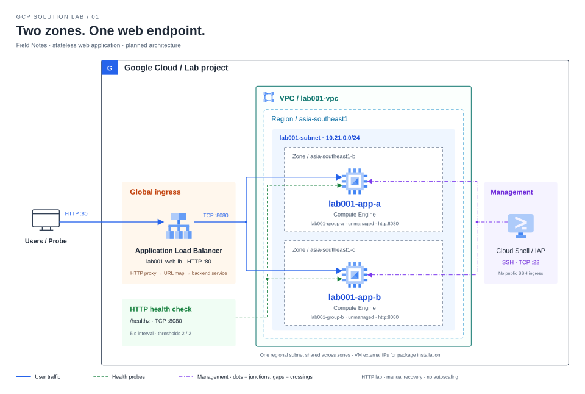
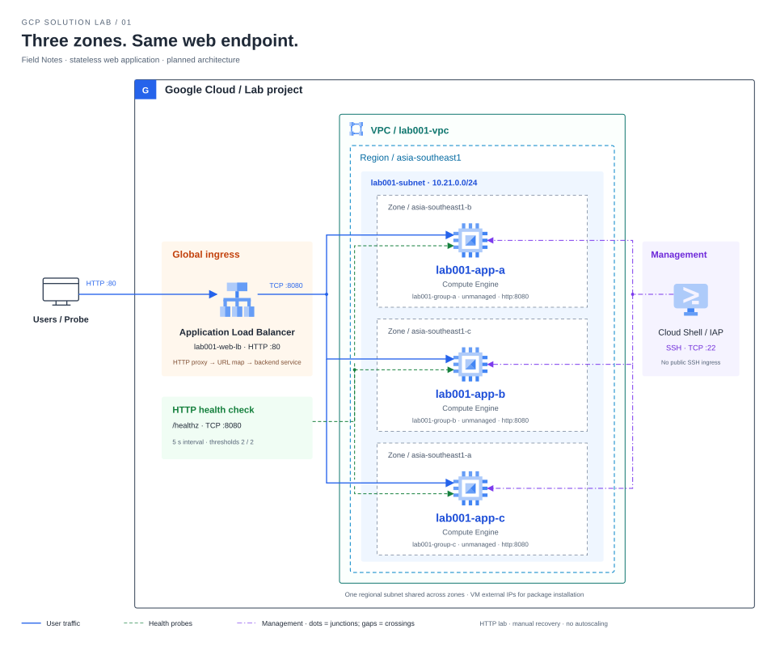

# Lab 01 — เว็บสอง Zone ที่ยังให้บริการได้เมื่อ App หนึ่งเครื่องหยุดทำงาน

สร้างทางเข้าเว็บจุดเดียว กระจายคำขอไปยัง App สอง Zone แล้วพิสูจน์ว่าเมื่อหยุดหนึ่ง App ระบบยังรับงานผ่านอีกเครื่องได้



[เปิด Diagram แบบ SVG](assets/solution.svg)

| รูปแบบ | รายละเอียด |
|---|---|
| Solution | Field Notes — Stateless Web Application |
| วิธีลงมือทำ | Console เป็นหลัก; Cloud Shell สำหรับตรวจและทดสอบ |
| เวลาเผื่อทำ | 3–4 ชั่วโมง |
| พื้นฐานที่ใช้ | เข้าใจ VM, IP address และ HTTP เบื้องต้น; อ่านคำสั่ง shell ได้ |
| สิ่งที่ได้เมื่อจบ | ระบบหนึ่งชุด พร้อมผล normal → failure → recovery และหลักฐาน |
| สถานะผลจริง | Planned — ยังไม่ได้รันบน GCP |

> **เมื่อทำจบ คุณควรอธิบายได้:** คำขอวิ่งผ่านส่วนไหน, LB รู้ได้อย่างไรว่า App พร้อม, หลัง App หยุดเกิดอะไรขึ้น และหลักฐานใดรองรับข้อสรุปนั้น

**เส้นทางของ Lab:** เตรียมตัว → สร้างระบบ → พิสูจน์การทำงาน → สรุปและ Cleanup

[เริ่ม Task 0](#task-0--เตรียม-project-และ-cloud-shell) · [ดูแผนทดสอบ](#แผนทดสอบ-solution) · [กลับมาทำต่อจากสารบัญ](#สารบัญการลงมือทำ)

## สถานการณ์

ทีมมีเว็บประชาสัมพันธ์ขนาดเล็ก ปัจจุบันรันบน VM เครื่องเดียว ทุกครั้งที่ต้องหยุด App ผู้ใช้จะเข้าเว็บไม่ได้ ทีมจึงต้องการทางเข้าเว็บจุดเดียวที่ส่งคำขอไปยัง App ที่พร้อมให้บริการ และต้องการเห็นหลักฐานว่าเมื่อ App หนึ่งเครื่องหยุด อีกเครื่องยังตอบคำขอได้

คุณจะสร้าง App สองเครื่องคนละ Zone ใน Singapore เชื่อมเข้ากับ Load Balancer แล้วทดสอบตั้งแต่เว็บทำงานปกติ การกระจายคำขอ การตัด App ที่ไม่พร้อมออก การกู้คืน และพฤติกรรมภายใต้โหลดเล็ก ๆ โดยเก็บผลในเอกสารนี้

### ระบบนี้ต้องทำอะไรได้

- ผู้ใช้เข้าผ่าน IP เดียว และทั้งสอง App รับคำขอได้
- เมื่อตัด App A ออกจากบริการ ระบบยังตอบคำขอใหม่ผ่าน B
- เมื่อกู้ A แล้ว ทั้งสองเครื่องกลับมารับงาน
- ตรวจโหลดเล็ก ๆ และยืนยันว่า App port ไม่เปิดให้เข้าตรงจากภายนอก
- รับ Change request เพิ่ม backend ตัวที่สาม โดยไม่เปลี่ยน frontend IP แล้วเปรียบเทียบผล
- เก็บหลักฐานและลบทรัพยากรของ Lab เมื่อจบ

รายละเอียดวิธีพิสูจน์แต่ละ Requirement อยู่ใน [แผนทดสอบ Solution](#แผนทดสอบ-solution)

## อ่านเส้นทางใน Diagram

ผู้ใช้ส่ง HTTP ไปยัง Global IPv4 ของ Load Balancer บน port 80 → HTTP proxy และ URL map เลือก backend service → backend service ส่งคำขอไป App port 8080 ของ VM ที่ Healthy เส้นประในภาพเป็น Health Check ส่วนเส้นจาก Administrator เป็นช่องทาง IAP SSH ไปยังทั้งสอง VM

แต่ละ VM อยู่ใน unmanaged instance group ของ Zone ตนเอง ทั้งสอง group ประกาศ named port `http:8080` เพื่อให้ backend service รู้ว่าจะต่อไปที่ port ใด ส่วน Health Check เรียก `/healthz` แยกจากคำขอผู้ใช้ เมื่อ probe ได้ผลไม่ผ่านตาม threshold ระบบจะเลี่ยง backend นั้นสำหรับงานใหม่

Firewall อนุญาต 8080 จาก Google proxy/health-check ranges และ 22 จาก IAP เท่านั้น VM มี external IPv4 สำหรับออกไปติดตั้งแพ็กเกจ แต่ไม่ได้เปิด App ให้ client เข้าโดยตรง ผู้ดูแลเข้า VM ผ่าน IAP SSH ใน Cloud Shell

### เหตุผลที่เลือกแบบนี้

| การเลือก | ช่วยตอบโจทย์อะไร | สิ่งที่ต้องยอมรับ |
|---|---|---|
| สอง Zone ใน region เดียว | แยกตำแหน่ง backend และฝึก failure handling | การทดสอบหยุด service ไม่ใช่หลักฐานว่าทน zone outage จริง |
| Global external Application LB | จุดเข้าระบบเดียวและ HTTP health-based routing | มีค่าใช้จ่ายแม้มีผู้ใช้น้อย |
| Unmanaged groups สองกลุ่ม | ควบคุม A/B ได้ตรง ๆ และเห็น health transition | ไม่มี autohealing/autoscaling; กู้ App ด้วยตนเอง |
| App แบบ stateless | ทุกเครื่องตอบงานเดียวกัน ไม่มี session ผูกเครื่อง | ยังไม่มีฐานข้อมูลหรือ shared state |
| HTTP สำหรับการทดลอง | ทดสอบด้วย IP ได้โดยไม่ต้องมี domain/certificate | ก่อนใช้กับข้อมูลจริงต้องเพิ่ม HTTPS |

App ใช้ Python standard library เพื่อให้ติดตั้งและอ่านโค้ดได้ง่าย เหมาะกับการพิสูจน์ flow นี้ การนำไปใช้งานจริงต้องเปลี่ยน runtime ให้เหมาะกับ workload พร้อมเพิ่ม TLS, logging/alerting, patching, deployment automation และทดสอบความทนทานเพิ่มเติม

## ก่อนเริ่ม

### ค่าที่ใช้ตลอด Lab

| รายการ | ค่าที่กำหนดไว้ | คุณต้องเปลี่ยนเองหรือไม่ |
|---|---|---|
| Project | `YOUR_PROJECT_ID` | **ต้องเปลี่ยน**เป็น project ทดลองของคุณ |
| Region / Zones | `asia-southeast1` / `b`, `c`; Change request ใช้ `a` | ใช้ตามนี้เพื่อให้ตรงคู่มือ |
| VPC / Subnet | `lab001-vpc` / `lab001-subnet` | ใช้ตามนี้ |
| CIDR / Network tag | `10.21.0.0/24` / `lab001-app` | ใช้ตามนี้ |
| VM A / B | `lab001-app-a` / `lab001-app-b`; C คือ `lab001-app-c` | ใช้ตามนี้ |
| VM / OS / Disk | `e2-small` / Debian 12 / 10 GB ต่อเครื่อง | ใช้ตามนี้ |
| Instance groups | `lab001-group-a` / `lab001-group-b` | ใช้ตามนี้ |
| Load Balancer / Backend | `lab001-web-lb` / `lab001-backend` | ใช้ตามนี้ |
| Named port / App listener | `http:8080` / TCP 8080 | ใช้ตามนี้; ไม่ใช่ frontend port 80 |
| Frontend address | `YOUR_LB_IPV4` | **แทนค่าหลัง Task 5** จากหน้า LB |
| Direct backend test | `VM_A_EXTERNAL_IPV4` | **แทนค่าตอน Task 8** จากหน้า VM A |

### รู้ว่าคำสั่งนี้ต้องรันที่ไหน

| ป้ายในคู่มือ | ตำแหน่งที่ทำ |
|---|---|
| Console | หน้าเว็บ Google Cloud; คลิกเมนูและกรอก field |
| Cloud Shell | Terminal ที่เปิดจากแถบด้านบน Console |
| VM A / VM B | Terminal หลัง SSH เข้าเครื่องนั้นแล้ว; ใช้ `hostname` ตรวจได้ |
| บันทึกผล | แก้ README นี้และแนบไฟล์ใน `assets/evidence/` |

### บัญชีและสิทธิ์

1. ใช้ GCP project สำหรับทดลองที่ผูก Billing แล้วและไม่ใช้ร่วมกับงาน production
2. ผู้ทำต้องสร้าง VM, instance groups, VPC/subnet/firewall, global IPv4, backend service, health check และ load balancer ได้
3. ผู้ดูแล project เตรียมสิทธิ์ที่เกี่ยวข้องให้: Compute Instance Admin (v1), Compute Network Admin, Compute Security Admin, Service Usage Admin สำหรับเปิด API และ IAP-secured Tunnel User สำหรับ tunnel
4. คู่มือนี้ตั้ง VM เป็น **No service account** จึงไม่ต้องให้ App เข้าถึง Cloud API หาก project บังคับ OS Login ผู้ทำต้องมี Compute OS Admin Login สำหรับ `sudo` ด้วย อย่าเปลี่ยนนโยบายองค์กรเพื่อข้ามข้อกำหนด
5. มี browser, Cloud Shell และเปิด SSH tunnel ไปยัง IAP ได้ หากองค์กรห้าม external IPv4 หรือ global LB ต้องเปลี่ยนแบบและทบทวนคู่มือก่อนเริ่ม

### ตรวจ quota และความพร้อมก่อนคิดค่าใช้จ่าย

**Console:** เปิด **IAM & Admin → Quotas & System Limits** กรอง service Compute Engine และ region asia-southeast1 ตรวจ CPU/E2 CPU, persistent disk, in-use external IPv4 และ global external IPv4/forwarding rules ที่เกี่ยวข้อง ต้องเหลือพอสำหรับ VM สามเครื่องและ frontend หนึ่งชุด ชื่อ quota อาจต่างตามชนิด resource และบัญชี การมี quota ไม่รับประกัน capacity ของ Zone

**Cloud Shell** ใช้คำสั่งอ่านอย่างเดียวเพื่อตรวจ machine type ในสาม Zone และรายการ image ที่จะเลือก:

```bash
for ZONE in asia-southeast1-a asia-southeast1-b asia-southeast1-c; do
  gcloud compute machine-types describe e2-small --zone="$ZONE" \
    --format='table(name,zone,guestCpus,memoryMb)'
done
gcloud compute images describe-from-family debian-12 --project=debian-cloud \
  --format='table(name,family,architecture,status)'
gcloud compute project-info describe --project="$PROJECT_ID" --format='json(quotas)'
gcloud compute regions describe asia-southeast1 --project="$PROJECT_ID" --format='json(quotas)'
```

รันหลังตั้ง PROJECT_ID ใน Task 0 ถ้า quota ไม่พอหรือ organization policy ปฏิเสธ ให้บันทึก BLOCKED และให้ผู้ดูแลแก้ก่อนสร้าง ไม่เปลี่ยน Zone/CIDR/ชนิด LB เฉพาะบางจุดโดยไม่ปรับแบบทั้งชุด และไม่ขอ Owner เพื่อแก้ permission ทุกกรณี

### ค่าใช้จ่ายและขอบเขต

จะมี VM `e2-small` สองเครื่อง, boot disk รวม 20 GB, VM external IPv4 สอง IP (หลัง Task 8B เพิ่ม VM/disk/IP อีกหนึ่งชุด รวม disk 30 GB), global frontend IPv4 หนึ่ง IP, Load Balancer และ traffic/logs ที่เกิดจากการทดสอบ ดู [Compute pricing](https://cloud.google.com/compute/all-pricing), [LB pricing](https://cloud.google.com/load-balancing/pricing) และ [IP/network pricing](https://cloud.google.com/vpc/network-pricing) ก่อนสร้าง ค่าใช้จ่ายขึ้นกับเวลาที่เปิดและบัญชีของคุณ ไม่ถือว่าอยู่ใน Free Tier โดยอัตโนมัติ

เปิด **Billing → Budgets & alerts → Create budget** ตั้งวงเงินแจ้งเตือนที่ยอมรับได้ Budget เป็นการแจ้งเตือน ไม่ได้หยุดใช้จ่ายอัตโนมัติ วางเวลาทำให้จบใน session เดียวและทำ Task 10 หลังเก็บหลักฐานครบ แม้ทดสอบไม่ผ่านก็ควร Cleanup

### ไฟล์ที่ใช้

| ไฟล์ | ใช้ตอนไหน |
|---|---|
| [scripts/startup.sh](scripts/startup.sh) | วางทั้งไฟล์ใน Startup script ของ VM แต่ละเครื่อง ติดตั้ง App และ systemd service |
| [scripts/probe.py](scripts/probe.py) | อัปโหลดเข้า Cloud Shell เพื่อส่ง HTTP requests และสร้างผล CSV/JSON |
| [assets/solution.svg](assets/solution.svg) | ภาพระบบที่กำลังสร้าง |
| `assets/evidence/` | เก็บภาพและผลทดสอบจริงของคุณ |

เอกสารนี้เป็นที่บันทึกหลัก เมื่อถึงหัวข้อ **บันทึกผล** ให้เติมข้อมูลในตำแหน่งนั้น และวางภาพ/Log ที่ชื่อสอดคล้องกับ Test ID ใน `assets/evidence/` ไม่ต้องแคปทุกคลิก

ตัวอย่างการแนบภาพหลังบันทึกไฟล์จริงแล้ว:

```markdown

[T05 — ผล request distribution](assets/evidence/t05-baseline.json)
```

### แผนทดสอบ Solution

| ID | Requirement | จะพิสูจน์อย่างไร |
|---|---|---|
| R1 | ผู้ใช้เข้าเว็บผ่าน IP เดียว | เปิดหน้าเว็บและเรียก `/api` ผ่าน frontend IP ได้ HTTP 200 |
| R2 | มี App อยู่สอง Zone | VM A อยู่ zone b, VM B อยู่ zone c และ backend ทั้งคู่ Healthy |
| R3 | ทั้งสอง App รับงานได้ | ชุดคำขอผ่าน LB พบ hostname ของทั้งสองเครื่อง; ไม่กำหนดว่าต้องแบ่ง 50:50 |
| R4 | App A หยุดแล้วคำขอใหม่ยังสำเร็จผ่าน B | หลัง LB แสดง A Unhealthy ส่ง 50 requests ต้องสำเร็จครบและพบเฉพาะ B |
| R5 | App A กลับมารับงานหลังคืนบริการ | A Healthy อีกครั้ง และชุดคำขอใหม่พบทั้ง A/B |
| R6 | มีผลทดสอบโหลดและเส้นทางเข้าถึง | เก็บ error rate, latency, backend counts; เข้า VM port 8080 ตรงจากภายนอกไม่ได้ |
| R8 | เพิ่ม backend เป็นสามเครื่องโดยใช้ frontend IP เดิม | หลัง C Healthy ส่ง 150 requests สำเร็จครบและเห็น A/B/C; ไม่อ้างว่าความจุเพิ่มตามจำนวนเครื่อง |
| R7 | จบงานแล้วจัดการทรัพยากรครบ | มีรายการยืนยันการลบ LB, VM, disk, IP และ network ของ Lab |

การทดสอบมีสามช่วงที่ต้องแยกผลให้ชัด:

| ช่วง | สภาพระบบ | สิ่งที่ต้องเก็บ |
|---|---|---|
| Normal | A/B Healthy | Response จากเว็บและจำนวนคำขอที่ไปแต่ละเครื่อง |
| Failure | หยุด A → รอ A Unhealthy | ผลช่วงเปลี่ยนสถานะ และผลชุดใหม่ที่ผ่าน B เท่านั้น |
| Recovery | Start A → รอทั้งคู่ Healthy | ชุดคำขอใหม่ที่แสดงว่าทั้งสองเครื่องกลับมารับงาน |

### สารบัญการลงมือทำ

- [Task 0 — เตรียม Project และ Cloud Shell](#task-0--เตรียม-project-และ-cloud-shell)
- [Task 1 — สร้าง Network](#task-1--สร้าง-network)
- [Task 2 — กำหนด Firewall](#task-2--กำหนด-firewall)
- [Task 3 — สร้างและ Deploy App สองเครื่อง](#task-3--สร้างและ-deploy-app-สองเครื่อง)
- [Task 4 — จัด Backend Groups](#task-4--จัด-backend-groups)
- [Task 5 — ประกอบ Load Balancer](#task-5--ประกอบ-load-balancer)
- [Task 6 — ทดสอบเว็บและการกระจายคำขอ](#task-6--ทดสอบเว็บและการกระจายคำขอ)
- [Task 7 — ทดสอบ Failure และ Recovery](#task-7--ทดสอบ-failure-และ-recovery)
- [Task 8 — ทดลองโหลดและตรวจเส้นทางเข้า](#task-8--ทดลองโหลดและตรวจเส้นทางเข้า)
- [Task 8B — เพิ่ม backend ตัวที่สาม](#task-8b--change-request-เพิ่ม-backend-ตัวที่สาม)
- [Task 9 — สรุปผล Solution](#task-9--สรุปผล-solution)
- [Task 10 — Cleanup](#task-10--cleanup)

## Task 0 — เตรียม Project และ Cloud Shell

> **เป้าหมาย:** เลือก project ถูกต้อง เปิด API และเตรียมตัวทดสอบก่อนสร้างทรัพยากร
>
> **ทำที่:** Console + Cloud Shell  
> **ก่อนเดินต่อ:** คำสั่งยืนยัน project ตรงกับ Console และเปิด help ของ probe ได้

### ลงมือทำ

ใน Console ใช้ภาษา English เพื่อให้ชื่อ field ตรงกัน ค้นหาหน้าผ่านแถบ Search ด้านบนได้หากตำแหน่งเมนูเปลี่ยน ค่าและชนิด resource ในตารางเป็นหลักในการตรวจว่าอยู่หน้าถูกต้อง

1. เปิด [Google Cloud Console](https://console.cloud.google.com/) กด project selector ด้านบน เลือก project สำหรับ Lab
2. จด **Project ID** จาก **IAM & Admin → Settings** ค่า Project ID อาจต่างจากชื่อ project
3. เข้า **APIs & Services → Library** ค้น **Compute Engine API** แล้วกด **Enable** หากเปิดอยู่แล้วให้ข้าม ทำเช่นเดียวกันกับ **Cloud Identity-Aware Proxy API**
4. กด **Activate Cloud Shell** รูป terminal บนแถบด้านบน กด Continue/Authorize เมื่อระบบถาม
5. ใน terminal กำหนดค่า โดยแทนข้อความ `YOUR_PROJECT_ID` เพียงตำแหน่งเดียว:

```bash
export PROJECT_ID="YOUR_PROJECT_ID"
gcloud config set project "$PROJECT_ID"
gcloud config get-value project
gcloud auth list --filter=status:ACTIVE
mkdir -p ~/lab001/evidence
cd ~/lab001
```

Project ที่คำสั่งแสดงต้องตรงกับ selector บน Console คำสั่งต่อไปทั้งหมดที่เขียนว่า **Cloud Shell** ให้รันจาก terminal นี้ ถ้า session หลุดให้กลับเข้ามา `cd ~/lab001` และตั้ง `PROJECT_ID` ใหม่

6. ดึงไฟล์จาก GitHub ใน Cloud Shell โดยไม่ต้องอัปโหลดจากเครื่องส่วนตัว:

```bash
git clone --branch docs/gcp-solution-labs --single-branch https://github.com/somkid-s5/Portfolio-Lab.git ~/portfolio-lab-source
export SOURCE_COMMIT="$(git -C ~/portfolio-lab-source rev-parse HEAD)"
printf 'Source commit: %s\n' "$SOURCE_COMMIT"
cp ~/portfolio-lab-source/GCP/LAB-001-multi-zone-web/scripts/probe.py ~/lab001/probe.py
cp ~/portfolio-lab-source/GCP/LAB-001-multi-zone-web/scripts/startup.sh ~/lab001/startup.sh
cd ~/lab001
python3 --version
python3 probe.py --help
```

ถ้า directory clone มีอยู่แล้ว อย่าลบหรือ reset ทับงานเดิม ให้ใช้ชื่อ directory ใหม่แล้วปรับ path ตามนั้น บันทึก SOURCE_COMMIT ลง T00 และใช้ไฟล์จาก commit เดียวกันทุก VM เมื่อกลับมาสร้างใหม่ให้ `git checkout <commit ที่บันทึก>` ใน clone ที่ไม่มีงานค้าง ไม่ดึง HEAD ใหม่กลาง Lab

7. ใน Cloud Shell Editor เปิด `~/lab001/startup.sh` สำหรับคัดลอกไปช่อง Startup script ใน Task 3 คำสั่ง `cat startup.sh` ใช้อ่านเพื่อตรวจว่าคัดลอกครบได้ แต่อย่ารัน startup script บน Cloud Shell เพราะจะติดตั้ง service ลงผิดเครื่อง

**ตรวจผลก่อนเดินต่อ:** เห็น Python 3 และตัวเลือก `--url`, `--requests`, `--concurrency`, `--rate`, `--out` หากเห็น HTML หรือ syntax error ให้ดาวน์โหลด Raw file ใหม่

---

### บันทึกผลของคุณ — T00 / Environment

กรอกหลังตรวจจริง: ใช้ PASS / FAIL / BLOCKED ตามผล และแนบหลักฐานที่ระบุเวลาได้

- Source commit SHA / Python version / image name ที่เลือกจริง: [เติม]
- Quota/capacity/policy ที่ตรวจ และวงเงินแจ้งเตือนที่ยอมรับ: [เติม]
- Project alias ที่ใช้อ้างอิง: [เติม; ไม่จำเป็นต้องเผยแพร่ Project ID]
- วันที่เริ่มและ timezone: [เติม]
- ผู้ใช้มีสิทธิ์พร้อม / API พร้อม: [เติม]
- สถานะ: PENDING

**ไปต่อ:** เมื่อเตรียมพร้อมแล้ว ไป Task 1 เพื่อสร้าง Network

---

## Task 1 — สร้าง Network

> **เป้าหมาย:** สร้างขอบเขตเครือข่ายให้ระบบทั้งหมดอยู่ในแบบเดียวกัน
>
> **ทำที่:** Console  
> **ก่อนเดินต่อ:** มี lab001-vpc และ subnet 10.21.0.0/24 ใน Singapore

### ลงมือทำ

เราจะใช้ custom VPC เพื่อกำหนด ingress เองทั้งหมด แทนการรับ default firewall rules ที่เปิดไว้ล่วงหน้า

1. ในช่อง Search ค้น **VPC networks** แล้วเปิดหน้า **VPC network → VPC networks**
2. กด **Create VPC network**
3. กรอกค่าต่อไปนี้:

| Field | ค่า |
|---|---|
| Name | `lab001-vpc` |
| Subnet creation mode | Custom |
| Subnet name | `lab001-subnet` |
| Region | `asia-southeast1` (Singapore) |
| IP stack | IPv4 single-stack |
| IPv4 range | `10.21.0.0/24` |
| Private Google Access | Off / default |
| Flow logs | Off สำหรับรอบนี้ |

4. กด **Done** ของ subnet ตรวจว่ามี subnet เดียวตามตาราง
5. ถ้ามีช่องเสนอ firewall rules ให้ไม่เลือก default allow rules จากนั้นกด **Create**
6. เปิด `lab001-vpc` ตรวจแท็บ Subnets ว่า region และ CIDR ถูกต้อง

**ตรวจผลก่อนเดินต่อ:** พบ `lab001-subnet` ใน Singapore ไม่มี rule ที่เปิด SSH หรือ app port จากทุก IP ข้อ implied deny ingress ยังทำให้ VM รับงานไม่ได้ จนกว่าเราจะเพิ่ม rule ใน Task 2

---

### บันทึกผลของคุณ — T01 / Network

กรอกหลังตรวจจริง: ใช้ PASS / FAIL / BLOCKED ตามผล และแนบหลักฐานที่ระบุเวลาได้

- VPC / subnet / CIDR ที่สร้างจริง: [เติม]
- วันเวลา: [เติม]
- หลักฐานแนะนำ: `assets/evidence/t01-network.png`
- ลิงก์หลักฐานและสิ่งที่เห็น: [เติม]
- สถานะ: PENDING

**ไปต่อ:** เมื่อ CIDR และ region ถูกต้อง ไป Task 2 เพื่อกำหนด Firewall

---

## Task 2 — กำหนด Firewall

> **เป้าหมาย:** เปิดเฉพาะเส้นทางที่ LB และผู้ดูแลต้องใช้
>
> **ทำที่:** Console  
> **ก่อนเดินต่อ:** พบสอง rule: Google proxy/probe → 8080 และ IAP → 22

### ลงมือทำ

มีสองเส้นทาง ingress: Google Load Balancer เข้า App port 8080 และผู้ดูแลใช้ IAP เข้า SSH port 22 ไม่ต้องสร้าง allow HTTP/HTTPS rule สำเร็จรูปบน VM

1. Search **Firewall** เปิดหน้า **VPC firewall rules** แล้วกด **Create firewall rule**
2. สร้าง rule แรก:

| Field | ค่า |
|---|---|
| Name | `lab001-allow-lb-app` |
| Network | `lab001-vpc` |
| Priority | `1000` |
| Direction | Ingress |
| Action | Allow |
| Targets | Specified target tags |
| Target tags | `lab001-app` |
| Source filter | IPv4 ranges |
| Source IPv4 ranges | `35.191.0.0/16` และ `130.211.0.0/22` (ใส่เป็นสองรายการ) |
| Protocols and ports | Specified protocols → TCP → `8080` |

3. กด **Create** แล้วสร้าง rule ที่สองด้วยค่าเหมือนเดิม ยกเว้น:

| Field | ค่า |
|---|---|
| Name | `lab001-allow-iap-ssh` |
| Source IPv4 ranges | `35.235.240.0/20` |
| TCP ports | `22` |

4. กลับไปหน้า rules กรอง network `lab001-vpc` ตรวจว่ามีสอง rule นี้และใช้ tag `lab001-app` ทั้งคู่

**ตรวจผลก่อนเดินต่อ:** ไม่ใช้ `0.0.0.0/0` สำหรับ ingress ของ VM ไม่มี port 80 rule เพราะ frontend port 80 เป็นของ LB ส่วน backend App ฟัง 8080

---

### บันทึกผลของคุณ — T02 / Firewall

กรอกหลังตรวจจริง: ใช้ PASS / FAIL / BLOCKED ตามผล และแนบหลักฐานที่ระบุเวลาได้

- Google proxy/probe → port: [เติม]
- IAP → port: [เติม]
- หลักฐานแนะนำ: `assets/evidence/t02-firewall.png`
- วันเวลา / สถานะ / สิ่งที่ต่างจากแบบ: [เติม; เริ่ม PENDING]

**ไปต่อ:** เมื่อ rules ถูกต้อง ไป Task 3 เพื่อ Deploy App

---

## Task 3 — สร้างและ Deploy App สองเครื่อง

> **เป้าหมาย:** Deploy App เดียวกันลงสอง Zone และตรวจจากภายในก่อนต่อ LB
>
> **ทำที่:** Console → Cloud Shell → VM A/B  
> **ก่อนเดินต่อ:** ทั้งสอง VM ตอบ /healthz ได้ 200 และ /api แสดง hostname คนละเครื่อง

### ลงมือทำ

### 3.1 สร้าง App A

1. Search **VM instances** เปิด **Compute Engine → VM instances → Create instance**
2. หน้า **Machine configuration** กำหนด:

| Field | ค่า |
|---|---|
| Name | `lab001-app-a` |
| Region / Zone | `asia-southeast1` / `asia-southeast1-b` |
| Machine family / Series | General purpose / E2 |
| Machine type | `e2-small` |
| Provisioning model | Standard (ไม่ใช้ Spot) |

3. หน้า **OS and storage** หรือ **Boot disk → Change** เลือก Debian, Debian GNU/Linux 12 (bookworm), x86/64, Balanced persistent disk, 10 GB แล้วกด **Select**
4. หน้า **Networking** เพิ่ม **Network tags** เป็น `lab001-app`
5. ไม่เลือก **Allow HTTP traffic** หรือ **Allow HTTPS traffic**
6. เปิดแก้ network interface `nic0`:
   - Network: `lab001-vpc`
   - Subnetwork: `lab001-subnet`
   - Internal IPv4: Ephemeral
   - External IPv4: Ephemeral, Premium tier
   - กด Done ของ interface
7. หน้า **Security** เลือก Service account เป็น **No service account** (ถ้าแสดงเป็นรายการว่าง/None ให้เลือกค่านั้น) เราไม่ได้เรียก Cloud API จาก App
8. หน้า **Advanced → Automation → Startup script** หรือช่อง Startup script ใน **Management** เปิดไฟล์ [startup.sh](scripts/startup.sh) คัดลอก **ทั้งไฟล์ตั้งแต่ `#!/bin/bash` จนจบ** วางลงช่องนี้
9. กด **Create** รอ VM เป็น Running การติดตั้ง App จะทำต่อหลัง VM เริ่ม จึงยังไม่ถือว่า App พร้อมเพียงเพราะ VM สีเขียว

### 3.2 สร้าง App B

ทำขั้นตอน 3.1 อีกครั้ง ใช้ startup script เดียวกัน เปลี่ยนเฉพาะ:

| Field | ค่า |
|---|---|
| Name | `lab001-app-b` |
| Zone | `asia-southeast1-c` |

ตรวจ network, subnet, network tag, image, machine type และ service account ให้เหมือน A อย่าใช้ default network จากหน้าสร้างครั้งใหม่

### 3.3 ตรวจ App ภายในแต่ละเครื่อง

กลับมาที่ **Cloud Shell** รันคำสั่งนี้เพื่อเข้า App A ผ่าน IAP:

```bash
gcloud compute ssh lab001-app-a \
  --project="$PROJECT_ID" --zone=asia-southeast1-b --tunnel-through-iap
```

ครั้งแรก gcloud อาจถามสร้าง SSH key ให้ยืนยันและตั้ง passphrase ตามที่ต้องการ เมื่อเห็น prompt ของ `lab001-app-a` แล้ว รัน **ใน VM A**:

```bash
hostname
sudo systemctl status lab001-app --no-pager
curl -i http://127.0.0.1:8080/healthz
curl -s http://127.0.0.1:8080/api
```

ตัวอย่างผลที่ควรเห็นต่อไปนี้ใช้เทียบรูปแบบเท่านั้น ค่าเวลาและ header อื่นอาจต่างกัน:

```text
$ hostname
lab001-app-a

$ sudo systemctl is-active lab001-app
active

$ curl -i http://127.0.0.1:8080/healthz
HTTP/1.0 200 OK
...
ok
```

ผล `/api` ควรมีรูปแบบนี้:

```json
{
  "service": "field-notes",
  "version": "lab001-v1",
  "hostname": "lab001-app-a",
  "time_utc": "<เวลาของคำขอในรูปแบบ ISO 8601>"
}
```

ต้องเห็น service `active (running)`, health ได้ `200` และ `ok`, API มี `hostname` ของ A หาก service ยังไม่มี รอการติดตั้งแล้วตรวจ startup log:

```bash
sudo journalctl -u google-startup-scripts.service --no-pager -n 80
sudo journalctl -u lab001-app --no-pager -n 50
```

ถ้าเป็น error ให้แก้ตามตาราง Troubleshooting ท้ายเอกสารก่อน ไม่สร้าง App เพิ่มเพื่อกลบอาการ

ออกจาก A ด้วย `exit` กลับ Cloud Shell แล้วเข้า B:

```bash
gcloud compute ssh lab001-app-b \
  --project="$PROJECT_ID" --zone=asia-southeast1-c --tunnel-through-iap
```

รันชุดตรวจเดียวกันใน B และ `exit` กลับ Cloud Shell

**ตรวจผลก่อนเดินต่อ:** ทั้งคู่ตอบ API ได้จาก localhost และ hostname ต่างกัน ถ้า SSH tunnel ถูกปฏิเสธ ให้ตรวจ IAP role, tag, rule port 22, project และ OS Login ไม่เปิด SSH ทั้งโลกเพื่อแก้ปัญหา

---

### บันทึกผลของคุณ — T03 / Application readiness

กรอกหลังตรวจจริง: ใช้ PASS / FAIL / BLOCKED ตามผล และแนบหลักฐานที่ระบุเวลาได้

| เครื่อง | Zone | Service status | `/healthz` | Hostname ใน API | เวลา |
|---|---|---|---|---|---|
| A | asia-southeast1-b | [เติม] | [เติม] | [เติม] | [เติม] |
| B | asia-southeast1-c | [เติม] | [เติม] | [เติม] | [เติม] |

- แนบ output: `assets/evidence/t03-app-a.txt` และ `t03-app-b.txt`
- ลิงก์หลักฐาน: [เติม]
- ปัญหา / วิธีแก้ / ผลตรวจซ้ำ: [เติม หรือระบุว่าไม่พบ]
- สถานะ: PENDING

**ไปต่อ:** เมื่อ App ทั้งสองพร้อม ไป Task 4 เพื่อจัด Backend Groups

---

## Task 4 — จัด Backend Groups

> **เป้าหมาย:** ทำให้ LB อ้างอิง App ทั้งสองและรู้ port ที่ต้องส่งต่อ
>
> **ทำที่:** Console  
> **ก่อนเดินต่อ:** แต่ละ group มี VM ที่ถูกต้องและ named port http:8080

### ลงมือทำ

Load Balancer จะอ้างอิง group แทนการเลือก VM ตรง ๆ เราต้องใช้สอง group เพราะ unmanaged group เป็น zonal resource

1. Search **Instance groups** เปิด **Compute Engine → Instance groups**
2. กด **Create instance group → New unmanaged instance group**
3. ตั้งค่ากลุ่ม A:

| Field | ค่า |
|---|---|
| Name | `lab001-group-a` |
| Region / Zone | asia-southeast1 / asia-southeast1-b |
| Network / Subnetwork | lab001-vpc / lab001-subnet |
| VM instances | เลือก `lab001-app-a` |

4. กด **Create** แล้วเปิดกลุ่ม → **Edit → Port mapping → Add port** กำหนดชื่อ `http` เลข port `8080` กด **Save** หากหน้า Create มี Port mapping อยู่แล้วใส่ตั้งแต่ตอนสร้างได้
5. สร้างกลุ่ม B ด้วยชื่อ `lab001-group-b`, zone `asia-southeast1-c`, VM `lab001-app-b` และ named port `http:8080` เหมือนกัน

**ตรวจผลก่อนเดินต่อ:** แต่ละกลุ่มมี VM หนึ่งตัวถูก Zone และมี named port `http` = `8080` Named port เป็น mapping สำหรับ LB ไม่ได้เปิด firewall ให้เอง

---

### บันทึกผลของคุณ — T04a / Backend membership

กรอกหลังตรวจจริง: ใช้ PASS / FAIL / BLOCKED ตามผล และแนบหลักฐานที่ระบุเวลาได้

- สมาชิกกลุ่ม A/B และ port mapping: [เติม]
- หลักฐานแนะนำ: `assets/evidence/t04-groups.png`
- วันเวลา / สถานะ: [เติม; เริ่ม PENDING]

**ไปต่อ:** เมื่อสมาชิกและ named ports ถูกต้อง ไป Task 5 เพื่อสร้าง LB

---

## Task 5 — ประกอบ Load Balancer

> **เป้าหมาย:** ประกอบจุดเข้าระบบเดียวแล้วตรวจเส้นทาง end-to-end
>
> **ทำที่:** Console → Cloud Shell  
> **ก่อนเดินต่อ:** Backend Healthy 2/2 และ /api ผ่าน frontend IP ตอบ 200

### ลงมือทำ

### 5.1 เลือกชนิดให้ถูกก่อนตั้งค่า

1. Search **Load balancing** เปิดหน้า **Network services → Load balancing**
2. กด **Create load balancer**
3. เลือก **Application Load Balancer (HTTP/HTTPS) → Next**
4. เลือก **Public facing (external) → Next**
5. เลือก **Best for global workloads → Next**
6. เลือก **Global external Application Load Balancer → Next → Configure**
7. ตั้ง Name เป็น `lab001-web-lb`

ถ้าหน้าสร้างถาม proxy-only subnet แสดงว่ากำลังสร้างชนิด Regional ให้ย้อนกลับเลือก Global ให้ตรงกับแบบนี้

### 5.2 ตั้ง Frontend

เปิด **Frontend configuration** แล้วกำหนด:

| Field | ค่า |
|---|---|
| Frontend name (ถ้ามี) | `lab001-http-frontend` |
| Protocol | HTTP |
| IP version | IPv4 |
| Network service tier | Premium |
| IP address | Create IP address → ชื่อ `lab001-lb-ip` → Reserve (Global) |
| Port | `80` |

กด **Done** ไม่เลือก HTTP→HTTPS redirect เพราะ Lab นี้ยังไม่มี HTTPS frontend

### 5.3 ตั้ง Backend service และ Health Check

1. เปิด **Backend configuration → Backend services & backend buckets → Create a backend service**
2. กำหนดชื่อ `lab001-backend` และค่าต่อไปนี้:

| Field | ค่า |
|---|---|
| Backend type | Instance group |
| Protocol | HTTP |
| Named port / Port name | `http` |
| IP address selection policy (ถ้ามี) | IPv4 only |
| Cloud CDN | ปิด |
| Session affinity | None |
| IAP สำหรับเว็บ | ปิด (คนละส่วนกับ IAP SSH) |
| Backend security policy | None สำหรับรอบนี้; ไม่สร้าง default Cloud Armor policy |

3. ใน **Backends → Add backend** เลือก `lab001-group-a`, port numbers `8080` หากมีช่องให้กรอก, Balancing mode **Rate**, Maximum RPS **per instance = 50**, Capacity **100%** กด Done
4. กด **Add backend** เพิ่ม `lab001-group-b` ด้วยค่าเดียวกัน **ค่า 50 นี้เป็นข้อมูล capacity สำหรับการกระจายงาน ไม่ใช่ rate limiter หรือผลวัดความจุจริง**
5. ใน **Health check → Create a health check** ใส่:

| Field | ค่า |
|---|---|
| Name | `lab001-http-health` |
| Protocol | HTTP |
| Port specification | Specify port / Fixed port |
| Port | `8080` |
| Request path | `/healthz` |
| Proxy protocol | None |
| Check interval / Timeout | 5 seconds / 5 seconds |
| Healthy / Unhealthy threshold | 2 / 2 |

6. กด Save ของ health check เลือก health check นี้ให้ backend service
7. เปิด **Logging**, Sample rate **1.0** เพื่อเก็บคำขอในชุดทดลองนี้ จากนั้นกด Create ของ backend service และเลือกให้ LB
8. เปิด **Routing rules** ให้ default host/path ทั้งหมดส่งไป `lab001-backend` ไม่ต้องเพิ่ม route อื่น
9. เปิด **Review and finalize** ตรวจ frontend HTTP:80, สอง groups, named port http และ health check จากนั้นกด **Create**

### 5.4 รอและยืนยันความพร้อม

1. เปิด `lab001-web-lb` จด frontend IPv4 ของ `lab001-lb-ip`
2. เปิดรายละเอียด backend service ตรวจทั้งสอง group ต้องเป็น Healthy **1/1 ต่อ group รวม 2/2** (ตำแหน่งตัวเลขอาจอยู่ในหน้ารายละเอียด Backend)
3. การเริ่ม LB และ probe อาจใช้เวลาหลายนาที รีเฟรชและให้เวลาประมาณ 10 นาทีก่อนสรุปว่าผิด ถ้ายังไม่ Healthy ให้ตรวจ App localhost, target tag, source ranges, named port และ path ตามลำดับ
4. ใน **Cloud Shell** ตั้งตัวแปรโดยแทน `YOUR_LB_IPV4` ด้วย IP จาก Console:

```bash
export LB_IP="YOUR_LB_IPV4"
export LB_URL="http://$LB_IP"
printf 'Frontend: %s\n' "$LB_URL"
curl --connect-timeout 5 --max-time 10 -i "$LB_URL/api"
```

**ตรวจผลก่อนเดินต่อ:** ได้ HTTP 200 และ JSON ของ `field-notes` ผ่าน frontend IP ไม่ใช่ IP ของ VM หากได้ 502/503 อย่าเริ่ม load test ให้แก้ health/readiness ก่อน

---

### บันทึกผลของคุณ — T04b / Load balancer ready

กรอกหลังตรวจจริง: ใช้ PASS / FAIL / BLOCKED ตามผล และแนบหลักฐานที่ระบุเวลาได้

- ชนิด LB / frontend port / backend port: [เติม]
- Health A / B: [เติม]
- HTTP status และ hostname ที่ตอบครั้งแรก: [เติม]
- วันเวลา: [เติม]
- หลักฐานแนะนำ: `assets/evidence/t04-backends-healthy.png`
- Forwarding rule / target HTTP proxy / URL map / global address ที่ wizard สร้างจริง: [เติมชื่อ; ใช้ตรวจ Cleanup]
- ลิงก์หลักฐาน / สถานะ: [เติม; เริ่ม PENDING]

**ไปต่อ:** เมื่อ Healthy 2/2 และ frontend ตอบ 200 ไป Task 6 เพื่อเก็บ baseline

---

## Task 6 — ทดสอบเว็บและการกระจายคำขอ

> **เป้าหมาย:** พิสูจน์ว่าทั้งสอง App ได้รับคำขอผ่าน LB
>
> **ทำที่:** Browser + Cloud Shell  
> **ก่อนเดินต่อ:** Baseline สำเร็จ 100 requests และพบทั้งสอง hostname

### ลงมือทำ

### 6.1 เปิด App ผ่าน LB

คัดลอกค่า `http://<frontend IPv4>` ไปเปิดใน browser โดยใช้ **http** ต้องเห็นหน้า **Field Notes** และชื่อเครื่องที่ตอบ หาก browser เปลี่ยนไป https อัตโนมัติให้ตรวจช่อง URL และตั้งให้ใช้ HTTP สำหรับ Lab นี้

กด **View JSON response** ต้องได้ `service`, `version`, `hostname`, `time_utc` กดกลับแล้วลอง **Request again** การ refresh อาจได้เครื่องเดิมหลายครั้ง ไม่ใช้รูปสลับชื่อเพียงสองภาพยืนยันสัดส่วนการกระจายโหลด

### 6.2 เก็บ baseline เป็นชุดข้อมูล

รันใน **Cloud Shell**:

```bash
cd ~/lab001
python3 probe.py --url "$LB_URL" --requests 100 --concurrency 5 --rate 5 \
  --out evidence/t05-baseline
```

Script ส่งไม่เกิน 5 requests/วินาที ใช้เวลาประมาณ 20 วินาที สร้าง `t05-baseline.csv` ซึ่งมีผลทุก request และ `t05-baseline.json` ซึ่งสรุปจำนวนสำเร็จ ล้มเหลว latency และ hostname ที่ตอบ

**อ่านผลจาก probe อย่างไร**

ตัวอย่างเฉพาะ field ที่ใช้ตัดสินผลด้านล่างเป็น **ค่าจำลองเพื่ออธิบาย** สัดส่วน 48/52 ไม่ใช่ผลที่ต้องได้ และ output จริงมีข้อมูลเวลาและ latency เพิ่มเติม:

```json
{
  "requests": 100,
  "success": 100,
  "failed": 0,
  "backend_counts": {
    "lab001-app-a": 48,
    "lab001-app-b": 52
  }
}
```

อ่านตามลำดับ: จำนวนส่งครบไหม → มี fail ไหม → ทั้งสองเครื่องรับคำขอไหม แล้วจึงดู latency และรายละเอียดใน CSV

**เกณฑ์ T05:** `success = 100`, `failed = 0`, และ `backend_counts` พบทั้ง A/B ไม่กำหนดสัดส่วน 50:50 เพราะ LB ใช้หลายปัจจัยในการเลือก backend หากพบเครื่องเดียวให้ตรวจว่าอีกเครื่อง Healthy, capacity ไม่เป็น 0 และ affinity เป็น None จากนั้นทดสอบชุดใหม่ด้วยชื่อ `evidence/t05-baseline-r2` อย่าทับหรือซ่อนผลรอบแรก หากยังพบเครื่องเดียวให้บันทึกว่ายังพิสูจน์ R3 ไม่ได้

---

### บันทึกผลของคุณ — T05 / Normal traffic (R1–R3)

กรอกหลังตรวจจริง: ใช้ PASS / FAIL / BLOCKED ตามผล และแนบหลักฐานที่ระบุเวลาได้

| Run | Requests | Success / Failed | A count | B count | p95 success latency (ms) | เวลา UTC |
|---|---|---|---|---|---|---|
| baseline | [เติม] | [เติม] | [เติม] | [เติม] | [เติม] | [เติม] |

- ภาพ App ผ่าน LB: [แนบ `assets/evidence/t05-web.png`]
- ผล JSON และ CSV: [แนบไฟล์ทั้งสอง]
- อธิบายผลที่เห็น: [เติม]
- สถานะ: PENDING

**ไปต่อ:** เมื่อยืนยันว่าทั้งสอง App รับงานได้ ไป Task 7 เพื่อทดลอง failure

---

## Task 7 — ทดสอบ Failure และ Recovery

> **เป้าหมาย:** เก็บหลักฐาน failure transition, การรับงานผ่าน B และ recovery ของ A
>
> **ทำที่:** Cloud Shell สอง tabs + Console  
> **ก่อนเดินต่อ:** ผล T06 และ T07 แยกตามช่วง พร้อมไฟล์และเวลาที่สังเกต

### ลงมือทำ

เราจะหยุด **เฉพาะ App A** โดยให้ VM ยังทำงาน เพื่อแยกความพร้อมของ Application ออกจากสถานะ Running ของเครื่อง systemd ไม่ start กลับเองเมื่อใช้คำสั่ง stop

### 7.1 เก็บพฤติกรรมช่วงเปลี่ยนสถานะ

1. เปิด Cloud Shell เป็นสอง terminal tabs ด้วยปุ่ม **+** บน terminal tab bar
2. ใน **Tab 1** (ยังอยู่ Cloud Shell) รัน probe ต่อเนื่องประมาณหนึ่งนาที:

```bash
cd ~/lab001
python3 probe.py --url "$LB_URL" --requests 300 --concurrency 5 --rate 5 \
  --out evidence/t06-transition
```

3. ขณะ probe ยังทำงาน ใน **Tab 2** เข้า A (ใช้ Project ID จริงตรง placeholder เพราะตัวแปรอาจไม่ติดมาจาก Tab 1):

```bash
gcloud compute ssh lab001-app-a \
  --project=YOUR_PROJECT_ID --zone=asia-southeast1-b --tunnel-through-iap
```

4. เมื่ออยู่ **VM A** รัน:

```bash
date -u +%FT%TZ
sudo systemctl stop lab001-app
sudo systemctl is-active lab001-app
curl --connect-timeout 2 --max-time 3 -i http://127.0.0.1:8080/healthz
```

ผล `inactive` และ curl connection refused เป็นอาการที่ตั้งใจสร้าง จดเวลา UTC ไว้ ไม่ต้องแก้ในขั้นนี้

5. กลับหน้า LB รีเฟรช health จน A เป็น Unhealthy และ B ยัง Healthy จดเวลาที่เห็นการเปลี่ยนสถานะ **อย่าสรุปว่าต้องเปลี่ยนภายใน 10 วินาทีแน่นอน** แม้ตั้ง interval/threshold ไว้ เพราะมีหลาย probe และเวลาที่ UI อัปเดต
6. รอ Tab 1 จบ ช่วงเปลี่ยนสถานะอาจมี request ล้มเหลวก่อน LB ตัด A ออก ให้เก็บตามจริง Script คืน exit code 1 หากมี request fail; ไฟล์ผลยังถูกสร้างตามปกติ

### 7.2 พิสูจน์ steady state หลังตัด A ออก

เมื่อ Console แสดง A Unhealthy / B Healthy แล้ว ใน **Tab 1 Cloud Shell** รัน:

```bash
python3 probe.py --url "$LB_URL" --requests 50 --concurrency 5 --rate 5 \
  --out evidence/t06-one-backend
```

**เกณฑ์ T06:** 50 requests สำเร็จทั้งหมดและทุก hostname เป็น B เก็บผล transition แยกจาก steady state เพื่อไม่กล่าวอ้างว่าไม่มี downtime ตลอดช่วงสลับ หากไม่ผ่านให้บันทึก error และตรวจ backend B กับ health ก่อนกู้ A

### 7.3 กู้ App A

ใน **Tab 2 ซึ่งยังอยู่ VM A**:

```bash
sudo systemctl start lab001-app
date -u +%FT%TZ
sudo systemctl is-active lab001-app
curl -i http://127.0.0.1:8080/healthz
exit
```

รอใน Console จน Healthy ทั้งสองเครื่อง แล้วรันใน **Tab 1 Cloud Shell**:

```bash
python3 probe.py --url "$LB_URL" --requests 100 --concurrency 5 --rate 5 \
  --out evidence/t07-recovery
```

**เกณฑ์ T07:** ทั้งคู่ Healthy, 100 requests สำเร็จและพบทั้ง A/B ไม่มี autohealing ในแบบนี้ การกู้ที่พิสูจน์เป็นการ start service ด้วยผู้ดูแล

---

### บันทึกผลของคุณ — T06 / Failure handling (R4)

กรอกหลังตรวจจริง: ใช้ PASS / FAIL / BLOCKED ตามผล และแนบหลักฐานที่ระบุเวลาได้

- เวลา UTC ที่ stop A: [เติม]
- เวลา UTC ที่เห็น A Unhealthy: [เติม; เป็นเวลาที่สังเกตจาก UI]
- Transition: success / failed / error ที่พบ: [เติม]
- หลัง health เปลี่ยน: 50 requests success / failed / hostname: [เติม]
- ภาพ health และไฟล์ `t06-transition.*`, `t06-one-backend.*`: [แนบ]
- ข้อสรุปที่ผลนี้รองรับ: [เติม]
- สถานะ: PENDING

---

### บันทึกผลของคุณ — T07 / Recovery (R5)

กรอกหลังตรวจจริง: ใช้ PASS / FAIL / BLOCKED ตามผล และแนบหลักฐานที่ระบุเวลาได้

- เวลา start / เวลาเห็น Healthy: [เติม]
- Requests / success / failed / A count / B count: [เติม]
- หลักฐาน `t07-recovery.*` และภาพ backend กลับมาครบ: [แนบ]
- สิ่งที่ผู้ดูแลทำเพื่อกู้ระบบ: [เติม]
- สถานะ: PENDING

**ไปต่อ:** เมื่อ recovery ผ่าน ไป Task 8 เพื่อวัดโหลดและตรวจขอบเขตการเข้าถึง

---

## Task 8 — ทดลองโหลดและตรวจเส้นทางเข้า

> **เป้าหมาย:** เปรียบเทียบโหลดสองระดับและตรวจว่า backend port เข้าตรงไม่ได้
>
> **ทำที่:** Cloud Shell + Console  
> **ก่อนเดินต่อ:** มีผล low/high และการเปรียบเทียบ VM IP กับ LB IP

### ลงมือทำ

### 8.1 เปรียบเทียบสองระดับโหลด

ให้ทั้งสอง App Healthy ก่อน รันทีละชุดใน **Cloud Shell**:

```bash
python3 probe.py --url "$LB_URL" --requests 100 --concurrency 2 --rate 2 \
  --out evidence/t08-load-low
python3 probe.py --url "$LB_URL" --requests 300 --concurrency 10 --rate 10 \
  --out evidence/t08-load-high
```

นี่เป็น bounded smoke load test สูงสุด 10 submissions/วินาที ไม่ใช่ stress test หาความจุสูงสุด ค่า `observed_rps` อาจต่ำกว่าค่าตั้งเมื่อ server ช้าหรือ timeout ค่า p95 คำนวณเฉพาะคำขอสำเร็จ จึงต้องอ่านคู่กับ error rate เสมอ

**เกณฑ์ T08:** ทั้งสองชุด failed = 0 สำหรับ workload นี้ ถ้ามี fail ให้บันทึก FAIL และตรวจ log ไม่เพิ่มจำนวน VM หรือปรับผลที่คาดหวังย้อนหลัง ส่วน latency ให้รายงานค่าที่วัดได้โดยไม่อ้าง SLA ที่ยังไม่ได้กำหนด

เปิด **Load balancing → lab001-web-lb → Monitoring** เลือกช่วงเวลาครอบคลุมการทดสอบ ดู request/error/latency หาก metric ยังไม่มาให้รอ data ingestion แล้วดูอีกครั้ง หากต้องดู log ให้เปิด **Logging → Logs Explorer** ใช้ filter:

```text
resource.type="http_load_balancer"
resource.labels.backend_service_name="lab001-backend"
```

ดู `httpRequest.status` และ `jsonPayload.statusDetails` ใกล้เวลา fail บันทึก error จริงที่พบ การไม่มี metric ทันทีไม่ใช่หลักฐานว่าไม่มี traffic

### 8.2 พิสูจน์ว่าเข้าหลังบ้านตรงไม่ได้

1. ไป **VM instances → lab001-app-a** จด External IPv4 (คนละ IP กับ frontend)
2. ใน **Cloud Shell** แทนค่า IP ของ A:

```bash
curl --noproxy '*' --connect-timeout 5 --max-time 8 -i http://VM_A_EXTERNAL_IPV4:8080/api
curl --connect-timeout 5 --max-time 8 -i "$LB_URL/api"
```

คำสั่งแรกควร timeout เพราะ source ไม่อยู่ใน Google proxy/probe ranges คำสั่งที่สองควรได้ 200 ถ้าเข้าตรงได้ให้หยุดสรุป PASS และค้น allow rule ที่กว้างเกินไปทั้งระดับ VPC/นโยบายที่ใช้จริง

การ `ping` frontend หรือ VM ไม่ใช่เกณฑ์ของระบบ HTTP นี้ เพราะเราไม่ได้เปิด ICMP และ App LB ไม่ใช่เครื่อง VM ให้ ping ทดสอบแทน `/api` และ health ตามข้อกำหนด

---

### บันทึกผลของคุณ — T08 / Load observation (R6)

กรอกหลังตรวจจริง: ใช้ PASS / FAIL / BLOCKED ตามผล และแนบหลักฐานที่ระบุเวลาได้

| Run | Requests | Concurrency / rate limit | Success / Failed | Observed RPS | p95 success latency (ms) |
|---|---|---|---|---|---|
| low | [เติม] | 2 / 2 | [เติม] | [เติม] | [เติม] |
| high | [เติม] | 10 / 10 | [เติม] | [เติม] | [เติม] |

- ไฟล์ `t08-load-low.*`, `t08-load-high.*` และภาพ metric (ถ้ามี): [แนบ]
- ข้อสังเกตและข้อจำกัดการวัด: [เติม]
- สถานะ: PENDING

---

### บันทึกผลของคุณ — T09 / Backend access boundary (R6)

กรอกหลังตรวจจริง: ใช้ PASS / FAIL / BLOCKED ตามผล และแนบหลักฐานที่ระบุเวลาได้

- เข้าผ่าน VM external IP:8080 ได้ผล: [เติม]
- เข้าผ่าน LB IP:80 ได้ผล: [เติม]
- วันเวลา / หลักฐาน `assets/evidence/t09-boundary.txt`: [เติม]
- สถานะ: PENDING

## Task 8B — Change request: เพิ่ม backend ตัวที่สาม

> **เป้าหมาย:** เพิ่ม App C โดยผู้ใช้ยังเข้า IP เดิม และตรวจผลเทียบกับสอง backend
>
> **ทำที่:** Console + Cloud Shell + VM C  
> **ก่อนเดินต่อ:** Healthy 3/3, probe เห็น A/B/C และบันทึกผลก่อน/หลังพร้อมแผนย้อนกลับ

### ตัดสินใจก่อนเปลี่ยน

ทีมขอเพิ่ม backend เพื่อกระจายงาน แต่ตัวเลข RPS ใน configuration ไม่ใช่ผล benchmark คุณต้องเลือกระหว่างเพิ่ม VM เข้า group เดิม กับเพิ่ม group ใน Zone ใหม่ รอบนี้เลือก Zone ใหม่เพื่อรักษาการแยกตำแหน่ง จึงเพิ่มทั้ง VM และ unmanaged group ไม่เพิ่ม frontend หรือเปลี่ยน VPC

ก่อนทำ ให้บันทึกค่าเดิมจาก **Load balancing → lab001-web-lb → Backend configuration**: ชื่อ groups, named port, Rate=50 ต่อ instance, capacity=100%, health check และ frontend IPv4 เก็บภาพ `assets/evidence/t11-before.png` และรัน baseline ใหม่:

```bash
cd ~/lab001
python3 probe.py --url "$LB_URL" --requests 150 --concurrency 5 --rate 5 \
  --out evidence/t11-before
```

### สร้างและตรวจ C

1. เปิด **Compute Engine → VM instances → Create instance** ทำตาม Task 3.1 ทุกค่า แต่ใช้ชื่อ `lab001-app-c`, Zone `asia-southeast1-a` ใช้ subnet `lab001-subnet` เดิม, tag `lab001-app` เดิม และ startup script จาก SOURCE_COMMIT เดิม ไม่เลือก HTTP/HTTPS firewall สำเร็จรูป
2. จาก Cloud Shell เข้าเครื่อง C:

```bash
gcloud compute ssh lab001-app-c \
  --project="$PROJECT_ID" --zone=asia-southeast1-a --tunnel-through-iap
```

3. **ใน VM C** ตรวจ `hostname`, `sudo systemctl is-active lab001-app`, `curl -i http://127.0.0.1:8080/healthz` และ `curl -s http://127.0.0.1:8080/api` ต้องได้ active, 200 และ hostname C แล้ว `exit` กลับ Cloud Shell ถ้าไม่ผ่านให้ใช้ startup journal ตาม Task 3 อย่าเพิ่ม C เข้า LB ก่อน App พร้อม
4. เปิด **Instance groups → Create instance group → New unmanaged instance group** ชื่อ `lab001-group-c`, Zone `asia-southeast1-a`, network/subnet เดิม เลือก VM C ตั้ง **Port mapping** ชื่อ `http` ค่า `8080` แล้ว Save
5. เปิด **Load balancing → lab001-web-lb → Edit → Backend configuration** เปิดแก้ `lab001-backend` → **Add backend** เลือก group C, Rate, Maximum RPS per instance 50, capacity 100% ใช้ health check เดิม ไม่สร้าง backend service ใหม่ กด Done/Update ตามหน้าจอแล้วบันทึก
6. รอ health แสดง Healthy 1/1 ทั้งสาม group จดเวลาที่สังเกตได้ และตรวจ frontend IP ว่ายังเท่าเดิม หาก C ไม่ Healthy ให้ตรวจ localhost → tag/rules → membership/named port → health path ไม่ลบ A/B เพื่อบังคับทดสอบ C

### ตรวจผลหลังเปลี่ยน

**Cloud Shell**:

```bash
python3 probe.py --url "$LB_URL" --requests 150 --concurrency 5 --rate 5 \
  --out evidence/t11-after
python3 probe.py --url "$LB_URL" --requests 300 --concurrency 10 --rate 10 \
  --out evidence/t11-three-load
```

**เกณฑ์ T11 / R8:** frontend IP เดิม, Healthy 3/3, after success=150 และ backend_counts พบ A/B/C ทั้งหมด เปรียบเทียบ `t11-three-load` กับ high load ใน Task 8 โดยใช้ request/rate/concurrency เท่ากัน เก็บ error rate คู่กับ p95 เสมอ จำนวน backend เพิ่มไม่ได้พิสูจน์ว่าประสิทธิภาพเพิ่ม และ Python demo นี้ไม่ใช่ production benchmark

หากเห็นแค่บาง hostname ให้เก็บผลเดิม ตรวจ health/affinity/capacity แล้วรันชื่อ `t11-after-r2` อีกครั้ง ห้ามแก้ JSON ให้ดูเหมือนผ่าน

### ย้อนกลับถ้าการเปลี่ยนมีปัญหา

ใน backend configuration ลบเฉพาะ group C ออกจาก `lab001-backend` แล้ว Update ตรวจ A/B Healthy และรัน probe 100 requests ชื่อ `evidence/t11-backout` ต้องเห็น A/B อย่าลบ VM C ขณะ backend ยังอ้างอิง หากต้องปิด C ให้ลบ group C แล้ว VM/boot disk C ตาม Cleanup หรือเก็บไว้เพื่อวิเคราะห์ช่วงสั้นพร้อมบันทึกต้นทุน

### บันทึกผลของคุณ — T11 / Third backend (R8)

- เหตุผลที่เลือกเพิ่ม Zone แทน group เดิม: [เติม]
- ผู้ทำ / เวลาเริ่ม / SOURCE_COMMIT: [เติม]
- Before / after frontend IP เท่ากัน: [เติม; เผยแพร่เฉพาะค่าที่เหมาะสม]
- Group C / Zone / health / เวลาพร้อม: [เติม]
- Before: success / failed / A count / B count: [เติม]
- After: success / failed / A count / B count / C count: [เติม]
- เปรียบเทียบ high load สองกับสาม backend พร้อมข้อจำกัด: [เติม]
- หลักฐาน `t11-before.*`, `t11-after.*`, `t11-three-load.*`, ภาพ health 3/3: [แนบ]
- ได้ backout จริงหรือเพียงบันทึกแผน / ผล retest: [เติม]
- สถานะ: PENDING

ภาพหลังเปลี่ยนด้านล่างเพิ่ม Zone a / group C / VM C โดยคง frontend และ subnet เดิม เป็นแบบที่ต้องสร้าง ไม่ใช่ภาพหลักฐานว่า Deploy แล้ว หากเปลี่ยนจากแบบให้ปรับ Diagram และอธิบายเหตุผล



[เปิด SVG หลังเปลี่ยน](assets/solution-after-change.svg)

**ไปต่อ:** เมื่อจบ change/retest แล้วจึงสรุป Task 9 และ Cleanup ทั้งสามเครื่อง

---

## Troubleshooting — ใช้เมื่อผลไม่ตรง

เลือกอาการที่ตรงกับจุดที่ติด แก้และตรวจซ้ำ Task เดิมก่อนเดินต่อ หากทำต่อไม่ได้ ให้บันทึก BLOCKED พร้อมอาการและหลักฐาน แล้วทำ Cleanup เมื่อเลิก session

| อาการ | ตรวจตามลำดับ | วิธีเดินต่อ |
|---|---|---|
| ไม่เห็น VPC/subnet ตอนสร้าง VM | Project selector → region → subnet | กลับไปเลือก project/region ให้ตรงก่อนสร้าง |
| SSH IAP ไม่ได้ | Tunnel User → rule source 35.235.240.0/20:22 → VM tag → OS Login | ให้ผู้ดูแลแก้สิทธิ์ที่ขาด ใช้ `--tunnel-through-iap` |
| VM Running แต่ App ไม่มี | Startup script ครบหรือไม่ → startup journal → apt error | แก้ต้นเหตุแล้วรัน startup script เดิมซ้ำใน VM ด้วย sudo หรือสร้าง VM ใหม่อย่างมีบันทึก |
| localhost 8080 ไม่ตอบ | `systemctl status lab001-app`, `journalctl -u lab001-app` | แก้ App/service ก่อนตรวจ LB |
| Backend Unhealthy ทั้งคู่ | localhost health → target tags → ingress ranges:8080 → check port/path | แก้ชั้นที่ผิดแล้วรอ health convergence |
| Healthy แต่ LB ได้ 502 | Named port http:8080 → backend protocol HTTP → App listener | อย่ากำหนด backend เป็น port 80 ตาม frontend |
| LB 503 หรือไม่มี backend ให้ใช้ | Group membership → health → capacity 100% | ให้ Healthy ก่อนทดสอบซ้ำ |
| พบ hostname เดียว | Health อีกเครื่อง → affinity → capacity → sample size | เก็บผลเดิมและรันรอบใหม่ ไม่อ้าง round robin |
| probe แจ้ง output exists | เคยรันชื่อชุดนี้แล้ว | เปลี่ยน `--out` เป็นชื่อรอบใหม่ เช่น `t05-baseline-r2` |
| probe ไม่มี LB_URL หลังเปิด tab ใหม่ | `printf '%s\n' "$LB_URL"` | ตั้ง `export LB_URL="http://<frontend IP>"` ใหม่ |
| ค่า latency ดูดีแต่มี fail | ดู error rate และ CSV ทุกแถว | รายงานทั้งผลสำเร็จ/ล้มเหลว ไม่ใช้ p95 อย่างเดียว |

### บันทึกการแก้ปัญหาของคุณ

คัดลอกบล็อกนี้เพิ่มได้ตามเหตุการณ์จริง:

- Task / Test ID และวันเวลา: [เติม]
- อาการและข้อความ error: [เติม]
- สิ่งที่ตรวจเพื่อแยกสาเหตุ: [เติม]
- สาเหตุที่ยืนยันได้: [เติม]
- สิ่งที่แก้และเหตุผล: [เติม]
- ผลทดสอบซ้ำ + ลิงก์หลักฐาน: [เติม]

**ไปต่อ:** เมื่อทดสอบครบ ไป Task 9 เพื่อรวบรวมหลักฐานและสรุปผล

---

## Task 9 — สรุปผล Solution

> **เป้าหมาย:** รวบรวมผลให้ย้อนตรวจได้และสรุปเฉพาะสิ่งที่พิสูจน์แล้ว
>
> **ทำที่:** เครื่องของคุณ + Cloud Shell  
> **ก่อนเดินต่อ:** ดาวน์โหลดหลักฐานและเติม Acceptance results

### ลงมือทำ

ก่อน Cleanup ดาวน์โหลดหลักฐานจาก Cloud Shell: เปิดเมนู **⋮ → Download → ระบุ path ของไฟล์** หรือบีบอัดชุดผลด้วยคำสั่งต่อไปนี้แล้วดาวน์โหลดไฟล์เดียว:

```bash
cd ~/lab001
tar -czf lab001-evidence.tar.gz evidence/
```

แตก archive ในเครื่องตนเองและคัดลอกไฟล์ผลเข้า `assets/evidence/` ของ Lab นี้ จากนั้นแนบลิงก์ในช่องบันทึกข้างบน หลักฐานใน Cloud Shell ยังไม่ได้อยู่ใน Repo จนกว่าคุณจะคัดลอกไฟล์และ commit เอง

### Acceptance results

| Requirement | Test | ผลจริงโดยสรุป | Status | Evidence |
|---|---|---|---|---|
| R1 จุดเข้าเดียว | T04b, T05 | [เติม] | PENDING | [เติม] |
| R2 สอง Zone | T03, T04a, T04b | [เติม] | PENDING | [เติม] |
| R3 ทั้งสอง App รับงาน | T05 | [เติม] | PENDING | [เติม] |
| R4 รับงานผ่าน B เมื่อ A หยุด | T06 | [เติม] | PENDING | [เติม] |
| R5 กู้ A กลับมารับงาน | T07 | [เติม] | PENDING | [เติม] |
| R6 วัดโหลดและจำกัด backend ingress | T08, T09 | [เติม] | PENDING | [เติม] |
| R8 เพิ่ม backend โดยไม่เปลี่ยน endpoint | T11 | [เติม] | PENDING | [เติม] |
| R7 จัดการทรัพยากรหลังจบ | T10 | [เติม] | PENDING | [เติม] |

### คำถามทบทวนก่อนสรุป

1. ทำไม VM Running จึงยังไม่เพียงพอที่จะยืนยันว่า App พร้อม?
2. ตอนหยุด A ช่วง transition ต่างจากช่วง A Unhealthy แล้วอย่างไร?
3. หลักฐานใดยืนยันว่าทั้งสอง App รับงาน โดยไม่อ้างว่าเป็น round robin?
4. ทำไมเข้า port 8080 ผ่าน LB ได้ แต่ใช้ external IP ของ VM เข้าไม่ได้?
5. ผลทดสอบนี้ยังตอบคำถามใดเกี่ยวกับ production ไม่ได้?

เขียนคำตอบที่สำคัญลงในสรุปด้านล่าง ไม่จำเป็นต้องตอบซ้ำเป็นเอกสารอีกชุด

### สรุปผลงานของคุณ

**ปัญหาที่แก้:** [สรุปด้วยคำของตนเอง]

**สิ่งที่สร้างจริง:** [ระบุ components, versions และสิ่งที่ต่างจาก Diagram หากเปลี่ยนแบบให้ปรับภาพด้วย]

**การตัดสินใจที่สำคัญ:** [ทำไมต้องสอง Zone / ทำไม Health Check ดู App / ข้อดีข้อเสียของ unmanaged groups]

**ผลที่พิสูจน์ได้:** [อ้าง Test ID, จำนวนคำขอ และหลักฐานจริง ไม่ใส่ผลที่ยังไม่ได้วัด]

**ปัญหาที่วิเคราะห์และแก้เอง:** [เลือกเหตุการณ์จริงที่อธิบายวิธีคิดได้]

**ข้อจำกัด:** [แยกสิ่งที่ทดสอบแล้วจากสิ่งที่ยังไม่ทดสอบ เช่น zone outage, HTTPS, session, long-running requests, production capacity]

**สิ่งที่จะปรับปรุงต่อ:** [เลือกหนึ่งเรื่องและอธิบายว่าจะเพิ่มอะไร พร้อมเกณฑ์ทดสอบ]

### โจทย์ต่อยอด — ทดสอบ Health แยกจากการตอบหน้าเว็บ

ทำหลัง T07/T08 ผ่าน หากมีเวลาพอให้ทดสอบและ Cleanup:

1. เข้า VM A ผ่าน IAP เหมือนเดิม รัน `sudo touch /opt/lab001/unhealthy`
2. ตรวจใน A: `curl -i http://127.0.0.1:8080/healthz` ต้องได้ 503 แต่ `/api` ยังตอบ 200
3. รอ LB แสดง A Unhealthy แล้วใช้ probe ชื่อ `evidence/extension-health-only` ตรวจว่าคำขอผ่าน LB ไป B
4. ลบ marker ด้วย `sudo rm /opt/lab001/unhealthy` แล้วตรวจ health กลับมา 200 และ LB Healthy
5. อธิบายว่าทำไมหน้าเว็บยังตอบได้ แต่ LB ควรหยุดส่งงานให้ A ในกรณีที่ dependency สำคัญไม่พร้อม และ `/healthz` ของระบบจริงควรตรวจอะไรบ้าง

ผลและหลักฐานของโจทย์ต่อยอด: [เติม หรือระบุว่ายังไม่ทำ]

**ไปต่อ:** เมื่อเก็บหลักฐานครบแล้ว ไป Task 10 เพื่อ Cleanup

---

## Task 10 — Cleanup

> **เป้าหมาย:** ลบทรัพยากรที่สร้างและตรวจสิ่งคงเหลือ
>
> **ทำที่:** Console → Cloud Shell  
> **ก่อนเดินต่อ:** รายการ Cleanup ครบพร้อมวันเวลาและหลักฐาน

### ลงมือทำ

ลบเฉพาะทรัพยากรชื่อ `lab001-*` ของ Lab นี้ ตรวจ project selector ก่อนทุกขั้น การลบ unmanaged group ไม่ได้ลบ VM และการหยุด VM อย่างเดียวไม่ลบ disk/IP/LB จึงต้องตรวจครบรายการ

1. **Load balancing → lab001-web-lb → Delete** อ่านรายการที่ Console จะลบ เลือกลบ backend service/health check ที่ใช้เฉพาะ Lab นี้หากมี checkbox อย่าลบ shared resources ของงานอื่น
2. ตรวจหน้า Load balancing และ backend/health check resource lists ให้ไม่มี `lab001-backend`, `lab001-http-health` เหลือ หากมีเพราะไม่ได้เลือกลบตอนแรก ให้ลบหลัง frontend/URL map/proxy เลิกอ้างอิงแล้ว
3. **VPC network → IP addresses → External IP addresses** เลือก `lab001-lb-ip` ที่เลิกใช้งานแล้วกด Release
4. **Compute Engine → Instance groups** ลบ `lab001-group-a`, `lab001-group-b` และ `lab001-group-c` หากสร้างใน Task 8B หลังไม่มี backend service อ้างอิง
5. **VM instances** ลบ `lab001-app-a`, `lab001-app-b` และ `lab001-app-c` หากสร้างใน Task 8B ในหน้าต่างยืนยันเลือกให้ลบ boot disk ด้วย
6. **Disks** ตรวจว่าไม่มี disk ของ A/B/C เหลือ หากเก็บ disk ไว้โดยไม่ตั้งใจให้ตรวจชื่อและลบเฉพาะ disk ของ Lab
7. **VPC firewall rules** ลบ `lab001-allow-lb-app` และ `lab001-allow-iap-ssh`
8. **VPC networks → lab001-vpc** ลบ network และ subnet ของ Lab ตามหน้าต่างยืนยัน ถ้าลบไม่ได้ให้อ่าน resource ที่ยังอ้างอิงและกลับไปลบสิ่งนั้นก่อน
9. ใน **Cloud Shell** ใช้คำสั่งอ่านรายการต่อไปนี้ตรวจ cross-check หลัง Console ลบแล้ว:

```bash
gcloud compute forwarding-rules list --global
gcloud compute target-http-proxies list
gcloud compute url-maps list
gcloud compute backend-services list --global
gcloud compute health-checks list
gcloud compute addresses list
gcloud compute instance-groups unmanaged list
gcloud compute instances list
gcloud compute disks list
gcloud compute firewall-rules list
gcloud compute networks list
```

รายการอาจมีของ project อื่นที่ใช้อยู่ ให้ตรวจชื่อ/การอ้างอิงที่บันทึกจาก Lab โดยเฉพาะ forwarding rule, target proxy และ URL map ที่ wizard สร้างให้อัตโนมัติ ไม่จำเป็นต้องทำให้ project ว่างทั้งหมด

---

### บันทึกผลของคุณ — T10 / Cleanup (R7)

กรอกหลังตรวจจริง: ใช้ PASS / FAIL / BLOCKED ตามผล และแนบหลักฐานที่ระบุเวลาได้

- [ ] Frontend forwarding rule / target HTTP proxy / URL map ของ Lab ถูกลบ
- [ ] Backend service และ Health Check ถูกลบ
- [ ] Global static IPv4 ถูก Release
- [ ] Unmanaged groups ทั้งหมดที่สร้าง (รวม C) ถูกลบ
- [ ] VM และ boot disk ทั้งหมดที่สร้าง (รวม C) ถูกลบ; ephemeral external IP ถูกปล่อยพร้อม VM
- [ ] Firewall, subnet และ VPC ของ Lab ถูกลบ
- [ ] เก็บหลักฐานออกจาก Cloud Shell แล้ว

วันเวลา / หลักฐาน `assets/evidence/t10-cleanup.txt` / รายการที่จงใจเก็บพร้อมเหตุผล: [เติม]

สถานะ: PENDING

กลับไปอัปเดต Acceptance results ข้อ R7 เมื่อเสร็จ หากเกณฑ์ R1–R8 ผ่านครบและหลักฐานตรงกับผล ให้เปลี่ยน frontmatter `cloud_verification` เป็น `verified` และใส่วันที่ `last_verified`

## การสร้างกลับและขอบเขตการตรวจ

เริ่มจาก clean sandbox project ที่มี Billing/API/IAM พร้อมตาม Task 0 แล้วดึง SOURCE_COMMIT ที่บันทึกไว้ ใช้ resource inventory เดิมและทำ Task 1–8B ใหม่ ห้ามถือว่าการเปิด VM ที่หยุดไว้แทนการ rebuild ได้ ตรวจ quota `e2-small` ครบสาม Zone และ global IPv4 ก่อนเริ่มซ้ำ หากชื่อชนกับงานเดิมต้องแยก project หรือวางแผนชื่อทั้งชุด ไม่เปลี่ยนบางชื่อกลางทาง

คู่มือระดับ Guide-ready: [cloud CI 39809864366](https://github.com/somkid-s5/Portfolio-Lab/actions/runs/39809864366) ผ่าน 10 tests ครอบคลุม App ที่ฝังใน startup script, health fault/restore, probe success/error/no-overwrite/bounds/slow-target rate, ลิงก์และสารบัญ, SVG และ resource IDs หลังเปลี่ยน พร้อม shell syntax/Python compile และ render Diagram สองแบบ ตรวจภาพที่ความกว้าง 960px แล้ว แต่ยังไม่ตรวจ apt/systemd ภายใน GCE หรือ Console deployment จริง ผลทุก Txx จึงยัง PENDING และ cloud_verification ยัง not-run

## เอกสารอ้างอิง

ทบทวนคู่มือกับเอกสาร Google Cloud วันที่ 22 ตุลาคม 2026 ขั้นตอน Console อาจมีการจัดกลุ่ม field ใหม่ ให้ยึดชนิด resource และค่าที่ระบุในแต่ละ Task ผลการสร้างระบบบน GCP ต้องยืนยันจากการลงมือทำจริง

- [Global external Application Load Balancer with VM backends](https://docs.cloud.google.com/load-balancing/docs/https/setup-global-ext-https-compute)
- [Unmanaged instance groups และ named ports](https://docs.cloud.google.com/compute/docs/instance-groups/creating-groups-of-unmanaged-instances)
- [IAP TCP forwarding และ SSH permissions](https://docs.cloud.google.com/iap/docs/using-tcp-forwarding)
- [Troubleshoot external Application Load Balancers](https://docs.cloud.google.com/load-balancing/docs/https/troubleshooting-ext-https-lbs)
- [Diagram Design — Cathryn Lavery](https://github.com/cathrynlavery/diagram-design) — แนวทางจัดวาง Diagram

