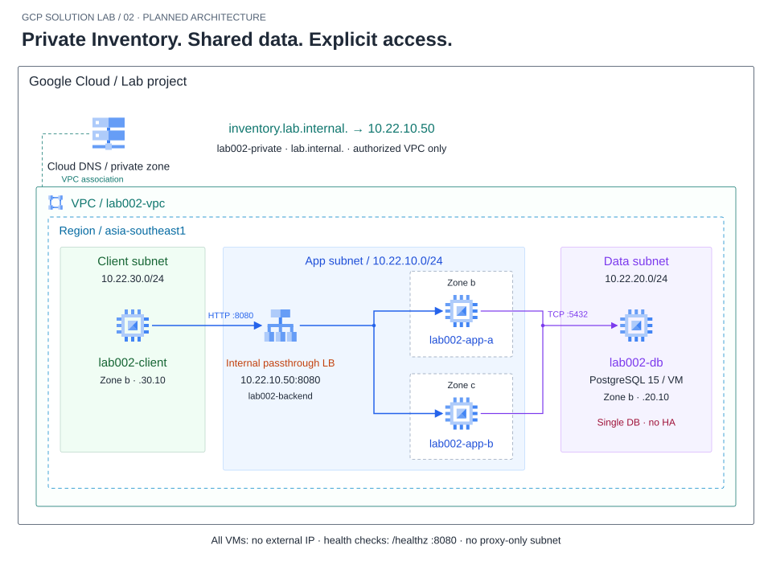
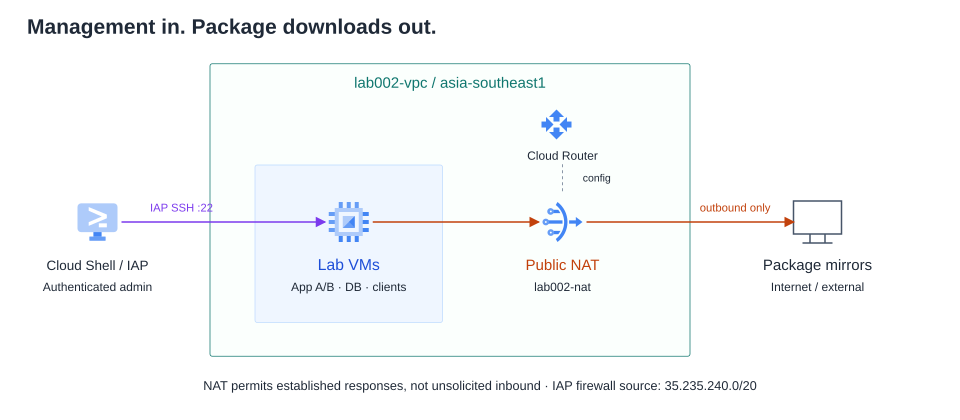

# Lab 02 — Inventory ภายในองค์กรที่ไม่เปิด App และ Database สู่อินเทอร์เน็ต



ภาพหลักแสดงเส้นทางใช้งานและฐานข้อมูล ส่วนภาพถัดไปแยก IAP/NAT ซึ่งไม่อยู่ในเส้นทางธุรกรรม App A/B วางแนวตั้งเพื่อให้ fan-out/fan-in สั้นและไม่อ้อมขอบภาพ ทั้งสองใช้ app subnet เดียวซึ่งเป็น regional



DNS เป็น private zone ที่ authorize VPC ไม่ใช่ VM DNS server; PostgreSQL ใช้ไอคอน Compute Engine เพราะติดตั้งบน VM ไม่ใช่ Cloud SQL เส้น App→DB เป็น TCP5432 และ firewall ไม่อนุญาต client→DB ส่วน health check HTTP8080 ตรวจ /healthz แยกจาก request ผู้ใช้

ทีมคลังสินค้าต้องค้นหาสินค้า ดูยอดคงเหลือ และบันทึกรับเข้า/เบิกออกจากเครือข่ายภายใน ผู้ดูแลต้องแยกให้ได้ว่าการเข้าไม่ได้เกิดจาก DNS, network, App auth หรือฐานข้อมูล โดยไม่เปิด public ingress เพื่อแก้ปัญหา

## ขอบเขตที่เลือก

- Singapore region; custom VPC `lab002-vpc` มี app subnet `10.22.10.0/24`, data subnet `10.22.20.0/24`, client subnet `10.22.30.0/24` ทุก subnet เป็น regional ไม่ใช่ zonal
- App VM สอง Zone b/c ไม่มี external IP, unmanaged instance groups และ **regional internal passthrough Network Load Balancer TCP:8080**; App เป็น HTTP UI/API บน TCP นี้ ไม่ใช่ internal Application LB จึงไม่สร้าง proxy-only subnet
- PostgreSQL 15 บน data VM ไม่มี external IP ใช้ private IP คงที่ ให้ application DB user เฉพาะ database Inventory และ firewall 5432 เฉพาะ app target/source tags; client ห้ามต่อ DB โดยตรง
- Client VM ไม่มี external IP เข้า App ผ่าน private DNS `inventory.lab.internal` ซึ่งชี้ internal LB VIP; Cloud Shell ใช้ IAP SSH เข้า client แล้วรัน requests จาก client ไม่ทดสอบ internal VIP จาก Cloud Shell โดยตรง
- Cloud Router + Public NAT สำหรับ outbound package installation ของ private VMs เท่านั้น ไม่ใช่ทางเข้า App
- IAP SSH ใช้ source range/roles ตามข้อกำหนด; VM ไม่มี runtime service account เพราะไม่เรียก Cloud API จาก workload

## Business flow และข้อมูลที่จะเตรียม

UI ค้นหา SKU และดู stock; API ตรวจ role แบบ reader/operator ด้วย bearer token สำหรับ demo เก็บ token hash ใน App config ไม่ใส่ credential ใช้งานจริงใน Repo สร้าง token บน sandbox และส่งผ่าน SSH/file ที่ permission จำกัด ไม่ผ่าน query string หรือ screenshot แบบเปิดเผย App ต้องไม่ log token/password

ฐานข้อมูลมี products, stock และ movements; seed อย่างน้อย 5 สินค้า การเบิกใช้ transaction/row lock และห้าม stock ติดลบ movement มี idempotency key เพื่อไม่หักซ้ำเมื่อ retry สอง App ใช้ข้อมูลชุดเดียว ต้องมี schema/seed และตัวตรวจ invariant ให้ครบใน Lab นี้ ไม่พึ่ง Lab 01

## Requirements และหลักฐาน

| ID | ผลที่ต้องได้ | วิธีพิสูจน์ | หลักฐาน |
|---|---|---|---|
| R1 | Private client resolve และเข้า UI/API ได้ | DNS ตอบ VIP และ HTTP 200 จาก client; ตรวจ VM ทุกตัวไม่มี external IP | DNS output, VM inventory, response |
| R2 | สอง App ใช้ Inventory เดียวกัน | Read stock, operator สร้าง movement แล้วอ่านกลับจาก sample ที่เห็นทั้ง backend | request IDs, backend IDs, stock/movement |
| R3 | จำกัดสิทธิ์ผู้ใช้ App | ไม่มี token ได้ 401, reader write ได้ 403, operator ทำได้ | redacted HTTP results; ไม่เก็บ token |
| R4 | ไม่หัก stock ซ้ำ/ติดลบ | retry key เดิมไม่เพิ่ม movement; concurrent withdrawal เกิน stock ถูก reject อย่างมีเหตุผล; sum movements reconcile | bounded business test JSON, SQL invariant |
| R5 | Network boundary ถูกต้อง | client→DB5432 denied, app→DB allowed, IAP→SSH allowed; public ingress ไม่มีและไม่มี external IP | effective rules, timed tests, resource inventory |
| R6 | แยกและกู้ dependency outage | หยุด PostgreSQL ชั่วคราว ดู App 503/readiness/logs แล้ว start และทดสอบ business flow ซ้ำ | incident timeline, health, redacted logs |
| R7 | เพิ่มเครือข่าย client อย่างควบคุม | เพิ่ม subnet2 10.22.40.0/24/client2; ก่อนอนุญาต App ใช้ไม่ได้ หลังเพิ่มเฉพาะ App rule ใช้ได้ แต่ DB ยังเข้าไม่ได้ | before/after flow matrix |
| R8 | Cleanup/rebuild ครบ | ลบ private DNS/LB/groups/VM/disks/NAT/router/rules/subnets/VPC ที่สร้าง; ต้นทางอยู่ใน commit | inventory และคำสั่งตรวจของเหลือ |

Fault injection ต้องทำใน sandbox หลังบันทึกยอดตั้งต้นและสำรองข้อมูล ไม่อ้าง zero downtime เพราะ DB baseline เป็นเครื่องเดียว ไม่มี managed HA; ภายหลังอธิบาย trade-off ไป Cloud SQL แต่ไม่บังคับสร้างอีก Solution ในเรื่องนี้

## ทางเลือกและขอบเขตความปลอดภัย

เลือก internal passthrough LB เพื่อทดสอบ source-preserving private network path; firewall backend จึงต้องยอมรับ client CIDRs ที่ตั้งใจอนุญาตพร้อม Google health-check ranges ไม่ใช้กฎ proxy-only ของ Application LB มาปะปน LB private ไม่ใช่ระบบยืนยันตัวตนแทน App

Bearer token demo ใช้ฝึกแยก 401/403 จาก network deny ไม่อ้างว่าเป็น enterprise SSO ไม่ใช้ข้อมูลจริง เนื่องจาก baseline HTTP และ PostgreSQL private traffic ยังไม่เข้ารหัส end-to-end ระบุ TLS/องค์กร identity เป็นข้อจำกัด ไม่อ้าง private network เท่ากับป้องกันทุก threat

NAT/LB/VM/disk/IPv4/router traffic มีต้นทุน ต้องกำหนดวงเงินและเวลาปิดก่อนรัน ไม่สร้าง GCP resources ในขั้นจัดทำเอกสาร ตรวจ API, IAM, region/quota, image/แพ็กเกจและ organization constraints ก่อน Guide-ready

## Access matrix ที่ใช้เขียน Tasks

| Source | Destination | Port / policy |
|---|---|---|
| client subnet 10.22.30.0/24 | App tag lab002-app | TCP 8080 allow |
| client2 subnet 10.22.40.0/24 | App tag lab002-app | deny ก่อน change; allow8080 หลัง change |
| Google health check ranges | App tag lab002-app | TCP 8080 allow |
| App tag lab002-app | DB tag lab002-db | TCP 5432 allow |
| client/client2 | DB | deny5432 |
| IAP 35.235.240.0/20 | VMs tag lab002-admin | TCP22 allow |
| Private VMs | Internet package mirrors | outbound via Public NAT; ไม่มี unsolicited inbound |

App เปิด /livez สำหรับ process และ /healthz ตรวจ DB/schema; reader อ่าน /api/products และ /api/movements ได้ ส่วน operator POST /api/movements โดยมี Idempotency-Key แต่ละ request เปิด DB connection ใหม่และจำกัด active DB operations 8 ต่อ process, connect/statement/lock timeouts แบบจำกัด ขอบเขตนี้ไม่ใช่ production pool design

ไฟล์ประกอบ: [App](app/server.py), [UI](app/index.html), [schema](db/schema.sql), [seed](db/seed.sql), [reconciliation](db/check-invariants.sql), [tests](tests/test_inventory.py) — ขั้นติดตั้งและ secret generation อยู่ใน Tasks ด้านล่าง

## สารบัญการลงมือทำ

- [Task 0 — ตั้ง Project และเตรียมไฟล์](#task-0)
- [Task 1 — สร้าง Private Network และ NAT](#task-1)
- [Task 2 — เปิดเฉพาะเส้นทางที่ใช้](#task-2)
- [Task 3 — สร้าง VM ที่ไม่มี External IP](#task-3)
- [Task 4 — ติดตั้ง PostgreSQL และตั้งสิทธิ์](#task-4)
- [Task 5 — Deploy App A/B](#task-5)
- [Task 6 — สร้าง Internal LB และ Private DNS](#task-6)
- [Task 7 — ทดสอบจาก Client และเปิด UI](#task-7)
- [Task 8 — พิสูจน์การเขียนซ้ำและการเบิกพร้อมกัน](#task-8)
- [Task 9 — ตรวจขอบเขต Network และจำลอง Database outage](#task-9)
- [Task 10 — Change request: เพิ่ม Client network](#task-10)
- [Task 11 — เก็บหลักฐานและสรุป Solution](#task-11)
- [Task 12 — Cleanup และ Rebuild](#task-12)

## เตรียมลงมือทำ

คู่มือใช้ Console เลือก project/ตรวจทรัพยากร และ Cloud Shell สำหรับสร้างชุดที่ต้องใช้ชื่อ/IP ตรงกันทุกจุด คำสั่งสร้างทรัพยากรมีค่าใช้จ่าย ผู้เรียนต้องตรวจงบและสิทธิ์ก่อนรัน ไม่ใช้ project production

| สิ่งที่ต้องเตรียม | รายละเอียด |
|---|---|
| เวลาและต้นทุน | เผื่อ 4–6 ชั่วโมง; baseline มี App 2, DB 1, client 1 และ client2 เพิ่มภายหลัง พร้อม disk/NAT/public NAT IP/internal LB/DNS/logs; Budget ไม่ใช่ hard cap |
| สิทธิ์ | Compute Instance Admin v1, Network Admin, Security Admin, DNS Admin, Service Usage Admin สำหรับ enable APIs, IAP-secured Tunnel User; OS Admin Login ถ้าใช้ OS Login; ผู้ดูแลอาจให้ custom role ที่แคบกว่า |
| Quota/policy | E2 CPU และ disk พอสำหรับ VM สูงสุด 5 ตัว, internal addresses/LB, router/NAT; องค์กรอนุญาต Public NAT/IAP แต่ VM ทุกตัวไม่มี external IP |
| Runtime | Debian 12, PostgreSQL 15, distro python3-psycopg2; ใช้ e2-small สำหรับ App/client และ e2-medium สำหรับ DB ไม่ใช่ sizing production |
| ข้อมูล | Synthetic seed เท่านั้น; App HTTP/private DB connection ยังไม่ใช่ end-to-end TLS; reader/operator token เป็น demo ไม่ใช่ SSO |

### ค่าคงที่และจุดที่ต้องแทน

| Resource | ค่า |
|---|---|
| Project | ต้องแทน YOUR_PROJECT_ID |
| Region | asia-southeast1 |
| App A / B | lab002-app-a / b; Zone b / c; IP 10.22.10.10 / .11 |
| DB | lab002-db; Zone b; IP 10.22.20.10 |
| Client | lab002-client; Zone b; IP 10.22.30.10 |
| Client2 | lab002-client2; Zone c; IP 10.22.40.10 (Task Change) |
| Internal VIP | 10.22.10.50:8080 |
| DNS | inventory.lab.internal. → VIP, private zone lab002-private |
| Database / runtime user | inventory / inventory_app |
| App service | lab002-inventory; files /opt/lab002; config /etc/lab002 |

ทุกคำสั่งที่ระบุ **Cloud Shell** รันบน terminal ของ Console ไม่ใช่ใน VM เมื่อ SSH เข้า VM ให้ดู hostname ก่อนทำ และใช้ exit กลับ Cloud Shell ไม่ตั้ง PROJECT_ID บนเครื่องส่วนตัวเพื่อใช้แทนโดยไม่ระบุ

<a id="task-0"></a>

## Task 0 — ตั้ง Project และเตรียมไฟล์

**Console:** เลือก sandbox project ที่ผูก Billing เปิด **Billing → Budgets & alerts** ตั้งวงเงินแจ้งเตือนที่ยอมรับได้ ตรวจ **IAM & Admin → Quotas & System Limits** ให้เหลือ resource ตามตารางก่อนสร้าง ถ้าไม่มีสิทธิ์ให้บันทึก BLOCKED และขอผู้ดูแล ไม่เปิด public SSH แทน IAP

**Cloud Shell:** เปิด terminal ด้านบน Console แทน YOUR_PROJECT_ID แล้วรัน:

```bash
export PROJECT_ID="YOUR_PROJECT_ID"
export REGION="asia-southeast1"
gcloud config set project "$PROJECT_ID"
gcloud config get-value project
gcloud auth list --filter=status:ACTIVE
gcloud services enable compute.googleapis.com iap.googleapis.com dns.googleapis.com
git clone --branch main --single-branch https://github.com/somkid-s5/Portfolio-Lab.git ~/portfolio-lab-002-source
export LAB_DIR="$HOME/portfolio-lab-002-source/GCP/LAB-002-private-inventory"
git -C ~/portfolio-lab-002-source rev-parse HEAD
cd "$LAB_DIR"
python3 scripts/create-secrets.py --out secrets
mkdir -p assets/evidence
```

ชื่อ directory clone ต้องยังไม่มี หากมีงานเก่าอย่าลบหรือ reset ทับ ให้ใช้ชื่อใหม่และแก้ LAB_DIR ให้ตรง บันทึก commit SHA แล้วใช้ code ชุดเดียวตลอด Lab Secrets generator สร้าง reader/operator token, hashes และ DB password โดยไม่แสดงค่า ไม่รันซ้ำที่ directory เดิมและไม่ใส่ไฟล์เหล่านี้ใน Git

**Expected:** project ตรง Console, API เปิด, secret bundle สร้างสำเร็จ ตรวจชื่อไฟล์ด้วย `ls -l secrets` เท่านั้น ไม่พิมพ์ password/token ลงหลักฐาน บน Cloud Shell directory เป็น 700 และไฟล์ 600

**บันทึก T00:** Project alias [เติม] / commit [เติม] / API/IAM/quota [เติม] / งบและเวลาปิด [เติม] / สถานะ PENDING

<a id="task-1"></a>

## Task 1 — สร้าง Private Network และ NAT

**Cloud Shell:** คำสั่งต่อไปนี้สร้างทรัพยากรใน project ที่ตั้งไว้ ตรวจค่าก่อนรัน ไม่ใช้ชื่อซ้ำกับของที่มีอยู่:

```bash
gcloud compute networks create lab002-vpc --subnet-mode=custom
gcloud compute networks subnets create lab002-app-subnet \
  --network=lab002-vpc --region="$REGION" --range=10.22.10.0/24
gcloud compute networks subnets create lab002-data-subnet \
  --network=lab002-vpc --region="$REGION" --range=10.22.20.0/24
gcloud compute networks subnets create lab002-client-subnet \
  --network=lab002-vpc --region="$REGION" --range=10.22.30.0/24
gcloud compute routers create lab002-router --network=lab002-vpc --region="$REGION"
gcloud compute routers nats create lab002-nat --router=lab002-router \
  --region="$REGION" --nat-all-subnet-ip-ranges --auto-allocate-nat-external-ips
```

**Console:** ค้น **VPC networks** เปิด lab002-vpc ตรวจสาม subnet ใน Singapore จากนั้นค้น **Cloud NAT** เปิด lab002-nat ตรวจ router/region และ source subnets ใช้ทุก subnet ใน region ของ VPC นี้ จึงครอบคลุม client2 ที่เพิ่มภายหลัง แต่ไม่ได้เปิด inbound ให้ VM

ถ้า apt ติดตั้งไม่ได้ภายหลัง ตรวจ NAT coverage, default route และ egress policy ก่อนเพิ่ม external IP การเรียก Google APIs ใช้เส้นทาง Private Google Access ตาม configuration ของบริการ ไม่สรุปจาก NAT ว่าทุก packet วิ่งเส้นเดียวกัน

**บันทึก T01:** network/subnets [เติม] / router/NAT [เติม] / ภาพ subnet และ NAT config [แนบ assets/evidence/t01-network.png] / สถานะ PENDING

<a id="task-2"></a>

## Task 2 — เปิดเฉพาะเส้นทางที่ใช้

**Cloud Shell:**

```bash
gcloud compute firewall-rules create lab002-iap-ssh --network=lab002-vpc \
  --direction=INGRESS --action=ALLOW --rules=tcp:22 \
  --source-ranges=35.235.240.0/20 --target-tags=lab002-admin
gcloud compute firewall-rules create lab002-client-app --network=lab002-vpc \
  --direction=INGRESS --action=ALLOW --rules=tcp:8080 \
  --source-ranges=10.22.30.0/24 --target-tags=lab002-app
gcloud compute firewall-rules create lab002-health --network=lab002-vpc \
  --direction=INGRESS --action=ALLOW --rules=tcp:8080 \
  --source-ranges=35.191.0.0/16,130.211.0.0/22 --target-tags=lab002-app
gcloud compute firewall-rules create lab002-app-db --network=lab002-vpc \
  --direction=INGRESS --action=ALLOW --rules=tcp:5432 \
  --source-tags=lab002-app --target-tags=lab002-db
gcloud compute firewall-rules list --filter='network:lab002-vpc'
```

**Expected:** มีสี่ allow rules ตาม matrix และไม่มี default allow-internal/all-source SSH แบบกว้าง ไม่ต้องสร้าง explicit deny เพราะ custom VPC มี implied deny ingress แต่ต้องตรวจ hierarchical/network firewall policies ที่ใช้จริงด้วย

Internal passthrough LB รักษา client source IP จึง allow client subnet ที่ App ไม่ใช่เปิดเฉพาะ proxy subnet แบบ Application LB Client ที่ได้รับอนุญาตอาจเข้า private App IP:8080 โดยตรงได้ในแบบนี้ ไม่อ้างว่า LB เป็น security boundary หรือยืนยันตัวตนแทน App

**บันทึก T02:** rule/source/target/port จริง [เติม] / inherited policy ที่พบ [เติม] / assets/evidence/t02-firewall.txt [แนบ] / สถานะ PENDING

<a id="task-3"></a>

## Task 3 — สร้าง VM ที่ไม่มี External IP

**Cloud Shell:** ทุกเครื่องใช้ No service account เพราะ workload ไม่เรียก Cloud API การสร้าง/SSH เป็นสิทธิ์ผู้ดูแลคนละส่วน:

```bash
gcloud compute instances create lab002-db --zone=asia-southeast1-b \
  --machine-type=e2-medium --subnet=lab002-data-subnet --private-network-ip=10.22.20.10 \
  --no-address --no-service-account --no-scopes --tags=lab002-db,lab002-admin \
  --image-family=debian-12 --image-project=debian-cloud --boot-disk-size=10GB
gcloud compute instances create lab002-app-a --zone=asia-southeast1-b \
  --machine-type=e2-small --subnet=lab002-app-subnet --private-network-ip=10.22.10.10 \
  --no-address --no-service-account --no-scopes --tags=lab002-app,lab002-admin \
  --image-family=debian-12 --image-project=debian-cloud --boot-disk-size=10GB
gcloud compute instances create lab002-app-b --zone=asia-southeast1-c \
  --machine-type=e2-small --subnet=lab002-app-subnet --private-network-ip=10.22.10.11 \
  --no-address --no-service-account --no-scopes --tags=lab002-app,lab002-admin \
  --image-family=debian-12 --image-project=debian-cloud --boot-disk-size=10GB
gcloud compute instances create lab002-client --zone=asia-southeast1-b \
  --machine-type=e2-small --subnet=lab002-client-subnet --private-network-ip=10.22.30.10 \
  --no-address --no-service-account --no-scopes --tags=lab002-client,lab002-admin \
  --image-family=debian-12 --image-project=debian-cloud --boot-disk-size=10GB
gcloud compute instances list --filter='name~^lab002-' \
  --format='table(name,zone,networkInterfaces[0].networkIP,networkInterfaces[0].accessConfigs[0].natIP)'
```

**Expected:** สี่เครื่อง Running, internal IP ตามตาราง, NAT_IP ของ VM ว่างทั้งหมด NAT gateway มี public IP ไม่ใช่การผูก external IP กับ VM

จาก Cloud Shell ทดสอบ IAP:

```bash
gcloud compute ssh lab002-client --zone=asia-southeast1-b --tunnel-through-iap
```

**ใน client VM:** รัน `hostname` ต้องเป็น lab002-client แล้ว `sudo apt-get update` เพื่อตรวจ outbound ผ่าน NAT จากนั้น `exit` กลับ Cloud Shell หาก SSH ไม่ได้แยก IAP role/firewall/OS Login ก่อน ไม่เพิ่ม external IP

**บันทึก T03:** VM/Zone/IP/image version ที่ใช้ [เติม] / IAP และ apt ผลจริง [เติม] / assets/evidence/t03-private-vms.txt [แนบ] / สถานะ PENDING

<a id="task-4"></a>

## Task 4 — ติดตั้ง PostgreSQL และตั้งสิทธิ์

**Cloud Shell:** เตรียม archive เฉพาะ code ไม่มี secrets ใน archive:

```bash
cd "$LAB_DIR"
export TASK_TMP="$(mktemp -d)"
tar -czf "$TASK_TMP/lab002-code.tgz" app db scripts
gcloud compute scp "$TASK_TMP/lab002-code.tgz" secrets/db-password.txt \
  lab002-db:~/ --zone=asia-southeast1-b --tunnel-through-iap
gcloud compute ssh lab002-db --zone=asia-southeast1-b --tunnel-through-iap
```

**ใน DB VM:** ห้ามใช้ชุดนี้บนฐานข้อมูลที่มีงานอื่น ใช้ cluster PostgreSQL 15/main เฉพาะ Lab:

```bash
hostname
mkdir -p ~/lab002
tar -xzf ~/lab002-code.tgz -C ~/lab002
chmod 600 ~/db-password.txt
sudo apt-get update
sudo apt-get install -y postgresql-15 python3
sudo python3 ~/lab002/scripts/configure-db.py --password-file ~/db-password.txt
sudo -u postgres psql -d inventory -c 'SELECT sku,quantity FROM stock ORDER BY sku;'
sudo -u postgres psql -d inventory < ~/lab002/db/check-invariants.sql
sudo ss -lntp | grep 5432
rm -- ~/db-password.txt
exit
```

หมายเหตุ: ถ้า postgres อ่านไฟล์ check-invariants ใน home ไม่ได้เพราะ home permissions ให้ใช้ `sudo -u postgres psql -d inventory < ~/lab002/db/check-invariants.sql` แทน การ redirect อ่านโดย shell ของผู้ดูแล ไม่เปิด permission home ทั้ง directory

**Expected:** สินค้า 5 รายการ, PEN-01=20, reconciliation ไม่มีแถวผิดปกติ, PostgreSQL ฟัง localhost และ 10.22.20.10:5432 เครื่องมือตั้งค่าไม่พิมพ์ password; App role ไม่มี superuser/createdb/createrole และไม่มีสิทธิ์ลบ movement หรือแก้ชื่อสินค้า

Script เพิ่ม host authentication เฉพาะ inventory/inventory_app จาก app subnet โดยใช้ scram-sha-256 ไม่ใช่ trust และ restart cluster หลังเปลี่ยน listener การรันซ้ำไม่ reset stock แต่จะตั้ง password ให้ตรง bundle ที่ป้อน จึงอย่าสลับ bundle กลาง Lab

**บันทึก T04:** version/listener/5 seed rows [เติม] / role privileges [เติม] / invariant result [เติม] / ปัญหาและ retest [เติม] / สถานะ PENDING

<a id="task-5"></a>

## Task 5 — Deploy App A/B

**Cloud Shell:** ส่ง code พร้อม DB password และ token hashes เท่านั้น ไม่ส่ง plaintext reader/operator tokens ไป App:

```bash
cd "$LAB_DIR"
gcloud compute scp "$TASK_TMP/lab002-code.tgz" secrets/db-password.txt secrets/token-hashes.json \
  lab002-app-a:~/ --zone=asia-southeast1-b --tunnel-through-iap
gcloud compute scp "$TASK_TMP/lab002-code.tgz" secrets/db-password.txt secrets/token-hashes.json \
  lab002-app-b:~/ --zone=asia-southeast1-c --tunnel-through-iap
gcloud compute ssh lab002-app-a --zone=asia-southeast1-b --tunnel-through-iap
```

**ใน App A:**

```bash
hostname
mkdir -p ~/lab002
tar -xzf ~/lab002-code.tgz -C ~/lab002
chmod 600 ~/db-password.txt ~/token-hashes.json
sudo python3 ~/lab002/scripts/configure-app.py \
  --password-file ~/db-password.txt --hash-file ~/token-hashes.json
sudo bash ~/lab002/scripts/install-app.sh
sudo systemctl status lab002-inventory --no-pager
curl --max-time 8 -i http://127.0.0.1:8080/livez
curl --max-time 8 -i http://127.0.0.1:8080/healthz
sudo journalctl -u lab002-inventory -n 30 --no-pager
rm -- ~/db-password.txt ~/token-hashes.json
exit
```

ทำชุด **ใน App A** ซ้ำบน App B หลังเข้า `gcloud compute ssh lab002-app-b --zone=asia-southeast1-c --tunnel-through-iap` ตรวจ hostname ให้ถูกก่อนตั้งค่า

**Expected:** active, /livez=200 และ /healthz=200 ทั้งคู่; DB ไม่พร้อมจะได้ /healthz=503 แต่ /livez ยัง 200 ตรวจ connection source IP/firewall/pg_hba/password/SQL grants ตามลำดับ อย่าพิมพ์ /etc/lab002/app.env ลง log หรือ screenshot

**บันทึก T05:** A service/health [เติม] / B service/health [เติม] / sanitized request IDs และ logs [แนบ] / สถานะ PENDING

<a id="task-6"></a>

## Task 6 — สร้าง Internal LB และ Private DNS

**Cloud Shell:** App ต้อง /healthz=200 ทั้งคู่ก่อนเริ่ม ขั้นตอนนี้ใช้ regional internal passthrough Network LB ไม่ใช่ Application LB ไม่มี URL map/proxy/named port:

```bash
gcloud compute instance-groups unmanaged create lab002-group-a --zone=asia-southeast1-b
gcloud compute instance-groups unmanaged add-instances lab002-group-a \
  --zone=asia-southeast1-b --instances=lab002-app-a
gcloud compute instance-groups unmanaged create lab002-group-b --zone=asia-southeast1-c
gcloud compute instance-groups unmanaged add-instances lab002-group-b \
  --zone=asia-southeast1-c --instances=lab002-app-b
gcloud compute health-checks create http lab002-health --region="$REGION" \
  --port=8080 --request-path=/healthz --check-interval=5s --timeout=3s \
  --healthy-threshold=2 --unhealthy-threshold=2
gcloud compute backend-services create lab002-backend --region="$REGION" \
  --load-balancing-scheme=INTERNAL --protocol=TCP \
  --health-checks=lab002-health --health-checks-region="$REGION"
gcloud compute backend-services add-backend lab002-backend --region="$REGION" \
  --instance-group=lab002-group-a --instance-group-zone=asia-southeast1-b
gcloud compute backend-services add-backend lab002-backend --region="$REGION" \
  --instance-group=lab002-group-b --instance-group-zone=asia-southeast1-c
gcloud compute addresses create lab002-vip --region="$REGION" \
  --subnet=lab002-app-subnet --addresses=10.22.10.50
gcloud compute forwarding-rules create lab002-forwarding --region="$REGION" \
  --load-balancing-scheme=INTERNAL --network=lab002-vpc --subnet=lab002-app-subnet \
  --address=lab002-vip --ip-protocol=TCP --ports=8080 \
  --backend-service=lab002-backend --backend-service-region="$REGION"
gcloud dns managed-zones create lab002-private --dns-name=lab.internal. \
  --description="Private Inventory lab" --visibility=private --networks=lab002-vpc
gcloud dns record-sets create inventory.lab.internal. --zone=lab002-private \
  --type=A --ttl=30 --rrdatas=10.22.10.50
gcloud compute backend-services get-health lab002-backend --region="$REGION"
```

**Console:** ค้น **Load balancing** เปิด LB ที่อ้าง lab002-backend ตรวจชนิด Internal passthrough, frontend private IP 10.22.10.50:8080 และ backend ทั้งสอง Healthy จากนั้นค้น **Cloud DNS → lab002-private** ตรวจ private visibility ผูก lab002-vpc และ A record ตรง VIP

**Expected:** Healthy สอง backend; อาจรอหลายรอบ probe อย่าเริ่ม business test ตอนยัง Unhealthy ถ้าไม่พร้อมให้ตรวจ App localhost → DB → health firewall → group membership ตามลำดับ Private DNS นี้มองเห็นจาก VM ใน authorized VPC ไม่ใช่ DNS สาธารณะหรือเครื่องส่วนตัว

**บันทึก T06:** LB/VIP/region [เติม] / health A/B และเวลา [เติม] / DNS A/TTL/visibility [เติม] / assets/evidence/t06-lb-dns.txt [แนบ] / สถานะ PENDING

<a id="task-7"></a>

## Task 7 — ทดสอบจาก Client และเปิด UI

**Cloud Shell:** ส่ง code และ demo user tokens ไป client เท่านั้น ไม่ส่ง DB password:

```bash
cd "$LAB_DIR"
gcloud compute scp "$TASK_TMP/lab002-code.tgz" secrets/reader.token secrets/operator.token \
  lab002-client:~/ --zone=asia-southeast1-b --tunnel-through-iap
gcloud compute ssh lab002-client --zone=asia-southeast1-b --tunnel-through-iap
```

**ใน client VM:**

```bash
hostname
mkdir -p ~/lab002/evidence
tar -xzf ~/lab002-code.tgz -C ~/lab002
chmod 600 ~/reader.token ~/operator.token
sudo apt-get update
sudo apt-get install -y python3 curl dnsutils netcat-openbsd
dig +short inventory.lab.internal
curl --max-time 8 -i http://inventory.lab.internal:8080/healthz
python3 ~/lab002/scripts/probe-inventory.py \
  --url http://inventory.lab.internal:8080 --reader-file ~/reader.token \
  --requests 30 --out ~/lab002/evidence/t07-read.json
```

**Expected:** DNS ตอบ 10.22.10.50, health=200 และ probe exit 0/all_checks_passed=true ผล JSON มี 30 reads=200, no-token=401 และ reader-write=403 ไม่ใช่ทุก request ต้อง 200 เพราะ negative tests เป็นส่วนของเกณฑ์ อ่าน results ดู backend A/B ด้วย TCP LB hash connections ไม่รับประกัน round robin หรือ 50:50 หากเห็นเครื่องเดียวให้ตรวจ health แล้วเก็บรอบใหม่ชื่อ t07-read-r2.json โดยไม่เขียนทับผลเดิม

### เปิด UI โดยไม่ทำ Public ingress

ใน client รัน `exit` กลับ Cloud Shell เปิด terminal อีกแท็บหนึ่งแล้วตั้ง PROJECT_ID ให้ตรง จากนั้นสร้าง SSH local forwarding ผ่าน client ที่ได้รับอนุญาต:

```bash
gcloud compute ssh lab002-client --project="$PROJECT_ID" --zone=asia-southeast1-b \
  --tunnel-through-iap -- -N -L 8080:10.22.10.50:8080
```

ปล่อยแท็บนี้ทำงาน เปิด **Cloud Shell → Web preview → Preview on port 8080** จะเห็นหน้า Inventory หาก port 8080 มีงานอื่นให้เลือก local port 8081 ในคำสั่งและ Web preview ให้ตรง อย่า kill process ที่ไม่ใช่งานนี้

ใน UI ป้อน reader token จาก secret bundle ของคุณเพื่อกดดูสินค้า Token ไม่ถูกบันทึกใน browser storage; หากต้องคัดลอกค่าให้ทำในแท็บส่วนตัวที่ไม่อัดหน้าจอและไม่เก็บ output ลงหลักฐาน ล้างช่อง token/ปิดหน้าหลังทดสอบ ภาพหลักฐานต้องไม่แสดง token ใช้ operator เฉพาะตอนทดสอบเขียน

ทางเข้า Web preview เป็นช่องทางผู้ดูแลที่ยืนยันตัวตนแล้ว ไม่ใช่ Public URL ของ Inventory และไม่ได้แทน negative network test จาก client2 ภายหลัง

**บันทึก T07 / R1–R3:** DNS [เติม] / UI screenshot ไม่เห็น token [แนบ] / reads, 401/403 และ backend IDs [เติม] / หลักฐาน t07-read.json [แนบ] / สถานะ PENDING

<a id="task-8"></a>

## Task 8 — พิสูจน์การเขียนซ้ำและการเบิกพร้อมกัน

**ก่อนทดสอบ:** ใช้ seed sandbox เท่านั้น ให้ทุกคนหยุดเขียน PEN-01 ชั่วคราว ยอดต้องอยู่ 1–1000 เครื่องมือจะเปลี่ยนยอดแล้วสร้างรายการชดเชย ไม่ลบประวัติ หากคำขอ timeout ต้องตรวจ ledger ก่อนลองใหม่ เพราะ client ไม่ได้รับ response ไม่ได้แปลว่า transaction rollback แล้ว

**ใน client VM:** หากออกไปแล้วให้ SSH ผ่าน IAP ตาม Task 7:

```bash
python3 ~/lab002/scripts/probe-inventory.py \
  --url http://inventory.lab.internal:8080 --reader-file ~/reader.token \
  --operator-file ~/operator.token --allow-writes --requests 30 \
  --out ~/lab002/evidence/t08-business.json
```

เครื่องมือจำกัด read สูงสุด 100 ครั้งที่ 5/s และส่ง concurrent withdrawals เพียง 2 คำขอ timeout 5 วินาที ไม่ใช่ load/stress test ตัวเลือก --allow-writes เป็นการยืนยันให้ทำ transaction ทดลอง

**Expected:**

- withdraw แรกได้ 201; retry Key เดิมได้ 200 พร้อม movement_id เดิมและ replayed=true
- concurrent withdrawals คนละ Key ซึ่งรวมกันเกินยอด ต้องได้หนึ่ง 201 และหนึ่ง 409 insufficient_stock
- รายการชดเชยสำเร็จ และ final-stock เท่ากับก่อนเริ่ม แต่ ledger มีประวัติเพิ่มตามจริง
- no-token=401, reader-write=403; ทุก check ผ่านจึง exit 0
- หากมีข้อผิดพลาดให้เก็บ JSON เดิม ตรวจ movements/invariant ก่อนตัดสินใจแก้ ห้ามแก้ JSON ให้ดูเหมือนผ่าน

**Cloud Shell → DB VM:** ยืนยันด้วย SQL ไม่ใช้แต่ผลจาก client:

```bash
gcloud compute ssh lab002-db --zone=asia-southeast1-b --tunnel-through-iap
```

**ใน DB VM:**

```bash
sudo -u postgres psql -d inventory < ~/lab002/db/check-invariants.sql
sudo -u postgres psql -d inventory -c \
  'SELECT id,sku,delta,quantity_after,actor,created_at FROM movements ORDER BY id DESC LIMIT 12;'
exit
```

**Expected:** invariant query ได้ 0 rows; การเปลี่ยนยอดแต่ละครั้งมี movement และ replay ไม่สร้าง movement ซ้ำ ตรวจด้วย Key/movement ID ในผลจริง ไม่สรุป exactly-once ทุกชนิด failure จาก Lab นี้

**บันทึก T08 / R2–R4:** ยอดก่อน/หลัง [เติม] / first/replay movement ID [เติม] / concurrent statuses [เติม] / SQL reconciliation [เติม] / เหตุการณ์ timeout/วิธีกู้ถ้ามี [เติม] / t08-business.json + sanitized SQL [แนบ] / สถานะ PENDING

<a id="task-9"></a>

## Task 9 — ตรวจขอบเขต Network และจำลอง Database outage

### 9.1 แยก network deny ออกจาก App auth

**ใน client VM:**

```bash
nc -vz -w 3 10.22.20.10 5432
curl --max-time 8 -i http://inventory.lab.internal:8080/api/products
```

**Expected:** DB TCP จาก client เข้าไม่ได้ แต่ HTTP ถึง App ได้และตอบ 401 เพราะยังไม่มี token การ timeout เพียงอย่างเดียวไม่ยืนยัน root cause ต้องเทียบ rule/source/tag และดูว่า health/App DB connection ใช้งานได้จาก App

**ใน App A ผ่าน IAP:** ตรวจเส้นทาง DB โดยไม่แสดง password:

```bash
sudo python3 -c 'import socket; s=socket.create_connection(("10.22.20.10",5432),3); print("DB TCP reachable"); s.close()'
curl --max-time 8 -i http://127.0.0.1:8080/healthz
```

TCP reachable และ health 200 ร่วมกันยืนยัน transport กับ DB access ของ App ตรวจ VM inventory อีกครั้งใน Cloud Shell ว่า external IP ยังว่างทั้งหมด ไม่ทดสอบ public ingress ด้วยการเพิ่ม public IP ให้ VM

### 9.2 หยุด dependency แล้วกู้

เปิดอย่างน้อยสอง terminal: client VM สำหรับ probe และ DB VM สำหรับ stop/start จด UTC ทุกครั้ง

**ใน DB VM:** สำรองข้อมูลก่อน injection แม้โจทย์หยุด service ไม่ใช่การลบข้อมูล:

```bash
sudo -u postgres pg_dump -d inventory > ~/lab002/pre-fault.sql
chmod 600 ~/lab002/pre-fault.sql
date -u +%FT%TZ
sudo systemctl stop postgresql@15-main
```

**ใน client VM:**

```bash
python3 ~/lab002/scripts/probe-inventory.py \
  --url http://inventory.lab.internal:8080 --reader-file ~/reader.token \
  --requests 5 --out ~/lab002/evidence/t09-db-down.json
```

**Expected:** exit 1 และ read เป็น 503 หรือ connection failure ที่บันทึกจริง บน App /livez ยัง 200 แต่ /healthz เป็น 503 และ journal มี event database_unavailable พร้อม request ID ไม่ใช่ password Health ทั้งสอง backend จะไม่พร้อมเพราะใช้ DB เดียวกัน Internal passthrough LB อาจส่ง traffic ไป unhealthy backends เมื่อไม่มี healthy backend เหลือ จึงไม่ใช้ข้อความว่า LB ปิดรับงานทั้งหมดหรือมี HA ครบทุกชั้น

**ใน DB VM:**

```bash
date -u +%FT%TZ
sudo systemctl start postgresql@15-main
sudo systemctl is-active postgresql@15-main
sudo -u postgres psql -d inventory < ~/lab002/db/check-invariants.sql
```

**Cloud Shell:** ตรวจ `gcloud compute backend-services get-health lab002-backend --region="$REGION"` จน Healthy ทั้งคู่ แล้วใน **client VM** รัน:

```bash
python3 ~/lab002/scripts/probe-inventory.py \
  --url http://inventory.lab.internal:8080 --reader-file ~/reader.token \
  --requests 30 --out ~/lab002/evidence/t09-recovery.json
```

**Expected:** exit 0, ยอดก่อน/หลังตรงกันและ SQL invariants 0 rows ไม่ต้อง restore dump เพราะการหยุด service ปกติไม่ได้ลบข้อมูล ห้าม restore ทับฐานข้อมูลเพียงเพื่อให้ดูเหมือน recovery ผ่าน ถ้าไม่กลับมาให้ตรวจ DB service journal/listener → pg_hba/password → App journal → LB health ตามลำดับ

**บันทึก T09 / R5–R6:** client→DB [เติม] / App→DB [เติม] / external IP inventory [แนบ] / stop/start UTC [เติม] / อาการระหว่าง down [เติม] / เวลากลับ Healthy และผล retest [เติม] / ข้อจำกัด single DB [เติม] / สถานะ PENDING

<a id="task-10"></a>

## Task 10 — Change request: เพิ่ม Client network

ทีมใหม่ต้องใช้ Inventory จาก subnet ใหม่ แต่ยังห้ามเข้าฐานข้อมูลโดยตรง การแก้คือเพิ่ม client subnet และ allow เฉพาะ App:8080 ไม่ขยาย rule เป็น allow all internal

**Cloud Shell:**

```bash
gcloud compute networks subnets create lab002-client2-subnet \
  --network=lab002-vpc --region="$REGION" --range=10.22.40.0/24
gcloud compute instances create lab002-client2 --zone=asia-southeast1-c \
  --machine-type=e2-small --subnet=lab002-client2-subnet --private-network-ip=10.22.40.10 \
  --no-address --no-service-account --no-scopes --tags=lab002-client,lab002-admin \
  --image-family=debian-12 --image-project=debian-cloud --boot-disk-size=10GB
gcloud compute scp "$TASK_TMP/lab002-code.tgz" secrets/reader.token \
  lab002-client2:~/ --zone=asia-southeast1-c --tunnel-through-iap
gcloud compute ssh lab002-client2 --zone=asia-southeast1-c --tunnel-through-iap
```

**ใน client2 VM:**

```bash
mkdir -p ~/lab002/evidence
tar -xzf ~/lab002-code.tgz -C ~/lab002
chmod 600 ~/reader.token
sudo apt-get update
sudo apt-get install -y python3 curl dnsutils netcat-openbsd
dig +short inventory.lab.internal
curl --connect-timeout 3 --max-time 5 -i http://inventory.lab.internal:8080/healthz
nc -vz -w 3 10.22.20.10 5432
exit
```

**Expected ก่อนอนุญาต:** DNS ตอบ VIP เพราะ authorized VPC เดียวกัน แต่ App TCP และ DB TCP เข้าไม่ได้ DNS resolve สำเร็จไม่เท่ากับอนุญาต access เก็บ output/time ก่อนเปลี่ยน

**Cloud Shell:** เพิ่ม rule ใหม่เพื่อย้อนกลับง่าย ไม่แก้ DB rule หรือให้ tag lab002-app แก่ client2:

```bash
gcloud compute firewall-rules create lab002-client2-app --network=lab002-vpc \
  --direction=INGRESS --action=ALLOW --rules=tcp:8080 \
  --source-ranges=10.22.40.0/24 --target-tags=lab002-app
gcloud compute ssh lab002-client2 --zone=asia-southeast1-c --tunnel-through-iap
```

**ใน client2 VM:**

```bash
python3 ~/lab002/scripts/probe-inventory.py \
  --url http://inventory.lab.internal:8080 --reader-file ~/reader.token \
  --requests 30 --out ~/lab002/evidence/t10-client2.json
nc -vz -w 3 10.22.20.10 5432
exit
```

**Expected หลังอนุญาต:** read probe exit 0 แต่ DB TCP ยังเข้าไม่ได้ บน client เดิมให้รัน t10-client1-regression.json ด้วยคำสั่ง read เดิมเพื่อยืนยันว่าไม่ทำระบบเดิมเสีย

**แผนย้อนกลับ:** Cloud Shell ลบเฉพาะ `gcloud compute firewall-rules delete lab002-client2-app` แล้วตรวจ client2 เข้า App ไม่ได้และ client เดิมยังใช้งานได้ หากทีมยกเลิกให้ลบ client2/disk/subnet ตอน Cleanup ไม่ลบ subnet ขณะที่ยังมี VM อ้างอิง

**บันทึก T10 / R7:** เหตุผล/ขอบเขตที่อนุมัติ [เติม] / before DNS, App, DB [เติม] / after App, DB [เติม] / client1 regression [เติม] / backout ทำจริงหรือเป็นแผน [เติม] / หลักฐานก่อน/หลัง [แนบ] / สถานะ PENDING

<a id="task-11"></a>

## Task 11 — เก็บหลักฐานและสรุป Solution

**ใน client และ client2 VM:** สร้าง archive เฉพาะ evidence ไม่รวม token หรือ source secrets:

```bash
tar -czf ~/lab002-evidence.tgz -C ~/lab002 evidence
exit
```

**Cloud Shell:** กลับ LAB_DIR แล้วดึงไฟล์แยกชื่อเพื่อไม่ทับกัน:

```bash
cd "$LAB_DIR"
gcloud compute scp lab002-client:~/lab002-evidence.tgz assets/evidence/client1-evidence.tgz \
  --zone=asia-southeast1-b --tunnel-through-iap
gcloud compute scp lab002-client2:~/lab002-evidence.tgz assets/evidence/client2-evidence.tgz \
  --zone=asia-southeast1-c --tunnel-through-iap
git status --short
```

ชื่อ output ของ scp อาจถูกเขียนทับถ้ารันซ้ำ ให้เลือกชื่อรอบใหม่เอง ตรวจและ redact project identifiers/ข้อมูลที่ไม่ต้องเผยแพร่ก่อน commit หลักฐาน ดึงออกจาก VM ให้ครบก่อนลบ และไม่ใช้การแนบหลักฐานของผู้สร้างคู่มือแทนผลการลงมือของตนเอง

| Requirement | ผลจริง | หลักฐาน | Status |
|---|---|---|---|
| R1 private DNS/UI/API | [เติม] | T03/T06/T07 | PENDING |
| R2 shared Inventory | [เติม] | T07/T08 | PENDING |
| R3 reader/operator | [เติม] | T07/T08 | PENDING |
| R4 retry/concurrency/invariant | [เติม] | T08 | PENDING |
| R5 network boundary | [เติม] | T02/T03/T09 | PENDING |
| R6 outage/recovery | [เติม] | T09 | PENDING |
| R7 new client subnet | [เติม] | T10 | PENDING |
| R8 cleanup/rebuild | [เติม] | T12 | PENDING |

**Case study ที่เขียนด้วยผลของคุณเอง:** ปัญหาทีม [เติม] / architecture ที่สร้างจริงและสิ่งที่เปลี่ยน [เติม] / เหตุผลเลือก private LB + NAT [เติม] / วิธีแยก DNS/network/auth/DB [เติม] / incident timeline และ retest [เติม] / การตัดสินใจ Change request [เติม] / trade-off single DB, HTTP, demo tokens [เติม] / สิ่งที่จะออกแบบเพิ่มก่อน production [เติม]

## Troubleshooting — แยกทีละชั้น

| อาการ | ตรวจ | เกณฑ์เดินต่อ |
|---|---|---|
| IAP SSH ไม่ได้ | account/project → Tunnel User → admin tag → IAP22 rule → OS Login/sudo | เข้า VM ได้โดยไม่เปิด public22 |
| apt timeout | NAT source-subnet coverage → default route → egress policy → DNS | package mirror ออกได้ผ่าน NAT |
| /livez200 แต่ /healthz503 | DB active/listener → app-db firewall → pg_hba → password/config → grants/schema | health200 ทั้งสอง App |
| SQL permission denied | ตรวจ runtime inventory_app กับ grants.sql; ไม่แก้เป็น superuser | business flow ผ่านด้วยสิทธิ์จำกัด |
| DNS ไม่ตอบ VIP | private zone authorized VPC → A record → client metadata resolver; อย่าทดสอบจาก Cloud Shell โดยตรง | dig จาก client ตอบ VIP |
| LB unhealthy | localhost health → regional health check path/port → health source ranges → group membership | get-health Healthy สองเครื่อง |
| มี HTTP401/403 | transport ถึง App แล้ว ตรวจชนิด token/role โดยไม่เผยค่า | readerอ่านได้/operatorเขียนได้ |
| timeout จาก client2 | ก่อน Change เป็น Expected; หลัง Change ตรวจ source CIDR/tag/inherited deny | App ผ่าน แต่ DBยัง deny |
| Key เดิมได้409 | payload ต่างจากคำขอเดิม | ถ้า retry ใช้ payloadเดิม; รายการใหม่ใช้ Keyใหม่ |
| timeout ตอนเขียน | ไม่รู้ commit สำเร็จหรือไม่ ตรวจ movement ด้วย Key/invariant | reconcileก่อน retry/ชดเชย |
| probe output exists | หลักฐานชื่อซ้ำ | เปลี่ยน --out; ไม่ลบผลที่ fail |

**บันทึกเหตุการณ์:** Task/time [เติม] / อาการ [เติม] / สมมติฐานและสิ่งที่ตรวจ [เติม] / สาเหตุที่พิสูจน์ได้ [เติม] / สิ่งที่แก้ [เติม] / retest+evidence [เติม]

<a id="task-12"></a>

## Task 12 — Cleanup และ Rebuild

คำสั่งนี้ลบข้อมูลและ VM ของ Lab จริง ตรวจ PROJECT_ID และเก็บหลักฐาน/ข้อมูลที่ต้องการก่อน ห้ามรันใน project งานจริงหรือคัดลอกเปลี่ยนชื่อเป็น resource อื่น อย่าลบทั้ง project เพื่อข้าม inventory

1. ปิด SSH forwarding/Web preview ด้วย Ctrl+C ในแท็บ tunnel ของงานนี้
2. **Cloud Shell:** ลบ DNS record ก่อน zone แล้ว frontend/backend/health/groups ตาม dependency:

```bash
gcloud config get-value project
gcloud dns record-sets delete inventory.lab.internal. --zone=lab002-private --type=A
gcloud dns managed-zones delete lab002-private
gcloud compute forwarding-rules delete lab002-forwarding --region="$REGION"
gcloud compute addresses delete lab002-vip --region="$REGION"
gcloud compute backend-services delete lab002-backend --region="$REGION"
gcloud compute health-checks delete lab002-health --region="$REGION"
gcloud compute instance-groups unmanaged delete lab002-group-a --zone=asia-southeast1-b
gcloud compute instance-groups unmanaged delete lab002-group-b --zone=asia-southeast1-c
```

3. ลบ VM และ boot disk ของชุดนี้ ตรวจหน้าต่างยืนยันและ **Compute Engine → Disks** หลังลบ ถ้าไม่ได้ทำ Task 10 ให้ข้ามเฉพาะ client2 และ rule/subnet2:

```bash
gcloud compute instances delete lab002-app-a lab002-db lab002-client \
  --zone=asia-southeast1-b --delete-disks=boot
gcloud compute instances delete lab002-app-b lab002-client2 \
  --zone=asia-southeast1-c --delete-disks=boot
gcloud compute routers nats delete lab002-nat --router=lab002-router --region="$REGION"
gcloud compute routers delete lab002-router --region="$REGION"
gcloud compute firewall-rules delete lab002-iap-ssh lab002-client-app lab002-health lab002-app-db lab002-client2-app
gcloud compute networks subnets delete lab002-app-subnet lab002-data-subnet lab002-client-subnet lab002-client2-subnet --region="$REGION"
gcloud compute networks delete lab002-vpc
```

4. ตรวจเฉพาะ resource ของ Lab ที่จดไว้ ไม่พยายามทำให้ project ว่าง:

```bash
gcloud compute instances list --filter='name~^lab002-'
gcloud compute disks list --filter='name~^lab002-'
gcloud compute forwarding-rules list --filter='name~^lab002-'
gcloud compute backend-services list --filter='name~^lab002-'
gcloud compute health-checks list --filter='name~^lab002-'
gcloud compute addresses list --filter='name~^lab002-'
gcloud compute routers list --filter='name~^lab002-'
gcloud compute firewall-rules list --filter='name~^lab002-'
gcloud compute networks subnets list --filter='name~^lab002-'
gcloud dns managed-zones list --filter='name=lab002-private'
```

ตรวจ IP ที่ Public NAT auto-allocate ด้วยหน้า **VPC network → IP addresses** ว่าไม่เหลือ reserved address ที่ตั้งใจเก็บไว้ บิลอาจแสดงช้าจึงไม่ใช้ billing dashboard ว่างทันทีเป็นหลักฐาน cleanup

5. Token/DB password ยังอยู่ใน secret bundle ของ Cloud Shell แม้ลบ VM แล้ว เก็บแบบปลอดภัยเฉพาะเมื่อจำเป็นหรือทำลายไฟล์ลับที่ตรวจชื่อแล้ว ห้าม commit bundle; archive evidence ต้องไม่มี secrets หากเผลอเผยแพร่ให้ revoke/เปลี่ยน token/password และจัดการประวัติที่หลุดตามนโยบาย ไม่แค่ลบ screenshot ล่าสุด

**บันทึก T12 / R8:** DNS/LB/VIP/groups [เติม] / VM/disks [เติม] / NAT/router/allocated IP [เติม] / rules/subnets/VPC [เติม] / หลักฐานที่ย้ายออกครบ [เติม] / secretsจัดการอย่างไรโดยไม่ใส่ค่า [เติม] / วันเวลาและของที่จงใจเก็บ [เติม] / สถานะ PENDING

**Rebuild:** ใช้ clean sandbox project, clone commit SHA ที่ T00 บันทึก แล้วทำ Task 0–10 ตามลำดับ ใช้ secret bundle ใหม่กับระบบใหม่ทั้งชุด ห้าม seed reset ยอดของฐานข้อมูลเดิมเพื่ออ้างว่า rebuild สำเร็จ ต้องบันทึก image/PostgreSQL/Python versions จริงอีกครั้ง

## ขอบเขตผลตรวจและแหล่งอ้างอิง

App สอง process, PostgreSQL 15, role/grants, idempotency/concurrent withdrawal, seed, secret generation และ learner probe ผ่าน [CI 39811584409](https://github.com/somkid-s5/Portfolio-Lab/actions/runs/39811584409) 10 tests แต่ CI ไม่ได้สร้าง VPC/IAP/NAT/LB/DNS หรือรัน installer บน GCE ผล Cloud ของ Lab จึงยัง Not run และทุกช่อง T00–T12 ยัง PENDING

ตรวจแนวทาง implementation กับเอกสารวันที่ 22 ตุลาคม 2026:

- [Internal passthrough LB setup](https://docs.cloud.google.com/load-balancing/docs/internal/setting-up-internal)
- [Cloud NAT overview](https://docs.cloud.google.com/nat/docs/overview)
- [Cloud DNS private zones](https://docs.cloud.google.com/dns/docs/zones/zones-overview)
- [IAP TCP forwarding](https://docs.cloud.google.com/iap/docs/using-tcp-forwarding)
- [PostgreSQL 15 locks](https://www.postgresql.org/docs/15/explicit-locking.html)
- [Psycopg parameter binding and transactions](https://www.psycopg.org/docs/usage.html)

สถานะ Guide-ready: [CI 39813493443](https://github.com/somkid-s5/Portfolio-Lab/actions/runs/39813493443) ผ่าน 15 tests รวม App/DB, secrets, Python materials, shell blocks, navigation และ SVG พร้อม render สองภาพ ตรวจที่ 960px และเก็บ PNG คู่กับ [SVG ระบบ](assets/diagrams/solution.svg) / [SVG operations](assets/diagrams/operations.svg) แล้ว การตรวจนี้ไม่ใช่ GCP Cloud-verified หรือ production readiness
