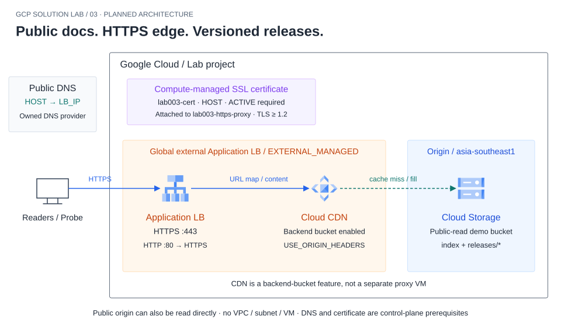
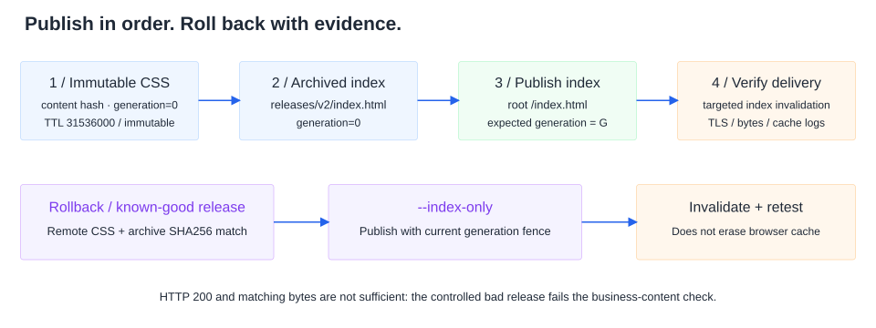

# Lab 03 — เอกสารสาธารณะผ่าน CDN และ HTTPS ที่อัปเดตและย้อนเวอร์ชันได้



DNS ใช้ provider ที่คุณควบคุม ส่วน certificate เป็น Compute-managed SSL resource ไม่ใช่ Certificate Manager ระบบไม่มี VPC/subnet/VM และ Cloud CDN เป็น feature ของ backend bucket เส้นประคือ cache miss/fill จาก origin ซึ่งเป็น public read ตามขอบเขต Lab



อัปโหลด asset ก่อน index และใช้ generation fence ทุกครั้งที่เปลี่ยน root การ rollback ตรวจ remote bytes ก่อน ไม่ใช่เพียงคัดลอกไฟล์เก่าทับแล้วถือว่าสำเร็จ

ทีม Support ต้องเผยแพร่คู่มือผลิตภัณฑ์ให้ลูกค้าเปิดผ่าน HTTPS ได้ทั่วถึง ปัญหาไม่ได้จบที่อัปโหลด HTML: เมื่อเปลี่ยนเอกสารต้องไม่เห็นหน้าใหม่กับ CSS เก่าปนกัน และถ้าปล่อยเนื้อหาผิดต้องย้อนกลับได้โดยพิสูจน์จาก version/hash ไม่ใช่แค่กด refresh แล้วคิดว่าหาย

## Requirements และขอบเขต Solution

| ID | ความต้องการ | วิธีพิสูจน์ / หลักฐาน |
|---|---|---|
| R1 | เข้าคู่มือผ่าน HTTPS ด้วยชื่อที่ทีมควบคุม | DNS A ตรง frontend IP, managed certificate ACTIVE และ TLS validation ผ่านโดยไม่ใช้ -k; เก็บ hostname/certificate และ HTTP status |
| R2 | เผยแพร่เนื้อหา/asset ครบและอ้างอิงตรง release | หน้า /index.html แสดง release ID; CSS content-hash URL โหลด200 และ SHA256 ตรง manifest; ไม่ทิ้งไฟล์ให้ผู้เรียนคิดเอง |
| R3 | Cache ตามชนิดไฟล์ | index.html public,max-age=60; immutable hashed assets max-age=31536000; ดู metadata/headers และ CDN cache-hit logs หลัง warmup ไม่ใช้ latency อย่างเดียวพิสูจน์ hit |
| R4 | อัปเดตเป็น v2 โดยไม่เสีย asset consistency | อัปโหลด immutable assets ก่อน index, publish index ด้วย generation precondition; ตรวจ release ID/hash หลัง TTL หรือ targeted invalidation |
| R5 | วินิจฉัยและกู้ bad release | ปล่อย bad release ที่ควบคุมไว้ ตรวจอาการจาก HTTP/content/hash แล้ว publish index v1 กลับด้วย generation fence; invalidate เฉพาะ path ที่จำเป็นและตรวจผลใหม่ |
| R6 | สิทธิ์ Public content ชัดและไม่อ้าง origin isolation | เฉพาะ bucket Lab เป็น public read; ไม่มี secret/customer data; anonymous write ต้องไม่สำเร็จ; ตรวจ IAM และ organization Public Access Prevention ก่อนเริ่ม |
| R7 | Change request: HTML กับ asset TTL ต่างกัน | เปรียบเทียบ update ก่อน/หลังเลือก TTL และ fingerprinted URLs; บันทึก stale object behavior และข้อจำกัด browser cache |
| R8 | Cleanup/rebuild ครบ | ลบ frontend/proxy/URL map/backend bucket/cert/reserved IP/objects versions/bucket และ DNS record ของ Lab ตาม dependency; บันทึก commit/config/resources จริง |

## เหตุผลการออกแบบ

Global external Application LB + Cloud CDN + Cloud Storage backend bucket + public DNS + Google-managed certificate ไม่มี VM/VPC/subnet ในเส้นทางนี้ ไม่ใส่กรอบ network ที่ไม่ได้สร้าง

เลือก **Global external Application Load Balancer รุ่น EXTERNAL_MANAGED** กับ backend bucket ตาม [คู่มือ setup รุ่น global](https://docs.cloud.google.com/load-balancing/docs/https/setup-global-ext-https-buckets) ใช้ HTTP proxy สำหรับ redirect และ HTTPS proxy สำหรับ content ไม่มีการปน EXTERNAL ของ classic ในชุดเดียวกัน

Cloud Storage origin baseline เป็น public-readable สำหรับเอกสารสาธารณะ จึงอาจอ่าน origin URL โดยตรงได้ ไม่อ้างว่าใครต้องผ่าน CDN เสมอ TLS termination ที่ LB ไม่ทำให้ origin private โดยอัตโนมัติ ไม่เปิด signed URL/private bucket complexity มาปะปนกับ baseline

## Domain, IAM และค่าใช้จ่ายที่เป็นเงื่อนไขเริ่ม

- ผู้เรียนต้องมี subdomain ที่ควบคุม DNS ได้จริง ไม่มีการซื้อ domain หรือเปลี่ยน DNS ของงานจริงโดยอัตโนมัติ ไม่มี domain ให้บันทึก BLOCKED ของ HTTPS; HTTP/IP-only test ไม่ถือว่าผ่าน R1
- หากองค์กรบังคับ Public Access Prevention ห้ามปิดนโยบายเพื่อทำ Lab ให้ใช้ sandbox ที่ได้รับอนุญาตหรือทบทวน solution ใหม่
- Bucket เก็บเฉพาะ demo docs ใช้ uniform bucket-level access และ public object viewer ตาม scope ไม่ให้ allUsers มีสิทธิ์เขียน
- ตรวจ Compute/LB, Storage, certificate และ DNS permissions ตามวิธีที่เลือก ไม่ขอ Owner เพื่อแก้ทุก error
- มีต้นทุน LB/static IP/storage/CDN egress/cache fill/requests/logs และ DNS ถ้าสร้าง zone แยก Budget ไม่ใช่ hard cap เปิดเวลาจำกัดแล้ว cleanup
- งานจัดทำคู่มือไม่สร้างทรัพยากร ไม่เปลี่ยน DNS และไม่ Deploy เว็บไซต์ใดจริง ผู้เรียนรันหลังตรวจงบ/สิทธิ์ของตนเอง

## Release materials ที่ใช้

ชุดนี้มีคู่มือผลิตภัณฑ์ v1/v2 และ bad-release fixture พร้อม release ID, immutable CSS และ manifest ระบุ SHA256/size/MIME/cache metadata Builder ไม่เขียนทับ output เดิมและไม่มี timestamp สุ่ม จึงตรวจ build ซ้ำได้

เครื่องมือ publish ต้อง upload assets ก่อน root index, ตรวจ generation fence, ไม่ลบ asset เก่าทันที และไม่ใช้งาน cloud credentials ใน CI baseline มี bounded HTTP probe เก็บ status/headers/content hash โดยไม่อ้าง cache HIT จาก header ที่ origin ใส่เอง

## ขอบเขตหลักฐานและการออกแบบทดสอบ

แยก browser cache, edge cache และ origin metadata ให้ชัด การ invalidate CDN ไม่ล้าง browser cache และการใช้ URL query สุ่มอาจเปลี่ยน cache key จึงห้ามใส่ cache-buster ใน probe ที่ใช้พิสูจน์ cache hit การ warm จาก client เดียวไม่พิสูจน์ hit ทุก PoP

เก็บ request timestamp/URL/release/hash, cache logs ที่สัมพันธ์กับชุดทดสอบ, certificate/DNS และ before/after metadata ไม่แต่ง screenshot หรือค่า latency เปรียบเทียบที่ไม่ได้วัด

## แหล่งอ้างอิงขอบเขต

- [Cloud CDN setup overview](https://docs.cloud.google.com/cdn/docs/using-cdn)
- [Backend bucket setup](https://docs.cloud.google.com/load-balancing/docs/https/ext-load-balancer-backend-buckets)
- [Cloud Storage static website](https://docs.cloud.google.com/storage/docs/hosting-static-website)
- [Cloud CDN cache modes](https://docs.cloud.google.com/cdn/docs/caching)
- [Cache invalidation](https://docs.cloud.google.com/cdn/docs/cache-invalidation-overview)

## สารบัญการลงมือทำ

- [Task 0 — ตรวจ Project, Domain และเตรียม Code](#task-0)
- [Task 1 — Build เอกสารสาม Release แบบตรวจซ้ำได้](#task-1)
- [Task 2 — สร้าง Public-read Bucket เฉพาะ Demo](#task-2)
- [Task 3 — Publish v1 โดยยังไม่สร้าง Frontend](#task-3)
- [Task 4 — ประกอบ Global HTTPS LB และ HTTP Redirect](#task-4)
- [Task 5 — ตั้ง DNS และตรวจ HTTPS จริง](#task-5)
- [Task 6 — ตรวจ Release และพิสูจน์ CDN Cache](#task-6)
- [Task 7 — ปล่อย v2 และรับมือ Cache ที่ยังเห็น v1](#task-7)
- [Task 8 — Fault: Bad Release และ Rollback](#task-8)
- [Task 9 — Change Request: Hotfix HTML เร็ว แต่ไม่ทำ Asset Cache เสีย](#task-9)
- [Task 10 — ตรวจ Public-read Boundary และสรุปผลงาน](#task-10)
- [Task 11 — Cleanup และ Rebuild](#task-11)

## เตรียมลงมือทำ

| สิ่งที่ต้องเตรียม | รายละเอียด |
|---|---|
| บัญชี | Sandbox project ผูก Billing; มีสิทธิ์ Compute Network/LB Admin, Storage Admin เฉพาะ bucket Lab, Service Usage Admin, Logs Viewer และ DNS editor เฉพาะ record ที่ควบคุม |
| Domain | Subdomain ใหม่ที่ไม่ทับบริการจริง; แก้ public DNS A/AAAA ได้ ผู้ทำต้องมีสิทธิ์จากเจ้าของ domain |
| เวลา/งบ | เผื่อ 3–5 ชั่วโมง รวมรอ DNS/certificate; ค่า LB/static IPv4/CDN/cache fill/egress/storage/requests/logs อาจเกิดแม้ไม่มีผู้ใช้ |
| ข้อมูล | Demo docs เท่านั้น ไม่มี credentials/customer data ทุก object ใน bucket นี้ public read ได้ |
| ขอบเขต | Guide ไม่ซื้อ domain, เปลี่ยนนโยบายองค์กร หรือสร้าง GCP resources ให้โดยอัตโนมัติ คำสั่งด้านล่างผู้เรียนรันหลังยอมรับต้นทุนแล้ว |

### ค่าที่ใช้ตลอด Lab

| ค่า | กำหนด |
|---|---|
| PROJECT_ID | ต้องแทน YOUR_PROJECT_ID |
| HOST | ต้องแทนด้วย subdomain ที่ควบคุมจริง เช่น docs-lab.your-owned-domain.tld ไม่ใส่ https:// |
| BUCKET | lab003-PROJECT_ID-docs; ต้อง unique ทั้งระบบ ถ้าชื่อชนให้เลือกชื่อใหม่ขึ้นต้น lab003- |
| Bucket location/class | asia-southeast1 / STANDARD |
| Backend bucket | lab003-docs-backend |
| Global IP | lab003-lb-ip |
| URL maps | lab003-content-map / lab003-http-redirect |
| Proxies | lab003-https-proxy / lab003-http-proxy |
| Forwarding rules | lab003-https / lab003-http |
| SSL certificate / policy | lab003-cert / lab003-tls |

คำสั่งทั้งหมดรันใน **Cloud Shell** ของ Console เว้นแต่ระบุ Browser/Console ไม่มี VM ที่ต้อง SSH เข้า

<a id="task-0"></a>

## Task 0 — ตรวจ Project, Domain และเตรียม Code

**Console:** เลือก sandbox project, เปิด **Billing → Budgets & alerts** ตั้งวงเงินที่ยอมรับ ตรวจ **IAM & Admin → Quotas & System Limits** ว่ามี global external IP/forwarding rule/target proxy/certificates เพียงพอ ตรวจ organization Public Access Prevention กับผู้ดูแลก่อนสร้าง bucket ถ้าบังคับ public access prevention ให้หยุด baseline ไม่ปิด policy ขององค์กร

**Cloud Shell:** แทน PROJECT_ID และ HOST ด้วยค่าจริงของตนเอง:

```bash
export PROJECT_ID="YOUR_PROJECT_ID"
export HOST="docs-lab.YOUR_OWN_DOMAIN"
export BUCKET="lab003-${PROJECT_ID}-docs"
gcloud config set project "$PROJECT_ID"
gcloud config get-value project
gcloud auth list --filter=status:ACTIVE
gcloud services enable compute.googleapis.com storage.googleapis.com logging.googleapis.com
git clone --branch main --single-branch https://github.com/somkid-s5/Portfolio-Lab.git ~/portfolio-lab-003-source
export LAB_DIR="$HOME/portfolio-lab-003-source/GCP/LAB-003-public-docs-cdn"
cd "$LAB_DIR"
git rev-parse HEAD
mkdir -p builds assets/evidence
python3 scripts/render-config.py --project "$PROJECT_ID" --host "$HOST" --out builds/config
```

หาก directory clone มีงานเก่าอยู่ อย่าลบหรือ reset ให้เลือก directory ใหม่และปรับ LAB_DIR Renderer จะปฏิเสธ HOST ที่ยังมี underscore จาก placeholder จึงต้องแทนทั้งค่าเป็น hostname จริงก่อน ไม่ใช้ example.com ที่คุณไม่ได้ควบคุมเพื่อให้คำสั่งดูผ่าน

**Expected:** project ตรง Console, ได้ builds/config/content-map.json และ http-redirect-map.json ไม่มี network call จาก renderer เปิดอ่านไฟล์ดู backend bucket project/ชื่อให้ตรง จด commit และใช้ code รุ่นเดียวตลอด Lab

**บันทึก T00:** Project alias [เติม] / hostname และสิทธิ์ควบคุม DNS [เติม] / commit/Python/gcloud versions [เติม] / IAM/quota/PAP/budget [เติม] / สถานะ PENDING

<a id="task-1"></a>

## Task 1 — Build เอกสารสาม Release แบบตรวจซ้ำได้

**Cloud Shell:**

```bash
cd "$LAB_DIR"
python3 scripts/build-release.py --release v1 --out builds/v1
python3 scripts/build-release.py --release v2 --out builds/v2
python3 scripts/build-release.py --release bad --out builds/bad
python3 -m json.tool builds/v1/manifest.json
python3 -m unittest discover -s tests -v
```

**Expected:** แต่ละ release มี index.html, CSS ชื่อ content hash ภายใต้ releases/RELEASE/assets และ manifest ที่ระบุ size/SHA256/MIME/Cache-Control ไม่มี timestamp สุ่มใน build output v1/v2 เป็นเอกสารดี ส่วน bad เป็น fixture ที่ขาด heading Support guide แต่ไฟล์/hash ถูกต้อง เพื่อฝึกแยก delivery สำเร็จออกจาก business content ผิด

Builder ไม่เขียนทับ output เดิม ถ้ารันซ้ำให้ใช้ directory ใหม่ เช่น builds/v1-check อย่าลบผลเก่าเพื่อกลบปัญหา การรัน tests นี้ใช้ local HTTP fixtures และ fake publisher runner ไม่สร้าง GCP resources หรือพิสูจน์ CDN/TLS

เปิด `python3 -m http.server 8080 --directory builds/v1` แล้วใช้ **Cloud Shell → Web preview → Preview on port 8080** ไป /index.html ตรวจหน้าเว็บ/CSS/Quick start และรายละเอียด Troubleshooting เมื่อจบกด Ctrl+C ที่ terminal ของ server ไม่ kill งานอื่นที่ใช้ port นี้

**บันทึก T01:** Release IDs/hash ใน manifest [เติม] / ภาพหน้า v1 ไม่ใช่ Cloud deployment [แนบ] / ผล tests [เติม] / สถานะ PENDING

<a id="task-2"></a>

## Task 2 — สร้าง Public-read Bucket เฉพาะ Demo

**Cloud Shell:** ตรวจ BUCKET ต้องขึ้นต้น lab003- และอยู่ใน project ทดลอง คำสั่งนี้สร้าง resource ที่คิดค่าใช้จ่าย:

```bash
printf 'Project=%s Bucket=%s Host=%s\n' "$PROJECT_ID" "$BUCKET" "$HOST"
gcloud storage buckets create "gs://$BUCKET" --project="$PROJECT_ID" \
  --location=asia-southeast1 --default-storage-class=STANDARD \
  --uniform-bucket-level-access --soft-delete-duration=0
gcloud storage buckets add-iam-policy-binding "gs://$BUCKET" \
  --member=allUsers --role=roles/storage.objectViewer
gcloud storage buckets describe "gs://$BUCKET"
gcloud storage buckets get-iam-policy "gs://$BUCKET"
```

**เหตุผล/ข้อจำกัด:** ใช้ uniform IAM และ allUsers เฉพาะ objectViewer ไม่ให้ write/admin Soft delete ปิดเฉพาะ bucket demo ใหม่นี้เพื่อไม่เหลือข้อมูลที่ถูกลบคิดค่าเก็บตาม default 7 วัน ใช้ STANDARD ไม่มี minimum retention ตาม storage class แบบ cold ไม่เปิด versioning เพราะ rollback ใช้ immutable archived releases ถ้า policy องค์กรบังคับ retention/soft delete ให้บันทึกเงื่อนไขและต้นทุนตามจริง ห้ามข้ามด้วยการเปลี่ยน policy ของทรัพยากรอื่น

**Console:** เปิด **Cloud Storage → Buckets → bucket นี้ → Permissions** ตรวจ public read เฉพาะ bucket Lab ดู **Protection** ว่า soft delete/versioning/retention ตรงสิ่งที่ตกลง อย่าคัดลอกข้อมูลลับใดเข้า bucket แม้ชั่วคราว

**บันทึก T02:** bucket/location/class [เติม] / IAM viewer-only [เติม] / retention/soft-delete/versioning ที่ตั้งจริง [เติม] / สถานะ PENDING

<a id="task-3"></a>

## Task 3 — Publish v1 โดยยังไม่สร้าง Frontend

**Cloud Shell:** ดู dry-run ก่อน ค่า expected-generation=0 ใช้เฉพาะตอน root index ยังไม่เคยมี:

```bash
cd "$LAB_DIR"
python3 scripts/publish-release.py --release-dir builds/v1 --bucket "$BUCKET" \
  --expected-generation 0
```

**Expected dry-run:** ลำดับ upload CSS → upload immutable releases/v1/index.html → publish root index.html สองคำสั่งแรก generation=0 และ root generation=0 ไม่มีการเรียก gcloud จาก script เมื่อไม่ใส่ --apply

เมื่ออ่านเป้าหมายและยืนยันว่าเป็น bucket demo ใหม่แล้วจึงรัน:

```bash
python3 scripts/publish-release.py --release-dir builds/v1 --bucket "$BUCKET" \
  --expected-generation 0 --apply
gcloud storage objects describe "gs://$BUCKET/index.html"
curl --max-time 10 -i "https://storage.googleapis.com/$BUCKET/index.html"
```

**Expected:** anonymous GET origin=200, HTML มี release v1 และ Support guide, metadata Cache-Control=public,max-age=60 ส่วน CSS เป็น public,max-age=31536000,immutable

หาก root หรือ archived path มีอยู่แล้ว publisher จะหยุด ไม่ใช้ force overwrite การรันซ้ำ release ที่อัปโหลดครบแล้วต้องเลือก --index-only พร้อม generation ของ root ปัจจุบัน และตรวจเหตุผลก่อนทำ ถ้าอัปโหลดค้างเพียงบางไฟล์ให้ตรวจ remote hashes/รายการให้ครบก่อนตัดสินใจ ไม่ลบทั้ง bucket เพื่อหนี precondition failure

**บันทึก T03:** ลำดับ publish [เติม] / root generation [เติม] / origin HTTP/release/hash/headers [เติม] / หลักฐาน dry-run ไม่ใช่ผล apply [แยกให้ชัด] / สถานะ PENDING

<a id="task-4"></a>

## Task 4 — ประกอบ Global HTTPS LB และ HTTP Redirect

**Cloud Shell:** ใช้ global EXTERNAL_MANAGED ตาม design ไม่สร้าง VPC/subnet/firewall:

```bash
gcloud compute addresses create lab003-lb-ip --global --ip-version=IPV4 --network-tier=PREMIUM
export LB_IP="$(gcloud compute addresses describe lab003-lb-ip --global --format='value(address)')"
gcloud compute backend-buckets create lab003-docs-backend \
  --gcs-bucket-name="$BUCKET" --enable-cdn
gcloud compute backend-buckets update lab003-docs-backend --cache-mode=USE_ORIGIN_HEADERS
gcloud compute url-maps import lab003-content-map --global --source=builds/config/content-map.json
gcloud compute url-maps import lab003-http-redirect --global --source=builds/config/http-redirect-map.json
gcloud compute ssl-certificates create lab003-cert --global --domains="$HOST"
gcloud compute ssl-policies create lab003-tls --profile=MODERN --min-tls-version=1.2
gcloud compute target-https-proxies create lab003-https-proxy \
  --url-map=lab003-content-map --ssl-certificates=lab003-cert --ssl-policy=lab003-tls
gcloud compute target-http-proxies create lab003-http-proxy --url-map=lab003-http-redirect
gcloud compute forwarding-rules create lab003-https --global \
  --load-balancing-scheme=EXTERNAL_MANAGED --network-tier=PREMIUM \
  --address=lab003-lb-ip --target-https-proxy=lab003-https-proxy --ports=443
gcloud compute forwarding-rules create lab003-http --global \
  --load-balancing-scheme=EXTERNAL_MANAGED --network-tier=PREMIUM \
  --address=lab003-lb-ip --target-http-proxy=lab003-http-proxy --ports=80
printf 'Set DNS A %s -> %s\n' "$HOST" "$LB_IP"
```

**Console:** เปิด **Network services → Load balancing** ตรวจ forwarding rules/target proxies/URL maps ที่สร้างไว้ Scheme ต้อง EXTERNAL_MANAGED, HTTPS443 ไป content map และ HTTP80 ไป redirect map Backend เป็น bucket ไม่ใช่ backend service ของ VM

Certificate ยังไม่ ACTIVE เป็นเรื่องที่คาดได้ก่อน DNS ชี้ถูก อย่าใช้ curl -k เพื่ออ้างว่า HTTPS ผ่าน และไม่สร้าง self-signed certificate แทน requirement ระหว่างรอ

Backend bucket logging เปิดอัตโนมัติและปิดไม่ได้ด้วย sample-rate flag ของ backend service หากไม่เห็น logs ภายหลังให้ตรวจช่วงเวลา/forwarding rule และ exclusions ไม่เพิ่มคำสั่ง --enable-logging ที่ไม่มีสำหรับ backend bucket

**บันทึก T04:** frontend IP/scheme [เติม] / proxy/maps/backend bucket [เติม] / cert initial state [เติม] / resource inventory [เติม] / สถานะ PENDING

<a id="task-5"></a>

## Task 5 — ตั้ง DNS และตรวจ HTTPS จริง

**ทำที่:** หน้า DNS ของผู้ให้บริการ domain ที่คุณควบคุม ไม่จำเป็นต้องย้ายทั้ง domain เข้า Cloud DNS

1. เปิด DNS zone ของ domain ตรวจว่า hostname ใหม่ของ Lab ยังไม่ใช้งาน อย่าแก้ record ของระบบจริง
2. เพิ่ม **A record** ของ HOST ให้ชี้ LB_IP จาก Task 4 ตั้ง TTL 300 วินาที หรือค่าต่ำสุดที่ provider รองรับ
3. หาก provider มี proxy/CDN อีกชั้น ให้ record Lab นี้เป็น **DNS only** เพื่อทดสอบ Google LB โดยตรง
4. ถ้า hostname ใหม่นี้มี AAAA/CNAME เดิม ให้ตรวจเจ้าของและ dependencies ก่อนแก้ ค่า DNS ทั้งหมดต้องชี้ frontend ที่ตั้ง certificate จริง อย่าลบ record ที่คุณไม่มีสิทธิ์ดูแล
5. **Console → Network services → Load balancing → Certificates** หรือค้น certificate lab003-cert ตรวจสถานะ domain/certificate

**Cloud Shell:**

```bash
dig +short A "$HOST"
dig +short AAAA "$HOST"
gcloud compute ssl-certificates describe lab003-cert --global \
  --format='yaml(name,managed.status,managed.domainStatus,expireTime)'
```

**Expected:** A ตรง LB_IP, ไม่มี AAAA/CNAME ที่ชี้ระบบอื่น, certificate ACTIVE หลัง DNS/attachment พร้อม การ provision อาจใช้เวลาตาม DNS propagation ไม่ตั้ง deadline ว่าได้แน่ในไม่กี่นาที ถ้า FAILED_NOT_VISIBLE ให้ตรวจ DNS, frontend443 และ cert attachment ก่อนสร้าง cert ใหม่ ถ้า CAA/องค์กรจำกัดผู้ออก certificate ให้ประสานผู้ดูแล ไม่ข้ามด้วย self-signed หรือ -k

เมื่อ ACTIVE แล้ว:

```bash
curl --connect-timeout 5 --max-time 15 -I "https://$HOST/index.html"
curl --connect-timeout 5 --max-time 15 -I "http://$HOST/index.html"
curl --connect-timeout 5 --max-time 15 -I "https://$HOST/"
openssl s_client -connect "$HOST:443" -servername "$HOST" \
  -verify_return_error -verify_hostname "$HOST" < /dev/null
```

**Expected:** HTTPS index=200, HTTP redirect ไป HTTPS, root / redirect ไป /index.html และ TLS verification ผ่านชื่อ HOST จริง ไม่ใช้การเห็นรูปกุญแจอย่างเดียวแทน certificate check

**บันทึก T05 / R1:** DNS ก่อน/หลัง [เติม] / cert ACTIVE และ UTC [เติม] / HTTPS status, redirect Location, certificate subject/SAN/expiry [เติม] / ข้อจำกัด propagation [เติม] / สถานะ PENDING

<a id="task-6"></a>

## Task 6 — ตรวจ Release และพิสูจน์ CDN Cache

**Cloud Shell:**

```bash
cd "$LAB_DIR"
python3 scripts/probe-release.py --url "https://$HOST" \
  --manifest builds/v1/manifest.json --requests 10 --out assets/evidence/t06-v1.json
```

**Expected:** exit 0, all_checks_passed=true, tls_verified=true; index/asset SHA256 และ Cache-Control ตรง manifest คำสั่งนี้ไม่มี cache-buster และไม่ส่ง Cache-Control:no-cache เพื่อไม่ทำลายการสังเกต cache ถ้ารันซ้ำเปลี่ยน --out ชื่อใหม่ ไม่เขียนทับหลักฐานเดิม

### แยกหลักฐาน content จาก cache hit

1. เปิด **Logging → Logs Explorer**
2. เลือกช่วงเวลาครอบคลุมการทดสอบและ resource **Cloud HTTP Load Balancer**
3. ใช้ filter:

```text
resource.type="http_load_balancer"
resource.labels.forwarding_rule_name="lab003-https"
```

4. เปิด entry ที่ requestUrl เป็น URL ของ HOST ในชุดทดสอบ ดู httpRequest.cacheLookup, cacheHit, cacheFillBytes และ jsonPayload.statusDetails/cacheId
5. รัน probe รอบ warm อีกครั้งชื่อ t06-v1-warm.json รอ log ingestion แล้วหา request ที่ `cacheHit=true` หรือ statusDetails=`response_from_cache` ตาม log จริง
6. เก็บ entry ของ cache fill/miss และ hit ที่สัมพันธ์กับ URL/เวลา บันทึกถ้าไม่พบ ห้ามแปลว่า latency ต่ำหรือมี Age header อย่างเดียวคือ hit แน่นอน

**Expected R3:** มี metadata ตามชนิดไฟล์และ cache-hit evidence หลัง warmup ถ้า logs ไม่มาให้ตรวจ log exclusions, forwarding rule และเวลาที่เลือก Backend bucket logging เปิดอัตโนมัติ ไม่ใช่กรณี backend service ที่ต้อง enable sample rate การ warm จาก client เดียวไม่รับประกันทุก PoP เป็น hit

**บันทึก T06 / R2–R3:** index release/hash [เติม] / CSS path/hash/TTL [เติม] / cache fill URL/time/field [เติม] / cache hit URL/time/field [เติม] / probe JSON และ sanitized log entries [แนบ] / สถานะ PENDING

<a id="task-7"></a>

## Task 7 — ปล่อย v2 และรับมือ Cache ที่ยังเห็น v1

**Cloud Shell:** อ่าน generation ปัจจุบันทุกครั้งก่อนเปลี่ยน root index:

```bash
export INDEX_GENERATION="$(gcloud storage objects describe "gs://$BUCKET/index.html" --format='value(generation)')"
python3 scripts/publish-release.py --release-dir builds/v2 --bucket "$BUCKET" \
  --expected-generation "$INDEX_GENERATION"
```

อ่าน dry-run ต้องเป็น assets v2 → archived index v2 → root index ที่คาด generation ล่าสุด ถ้าถูกต้อง:

```bash
python3 scripts/publish-release.py --release-dir builds/v2 --bucket "$BUCKET" \
  --expected-generation "$INDEX_GENERATION" --apply
curl --max-time 10 -i "https://storage.googleapis.com/$BUCKET/index.html"
python3 scripts/probe-release.py --url "https://$HOST" \
  --manifest builds/v2/manifest.json --requests 5 --out assets/evidence/t07-v2-transition.json
```

**Expected ช่วง transition:** origin เป็น v2 แต่ edge อาจยังเป็น v1 จน TTL/convergence ผ่าน Probe อาจ exit 1 เพราะ hash ยังเก่า ให้เก็บผลตามจริง ไม่เปลี่ยน manifest ให้ตรงกับของเก่าที่ edge ส่งมา CSS เป็นชื่อใหม่จึงไม่มีการเขียนทับ bytes ของ asset เดิม

เมื่อยืนยัน origin v2 ถูกแล้ว ถ้าทีมต้องการเปลี่ยนทันทีให้ invalidate เฉพาะ index:

```bash
gcloud compute url-maps invalidate-cdn-cache lab003-content-map \
  --host="$HOST" --path="/index.html"
python3 scripts/probe-release.py --url "https://$HOST" \
  --manifest builds/v2/manifest.json --requests 10 --out assets/evidence/t07-v2-after.json
```

การ invalidate ใช้เวลามีผล ไม่ใช่ synchronous global browser refresh ถ้ารอบแรกยังเห็นเก่า ให้บันทึกเวลาและรันชื่อรอบใหม่แบบจำกัดหลังรอ ไม่ใช้ loop ยิงไม่จำกัดและไม่ invalidate /* ซ้ำ ๆ การ invalidate CDN ไม่ล้าง browser cache ของผู้ใช้

### ถ้าเจอ generation precondition failure

อย่าแก้ expected generation เป็น 0 หรือ force overwrite ทันที ตรวจ root generation/release ปัจจุบันและว่าใครเปลี่ยน ถ้าการเปลี่ยนอื่นถูกต้องให้หยุดและตัดสินใจร่วมกับเจ้าของ ถ้าจะ retry ต้องอ่าน generation ใหม่อย่างมีเหตุผลก่อน

หากการอัปโหลดค้างหลัง CSS สำเร็จแต่ archived index ยังไม่มี ให้เก็บ error แล้วตรวจใน Console ว่าเป็นกรณีนี้จริง อ่าน root generation ล่าสุดและใช้ --reuse-assets (ตัวอย่าง v2):

```bash
export INDEX_GENERATION="$(gcloud storage objects describe "gs://$BUCKET/index.html" --format='value(generation)')"
python3 scripts/publish-release.py --release-dir builds/v2 --bucket "$BUCKET" \
  --expected-generation "$INDEX_GENERATION" --reuse-assets
python3 scripts/publish-release.py --release-dir builds/v2 --bucket "$BUCKET" \
  --expected-generation "$INDEX_GENERATION" --reuse-assets --apply
```

โหมดนี้อ่าน remote CSS ตรวจ SHA256 ก่อน แล้ว upload archived index ด้วย generation=0 และ publish root ด้วย generation fence ถ้า archive มีอยู่แล้วด้วย ให้ใช้ --index-only แทนเพื่อ verify ทั้ง CSS/archive ถ้า root ไม่เคยสร้างมาก่อนจริงจึงใช้ expected-generation=0 ไม่อ่านค่าจาก error แล้วเดาเอง ทั้งสองโหมดหยุดเมื่อ remote bytes ไม่ตรงและไม่ทับ immutable objects

**บันทึก T07 / R4:** generation ก่อน/หลัง [เติม] / origin v2 UTC [เติม] / edge transition ที่วัดได้ [เติม] / invalidation operation/time [เติม] / ผล after [เติม] / สถานะ PENDING

<a id="task-8"></a>

## Task 8 — Fault: Bad Release และ Rollback

ทำเฉพาะ demo hostname โดยผู้ทำรู้ว่าชั่วคราวจะเห็นเอกสารผิด ห้ามใช้กับเอกสารลูกค้าจริง

**Cloud Shell:**

```bash
export INDEX_GENERATION="$(gcloud storage objects describe "gs://$BUCKET/index.html" --format='value(generation)')"
python3 scripts/publish-release.py --release-dir builds/bad --bucket "$BUCKET" \
  --expected-generation "$INDEX_GENERATION" --apply
gcloud compute url-maps invalidate-cdn-cache lab003-content-map --host="$HOST" --path="/index.html"
python3 scripts/probe-release.py --url "https://$HOST" \
  --manifest builds/bad/manifest.json --requests 5 --out assets/evidence/t08-bad.json
```

**Expected:** หลัง edge รับ bad release จริง bytes/hash อาจตรง manifest ทุกไฟล์และ HTTP200 แต่ business_content_ok=false เพราะไม่มี heading Support guide ดังนั้น all_checks_passed=false และ exit1 ระบบส่งไฟล์สำเร็จไม่ได้แปลว่าบริการตอบโจทย์ถูก

### ย้อนกลับ v1 ที่รู้ว่าใช้งานได้

```bash
export INDEX_GENERATION="$(gcloud storage objects describe "gs://$BUCKET/index.html" --format='value(generation)')"
python3 scripts/publish-release.py --release-dir builds/v1 --bucket "$BUCKET" \
  --expected-generation "$INDEX_GENERATION" --index-only
python3 scripts/publish-release.py --release-dir builds/v1 --bucket "$BUCKET" \
  --expected-generation "$INDEX_GENERATION" --index-only --apply
gcloud compute url-maps invalidate-cdn-cache lab003-content-map --host="$HOST" --path="/index.html"
python3 scripts/probe-release.py --url "https://$HOST" \
  --manifest builds/v1/manifest.json --requests 10 --out assets/evidence/t08-rollback.json
```

**Expected:** --index-only อ่าน remote CSS/archive ตรวจ SHA256 ก่อน root publish หากไม่ตรงจะหยุด ไม่อัปโหลดทับ immutable path หลัง invalidate/convergence ต้องกลับมา v1, business content ถูก, asset hash/metadata ตรงและ exit0 เก็บ raw results ที่ fail ก่อนหน้าทั้งหมด

Rollback นี้ย้อน content pointer ไม่ได้ลบ bad release, history หรือ browser cache จด deployment/invalidation/observed recovery UTC เพื่อวัดเวลาที่สังเกตได้ ไม่อ้าง RTO guarantee หรือ zero downtime

**บันทึก T08 / R5:** bad publish time/generation [เติม] / HTTP/hash/business result [เติม] / สาเหตุที่ระบุได้ [เติม] / rollback generation/remote verification [เติม] / observed recovery และข้อจำกัด [เติม] / สถานะ PENDING

<a id="task-9"></a>

## Task 9 — Change Request: Hotfix HTML เร็ว แต่ไม่ทำ Asset Cache เสีย

ทีมขอให้ HTML hotfix สดขึ้นเป็น TTL15 วินาที โดย CSS ยัง immutable หนึ่งปี ไม่แก้เป็น FORCE_CACHE_ALL เพราะจะทับนโยบาย origin ทั้งชุด

**Cloud Shell:** v2 มี archived assets อยู่แล้วจาก Task 7 จึงเปลี่ยน metadata ของ root โดยใช้ --index-only:

```bash
cd "$LAB_DIR"
python3 scripts/build-release.py --release v2 --html-ttl 15 --out builds/v2-fast
export INDEX_GENERATION="$(gcloud storage objects describe "gs://$BUCKET/index.html" --format='value(generation)')"
python3 scripts/publish-release.py --release-dir builds/v2-fast --bucket "$BUCKET" \
  --expected-generation "$INDEX_GENERATION" --index-only
python3 scripts/publish-release.py --release-dir builds/v2-fast --bucket "$BUCKET" \
  --expected-generation "$INDEX_GENERATION" --index-only --apply
gcloud compute url-maps invalidate-cdn-cache lab003-content-map --host="$HOST" --path="/index.html"
python3 scripts/probe-release.py --url "https://$HOST" \
  --manifest builds/v2-fast/manifest.json --requests 10 --out assets/evidence/t09-fast-html.json
```

**Expected:** index Cache-Control เป็น public,max-age=15, CSS ยัง public,max-age=31536000,immutable และ URL/hash ของ CSS v2 เหมือนเดิม เป็น metadata change โดยไม่เปลี่ยน asset bytes เก็บก่อน/หลัง header และ cache log ผลต้องไม่อ้างว่า TTL15 ทำให้ทุก browser เปลี่ยนใน15วินาทีทันที เพราะ browser/edge อาจมี representation ตาม TTLเก่าก่อนเปลี่ยน

**Backout:** ใช้ builds/v2 เดิมกับ --index-only/expected-generation ล่าสุดเพื่อคืน HTML TTL60 และ invalidate เฉพาะ index จากนั้นใช้ manifest v2 ตรวจใหม่ หากกังวลเนื้อหาให้เลือก v1 ที่ทราบว่าดีแทนพร้อมบันทึกเหตุผล

**บันทึก T09 / R7:** requirement และทางเลือกที่พิจารณา [เติม] / HTML TTL ก่อน/หลัง [เติม] / CSS path/hash/TTL คงเดิม [เติม] / ข้อจำกัด browser cache [เติม] / backout ทำจริงหรือแผน [เติม] / สถานะ PENDING

<a id="task-10"></a>

## Task 10 — ตรวจ Public-read Boundary และสรุปผลงาน

### Anonymous อ่านได้ แต่เขียนไม่ได้

**Cloud Shell:** ใช้ curl ที่ไม่มี Authorization และไม่เรียก gcloud สำหรับ negative write เพื่อไม่เผลอใช้สิทธิ์ผู้ดูแล:

```bash
curl --max-time 10 -I "https://storage.googleapis.com/$BUCKET/index.html"
curl --max-time 10 -i -X PUT --data-binary 'anonymous-write-test' \
  "https://storage.googleapis.com/$BUCKET/anonymous-write-test.txt"
gcloud storage ls "gs://$BUCKET/anonymous-write-test.txt"
gcloud storage buckets get-iam-policy "gs://$BUCKET"
```

**Expected:** anonymous GET200, PUT ถูกปฏิเสธ และไม่มี test object ถ้า write สำเร็จให้บันทึก FAIL หยุดเผยแพร่ แก้ IAM ที่กว้างเกินและลบเฉพาะ object ทดลองหลังตรวจชื่อ อย่าถือว่า public content หมายถึง public write ถูกต้อง

Origin URL อ่านได้โดยตรงเป็นข้อจำกัด baseline ไม่อ้าง origin isolation หรือบังคับผ่าน CDN ถ้าต้องการ origin private ต้องออกแบบ private bucket access แยก ไม่ใส่คำกล่าวอ้างลงผลงานโดยไม่มี config/negative test รองรับ

### รวบรวมหลักฐานก่อน Cleanup

ผล probe อยู่ assets/evidence/ อยู่แล้ว แต่ log/DNS/cert/invalidation outputs ต้องเก็บแยกชื่อและ redact ข้อมูลที่ไม่ต้องเผยแพร่ ตรวจ git status ก่อน commit ห้ามแนบ credentials, Cloud Shell auth exports หรือสิทธิ์ของ domain ที่ไม่เกี่ยวข้อง

| Requirement | Actual | Evidence | Status |
|---|---|---|---|
| R1 DNS/TLS | [เติม] | T05 | PENDING |
| R2 release/asset consistency | [เติม] | T06/T07 | PENDING |
| R3 cache metadata + hit | [เติม] | T06 logs/headers | PENDING |
| R4 safe v2 publish | [เติม] | T07 | PENDING |
| R5 bad-release recovery | [เติม] | T08 | PENDING |
| R6 public read/not write | [เติม] | T02/T10 | PENDING |
| R7 HTML/asset cache change | [เติม] | T09 | PENDING |
| R8 cleanup/rebuild | [เติม] | T11 | PENDING |

**Case study:** ปัญหาทีม [เติม] / architecture และเหตุผลเลือก CDN+bucket [เติม] / วิธีปล่อยอย่างไม่ปน asset [เติม] / incident และการแยก content correctness จาก HTTP200 [เติม] / rollback evidence [เติม] / cache change trade-off [เติม] / สิ่งที่ยังไม่ได้พิสูจน์ เช่น every-PoP hit, production load, origin isolation [เติม]

## Troubleshooting

| อาการ | ตรวจทีละชั้น | วิธีเดินต่อ |
|---|---|---|
| public IAM ถูกปฏิเสธ | PAP/organization policy/ผู้ทำมีสิทธิ์ bucket IAM หรือไม่ | ขอ sandbox ที่อนุญาต ไม่ปิด policy ขององค์กร |
| TLS name mismatch | HOST/DNS A/AAAA → cert domains → HTTPS proxy attachment | ชื่อถูกและ verifyผ่าน ไม่ใช้ -k |
| cert provision ไม่เสร็จ | authoritative DNS → LB443 → CAA/validation state | เก็บสถานะและแก้สาเหตุ ไม่สร้าง certซ้ำไม่จำกัด |
| /index404 หรือ CSS404 | backend bucket name → object path/case → manifest asset reference | ตรวจ origin object ก่อน invalidate |
| HTTP200 แต่ probe fail | expected release/hash → business heading → Cache-Control | แยก old edge, bad content และ metadata |
| ไม่พบ cache hit | CDN enabled/cache mode → origin metadata → request URL/key → logs exclusions/time | warmแบบจำกัดและดู cache fieldsจริง |
| generation mismatch | มี publish อื่นหรือ rootเปลี่ยนแล้ว | ตรวจ current release แล้วตัดสินใจ ไม่force |
| immutable asset exists | releaseเคยstageแล้วหรือpartial upload | verify bytes/archive ก่อน --index-only; ไม่ทับ asset |
| invalidateแล้ว browserยังเก่า | browser cache ต่างจาก edge cache | ตรวจ fresh client/headers; บันทึกข้อจำกัด |
| probe output exists | ชื่อ evidenceซ้ำ | ใช้ชื่อรอบใหม่ เก็บผลfailเดิม |

**บันทึก Incident:** Task/UTC [เติม] / อาการ [เติม] / สมมติฐาน/หลักฐานที่ตรวจ [เติม] / สาเหตุที่พิสูจน์ได้ [เติม] / การแก้ [เติม] / retest [เติม]

<a id="task-11"></a>

## Task 11 — Cleanup และ Rebuild

คำสั่งต่อไปนี้ลบเนื้อหาและทรัพยากรจริงของ Lab ตรวจ PROJECT_ID, BUCKET และ HOST ให้ตรง sandbox และเก็บหลักฐานครบก่อน ห้ามแทนค่าเป็น bucket/domain งานจริง

1. ที่ DNS provider ลบเฉพาะ A record ของ hostname Lab ที่สร้างไว้ ถ้าเคยเปลี่ยน record เดิมต้องคืนค่าที่บันทึก ไม่ลบทั้ง zone หรือ domain
2. **Cloud Shell:** ลบ frontend/proxies/maps/backend ตาม dependency:

```bash
gcloud config get-value project
printf 'Bucket=%s Host=%s\n' "$BUCKET" "$HOST"
gcloud compute forwarding-rules delete lab003-http lab003-https --global
gcloud compute target-http-proxies delete lab003-http-proxy
gcloud compute target-https-proxies delete lab003-https-proxy
gcloud compute url-maps delete lab003-http-redirect lab003-content-map
gcloud compute backend-buckets delete lab003-docs-backend
gcloud compute ssl-certificates delete lab003-cert --global
gcloud compute ssl-policies delete lab003-tls
gcloud compute addresses delete lab003-lb-ip --global
```

3. ตรวจว่า bucket เป็นของ Lab ใหม่และไม่มีไฟล์อื่นแล้วจึงลบทุก object/version รวม archived v1/v2/bad จากนั้นลบ bucket:

```bash
python3 -c 'import os,re; assert re.fullmatch(r"lab003-[a-z0-9][a-z0-9-]{3,50}[a-z0-9]",os.environ["BUCKET"]), "Stop: invalid lab bucket"'
gcloud storage ls --all-versions "gs://$BUCKET/**"
gcloud storage rm --recursive --all-versions "gs://$BUCKET"
```

คำสั่ง recursive ด้านบนลบทั้ง bucket และข้อมูลภายใน ต้องตรวจ resolved BUCKET ก่อนกดยืนยัน หาก retention/soft delete ถูกบังคับและยังมีของเหลือ ให้บันทึก retention/วันหมดอายุ/ต้นทุนที่เหลือ ไม่อ้าง cleanupเสร็จจากการที่ live objectsหายไปอย่างเดียว

4. ตรวจรายการคงเหลือ:

```bash
gcloud compute forwarding-rules list --filter='name~^lab003-'
gcloud compute target-http-proxies list --filter='name~^lab003-'
gcloud compute target-https-proxies list --filter='name~^lab003-'
gcloud compute url-maps list --filter='name~^lab003-'
gcloud compute backend-buckets list --filter='name~^lab003-'
gcloud compute ssl-certificates list --filter='name=lab003-cert'
gcloud compute ssl-policies list --filter='name=lab003-tls'
gcloud compute addresses list --filter='name=lab003-lb-ip'
gcloud storage buckets describe "gs://$BUCKET"
dig +short A "$HOST"
```

**Expected:** resource ของ Lab ไม่เหลือ, bucket describe not-found และ DNS record ถูกลบ/คืนค่าที่ authoritative provider DNS cache อาจยังตอบตาม TTLเดิมได้ ต้องแยก authoritative state จาก cached lookup และ billing อาจแสดงช้าตามรอบข้อมูล

**บันทึก T11 / R8:** DNS [เติม] / frontend/proxy/maps/backend [เติม] / cert/policy/IP [เติม] / bucket+versions/retention [เติม] / ของที่จงใจเก็บและเหตุผล [เติม] / UTC/evidence [เติม] / สถานะ PENDING

**Rebuild:** clone commit ที่ T00 บันทึก ใช้ clean sandbox และ hostname/bucket ที่อนุญาตใหม่ ทำ Tasks 0–10 ตามลำดับ อย่าถือว่าดึง index เก่ากลับมาแทนการสร้าง LB/DNS/cert ใหม่ได้ ต้องตรวจ certificate ACTIVE และทุก acceptance ใหม่

## ขอบเขตการตรวจ

ไม่มีการสร้าง GCP resources เปลี่ยน DNS หรืออ้างผล TLS/CDN จริงในขั้นจัดทำเอกสารนี้ CI ที่ใช้ localhost HTTP/fake publish runner พิสูจน์ได้เฉพาะ code/material contracts ไม่ใช่ Cloud-verified ทุกช่อง T00–T11 ยัง PENDING จนผู้เรียนลงมือจริง คู่มือระดับ Guide-ready: [CI 39816792474 / lab003](https://github.com/somkid-s5/Portfolio-Lab/actions/runs/39816792474) ผ่าน 18 tests ครอบคลุม release integrity/determinism, publish generation/order/partial resume, rollback, TTL change, real localhost HTTP probe, config, navigation, shell syntax และ SVG ตรวจภาพที่ 960px แล้ว เก็บ PNG คู่กับ [SVG ระบบ](assets/diagrams/solution.svg) และ [SVG release flow](assets/diagrams/release-flow.svg) การตรวจนี้ไม่ใช่ผล DNS/TLS/CDN บน GCP จริง
