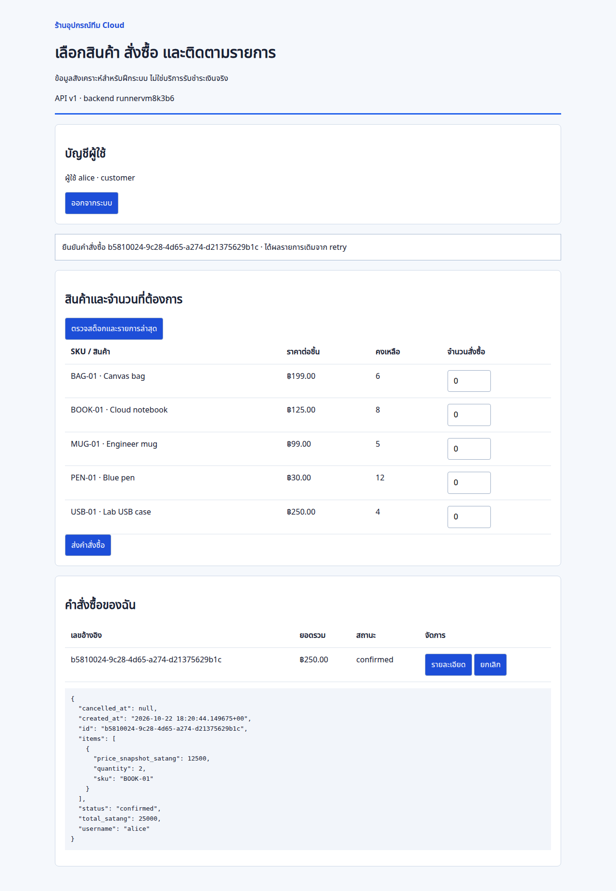

# Lab 05 — ระบบสั่งซื้อสามชั้นบน VM ที่รับมือ App failure และ Database failover ได้

ทีมขายมีเว็บสั่งซื้อที่ต้องแยก Web, API และฐานข้อมูลออกจากกัน ต้องปล่อย App รุ่นใหม่โดยไม่หยุดทุกเครื่องพร้อมกัน และต้องรู้ว่าระหว่างฐานข้อมูลสลับ primary คำสั่งซื้อใดสำเร็จ คำสั่งใดควร retry โดยไม่ตัดสต็อกซ้ำ

## ผู้ใช้และเส้นทางธุรกิจ

ลูกค้าสองบัญชีและ operator ใช้ข้อมูลสังเคราะห์ ผู้ใช้ login → ดูสินค้า/สต็อก → ส่งคำสั่งซื้อ → ดูรายการของตน → ยกเลิกและคืนสต็อกหนึ่งครั้ง Operator ดูรายการรวมเพื่อเทียบกับ ledger แต่ไม่ใช้สิทธิ์ Cloud IAM มาแทน App role

ชุด App ต้องมี UI ที่ใช้งานได้, PostgreSQL schema/seed, health endpoints, structured logs และ bounded HTTP probes ครบ ไม่ให้ผู้เรียนสร้าง App เองก่อนทำระบบ

## Requirements และวิธีพิสูจน์

| ID | Must-have | Acceptance / หลักฐานที่ต้องเก็บ |
|---|---|---|
| R1 | HTTPS user journey ผ่าน Web → private API → SQL | login/list/create/read/cancel ทำงานจริง เก็บ order reference, request IDs และผลจาก DB โดยไม่เปิด API/DB สาธารณะ |
| R2 | แยก tier และ runtime identity | Web/API VMs ไม่มี external IP; Web SA อ่าน DB secret ไม่ได้; client ที่ไม่ใช่ Web tier เข้า API VIP/backend ไม่ได้ตาม firewall matrix; anonymous/other-owner/operator negative tests |
| R3 | ธุรกรรมถูกต้องแม้คำขอพร้อมกันหรือซ้ำ | หลาย API process ใช้ DB เดียว ไม่ขายเกิน stock; retry key เดิมได้ order เดิม; key เดิมเปลี่ยน payload ได้ 409; cancel ซ้ำไม่คืน stock ซ้ำ; stock/ledger reconciliation ไม่มีส่วนต่าง |
| R4 | Web/API แต่ละ tier อยู่สอง zone และรับมือ App เครื่องเดียวเสีย | กำหนด fault กับหนึ่ง VM/หนึ่ง process ตรวจ LB health, MIG action, surviving requests และ recovery instance ID; ไม่อ้าง zone outage จริงจากการหยุด process เดียว |
| R5 | Rolling update ที่ตรวจและถอยได้ | ทดสอบ compatible v2 และ bad startup template; บันทึก current actions/healthy replicas/errors; backout template ที่ยังอ่าน schema เดิมได้ ไม่อ้างว่า update policy รับประกัน zero errors |
| R6 | Cloud SQL HA และ reconnect หลัง planned failover | ใช้ Enterprise REGIONAL private SQL; ตรวจ primary/standby configuration และ operation จริงก่อน-หลัง failover; วัดช่วง error/recovery จาก probe; retry key เดิมและตรวจ order/stock ไม่ซ้ำ |
| R7 | รับ Change Request เพิ่ม API replicas/connection capacity อย่างมีเหตุผล | API2→4 replicas, pool4 คงเดิม; คำนวณ surge/old/new/admin headroom ก่อนเปลี่ยน เทียบ bounded load/latency/error/DB connections/invariants และทดสอบ backout |
| R8 | มี runbook, evidence, cleanup และ rebuild | ผู้เรียนแยก LB/MIG/process/network/SQL สาเหตุได้ เก็บ timeline/decision/case study และลบ DNS/TLS/LB/MIG/templates/SQL/secrets/NAT/artifacts/VPC ตาม inventory ของ Lab |

Optional extensions ที่ไม่ใช้แทน baseline: mTLS ระหว่าง Web/API, managed login/SSO, autoscaling policy, Cloud Armor, cross-region recovery และ destructive schema migration ต้องออกแบบ/ทดสอบแยก ไม่อ้างว่ามีแล้ว

## Architecture ที่เลือก

- Region asia-southeast1; Web และ API เป็น regional managed instance groups คนละกลุ่ม กลุ่มละ 2VM กระจายสอง zone ไม่ใช่ unmanaged groups จาก Lab01
- Public global external Application Load Balancer รับ HTTPS ด้วย domain ที่ผู้เรียนควบคุม DNS ได้ ส่งไป Web Nginx บน private VMs
- Web ให้ static UI และ reverse proxy /api ไป **regional internal passthrough Network Load Balancer TCP8080** ซึ่งกระจายไป API VMs ใช้ L4 เพื่อรักษา client source และกำหนด ingress API ให้มาจาก Web tier ตาม matrix ไม่วาดเป็น regional L7proxy หรือเพิ่ม proxy-only subnet โดยไม่มีบริการนั้น
- API ใช้ PostgreSQL transactions/locks/idempotency ledger ผ่าน Cloud SQL Python Connector private IP/TLS ไป Cloud SQL PostgreSQL16 Enterprise REGIONAL (HA) ใน region เดียวกัน
- Custom VPC; แยก regional Web/API subnets; PSA allocation เป็น managed service producer address space ไม่ใช่ subnet ของฐานข้อมูล VM
- Cloud Router/NAT สำหรับ private VM outbound ตามจำเป็น; IAP TCP forwarding + OS Login สำหรับดูแล ไม่เปิด SSH0.0.0.0/0
- Web SA ไม่มี SQLClient/DBSecretAccessor; API SA มีสิทธิ์เฉพาะ SQLClient, App/DBsecret, อ่าน release artifact ที่ต้องใช้ และส่ง logs ตามจำเป็น Bootstrap/admin เป็น identity คนละชุด
- Release artifact ตรึง source commit/hash; instance template ใหม่สำหรับแต่ละ release ไม่มี password อยู่ใน template/startupmetadata/image/repository
- Public TLS จบที่ externalLB ส่วน Web→API baseline เป็น HTTP ใน private VPC พร้อม firewall/Appauth **ไม่ใช่ end-to-end mTLS** ต้องระบุ trade-off นี้ชัดเจน SQL connector ใช้ TLS แยกต่างหาก

เลือก Terraform สร้างระบบซ้ำได้ และใช้ Console/CLI สำรวจ ตรวจ health/metrics ทำ rollout/failover และวิเคราะห์เหตุ แทนการสร้าง manual ชุดหนึ่งแล้วให้ Terraform สร้างชื่อซ้ำทับ หากต้องนำของที่สร้าง manual เข้า state ต้องมีขั้น import/reconcile เฉพาะ ไม่ให้ผู้เรียนเดาเอง

## Data และ App contract

products มี SKU/ชื่อ/stock ตั้งต้น; orders มี UUID/owner/status/idempotency key/request fingerprint; order_items มี quantity และ snapshot ราคาหน่วยเป็นจำนวนเต็ม; stock_events มี order/SKU/effect/event และ unique business constraints

Create order ต้องล็อกสินค้าในลำดับแน่นอนและทำ stock/order/event ใน transaction เดียว; การ cancel คืนเฉพาะ order ที่ confirmed ครั้งแรก ไม่ลบ ledger สอง API เครื่องต้องพิสูจน์จาก DB เดียวกัน ไม่ใช้ in-memorycounter แทนผลจริง

API มี /livez สำหรับ process และ /healthz ตรวจ schema/DB แยกบทบาทจากกัน LB/autohealing ที่ใช้ processhealth ต้องไม่ recreate ทุก VM เพียงเพราะ SQL failover ชั่วคราว จะยืนยัน startup grace/readiness/health thresholds ใน Design ก่อนเขียน Task

App user ใช้ hashed demo passwords, secure session/CSRF/ownership/role มีข้อจำกัด production ระบุชัด ชุดทดสอบต้องไม่พิมพ์ cookie/secret และอ่านรหัสจาก privatefile ไม่รับ plaintextpassword ใน command line

## Operation scenarios ที่ต้องเตรียม

1. Normal journey + unauthorized/cross-owner/role/network checks
2. Concurrent orders บน API สอง process, duplicate delivery/key conflict, cancel replay และ reconciliation
3. Stop หนึ่ง API process แบบควบคุม ตรวจ healthybackend ที่เหลือ/MIG recovery ไม่ขยาย fault เป็นลบทั้งกลุ่ม
4. Compatible rolling release และ bad-template rollout พร้อม backout/evidence
5. Planned Cloud SQL HA failover ระหว่าง bounded writes/readiness checks จด operation ID, errors, reconnect time และ data integrity ไม่สัญญาว่าไม่มี connectionreset
6. Change API2→4 พร้อม surge/headroom calculation และ retest
7. Cleanup จาก inventory ของ Lab นี้และ rebuild จาก source/infra version เดิม โดยไม่พึ่ง resource จาก Lab ก่อน

## Connection และ resource assumptions ก่อนทำ Guide

ค่าตั้งต้นที่จะตรวจอีกครั้ง: App หนึ่ง worker/VM, pool4/max_overflow0, Web2VM/API2VM, APIchange4VM, regional rollout เผื่อ surge สำหรับสอง zone ต้องคำนวณ instance สูงสุดช่วง rollout ก่อนเลือก SQL max_connections และขนาดเครื่อง ไม่ใช้จำนวน replicas steady state เป็น connection hard cap

ต้องมี Sandbox ที่เปิด Billing, compute/SQL/NAT/LB quotas, สิทธิ์ IAM/OSLogin/IAP/DNS ที่จำเป็น และ domain/subdomain ของผู้เรียนเอง หากไม่มี domain/สิทธิ์ DNS จะยังไม่ผ่าน R1 แบบ HTTPS ห้ามเปลี่ยนเป็น publicHTTP แล้วอ้างว่าครบ baseline

SQL HA, VMs หลายเครื่อง, NAT, LB, disks/backups/logs และ IP มีค่าใช้จ่ายระหว่างฝึก ต้องประมาณงบและเวลาปิดก่อน provision Budget เป็น alert ไม่ใช่ hard cap Cloud verification ยังเป็น Not run

## แหล่งอ้างอิงที่ใช้ปิดขอบเขต

- [Cloud SQL PostgreSQL high availability](https://docs.cloud.google.com/sql/docs/postgres/high-availability)
- [Internal passthrough Network Load Balancer](https://docs.cloud.google.com/load-balancing/docs/internal)
- [Managed instance group rolling updates](https://docs.cloud.google.com/compute/docs/instance-groups/rolling-out-updates-to-managed-instance-groups)
- [External Application Load Balancer](https://docs.cloud.google.com/load-balancing/docs/https)

ขั้นถัดไป: ยืนยัน ports/source identities/routes/health policy, tier placement, SQL sizing/connection budget และ data invariants → working App/installer/tests/IaC → Diagram → Tasks พาทำ → Review/Guide-ready ยังไม่ถือว่า Brief นี้เป็น Lab ที่ทำเสร็จ


## Design — ขอบเขตที่ใช้ทำ Materials

### Resource map และ placement

| ส่วน | Baseline |
|---|---|
| Region / zones | asia-southeast1; เลือก zone a/b ให้ทั้งสอง MIG อย่างชัดเจน ไม่ปล่อย regional MIG ใช้สาม zone โดยไม่คำนวณ surge |
| VPC | lab005-vpc แบบ custom; Web subnet10.55.10.0/24 และ API subnet10.55.20.0/24 เป็น regional subnets ไม่แยก subnet ซ้ำตาม zone |
| Public edge | global EXTERNAL_MANAGED HTTPS LB, managed certificate, reserved public IP และ DNS record ของผู้เรียน; Web backend port80 |
| Web | regional MIG2 replicas; Nginx static UI/reverse proxy, e2-small เบื้องต้น, private IP เท่านั้น, Web SA เฉพาะ |
| Private API VIP | regional INTERNAL passthrough TCP8080 ใน API subnet, allow_global_access=false; backend เป็น API MIG ไม่มี proxy-only subnet |
| API | regional MIG2 replicas → change4; private IP, Gunicorn1worker/8threads, pool4/overflow0, API SA เฉพาะ |
| SQL | orders database, PostgreSQL16 Enterprise REGIONAL, private services access10.85.0.0/16, ไม่มี publicIP; baseline tier db-custom-1-3840 ต้องตรวจ quota/ราคา/region ก่อน provision |
| SQL HA | primary/secondary คนละ zone ภายใน region เดียวกัน ไม่วาดเป็นสอง database ที่ App ต้องเลือกเองหรือ read replica ที่ใช้กระจายอ่าน |
| Outbound / admin | regional NAT และ Router, OS Login/IAP; diagnostic/init VM ชั่วคราวคนละ SA และไม่มี externalIP ใช้เท่าที่ต้องตรวจ/initialize แล้วลบ |
| Release | private versioned GCS artifact bucket, Web/API archives แยกและตรึง SHA256, Secret containers แยก auth/runtimeDB/admin ไม่ใส่ payload ใน Terraformstate |

PublicLB เป็น global, MIG/subnets/internalLB เป็น regional, VM เป็น zonal และ SQLHA เป็น regional managed resource เส้นทาง SQL ไป service-producer network ไม่ใช่ VM ใน API subnet

### Network / identity matrix

| Source → destination | Port / path | เกณฑ์ |
|---|---|---|
| Browser → publicLB | HTTPS443 | เปิด login/UI แต่ business endpoints ต้อง Appsession/CSRF/owner/role |
| GFE/health → WebSA VMs | TCP80; ranges35.191.0.0/16,130.211.0.0/22 | แยก rule จาก API sourceidentity; ยืนยันชนิด LB ก่อนใช้ ranges |
| WebSA primary NIC → API SA VMs ผ่าน privateVIP | TCP8080 | source_service_accounts=WebSA,target_service_accounts=APISA ใน VPC เดียวกัน ไม่ผสม networktags กับ SA |
| Health probers → API SA VMs | TCP8080 จาก health ranges เท่านั้น | เป็น exception สำหรับ health ไม่ใช่การยืนยัน Appidentity จาก IP |
| Diagnostic SA VM → API VIP/backend | TCP8080 | ต้องถูกปฏิเสธโดย ingresspolicy; อ่าน default/organization rules ก่อนสรุป |
| API → SQLprivateIP | TCP3307 สำหรับ connectorTLS + HTTPS443 สำหรับ Admin API/certificate | native5432 ใช้เฉพาะกรณีที่เลือก driverdirect แยก ไม่วาด connector เป็น 5432; SQLClient ไม่แทน DBlogin/grants |
| Web → SQL PSA range | egress deny ทั้ง range สำหรับ WebSA | กัน Web ข้าม API tier; ยังต้องทดสอบ Web อ่าน DBsecret ไม่ได้แยกอีกชั้น |
| IAP → Web/API/diagnostic/init | SSH22 จาก 35.235.240.0/20 | OSLogin/IAPIAM และ actAs ต้องถูกต้อง ไม่ใช่มี firewall แล้วใครก็ SSH ได้ |
| VMs → metadata/DNS/GoogleAPI/package sources | ตาม startup/runtime จำเป็น | ไม่มี default allow-internal; baselineegress ส่วนอื่นไม่ได้อ้างเป็น allowlist สมบูรณ์หรือ NAT เป็น firewall |

ใช้ sourceSA และ sourceCIDR ใน rule เดียวกันจะเป็น union ไม่ใช่ AND จึงแยก Web-client rule กับ health-check rule และ target ด้วย SA สอดคล้องกัน ทั้งนี้ SA ใน firewall คือ identity ของ VM primaryNIC ไม่ใช่ signed JWT ของผู้ใช้

### Health, startup และการดูแล

- Web /livez ตอบเฉพาะ Nginx/staticrelease พร้อมใช้ ไม่เรียก DB ผ่าน API; API /livez ตรวจ process และ releaseconfig ส่วน /healthz query schema/DB
- LB/autohealing ใช้ processhealth ไม่ทำให้ SQLfailover กลายเป็น massVMreplacement ตรวจ DBhealth ผ่าน probe/log/metrics แยก
- Baselinehealth interval10s/timeout3s/threshold2; autohealing initial delay300s, rolling minReady30s เป็นค่าฝึกที่จะตรวจใน materials ไม่อ้างว่าเก็บ error ได้ทันทีหรือไม่มี connection ขาด
- App poolwait3s, SQLstatement5s/lock3s, connectorconnectiontimeout5s, Gunicornrequesttimeout30s; dependencyerror ตอบ sanitized503 และ requestID ไม่ส่ง rawDBerror ถึง Browser
- Installer ต้องดาวน์โหลด archive ตาม hash, ปฏิเสธ path traversal/symlink ที่ไม่คาดหมาย, ติดตั้ง release แบบ immutable, ดึง numericsecretversions ด้วย attachedSA และเขียน privatefile ให้ daemon เท่านั้น Startupmetadata มี references ไม่ใช่ password
- Bootstrap ใช้ init VM/identity ชั่วคราวกับ adminsecret เท่านั้น API MIG เปิดหลัง schema/seed/runtimegrants ตรวจแล้ว Web ไม่มี admin/DBsecret ไม่เอา initcredential ไปใช้ใน APIservice

### Data invariants และ request contract

POST /api/orders รับ items1–10SKU, quantity เป็น integer1–20 (ไม่รับ bool), SKU ซ้ำใน cart ถูกปฏิเสธ, Idempotency-Key8–80 ตัวอักษร; normalizeSKU order ก่อน hashpayload และ lockproducts ตาม SKU order เพื่อลด deadlock

Transaction: advisory lock ตาม owner+key → ตรวจ replay/fingerprint → SELECTproductsFORUPDATE ตามลำดับ → ตรวจ stock และ snapshotprice → INSERTorder/items/events + UPDATEavailable → commit ถ้าขั้นใดล้มทุก mutation ต้อง rollback

Cancellation: lockorder ของ owner → lockproducts ตาม SKU order → เปลี่ยน status/cancelled_at+คืน stock+event ครั้งเดียวใน transaction Operator อ่านภาพรวมได้แต่ไม่เป็น owner แทนลูกค้า

ต้องตรวจอย่างน้อย:
- available = initial + sum(stock_events.delta) และไม่ติดลบ/เกิน initial
- order.total_satang = sum(item.quantity × price_snapshot_satang)
- ทุก item มี reserved event หนึ่งรายการ; confirmed ไม่มี cancelled event; cancelled มี cancelled หนึ่งรายการเท่าจำนวนเดิม
- ไม่มี order ว่าง, key หนึ่งชุดของ owner เดียวไม่มี order ซ้ำ และ replaypayload ต่างต้อง 409

ราคาหน่วยเป็นจำนวนเต็มสตางค์ ไม่ใช้ float และไม่อ้างว่านี่คือระบบรับชำระเงินจริง เปลี่ยนราคาภายหลังไม่แก้ snapshot ของ order ที่สร้างแล้ว

### Connection / rollout budget และ change

| สถานะ | API VMs ตามแผน | pool สูงสุดเชิงคำนวณ |
|---|---:|---:|
| Baseline | 2 | 8 |
| Baseline rolling: surge2 / unavailable0 | 4 | 16 |
| Change steady state | 4 | 16 |
| Change rolling: surge2 / unavailable0 | 6 | 24 |

เลือก SQL max_connections64 เบื้องต้นและจอง headroom สำหรับ admin/health/connection ที่กำลังปิด ต้องตรวจ pg_stat_activity และ metrics จริง ไม่อ้างตัวเลขในตารางเป็น hard cap ระหว่าง recreate/failover หรือใช้ worker หลายตัวต้องคำนวณใหม่ เผื่อ computequota รวม Web/API surges ด้วย ไม่ rollout สอง tier พร้อมกันระหว่างทดลอง

ใช้ regional rolling policyfixed maxSurge2,maxUnavailable0 เพราะมีสอง zone พร้อม healthcheck/minReady ไม่ใช้ maxSurge1 ซึ่งไม่เข้ากับ regionalconstraint หาก healthyreplicas ไม่เพิ่มจาก badtemplate ให้หยุด/กลับ template เดิม ไม่เพิ่ม maxUnavailable เพื่อบังคับให้ผ่าน

Failoverprobe ต้องมี boundeddeadline/requests และ idempotencykey คงเดิมสำหรับ logicalorder หนึ่งรายการ ถ้า response หายหลัง commit การ retry ต้องคืน reference เดิม ไม่สร้าง key ใหม่เพื่อให้ request สำเร็จ แยกเวลาตรวจพบ error, operationstart/end และเวลาที่ App กลับมาทำ journey ได้ จึงไม่ใช้ HA label แทนหลักฐาน applicationrecovery

### ลำดับส่งมอบ

1. Domainservice/schema/seed/grants/invariants + PostgreSQL16 tests (หลาย pool, races, replay, cancel, rollback, privilege)
2. HTTPS-facing UI/session API/health/logs และ HTTPprobes แยก Webstatic จาก API
3. Immutable artifacts + installer/systemd + secret/bootstrap/inspection tooling
4. Terraformfoundation → seed/init → workloads/LBs/TLS และ syntax/config checks ใน cloudCI
5. Diagram ตาม scope จริง + READMETasks/Expected/record/fault/change/cleanup
6. Review/read-back/render/Guide-ready; GCPverification ยัง Not run จนผู้เรียนรันจริง

อ้างอิง Design เพิ่มเติม: [VPC firewall source/target service accounts](https://docs.cloud.google.com/firewall/docs/firewalls#service-accounts), [LB firewall ranges](https://docs.cloud.google.com/load-balancing/docs/firewall-rules), [connector v1.18.5 implementation](https://github.com/GoogleCloudPlatform/cloud-sql-python-connector/blob/v1.18.5/google/cloud/sql/connector/connector.py)


## Materials ที่กำลังตรวจ

[Order domain](app/orders.py), [schema](db/schema.sql), [seed](db/seed.sql), [runtime grants](db/grants.sql), [invariants](db/check-invariants.sql) และ [PostgreSQL transaction tests](tests/test_orders.py) เป็นแกนธุรกรรมที่ใช้ร่วมกับ API ยังไม่ใช่คู่มือ Deploy หรือผล Cloud SQL HA จริง


[Orders API](app/main.py), [private DB pool](app/database.py), [Web UI](web/index.html), [browser script](web/app.js), [Nginx template](web/nginx.conf.template) และ [config renderer](scripts/render-web-config.py) แยก Web static tier ออกจาก API โดยใช้ session/CSRF/owner/role และแชร์ข้อมูลผ่าน PostgreSQL ไม่ใช้ in-memory stock

UI เก็บเฉพาะ pending cart + idempotency key ใน sessionStorage ของแท็บนั้นเพื่อใช้คำขอเดิมหลัง response หาย ไม่เก็บรหัสผ่าน/cookie/CSRF ใน storage การทดสอบเบราว์เซอร์จำลอง response หายหลัง DB commit แล้ว reload/retry และตรวจ order/stock จาก DB จริง เป็นการทดสอบใน CI ไม่ใช่ผล Deploy GCP หรือ SQL HA failover


## ภาพ UI และผลตรวจ App ใน CI



ภาพนี้มาจาก App ที่รันจริงในฐานข้อมูลชั่วคราวของ CI ไม่ใช่ภาพ Console หรือผล Deploy GCP: จำลอง response หายหลัง commit → reload → ส่ง key เดิม → ได้ order เดิมหนึ่งรายการ แล้วทดสอบ cancel คืน stock ผ่าน Browser/Nginx/API/PostgreSQL

[CI 39830356415](https://github.com/somkid-s5/Portfolio-Lab/actions/runs/39830356415) source146bb2e ผ่าน18 tests พร้อมตรวจ bootstrap จริง: failure rollback ไม่ทิ้ง role, schema/seed/grants, runtime login และ rerun ไม่เปลี่ยนรหัสเดิม [ที่มาภาพ](assets/ui-ci-provenance.json)

ไฟล์เตรียมระบบ: [สร้าง Secret bundle](scripts/create-secrets.py), [bootstrap ฐานข้อมูล](scripts/init-db.py) ยังต้องใช้ตามลำดับ Foundation/Secret/init ที่จะระบุใน Tasks ไม่ใช้ admin credential เป็น App runtime

## เริ่มทำ Lab — จาก Cloud Shell ถึง release ที่ตรวจสอบได้

**สถานะคู่มือ: กำลังเขียน** ส่วนด้านล่างครอบคลุม Tasks 0–10 (รวม 7A/7B/9B) ยังไม่ครบทั้ง Lab ยังต้องต่อ Secret/bootstrap/เปิดระบบ/ทดสอบ/operations/change/cleanup ก่อนใช้เป็นคู่มือจบทั้ง Solution ไม่มีผล GCP จริงถูกบันทึกไว้ล่วงหน้า

### Task 0 — เตรียมพื้นที่ฝึกและบันทึกเวอร์ชัน

**ทำที่ไหน:** Google Cloud Console → เลือก sandbox project → กด Activate Cloud Shell มุมขวาบน ทุกคำสั่งต่อไปใช้ Bash ใน Cloud Shell ไม่ใช่ PowerShell และไม่ใช่ terminal บน Web/API VM

1. ตรวจว่า project นี้สร้างเพื่อ Lab โดยเฉพาะ มี Billing และคุณยอมรับค่าใช้จ่าย VM/SQL HA/NAT/LB/disks/backups ก่อนเริ่ม อย่าทำใน production หรือ project ที่มี Shared VPC/ทรัพยากรทีมอื่น
2. เตรียม hostname ที่คุณแก้ DNS ได้จริง เช่น subdomain ของคุณเอง ห้ามใช้ชื่อในตัวอย่างแล้วคาดหวังว่า certificate จะออกได้
3. ใน Console เปิด IAM & Admin → Quotas & System Limits ตรวจ compute CPU, regional managed instance groups, addresses และ Cloud SQL ใน asia-southeast1 รวมช่วง surge ไม่ใช่เฉพาะ steady state ตั้ง Billing budget alert และเวลาหยุดฝึกไว้ด้วย Budget ไม่ใช่การตัดค่าใช้จ่ายอัตโนมัติ
4. ผู้รันต้องมีสิทธิ์เปิด APIs, จัดการ network/firewall/SA/IAM/Storage/SQL/Secrets/VM/LB ของ sandbox การ SSH ต้องมี IAP tunnel access, OS Login ที่เหมาะสม และสิทธิ์ใช้ attached service account อย่าให้ Editor กับ runtime SA เพื่อแก้ปัญหา permission รวม ๆ
5. เริ่ม checkout ใหม่ในพื้นที่ชั่วคราว ไม่ทับโฟลเดอร์เดิม:

```bash
export PROJECT_ID='ใส่-project-id-ของคุณ'
export ARTIFACT_BUCKET='ใส่ชื่อ-bucket-ใหม่ที่ไม่ซ้ำทั่วโลก'
export LAB_DOMAIN='ใส่-hostname-ของคุณ'
export REGION='asia-southeast1'
gcloud config set project "$PROJECT_ID"
gcloud auth list --filter=status:ACTIVE --format='value(account)'
gcloud config get-value project
export CHECKOUT_PARENT="$(mktemp -d "$HOME/lab005-work-XXXXXX")"
git clone --branch docs/gcp-solution-labs --single-branch   https://github.com/somkid-s5/Portfolio-Lab.git "$CHECKOUT_PARENT/Portfolio-Lab"
export REPO_DIR="$CHECKOUT_PARENT/Portfolio-Lab"
export LAB_DIR="$REPO_DIR/GCP/LAB-005-three-tier-orders"
cd "$LAB_DIR"
export SOURCE_COMMIT="$(git -C "$REPO_DIR" rev-parse HEAD)"
printf 'Source commit: %s\n' "$SOURCE_COMMIT"
gcloud version
terraform version
python3 --version
```

**Expected:** active account กับ project ตรง sandbox ที่เลือก, commit เป็น SHA เต็ม 40 ตัว และ Terraform รุ่น 1.9.x ที่ใช้ตรวจคู่มือนี้คือ 1.9.8; provider ตรึง 6.50.0 ในไฟล์ ไม่ต้องใช้ `init -upgrade` ถ้าไม่มี Terraform ที่รองรับให้ติดตั้งรุ่นที่ระบุจาก HashiCorp ก่อน อย่าลด version constraint เพื่อให้คำสั่งผ่าน

Checkout นี้อยู่ใน home persistent ของ Cloud Shell ไม่ใช่ /tmp ให้จด CHECKOUT_PARENT/REPO_DIR/LAB_DIR และเก็บ state ของแต่ละ Terraform root ไว้จน cleanup เสร็จ หากเปิด session ใหม่ให้ตั้ง variables กลับไปยัง checkout เดิมก่อน ห้าม clone ใหม่แล้ว apply ซ้ำเสมือนไม่มีระบบเดิม State/plan/Secret bundle เป็นไฟล์ private ห้าม commit หรืออัปโหลด GitHub; ตั้งสิทธิ์พื้นที่ฝึกด้วย `chmod 700 "$CHECKOUT_PARENT"` และอย่าแชร์ home/storage นี้กับผู้ไม่มีสิทธิ์ หากองค์กรไม่ให้เก็บ state ใน Cloud Shell ต้องเตรียม remote backend ที่ควบคุมสิทธิ์ก่อน provision

**จุดบันทึก T00**

| รายการ | ผลจริงของคุณ |
|---|---|
| Project / active account ที่ตรวจแล้ว | … |
| SOURCE_COMMIT / Terraform / gcloud / Python | … |
| Persistent working directory และที่เก็บ state ที่จำกัดสิทธิ์ | … |
| Hostname / ผู้ดูแล DNS | … |
| Quota รวม surge / budget alert / เวลาปิด | … |
| ข้อจำกัดองค์กรที่ต้องแก้ก่อนเริ่ม | … |

**เกณฑ์ไปต่อ:** ยืนยัน project, budget, domain, สิทธิ์ และพื้นที่ persistent ครบ ถ้ายังไม่ครบหยุดที่นี่ ไม่ใช้ HTTP public แทน HTTPS baseline

### Task 1 — สร้าง foundation โดยยังไม่เปิด App VM

**เป้าหมาย:** ได้ custom VPC สอง subnet, NAT, private SQL HA, identities และ Secret containers เปล่า ยังไม่มีค่า Secret ใน Terraform state

**ทำที่ไหน:** Cloud Shell ที่ LAB_DIR จาก Task 0 และใช้ checkout persistent เดิม คำสั่ง apply ในหัวข้อนี้สร้างทรัพยากรมีค่าใช้จ่าย ผู้เรียนต้องตรวจ plan และยืนยันด้วยตนเอง

```bash
cd "$LAB_DIR"
export TF_VAR_project_id="$PROJECT_ID"
export TF_VAR_artifact_bucket="$ARTIFACT_BUCKET"
terraform -chdir=infra/foundation init -input=false
terraform -chdir=infra/foundation validate
terraform -chdir=infra/foundation plan -out=foundation.tfplan
terraform -chdir=infra/foundation show -no-color foundation.tfplan
```

อ่าน plan ก่อน apply: ชื่อทั้งหมดขึ้นต้น lab005, subnets10.55.10.0/24 กับ10.55.20.0/24, PSA10.85.0.0/16, SQL POSTGRES_16/ENTERPRISE/REGIONAL ไม่มี public IP, primary a/secondary b, ไม่มี resource ลบหรือแก้ของระบบอื่น ไม่มี google_sql_user หรือ Secret version/payload ถ้าไม่ตรงให้แก้ input/โค้ดและ plan ใหม่ ไม่รัน apply ทั้งที่ยังไม่เข้าใจ diff

```bash
terraform -chdir=infra/foundation apply foundation.tfplan
terraform -chdir=infra/foundation output
gcloud compute networks describe lab005-vpc --format='yaml(name,autoCreateSubnetworks)'
gcloud compute networks subnets list --filter='network:lab005-vpc'   --format='table(name,region.basename(),ipCidrRange,privateIpGoogleAccess)'
gcloud sql instances describe lab005-sql   --format='yaml(name,databaseVersion,region,settings.edition,settings.availabilityType,settings.locationPreference,settings.ipConfiguration.ipv4Enabled,ipAddresses)'
gcloud storage buckets describe "gs://$ARTIFACT_BUCKET"   --format='yaml(name,location,iamConfiguration)'
```

เปิด Console → SQL → lab005-sql ดู Connections/Networking ว่ามี private address และไม่มี public address; ดู Configuration ว่าเป็น HA ภายใน region เดียวกัน และตรวจ backups/PITR เปิดแล้ว อย่าตีความ standby เป็น read replica สำหรับ App

**Expected:** VPC custom; subnets อยู่ region เดียว; SQL REGIONAL พร้อม private address; bucket บังคับ public access prevention และ uniform access ค่า Secret containers ยังไม่มี payload จน Task ถัดไป การแสดง HA ใน Console ยังไม่ใช่ผล failover สำเร็จ

**ถ้าไม่ตรง:** API disabled ให้ตรวจ permission เปิด API; Service Networking/PSA failure ให้ตรวจ address overlap และสิทธิ์ peering; SQL creation/quota failure ให้ตรวจ operation และ quota/region ก่อน retry ไม่สร้าง SQL สำรองชื่ออื่นจนไม่รู้ว่าตัวใดอยู่ใน state ถ้า connection รอ provisioning ให้ตรวจ operation จน terminal ก่อนรัน apply ซ้ำ

**จุดบันทึก T01:** เวลาเริ่ม/จบ …; plan ที่ review …; VPC/subnets/SQL private IP …; primary/secondary …; backup/PITR …; bucket policy …; หลักฐาน sanitized ที่พิสูจน์รายการเหล่านี้ …; ปัญหา/วิธีแก้ …  
ห้ามแนบ state/plan binary หรือ output ที่มีข้อมูลลับลง repository

**เกณฑ์ไปต่อ:** foundation ตรง design และ Terraform state ถูกเก็บรักษา ไม่ใช่เพียง exit code0

### Task 2 — สร้าง release จาก commit ที่ระบุและตรวจคำสั่งอัปโหลด

**ทำที่ไหน:** Cloud Shell ที่ LAB_DIR สร้าง Web/API archive แยกกันจาก committed blobs เท่านั้น ไฟล์ secrets/evidence/dirty working tree ไม่ถูก pack เข้า archive

```bash
cd "$LAB_DIR"
mkdir -p .build
python3 scripts/release.py build --source-commit "$SOURCE_COMMIT"   --app-version v1 --out .build/v1
python3 scripts/publish-release.py --release-dir .build/v1 --bucket "$ARTIFACT_BUCKET"
python3 scripts/publish-release.py --release-dir .build/v1 --bucket "$ARTIFACT_BUCKET" --shell
```

**Expected:** manifest มี web/api SHA256 คนละค่า, source_commit ตรง T00 และชื่อ object เป็น releases/HASH/web.tar.gz หรือ api.tar.gz คำสั่ง upload ทุกบรรทัดมี `--if-generation-match=0` ตัว planner ไม่ได้เรียก GCP จึงยังไม่มีไฟล์บน bucket

ตรวจสองบรรทัด upload แล้วคัดลอกไปรันใน Cloud Shell เอง **ไม่ pipe เข้า shell โดยไม่อ่าน** หลัง upload ให้ตรวจ object list:

```bash
gcloud storage ls --long "gs://$ARTIFACT_BUCKET/releases/**"
```

หากได้412 แปลว่ามี live object ชื่อนั้นแล้ว ไม่ใช่คำสั่งให้ลบ generation guard หรือลบไฟล์เดิม ดาวน์โหลด object นั้นไปยังโฟลเดอร์ใหม่แล้วใช้ `release.py unpack --archive FILE --sha256 HASH --tier web|api --out NEW_DIRECTORY` เพื่อตรวจ bytes/manifest ก่อน reuse ถ้าตรวจไม่ผ่านหยุดสอบสวน bucket/identity ไม่สั่งทับของเดิม

หาก build แจ้ง directory exists อย่าใช้ recursive delete เพื่อให้ผ่าน ให้ตรวจ manifest ของชุดเดิมหรือใช้ชื่อ output ใหม่ เช่น .build/v1-check2; หาก committed blob missing ตรวจ SOURCE_COMMIT กับไฟล์ใน commit นั้น อย่าใช้ archive จาก dirty worktree แทนแล้วอ้าง source SHA เดิม

**จุดบันทึก T02**

| รายการ | ผลจริงของคุณ |
|---|---|
| Source commit / app version | … |
| Web SHA256 / object generation | … |
| API SHA256 / object generation | … |
| Upload หรือ reuse ที่ตรวจแล้ว / เวลา | … |
| ผล archive verification และหลักฐานที่ไม่มี secrets | … |

**เกณฑ์ไปต่อ:** Web/API archives ที่ใช้งานจริงตรง hash และ source commit ที่บันทึก ไม่ใช่แค่มีไฟล์ชื่อคล้ายกันใน bucket ขั้นต่อไปจะสร้าง Secret versions และ initialize DB ก่อนเปิด API MIG

### Task 3 — สร้าง Secret bundle และตั้งรหัสผู้ดูแล SQL

**ทำที่ไหน:** Cloud Shell ที่ LAB_DIR บน checkout เดิม ห้ามเปิด shell tracing (`set -x`) หรือ `gcloud --log-http` ระหว่างทำ Secret และห้ามถ่ายภาพเนื้อหาไฟล์ private

```bash
cd "$LAB_DIR"
umask 077
python3 -m venv .venv
.venv/bin/pip install -r requirements.txt
.venv/bin/python scripts/create-secrets.py --out secrets
gcloud sql users set-password postgres --instance=lab005-sql   --flags-file=secrets/sql-admin-flags.json
```

ไฟล์ sql-admin-flags.json ถูกสร้าง mode600 และมีเฉพาะ flagรหัสที่ตรงกับ bootstrap-admin.json คำสั่งอ้าง path จึงไม่มี password literal ใน shell history/argv แต่ process gcloud และผู้ดูแลเครื่องยังเป็น trusted boundary เช่นเดิม ไม่เปิด debug logs หรือแชร์ไฟล์นี้ รายละเอียด [gcloud flags-file](https://docs.cloud.google.com/sdk/gcloud/reference/topic/flags-file)

**Expected:** generator แจ้งว่าสร้าง bundle โดยไม่พิมพ์รหัส; คำสั่ง set-password จบ operation สำเร็จ ถ้า secrets มีอยู่แล้ว generator จะปฏิเสธ อย่าสร้างชุดใหม่แล้วเปลี่ยนรหัสเดิมซ้ำโดยไม่รู้ว่าฐานข้อมูล initialize ไปแล้วหรือยัง

เพิ่ม versions จากไฟล์ ไม่พิมพ์ payload:

```bash
export AUTH_VERSION_NAME="$(gcloud secrets versions add lab005-auth   --data-file=secrets/auth.json --format='value(name)')"
export DB_VERSION_NAME="$(gcloud secrets versions add lab005-db   --data-file=secrets/db.json --format='value(name)')"
export ADMIN_VERSION_NAME="$(gcloud secrets versions add lab005-bootstrap-admin   --data-file=secrets/bootstrap-admin.json --format='value(name)')"
export AUTH_VERSION="${AUTH_VERSION_NAME##*/}"
export DB_VERSION="${DB_VERSION_NAME##*/}"
export ADMIN_VERSION="${ADMIN_VERSION_NAME##*/}"
printf 'Auth version=%s; DB version=%s; admin version=%s\n'   "$AUTH_VERSION" "$DB_VERSION" "$ADMIN_VERSION"
gcloud secrets versions list lab005-db --format='table(name,state)'
gcloud secrets get-iam-policy lab005-db --format=json
gcloud secrets get-iam-policy lab005-bootstrap-admin --format=json
```

**ตรวจ:** versionsเป็นเลขและ ENABLED; DBsecret ให้ API/bootstrap เท่านั้น, adminsecretให้ bootstrap ไม่ใช่Web/API ตรวจ inherited project/organization IAM ร่วมด้วย เพราะ per-secret policy ไม่ได้ลบสิทธิ์กว้างที่มีอยู่เดิม Secretcontainersสร้างใน Task1 แล้วจึงใช้ versions add ไม่ใช่สร้างSecretชื่อใหม่

หาก upload บางรายการล้ม อย่ารันทั้งblockซ้ำจนได้เลขversionหลายชุดโดยไม่รู้ว่าใช้ชุดไหน ตรวจ list ของแต่ละSecret แล้วจดเลขที่payloadตรงกับbundleนี้ ถ้าไม่ทราบให้หยุดก่อนเปิดVM ห้ามใช้latestเพื่อเลี่ยงการตัดสินใจ

**จุดบันทึก T03:** authversion …; DBversion …; adminversion …; SQL password operation …; identity matrixที่ตรวจแล้ว …; inherited grantsที่แก้/ยอมรับ …; เหตุขัดข้องและวิธีแก้ …  
ไม่บันทึกรหัส/session key/password hashes/demo-logins หรือSecretpayloadลงช่องนี้

**เกณฑ์ไปต่อ:** SQLpostgresรหัสตรงกับadminbundle, versionsครบและสิทธิ์ถูกต้อง ยังไม่สร้าง orders_app ด้วย gcloud เพราะ bootstrapต้องสร้างroleพร้อมgrantsในtransaction

### Task 4 — Initialize ฐานข้อมูลผ่าน private VM ชั่วคราว

**ทำที่ไหน:** เริ่มจาก Cloud Shell; initializer startupทำงานบน lab005-init ด้วย bootstrapSA ไม่ใช่บัญชี API/Web

ตรึง OSimage เป็นชื่อจริง ไม่ใช้familyในtemplate และอ่านAPIarchivehashจากmanifestของTask2:

```bash
cd "$LAB_DIR"
export DEBIAN_IMAGE_NAME="$(gcloud compute images describe-from-family debian-12   --project=debian-cloud --format='value(name)')"
export TF_VAR_debian_image="projects/debian-cloud/global/images/$DEBIAN_IMAGE_NAME"
export TF_VAR_api_sha256="$(python3 -c 'import json; print(json.load(open(".build/v1/manifest.json"))["artifacts"]["api"]["sha256"])')"
export TF_VAR_secret_versions="{\"db\":\"$DB_VERSION\",\"admin\":\"$ADMIN_VERSION\"}"
terraform -chdir=infra/bootstrap init -input=false
terraform -chdir=infra/bootstrap validate
terraform -chdir=infra/bootstrap plan -out=bootstrap.tfplan
terraform -chdir=infra/bootstrap show -no-color bootstrap.tfplan
```

ตรวจplanต้องสร้างlab005-initเครื่องเดียว ไม่มีexternalIP ใช้lab005-bootstrap SA และmetadataมีเฉพาะreferencesกับcode ไม่มีpassword/payload หากเห็นresourceฐานข้อมูล/networkใหม่ แปลว่าอยู่ผิดTerraformroot ให้หยุด

```bash
terraform -chdir=infra/bootstrap apply bootstrap.tfplan
gcloud compute ssh lab005-init --zone=asia-southeast1-a --tunnel-through-iap   --command='sudo journalctl -u google-startup-scripts.service --no-pager -n 100'
```

**Expected:** startupมีverified_bundle, bootstrapสำเร็จ และinstall_complete tierinit อาจต้องรอgueststartupติดตั้งpackagesก่อน `terraform apply` สำเร็จหมายถึงVMสร้างแล้ว ไม่ใช่DBพร้อม ถ้าstartupยังทำงานอยู่ให้รอและตรวจprocess/logเดิม ไม่รีบrebootหรือสร้างinitializerอีกเครื่อง

เปิด Console → Compute Engine → VM instances → lab005-init ตรวจattachedSA, internalIP และไม่มีexternalIP จากนั้นดูSQL → Databases ว่ามีorders (ตัวนี้สร้างโดยfoundation ไม่ใช่หลักฐานว่าschema/seedครบ) ผลbootstrapตรวจschema/seed/grants/invariantsในtransactionและต้องexit0ก่อนเดินต่อ

**ถ้าไม่สำเร็จ**

| อาการ | ตรวจอย่างไร / ทำอะไรต่อ |
|---|---|
| SSHผ่านIAPไม่ได้ | ตรวจIAP/OSLogin/actAsและfirewall22 ไม่เปิดSSHสาธารณะเพื่อแก้ |
| Artifact403/404 | ตรวจattachedbootstrapSA, bucketIAM, objectpath/hashจากT02 ไม่ให้StorageAdminทั้งproject |
| Secret403 | ตรวจbootstrapSecretAccessorที่db/admin และnumericversionenabled; ไม่แก้โดยให้Web/APIอ่านadmin |
| apt/pip timeout | ตรวจNAT/route/packageavailabilityและstartupstage ไม่ใช่เปลี่ยนSecret |
| bootstrapFailed | ตรวจerror_typeและstage/SQLstateที่ปลอดภัย ห้ามพิมพ์rawSQLexceptionที่อาจมีpassword |
| roleexists | bootstrapตั้งใจปฏิเสธการresetรหัส/ทับschema ให้ตรวจประวัติว่าทำสำเร็จแล้วหรือสร้างroleนอกขั้นตอน อย่าลบrole/tableเพื่อบังคับให้ผ่าน |

**จุดบันทึก T04:** imageชื่อจริง …; APIhash …; initVM/zone/SA …; startupเริ่ม/จบ …; bootstrapresult …; ปัญหา/การแก้ …; หลักฐานไม่มีค่าลับ …  
ห้ามคัดลอกไฟล์ /var/lib/lab005/*/admin.json หรือ db.json มาใส่evidence

หลังบันทึกสำเร็จ ให้reviewและลบเฉพาะinitializerด้วยrootเดิม:

```bash
terraform -chdir=infra/bootstrap plan -destroy -out=bootstrap-cleanup.tfplan
terraform -chdir=infra/bootstrap show -no-color bootstrap-cleanup.tfplan
terraform -chdir=infra/bootstrap apply bootstrap-cleanup.tfplan
gcloud compute instances list --filter='name=lab005-init' --format='table(name,zone,status)'
unset TF_VAR_api_sha256 TF_VAR_secret_versions
```

**Expected:** planลบVM/diskของinitializerเท่านั้น ไม่ลบfoundation/SQL/SA; listไม่เหลือlab005-init การลบVMไม่ถอนbootstrapSAสิทธิ์Secretอัตโนมัติ จึงต้องคุมสิทธิ์actAsของผู้ดูแลและจัดการSecret/SAตามcleanupท้ายLabอีกครั้ง

**เกณฑ์ไปต่อ:** bootstrapสำเร็จจริง, มีหลักฐานsanitizedและinitializerถูกนำออกแล้ว ก่อนเปิดAPI/Web MIG ในขั้นถัดไป

### Task 5 — เปิด Web/API MIG และ HTTPS

**ทำที่ไหน:** Cloud Shell ที่ LAB_DIR หลัง T04 สำเร็จและนำ initializer ออกแล้ว ใช้ TF_VAR_project_id/artifact_bucket/debian_image เดิม และตั้ง Secret references ให้เป็น runtime เท่านั้น

```bash
cd "$LAB_DIR"
export TF_VAR_domain="$LAB_DOMAIN"
export TF_VAR_release_sha256="$(python3 -c 'import json; m=json.load(open(".build/v1/manifest.json")); print(json.dumps({k:v["sha256"] for k,v in m["artifacts"].items()}))')"
export TF_VAR_secret_versions="{\"db\":\"$DB_VERSION\",\"auth\":\"$AUTH_VERSION\"}"
export TF_VAR_api_replicas=2
terraform -chdir=infra/workloads init -input=false
terraform -chdir=infra/workloads validate
terraform -chdir=infra/workloads plan -out=workloads.tfplan
terraform -chdir=infra/workloads show -no-color workloads.tfplan
```

ตรวจplanก่อนยืนยัน: Web/APIอย่างละ2VM ผ่านregionalMIG zonesa/b, imageชื่อจริงจากT04, attachedSAตรงtier, ไม่มีaccess_config/externalIP, templateมีhashและnumericversions ไม่มีadminversion/Secretpayload, VIP10.55.20.10/TCP8080, publicfrontend443/EXTERNAL_MANAGED, domainตรงของคุณ และไม่มีการแก้SQL/schema ถ้าไม่ตรงอย่าapply

```bash
terraform -chdir=infra/workloads apply workloads.tfplan
terraform -chdir=infra/workloads output
gcloud compute instance-groups managed list-instances lab005-web-mig --region="$REGION"
gcloud compute instance-groups managed list-instances lab005-api-mig --region="$REGION"
gcloud compute backend-services get-health lab005-web-public --global
gcloud compute backend-services get-health lab005-api-internal --region="$REGION"
gcloud compute instances list --filter='name~^lab005-'   --format='table(name,zone.basename(),status,networkInterfaces[0].networkIP,networkInterfaces[0].accessConfigs[0].natIP,serviceAccounts[0].email)'
```

**Expected:** แต่ละMIGมีสองเครื่องคนละzone; currentActionกลับเป็นNONEหลังstartupและhealthพร้อม; backendHEALTHYทั้งสองtier; ช่องexternalIPว่าง `apply` ไม่ได้รอให้TLS/domainทุกอย่างพร้อมเสมอ ต้องตรวจต่อ

เปิด Console → Compute Engine → Instance groups → lab005-api-mig → Instances ดูzone/currentaction/health จากนั้นเปิด Network Services → Load balancing → backendserviceที่เกี่ยวข้องดูhealthybackends หากConsoleจัดเมนูใหม่ให้ค้นชื่อresourceจากช่องSearch โดยไม่สร้างLBอีกชุดซ้ำชื่อเดิม

#### เชื่อม DNS และรอ certificate

```bash
export HTTPS_IP="$(terraform -chdir=infra/workloads output -raw https_ip)"
printf 'DNS A record target: %s\n' "$HTTPS_IP"
gcloud compute ssl-certificates describe lab005-web --global   --format='yaml(name,managed.status,managed.domainStatus)'
```

ที่ผู้ให้บริการDNSของคุณ เปิดzoneของLAB_DOMAINแล้วเพิ่ม/แก้ **A recordของhostnameนี้เท่านั้น** ให้ชี้HTTPS_IP จดค่าเดิมก่อนเปลี่ยน ตั้งTTL300ถ้านโยบายอนุญาต ถ้าhostnameเดิมชี้บริการคนอื่นให้เลือกsubdomainใหม่ อย่าทับเพื่อทำLab ตรวจAAAAเดิมด้วย เพราะLabนี้ไม่ได้สร้างIPv6frontend; AAAAที่ชี้ปลายทางอื่นอาจทำให้domainvalidationไม่ผ่าน ไม่แก้recordของชื่ออื่น

```bash
dig +short A "$LAB_DOMAIN"
dig +short AAAA "$LAB_DOMAIN"
gcloud compute ssl-certificates describe lab005-web --global   --format='yaml(name,managed.status,managed.domainStatus)'
```

**Expected:** AตรงHTTPS_IP, ไม่มีAAAAผิดปลายทาง และcertificate/domainACTIVEตามลำดับ การออกcertificate/แพร่DNSใช้เวลา อย่าสร้างcertใหม่ถี่ยิบหรือใช้curl-kข้ามverificationเพื่ออ้างว่าสำเร็จ ตรวจDNS,CAA,proxyassociationและfrontend443ตาม [คู่มือGoogle-managed certificates](https://docs.cloud.google.com/load-balancing/docs/ssl-certificates/google-managed-certs)

เมื่อACTIVEแล้ว:

```bash
curl --fail --show-error --silent --max-time 15 "https://$LAB_DOMAIN/healthz"
python3 scripts/probe.py --base-url "https://$LAB_DOMAIN"   --path /healthz --requests 20 --workers 1 --interval 1
```

**Expected:** /healthz200มีready/version/backend; probeมีsamplesและsummary โดยไม่พิมพ์cookieหรือCSRF หากเห็นbackendตัวเดียวใน20samplesยังไม่พอสรุปLBเสีย ให้เทียบget-health/MIGplacementและจำนวนsampleที่อนุญาต ไม่เพิ่มโหลดไม่จำกัดเพื่อให้ได้รูปสวย

**แยกสาเหตุให้ถูก**

| อาการ | เริ่มตรวจ |
|---|---|
| Public502/503 และWebunhealthy | Webstartup/Nginxsyntax/staticfiles, namedport80, GFEhealthfirewall |
| UIเปิดได้แต่APIไม่ตอบ | InternalLBhealth, WebSA→APISA8080, NginxVIP และAPIservice |
| /livez200แต่/healthz503 | DBschema/SQLstate/connector3307+443/DBsecretversion/login ไม่สั่งrecreateทั้งMIG |
| VMstartupFailed | hash/SA/Secretaccess/NAT/packageก่อนแก้loadbalancer |
| TLSไม่ผ่านแต่backendhealthy | DNS/cert/domain/frontends ไม่ใช่ปัญหาstocktransaction |

**จุดบันทึก T05:** templates/hashes …; VMzone/SA/internalIP …; healthybackendsก่อนเริ่มjourney …; DNSค่าเดิม/ค่าใหม่/TTL …; certACTIVEเวลา …; probeversion/backendcounts/errors …; หลักฐานsanitized …  
**เกณฑ์ไปต่อ:** HTTPSตรวจcertificateผ่าน, Web/APIhealthyสองzone และ/healthzพร้อมจริง

### Task 6 — ทำคำสั่งซื้อผ่าน Browser และตรวจสิทธิ์ผู้ใช้

**ทำที่ไหน:** Browserเปิด `https://LAB_DOMAIN` ของคุณ ใช้ข้อมูลสังเคราะห์เท่านั้น ในCloudShell Editorเปิดไฟล์secrets/demo-logins.jsonส่วนตัวเพื่ออ่านรหัส อย่าพิมพ์ทั้งไฟล์ลงterminalหรือถ่ายภาพรหัส ปิดไฟล์หลังใช้

1. ก่อนloginเปิด URL `/api/orders` ในแท็บใหม่ ต้อง401login_required ไม่ใช่รายการของคนอื่น
2. กลับหน้าUI loginเป็นalice เลือกBOOK-01จำนวน2 กดส่งคำสั่งซื้อ บันทึกorderreferenceและstockก่อน/หลัง ต้องได้confirmedและลด2 ไม่ใช่ลดตามจำนวนAPIreplicas
3. เปิดรายละเอียดorder ดูquantity/ราคาต่อหน่วย/ยอดรวมเป็นสตางค์ ข้อมูลราคาคือsnapshot ไม่ใช่ให้Browserคำนวณแล้วAPIเชื่อทันที
4. Refreshหน้า ต้องยังเห็นorderเดิมในรายการ ไม่เกิดorderใหม่จากการrefresh
5. เปิดprivatewindowหรือBrowserprofileอีกชุด loginเป็นbob เปิด `/api/orders/ORDER_UUID_ของ_alice` ต้อง404 ไม่เปิดเผยข้อมูลalice; รายการbobไม่รวมorderของalice
6. ในsessionbobเปิด `/api/operator/orders` ต้อง403operator_required จากนั้นlogout และloginoperatorต้องอ่านภาพรวมได้ Operatorไม่ใช่เจ้าของorderแทนalice
7. กลับalice กดยกเลิกorder ต้องcancelledและคืนstock2หนึ่งครั้ง เปิดรายละเอียดใหม่หรือrefreshตรวจไม่คืนstockซ้ำ การกดcancelAPIซ้ำแบบexplicitและidempotency/raceจะตรวจด้วยเครื่องมือในหัวข้อถัดไป ไม่ถือว่าrefreshอย่างเดียวพิสูจน์กรณีนั้นแล้ว
8. กรอกรหัสผิดหนึ่งครั้งต้องไม่loginสำเร็จ ไม่ทำbruteforce/โหลดloginendpointซ้ำ; passwordhashใช้CPUและไม่ใช่โหลดอ่านสินค้า
9. BrowserDevTools → Network เลือกคำขอของorder ดูstatus/requestID/backendIDเพื่อจับคู่กับAPIlogs แต่ห้ามexportHARเต็มหรือcopyCookie/CSRF/requestpayloadที่มีรหัสลงevidence ปิดPreserve logระหว่างloginถ้าไม่จำเป็น

ถ้าbrowserแจ้งsession/CSRFหมดอายุ ให้refresh/loginใหม่ ไม่ปิดCSRFหรือแก้Securecookieเป็นfalseบนGCE หากส่งorderแล้วresponseหาย UIจะเก็บpendingcart+keyเดิมให้retry อย่าเปลี่ยนcart/ล้างsessionStorage/สร้างkeyใหม่ก่อนตรวจว่าorderเดิมcommitไปหรือยัง

**จุดบันทึก T06**

| ตรวจอะไร | Expected | Actual / หลักฐานของคุณ |
|---|---|---|
| anonymous orders | 401 | … |
| alice BOOK-01×2 | confirmed / stockลด2 | … |
| refresh/read | referenceเดิม | … |
| bobอ่านalice | 404 | … |
| customerอ่านoperatorlist | 403 | … |
| operatorภาพรวม | อ่านได้ ไม่เปลี่ยนowner | … |
| alicecancel | cancelled / stockคืน2ครั้งเดียว | … |
| badpassword | loginไม่สำเร็จ | … |

บันทึกorderUUID, requestID, Web/APIidentityที่เห็นและเวลาUTCจากprobeให้เชื่อมกับlogsได้ ภาพพอร์ตใช้เฉพาะUIที่ไม่มีรหัส/Token ไม่ใช้ภาพCIแทนผลที่คุณทำบนGCP

**เกณฑ์ไปต่อ:** journeyและnegativecasesข้างต้นผ่านจริง หากมีfailureให้จดอาการ/สาเหตุ/การแก้/retestไว้ติดตาราง ไม่ติ๊กผ่านเพราะเข้าเว็บได้อย่างเดียว

### Task 7A — ส่งคำขอเดิมซ้ำอย่างควบคุมและตรวจ ledger

**ทำที่ไหน:** Cloud Shell สำหรับ HTTPjourney จากนั้น SSHผ่านIAPไปAPI VMหนึ่งเครื่องเพื่อตรวจDBด้วยruntime role ไม่ใช้postgres/adminsecret

ก่อนรันต้องเหลือBOOK-01อย่างน้อย1หน่วย และไม่มีผู้ใช้อื่นกำลังแก้ข้อมูลทดสอบ เครื่องมือนี้สร้างorderสังเคราะห์หนึ่งรายการแล้วยกเลิก ไม่ใช่read-only และไม่ควรยิงใส่ระบบอื่น

```bash
cd "$LAB_DIR"
.venv/bin/python scripts/journey.py --base-url "https://$LAB_DOMAIN"   --logins-file secrets/demo-logins.json --journal secrets/journey-baseline.json
```

**Expected:** checksครอบคลุมanonymous401, create/resume, keyเดิมได้referenceเดิม, keyเดิมpayloadต่าง409, ไม่มีCSRF403, bobอ่านalice404, customerอ่านoperator403 และcancelซ้ำได้replayed เครื่องมือบันทึกkeyและcartในjournalmode600ก่อนส่งคำขอแรก; ไม่พิมพ์password/cookie/CSRF และไม่retryไม่จำกัด

รันคำสั่งเดิมอีกครั้งโดยใช้journalเดิม ต้องได้orderUUIDเดิม ไม่ใช่orderใหม่ แม้orderถูกcancelแล้วก็ไม่ควรตัดstockใหม่ ถ้าคำสั่งล้ม/responseหาย **เก็บjournalเดิม** ตรวจระบบก่อนretry ห้ามลบjournalเพื่อหลบerror การเปลี่ยนjournalคือlogicalorderใหม่ที่อาจสร้างผลซ้ำจากมุมธุรกิจ

#### ตรวจจากฐานข้อมูล ไม่ใช้HTTPเพียงอย่างเดียวสรุปข้อมูลถูกต้อง

จากCloudShellแสดงVMในAPI MIGแล้วเลือกชื่อและzoneจริง:

```bash
gcloud compute instance-groups managed list-instances lab005-api-mig --region="$REGION"
```

เปิดSSHผ่านIAPไปเครื่องที่เลือก (แทนชื่อสองช่องให้ตรงผลจริง):

```bash
gcloud compute ssh 'ใส่ชื่อ-api-vm' --zone='ใส่-zone-ของเครื่อง' --tunnel-through-iap
```

**คำสั่งถัดไปทำในAPI VM** ไม่ใช่CloudShell ตั้งAPI_HASHจากT02ของreleaseที่VMนี้ใช้:

```bash
export API_HASH='ใส่-api-sha256-64ตัวจากT02'
sudo systemd-run --wait --pipe --collect --uid=lab005-api   --property=EnvironmentFile=/etc/lab005/api.env   --working-directory="/opt/lab005/releases/$API_HASH/app"   "/opt/lab005/venvs/$API_HASH/bin/python"   "/opt/lab005/releases/$API_HASH/scripts/inspect-db.py"
```

systemd managerอ่านEnvironmentFileให้transientprocess ซึ่งมีเฉพาะreferences ไม่มีpasswordliteralในคำสั่ง ใช้UIDlab005-apiและสิทธิ์DBเดิม ไม่ต้องcatไฟล์db.json/admin.json และไม่ให้postgresกับApp

**Expected:** db_roleorders_app, invariants_oktrue, violationsว่าง, stockbalance/order_total/itemledgerตรงกัน snapshotเป็นREPEATABLE READ/READ ONLYชุดเดียว countsรวมข้อมูลก่อนหน้าทั้งLabจึงไม่จำเป็นเท่ากับ1 หากทำT06ไปแล้ว ควรเทียบก่อน/หลังของคุณเอง; connectionsรวมinspectorหนึ่งconnectionและเป็นเพียงค่าขณะนั้น ไม่ใช่connectionpeakระหว่างfailover

หากinspect-db.pyไม่มีในrelease แสดงว่าarchiveมาจากcommitก่อนเพิ่มเครื่องมือนี้ อย่าคัดลอกscriptจากHEADใหม่แล้วอ้างว่าเป็นreleaseเดิม ให้กลับT02สร้างarchiveจากcommitที่มีไฟล์ครบ บันทึกhashใหม่และrolloutตามversionนั้นก่อนทดสอบ

**ถ้าไม่ผ่าน:** violationsไม่ว่างให้หยุดwritesและเก็บsnapshot/ช่วงเวลาที่เกิดปัญหา ไม่แก้stockด้วยมือให้ตัวเลขดูผ่าน; connectionerrorให้ตรวจSQL/Secret/connectorก่อน; permissionerrorให้ตรวจว่าใช้runtimeUID/envfile/roleถูกต้อง ไม่เปลี่ยนเป็นadminเพื่อให้ผ่าน

**จุดบันทึก T07A:** journalpathส่วนตัว …; orderUUIDครั้งแรก/รันซ้ำ …; HTTPchecksที่ผ่าน/ไม่ผ่าน …; snapshotก่อน/หลัง …; violations …; stockและledgereventsที่สัมพันธ์กับorder …; ปัญหา/การแก้/retest …  
การทดสอบนี้ยังไม่ใช่concurrentoversellหรือGCPfailover ต้องมีหลักฐานแยกในหัวข้อถัดไป

### Task 7B — ส่งคำสั่งซื้อพร้อมกันโดยไม่ขายเกินสต็อก

**ทำที่ไหน:** Cloud Shell; ใช้journalใหม่สำหรับการทดลองนี้เท่านั้น ก่อนเริ่มให้ตรวจsnapshotจากT07Aว่าUSB-01มีavailable4 และไม่มีผู้ใช้อื่นเขียนข้อมูล หากไม่ใช่4ให้ตรวจorderเดิม/คืนรายการผ่านbusinesscancelแล้วsnapshotใหม่ **ไม่UPDATE stockหรือรันseedทับเพื่อให้ได้ตัวเลขที่อยากเห็น**

```bash
cd "$LAB_DIR"
.venv/bin/python scripts/stock-race.py --base-url "https://$LAB_DOMAIN"   --logins-file secrets/demo-logins.json --journal secrets/usb-race-01.json
```

เครื่องมือใช้6sessionsของaliceส่งlogicalorderคนละkeyพร้อมกัน สินค้าUSB-01จำนวน1ต่อorder แต่ละclientมีtimeout5sและไม่ยิงซ้ำไม่จำกัด การloginทำก่อนbarrierจึงไม่เอาpasswordhashloadมาปนกับช่วงrace

**Expectedเมื่อเริ่มstock4/ไม่มีwriterอื่น:** attempts6, confirmed4, rejected2จากinsufficient_stock และUUIDของ4ordersไม่ซ้ำกัน เก็บผลterminalในusb-race-01.json.result.jsonแบบprivateก่อนพิมพ์ผล หากคำสั่งจบแล้วรันซ้ำjournalเดิมจะอ่านผลที่เก็บโดยไม่ส่งnetworkใหม่ **ผลstoredไม่ใช่การretestระบบ**

หากresponseขาดหายก่อนผลครบ ให้เก็บjournalเดิมไว้ ตรวจระบบแล้วรันคำสั่งเดิมเพื่อresolveด้วยkeysเดิม ห้ามcancelorder/resetstock/สร้างjournalใหม่ก่อนresolve เพราะkeyที่เคยstockไม่พออาจสร้างorderใหม่ได้เมื่อมีการคืนstockแล้ว หากเริ่มcancelไปก่อนให้หยุดอัตโนมัติและตรวจoutcomesจากDB/operatorlist ไม่เดาว่าทุกรายการล้มเหลว

หลังได้ผลครบ ให้รันinspectorบนAPI VMตามT07Aอีกครั้ง:
- USBavailableต้อง0ถ้าเริ่ม4และสำเร็จ4
- ledgerreservedรวมของสี่orderต้อง-4 ไม่ใช่-6
- invariants_oktrueและviolationsว่าง
- ผลHTTPอย่างเดียวไม่ยืนยันว่าคำขอผ่านAPIครบสองเครื่อง ดูbackend/requestlogsและhealthyMIGเพิ่มเติม ไม่อ้างmulti-backendraceหากไม่มีหลักฐานการกระจายจริง

เก็บผลก่อนcancel จากนั้นaliceเปิดUIยกเลิกเฉพาะUUIDทั้ง4ที่เครื่องมือรายงาน ตรวจsnapshotอีกครั้งstockกลับ4และcancelledgerของแต่ละorderเกิดครั้งเดียว อย่าcancelรายการของT06หรือorderนอกการทดลองนี้ ถ้าการcancelไม่ครบให้บันทึกรายการค้างและแก้ก่อนเริ่มraceรอบใหม่ ใช้journalชื่อใหม่เฉพาะหลังยืนยันปิดรอบเดิมแล้ว

**จุดบันทึก T07B**

| จุดตรวจ | Expectedสำหรับbaseline | Actual / หลักฐาน |
|---|---|---|
| ก่อนrace | USBavailable4 / ไม่มีwriterอื่น | … |
| HTTP | 6attempts / 4confirmed / 2stockconflicts | … |
| หลังrace | available0 / reservedรวม-4 / invariantsครบ | … |
| การกระจายAPI | ระบุเฉพาะเครื่องที่มีหลักฐาน | … |
| หลังcancel4orders | available4 / cancelครั้งเดียวต่อorder | … |
| ambiguousresponses | journalเดิม / วิธีresolve | … |

**เกณฑ์ไปต่อ:** HTTPoutcomesเชื่อมกับsnapshot/UUIDได้ ไม่มีoversellหรือstock/ledgerส่วนต่าง และปิดorderทดลองครบก่อนทำfault/change

### Task 8 — พิสูจน์ network/identity boundaries

**ทำที่ไหน:** Cloud ShellสำหรับเลือกVM/เปิดdiagnosticชั่วคราว และคำสั่งทดสอบจริงบนVMต้นทาง ห้ามใช้CloudShellยิงprivateVIPแล้วสรุปว่าfirewallถูก เพราะCloudShellไม่ได้อยู่ในVPCเดียวกัน

1. เก็บรายการVM/IP/SAตามT05 และยืนยันWeb/APIhealthyก่อนทำnegative tests จดAPIbackendIPจริงหนึ่งเครื่องกับVIP10.55.20.10
2. SSHผ่านIAPเข้าWebVMหนึ่งเครื่อง จากWebรันPythonstdllibตรวจAPIhealthผ่านVIP:

```bash
python3 -c 'import urllib.request; r=urllib.request.urlopen("http://10.55.20.10:8080/healthz",timeout=5); print("status",r.status); print(r.read(4096).decode())'
```

**Expected:** 200/readyจากAPI แสดงเส้นทางWebSA→APIพร้อม อย่าใช้pingทดแทนHTTP/portcheck เพราะICMPไม่ได้เป็นrequirementของsolutionนี้

#### Webต้องอ่านDBsecretไม่ได้; APIต้องอ่านadminsecretไม่ได้

กลับCloudShell ตั้งชื่อ/zoneจริงจากรายการT05:

```bash
export WEB_VM='ใส่ชื่อ-web-vm'
export WEB_ZONE='ใส่-zone'
export API_VM='ใส่ชื่อ-api-vm'
export API_ZONE='ใส่-zone'
gcloud compute scp "$LAB_DIR/scripts/check-secret-access.py"   "$WEB_VM:/tmp/lab005-check-secret-access.py" --zone="$WEB_ZONE" --tunnel-through-iap
gcloud compute ssh "$WEB_VM" --zone="$WEB_ZONE" --tunnel-through-iap   --command="python3 /tmp/lab005-check-secret-access.py --secret lab005-db --version $DB_VERSION --expected-sa lab005-web@$PROJECT_ID.iam.gserviceaccount.com"
gcloud compute scp "$LAB_DIR/scripts/check-secret-access.py"   "$API_VM:/tmp/lab005-check-secret-access.py" --zone="$API_ZONE" --tunnel-through-iap
gcloud compute ssh "$API_VM" --zone="$API_ZONE" --tunnel-through-iap   --command="python3 /tmp/lab005-check-secret-access.py --secret lab005-bootstrap-admin --version $ADMIN_VERSION --expected-sa lab005-api@$PROJECT_ID.iam.gserviceaccount.com"
```

**Expected:** secret_boundary/deniedtrue/http_status403พร้อมSAที่คาด เครื่องมือใช้attachedVMtokenในmemory ไม่ใช้gcloudบัญชีผู้เรียน ไม่พิมพ์token/responsebody และไม่ยอมรับscopeไม่ครบหรือ404/timeoutเป็นผลผ่าน ถ้าdeniedfalseให้หยุดและตรวจinheritedIAMก่อนทำfault ไม่แก้โดยปิดSecretversion เพราะต้องพิสูจน์IAMกับversionที่มีจริง

บัญชีroot/OSLoginadminบนVMยังเป็นtrustedboundary: IAMของattachedSAไม่ได้แยกตามLinuxprocess ผู้ที่ได้สิทธิ์ดูแลAPI VMย่อมเข้าถึงruntimecredentialsได้ตามขอบเขตเครื่อง ไม่อ้างว่าmode640แทนper-processCloudIAM

หลังตรวจให้ลบเฉพาะไฟล์เครื่องมือชั่วคราวสองไฟล์นี้ ไม่ลบrelease/configของApp:

```bash
gcloud compute ssh "$WEB_VM" --zone="$WEB_ZONE" --tunnel-through-iap   --command='rm -- /tmp/lab005-check-secret-access.py'
gcloud compute ssh "$API_VM" --zone="$API_ZONE" --tunnel-through-iap   --command='rm -- /tmp/lab005-check-secret-access.py'
```

#### Clientที่อยู่subnetเดียวกับWebแต่ใช้SAอื่น ต้องเข้าAPIไม่ได้

CloudShellใช้workloadvariablesชุดเดิมของT05 เปิดdiagnosticอย่างชัดเจน:

```bash
cd "$LAB_DIR"
terraform -chdir=infra/workloads plan -var=enable_diagnostic=true -out=diagnostic.tfplan
terraform -chdir=infra/workloads show -no-color diagnostic.tfplan
terraform -chdir=infra/workloads apply diagnostic.tfplan
gcloud compute ssh lab005-diagnostic --zone=asia-southeast1-a --tunnel-through-iap
```

Reviewplanควรเพิ่มdiagnosticVMหนึ่งเครื่อง ไม่มีแก้MIG/SQLถ้าinputอื่นไม่เปลี่ยน บนdiagnosticVMทดสอบทั้งVIPและbackendIPจริงแยกทีละปลายทาง:

```bash
python3 -c 'import socket; s=socket.create_connection(("10.55.20.10",8080),timeout=5); s.close(); print("UNEXPECTED: connected")'
python3 -c 'import socket; s=socket.create_connection(("ใส่-api-backend-private-ip",8080),timeout=5); s.close(); print("UNEXPECTED: connected")'
```

**Expected:** เชื่อมต่อไม่ได้ ทั้งที่Webpositivecontrolก่อนหน้าสำเร็จและAPIยังhealthy ถ้าconnectedแปลว่าboundaryไม่ตรงแบบ ตรวจConsole → VPC network → FirewallและeffectivepoliciesของNIC หาว่าinheritedrule/allow-internalใดเปิด8080ให้clientอื่น อย่าลบruleระบบอื่นแบบเดาสุ่ม

Timeoutอย่างเดียวไม่พิสูจน์ว่าเกิดจากfirewall อาจเป็นroute/serviceเสีย ต้องแนบpositivecontrol, attachedSA, backendhealth, effectivepolicyและเวลาที่ตรงกัน ถ้าไม่มีหลักฐานพอให้บันทึก“ยังสรุปไม่ได้” ไม่ติ๊กผ่าน

Web→SQLใช้egressdenyไปPSA10.85.0.0/16 ตรวจrulelab005-web-deny-sqlและeffectivepolicy พร้อมทดสอบTCP3307ไปSQLprivateIPจากWebเทียบAPIconnectorที่ทำงานจริง ห้ามใช้WebDBsecretหรือnative5432แทนเส้นทางconnectorในแบบนี้

ออกdiagnosticกลับCloudShell แล้วreviewplanปิดเครื่อง:

```bash
terraform -chdir=infra/workloads plan -var=enable_diagnostic=false -out=diagnostic-cleanup.tfplan
terraform -chdir=infra/workloads show -no-color diagnostic-cleanup.tfplan
terraform -chdir=infra/workloads apply diagnostic-cleanup.tfplan
```

**จุดบันทึก T08:** Web→VIP200 …; WebDBsecret403 …; APIadminsecret403 …; diagnosticVIP/backendผล …; positivecontrol/healthybackendเวลาเดียวกัน …; effectivepolicy …; WebPSAdenyและAPIconnectorcontrol …; diagnosticถูกลบแล้ว …; ข้อจำกัด/สิ่งที่ยังสรุปไม่ได้ …  
**เกณฑ์ไปต่อ:** หลักฐานตรงaccessmatrix ไม่ใช้HTTPauth401/403แทนnetworkdeny และไม่ใช้networkdenyแทนAppownership

### Task 9 — หยุด API หนึ่งเครื่องและดูการกู้คืน

**ขอบเขตfault:** หยุดlab005-api serviceบนVMที่เลือกเพียงเครื่องเดียว ไม่ลบMIG ไม่แก้firewallทั้งกลุ่ม และไม่อ้างว่าเป็นzoneoutage

**ก่อนเริ่ม:** APIสองเครื่องHEALTHY ไม่มีrollout/failoverอื่น ปิดorderทดลองT07ครบ เก็บsnapshotและชื่อVM/instanceID/zoneจริงทั้งสองเครื่อง จดเครื่องเป้าหมายกับเครื่องที่ต้องอยู่รอด อย่าเลือกWebVMเพราะชื่อคล้ายกัน

CloudShell Terminal A เก็บprobeในไฟล์ใหม่private:

```bash
cd "$LAB_DIR"
umask 077
mkdir -p .build/evidence
set -C
python3 scripts/probe.py --base-url "https://$LAB_DOMAIN" --path /healthz   --requests 120 --workers 1 --interval 1 > .build/evidence/api-fault-read.jsonl
```

เปิดTerminal B ตั้งproject/regionและชื่อVMจริง (variablesไม่แชร์ข้ามterminalอัตโนมัติ):

```bash
export PROJECT_ID='ใส่-project-id'
export REGION='asia-southeast1'
export API_VM='ใส่ชื่อ-api-vm-ที่จะหยุด'
export API_ZONE='ใส่-zone'
gcloud config set project "$PROJECT_ID"
date -u +'%Y-%m-%dT%H:%M:%SZ'
gcloud compute instances describe "$API_VM" --zone="$API_ZONE" --format='yaml(name,id,zone,status)'
gcloud compute ssh "$API_VM" --zone="$API_ZONE" --tunnel-through-iap   --command='sudo systemctl stop lab005-api'
gcloud compute backend-services get-health lab005-api-internal --region="$REGION"
gcloud compute instance-groups managed list-instances lab005-api-mig --region="$REGION"
```

ตรวจhealth/currentactionsซ้ำเป็นระยะด้วยคำสั่งเดิมและจดเวลา ไม่ใช้loopไม่มีวันจบ เปิดConsole → Compute Engine → Instance groups → lab005-api-mig → Instances/Monitoring ดูhealth/repairaction **การตัดtrafficโดยLBกับการซ่อมโดยMIGเป็นคนละขั้น** อาจมีrequesterrorก่อนLBตัดbackend ไม่เรียกผลนี้zero-downtime

**Expected:** serviceเป้าหมายหยุด → backendUNHEALTHY → อีกzoneยังรับงาน → MIGrepair → startupใหม่สำเร็จ → healthyครบสองเครื่อง บันทึกinstanceIDก่อน/หลัง แม้ชื่อVMอาจเหมือนเดิม อย่าใช้ชื่ออย่างเดียวสรุปว่าไม่ได้recreate

[initial delay300s](https://docs.cloud.google.com/compute/docs/instance-groups/autohealing-instances-in-migs) คือช่วงเริ่มVM ไม่ใช่คำสัญญาว่าจะกู้เสร็จภายใน300s healthsuccessอาจจบinitialdelayก่อนครบ อย่าอ้างตัวเลขนี้เป็นRTOจริง

ถ้าprobeจบก่อนrecovery ให้เก็บwindowแรกแล้วรันboundedwindowใหม่ชื่อไฟล์ใหม่ ระบุช่องว่างตามจริง ถ้าMIGไม่repairให้ตรวจpolicy/health/firewall/currentactionsก่อน หากต้องคืนระบบเองและเครื่องเดิมยังอยู่:

```bash
gcloud compute ssh "$API_VM" --zone="$API_ZONE" --tunnel-through-iap   --command='sudo systemctl start lab005-api'
```

ถ้าMIGrecreateแล้วให้เลือกVMปัจจุบันจากlist ไม่ยิงชื่อเก่าหรือstartเครื่องอื่นสุ่ม การกู้ด้วยมือต้องบันทึกmanual recovery ไม่ใช่autohealingสำเร็จ หลังhealthyครบ ให้รันjourneyด้วยjournalใหม่สำหรับrecovery และsnapshotT07A ไม่ใช้storedresultของstockraceแทนretest

**จุดบันทึก T09:** faultstart …; targetID/zone …; survivorID/zone …; LBunhealthyเวลา …; MIGaction …; replacementID/startup/healthyเวลา …; probeerrors/latency/backendwindow …; recoveryauto/manual …; journey/ledgerหลังแก้ …  
**เกณฑ์ไปต่อ:** healthyครบสองเครื่อง ข้อมูลถูกต้อง และอธิบายสิ่งที่observedโดยไม่ขยายเป็นzonefailure/SLA

#### Task 9B — ตรวจ Web tier ด้วยหลักเดียวกัน

ทำหลังAPIคืนปกติเท่านั้น ไม่หยุดWeb/APIพร้อมกัน เลือกWebVMหนึ่งเครื่องและจดID/zoneกับsurvivor เปิดprobewindowใหม่ชื่อweb-fault-read.jsonlจากCloudShell แล้วอีกTerminalตั้งWEB_VM/WEB_ZONEจากT08:

```bash
gcloud compute instances describe "$WEB_VM" --zone="$WEB_ZONE" --format='yaml(name,id,zone,status)'
gcloud compute ssh "$WEB_VM" --zone="$WEB_ZONE" --tunnel-through-iap   --command='sudo systemctl stop nginx'
gcloud compute backend-services get-health lab005-web-public --global
gcloud compute instance-groups managed list-instances lab005-web-mig --region="$REGION"
```

ExpectedคือWebbackendเป้าหมายunhealthy/repair และอีกเครื่องรับUI/APIproxyได้ เก็บX-Web-IDจากprobeพร้อมMIGIDs ไม่ใช้APIbackendIDอย่างเดียวพิสูจน์Websurvivor หากต้องmanualrecoveryใช้sudo systemctl start nginxบนเครื่องปัจจุบันที่เลือกผ่านIAPและระบุว่าmanual หลังhealthyครบให้ตรวจUI/journey/DBsnapshotอีกครั้ง บันทึกtimeline/target/survivor/errors/recoveryในT09แยกแถวWebกับAPI

### Task 10 — Planned Cloud SQL HA failover และคำขอที่อาจได้ผลไม่แน่นอน

**ขอบเขต:** สั่งplannedfailoverของSQLsandboxนี้ครั้งเดียว ไม่ทดสอบregionaldisaster/restore และไม่เปลี่ยนedition/regionระหว่างทดลอง [คำสั่งfailover](https://docs.cloud.google.com/sdk/gcloud/reference/sql/instances/failover)

**ก่อนเริ่ม:** T09ปกติ SQLREGIONALพร้อมbackup/PITRและไม่มีoperationค้าง Web/APIHEALTHY เก็บsnapshotก่อนทดลองและเตรียมBOOK-01อย่างน้อย1

Terminal A รันprobeT09โดยเปลี่ยนชื่อไฟล์เป็นsql-failover-read.jsonl เริ่มก่อนfaultและจดwindow หากจบก่อนrecoveryใช้windowใหม่และระบุช่องว่าง ไม่ต่อผลให้เหมือนmonitorต่อเนื่อง

Terminal B ตั้งprojectให้ตรงและตรวจSQL:

```bash
gcloud sql instances describe lab005-sql   --format='yaml(name,state,region,settings.availabilityType,settings.locationPreference,ipAddresses)'
gcloud sql operations list --instance=lab005-sql --limit=5   --format='table(name,operationType,status,startTime,endTime)'
date -u +'%Y-%m-%dT%H:%M:%SZ'
export FAILOVER_OP="$(gcloud sql instances failover lab005-sql --async --format='value(name)')"
printf 'Failover operation: %s\n' "$FAILOVER_OP"
gcloud sql operations describe "$FAILOVER_OP"
```

หากไม่มีoperationID ให้ตรวจlist/CLIerrorก่อน **อย่ากดfailoverซ้ำ** เพียงเพราะรอหรืออ่านoperationไม่สำเร็จ ตรวจoperationเดิมจนDONEและไม่มีerrorผ่านSQL → Operationsหรือdescribeเดิม แยก“operationจบ”จาก“Appกลับมาทำธุรกรรมได้”

ระหว่างwindow อีกTerminalที่ตั้งLAB_DIR/LAB_DOMAINถูกต้อง ใช้journalใหม่ครั้งแรก:

```bash
cd "$LAB_DIR"
.venv/bin/python scripts/journey.py --base-url "https://$LAB_DOMAIN"   --logins-file secrets/demo-logins.json --journal secrets/sql-failover-order.json
```

ถ้าjourneyจบก่อนoutageจริงให้บันทึกว่าไม่ได้พิสูจน์writeoverlap ห้ามอ้างว่าrequestผ่านช่วงfailover หากล้ม/responseหายให้เก็บjournalเดิม ห้ามสร้างkeyใหม่ หลังoperationDONEและ/healthzพร้อมจึงรันคำสั่งเดิมเพื่อresolve UUIDต้องเชื่อมกับDBledger ไม่ตัดstockซ้ำแม้คำขอแรกcommitแล้วแต่responseหาย

การตรวจAPI/livezให้SSHเข้าAPI VMผ่านIAPแล้วรันคำสั่งต่อไปนี้ในVMระหว่างทดลอง (public/livezเป็นWebstatichealth ไม่ใช่APIprocess):

```bash
python3 -c 'import urllib.request; r=urllib.request.urlopen("http://127.0.0.1:8080/livez",timeout=5); print(r.status); print(r.read(4096).decode())'
```

ช่วงfailoverconnectionเดิมอาจปิดและ/healthz/businessendpointตอบ503 แต่/livezควรยัง200และไม่ทำให้recreateทั้งMIG เก็บMIGIDsก่อน/หลังร่วมกับprobe ถ้ามีrecreateตรวจสาเหตุจากMIGlogs ไม่ติ๊กว่าhealthแยกถูกต้องโดยไม่ตรวจ

หลังจบตรวจ:
1. SQLoperation/zoneconfigurationและprivateendpointเดิม Appไม่เลือกstandbyIPเอง
2. /healthzพร้อมและjourney/resumeได้ผลแน่นอน
3. snapshotT07A/invariants, UUIDและstock/ledgerหลังcancel ไม่คืนstockซ้ำ
4. APIIDs/healthybackendsและconnectioncount/metrics ไม่ใช้snapshotเดียวแทนpeak
5. ถ้าoperationFAILED เก็บerrorที่sanitizedและคืนบริการก่อนหัวข้อถัดไป ไม่resetDBหรือเปิดSQLpublicIP

**จุดบันทึก T10**

| Timeline/หลักฐาน | Actual |
|---|---|
| SQLconfig/primaryก่อนเริ่ม / operationID | … |
| probewindow / firsterror / lastfailure | … |
| operationDONE/FAILED / Apprecoveredเวลา | … |
| journalเดิม / UUIDก่อนและหลังresolve | … |
| stock/ledger/invariantsหลังrecovery | … |
| APIIDsและ/livezเทียบ/healthz | … |
| ข้อจำกัด เช่นไม่พบerrorหรือไม่ได้overlapwrites | … |

หากprobeไม่พบerror ให้รายงาน“ไม่พบในsamplewindowนี้” ไม่สรุปว่าไม่มีdowntime การวัดนี้คือapplicationrecoveryในLab ไม่ใช่RTO/RPO/SLAของproduction
