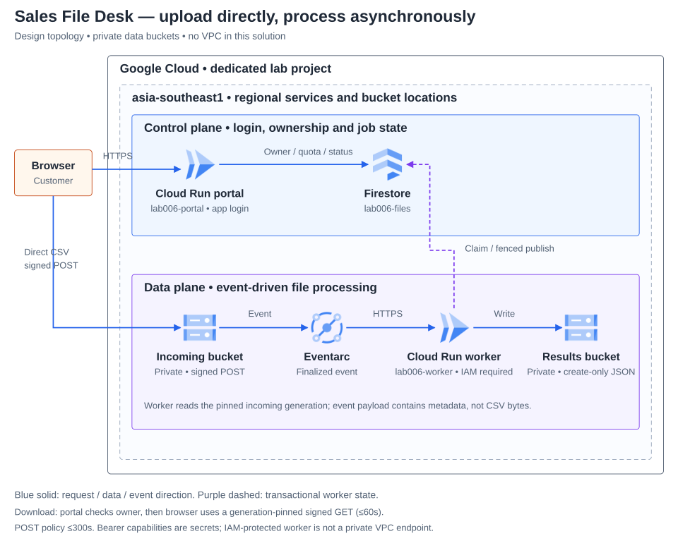
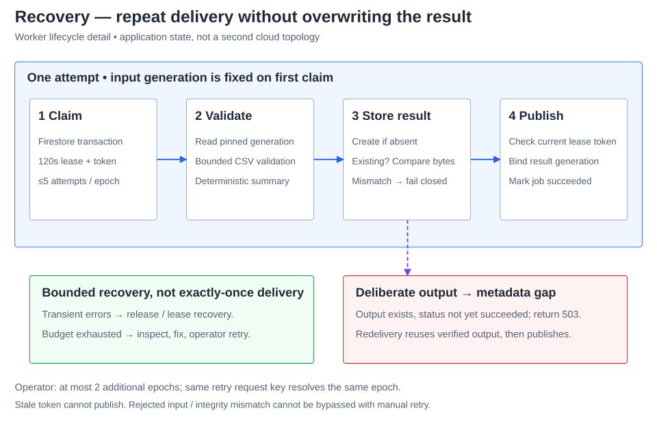

# Lab 06 — รับไฟล์ยอดขายและสร้างรายงานส่วนตัวแบบ Event-driven



Browser ขอสิทธิ์จาก Portal แล้วส่ง CSV ตรงเข้า private incoming bucket เมื่อไฟล์ finalized จึงมี event เรียก worker ส่วน Firestore เก็บ owner และสถานะงาน ไม่ส่งไฟล์ผ่าน Portal และไม่ใช้ VPC ใน Solution นี้ เส้นประแยกการ claim/publish สถานะออกจากเส้นทางไฟล์

[SVG แก้ไขได้](assets/solution.svg) · [ที่มาไอคอนและผลตรวจภาพ](assets/diagram-provenance.json) ภาพเป็นการออกแบบ ไม่ใช่ผล deploy บน GCP

## สถานการณ์

ทีมปฏิบัติการรับ CSV ยอดขายจากหลายคน ผู้ส่งต้องเห็นเฉพาะไฟล์ของตน รู้ว่าไฟล์กำลังรอ ประมวลผลสำเร็จ หรือถูกปฏิเสธ และดาวน์โหลดรายงานได้โดยไม่เปิด bucket สาธารณะ หาก worker ล้มหลังเขียนผลแล้ว การส่ง event ซ้ำต้องไม่สร้างรายงานธุรกิจซ้ำหรือเปลี่ยนเจ้าของงาน

ผู้เรียนจะสร้าง Upload portal และระบบประมวลผลจริง ไม่ใช่เพียงสร้าง bucket กับ trigger ตัวอย่างนี้ใช้ข้อมูลสังเคราะห์ ไม่มีบัตรชำระเงินหรือข้อมูลลูกค้าจริง

**สถานะ:** กำลังตรวจคู่มือฉบับเต็มและ Diagram ก่อน Guide-ready ผล GCP ยัง Not run ช่อง Actual และหลักฐานเป็นส่วนที่ผู้เรียนเติมจากการลงมือจริง

## ผู้ใช้และผลลัพธ์

- alice / bob: login, ขอสิทธิ์ upload, ส่ง CSV, ดูประวัติ/สถานะของตน และขอ download link ของผลสำเร็จ
- operator: ดูงานค้าง/failed พร้อมเหตุผลที่ไม่เปิดข้อมูลไฟล์ และขอ retry เฉพาะงานที่เข้าเงื่อนไข
- worker: อ่านไฟล์ต้นฉบับ generation ที่ถูกตรึง ตรวจข้อมูล และสร้าง summary JSON ไม่มี public endpoint สำหรับเรียกโดย anonymous

CSV baseline: คอลัมน์ sale_id,sku,quantity,unit_price_satang; จำกัด UTF-8, header ตรง, sale_id ไม่ซ้ำในไฟล์, quantity เป็นจำนวนเต็มบวก, ราคาเป็นจำนวนเต็มสตางค์ ไม่ใช้ float รายงานมีจำนวนรายการ จำนวนหน่วย ยอดรวม และยอดแยก SKU พร้อม input SHA256 และ processor version ไม่สะท้อน arbitrary HTML จากไฟล์

## Requirements และหลักฐาน

| ID | ข้อกำหนด | วิธีพิสูจน์ |
|---|---|---|
| R1 | ส่งไฟล์และรับรายงานครบวงจร | Browser login → upload → pending/processing → succeeded → download; เทียบผลกับ expected fixture ที่คำนวณไว้ |
| R2 | แยก owner และ runtime identity | bob อ่านสถานะหรือขอ link ของ alice ได้404; anonymous401; worker ปฏิเสธ anonymous; bucketไม่มี allUsers/allAuthenticatedUsers |
| R3 | จำกัด upload ทั้งทางเข้าและการอ่านจริง | baseline1MiB/10,000rows; ทดสอบ oversized, MIMEปลอม, invalidUTF-8, headerผิด, duplicate sale_id และตัวเลขผิด; rejectedไม่มี published output |
| R4 | รับ event ซ้ำ/ต่างลำดับอย่างถูกต้อง | replay CloudEvent เดิมและ eventIDต่างกันแต่ bucket/name/generationเดิม; มี logical result เดียว, ownerเดิม และ immutable input binding |
| R5 | กู้จาก failure ระหว่าง storage กับ metadata | ฉีด fault หลัง output create ก่อน success commit; retry ตรวจ output เดิมและทำงานจบโดยไม่เขียนผลซ้ำ; leaseหมดอายุถูก reclaim อย่างมี fencing |
| R6 | สิทธิ์เข้าถึงมีอายุและ retention ตรวจได้ | upload permissionหมดอายุใช้งานไม่ได้; download linkเป็น bearer capabilityที่มีTTLสั้น; Appไม่ออกlinkหลังหมดอายุงาน; บันทึก lifecycle/softdelete/metadata expiry ตามจริง |
| R7 | Change request เพิ่มขนาดไฟล์อย่างมีเพดาน | baseline1MiB→5MiB พร้อมเพิ่ม row/timeout/memory budgetที่มีเหตุผล; ทดสอบก่อน–หลัง/negative cases/คืนbaseline ไม่เพียงแก้ UI |
| R8 | ดูแลและปิดระบบได้ | request/job/event correlation, stuck-job inspection, bounded retry/backout, evidence/case study, cleanupทั้งobjects/generations/metadata/trigger/services/identities และrebuild |

## สถาปัตยกรรมและขอบเขต

เลือก Cloud Run portal/API + Cloud Run worker แยก service accounts, Cloud Storage incoming/results แยก private buckets, Eventarc Standard object-finalized trigger เฉพาะ incoming และ Firestore Native สำหรับ job state/claim ledger

วางบริการ/Storage/Firestore location ให้เข้ากันใน asia-southeast1 โดยตรวจข้อกำหนด Eventarc และ Firestore database location ก่อนสร้างจริง ไม่ใช้ทรัพยากรที่ยังเปิดค้างจาก Lab ก่อน

Portal ใช้ HTTPS ของ Cloud Run และ App session/CSRF/owner checks; การเปิด portal ให้เข้า login ได้ไม่แปลว่า worker หรือ buckets เปิดสาธารณะ ผู้ใช้ไม่รับ Google Cloud credentials และ Browser ไม่เข้าถึง Firestore โดยตรง Server SDK ใช้ IAM จึงต้องตรวจ App ownership เอง ไม่อ้าง Firestore Security Rules มาคุม server SDK แทน

ทาง upload ใช้ V4 signed POST policy ที่ตรึง bucket/key/Content-Type/expiry และ content-length-range เหตุผลคือโจทย์ต้องจำกัดขนาดตั้งแต่ทางเข้า ไม่ใช้คำอธิบายว่า signed URL ธรรมดาบังคับขนาด/ตรวจเนื้อหาได้เอง Worker ต้องตรวจ bytes/rows/schema ซ้ำเสมอ CORS ไม่ใช่ authentication และ MIME/filename จาก client ไม่ใช่หลักฐานชนิดไฟล์

ทาง download ใช้ V4 signed GET อายุสั้นเฉพาะ output object generation ที่ jobสำเร็จและ ownerผ่านแล้ว ไม่ใส่ signed URL/query/session/cookie ใน logs หรือหลักฐาน ลิงก์ที่ออกไปแล้วเป็น bearer capability: คนที่ได้ลิงก์อาจอ่านได้จนหมดอายุ จึงไม่อ้างว่า owner login ถูกตรวจทุกครั้งที่ Storage รับ download

ไม่ใช้ service-account private key file ใน repo หรือ runtime ใช้ IAM Credentials signBlob แบบ keyless โดยแยก upload signer/download signer และกำหนดสิทธิ์เฉพาะ resource ที่ต้องใช้ ขอบเขต IAM/custom role อยู่ในตารางสิทธิ์ด้านล่าง

## ข้อตกลงข้อมูลและความถูกต้อง

1. สร้าง job UUID/owner/object key/limits ก่อนออก upload permission; object key กำหนดโดย server ไม่รับ pathจาก client
2. incoming ต้องป้องกัน overwrite โดย uploader identity มี create ไม่ใช่ update/delete; bindingเลือก generationหนึ่งครั้งใน transaction และไม่เปลี่ยนตาม eventที่มาทีหลัง
3. ระบุตัวตนงานจาก bucket/name/generation ไม่ใช้ eventIDอย่างเดียว ตรวจ bucketและjob bindingก่อนอ่านไฟล์
4. Firestore transaction callback ไม่มี network I/O หรือเขียน Storage เพราะ callbackอาจถูก retry
5. claim ใช้ attempt token/fencing + lease expiry; publish success เฉพาะ tokenปัจจุบัน ไม่ให้ workerเก่าทับสถานะหลังถูก reclaim
6. output ชื่อ deterministic จาก job/generation/processor-version, create-only precondition และ verify bytes/hash เมื่อพบของเดิม; StorageกับFirestoreไม่ใช่ transactionเดียวกัน ต้องมี recoveryสำหรับช่องว่างนี้
7. validation failureเป็น terminal rejectedพร้อมreason codeที่ปลอดภัยและack; transient failureคืน retryable response ไม่ackเป็นsuccess; stale/unknown eventsต้องมีpolicyไม่เขียนข้อมูลผิดowner
8. result expiryตรวจใน App ก่อนออกlink; FirestoreTTL/Storagelifecycleเป็น cleanupภายหลัง ไม่ใช่ตัวปฏิเสธaccessทันทีและไม่รับประกันลบตรงวินาที
9. initial limits/processor versionถูกบันทึกใน job; change requestไม่เปลี่ยน contractของงานเก่ากลางทาง
10. operator retryต้อง authenticated/authorized, จำกัดจำนวนและอายุ, เก็บattempt history และกลับไปอ่าน generationเดิม ไม่สร้าง jobใหม่เงียบ ๆ

## Failure และ change scenarios

- ส่ง eventซ้ำพร้อมกันสอง worker และส่ง eventของ generationอื่นหลัง jobถูกbindแล้ว
- ข้อมูลเสียเป็น rejectedโดยไม่วน retryไม่จบ; งานค้างเพราะ transient faultสามารถ inspectและretryได้
- worker crashหลัง outputเขียนสำเร็จ แต่ก่อนmetadata success ต้อง convergeเป็นresultเดียว
- workerที่leaseหมดอายุพยายามcommitหลังattemptใหม่ ต้องถูกfence
- ถอดสิทธิ์เฉพาะ sandbox test identity/ใช้ fault revision เพื่อทดสอบ access failure ไม่แก้ IAMกว้างทั้งproject
- ขยาย1→5MiB และวัดเวลา/memory/error/ผลรวมถูกต้อง พร้อมกลับค่าเดิม; ใช้synthetic fixturesไม่ใช่ไฟล์จริงของทีม

## เตรียมสิทธิ์ ต้นทุน และ Cleanup

ใช้ sandbox projectที่เปิด Billing และมีสิทธิ์สร้าง Cloud Run/Eventarc/Storage/Firestore/Artifact Registry/Secret Manager/IAM Credentials และกำหนด IAM bindings ต้องตรวจว่ามี Firestore databaseเดิมหรือไม่ ไม่เปลี่ยน location/type ของระบบอื่นเพื่อทำLab

กำหนด max instances/concurrency/timeouts/ขนาดไฟล์/จำนวนงาน/retentionก่อนทดสอบ Budget alertไม่ใช่hard cap Storage operations, Eventarc/PubSub transport, Firestore reads/writes, Cloud Run/build/image/logs และsoftdeletedobjectsอาจคิดค่าใช้จ่าย ไม่มีการprovisionในงานเขียนเอกสารนี้

Cleanupต้องหยุดรับงาน/triggerก่อนลบworker, resolve/บันทึกงานค้าง, ตรวจobjectsทุกgeneration/softdelete, metadataและTTL, triggertransportที่ระบบสร้าง, service accounts/IAM/secrets/imagesและservices โดยแยกของLabจากFirestoreหรือprojectที่แชร์ ไม่ลบdefaultdatabaseทั้งก้อนถ้ามีข้อมูลอื่น

## แหล่งอ้างอิงที่ใช้ตั้งโจทย์

ตรวจวันที่23ตุลาคม2026 รายละเอียด version/IAM/location/SDKจะตรวจอีกครั้งใน Design

- [Eventarc retry และ duplicate delivery](https://docs.cloud.google.com/eventarc/docs/retry-events)
- [Cloud Storage events ไป Cloud Run](https://docs.cloud.google.com/run/docs/triggering/storage-triggers)
- [V4 policy signatures และ conditions](https://docs.cloud.google.com/storage/docs/authentication/signatures)
- [HTML form upload](https://docs.cloud.google.com/storage/docs/xml-api/post-object-forms)
- [Signed URLs และ bearer access](https://docs.cloud.google.com/storage/docs/access-control/signed-urls)
- [Firestore transactions](https://firebase.google.com/docs/firestore/manage-data/transactions)

## การออกแบบระบบ

### Resource map และขอบเขตจริง

| Resource | ขอบเขต / ค่าตั้งต้น |
|---|---|
| Portal/API | Cloud Run service lab006-portal, asia-southeast1; HTTPS URL ของบริการ; min0/max2 instances, concurrency8, timeout30s, memory512MiB |
| Worker | Cloud Run service lab006-worker, asia-southeast1; ต้องผ่าน Cloud Run IAM, min0/max2, concurrency1, timeout60s, memory512MiB |
| Incoming / results | bucketคนละใบ ชื่อ globally unique ที่ผู้เรียนกำหนด, regional ASIA-SOUTHEAST1, uniform access/public-access prevention; ไม่มี static website/public ACL |
| Metadata | Firestore Native Standard named database lab006-files ใน asia-southeast1 ไม่ใช้หรือเปลี่ยน default database; server SDKเลือก database IDชัดเจน |
| Events | Eventarc Standard trigger lab006-incoming-finalized, asia-southeast1, filter finalized+incoming bucket, destination worker path /events/storage |
| Image / Secret | Artifact Registry repositoryของLab, image digestที่บันทึกไว้; auth Secret versionเป็นเลข, ไม่มีpayloadในTerraform |
| Signing | แยก service accounts upload-signer และ download-signer; portalขอ signBlob ไม่ใช้keyfile |
| Observability | structured stdout/stderr และ Cloud Run metrics; job_id/request_id/event_id ใช้เชื่อมเหตุการณ์ ไม่บันทึก attempt token ไม่มีCSV/policy/signedqueryในlogs |

ทุกresourceอยู่projectเดียวกัน Eventarc locationตรงincoming bucket; Firestoreเป็นmanaged regional service ไม่วาดอยู่ในVPCsubnet และCloud Runในโจทย์นี้ไม่ได้ใช้VM/privateVPC/NATเพิ่มเพียงเพื่อให้Diagramใหญ่ Workerใช้ingress allพร้อมIAMauthenticationเพื่อให้Eventarcและเครื่องมือoperatorที่ได้รับอนุญาตเรียกได้ **ไม่อ้างว่าเป็นprivate network endpoint** Public portalต้องผ่านAppauthสำหรับทุกbusinessendpoint ยกเว้นlogin/health/static

Named Firestore databaseแยกจากข้อมูลระบบอื่นเพื่อลดความเสี่ยงตอนCleanup แต่IAMต้องตรวจscopeตามdatabaseที่ใช้จริง ไม่อ้างว่าแยกdatabaseแล้วproject-widegrantsจะหายไปโดยอัตโนมัติ

### Identity และ permission matrix

| Identity | อนุญาต | ไม่อนุญาต / จุดตรวจ |
|---|---|---|
| portal SA | อ่านauth Secretที่ระบุ; อ่าน/สร้าง/แก้jobผ่านFirestore; signBlobบนsignerทั้งสอง; invoke workerเฉพาะserviceเพื่อmanualretry | ไม่มีStorageobjectadmin/ไม่อ่านincomingbytes; ไม่มีprivatekey; signBlobไม่จำเป็นต้องgrantTokenCreatorทั้งproject |
| upload signer | storage.objects.create เฉพาะincoming bucket | ไม่มีget/list/delete/update; replaypolicyต้องไม่overwriteobjectเดิม |
| download signer | storage.objects.get เฉพาะresults bucket | ไม่มีcreate/delete/list; portalต้องตรวจownerก่อนออกGET URL |
| worker SA | Firestorejob transactions; getincoming generation; create/getresults | ไม่มีsignBlob/ไม่มีauth Secret/ไม่ลบหรือแก้incoming; ไม่ให้Editor |
| Eventarc trigger SA | eventarc.eventReceiverตามscopeที่บริการกำหนด และrun.invokerเฉพาะworker | ไม่มีpermissionอ่านไฟล์เพื่อทำแทนworker |
| Cloud Storage service agent | pubsub.publisherสำหรับdirecteventtransportตามเอกสาร | แยกจากtrigger SA/runtimeworker ไม่ให้StorageAdminแทน |
| ผู้ดูแลLab | deploy/actAs/inspectตามความจำเป็นและreviewIAM | สิทธิ์ผู้ดูแลไม่ใช้เป็นหลักฐานว่ารันtimeidentityทำได้ |

สร้างcustom roleสำหรับ iam.serviceAccounts.signBlob แล้วbindบนsignerแต่ละตัวให้portal แทนroleที่รวมgetAccessTokenโดยไม่จำเป็น หากนโยบายองค์กรไม่อนุญาตcustom roleต้องบันทึกทางเลือก/สิทธิ์ส่วนเกินก่อนdeploy ไม่เพิ่มOwnerเพื่อให้ผ่าน สิทธิ์Firestoreต้องใช้IAMcondition/database scopeที่providerรองรับและตรวจpolicyจริงก่อนเรียกleast-privilege; tests emulatorไม่พิสูจน์IAM

### HTTP และ upload contract

Portalใช้Flask signed session, Secure/HttpOnly/SameSite=Lax, CSRFสำหรับทุกmutation, hashedsyntheticpasswordsและoperatorrole; HTML/JSใช้same-originAPI ไม่มีpasswordหรือCSRFในlocalStorage ไม่มีinlineexecutionจากfilename/CSV

| Endpoint | สัญญา |
|---|---|
| POST /api/login, POST /api/logout | จำกัดrequestbody, CSRFที่เหมาะกับsession, genericbadlogin, ไม่logcredentials |
| GET /api/session | คืนuser/role/CSRFสำหรับsessionที่เปิดอยู่ ไม่คืนpasswordhash |
| POST /api/jobs | ownerจากsession ไม่รับownerจากbody; รับdisplaynameที่จำกัดและidempotencykey; สร้างjob+quotareservationในtransaction |
| POST /api/jobs/{id}/upload-policy | ownerผ่านก่อน; ออกpolicyเฉพาะawaiting_uploadและภายในupload deadline; retryได้แต่ใช้objectkeyเดิม |
| GET /api/jobs, GET /api/jobs/{id} | queryownerฝั่งserver, จำกัดpage size20/cursor; other-owner404; ไม่คืนpolicyหรือobjectstorageURL |
| POST /api/jobs/{id}/download-link | owner+CSRF+success+notexpired; signedGETตรึงoutputgeneration; Cache-Control:no-store |
| POST /api/operator/jobs/{id}/retry | operator+CSRF; จำกัดepoch/attempt; preservegeneration/limits/version; เรียกworkerด้วยIDtokenและaudienceของworker |
| POST worker /events/storage | Cloud Run IAMก่อนเข้าApp; CloudEvents binary headers+JSONdata; จำกัดbody64KiB; ตรวจeventtype/source/bucket/key/generationซ้ำ |
| GET /livez, GET /healthz | ไม่แก้ข้อมูล; livezprocess/config, healthz boundedmetadataread ไม่มีlistทุกjob |

Baseline: input1,048,576bytes/10,000rows; change5,242,880bytes/50,000rows; แต่ละfieldไม่เกิน128chars, SKUรูปแบบallowlist, quantity1..1,000,000และunit_price_satang0..100,000,000; จำกัดผลรวมไม่เกินsigned64-bit integer ปฏิเสธNaN/decimal/bool/extra columns/nullbytes/quotednewlineถ้าparsercontractไม่รองรับ BOM/CRLFต้องกำหนดและทดสอบชัดเจนก่อนประกาศใช้งานได้

POSTpolicyอายุสูงสุด300s และไม่เกินupload_deadline; keyตรงincoming/{jobUUID}/source.csv, Content-Type=text/csv, lengthrange1..job.max_bytes ไม่มีstarts-withkeyที่เปิดให้เลือกpathเอง Browserใช้FormDataส่งpolicyfieldsตามที่APIให้และfileเป็นfieldสุดท้าย ไม่ตั้งmultipartboundaryเอง กำหนดsuccess_action_status201แล้วตรวจresponseก่อนpolljob

Storagepolicyตรวจheaders/size แต่ไม่รู้ว่าbytesเป็นCSVจริง Workerdownloadแบบbounded max_bytes+1และตรึงgeneration ไม่ใช้download_as_bytesแบบไม่จำกัดกับeventsizeที่เชื่อจากclient ไม่followURLในevent ไม่evalformulaหรือเปิดspreadsheetเพื่อรันmacro

Uploadpolicyเป็นbearerpermissionและreplayได้ระหว่างTTL การcreateobjectชื่อเดิมอีกรอบต้องถูกปฏิเสธจากsignerที่ไม่มีdelete/update; ต้องพิสูจน์บนGCPจริง หากstorageAPI/libraryต้องการpermissionเกินที่ตั้งไว้ให้ทบทวนcontract ไม่ให้overwriteเพื่อทำให้testผ่าน

DownloadTTLสูงสุด60sและไม่เกินเวลาที่jobเหลือก่อนexpires_at ออกURLเฉพาะgenerationที่ตรวจแล้ว Content-Disposition attachmentชื่อserverกำหนดและContent-Type application/json; ผลใกล้หมดอายุจนเหลือไม่ถึง1sให้ปฏิเสธ การlogoutไม่เพิกถอนlinkที่ออกไปแล้ว

### Metadata และ state machine

jobs/{UUID} มี owner, display_name, object_name, created_at/upload_deadline/expires_at/delete_after, max_bytes/max_rows, processor_version, state, input_generation, input_sha256, attempt_epoch/count/token/lease_until, output_name/generation/sha256, safe_reason และtimestamps ส่วนidempotencyrecordsใช้hash(owner+key)พร้อมfingerprintและjobreference ไม่เก็บrawkeyในlogs

ตั้งexpires_at=created+24hสำหรับAppaccess; upload_deadline=created+5min; delete_after=created+48hสำหรับTTLcleanup หลังuploaddeadlineจะขอpolicyใหม่ไม่ได้ แต่metadataอาจยังเป็นawaiting_uploadจนถึงAppexpiryหรือมีการประมวลผลevent ไม่ได้มีreconcilerเปลี่ยนทุกงานเป็นexpiredทันที TTLdeleteอาจล่าช้าและไม่ลบStorageobjectsโดยอัตโนมัติ

| สถานะเดิม | เหตุการณ์ | ผล |
|---|---|---|
| awaiting_upload | finalizedeventที่ตรงkey/bucketและไม่เลยdeadline/expiry | transactionbindgenerationครั้งเดียวแล้วclaimprocessing |
| processing / leaseยังไม่หมด | duplicategenerationเดิม | retryable503 ไม่ackแล้วพึ่งworkerเดิมเพียงตัวเดียว |
| processing / leaseหมด | eventเดิมส่งใหม่ | claimtokenใหม่; workerเก่าไม่มีสิทธิ์publishstatus |
| processing | validationไม่ผ่าน | rejected+safe_reason แล้วack204; ไม่มีpublishedoutput |
| processing | outputverified + tokenยังตรง | succeededพร้อมgeneration/hashแล้วack204 |
| processing | transientstorage/metadata failure | ปล่อยleaseให้หมดหรือreleaseโดยtoken; return503สำหรับtransportretry |
| succeeded/rejected/expired | duplicateevent | ack204โดยไม่สร้างผลใหม่ |
| ทุกสถานะที่bindแล้ว | generationต่างจากที่bind | ignore+reasonlogged ไม่เปลี่ยนowner/input/result |
| retrybudgetครบ | transientครั้งถัดไป | failedพร้อมsafe_reasonและack; operatorretryได้ตามpolicy ไม่วนตลอดไป |

Lease120sเป็นช่วงถือสิทธิ์ก่อนclaimใหม่ ไม่ใช่ตัวหยุดprocess; Cloud Run request timeout60s และGunicorn timeout65s ส่วนGCSแต่ละoperationตั้งtimeout5sและretry=None โค้ดยังไม่มีwall-clock deadlineรวม45s จึงไม่รับประกันว่าoperationทั้งหมดจะจบภายใน45sหรือว่าHTTPtimeoutหยุดงานทันที ใช้token-fencedpublishและcreate-or-verifyoutputรับมือattemptที่ทับช่วงกัน และต้องทดสอบtimeout/recoveryบนCloudจริง ไม่ต่อleaseไม่จำกัด attemptไม่เกิน5ต่อepoch, manualretryไม่เกิน2epochsเพิ่มจากครั้งแรก; rejected/expiredไม่เปิดretryเพื่อหลบvalidation ต้องสร้างjobใหม่ผ่านขั้นตอนปกติ งานfailedเก็บgenerationเดิมและนำoutputที่ถูกต้องกลับมาใช้ได้

Unknown/malformedevents: invalidenvelope400เพื่อให้เห็นconfigurationerror; authenticแต่ไม่อยู่bucket/key/jobnamespaceของLabให้ack204และsafeignoredreason ไม่สร้างjobจากevent หากmetadataอ่านไม่ได้เป็น503ไม่เหมาว่าunknownแล้วack งานที่หาไม่เจอจริงต้องlogignoredและให้runbookreconcile ไม่สร้างownerจากobjectmetadataที่clientปลอมได้

### Output commit และการกู้ช่องว่างข้ามบริการ



[SVG การกู้คืน](assets/recovery.svg): หากผลเขียนแล้วแต่สถานะยังไม่สำเร็จ รอบถัดไปต้องตรวจและใช้ผลเดิม ไม่เขียนทับเพื่อให้ผ่าน


คำนวณsummaryแบบdeterministic ใช้integer, sortedSKU, canonicalUTF-8JSON ไม่มีcurrenttime/attempttokenในbusinessbytes Outputkeyคือ results/{jobUUID}/{inputGeneration}/{processorVersion}/summary.json เขียนif_generation_match=0 พร้อมmetadatainputSHA/processorversion ไม่updateobjectที่มีอยู่

ถ้าได้preconditionfailed ให้GETexistinggenerationแบบboundedและเทียบcanonicalbytes/SHA/inputgeneration/versionก่อนreuse หากไม่ตรงให้failed_integrityและหยุด ไม่overwriteเพื่อให้เลขตรง ส่วนtimestampการattemptเก็บในFirestoreแยกจากผลสรุป

หลังเขียนหรือverifyoutputแล้วจึงFirestoretransactionตรวจtoken/generation/version/expiryก่อนpublishsuccess ถ้าworkerเก่าถูกfenceoutputที่คำนวณเหมือนกันอาจยังเกิดได้ แต่ไม่เปลี่ยนstateและไม่มีผลธุรกิจซ้ำ workerใหม่verifyreuseแล้วcommitต่อ ถ้างานexpireระหว่างทำต้องไม่publishdownloadable success; เก็บorphanoutputให้cleanupตามretention

Faultcontrolเป็นrevisionconfigสำหรับsandbox: fail_after_output_onceตามjobmarkerที่เก็บในFirestore ไม่รับflagจากclientทั่วไป ปิดfaultแล้วreplayeventgenerationเดิมต้องจบได้ด้วยoutputเดิม ไม่อ้างexactly-oncedelivery แต่พิสูจน์logicalresultconvergence

### ขอบเขตการทดสอบ

1. Domain parserfixtures: valid/CRLF/BOMcontract, duplicateID, invalidUTF8/header/quantity/price, maxbytes/rows/field/total bounds; exactexpectedsummary
2. Firestore emulatorจริง: owner/idempotencytransaction, concurrentclaim, generationbinding, leaseexpiry, stale-tokencommit, retrybudget/manualepoch, expiration และquotareservation ไม่ใช้fakeอย่างเดียว
3. Storageadapter: boundedgenerationread, create-onlyoutput, existinghashmismatch, signedpolicyexactconditions/keylesssigner; mockrequestใช้ตรวจAPIcontractแต่ไม่เรียกGCPจริง
4. HTTP/browser: aliceupload/status/download, bob404, anonymous401, operator403, CSRF, workerIAMแยกจากAppunit checks, UIerror/retry/pollboundedโดยไม่เผยsignedquery
5. Recoveryintegration: outputcreated→fault→duplicateevent→sameoutputgeneration→success; invalidfileackterminal; failedtransientสามารถmanualretry; expiredjobไม่ออกlink
6. Terraform: fmt/init-backendfalse/validate; IAM/triggerlocation/Firestoreisolation/staticconfigtests; actualplan/applyและsignedupload/permission/expiryต้องผู้เรียนรันบนGCP
7. Guide: expected/actualข้างทุกTask, fixtures+boundedtools, resourceinventoryและcleanuporder; ไม่มีCloudPASSล่วงหน้า

Quotaฝึก: ไม่เกิน5activejobs/ownerและ20newjobs/owner/UTCdayด้วยtransactioncounter; จำกัดรวมชุดทดสอบ40jobsและไฟล์changeสูงสุด5MiBต่อไฟล์ นี่เป็นAppguardไม่ใช่Billinghardcap publicloginยังไม่ใช่productionabuseprotection ต้องตั้งเวลาเปิดและmaxinstancesร่วมด้วย

Retention: incoming/results lifecycledeleteหลัง2วันและบันทึกsoftdeletepolicyจริง; FirestoreTTLใช้delete_afterเมื่อเปิดpolicyแล้ว Appตรวจexpiryเองก่อนTTL; ไม่เปิดbucketversioningโดยไม่จำเป็น แต่ทุกread/resultbindingยังใช้generation Lifecycle/TTLไม่ใช่backupstrategyและไม่รับประกันไม่มีค่าใช้จ่ายหลังUIซ่อนงาน

แหล่งอ้างอิงDesign: [Eventarc Storage routing/location](https://docs.cloud.google.com/eventarc/standard/docs/run/route-trigger-cloud-storage), [Eventarc identities](https://docs.cloud.google.com/eventarc/docs/roles-permissions), [Python signed POST policy API](https://docs.cloud.google.com/python/docs/reference/storage/latest/google.cloud.storage.client.Client), [Firestore database locations](https://docs.cloud.google.com/firestore/native/docs/locations), [Firestore transaction retries](https://firebase.google.com/docs/firestore/manage-data/transactions)

ข้อจำกัด SDK/API และสิทธิ์จริงต้องตรวจตอน deploy ตามจุดตรวจใน Tasks ผล CI ด้านล่างไม่ใช่หลักฐานว่าโครงสร้างนี้ถูกสร้างบน GCP แล้ว


## ไฟล์ที่ใช้ใน Lab และพฤติกรรมสำคัญ

| ส่วน | ไฟล์หลัก | ใช้ทำอะไร |
|---|---|---|
| ข้อมูลและรายงาน | [CSV domain](app/csv_domain.py), [valid CSV](fixtures/valid-sales.csv), [expected summary](fixtures/valid-sales.expected.json) | ตรวจข้อมูลและคำนวณผลแบบ deterministic |
| สถานะและฐานข้อมูล | [state transitions](app/job_state.py), [Firestore repository](app/firestore_jobs.py) | สร้างงาน, quota, idempotency, claim/lease, fencing และประวัติ |
| การประมวลผล | [processor](app/processor.py), [Storage adapter](app/gcs_objects.py), [event parser](app/storage_events.py), [worker HTTP](app/worker_http.py) | อ่าน input generation เดิม เขียนหรือยืนยันผล แล้วบันทึกสถานะ |
| Portal และสิทธิ์ชั่วคราว | [Portal API](app/portal_http.py), [signed access](app/signed_access.py), [runtime](app/portal_runtime.py), [retry dispatch](app/retry_dispatch.py) | Login, owner checks, signed POST/GET และ operator retry |
| หน้าจอ | [HTML](app/static/index.html), [JavaScript](app/static/app.js), [CSS](app/static/style.css) | ส่งไฟล์ ดูสถานะ ดาวน์โหลด และแก้คำขอที่ไม่ทราบผล |
| บัญชีทดลอง | [create-secrets.py](scripts/create-secrets.py) | สร้าง auth bundle และรหัสสังเคราะห์ไว้ในโฟลเดอร์ส่วนตัวใหม่ ไม่เขียนทับ |
| เครื่องมือผู้เรียน | [verify-report.py](scripts/verify-report.py), [Portal client](scripts/portal_client.py), [upload boundary runner](scripts/test-upload-boundary.py), [change fixtures](scripts/create-change-fixtures.py), [event replay](scripts/replay-storage-event.py) | เทียบผล ทดสอบข้อจำกัด Storage และสร้างข้อมูลเปลี่ยนขนาด |
| Container | [Dockerfile](Dockerfile), [entry point](scripts/run-container.py) | Image เดียวเลือกบทบาท Portal หรือ worker และรันด้วย UID 10001 |
| Infrastructure | [foundation](infra/foundation/main.tf), [workloads](infra/workloads/main.tf) | แยกฐานระบบออกจากบริการ เพื่อทราบ Portal URL ก่อนตั้ง CORS |
| การทดสอบ | [domain](tests/test_csv_domain.py), [Firestore integration](tests/test_firestore_jobs.py), [browser journey](tests/test_browser_journey.py), [guide checks](tests/test_guide.py) | ตรวจ business invariants, race/recovery, การใช้งานจริงใน CI และตัวอย่างคำสั่ง |

### รูปแบบ CSV และผลที่ควรได้

ไฟล์ valid มี 3 รายการ รวม 6 หน่วย ยอด 72,400 สตางค์ เทียบกับ expected summary โดยคำนวณ SHA256 จาก bytes ของไฟล์ที่ส่งจริง ไม่คัดลอก hash ของไฟล์ที่อาจมี line ending ต่างกัน

ตัวตรวจรับ UTF-8 BOM หนึ่งชุดที่ต้นไฟล์, LF/CRLF และ quoted fields แต่ไม่รับ newline ใน field, blank record, null byte, คอลัมน์เกิน, whitespace รอบตัวเลข, leading zero เช่น 01, exponent หรือ float ราคาเป็นศูนย์ได้ แต่ quantity ต้องมากกว่าศูนย์ SKU ใช้ตัวพิมพ์ใหญ่ตาม allowlist ไม่ประเมินสูตรหรือรัน macro

Storage adapter อ่านแบบ raw และตรึง generation ตรวจขนาดจาก metadata และจำกัด buffer ซ้ำ ปฏิเสธ content encoding/MIME ที่ไม่ตรง ผลลัพธ์ไม่เกิน 8 MiB เขียนด้วย if_generation_match=0 และ CRC32C หากมีผลอยู่แล้วต้องเทียบ bytes/hash/metadata ก่อน reuse ไม่เขียนทับสิ่งที่ไม่ตรง

### คำขอซ้ำ งานค้าง และประวัติ

การสร้าง job, idempotency record และ quota อยู่ใน Firestore transaction เดียวกัน key เดิมคืนงานเดิม แม้ quota เต็ม แต่เปลี่ยนชื่อ/limits/version ด้วย key เดิมจะ conflict หาก record ชี้งานที่หายหรือหมดอายุจะไม่สร้างงานใหม่เงียบ ๆ

Quota จำกัด 5 active jobs และ 20 งานใหม่ต่อ owner ต่อ UTC day งานที่สำเร็จ ถูกปฏิเสธ หรือหมดอายุคืน active slot เมื่อสร้างงานถัดไป งาน failed ที่ยัง retry ได้ยังนับ active และงาน awaiting_upload ไม่คืน slot ทันทีที่หมด upload deadline เพราะ event ของไฟล์ที่ส่งทันอาจมาช้า ต้อง reconcile หรือรออายุงาน ไม่ใช้ TTL เป็นตัวปล่อย quota ทันที

callback ของ transaction ไม่อ่าน Storage และอ่านเวลาใหม่เมื่อ SDK retry ส่วน history บันทึกพร้อม state change สูงสุด 100 รายการ พร้อม count/truncated flag โดยไม่มี token หรือ credentials รายการงานแบ่งหน้าครั้งละไม่เกิน 20 รายการ cursor เป็นตำแหน่ง ไม่ใช่สิทธิ์อ่านของผู้อื่น

Operator retry เตรียม epoch ก่อนเรียก network คำขอเดิมใช้ epoch เดิม หาก Portal ตอบ 202 แบบ acknowledged หรือ unconfirmed ต้องอ่านสถานะงานต่อ ทั้งสองไม่ใช่ผลธุรกิจว่าสำเร็จ จำกัด manual retry เพิ่มอีกสอง epoch และไม่เปิดให้ใช้ข้าม validation/integrity failure

### Browser และขอบเขตความลับ

Portal ใช้ session cookie แบบ Secure/HttpOnly/SameSite=Lax และ CSRF ทุก mutation ก่อนสร้างงาน Browser เก็บเฉพาะ request key, SHA ของไฟล์, ชื่อไฟล์ และ job ID สำหรับ resume ไม่เก็บ password, CSRF, policy หรือ signed URL ใน sessionStorage หน้าจอใช้ textContent ไม่รัน HTML จากชื่อไฟล์

หากคำตอบ create หาย ให้เลือกไฟล์เดิมเพื่อ resolve key เดิมก่อนเริ่มงานใหม่ เมื่อ upload สำเร็จต้องตรวจ Storage ตอบ 201 แล้วจึงติดตามสถานะ โดย poll ไม่เกิน 30 รอบ ข้อมูลที่ดาวน์โหลดเป็น bearer capability อายุสั้น ไม่เผย URL ในภาพหรือ logs

Runtime อ่าน Secret version แบบตัวเลขและ attached identity ไม่ใช้ private key หรือ emulator ใน Cloud Run ค่า Secret mount 0444 ให้อ่านได้ด้วย non-root container แต่ไม่ได้แยกสิทธิ์แต่ละ process ภายใน container จึงต้องถือ container เป็น trusted boundary

### Infrastructure และสิ่งที่ CI พิสูจน์ได้

Foundation สร้าง buckets แบบ private/ไม่ force destroy, named Firestore พร้อม deletion protection, TTL, service accounts ห้าชุด, custom get/create/signBlob roles, Secret container และ Artifact Registry โดยไม่ใส่ Secret payload ใน Terraform ตั้ง CORS เฉพาะ origin จริงหลัง workloads พร้อม

Workloads ตรึง image digest, ให้ worker invoker เฉพาะ Portal/trigger SA, เปิดหน้า login ของ Portal ผ่าน App auth และตั้ง fault flags เป็น false ค่าเริ่มต้น ใช้ /livez สำหรับ startup/liveness ไม่ทำให้ความขัดข้องของ Firestore กลายเป็น process-health โดยอัตโนมัติ

[CI 39991195096](https://github.com/somkid-s5/Portfolio-Lab/actions/runs/39991195096) ผ่าน domain/state/tooling/guide checks, SDK/HTTP/runtime tests, 18 Firestore emulator tests, Chrome journey, container build/import/non-root/private-file exclusion และ Terraform fmt/init-backend=false/validate ทั้งสอง roots

Firestore emulator ใช้ named database บน loopback และ anonymous credentials ไม่ fallback ไป GCP ส่วน Chrome ใช้ HTTPS loopback กับ Storage/signing test doubles จึงไม่พิสูจน์ IAM, ลายเซ็นจริง, Eventarc delivery, CORS หรือ performance บน GCP การตรวจ Terraform ไม่ใช่ plan/apply

Image base ใช้ official Python 3.12.15-slim-bookworm ซึ่งอาจได้รับ rebuild ต้องบันทึก resolved image digest ของการ build จริง ไม่อ้าง bit-reproducible จาก tag หรือ dependencies ที่ไม่ได้ล็อกทุกชั้น

## หลักฐาน UI จาก CI (ไม่ใช่ผล Deploy GCP)


[CI39991195096](https://github.com/somkid-s5/Portfolio-Lab/actions/runs/39991195096) / job120543077262 ผ่านBrowserlost-create-response→reload→samekey→onejob/oneoutput รวมถึง18FirestoreintegrationtestsและชุดSDK/HTTP/runtimeที่อยู่ในjobเดียวกัน ภาพนี้ใช้HTTPSloopback/Firestoreemulatorจริง ส่วนStorage/signingเป็นtestdouble ไม่ใช่GoogleCloudConsoleหรือGCS/IAMverification [รายละเอียดที่มาภาพ](assets/ui-ci-provenance.json)

ตรวจภาพรอบนี้แล้ว: แถบสถานะและแถวงานแสดงsucceededตรงกัน อ่านรายละเอียดjob/limits/attemptได้ครบ ภาพไม่แสดงsignedURL/password ส่วนcontainerbuild/import/nonroot/privatefileexclusionและTerraformvalidateทั้งสองrootsผ่านในworkflowเดียวกัน ผลเหล่านี้ยังไม่พิสูจน์CloudRunIAM/Eventarc/GCSจริง


## เริ่มทำ Lab — สร้างระบบจาก sandbox ว่าง

ส่วนนี้เป็นคู่มือที่ผู้เรียนใช้สร้างทรัพยากรมีค่าใช้จ่าย ไม่ใช่คำสั่งที่ผู้จัดทำรันแทนคุณ ช่อง Actual ยังไม่มีผล GCP บันทึกไว้ล่วงหน้า คู่มือมีร่าง Tasks 0–13 แล้ว ยังต้องตรวจ Diagram และทบทวนทั้งชุดก่อน Guide-ready

### Task 0 — เตรียม project สิทธิ์ และพื้นที่ทำงาน

**ทำที่ไหน:** Google Cloud Console → เลือก sandbox project → Activate Cloud Shell ใช้ Bash ของ Cloud Shell ไม่ใช่ PowerShell และไม่ใช่ terminal บน laptop

1. เลือก project สำหรับ Lab นี้โดยเฉพาะ เปิด Billing และตั้งเวลาปิดระบบ/งบก่อนเริ่ม Budget alert ไม่ใช่ hard cap ค่า Cloud Run, builds/images, Storage operations/soft delete, Firestore และ Eventarc/PubSub อาจยังมีหลังหยุด Browser
2. เปิด IAM & Admin → Quotas & System Limits ตรวจ Cloud Run ใน asia-southeast1, Firestore named databases, Eventarc triggers และ Artifact Registry ตรวจนโยบายองค์กรเรื่อง public invoker ด้วย เพราะ Portal เปิดให้เข้า login แต่ worker ไม่เปิด anonymous
3. ผู้ทำต้องสร้าง APIs/SA/custom roles/IAM bindings/Storage/Firestore/Run/Eventarc/Secret containers ได้ และมี actAs ของ runtime/trigger identities อย่าแก้การติดสิทธิ์ด้วยการให้ Owner กับ runtime SA
4. ใน Firestore → Databases ตรวจว่าไม่มี lab006-files ของงานอื่นอยู่แล้ว ไม่เปลี่ยน default database หรือ import ของทีมอื่นเข้าระบบนี้
5. Clone ใหม่ใน persistent Cloud Shell home โดยไม่ทับงานเดิม:

```bash
export PROJECT_ID='ใส่-sandbox-project-id'
export INCOMING_BUCKET='ใส่ชื่อ-incoming-bucketใหม่ที่ไม่ซ้ำทั่วโลก'
export RESULTS_BUCKET='ใส่ชื่อ-results-bucketใหม่ที่ไม่ซ้ำทั่วโลก'
export REGION='asia-southeast1'
gcloud config set project "$PROJECT_ID"
gcloud auth list --filter=status:ACTIVE --format='value(account)'
gcloud config get-value project
umask 077
export CHECKOUT_PARENT="$(mktemp -d "$HOME/lab006-work-XXXXXX")"
git clone --branch docs/gcp-solution-labs --single-branch https://github.com/somkid-s5/Portfolio-Lab.git "$CHECKOUT_PARENT/Portfolio-Lab"
export REPO_DIR="$CHECKOUT_PARENT/Portfolio-Lab"
export LAB_DIR="$REPO_DIR/GCP/LAB-006-private-file-processing"
cd "$LAB_DIR"
export SOURCE_COMMIT="$(git rev-parse HEAD)"
printf 'Source commit: %s\n' "$SOURCE_COMMIT"
terraform version
gcloud version
docker version
python3 --version

```

**Expected:** active account/project ตรง sandbox, SHA เต็ม40ตัว, Terraform1.9.x (CIใช้1.9.8), Dockerใช้งานได้ และ Python3.12ที่รองรับdependencies ถ้าไม่มีTerraformให้ติดตั้งรุ่นที่รองรับจากHashiCorpก่อน ไม่ลดconstraintเพื่อข้ามการตรวจ providerตรึง6.50.0 ไม่ใช้init-upgradeระหว่างทำLabโดยไม่ทบทวนdiff

พื้นที่นี้อยู่persistent home ไม่ใช่ /tmp เก็บpathและstateของทั้งสองTerraformrootsไว้จนCleanupจบ หากเปิดCloudShellใหม่ให้กลับcheckout/stateเดิมและตั้งvariablesคืน ไม่cloneใหม่แล้วapplyซ้ำโดยไม่ตรวจstate ไฟล์state/plan/Secretbundleเป็นprivate ห้ามcommitGitHub หากองค์กรไม่ให้เก็บstateในCloudShellต้องเตรียมcontrolledremote backendก่อนprovision

**จุดบันทึก T00:** project/accountที่ตรวจ …; SOURCE_COMMIT …; versions …; persistentdirectory/ผู้มีสิทธิ์เข้าถึง …; budget/เวลาปิด …; quotas/orgpolicy …; prefixชื่อที่ยืนยันว่าไม่ชนระบบอื่น …  
**เกณฑ์ไปต่อ:** project/สิทธิ์/งบ/พื้นที่stateครบ ถ้ายังไม่ครบหยุดก่อนapply ไม่เปลี่ยนworkerเป็นpublicเพื่อให้ขั้นตอนผ่าน

### Task 1 — สร้าง foundation โดยยังไม่เปิดบริการ

**เป้าหมาย:** privatebucketsสองใบ, Firestoredatabaseแยก, identities, IAM, authSecretcontainerว่าง และArtifactRegistry ไม่มีSecretpayloadในTerraformstate

**ทำที่ไหน:** Cloud Shell ที่ LAB_DIR จาก T00 ทุกapplyด้านล่างผู้เรียนต้องอ่านplanและยืนยันเอง

```bash
cd "$LAB_DIR"
export TF_VAR_project_id="$PROJECT_ID"
export TF_VAR_bucket_names="{\"incoming\":\"$INCOMING_BUCKET\",\"results\":\"$RESULTS_BUCKET\"}"
export TF_VAR_portal_origin=''
terraform -chdir=infra/foundation init -input=false
terraform -chdir=infra/foundation validate
terraform -chdir=infra/foundation plan -out=foundation.tfplan
terraform -chdir=infra/foundation show -no-color foundation.tfplan

```

ตรวจplan: databaseชื่อlab006-files/FIRESTORE_NATIVE/asia-southeast1 ไม่ใช่(default), protectionเปิด/PREVENT, bucketsชื่อตรงตัวแปรไม่ซ้ำกัน/publicaccessprevention/uniform/force_destroyfalse, lifecycle2วัน/softdelete7วัน, SA5ชุดและcustomroleget/create/signBlobตามmatrix ไม่มีSecretversion/privatekey/CloudRun/Eventarctriggerหรือresourceลบของระบบอื่น ถ้าไม่ตรงอย่าapply

```bash
terraform -chdir=infra/foundation apply foundation.tfplan
terraform -chdir=infra/foundation output
gcloud firestore databases describe --database=lab006-files --format='yaml(name,locationId,type,concurrencyMode,deleteProtectionState)'
gcloud storage buckets describe "gs://$INCOMING_BUCKET"
gcloud storage buckets describe "gs://$RESULTS_BUCKET"
gcloud storage buckets get-iam-policy "gs://$INCOMING_BUCKET"
gcloud storage buckets get-iam-policy "gs://$RESULTS_BUCKET"
gcloud secrets get-iam-policy lab006-auth

```

เปิด Console → Firestore → Databases → lab006-files ตรวจlocation/type/protection แล้วเปิดTTLpoliciesตรวจdelete_afterของjobs/idempotency/owner_quotas รอpolicyพร้อมตามoperationเดิม ไม่สร้างdatabaseซ้ำชื่ออื่นเพราะรอ จากนั้นStorage → bucketsแต่ละใบ → Permissions/Protection/Lifecycle ตรวจไม่publicและretentionตามแบบ

**Expected:** ไม่มีallUsers/allAuthenticatedUsersที่bucket; upload signerมีcreateincomingอย่างเดียว, workergetincoming/create+getresults, download signergetresults, portalไม่มีobjectaccessโดยตรง ส่วนauthSecretAccessorให้portalเท่านั้น ต้องตรวจinheritedproject/orggrantsร่วมด้วย policyระดับbucketไม่ได้ถอนสิทธิ์กว้างที่มีอยู่ก่อน

FirestoreIAMconditionต้องชี้databaseนี้โดยเฉพาะ ไม่ได้แยกสิทธิ์เป็นรายcollectionหรือรายAppuser และConsoleผู้ดูแลไม่ใช่หลักฐานว่าruntimeSAถูกจำกัดจริง TTL/lifecycleไม่รับประกันลบตรงเวลา softdeleteอาจเก็บของต่อ7วันและคิดค่าใช้จ่าย

**ถ้าไม่ผ่าน:** bucketnameชนให้เลือกชื่อใหม่ก่อนapply ไม่importbucketคนอื่น; permissioncustomrole/SAให้แก้สิทธิ์ผู้deploy ไม่ให้runtimeOwner; API/TTLoperationยังรันให้ตรวจoperationเดิมจนterminalก่อนapplyใหม่; Firestorelocationผิดให้หยุด ไม่ลบdatabaseเพื่อแก้แบบเดาสุ่ม

**จุดบันทึก T01:** reviewedplan …; bucketpolicy/retention …; database/location/protection …; TTLสถานะ …; IAMcondition/runtimeSAที่ตรวจ …; inheritedgrants/ข้อจำกัด …; error/วิธีแก้ …  
**เกณฑ์ไปต่อ:** foundationตรงDesignและstateถูกเก็บ ไม่ใช่เพียงexit0

### Task 2 — สร้างบัญชีสังเคราะห์และ Secret version

**ทำที่ไหน:** Cloud Shell ที่ LAB_DIR ห้ามset-x, gcloud--log-http หรือถ่ายภาพไฟล์ที่มีรหัส

```bash
cd "$LAB_DIR"
umask 077
python3 -m venv .venv
.venv/bin/pip install -r requirements.txt
.venv/bin/python scripts/create-secrets.py --out secrets
export AUTH_VERSION_NAME="$(gcloud secrets versions add lab006-auth --data-file=secrets/auth.json --format='value(name)')"
export AUTH_VERSION="$(basename "$AUTH_VERSION_NAME")"
printf 'Auth version: %s\n' "$AUTH_VERSION"
gcloud secrets versions list lab006-auth --format='table(name,state)'

```

**Expected:** generatorพิมพ์เฉพาะeventไม่พิมพ์รหัส, secretsdirectorymode700/auth.jsonกับdemo-logins.jsonmode600, AUTH_VERSIONเป็นเลขและENABLED auth.jsonมีhash/sessionkey ไม่มีplaintextpassword ส่วนdemo-logins.jsonเป็นprivateสำหรับอ่านรหัสตอนBrowserlogin ไม่อัปโหลดไฟล์นี้เป็นSecretที่Appไม่ต้องใช้

ถ้าdirectoryมีอยู่generatorจะปฏิเสธ อย่าลบเพื่อข้ามการป้องกันหรือออกbundleใหม่แล้วเปลี่ยนversionโดยไม่รู้ว่าใช้อะไรอยู่ หากuploadversionล้มให้ตรวจversionslistก่อนรันใหม่ ไม่ใช้latestเพื่อเลี่ยงการตัดสินใจ deploymentจะmountnumericversionและAppอ่านตอนstartup ถ้าmountอ่านไม่ได้ต้องแก้IAM/version ไม่ปิดauth

**จุดบันทึก T02:** AUTH_VERSION …; versionENABLED/IAM …; privatefilepermissionsที่ตรวจ …; ข้อผิดพลาด/retest …  
ไม่บันทึกรหัส/passwordhash/sessionkey/payloadลงช่องนี้  
**เกณฑ์ไปต่อ:** versionที่ตั้งใจใช้ชัดเจนและruntimeportalอ่านได้ตามpolicy workerไม่มีสิทธิ์อ่านauthSecret

### Task 3 — Build และบันทึก image digest

**ทำที่ไหน:** Cloud Shell ที่ LAB_DIR; buildจากcheckoutSOURCE_COMMITที่สะอาด ไม่คัดลอกsecretsเข้าapp โครงDockerใช้explicitCOPY/dockerignoreแต่ผู้เรียนยังต้องตรวจไฟล์ก่อนbuild

```bash
cd "$LAB_DIR"
git status --short
export IMAGE_REPOSITORY="$(terraform -chdir=infra/foundation output -raw image_repository)"
export IMAGE_TAG="$IMAGE_REPOSITORY/files:$SOURCE_COMMIT"
gcloud auth configure-docker asia-southeast1-docker.pkg.dev
docker pull python:3.12.15-slim-bookworm
docker image inspect python:3.12.15-slim-bookworm --format '{{json .RepoDigests}}'
docker build -t "$IMAGE_TAG" .
docker push "$IMAGE_TAG"
gcloud artifacts docker images describe "$IMAGE_TAG" --format=json
export IMAGE_DIGEST="$(gcloud artifacts docker images describe "$IMAGE_TAG" --format='value(image_summary.digest)')"
export PINNED_IMAGE="$IMAGE_REPOSITORY/files@$IMAGE_DIGEST"
printf 'Pinned image: %s\n' "$PINNED_IMAGE"

```

**Expected:** digestเป็นsha256ตามด้วย64hex, PINNED_IMAGEอยู่repository/projectนี้และอ้าง@sha256ไม่ใช่tag ตรวจJSONจากdescribeร่วมด้วย หากfieldว่างหรือpushไม่สำเร็จให้หยุด ไม่แต่งdigestหรือใช้tagแทน [Artifact Registry describe](https://docs.cloud.google.com/sdk/gcloud/reference/artifacts/docker/images/describe)

SourceimageรวมPortalและworker เลือกSERVICE_ROLEตอนruntime USER10001:10001 ไม่มีtests/fixtures/privatebundleในimage การbuildสำเร็จยังไม่พิสูจน์Firestore/Storage/IAMหรือCloudRunstartup Baseimageแม้ตรึงversiontagยังอาจถูกrebuild และpipdependenciesชั้นล่างอาจเปลี่ยน จึงจดbase/image digestจริง ไม่อ้างbit-identicalrebuildจากชื่อtagอย่างเดียว

หากdockerpermission/daemonไม่พร้อมให้แก้CloudShellruntimeหรือเลือกcloudbuildenvironmentที่ได้รับอนุญาตก่อน ไม่ย้ายไปทำบนlaptopเพื่อพึ่งเครื่องเปิดค้าง หากpush403ตรวจArtifactRegistrywriterของผู้deploy ไม่เพิ่มstorageadminให้signer

**จุดบันทึก T03:** commit/workingtreestatus …; baseRepoDigests …; buildเวลา …; IMAGE_TAG/digest/PINNED_IMAGE …; registrydescribeที่ตรวจ …; ปัญหา/retest …  
**เกณฑ์ไปต่อ:** imageมีอยู่จริงในregistryและdigestถูกต้อง เก็บv1digestไว้ใช้backoutภายหลัง

### Task 4 — เปิด Portal/worker และ Eventarc แล้วตั้ง CORS เฉพาะ origin

**ทำที่ไหน:** Cloud Shell ที่ LAB_DIR ใช้foundationstate/variablesชุดเดิมและauthversion/imageจากT02–03

```bash
export TF_VAR_image="$PINNED_IMAGE"
export TF_VAR_auth_version="$AUTH_VERSION"
export TF_VAR_upload_limit_mode='baseline'
export TF_VAR_worker_fail_after_output_once=false
export TF_VAR_worker_fail_before_read=false
terraform -chdir=infra/workloads init -input=false
terraform -chdir=infra/workloads validate
terraform -chdir=infra/workloads plan -out=workloads.tfplan
terraform -chdir=infra/workloads show -no-color workloads.tfplan

```

ตรวจplan: Portal/workerคนละSA/roleแต่imageเดียว@digest, maxinstances2, Portalconcurrency8/30s worker1/60s, numericSecretmountเฉพาะPortal, /livezprobes, Eventarctypefinalized+incomingbucketในasia-southeast1/path/events/storage; workerinvokerเฉพาะportal/triggerSA ไม่มีallUsers มีpublicinvokerเฉพาะPortalเพื่อเข้าlogin ไม่ให้portalอ่านไฟล์ตรงหรือworkerอ่านauthSecret

```bash
terraform -chdir=infra/workloads apply workloads.tfplan
export PORTAL_URL="$(terraform -chdir=infra/workloads output -raw portal_uri)"
export WORKER_URL="$(terraform -chdir=infra/workloads output -raw worker_uri)"
gcloud run services describe lab006-portal --region="$REGION" --format=yaml
gcloud run services describe lab006-worker --region="$REGION" --format=yaml
gcloud run services get-iam-policy lab006-worker --region="$REGION"
gcloud eventarc triggers describe lab006-incoming-finalized --location="$REGION" --format=yaml

```

Console → Cloud Run → แต่ละservice → Revisions/Logs ตรวจreadyrevision, digest, runtimeSA, Secretmountและcontainerstartup ไม่ถือว่าapplyexit0แทนHTTPready Eventarc → Triggers → lab006-incoming-finalized ตรวจsource/region/destination/identityและสถานะพร้อม หากserviceagent/IAMpropagationยังไม่พร้อมให้ดูoperation/errorเดิม ไม่สร้างtriggerชื่อใหม่ซ้ำ

workerมีHTTPSURLที่เข้าถึงnetworkได้แต่ต้องIAMauthentication ไม่ใช่privateVPCendpoint ต้องไม่มีpublicinvoker ที่Portalstartupอ่านauthmountmode0444ภายในtrustedcontainerสำหรับnonroot ไม่อ้างfilemodeแทนper-processCloudIAM

เมื่อได้PortalURLจริงจึงกลับfoundationตั้งCORS:

```bash
export TF_VAR_portal_origin="$PORTAL_URL"
terraform -chdir=infra/foundation plan -out=cors.tfplan
terraform -chdir=infra/foundation show -no-color cors.tfplan
terraform -chdir=infra/foundation apply cors.tfplan
curl --fail --show-error --silent --max-time 15 "$PORTAL_URL/livez"
curl --fail --show-error --silent --max-time 15 "$PORTAL_URL/healthz"
curl --silent --show-error --max-time 15 --output /dev/null --write-out '%{http_code}\n' "$WORKER_URL/livez"

```

**ReviewCORSplan:** เปลี่ยนเฉพาะincomingCORSให้ตรงPortalURL ไม่มีwildcard ไม่มีผลกับresultsbucket/Secret/IAM ถ้ามีdiffอื่นต้องเข้าใจก่อนapply **Expected:** Portal/livez200และ/healthzready; anonymousworkerต้องถูกplatformปฏิเสธ(โดยทั่วไป403) หากได้200ให้หยุดตรวจIAM/inheritedgrantsก่อนทดสอบไฟล์ CORSไม่ได้ทำให้bucketpublicและไม่ใช่authentication

| อาการ | จุดเริ่มตรวจ |
|---|---|
| Portalrevisionไม่ready | AUTH_FILE/mount/numericversion/SecretAccessor, startupJSONและerrorที่ปลอดภัย ไม่พิมพ์Secret |
| livez200แต่healthz503 | namedFirestore/condition/runtimeSA/metadataread ไม่เพิ่มEditorเพื่อข้าม |
| uploadถูกBrowserCORSblock | exactPortalorigin/POSTpolicyendpointและCORSpropagation ไม่ตั้งwildcard/ปิดBrowsersecurity |
| Workeranonymous200 | serviceIAM/inheritedrun.invoker ต้องแก้ก่อนทำLabต่อ |
| Triggerไม่ส่งงาน | filterbucket/location, Storageagentpublisher, triggerSAeventReceiver/workerinvokerและoperation ไม่ใช้manualHTTPแทนแล้วอ้างEventarcผ่าน |

**จุดบันทึก T04:** image/Secretversion/revisionIDs …; Portal/workerSA …; workerIAM/anonymousstatus …; triggerregion/filter/destination/status …; CORSdiff/origin …; livez-healthzผล …; error/แก้/retest …  
**เกณฑ์ไปต่อ:** Portalพร้อม, workerไม่anonymous, triggerตรงแบบและCORSเฉพาะorigin ตอนนี้ยังไม่ถือว่าbusinessflowหรือGCSsignedpermissionผ่าน ต้องพิสูจน์ด้วยไฟล์จริงในTasksถัดไป

### Task 5 — อัปโหลด CSV และพิสูจน์รายงานจากไฟล์จริง

**ทำที่ไหน:** Browser ที่ PORTAL_URL ของคุณ และ Cloud Shell สำหรับเทียบผล ไม่ใช้ภาพหรือผล CI เป็น Actual ของGCP

1. ใน Cloud Shell Editor เปิดโฟลเดอร์ fixtures แล้วดาวน์โหลด valid-sales.csv แบบไฟล์เดิม ไม่คัดลอกผ่านโปรแกรมตารางที่อาจเปลี่ยนencoding/ราคา/lineendings ไฟล์นี้มี3รายการ/6หน่วย/ยอดรวม72,400สตางค์
2. เปิด private file secrets/demo-logins.json ใน Cloud Shell Editor อ่านรหัสalice แล้วปิดไฟล์ ห้ามพิมพ์ทั้งไฟล์ลงterminal/ถ่ายภาพรหัส
3. BrowserเปิดPortal loginalice เลือกvalid-sales.csv กด “ส่งไฟล์ / ทำคำขอเดิมต่อ” หนึ่งครั้ง จดjobUUIDที่รายการงาน
4. ตรวจสถานะawaiting_upload/processing/succeededตามที่เห็นจริง งานเล็กอาจจบเร็วจนไม่เห็นสถานะกลาง ไม่แต่งtimelineให้ครบทุกสถานะ หากpollครบ30รอบให้กดรายละเอียด/โหลดรายการใหม่ ไม่ถือว่าครบpollแล้วworkerต้องfailed
5. เมื่อsucceeded กดดาวน์โหลดJSONของงานนี้ ข้อมูลรายงานต้องมีrows3/units6/total_satang72400, BOOK-01จำนวน5ยอด62500และUSB-01จำนวน1ยอด9900 พร้อมinput_sha256กับprocessor_versionv1
6. ไม่เปิดหรือแชร์signedURLให้คนอื่น ผู้ที่ได้ลิงก์อาจใช้ได้จนหมดอายุ การlogoutไม่เพิกถอนลิงก์ที่ออกไปแล้ว
7. นำไฟล์summary.jsonที่ดาวน์โหลดจริงขึ้นCloudShellผ่านเมนูUpload file ไปยังพื้นที่ส่วนตัว แล้วใช้คำสั่งตรวจด้านล่าง โดยใส่pathของไฟล์จริง อย่าใช้fixtures/valid-sales.expected.jsonแทนไฟล์ดาวน์โหลด

```bash
cd "$LAB_DIR"
sha256sum fixtures/valid-sales.csv
.venv/bin/python scripts/verify-report.py --source fixtures/valid-sales.csv --report 'ใส่-path-summary.json-ที่ดาวน์โหลดจริง' --processor-version v1

```

**Expected:** eventreport_matches_fixture, rows3/units6/total_satang72400และSHAตรงbytesต้นฉบับ เครื่องมือนี้ตรวจทุกfieldกับcanonicaldomainresult อ่านแบบboundedและปฏิเสธduplicateJSONkeys/NaN/ผลผิด ไม่ติดต่อGCPหรือพิมพ์credentials ถ้าไม่ตรงให้เก็บไฟล์/UUID/sourcecommit/เวลาและตรวจinputgeneration/workerimageก่อน ไม่แก้รายงานให้ตัวเลขผ่าน

Cloud Shell → Console → Firestore → lab006-files → jobs → UUIDนี้ ตรวจstate/input_generation/input_sha256/output_generation/output_sha256 สัมพันธ์กับไฟล์ที่สร้างจริง และStorage → incoming/results ตรวจชื่อobjectตามjob/generation/processorversion ไม่ใช้จำนวนeventIDsแทนจำนวนlogicalresults

**เมื่อresponseหาย:** UIเก็บkey/ชื่อไฟล์/SHAก่อนcreate และเก็บjobIDเมื่อได้รับคำตอบ หากค้างให้เลือกไฟล์เดิมแล้วกดทำคำขอเดิมต่อ ไม่ล้างsessionStorageหรือสร้างkeyใหม่เพื่อหลบerror ตรวจjob/list/Storageก่อนสรุปว่าการอัปโหลดไม่สำเร็จ หากStorageตอบduplicateobjectในช่วงรอeventให้ตรวจงานเดิมต่อ ไม่ลบincomingแล้วอัปโหลดทับ

**ถ้าไม่สำเร็จ**

| อาการ | เริ่มตรวจ |
|---|---|
| awaiting_uploadค้าง | BrowserStorageHTTP/CORS, policyexpiry/key/MIME/size และobjectมีจริงหรือไม่ |
| objectมีแต่jobยังรอ | Eventarctrigger/filter/transport/workerIAMและlogs ไม่สร้างjobใหม่ |
| processingค้าง | lease/attempt/history, workerdependencyerror, generationที่อ่าน และexpiry |
| rejected | safe_reason/fixturebytes ไม่ใช่แก้IAMเพื่อให้CSVผิดผ่าน |
| failed_integrity | outputเดิมผิดbytes/metadata ให้หยุดตรวจ ไม่overwriteหรือoperatorretryกลบ |
| succeededแต่downloadไม่ได้ | owner/expiry/downloadsignergetresults/signBlob ไม่เปิดbucketpublic |

**จุดบันทึก T05**

| จุดตรวจ | Expected | Actual / หลักฐานของคุณ |
|---|---|---|
| Sourcefixture/SHA | ไฟล์เดิมจากcommitที่บันทึก | … |
| jobUUID/owner | alice/งานเดียวตามlogicalrequest | … |
| StorageHTTP/statusที่เห็น | ส่งสำเร็จแล้วประมวลผล ไม่เดาสถานะที่ไม่เห็น | … |
| รายงานที่ดาวน์โหลด | 3rows/6units/72400satang/SHAตรง | … |
| input/outputgenerations/workerrevision | เชื่อมกับjobและreportได้ | … |
| responseขาดหายถ้ามี | keyเดิม/วิธีresolve/ผลแน่นอน | … |

**เกณฑ์ไปต่อ:** แยกได้ว่าระบบรับไฟล์ ประมวลผล และคืนรายงานถูกต้องจากหลักฐานจริง ไม่ใช่เพียงstatusชื่อsucceededหรือหน้าเว็บเปิดได้

### Task 6 — ทดสอบไฟล์ผิดเงื่อนไขและสิทธิ์ข้ามบัญชี

**ก่อนเริ่ม:** T05ปกติ, budget/จำนวนงานยังอยู่ในเพดาน ใช้ข้อมูลสังเคราะห์ ไม่มีwriterอื่นกดทดสอบพร้อมกัน แต่ละfixtureที่ผิดคือlogicaljobใหม่ที่ตั้งใจสร้าง ไม่ใช้การเปลี่ยนไฟล์ในpendingrequestเดิมเพื่อเลี่ยงfingerprintguard

#### Validation ที่ worker ต้องตรวจ

ใช้ fixtures/duplicate-sale-id.csv, fixtures/invalid-header.csv และ fixtures/invalid-quantity.csv จาก checkout เดียวกัน ส่วนไฟล์ UTF-8 เสียให้สร้างใน Cloud Shell โดยไม่แก้หรือบันทึกใหม่ผ่าน text editor เพราะ editor อาจซ่อม encoding ให้เอง:

```bash
cd "$LAB_DIR"
mkdir -p .build
.venv/bin/python scripts/create-change-fixtures.py --out .build/validation-fixtures --validation-only

```

เครื่องมือสร้างโฟลเดอร์ใหม่ส่วนตัวและไม่เขียนทับ หากมีอยู่แล้วให้ตรวจ manifest/ไฟล์ของรอบเดิมก่อน ไม่ลบทิ้งเพื่อให้คำสั่งผ่าน ดาวน์โหลด invalid-utf8.csv จาก .build/validation-fixtures โดยตรง แล้วใช้ alice ส่งแต่ละ fixture เป็นงานใหม่ รอผลแน่นอนก่อนเริ่มไฟล์ถัดไป:

| Fixture | Expected / สิ่งที่ต้องพิสูจน์ |
|---|---|
| duplicate-sale-id.csv | rejected/duplicate_sale_id ไม่มีpublishedoutputของjobนี้ |
| invalid-header.csv | rejected/invalid_header ไม่มีpublishedoutput |
| invalid-quantity.csv | rejected/integer_out_of_range ไม่มีpublishedoutput |
| invalid-utf8.csv จากตัวสร้าง | rejected/invalid_utf8 ไม่มี published output ไม่ใช่ header error |
| ไฟล์เกินbaseline1MiB | UIปฏิเสธก่อนcreate/upload; นี่พิสูจน์เฉพาะBrowserguard ไม่ใช่GCSpolicyenforcement |

ตรวจFirestorejobstate/safe_reasonและStorageprefixของUUIDแต่ละตัวด้วยสิทธิ์ผู้ดูแล การที่jobไม่มีปุ่มdownloadยังไม่พิสูจน์ว่าไม่มีoutputobject ต้องตรวจทั้งmetadataกับStorage ส่วนinvalidCSVอาจถูกเก็บในincomingจนlifecyclecleanup ไม่อ้างว่าrejectedหมายถึงลบไฟล์ต้นฉบับทันที

Validationfailureต้องackเป็นterminal ไม่วนattemptขึ้นเรื่อย ๆ เก็บhistoryสองจุดเวลาที่ห่างกันอย่างเหมาะสมและดูworkerlogs หากattemptเพิ่มไม่จบให้หยุดfault/retryและแก้การแยกterminal/transient ไม่เพิ่มretrybudgetเพื่อให้ดูสำเร็จ

การตรวจoversizedที่StorageจริงและMIMEปลอมต้องทำผ่านsignedrequestที่เปลี่ยนข้อมูลโดยตั้งใจและยังไม่เผยpolicy/tokenในlog ใช้ bounded tool ใน Task 7 ไม่ใช้ผลUIguardแทนการพิสูจน์R3ทั้งหมด

#### Owner/role และ CSRF แยกจาก Cloud IAM

เปิดBrowserprofileหรือprivatewindowอีกชุด loginbob ใส่alicejobUUIDจากT05ในตัวอย่างด้านล่าง เปิดDevTools → ConsoleบนPortaloriginของคุณ คำสั่งนี้พิมพ์เฉพาะHTTPstatus ไม่พิมพ์cookie/CSRF/responseที่มีsignedURL:

```javascript
const aliceJob = 'ใส่-jobUUID-ของ-alice';
const sessionInfo = await fetch('/api/session', {cache:'no-store'}).then(r => r.json());
const statusReply = await fetch('/api/jobs/' + aliceJob, {cache:'no-store'});
const linkReply = await fetch('/api/jobs/' + aliceJob + '/download-link', {
  method:'POST', headers:{'Content-Type':'application/json','X-CSRF-Token':sessionInfo.csrf},
  body:'{}'
});
const operatorReply = await fetch('/api/operator/jobs', {cache:'no-store'});
console.log({otherOwnerStatus:statusReply.status, otherOwnerLink:linkReply.status, operatorList:operatorReply.status});

```

**Expected:** bobได้404/404/403 แม้รู้UUID ไม่เห็นไฟล์หรือออกlinkแทนaliceได้ รายการbobไม่รวมalice อย่าcopyทั้งlinkReplybodyหรือHARเป็นหลักฐาน

ในหน้าที่loginaliceอยู่ ตรวจmutationที่ไม่มีCSRFโดยไม่ส่งtoken:

```javascript
const csrfDenied = await fetch('/api/jobs/' + 'ใส่-jobUUID-ของ-alice' + '/download-link', {
  method:'POST', headers:{'Content-Type':'application/json'}, body:'{}'
});
console.log({missingCsrf:csrfDenied.status});

```

**Expected:**403 ไม่ปิดCSRFเพื่อให้คำสั่งผ่าน จากนั้นในprofileที่ยังไม่login เปิด/api/jobsต้อง401 ส่วนloginoperatorต้องเห็นรายการ/รายละเอียดsafehistoryได้ แต่ไม่ได้สิทธิ์downloadของaliceโดยอัตโนมัติ หากเรียกdownload-linkของaliceในsessionoperatorพร้อมCSRFที่ถูกต้องต้อง404เหมือนnon-owner

ลองรหัสผิดเพียงครั้งเดียวต้องloginไม่สำเร็จ ไม่ยิงbruteforceหรือโหลดloginendpointเพื่อวัดperformance และไม่ใช้ApproleแทนCloudRunIAM: anonymousworkerต้องถูกplatformปฏิเสธตามT04แยกอีกหลักฐาน

**จุดบันทึก T06:** UUID/fixture/rejectedreason/outputprefixแต่ละกรณี …; historyก่อน/หลัง …; bobstatus/link/operatorlist …; anonymous401 …; missingCSRF403 …; operatorอ่านmetadataได้แต่ไม่download …; ข้อจำกัด เช่นยังไม่ทดสอบStorage-levelsize/MIME …  
**เกณฑ์ไปต่อ:** ผลnegativeเชื่อมกับidentity/เวลา/UUIDได้ ไม่มีข้อมูลหรือcapabilityรั่ว และระบุส่วนที่ยังไม่ได้พิสูจน์ตามจริง ไม่ติ๊กR2/R3ครบจากtestใดtestหนึ่ง


### Task 7 — ทดสอบ signed POST ที่ Storage โดยไม่พึ่ง UI guard

**ทำที่ไหน:** Cloud Shell ที่ LAB_DIR หลังT05–06ปกติ เครื่องมือนี้สร้างงานและส่งHTTPจริง มีค่าoperations/metadataตามบัญชีคุณ ใช้เฉพาะsandbox/PortalของLab ไม่ส่งไปบริการทีมอื่น

ก่อนเริ่มตรวจactivejobsของaliceยังไม่ถึง5และdailyquotaยังไม่ถึง20 งานnegativeที่Storageไม่รับอาจยังอยู่awaiting_uploadและนับactiveอยู่ ไม่ลบmetadataด้วยมือเพื่อหลบquota เก็บUUIDไว้ตรวจ/cleanupท้ายLab

```bash
cd "$LAB_DIR"
.venv/bin/python scripts/test-upload-boundary.py --base-url "$PORTAL_URL" --logins-file secrets/demo-logins.json --journal secrets/boundary-positive.json --bucket "$INCOMING_BUCKET" --case positive
.venv/bin/python scripts/test-upload-boundary.py --base-url "$PORTAL_URL" --logins-file secrets/demo-logins.json --journal secrets/boundary-oversize.json --bucket "$INCOMING_BUCKET" --case oversize
.venv/bin/python scripts/test-upload-boundary.py --base-url "$PORTAL_URL" --logins-file secrets/demo-logins.json --journal secrets/boundary-mime.json --bucket "$INCOMING_BUCKET" --case mime

```

รันทีละบรรทัดและอ่านผลก่อนต่อ ใช้journalคนละไฟล์ตามcase ไม่รันสองprocessกับjournalเดียวกัน เครื่องมือเก็บkeyก่อนcreate/เก็บjobIDก่อนขอpolicy อ่านรหัสจากprivatefile ไม่พิมพ์password/cookie/CSRF/policy/signature และไม่ตามredirect

| Case | สิ่งที่ส่ง | สิ่งที่ต้องตรวจ |
|---|---|---|
| positive | CSVเล็กตามcontract/MIMEตรง | Storage201 และjobนี้ประมวลผลได้ เป็นpositivecontrolของsigner/policyทางเข้า |
| oversize | bytesมากกว่าsignedmax1byte แต่MIMEเดิม | Storageปฏิเสธเพราะเงื่อนไขขนาด พร้อมerrorcode/เหตุผลที่ตรง และไม่มีincomingobjectของUUIDนี้ |
| mime | ขนาดเล็กแต่Content-Typeเปลี่ยนเป็นapplication/octet-stream | Storageปฏิเสธเงื่อนไขMIME/ลายเซ็นpolicy พร้อมไม่มีobjectของUUIDนี้ |

ผลอาจเป็น400หรือ403ตามสาเหตุ เครื่องมือรายงานstatus/errorcodeที่อ่านได้เท่านั้น **exit0หมายถึงเก็บobservationได้ ไม่ใช่PASS** หากpositivecontrolล้มให้หยุดแก้signBlob/Storagepermissions/expiryก่อนตีความnegative403 อย่าใช้AccessDeniedทั่วไปเพียงอย่างเดียวพิสูจน์size/MIME หากnegativeกลับ201ให้ถือว่าacceptanceไม่ผ่าน เก็บUUIDและตรวจงานที่อาจถูกสร้าง ไม่ลบผลแล้วทดลองซ้ำจนดูผ่าน

ใช้Console → Storage → incomingbucket → ค้นprefix incoming/UUID/source.csvของแต่ละjob ตรวจว่างานpositiveมีobject ส่วนnegativeไม่มี ตรวจFirestorestatusกับevent/logเวลาเดียวกันประกอบ การที่workerrejectภายหลังไม่ใช่หลักฐานว่าStoragepolicyปฏิเสธตั้งแต่ทางเข้า

ถ้าtimeout/responseหาย เครื่องมือออกboundary_unresolvedและเก็บjournalเดิม ตรวจPortaljobกับStorageก่อนรันคำสั่งเดิม ห้ามใช้journalใหม่เพื่อเลี่ยงผลไม่แน่นอน หากมีterminalresultแล้วรันซ้ำจะได้stored_result_not_retestโดยไม่ยิงnetwork **ไม่ใช่การretest** ทดลองใหม่ด้วยjournalใหม่ได้เมื่อresolveและบันทึกรอบเดิมแล้วเท่านั้น

**จุดบันทึก T07:** positiveUUID/status/processingผล …; oversizeUUID/status/errorcode/objectabsence …; mimeUUID/status/errorcode/objectabsence …; policyversion/workerrevision/เวลา …; ข้อจำกัดหรือสาเหตุที่ยังสรุปไม่ได้ …; journalsที่ต้องเก็บprivate/งานค้าง …  
**เกณฑ์ไปต่อ:** positivecontrolสำเร็จและnegativeมีหลักฐานตรงเงื่อนไขจริง แยกStorage-levelrejectionจากBrowserguardและworkerCSVvalidation ไม่แชร์policyหรือsignedURLลงหลักฐาน

### Task 8 — กู้ช่องว่าง “เขียนรายงานแล้วแต่ยังไม่บันทึก success”

**ขอบเขต:** faultสังเคราะห์ในworkerเฉพาะsandboxนี้ ไม่ใช่การทำให้GCS/Firestoreล่มทั้งบริการ ต้องไม่มีผู้ใช้อื่นuploadระหว่างทดลอง และต้องมีbaselineT05–07ที่ตรวจแล้ว

**ทำที่ไหน:** Cloud Shell ใช้variables/state/image/authversionเดิมจากT04 เปลี่ยนเฉพาะworkerfaultconfig:

```bash
cd "$LAB_DIR"
export TF_VAR_worker_fail_before_read=false
export TF_VAR_worker_fail_after_output_once=true
terraform -chdir=infra/workloads plan -out=worker-output-gap.tfplan
terraform -chdir=infra/workloads show -no-color worker-output-gap.tfplan
terraform -chdir=infra/workloads apply worker-output-gap.tfplan
gcloud run services describe lab006-worker --region="$REGION" --format='yaml(status.conditions,status.latestReadyRevisionName,status.traffic)'

```

Reviewplanต้องเปลี่ยนเฉพาะworkerrevision/env ไม่เปลี่ยนimage/Secret/Portal/Firestore/IAM ถ้ามีdiffอื่นหยุดตรวจ รอreadyrevision/trafficชัดเจนก่อนส่งไฟล์ใหม่หนึ่งงานจากalice ใช้valid-sales.csvผ่านBrowserตามT05 ถ้าUIมีpendingrequestเดิมให้resolveก่อน ไม่เปลี่ยนไฟล์หรือkeyเพื่อเริ่มfault

**Expected:** workerclaim → เขียนoutputcreate-only → บันทึกdurablefaultmarker → ตอบ503 → Eventarcส่งใหม่ → verify/reuseoutputเดิม → fencedsuccess ไม่รับประกันว่าBrowserจะเห็นช่องว่างก่อนretryจบ เพราะอาจเกิดเร็ว ต้องใช้logs/history/Storagegenerationเป็นหลักฐาน

จดjobUUIDแล้วตรวจlogsแบบไม่พิมพ์payload:

```bash
export JOB_ID='ใส่-jobUUID-ของการทดลองนี้'
gcloud logging read "resource.type=\"cloud_run_revision\" AND resource.labels.service_name=\"lab006-worker\" AND jsonPayload.job_id=\"$JOB_ID\"" --project="$PROJECT_ID" --freshness=30m --limit=30 --format='table(timestamp,resource.labels.revision_name,jsonPayload.request_id,jsonPayload.event_id,jsonPayload.status,jsonPayload.result_reason)'
gcloud storage ls --long "gs://$RESULTS_BUCKET/results/$JOB_ID/**"

```

Console → Firestore → lab006-files/jobs/UUID ดูoutput_fault_consumed=true, input_generationเดิม, history/attemptsและoutput_generation จากนั้นStorageดูgenerationของsummaryobjectและเทียบreportตามT05 ควรมีlogicaloutputเดียว ไม่ใช้eventIDsที่ต่างกันตีความว่าเป็นคนละbusinessjob

หากไม่พบintentional_after_outputในlogsแต่มีsucceeded ไม่อ้างว่าfaultเกิดแล้ว ตรวจreadyrevision/env/งานที่ใช้ให้ตรง หากพบ503แต่ไม่recoverให้ตรวจEventarc/metadata/Storagepermissionsและleaseก่อน ไม่ลบoutputเพื่อให้retryเขียนใหม่ หากมีfailed_integrityให้หยุดตรวจbytes/metadata ห้ามoverwrite

จำกัดช่วงสังเกตรอบแรก10นาที ถ้ายังไม่จบให้บันทึกอาการ/ช่วงเวลาที่เห็น แล้วปิดfaultก่อนหาสาเหตุต่อ ไม่ทิ้งfaultrevisionค้างไว้:

```bash
export TF_VAR_worker_fail_after_output_once=false
terraform -chdir=infra/workloads plan -out=worker-output-gap-backout.tfplan
terraform -chdir=infra/workloads show -no-color worker-output-gap-backout.tfplan
terraform -chdir=infra/workloads apply worker-output-gap-backout.tfplan

```

หลังคืนbaselineส่งvalidfixtureเป็นงานใหม่ที่ตั้งใจสร้าง ตรวจsucceeded/report/flagsfalse ถ้างานfaultเดิมยังไม่แน่นอนต้องเก็บUUID/resolveต่อ อย่าสรุปว่าbackoutหมายถึงงานค้างสำเร็จแล้ว

**จุดบันทึก T08:** before/fault/backoutrevision …; UUID/inputgeneration …; first503/retry/successเวลา …; faultmarker …; outputgeneration/จำนวนlogicaloutputs …; reportverification …; backout/retest …; ข้อจำกัดที่สังเกตไม่ทัน …  
**เกณฑ์ไปต่อ:** ผลเดียวเชื่อมกับgenerationเดิมและผลตรวจจริง หรือบันทึกfailureที่ต้องแก้ก่อนต่อ ไม่อ้างexactly-oncedelivery/zeroerrorจากrecoveryนี้

### Task 8B — ส่ง event ซ้ำและตรวจว่าผลไม่เปลี่ยน

**ทำหลัง T08 กลับสู่ baseline:** ใช้งานที่ succeeded แล้วและยังไม่หมดอายุ จด input generation, output generation/hash, owner และ attempt history ก่อนเริ่ม เป้าหมายคือเปรียบเทียบงานเดิม ไม่สร้างไฟล์หรือ job ใหม่

เครื่องมือ [replay-storage-event.py](scripts/replay-storage-event.py) อ่าน metadata ของ incoming generation จริงก่อนประกอบ event ไม่รับ timestamp ที่เดาเอง ส่งไม่เกินสามครั้ง: event ID เดิมสองครั้ง แล้วเปลี่ยน event ID โดยคง bucket/name/generation เดิม ทุกคำขอเรียก worker ด้วย ID token ที่ audience ตรง URL และไม่ตาม redirect

**สิทธิ์เพิ่มเติมเฉพาะการทดสอบ:** บัญชีผู้เรียนต้องอ่าน incoming object generation ได้ และ impersonate trigger service account ของ Lab ได้ ไม่ใช่การเปิด worker ให้ anonymous หรือให้ Token Creator ทั้ง project หากยังไม่มีสิทธิ์ ให้ผู้ดูแล sandbox ตรวจตามขั้นนี้ก่อน:

1. Console → IAM & Admin → Service Accounts → เลือกอีเมล trigger ที่ได้จาก output ด้านล่าง → Permissions
2. บันทึก policy เดิมและตรวจว่าบัญชีผู้เรียนได้รับสิทธิ์ impersonation อยู่แล้วหรือไม่ อย่าเพิ่มซ้ำหรือใช้บัญชีคนอื่น
3. หากต้องเพิ่ม ให้ Grant access บน service account นี้เท่านั้น เลือก principal เป็นบัญชีผู้เรียน และ role **Service Account Token Creator** ใช้ condition วันหมดอายุที่ครอบคลุมช่วงทดสอบสั้น ๆ ตามนโยบาย sandbox
4. Role นี้ให้สิทธิ์มากกว่าการขอ ID token อย่างเดียว จึงใช้เฉพาะ trigger SA ของ Lab ไม่ใช้กับ signer/Portal/production SA และไม่สร้าง private key จด binding/condition ที่เพิ่มเพื่อลบเฉพาะรายการนี้หลังจบ หากองค์กรไม่อนุญาต ให้บันทึก T08B ว่า Not run และขอแนวทางผู้ดูแล ไม่ขยายสิทธิ์เอง

อ้างอิง [CLI ID token และ audience](https://docs.cloud.google.com/sdk/gcloud/reference/auth/print-identity-token) และ [ขอบเขต role สำหรับ impersonation](https://docs.cloud.google.com/iam/docs/service-account-permissions)

**ทำที่ไหน:** Cloud Shell ใน LAB_DIR ใช้ project/region/state/venv เดิม:

```bash
cd "$LAB_DIR"
export TRIGGER_SA="$(terraform -chdir=infra/foundation output -json service_accounts | python3 -c 'import json,sys; print(json.load(sys.stdin)["trigger"])')"
export JOB_ID='ใส่-jobUUID-ที่-succeeded-และยังไม่หมดอายุ'
export INPUT_GENERATION='ใส่-input_generation-จากงานเดียวกัน'
.venv/bin/python scripts/replay-storage-event.py --project "$PROJECT_ID" --bucket "$INCOMING_BUCKET" --job-id "$JOB_ID" --generation "$INPUT_GENERATION" --worker-origin "$WORKER_URL" --service-account "$TRIGGER_SA" --confirm-sandbox

```

เครื่องมือใช้ Application Default Credentials ของ Cloud Shell อ่าน Storage และใช้ gcloud account ปัจจุบันขอ ID token หากอ่าน metadata ไม่ได้ ให้ตรวจ account/project/ADC และสิทธิ์อ่าน generation ก่อน ไม่ export token ลงไฟล์หรือใส่ key ลง repository หากสภาพแวดล้อมยังไม่มี ADC ให้ทำ gcloud auth application-default login ตามนโยบายของ sandbox แล้วรันคำสั่งเดิม ไม่ใช้ service account key แทน

**Expected ของ transport:** JSON แสดงสามคำขอที่ HTTP 204 และ business_verification เป็น required_separately ข้อนี้หมายถึง worker รับและตอบคำขอ ไม่ใช่ PASS ของ business requirement เครื่องมือไม่อ่านหรือพิมพ์ token/response body และหยุดเมื่อ HTTP ไม่ใช่ 204 หรือผลไม่แน่นอน

**ตรวจผลธุรกิจต่อ:** เปิดงานเดิมใน Portal/Firestore ตรวจ owner, input generation, output generation และ hash ต้องไม่เปลี่ยน ดาวน์โหลด report ใหม่แล้วเทียบตาม T05 ตรวจ Storage ว่าไม่มี logical result เพิ่ม และดู worker logs ตาม T08 ว่ามี event ID เดิม/ใหม่ตรงกับสามคำขอ Terminal duplicate ไม่ควรเพิ่ม attempt เพื่อทำงานซ้ำ ถ้าเห็น 204 แต่หา job ไม่พบหรือ output ไม่ตรง ห้ามนับผ่าน

ถ้า 401/403 ให้ตรวจ audience, trigger SA invoker และสิทธิ์ impersonation ไม่ให้ allUsers เพื่อแก้ ถ้า 400 ให้ตรวจ event contract/source/bucket/namespace ถ้า 503 หรือ unknown ให้ตรวจ logs/สถานะ/generation ก่อนตัดสินใจรอบใหม่ ไม่วนยิงเพื่อให้ได้ 204

การส่งตรงนี้พิสูจน์ receiver และ business deduplication ไม่ใช่หลักฐานว่า Eventarc เป็นผู้ส่ง retry จริง ใช้ T08 ร่วมกับ Eventarc logs แยกหลักฐาน ส่วน concurrent claim/lease fencing ใช้ผล emulator tests ประกอบ ไม่อ้างจากสามคำขอเรียงลำดับว่าได้พิสูจน์ race บน GCP

หลังจบกลับไป Permissions ของ trigger SA ลบเฉพาะ binding/condition ที่เพิ่มสำหรับ T08B อย่าลบสิทธิ์เดิมหรือ run.invoker ของระบบ ตรวจ policy เทียบก่อนทำ Token ที่ออกไปแล้วอาจยังใช้ได้จนหมดอายุ จึงอย่าเผยแพร่และอย่าอ้างว่าลบ role แล้วเพิกถอนทุก token ทันที

**จุดบันทึก T08B:** UUID …; owner/input/output generation/hash ก่อน–หลัง …; event IDs/HTTP …; จำนวน logical results …; report verification …; IAM binding ก่อน/เพิ่ม/คืน …; เวลาและข้อจำกัด …  
**เกณฑ์ไปต่อ:** แยก transport acknowledgement จากผลธุรกิจได้ และมีหลักฐานว่าคำขอซ้ำไม่สร้างผลเพิ่ม หากไม่รันจริงให้ระบุ Not run

### Task 9 — งานล้มเหลวครบ budget และ operator retry ไฟล์เดิม

ทำเมื่อT08คืนปกติ ไม่มีunresolvedงานที่ปะปน ใช้faultก่อนอ่านไฟล์เพื่อจำลองdependencyfailureซ้ำ ไม่ถอนIAMของprojectหรือเปิดworkerpublic

```bash
export TF_VAR_worker_fail_after_output_once=false
export TF_VAR_worker_fail_before_read=true
terraform -chdir=infra/workloads plan -out=worker-pre-read-fault.tfplan
terraform -chdir=infra/workloads show -no-color worker-pre-read-fault.tfplan
terraform -chdir=infra/workloads apply worker-pre-read-fault.tfplan

```

รอworkerrevisionพร้อม แล้วaliceส่งvalidfixtureใหม่หนึ่งjob จดUUID ดูoperatorprofile → รายการ/รายละเอียด และlogsตามT08 ควรเห็นintentional_before_read/503 แล้วattemptcountเพิ่มไม่เกิน5ต่อepoch การส่งครั้งถัดไปเมื่อbudgetครบทำให้failed/retry_budgetและackแทนวนไม่จบ ยังไม่มีoutputจากการอ่านไฟล์รอบนี้

Eventarcretryอาจหน่วงและเวลาไม่คงที่ สังเกตเป็นช่วงไม่เกิน10นาทีก่อนตัดสินใจ ไม่สร้างjobเพิ่มเพื่อเร่งให้ครบbudget ถ้าไม่ถึงfailedในwindowนี้ให้บันทึกว่าscenarioยังไม่ครบ ปิดfaultและตรวจdelivery/backoffต่อ ห้ามแก้Firestorecount/stateด้วยมือให้ดูผ่าน

**ก่อนกดoperatorretryต้องปิดfaultและรอreadyrevisionใหม่ก่อน:**

```bash
export TF_VAR_worker_fail_before_read=false
terraform -chdir=infra/workloads plan -out=worker-pre-read-backout.tfplan
terraform -chdir=infra/workloads show -no-color worker-pre-read-backout.tfplan
terraform -chdir=infra/workloads apply worker-pre-read-backout.tfplan
gcloud run services describe lab006-worker --region="$REGION" --format='yaml(status.conditions,status.latestReadyRevisionName,status.traffic)'

```

ในoperatorprofileเปิดjobที่failed/retry_budget กด “Retry คำขอเดิม” หนึ่งครั้ง Portalต้องprepareepoch1ก่อนdispatch Workerอ่านinputgeneration/finalizedtimeจากjob ไม่รับpathใหม่จากBrowser สถานะHTTP202/dispatchacknowledgedไม่ใช่businesssuccess ต้องอ่านjobต่อจนได้ผลแน่นอน

หากresponseหายหรือdispatchunconfirmed ให้กดคำขอเดิมต่อ ไม่ล้างsessionStorageหรือเปิดepochใหม่เพราะไม่แน่ใจ keyเดิมต้องคืนepochเดิม ไม่กินmanualbudgetซ้ำ หากงานล้มครบbudgetอีกจริงจึงพิจารณาปุ่ม “เปิดรอบ retry ใหม่” พร้อมยืนยัน ไม่เกิน2manualepochs ห้ามใช้rejected/expired/failed_integrityเพื่อหลบvalidation/integrityfailure

**Expectedหลังแก้:** owner/inputgeneration/processorversion/limitsเดิม, epochเพิ่มหนึ่งครั้ง, summary/reportถูกต้องและoutputlogicalเดียว customerเรียกoperatorretryไม่ได้ และoperatorยังไม่ได้สิทธิ์downloadไฟล์ของaliceแทนเจ้าของ

**จุดบันทึก T09:** UUID/faultrevision …; window/attempttimeline …; failedreason/budget …; faultfalse-readyrevision …; retryrequest/epochแรกและreplay …; dispatchผลและการreconcile …; finalgeneration/report …; negativecustomer403 …; ข้อจำกัด/งานที่ยังไม่จบ …  
**เกณฑ์ไปต่อ:** faultflagsfalseทั้งคู่, ไม่เหลือunknownoutcome และอธิบายได้ว่ากู้ด้วยข้อมูลเดิมโดยไม่เพิ่มรอบซ้ำ การทดลองนี้เป็นdependencyfaultสังเคราะห์ ไม่ใช่หลักฐานว่าFirestore/GCS outageจริง

### Task 10 — Change Request: เพิ่มขนาดไฟล์จาก 1 เป็น 5 MiB โดยไม่เปลี่ยนสัญญางานเก่า

**โจทย์ทีม:** ไฟล์ยอดขายเริ่มใหญ่ขึ้น ต้องรับได้ถึง5MiB/50,000rows โดยไม่เปิดbucketpublic ไม่เพิ่มconcurrencyแบบเดาสุ่ม และงานที่สร้างไว้ก่อนเปลี่ยนยังใช้limits/versionเดิม

**ก่อนเริ่ม:** faultflagsfalseทั้งคู่, ไม่มีunknownoutcome, จดimage/authversion/revisionและค่าbaseline ตรวจactive/dailyjobquotaก่อนจัดชุดทดลอง งานทั้งLabอาจใกล้20newjobs/UTCday ให้จดจำนวนและเว้นงานเสริม ไม่แก้counterหรือเปลี่ยนownerเพื่อหลบguard หากเต็มให้รอรอบUTCdayใหม่และบันทึกไว้ ไม่เรียกผ่านว่าchangeล้มเพราะcapacityของGCP

Cloud Shell สร้างfixturesใหม่โดยไม่ทับของเดิม:

```bash
cd "$LAB_DIR"
mkdir -p .build
.venv/bin/python scripts/create-change-fixtures.py --out .build/change-fixtures

```

**Expected:** manifestมีbytes/SHAของ6ไฟล์ ทุกไฟล์deterministic ไม่ใช่ข้อมูลธุรกิจจริง ถ้าdirectoryมีอยู่แล้วให้ตรวจmanifestเดิมหรือเลือกdirectoryใหม่ ไม่ลบเพื่อบังคับให้ผ่าน ดาวน์โหลดไฟล์จากCloudShellEditorไปใช้Browserแบบbytesเดิม

| Fixture | Baseline1MiB/10krows | หลังChange5MiB/50krows |
|---|---|---|
| exact-1mib.csv | succeeded10000rows/10000units/1,000,000,000,000satang | ต้องยังผ่าน |
| byte-change.csv | UI/Storageขนาดปฏิเสธ; validCSV10000rowsแต่bytes>1MiB | ต้องผ่านโดยไม่มีการลดvalidation |
| row-change.csv | rejected/too_many_rows แม้bytes<1MiB | ต้องผ่าน10001rows |
| exact-5mib.csv | เกินขนาดbaseline | ต้องผ่าน50000rowsที่5MiBพอดี |
| too-many-rows.csv | ไม่ใช้เป็นbaselineหลัก | rejected/too_many_rows แม้bytesอยู่ใน5MiB |
| too-large.csv | เกินขนาด | UI/Storageต้องปฏิเสธ5MiB+1byte ไม่ถือว่าUIguardแทนpolicytest |

เลือกbaselineที่ต้องเก็บก่อนเปลี่ยน ไม่จำเป็นต้องสร้างงานซ้ำทุกช่อง หากตัวเลขรายงานใหญ่ให้คงหน่วยสตางค์/จำนวนเต็ม ไม่แปลงfloatหรือใส่percentageimprovementจากsampleเดียว

#### สร้างงานค้างหนึ่งรายการเพื่อพิสูจน์ immutable job contract

ในBrowserที่loginaliceอยู่ เปิดDevTools → Console ใช้keyเดิมถ้าคำตอบหาย คำสั่งนี้สร้างmetadatajobแต่ยังไม่อัปโหลด ไม่พิมพ์CSRFหรือลิงก์:

```javascript
const contractSession = await fetch('/api/session', {cache:'no-store'}).then(r => r.json());
const contractKey = sessionStorage.getItem('lab006.contractKey') || 'contract-' + crypto.randomUUID();
sessionStorage.setItem('lab006.contractKey', contractKey);
const contractResponse = await fetch('/api/jobs', {
  method:'POST',
  headers:{'Content-Type':'application/json','X-CSRF-Token':contractSession.csrf,'Idempotency-Key':contractKey},
  body:JSON.stringify({display_name:'prechange-contract.csv'})
});
const contractResult = await contractResponse.json();
console.log({status:contractResponse.status, job_id:contractResult.job_id, replayed:contractResult.replayed});

```

จดUUIDและรายละเอียดmax_bytes1048576/max_rows10000/processor_versionv1ไว้ หลังเปลี่ยนตรวจUUIDเดิมอีกครั้งต้องยังคงค่าเดิม หากuploaddeadlineของงานค้างหมดแล้วไม่แก้deadlineในDBหรือขอpolicyใหม่ให้ผ่าน ใช้metadataพิสูจน์contractเดิมและระบุว่าไม่ได้ทดสอบuploadของงานนั้น

#### วิเคราะห์และเปลี่ยนเฉพาะ admission contract สำหรับงานใหม่

ก่อนapplyจดทางเลือก เช่นแบ่งไฟล์ฝั่งผู้ส่ง, เพิ่มlimitsแบบbounded หรือทำstream/batchprocessorแยก เป้าหมายรอบนี้เลือกเพิ่มlimitsโดยยังworkermax2/concurrency1/memory512MiB/60sเดิม ต้องวัดจริงว่าพอหรือไม่ ไม่อ้างว่าตารางไฟล์แปลว่าmemory/RTOรับประกันแล้ว

```bash
export TF_VAR_worker_fail_before_read=false
export TF_VAR_worker_fail_after_output_once=false
export TF_VAR_upload_limit_mode='large'
terraform -chdir=infra/workloads plan -out=large-upload.tfplan
terraform -chdir=infra/workloads show -no-color large-upload.tfplan
terraform -chdir=infra/workloads apply large-upload.tfplan
gcloud run services describe lab006-portal --region="$REGION" --format='yaml(status.conditions,status.latestReadyRevisionName,status.traffic)'

```

**Review:** เปลี่ยนPortalrevision/envUPLOAD_LIMIT_MODEเท่านั้น ไม่เปลี่ยนworker/image/Secret/IAM/Firestoreschemaหรือlimitsของdocumentsเดิม รอreadyrevisionและlogout/loginหรือrefreshPortalเพื่ออ่านsessionlimitsใหม่ UIต้องแสดง5MiB งานใหม่ต้องมีmax_bytes5242880/max_rows50000 ตรวจimmutablejobจากก่อนหน้าแยก อย่าใช้ตัวเลขUIอย่างเดียวพิสูจน์metadata

ส่งfixturesที่เลือกทีละไฟล์ ดู/ดาวน์โหลดรายงานและใช้verify-report.pyกับsourcefileนั้นตามT05 สำหรับexact5MiBให้ใช้ .build/change-fixtures/exact-5mib.csvเป็นsource ไม่ใช้valid-sales.csvแทน จดเวลาupload/finalized/firstprocessing/successและworkerCPU/memory/requestlatencyจากCloudRunMonitoringในช่วงเดียวกัน ถ้าไม่มีสิทธิ์metricให้ระบุข้อจำกัด ไม่ใช้wallclockBrowserแทนprocessorCPU

ทดสอบStoragepolicyขนาดใหม่ด้วยboundaryrunnerจากT07แต่ใช้journalชื่อใหม่ของlarge เช่นsecrets/large-oversize.jsonและcaseoversize เพื่อให้เครื่องมืออ่านmaxจากpolicyใหม่แล้วส่งเกิน1byte ตรวจpositivecontrolและobjectabsenceเช่นเดิม ผลstoredของรอบbaselineไม่ใช่retestหลังchange

**ถ้าขนาดใหญ่timeout/OOM/ผลผิด:** เก็บUUID/generation/metrics/attempthistory ปิดการรับงานใหม่ที่เกินbaselineโดยbackoutด้านล่างก่อน ไม่เพิ่มmemory/concurrencyจนผ่านโดยไม่ทบทวนplan งานlargeที่สร้างไปแล้วมีcontractเดิมจึงยังต้องreconcile/resolve ไม่หายไปเพราะลดค่าPortal

#### Backout และยืนยันขอบเขตงานเดิม

```bash
export TF_VAR_upload_limit_mode='baseline'
terraform -chdir=infra/workloads plan -out=large-upload-backout.tfplan
terraform -chdir=infra/workloads show -no-color large-upload-backout.tfplan
terraform -chdir=infra/workloads apply large-upload-backout.tfplan

```

รอPortalready/UIกลับ1MiB ตรวจงานใหม่baselineอีกหนึ่งงาน และอ่านjoblargeที่สร้างก่อนbackoutว่าค่า5MiBยังอยู่ ไม่แก้documentเหล่านั้นตามค่าglobalหรือเรียกว่าคืนlimitsของทุกงานแล้ว

**จุดบันทึก T10:** เหตุผล/ทางเลือก/trade-off …; baselinejobquota/limits/metrics …; oldjobUUIDและcontractก่อน–หลัง …; reviewedchange/revision …; fixturebytes/SHA/outcomes/report …; largepolicynegative/objectabsence …; workerresource/timingและข้อจำกัด …; backout/newbaseline/งานlargeค้าง …  
**เกณฑ์ไปต่อ:** พิสูจน์contractใหม่และเก่าแยกได้ ข้อมูลรายงานถูกต้อง และคืนbaselineหรือระบุfinalconfigurationที่ตัดสินใจ ไม่อ้างproductionthroughputจากไฟล์ไม่กี่ชุด

### Task 11 — แยกอายุ capability, อายุงาน และเวลาเก็บข้อมูล

**ก่อนเริ่ม:** faultfalseทั้งคู่ งานตัวอย่างT05สำเร็จและยังไม่เกินexpires_at ใช้Browserส่วนตัว ไม่มีการแชร์signedURL/policy/CookieหรือHAR

| ชั้น | ค่าbaseline | ความหมาย |
|---|---|---|
| Upload policy | ไม่เกิน300sและupload_deadline | สิทธิ์ส่งobjectเฉพาะkey ข้อมูลยังไม่เกิดถ้ายังไม่upload |
| Download link | ไม่เกิน60sและเวลางานที่เหลือ | beareraccessเฉพาะoutputgeneration การlogoutไม่เพิกถอนlinkเดิม |
| App job expiry | created_at+24h | Appไม่ออกcapabilityใหม่หลังหมดอายุ แม้document/objectยังอยู่ |
| Firestore TTL | delete_after=created_at+48h | ลบmetadataภายหลัง ไม่ใช่access-control และไม่ลบStorageให้เอง |
| Storage lifecycle/softdelete | lifecycle2วัน/softdelete7วัน | physicalretention/ค่าใช้จ่ายต่างจากAppexpiry ไม่ลบตรงวินาที |

#### Download link หมดอายุโดยไม่ขอ link ใหม่มาปะปน

ในBrowserที่loginaliceอยู่ เปิดDevToolsConsole ใช้jobUUIDที่succeeded ยังไม่expired ตัวแปรcapabilityเป็นข้อมูลลับชั่วคราวในBrowserนี้ ไม่พิมพ์URLออกconsoleหรือถ่ายภาพ:

```javascript
const expiryJob = 'ใส่-jobUUID-ที่-succeeded';
const expirySession = await fetch('/api/session', {cache:'no-store'}).then(r => r.json());
const expiryReply = await fetch('/api/jobs/' + expiryJob + '/download-link', {
  method:'POST', headers:{'Content-Type':'application/json','X-CSRF-Token':expirySession.csrf}, body:'{}'
});
const expiryCapability = expiryReply.ok ? await expiryReply.json() : null;
console.log({status:expiryReply.status, expires_at:expiryCapability ? expiryCapability.expires_at : null});

```

ถ้าstatusไม่200ให้หยุดตรวจowner/state/expiry/signingก่อน เมื่อ200ให้เปิดURLเดิมโดยไม่แสดงค่าในconsole:

```javascript
window.open(expiryCapability.url, '_blank', 'noopener,noreferrer');

```

**Expectedก่อนหมดอายุ:** downloadสำเร็จ ใช้Networktabตรวจstatusของrequestจริง หลังเวลาที่expires_atระบุผ่านไปแล้วเผื่อclockเล็กน้อย ให้เปิดURLตัวเดิมอีกครั้งด้วยคำสั่งเดิม **ไม่กดปุ่มdownloadใหม่** ต้องถูกGCSปฏิเสธ เก็บเฉพาะstatus/errorcode/เวลาที่ไม่มีqueryในภาพ ถ้าBrowserใช้ไฟล์เดิมหรือcacheไม่ใช่networkrequestใหม่ ให้บันทึกว่ายังพิสูจน์ไม่ได้ ไม่เดาว่าaccessยังใช้ได้จากไฟล์ที่ดาวน์โหลดไว้ก่อน

ลิงก์อาจยังใช้ได้หลังlogoutแต่ก่อนหมดอายุ นี่คือbearersemanticsไม่ใช่ownercheckพัง คนที่ไม่มีURLยังต้องผ่านownerAPIcheckตามT06 การลบไฟล์ที่ดาวน์โหลดในเครื่องก็ไม่ใช่การเพิกถอนcapability

#### Upload policy อายุสั้น กับงานที่ยังไม่ได้รับไฟล์

ใช้aliceสร้างjobใหม่ที่ตั้งใจทดสอบ ไม่ใช้keyของงานเก่า เก็บUUID/เวลาโดยไม่แสดงpolicy:

```javascript
const uploadExpirySession = await fetch('/api/session', {cache:'no-store'}).then(r => r.json());
const uploadExpiryKey = sessionStorage.getItem('lab006.uploadExpiryKey') || 'expiry-' + crypto.randomUUID();
sessionStorage.setItem('lab006.uploadExpiryKey', uploadExpiryKey);
const uploadExpiryCreate = await fetch('/api/jobs', {
  method:'POST', headers:{'Content-Type':'application/json','X-CSRF-Token':uploadExpirySession.csrf,'Idempotency-Key':uploadExpiryKey},
  body:JSON.stringify({display_name:'upload-expiry-check.csv'})
});
const uploadExpiryJob = await uploadExpiryCreate.json();
const uploadExpiryPolicyReply = await fetch('/api/jobs/' + uploadExpiryJob.job_id + '/upload-policy', {
  method:'POST', headers:{'Content-Type':'application/json','X-CSRF-Token':uploadExpirySession.csrf}, body:'{}'
});
const uploadExpiryPolicy = uploadExpiryPolicyReply.ok ? await uploadExpiryPolicyReply.json() : null;
console.log({createStatus:uploadExpiryCreate.status, job_id:uploadExpiryJob.job_id,
  policyStatus:uploadExpiryPolicyReply.status, expires_at:uploadExpiryPolicy ? uploadExpiryPolicy.expires_at : null});

```

ต้องcreate200/201และpolicy200ก่อนต่อ **อย่าuploadก่อนหมดอายุ** เพื่อไม่ให้overwrite-denialมาปน เมื่อผ่านexpires_atแล้ว ส่งpolicyเดิมกับCSVเล็กตามนี้:

```javascript
const expiredForm = new FormData();
for (const [field, value] of Object.entries(uploadExpiryPolicy.fields)) expiredForm.append(field, value);
expiredForm.append('file', new Blob(['sale_id,sku,quantity,unit_price_satang\nS1,BOOK-01,1,100\n'], {type:'text/csv'}), 'source.csv');
try {
  const expiredUpload = await fetch(uploadExpiryPolicy.url, {
    method:'POST', body:expiredForm, credentials:'omit', redirect:'error', referrerPolicy:'no-referrer'
  });
  console.log({expiredUploadStatus:expiredUpload.status});
} catch (_) { console.log({result:'ดู Network และ Storage เพิ่มเติม; fetch error อย่างเดียวไม่พิสูจน์ expiry'}); }

```

**Expected:** GCSปฏิเสธด้วยเหตุexpiryและไม่มีincomingobjectของUUIDนี้ ต้องดูNetworkstatus/errorcodeกับStorageabsence หากCORSบังerrorbodyหรือมีเหตุอื่นให้บันทึกยังสรุปไม่ได้ ไม่ถือTypeErrorเป็นPASS การขอpolicyใหม่หลังdeadlineต้องถูกAppปฏิเสธด้วย409 ไม่แก้deadlineในFirestoreเพื่อให้ต่อได้

เมื่อจบปิดDevTools/privatewindowsที่มีcapability ไม่ใส่ตัวแปรหรือfullURLในevidence อย่าเรียกทุกresultที่ยังอยู่awaiting_uploadว่าaccessยังใช้ได้ ต้องดูdeadlineกับrequestจริงด้วย

#### Job expiry และ retention ไม่ใช้การแก้เวลาแทนการรอจริง

หากจะพิสูจน์App24hบนGCP ให้เลือกjobสังเคราะห์หนึ่งรายการและจดexpires_atจากmetadataจริงก่อน ตัดสินใจเรื่องงบ/retentionแล้วจึงเลือกว่าจะเก็บenvironmentถึงเวลานั้นหรือไม่ ไม่เปิดpoll/browser/workerfaultค้างรอทั้งคืน งานนี้ไม่ได้อนุญาตagentให้เปิดระบบรอแทนคุณ

หลังexpires_atให้loginใหม่และอ่านjobเดิม: statusแสดงexpired; ownerขอdownload/uploadcapabilityใหม่ต้อง409 แม้document/objectยังเห็นในConsoleได้ ตรวจเวลาUTCและอายุsessionแยกจากjobexpiry ไม่แก้expires_at/ระบบclockแล้วอ้างว่าเป็นelapsed24hจริง

ถ้าไม่รอให้บันทึก“Cloud job-expiry: Not run; ตรวจlogicในemulatorแล้วเท่านั้น” ไม่ติ๊กR6ครบจากCI ส่วนTTL/lifecycleต้องตรวจoperation/metricsและinventoryภายหลังตาม [Firestore TTL](https://firebase.google.com/docs/firestore/ttl) ไม่มีคำรับประกันว่าจะลบตรงเวลา48h

**จุดบันทึก T11:** UUID/expiryแต่ละชั้น …; freshdownloadก่อน/หลังURLเดิมหมดอายุ …; uploadpolicyก่อนสร้างobject/expiredrequest/absence …; App24hผลจริงหรือNotrun …; TTL/lifecycle/softdeleteสถานะและข้อจำกัด …  
**เกณฑ์ไปต่อ:** อธิบายได้ว่าหมดสิทธิ์กับข้อมูลถูกลบเป็นคนละเหตุการณ์ และไม่มีcapabilityรั่วในหลักฐาน

### Task 12 — สรุปหลักฐานและส่งมอบ Case Study

ทำก่อนCleanupเมื่อทุกงานได้ผลแน่นอนแล้ว หากยังมีdispatchunconfirmed/pendingunknownให้resolveหรือบันทึกเป็นข้อจำกัดชัดเจน ไม่เขียนPASSเพราะทรัพยากรชื่อครบ

| Requirement | หลักฐานจากการทำของคุณ / ข้อจำกัด |
|---|---|
| R1 journey/report | T05: UUID/sourceSHA/input-outputgenerations/reportverified … |
| R2 owner/identity | T04/T06: anonworkerIAMdeny, bob404/operator403, Secret/bucket/SApolicies … |
| R3 validation/bounds | T06/T07: rejectedreason, Storagepositivecontrol/negativecode/objectabsence … |
| R4 duplicate/convergence | T08/T08B: event IDs เดิม–ใหม่, owner/input/output generation/hash ก่อน–หลัง, ผลเดียว และขอบเขตของ sequential replay เทียบกับ emulator race tests … |
| R5 fault/recovery | T08–09: revision/marker/budget/epoch/samekeyreplay/reconcile … |
| R6 accessage/retention | T11: URL/policyexpiry, App24hผลจริงหรือNotrun, retainedinventory … |
| R7 change | T10: ทางเลือก/limitsimmutable/fixtures/metrics/backout … |
| R8 operations/handover | runbook, versions, unresolveditems, Cleanup/rebuild/costreview … |

สรุปด้วยคำของคุณ: ปัญหาทีม …; เหตุผลเลือกdirectupload/Eventarc/Firestore …; ส่วนที่ทำเอง/ใช้samplecode/ตัดสินใจเพิ่ม …; incidentหนึ่งเรื่องแบบอาการ→หลักฐาน→สาเหตุ→แก้→retest …; changetrade-offและผลจริง …; สิ่งที่จะปรับก่อนproduction เช่นSSO/abusecontrols/streaming/alerting …; ค่าใช้จ่าย/เวลาระบบเปิด …; สิ่งที่ยังไม่ได้พิสูจน์ …

Diagramต้องตรงfinalconfiguration ไม่วาดworkerเป็นprivateVPCเพราะมีIAMอย่างเดียว และไม่อ้างexactly-once/zero-downtime/productioncapacityหรือmalwarescanningจากCSVvalidation ตรวจทุกภาพ/logว่าไม่มีpassword/sessionkey/passwordhash/cookie/CSRF/policy/fullsignedURL/state/planbinary/HAR เก็บprivatejournalsต่างหาก ผลที่ไม่มีหลักฐานให้ระบุNotrun/ยังสรุปไม่ได้

### Task 13 — Cleanup พร้อม inventory และวิธีสร้างกลับ

**คำเตือน:** ขั้นนี้ลบข้อมูลและทรัพยากรของLabจริง ทำเฉพาะsandboxและstateที่ยืนยันแล้ว เก็บรายงาน/evidence/ข้อมูลที่ต้องการก่อน ไม่มีundoที่รับประกันจะคืนทุกอย่าง

| เจ้าของ | เป้าหมาย |
|---|---|
| workloadstate | Eventarctrigger/transportที่ระบบสร้าง, CloudRunPortal/worker/revisions/IAMinvokers |
| foundationstate | privatebuckets/objects, namedFirestore/TTL/IAM, 5SAs/customroles, authSecretcontainer/versions, ArtifactRegistry/images, bindings |
| นอกstate | localprivatebundle/journals, downloadedreports, softdeletedobjects/buckets, logs/budgetsและCloudShellworkspace |
| ไม่ใช่เป้าลบ | project/Billing/(default)database/ข้อมูลทีมอื่น/remoteTerraformbackend/sharedrepositories |

1. หยุดwriters/tools/pollingและoperatorretry ตรวจทุกUUIDที่มีผลไม่แน่นอน เก็บfinalreport/metadata/historyที่sanitized
2. หยุดออกcapabilityใหม่และรอสิทธิ์เก่าที่ออกไปหมดอายุตามที่บันทึก ไม่คิดว่าปิดPortalแล้วsignedpolicyเดิมหายทันที หากมีผู้ใช้อื่นต้องประสานให้หยุดก่อน ไม่ทำcleanupขณะยังupload
3. ตั้งfaultfalseทั้งคู่/limitmodebaselineและvariablesเดิมให้ตรงstate Reviewปลดworkloadsdeletiongateก่อนdestroy:

```bash
cd "$LAB_DIR"
gcloud config get-value project
export TF_VAR_worker_fail_before_read=false
export TF_VAR_worker_fail_after_output_once=false
export TF_VAR_upload_limit_mode='baseline'
terraform -chdir=infra/workloads plan -var=allow_destroy=true -out=workloads-unlock.tfplan
terraform -chdir=infra/workloads show -no-color workloads-unlock.tfplan
terraform -chdir=infra/workloads apply workloads-unlock.tfplan
terraform -chdir=infra/workloads plan -destroy -var=allow_destroy=true -out=workloads-cleanup.tfplan
terraform -chdir=infra/workloads show -no-color workloads-cleanup.tfplan
terraform -chdir=infra/workloads apply workloads-cleanup.tfplan
terraform -chdir=infra/workloads state list

```

Planต้องลบเฉพาะLabservices/trigger/IAM ไม่มีระบบอื่น หลังdestroyตรวจEventarc/CloudRunConsoleและtransportPubSubที่triggerเคยใช้ ถ้าพบค้างให้ตรวจowner/resource referenceก่อนลบ ไม่ลบtopic/subscriptionทั้งprojectแบบเหมารวม

4. ตรวจชื่อbucketจากfoundationstateให้ตรงตัวแปรก่อนเลือกข้อมูลลบ:

```bash
export EXPECTED_INCOMING="$(terraform -chdir=infra/foundation output -raw incoming_bucket)"
export EXPECTED_RESULTS="$(terraform -chdir=infra/foundation output -raw results_bucket)"
test -n "$INCOMING_BUCKET"
test -n "$RESULTS_BUCKET"
test "$INCOMING_BUCKET" = "$EXPECTED_INCOMING"
test "$RESULTS_BUCKET" = "$EXPECTED_RESULTS"
gcloud storage buckets describe "gs://$INCOMING_BUCKET"
gcloud storage buckets describe "gs://$RESULTS_BUCKET"
gcloud storage ls --all-versions --long "gs://$INCOMING_BUCKET/incoming/**"
gcloud storage ls --all-versions --long "gs://$RESULTS_BUCKET/results/**"

```

ถ้าtestเปรียบเทียบตัวใดไม่ผ่านให้หยุด ไม่ทำคำสั่งลบ หากรายการตรงLabและตัดสินใจไม่เก็บข้อมูลแล้วจึงลบเฉพาะprefixเหล่านี้:

```bash
gcloud storage rm --all-versions "gs://$INCOMING_BUCKET/incoming/**"
gcloud storage rm --all-versions "gs://$RESULTS_BUCKET/results/**"
gcloud storage ls --all-versions --long "gs://$INCOMING_BUCKET/**"
gcloud storage ls --all-versions --long "gs://$RESULTS_BUCKET/**"

```

ไม่มีmatchingobjectให้บันทึกempty ไม่retrydeleteไม่จำกัด หากมีไฟล์นอกprefixให้ตรวจทีละไฟล์/ที่มา ไม่เปลี่ยนforce_destroy=trueเพื่อข้ามข้อมูลไม่รู้จัก softdeletedobjectsอาจยังอยู่7วันตามpolicyและคิดค่าเก็บ ตรวจConsoleProtection/Soft-deletedobjectsพร้อมexpiry ไม่ใช้live-listว่างแทนzero-cost

5. ReviewArtifactRegistryของLabและบันทึกimages/digestsที่ต้องเก็บก่อนลบrepositoryด้วยfoundation ห้ามลบsharedrepoหรือเผยprivatebundleในimage:

```bash
gcloud artifacts docker images list "$IMAGE_REPOSITORY" --include-tags --limit=50
gcloud firestore databases describe --database=lab006-files --format='yaml(name,locationId,type,deleteProtectionState)'
terraform -chdir=infra/foundation plan -var=allow_destroy=true -out=foundation-unlock.tfplan
terraform -chdir=infra/foundation show -no-color foundation-unlock.tfplan
terraform -chdir=infra/foundation apply foundation-unlock.tfplan
terraform -chdir=infra/foundation plan -destroy -var=allow_destroy=true -out=foundation-cleanup.tfplan
terraform -chdir=infra/foundation show -no-color foundation-cleanup.tfplan
terraform -chdir=infra/foundation apply foundation-cleanup.tfplan
terraform -chdir=infra/foundation state list

```

**Reviewก่อนยืนยัน:** databaseเป้าลบต้องเป็นlab006-filesเท่านั้น ไม่ใช่(default)หรือdatabaseทีมอื่น การลบนี้ลบmetadata/history ไม่ใช่exportbackup ส่วนSecret/image/bucket/SA/customrolesตามinventoryจะหายหรือถูกsoftdeleteตามบริการ หากresourceinuseให้หาว่าworkloads/triggerยังค้าง ไม่ใช้state-rm/force-unlockเพื่อหลบdependency

6. ตรวจstateเทียบของจริง:

```bash
gcloud run services list --region="$REGION" --filter='metadata.name~^lab006-'
gcloud eventarc triggers list --location="$REGION" --filter='name:lab006-'
gcloud firestore databases list --format='table(name,locationId,type)'
gcloud secrets list --filter='name:lab006-'
gcloud iam service-accounts list --filter='email:lab006-'
gcloud artifacts repositories list --location="$REGION" --filter='name:lab006-files'

```

ตรวจStorage/retainedobjects, PubSubtransport, deletedcustomroles/SAs, logsretentionและBillingReportsช่วงproject/labelsของLabด้วย Billingอาจตามหลัง inventoryว่างจึงยังไม่ใช่ค่าใช้จ่ายศูนย์ APIsที่foundationเปิดตั้งdisable_on_destroy=falseจึงยังenabled ไม่จำเป็นต้องปิดAPIที่คนอื่นใช้เพื่อทำให้หน้าดูว่าง

7. เก็บหรือลบprivatebundle/journals/state/plan/reportตามอายุที่กำหนดหลังยืนยันcleanup ไม่recursiveลบhome/checkout ไม่commitของเหล่านี้หรือfullsignedURL และไม่ลบremotebackend/budgetที่มีownerอื่นโดยไม่ตกลงกัน

**จุดบันทึก T13:** capabilitiesหมดอายุ/งานค้าง …; reviewedunlock/destroyplans …; workloads/foundationstate …; liveinventoryเทียบstate …; softdelete/transport/logs/role-retentionและexpiry …; Billingตรวจเมื่อใด/รายการค้าง …; privatefilepolicy …; ปัญหา/การแก้ …

#### Rebuild ไม่ใช่ restore ข้อมูลธุรกิจ

ใช้SOURCE_COMMITและimage@digestที่บันทึกหรือbuildใหม่พร้อมจดdigestที่เปลี่ยน เริ่มcheckoutpersistentใหม่เมื่อยืนยันstateเก่าemptyและทรัพยากรเดิมไม่ค้าง เลือกbucketชื่อใหม่หากชื่อเดิมยังมีข้อจำกัดจากsoftdelete สร้างSecretbundleใหม่สำหรับenvironmentใหม่ ไม่reuseorder/retryjournalsของdatabaseที่ถูกลบ

Customrolesอาจยังอยู่ในสถานะdeletedระหว่างretention จึงอย่าสมมติว่าใช้roleIDเดิมได้ทันที หากcreateแจ้งalreadyexistsให้ตรวจIAMRolesที่deletedเฉพาะ3rolesของLabนี้ก่อน ทางเลือกคือรอรอบretentionหรือrecover/importresourceเดิมที่ยืนยันownerแล้วพร้อมreviewplan ไม่สร้างcustomroleกว้าง/เปลี่ยนชื่อสุ่มทุกครั้งเพื่อให้applyผ่าน

ทำTask0→1→2→3→4ใหม่แล้วทดสอบjourney/report/accessใหม่ ถ้าต้องrecoverSA/role/bucketให้บันทึกสิ่งที่กู้และผลIAMจริง ไม่อ้างidenticalrebuildจากemail/ชื่ออย่างเดียว การสร้างschema/บริการใหม่ไม่ได้คืนไฟล์ยอดขายหรือreportที่ลบแล้ว หากต้องrestoreข้อมูลต้องมีexport/backupและrunbookแยก
