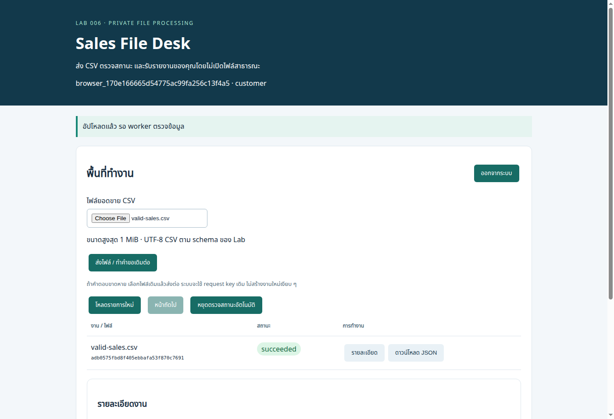

# Lab 06 — รับไฟล์ยอดขายและสร้างรายงานส่วนตัวแบบ Event-driven

## สถานการณ์

ทีมปฏิบัติการรับ CSV ยอดขายจากหลายคน ผู้ส่งต้องเห็นเฉพาะไฟล์ของตน รู้ว่าไฟล์กำลังรอ ประมวลผลสำเร็จ หรือถูกปฏิเสธ และดาวน์โหลดรายงานได้โดยไม่เปิด bucket สาธารณะ หาก worker ล้มหลังเขียนผลแล้ว การส่ง event ซ้ำต้องไม่สร้างรายงานธุรกิจซ้ำหรือเปลี่ยนเจ้าของงาน

ผู้เรียนจะสร้าง Upload portal และระบบประมวลผลจริง ไม่ใช่เพียงสร้าง bucket กับ trigger ตัวอย่างนี้ใช้ข้อมูลสังเคราะห์ ไม่มีบัตรชำระเงินหรือข้อมูลลูกค้าจริง

**สถานะ:** กำหนดโจทย์และ acceptance ก่อนลง Design/Materials ยังไม่ใช่คู่มือพร้อมรัน ไม่มีผลทดสอบ GCP จริง

## ผู้ใช้และผลลัพธ์

- alice / bob: login, ขอสิทธิ์ upload, ส่ง CSV, ดูประวัติ/สถานะของตน และขอ download link ของผลสำเร็จ
- operator: ดูงานค้าง/failed พร้อมเหตุผลที่ไม่เปิดข้อมูลไฟล์ และขอ retry เฉพาะงานที่เข้าเงื่อนไข
- worker: อ่านไฟล์ต้นฉบับ generation ที่ถูกตรึง ตรวจข้อมูล และสร้าง summary JSON ไม่มี public endpoint สำหรับเรียกโดย anonymous

CSV baseline: คอลัมน์ sale_id,sku,quantity,unit_price_satang; จำกัด UTF-8, header ตรง, sale_id ไม่ซ้ำในไฟล์, quantity เป็นจำนวนเต็มบวก, ราคาเป็นจำนวนเต็มสตางค์ ไม่ใช้ float รายงานมีจำนวนรายการ จำนวนหน่วย ยอดรวม และยอดแยก SKU พร้อม input SHA256 และ processor version ไม่สะท้อน arbitrary HTML จากไฟล์

## Requirements และหลักฐาน

| ID | ข้อกำหนด | วิธีพิสูจน์ |
|---|---|---|
| R1 | ส่งไฟล์และรับรายงานครบวงจร | Browser login → upload → pending/processing → succeeded → download; เทียบผลกับ expected fixture ที่คำนวณไว้ |
| R2 | แยก owner และ runtime identity | bob อ่านสถานะหรือขอ link ของ alice ได้404; anonymous401; worker ปฏิเสธ anonymous; bucketไม่มี allUsers/allAuthenticatedUsers |
| R3 | จำกัด upload ทั้งทางเข้าและการอ่านจริง | baseline1MiB/10,000rows; ทดสอบ oversized, MIMEปลอม, invalidUTF-8, headerผิด, duplicate sale_id และตัวเลขผิด; rejectedไม่มี published output |
| R4 | รับ event ซ้ำ/ต่างลำดับอย่างถูกต้อง | replay CloudEvent เดิมและ eventIDต่างกันแต่ bucket/name/generationเดิม; มี logical result เดียว, ownerเดิม และ immutable input binding |
| R5 | กู้จาก failure ระหว่าง storage กับ metadata | ฉีด fault หลัง output create ก่อน success commit; retry ตรวจ output เดิมและทำงานจบโดยไม่เขียนผลซ้ำ; leaseหมดอายุถูก reclaim อย่างมี fencing |
| R6 | สิทธิ์เข้าถึงมีอายุและ retention ตรวจได้ | upload permissionหมดอายุใช้งานไม่ได้; download linkเป็น bearer capabilityที่มีTTLสั้น; Appไม่ออกlinkหลังหมดอายุงาน; บันทึก lifecycle/softdelete/metadata expiry ตามจริง |
| R7 | Change request เพิ่มขนาดไฟล์อย่างมีเพดาน | baseline1MiB→5MiB พร้อมเพิ่ม row/timeout/memory budgetที่มีเหตุผล; ทดสอบก่อน–หลัง/negative cases/คืนbaseline ไม่เพียงแก้ UI |
| R8 | ดูแลและปิดระบบได้ | request/job/event correlation, stuck-job inspection, bounded retry/backout, evidence/case study, cleanupทั้งobjects/generations/metadata/trigger/services/identities และrebuild |

## Candidate architecture และขอบเขต

เลือก Cloud Run portal/API + Cloud Run worker แยก service accounts, Cloud Storage incoming/results แยก private buckets, Eventarc Standard object-finalized trigger เฉพาะ incoming และ Firestore Native สำหรับ job state/claim ledger

วางบริการ/Storage/Firestore location ให้เข้ากันใน asia-southeast1 โดยตรวจข้อกำหนด Eventarc และ Firestore database location ก่อนสร้างจริง ไม่ใช้ทรัพยากรที่ยังเปิดค้างจาก Lab ก่อน

Portal ใช้ HTTPS ของ Cloud Run และ App session/CSRF/owner checks; การเปิด portal ให้เข้า login ได้ไม่แปลว่า worker หรือ buckets เปิดสาธารณะ ผู้ใช้ไม่รับ Google Cloud credentials และ Browser ไม่เข้าถึง Firestore โดยตรง Server SDK ใช้ IAM จึงต้องตรวจ App ownership เอง ไม่อ้าง Firestore Security Rules มาคุม server SDK แทน

ทาง upload จะลงรายละเอียดการใช้ V4 signed POST policy ที่ตรึง bucket/key/Content-Type/expiry และ content-length-range ก่อนเขียน code เหตุผลคือโจทย์ต้องจำกัดขนาดตั้งแต่ทางเข้า ไม่ใช้คำอธิบายว่า signed URL ธรรมดาบังคับขนาด/ตรวจเนื้อหาได้เอง Worker ต้องตรวจ bytes/rows/schema ซ้ำเสมอ CORS ไม่ใช่ authentication และ MIME/filename จาก client ไม่ใช่หลักฐานชนิดไฟล์

ทาง download ใช้ V4 signed GET อายุสั้นเฉพาะ output object generation ที่ jobสำเร็จและ ownerผ่านแล้ว ไม่ใส่ signed URL/query/session/cookie ใน logs หรือหลักฐาน ลิงก์ที่ออกไปแล้วเป็น bearer capability: คนที่ได้ลิงก์อาจอ่านได้จนหมดอายุ จึงไม่อ้างว่า owner login ถูกตรวจทุกครั้งที่ Storage รับ download

ไม่ใช้ service-account private key file ใน repo หรือ runtime ใช้ IAM Credentials signBlob แบบ keyless โดยแยก upload signer/download signer และกำหนดสิทธิ์เฉพาะ resource ที่ต้องใช้ รายละเอียด IAM/custom role จะยืนยันใน Design

## ข้อตกลงข้อมูลและความถูกต้องที่ต้องปิดใน Design

1. สร้าง job UUID/owner/object key/limits ก่อนออก upload permission; object key กำหนดโดย server ไม่รับ pathจาก client
2. incoming ต้องป้องกัน overwrite โดย uploader identity มี create ไม่ใช่ update/delete; bindingเลือก generationหนึ่งครั้งใน transaction และไม่เปลี่ยนตาม eventที่มาทีหลัง
3. ระบุตัวตนงานจาก bucket/name/generation ไม่ใช้ eventIDอย่างเดียว ตรวจ bucketและjob bindingก่อนอ่านไฟล์
4. Firestore transaction callback ไม่มี network I/O หรือเขียน Storage เพราะ callbackอาจถูก retry
5. claim ใช้ attempt token/fencing + lease expiry; publish success เฉพาะ tokenปัจจุบัน ไม่ให้ workerเก่าทับสถานะหลังถูก reclaim
6. output ชื่อ deterministic จาก job/generation/processor-version, create-only precondition และ verify bytes/hash เมื่อพบของเดิม; StorageกับFirestoreไม่ใช่ transactionเดียวกัน ต้องมี recoveryสำหรับช่องว่างนี้
7. validation failureเป็น terminal rejectedพร้อมreason codeที่ปลอดภัยและack; transient failureคืน retryable response ไม่ackเป็นsuccess; stale/unknown eventsต้องมีpolicyไม่เขียนข้อมูลผิดowner
8. result expiryตรวจใน App ก่อนออกlink; FirestoreTTL/Storagelifecycleเป็น cleanupภายหลัง ไม่ใช่ตัวปฏิเสธaccessทันทีและไม่รับประกันลบตรงวินาที
9. initial limits/processor versionถูกบันทึกใน job; change requestไม่เปลี่ยน contractของงานเก่ากลางทาง
10. operator retryต้อง authenticated/authorized, จำกัดจำนวนและอายุ, เก็บattempt history และกลับไปอ่าน generationเดิม ไม่สร้าง jobใหม่เงียบ ๆ

## Failure และ change scenarios

- ส่ง eventซ้ำพร้อมกันสอง worker และส่ง eventของ generationอื่นหลัง jobถูกbindแล้ว
- ข้อมูลเสียเป็น rejectedโดยไม่วน retryไม่จบ; งานค้างเพราะ transient faultสามารถ inspectและretryได้
- worker crashหลัง outputเขียนสำเร็จ แต่ก่อนmetadata success ต้อง convergeเป็นresultเดียว
- workerที่leaseหมดอายุพยายามcommitหลังattemptใหม่ ต้องถูกfence
- ถอดสิทธิ์เฉพาะ sandbox test identity/ใช้ fault revision เพื่อทดสอบ access failure ไม่แก้ IAMกว้างทั้งproject
- ขยาย1→5MiB และวัดเวลา/memory/error/ผลรวมถูกต้อง พร้อมกลับค่าเดิม; ใช้synthetic fixturesไม่ใช่ไฟล์จริงของทีม

## สิ่งที่จะส่งมอบก่อน Guide-ready

READMEนี้จะรวม Diagram, Tasksแบบพาทำ, Expected/Actualข้างงาน, runbook, case study และcleanup โค้ดแยกเฉพาะportal/worker/domain/storage-metadata adapters/infra/tests/fixtures/toolsที่จำเป็น ต้องมีsample CSV valid/invalid/boundaryและexpected summaries, health endpoints, structured logs, UIจริง, bounded journey/event-replay/fault tools และ testsกับFirestore emulatorบนcloud CI รวมกรณีrace/lease/recovery ไม่ใช้ in-memorymockอย่างเดียวพิสูจน์ transactionของFirestore

Diagramจะทำหลังยืนยันscope/identity/eventflow; ไม่ใช้ภาพแทนการตัดสินใจทางเทคนิค ชุดนี้ยังไม่มีAppหรือDiagramสำเร็จ จึงไม่เรียกGuide-ready

## เตรียมสิทธิ์ ต้นทุน และ Cleanup

ใช้ sandbox projectที่เปิด Billing และมีสิทธิ์สร้าง Cloud Run/Eventarc/Storage/Firestore/Artifact Registry/Secret Manager/IAM Credentials และกำหนด IAM bindings ต้องตรวจว่ามี Firestore databaseเดิมหรือไม่ ไม่เปลี่ยน location/type ของระบบอื่นเพื่อทำLab

กำหนด max instances/concurrency/timeouts/ขนาดไฟล์/จำนวนงาน/retentionก่อนทดสอบ Budget alertไม่ใช่hard cap Storage operations, Eventarc/PubSub transport, Firestore reads/writes, Cloud Run/build/image/logs และsoftdeletedobjectsอาจคิดค่าใช้จ่าย ไม่มีการprovisionในงานเขียนเอกสารนี้

Cleanupต้องหยุดรับงาน/triggerก่อนลบworker, resolve/บันทึกงานค้าง, ตรวจobjectsทุกgeneration/softdelete, metadataและTTL, triggertransportที่ระบบสร้าง, service accounts/IAM/secrets/imagesและservices โดยแยกของLabจากFirestoreหรือprojectที่แชร์ ไม่ลบdefaultdatabaseทั้งก้อนถ้ามีข้อมูลอื่น

## แหล่งอ้างอิงที่ใช้ตั้งโจทย์

ตรวจวันที่23ตุลาคม2026 รายละเอียด version/IAM/location/SDKจะตรวจอีกครั้งใน Design

- [Eventarc retry และ duplicate delivery](https://docs.cloud.google.com/eventarc/docs/retry-events)
- [Cloud Storage events ไป Cloud Run](https://docs.cloud.google.com/run/docs/triggering/storage-triggers)
- [V4 policy signatures และ conditions](https://docs.cloud.google.com/storage/docs/authentication/signatures)
- [HTML form upload](https://docs.cloud.google.com/storage/docs/xml-api/post-object-forms)
- [Signed URLs และ bearer access](https://docs.cloud.google.com/storage/docs/access-control/signed-urls)
- [Firestore transactions](https://firebase.google.com/docs/firestore/manage-data/transactions)

ขั้นถัดไป: ปิด Designเรื่องlocation/IAM/POST policy/objectgeneration/state machine/fencing/retry/retention และtest matrix ก่อนเริ่มสร้าง Materials

## Design — สัญญาที่ใช้สร้าง Materials

### Resource map และขอบเขตจริง

| Resource | ขอบเขต / ค่าตั้งต้น |
|---|---|
| Portal/API | Cloud Run service lab006-portal, asia-southeast1; HTTPS URL ของบริการ; min0/max2 instances, concurrency8, timeout30s, memory512MiB |
| Worker | Cloud Run service lab006-worker, asia-southeast1; ต้องผ่าน Cloud Run IAM, min0/max2, concurrency1, timeout60s, memory512MiB |
| Incoming / results | bucketคนละใบ ชื่อ globally unique ที่ผู้เรียนกำหนด, regional ASIA-SOUTHEAST1, uniform access/public-access prevention; ไม่มี static website/public ACL |
| Metadata | Firestore Native Standard named database lab006-files ใน asia-southeast1 ไม่ใช้หรือเปลี่ยน default database; server SDKเลือก database IDชัดเจน |
| Events | Eventarc Standard trigger lab006-incoming-finalized, asia-southeast1, filter finalized+incoming bucket, destination worker path /events/storage |
| Image / Secret | Artifact Registry repositoryของLab, image digestที่บันทึกไว้; auth Secret versionเป็นเลข, ไม่มีpayloadในTerraform |
| Signing | แยก service accounts upload-signer และ download-signer; portalขอ signBlob ไม่ใช้keyfile |
| Observability | structured stdout/stderr และ Cloud Run metrics; job_id/request_id/event_id/attempt tokenใช้เชื่อมเหตุการณ์ ไม่มีCSV/policy/signedqueryในlogs |

ทุกresourceอยู่projectเดียวกัน Eventarc locationตรงincoming bucket; Firestoreเป็นmanaged regional service ไม่วาดอยู่ในVPCsubnet และCloud Runในโจทย์นี้ไม่ได้ใช้VM/privateVPC/NATเพิ่มเพียงเพื่อให้Diagramใหญ่ Workerใช้ingress allพร้อมIAMauthenticationเพื่อให้Eventarcและเครื่องมือoperatorที่ได้รับอนุญาตเรียกได้ **ไม่อ้างว่าเป็นprivate network endpoint** Public portalต้องผ่านAppauthสำหรับทุกbusinessendpoint ยกเว้นlogin/health/static

Named Firestore databaseแยกจากข้อมูลระบบอื่นเพื่อลดความเสี่ยงตอนCleanup แต่IAMต้องตรวจscopeตามdatabaseที่ใช้จริง ไม่อ้างว่าแยกdatabaseแล้วproject-widegrantsจะหายไปโดยอัตโนมัติ

### Identity และ permission matrix

| Identity | อนุญาต | ไม่อนุญาต / จุดตรวจ |
|---|---|---|
| portal SA | อ่านauth Secretที่ระบุ; อ่าน/สร้าง/แก้jobผ่านFirestore; signBlobบนsignerทั้งสอง; invoke workerเฉพาะserviceเพื่อmanualretry | ไม่มีStorageobjectadmin/ไม่อ่านincomingbytes; ไม่มีprivatekey; signBlobไม่จำเป็นต้องgrantTokenCreatorทั้งproject |
| upload signer | storage.objects.create เฉพาะincoming bucket | ไม่มีget/list/delete/update; replaypolicyต้องไม่overwriteobjectเดิม |
| download signer | storage.objects.get เฉพาะresults bucket | ไม่มีcreate/delete/list; portalต้องตรวจownerก่อนออกGET URL |
| worker SA | Firestorejob transactions; getincoming generation; create/getresults | ไม่มีsignBlob/ไม่มีauth Secret/ไม่ลบหรือแก้incoming; ไม่ให้Editor |
| Eventarc trigger SA | eventarc.eventReceiverตามscopeที่บริการกำหนด และrun.invokerเฉพาะworker | ไม่มีpermissionอ่านไฟล์เพื่อทำแทนworker |
| Cloud Storage service agent | pubsub.publisherสำหรับdirecteventtransportตามเอกสาร | แยกจากtrigger SA/runtimeworker ไม่ให้StorageAdminแทน |
| ผู้ดูแลLab | deploy/actAs/inspectตามความจำเป็นและreviewIAM | สิทธิ์ผู้ดูแลไม่ใช้เป็นหลักฐานว่ารันtimeidentityทำได้ |

สร้างcustom roleสำหรับ iam.serviceAccounts.signBlob แล้วbindบนsignerแต่ละตัวให้portal แทนroleที่รวมgetAccessTokenโดยไม่จำเป็น หากนโยบายองค์กรไม่อนุญาตcustom roleต้องบันทึกทางเลือก/สิทธิ์ส่วนเกินก่อนdeploy ไม่เพิ่มOwnerเพื่อให้ผ่าน สิทธิ์Firestoreต้องใช้IAMcondition/database scopeที่providerรองรับและตรวจpolicyจริงก่อนเรียกleast-privilege; tests emulatorไม่พิสูจน์IAM

### HTTP และ upload contract

Portalใช้Flask signed session, Secure/HttpOnly/SameSite=Lax, CSRFสำหรับทุกmutation, hashedsyntheticpasswordsและoperatorrole; HTML/JSใช้same-originAPI ไม่มีpasswordหรือCSRFในlocalStorage ไม่มีinlineexecutionจากfilename/CSV

| Endpoint | สัญญา |
|---|---|
| POST /api/login, POST /api/logout | จำกัดrequestbody, CSRFที่เหมาะกับsession, genericbadlogin, ไม่logcredentials |
| GET /api/session | คืนuser/role/CSRFสำหรับsessionที่เปิดอยู่ ไม่คืนpasswordhash |
| POST /api/jobs | ownerจากsession ไม่รับownerจากbody; รับdisplaynameที่จำกัดและidempotencykey; สร้างjob+quotareservationในtransaction |
| POST /api/jobs/{id}/upload-policy | ownerผ่านก่อน; ออกpolicyเฉพาะawaiting_uploadและภายในupload deadline; retryได้แต่ใช้objectkeyเดิม |
| GET /api/jobs, GET /api/jobs/{id} | queryownerฝั่งserver, จำกัดpage size20/cursor; other-owner404; ไม่คืนpolicyหรือobjectstorageURL |
| POST /api/jobs/{id}/download-link | owner+CSRF+success+notexpired; signedGETตรึงoutputgeneration; Cache-Control:no-store |
| POST /api/operator/jobs/{id}/retry | operator+CSRF; จำกัดepoch/attempt; preservegeneration/limits/version; เรียกworkerด้วยIDtokenและaudienceของworker |
| POST worker /events/storage | Cloud Run IAMก่อนเข้าApp; CloudEvents binary headers+JSONdata; จำกัดbody64KiB; ตรวจeventtype/source/bucket/key/generationซ้ำ |
| GET /livez, GET /healthz | ไม่แก้ข้อมูล; livezprocess/config, healthz boundedmetadataread ไม่มีlistทุกjob |

Baseline: input1,048,576bytes/10,000rows; change5,242,880bytes/50,000rows; แต่ละfieldไม่เกิน128chars, SKUรูปแบบallowlist, quantity1..1,000,000และunit_price_satang0..100,000,000; จำกัดผลรวมไม่เกินsigned64-bit integer ปฏิเสธNaN/decimal/bool/extra columns/nullbytes/quotednewlineถ้าparsercontractไม่รองรับ BOM/CRLFต้องกำหนดและทดสอบชัดเจนก่อนประกาศใช้งานได้

POSTpolicyอายุสูงสุด300s และไม่เกินupload_deadline; keyตรงincoming/{jobUUID}/source.csv, Content-Type=text/csv, lengthrange1..job.max_bytes ไม่มีstarts-withkeyที่เปิดให้เลือกpathเอง Browserใช้FormDataส่งpolicyfieldsตามที่APIให้และfileเป็นfieldสุดท้าย ไม่ตั้งmultipartboundaryเอง กำหนดsuccess_action_status201แล้วตรวจresponseก่อนpolljob

Storagepolicyตรวจheaders/size แต่ไม่รู้ว่าbytesเป็นCSVจริง Workerdownloadแบบbounded max_bytes+1และตรึงgeneration ไม่ใช้download_as_bytesแบบไม่จำกัดกับeventsizeที่เชื่อจากclient ไม่followURLในevent ไม่evalformulaหรือเปิดspreadsheetเพื่อรันmacro

Uploadpolicyเป็นbearerpermissionและreplayได้ระหว่างTTL การcreateobjectชื่อเดิมอีกรอบต้องถูกปฏิเสธจากsignerที่ไม่มีdelete/update; ต้องพิสูจน์บนGCPจริง หากstorageAPI/libraryต้องการpermissionเกินที่ตั้งไว้ให้ทบทวนcontract ไม่ให้overwriteเพื่อทำให้testผ่าน

DownloadTTLสูงสุด60sและไม่เกินเวลาที่jobเหลือก่อนexpires_at ออกURLเฉพาะgenerationที่ตรวจแล้ว Content-Disposition attachmentชื่อserverกำหนดและContent-Type application/json; ผลใกล้หมดอายุจนเหลือไม่ถึง1sให้ปฏิเสธ การlogoutไม่เพิกถอนlinkที่ออกไปแล้ว

### Metadata และ state machine

jobs/{UUID} มี owner, display_name, object_name, created_at/upload_deadline/expires_at/delete_after, max_bytes/max_rows, processor_version, state, input_generation, input_sha256, attempt_epoch/count/token/lease_until, output_name/generation/sha256, safe_reason และtimestamps ส่วนidempotencyrecordsใช้hash(owner+key)พร้อมfingerprintและjobreference ไม่เก็บrawkeyในlogs

ตั้งexpires_at=created+24hสำหรับAppaccess; upload_deadline=created+5min; delete_after=created+48hสำหรับTTLcleanup งานที่ไม่uploadหลังdeadlineเป็นexpiredเมื่ออ่าน/ตรวจreconcile ไม่ต้องอ้างว่ามีdaemonเปลี่ยนสถานะตรงเวลา TTLdeleteอาจล่าช้าและไม่ลบStorageobjectsโดยอัตโนมัติ

| สถานะเดิม | เหตุการณ์ | ผล |
|---|---|---|
| awaiting_upload | finalizedeventที่ตรงkey/bucketและไม่เลยdeadline/expiry | transactionbindgenerationครั้งเดียวแล้วclaimprocessing |
| processing / leaseยังไม่หมด | duplicategenerationเดิม | retryable503 ไม่ackแล้วพึ่งworkerเดิมเพียงตัวเดียว |
| processing / leaseหมด | eventเดิมส่งใหม่ | claimtokenใหม่; workerเก่าไม่มีสิทธิ์publishstatus |
| processing | validationไม่ผ่าน | rejected+safe_reason แล้วack204; ไม่มีpublishedoutput |
| processing | outputverified + tokenยังตรง | succeededพร้อมgeneration/hashแล้วack204 |
| processing | transientstorage/metadata failure | ปล่อยleaseให้หมดหรือreleaseโดยtoken; return503สำหรับtransportretry |
| succeeded/rejected/expired | duplicateevent | ack204โดยไม่สร้างผลใหม่ |
| ทุกสถานะที่bindแล้ว | generationต่างจากที่bind | ignore+reasonlogged ไม่เปลี่ยนowner/input/result |
| retrybudgetครบ | transientครั้งถัดไป | failedพร้อมsafe_reasonและack; operatorretryได้ตามpolicy ไม่วนตลอดไป |

Lease120sยาวกว่าworkerrequest60sบวกช่วงcleanup; processdeadline45s และclienttimeout/retrybudgetย่อยต้องรวมไม่เกินdeadline ไม่ต่อleaseไม่จำกัด attemptไม่เกิน5ต่อepoch, manualretryไม่เกิน2epochsเพิ่มจากครั้งแรก; rejected/expiredไม่เปิดretryเพื่อหลบvalidation ต้องสร้างjobใหม่ผ่านขั้นตอนปกติ งานfailedเก็บgenerationเดิมและนำoutputที่ถูกต้องกลับมาใช้ได้

Unknown/malformedevents: invalidenvelope400เพื่อให้เห็นconfigurationerror; authenticแต่ไม่อยู่bucket/key/jobnamespaceของLabให้ack204และsafeignoredreason ไม่สร้างjobจากevent หากmetadataอ่านไม่ได้เป็น503ไม่เหมาว่าunknownแล้วack งานที่หาไม่เจอจริงต้องlogignoredและให้runbookreconcile ไม่สร้างownerจากobjectmetadataที่clientปลอมได้

### Output commit และการกู้ช่องว่างข้ามบริการ

คำนวณsummaryแบบdeterministic ใช้integer, sortedSKU, canonicalUTF-8JSON ไม่มีcurrenttime/attempttokenในbusinessbytes Outputkeyคือ results/{jobUUID}/{inputGeneration}/{processorVersion}/summary.json เขียนif_generation_match=0 พร้อมmetadatainputSHA/processorversion ไม่updateobjectที่มีอยู่

ถ้าได้preconditionfailed ให้GETexistinggenerationแบบboundedและเทียบcanonicalbytes/SHA/inputgeneration/versionก่อนreuse หากไม่ตรงให้failed_integrityและหยุด ไม่overwriteเพื่อให้เลขตรง ส่วนtimestampการattemptเก็บในFirestoreแยกจากผลสรุป

หลังเขียนหรือverifyoutputแล้วจึงFirestoretransactionตรวจtoken/generation/version/expiryก่อนpublishsuccess ถ้าworkerเก่าถูกfenceoutputที่คำนวณเหมือนกันอาจยังเกิดได้ แต่ไม่เปลี่ยนstateและไม่มีผลธุรกิจซ้ำ workerใหม่verifyreuseแล้วcommitต่อ ถ้างานexpireระหว่างทำต้องไม่publishdownloadable success; เก็บorphanoutputให้cleanupตามretention

Faultcontrolเป็นrevisionconfigสำหรับsandbox: fail_after_output_onceตามjobmarkerที่เก็บในFirestore ไม่รับflagจากclientทั่วไป ปิดfaultแล้วreplayeventgenerationเดิมต้องจบได้ด้วยoutputเดิม ไม่อ้างexactly-oncedelivery แต่พิสูจน์logicalresultconvergence

### Test matrix และจุดส่งมอบถัดไป

1. Domain parserfixtures: valid/CRLF/BOMcontract, duplicateID, invalidUTF8/header/quantity/price, maxbytes/rows/field/total bounds; exactexpectedsummary
2. Firestore emulatorจริง: owner/idempotencytransaction, concurrentclaim, generationbinding, leaseexpiry, stale-tokencommit, retrybudget/manualepoch, expiration และquotareservation ไม่ใช้fakeอย่างเดียว
3. Storageadapter: boundedgenerationread, create-onlyoutput, existinghashmismatch, signedpolicyexactconditions/keylesssigner; mockrequestใช้ตรวจAPIcontractแต่ไม่เรียกGCPจริง
4. HTTP/browser: aliceupload/status/download, bob404, anonymous401, operator403, CSRF, workerIAMแยกจากAppunit checks, UIerror/retry/pollboundedโดยไม่เผยsignedquery
5. Recoveryintegration: outputcreated→fault→duplicateevent→sameoutputgeneration→success; invalidfileackterminal; failedtransientสามารถmanualretry; expiredjobไม่ออกlink
6. Terraform: fmt/init-backendfalse/validate; IAM/triggerlocation/Firestoreisolation/staticconfigtests; actualplan/applyและsignedupload/permission/expiryต้องผู้เรียนรันบนGCP
7. Guide: expected/actualข้างทุกTask, fixtures+boundedtools, resourceinventoryและcleanuporder; ไม่มีCloudPASSล่วงหน้า

Quotaฝึก: ไม่เกิน5activejobs/ownerและ20newjobs/owner/UTCdayด้วยtransactioncounter; จำกัดรวมชุดทดสอบ40jobsและไฟล์changeสูงสุด5MiBต่อไฟล์ นี่เป็นAppguardไม่ใช่Billinghardcap publicloginยังไม่ใช่productionabuseprotection ต้องตั้งเวลาเปิดและmaxinstancesร่วมด้วย

Retention: incoming/results lifecycledeleteหลัง2วันและบันทึกsoftdeletepolicyจริง; FirestoreTTLใช้delete_afterเมื่อเปิดpolicyแล้ว Appตรวจexpiryเองก่อนTTL; ไม่เปิดbucketversioningโดยไม่จำเป็น แต่ทุกread/resultbindingยังใช้generation Lifecycle/TTLไม่ใช่backupstrategyและไม่รับประกันไม่มีค่าใช้จ่ายหลังUIซ่อนงาน

แหล่งอ้างอิงDesign: [Eventarc Storage routing/location](https://docs.cloud.google.com/eventarc/standard/docs/run/route-trigger-cloud-storage), [Eventarc identities](https://docs.cloud.google.com/eventarc/docs/roles-permissions), [Python signed POST policy API](https://docs.cloud.google.com/python/docs/reference/storage/latest/google.cloud.storage.client.Client), [Firestore database locations](https://docs.cloud.google.com/firestore/native/docs/locations), [Firestore transaction retries](https://firebase.google.com/docs/firestore/manage-data/transactions)

**Design checkpoint:** contractsนี้เป็นเป้าหมายที่Materialsต้องทำให้จริง ไม่ใช่ผลว่าระบบถูกสร้างแล้ว ขั้นถัดไปสร้างparser/fixtures/transactionrepositoryและtestsก่อนต่อHTTP/UI/Storage/IaC หากข้อจำกัดSDK/APIเปลี่ยนให้แก้Designพร้อมเหตุผลก่อนเขียนTask


## Materials — CSV domain checkpoint

[ตัวตรวจและคำนวณรายงาน](app/csv_domain.py) รับbytesแบบจำกัดขนาด ตรวจheader/จำนวนคอลัมน์/UTF-8/identifiers/ตัวเลข/duplicate sale_id/จำนวนแถว และคืนcanonicalJSONที่เรียงSKU พร้อมSHA256ของbytesต้นฉบับ ไม่มีstorage/networkหรือการเขียนไฟล์ในdomain layer

รับUTF-8 BOMหนึ่งชุดที่ต้นไฟล์, LF/CRLFและquotedfieldsตามCSV แต่ไม่รับnewlineในfield, blankrecord, whitespaceรอบตัวเลข, leadingzeroเช่น01, exponent, floatหรือformulaเป็นidentifier ตัวเลขราคา0ได้แต่quantityต้องมากกว่า0 ชื่อSKUต้องuppercaseตามallowlist

[ไฟล์ตัวอย่าง](fixtures/valid-sales.csv) มี3รายการ/6หน่วย/72,400สตางค์ เทียบกับ [expected business summary](fixtures/valid-sales.expected.json); inputSHAคำนวณจากไฟล์จริงไม่ตรึงhashที่อาจเปลี่ยนตามlineendings มี [duplicate fixture](fixtures/duplicate-sale-id.csv) และ [10 domain tests](tests/test_csv_domain.py) รวมboundedstream/max+1, inputผิดและchange1→5MiB/10k→50krows กำลังรอcloudCIยืนยันผล ไม่ใช่ผลGCPหรือFirestoretransaction verification


### Job-state transition materials

เพิ่ม [state transitions](app/job_state.py) และ [9 tests](tests/test_job_state.py) สำหรับgenerationbinding, duplicate/busy, lease120s/reclaim, stale-tokenfencing, expiry, outputbinding, rejection, retrybudgetและmanualepochs การเปลี่ยนสถานะไม่อ่านclock/networkและไม่แก้dictต้นฉบับ จึงนำไปใช้ในFirestoretransactioncallbackได้ แต่ยัง **ไม่ได้พิสูจน์concurrencyของFirestore** จนกว่าจะต่อrepositoryและรันemulatortests

เงื่อนไขuploaddeadlineใช้เวลาที่object finalizedจากStorageevent ไม่ใช่เวลาeventมาถึงworker เพราะtransportอาจส่งช้า; workerต้องvalidateเวลาจากeventที่ผ่านIAM/source/bucketbindingแล้ว ไม่รับtimestampจากclientเอง งานยังต้องไม่เกินexpires_atตอนclaim/publish ผลfailed_integrityห้ามoperatorretryเพื่อกลบoutputที่ไม่ตรง ต้องตรวจเหตุผิดปกติก่อน


### Firestore transaction adapter checkpoint

เพิ่ม [Firestore repository](app/firestore_jobs.py) นำstate transitionsไปใช้ในSDKtransactionจริง: อ่านjob/ตรวจtoken-generation/เขียนสถานะในtransactionเดียว callbackไม่อ่านStorageและclockถูกอ่านใหม่เมื่อSDKretry มี [4emulator integration tests](tests/test_firestore_jobs.py) สำหรับสองworkerclaimพร้อมกัน, lease-reclaim/stalecommitrollback, owner/generationboundary และretrybudget/manualepoch

GitHubCIใช้Firestoreemulatorบนrunner, projectdemo-lab006/named databaselab006-filesและAnonymousCredentials พร้อมบังคับloopbackhostก่อนtest ไม่fallbackไปGCPเมื่อไม่มีemulator ยังรอผลชุดนี้ ไม่อ้างว่าtransactionผ่านจากpurestate tests และemulatorไม่พิสูจน์IAM/index/quota/productionlatency ส่วนjobcreationพร้อมidempotency/quotaและboundedlistยังต้องต่อก่อนHTTP


### Job creation และ quota checkpoint

เพิ่มtransactionสร้างjob+idempotencyrecord+ownerquotaพร้อมกัน คำขอเดิมคืนjobเดิมแม้quotaเต็ม; keyเดิมเปลี่ยนdisplayname/limits/versionเป็นconflict ไม่มีrawkeyในdocumentID ใช้SHA256(owner+key) หากrecordชี้jobที่ถูกลบหรือหมดอายุจะปฏิเสธ ไม่แอบสร้างjobใหม่

Quota5active/20newjobsต่อUTCdayถูกอ่านและปรับในtransactionเดียวกัน งานsuccess/rejected/expiredคืนactive slotเมื่อสร้างงานถัดไป; failedที่ยังretryได้ยังนับactive งานawaiting_uploadจะไม่ถูกปล่อยslotเพียงเพราะเลยuploaddeadline เพื่อไม่ให้eventที่finalizeทันแต่ส่งช้าทำให้จำนวนactiveทะลุguard ต้องตรวจreconcileก่อนexpireหรือรอjobexpiry ไม่ใช้TTLลบเป็นmechanismปล่อยquotaทันที

[CI39932700165](https://github.com/somkid-s5/Portfolio-Lab/actions/runs/39932700165) joblab006-firestoreผ่าน4emulatortestsของclaim/fencing/owner/retryแล้ว ชุดcreate/quotaเพิ่ม4testsยังรอCI ไม่มีGCPidentity/permissionsverification และยังไม่มีHTTP/UI/Storageworkerสำเร็จ


### Worker orchestration checkpoint

เพิ่ม [processor](app/processor.py) เชื่อมCSVdomainกับFirestoreclaim/finishและStorageadaptercontract: readsourcegenerationที่bind, canonicalsummary, create-or-verifyผล, fencedpublish และsafeack/retryreason มีdurablefaultmarkerสำหรับจำลองช่องว่างoutputเขียนแล้วแต่metadataยังไม่success

[CI39932999988](https://github.com/somkid-s5/Portfolio-Lab/actions/runs/39932999988) ผ่านชุดก่อนหน้า รวม8Firestoreemulatortestsและ19puretestsแล้ว ชุดworkerเพิ่ม4integrationtestsใช้Firestoreemulatorจริงแต่Storageเป็นtestdouble จึงยังไม่พิสูจน์GCSgenerationpreconditions/permissions ชุดใหม่นี้รอCI ต้องต่อStorageadapterจริงและCloudEvent/HTTPก่อนใช้งานได้


### GCS adapter checkpoint

เพิ่ม [GCS adapter](app/gcs_objects.py) สำหรับgeneration-pinnedrawrange reads พร้อมmetadata-size check/boundedbuffer และrejectcontent-encoding/MIMEผิด; outputเขียนif_generation_match=0พร้อมCRC32C ถ้ามีอยู่แล้วจะตรึงgenerationและเทียบbytes/SHA/processor metadataก่อนreuse ไม่overwriteผลที่ไม่ตรง จำกัดoutputต่ำกว่า8MiBและปิดSDKretryเพื่อให้workerคุมdeadlineได้

[7SDKcontracttests](tests/test_gcs_objects.py) ใช้autospecของBlobที่ติดตั้งจริงแต่mocktransport ตรวจprecondition/range/bounds/mismatch/nooverwrite ยังไม่ใช่ผลGCSจริง ต้องผู้เรียนพิสูจน์IAM/preconditions/CRC/latencyในการทำLab และยังรอCIชุดนี้ [Blob API](https://docs.cloud.google.com/python/docs/reference/storage/latest/google.cloud.storage.blob.Blob)


### CloudEvent validation checkpoint

เพิ่ม [binary CloudEvent parser](app/storage_events.py) และ [5tests](tests/test_storage_events.py) ตรวจspec/type/id/contenttype/body64KiB, bucket/source/subject/objectnamespace, numericgenerationและtimeCreatedแบบUTC ปฏิเสธduplicateJSONkeys/NaN/invalidencoding ไม่ตามmediaLinkและไม่ใช้eventIDเป็นbusinessdeduplicationkey

Parserนี้ไม่ใช่authentication ต้องใช้หลังCloudRunIAMเท่านั้น โดยjobIDจากservernamespace/generationจะถูกตรวจซ้ำในFirestoreclaim ส่วนforeignbucket/namespaceคืนignored ไม่สร้างjobจากmetadataที่clientใส่เอง [Eventarc HTTP binding](https://docs.cloud.google.com/eventarc/docs/cloudevents)

CI39933281841ของworkerชุดก่อนผ่านlab006-domainและlab006-firestoreแล้ว; GCScontractชุด39933551789ยังin_progressตอนตรวจ CloudEventชุดใหม่นี้ยังรอCI และยังต้องต่อHTTPreceiverจริง


### Worker HTTP receiver checkpoint

เพิ่ม [Flask receiver](app/worker_http.py) ที่ /events/storage รับbinaryCloudEventแบบจำกัด64KiB ตรวจeventก่อนเรียกprocessor, ack204เฉพาะterminal/success/ignored และคืน503ให้retryเมื่อbusy/dependencyerror มีrequestID/structuredlogsที่ไม่บันทึกpayload/query/credentials แยกprocess/liveกับmetadatahealth

build_appเลือกnamedFirestoredatabaseอย่างชัดเจน, ปฏิเสธemulatorenvในruntime และผูกObjects/Jobs/Processorจริง มี [6HTTPtests](tests/test_worker_http.py) สำหรับdispatch/retry/sanitization/foreignevents/bodylimit/health เป็นFlasktestclientไม่ใช่CloudRunIAMverification **ต้องdeployworkerโดยไม่grantallUsersInvoker** ส่วนce-headersไม่ใช่หลักฐานauthentication [CI39933551789](https://github.com/somkid-s5/Portfolio-Lab/actions/runs/39933551789) GCScontract/emulatorชุดก่อนผ่านแล้ว HTTPชุดใหม่นี้ยังรอCI


### Signed access checkpoint

เพิ่ม [signed access service](app/signed_access.py) ตรวจowner/state/expiryก่อนขอtokenและsign: V4POSTpolicyตรึงbucket/key/text-csv/size/201พร้อมdeadlineไม่เกิน300s ส่วนGETตรึงoutputgenerationและอายุไม่เกิน60sหรือเวลางานที่เหลือ ใช้service_account_email+runtimeaccess_tokenสำหรับkeylesssignBlob ไม่ใช้privatekeyfile

[5tests](tests/test_signed_access.py) เรียกSDKจริงเพื่อdecodepolicyและตรวจGETquery แต่แทนsignBlobtransportด้วยdummy signature จึงยังไม่พิสูจน์GoogleIAM/signaturevalidity/actualupload/expiryenforcement ต้องต่อportaltoken supplierและrouteที่ไม่logpolicy/URLก่อนใช้งาน ชุดใหม่นี้รอCI [SDK3.4.1 policy implementation](https://github.com/googleapis/python-storage/blob/v3.4.1/google/cloud/storage/client.py)


### Portal API checkpoint

เพิ่ม [Portal HTTP API](app/portal_http.py) สำหรับanonymousCSRFbootstrap/login/logout, signedSecureHttpOnlysession30min, exactinputcontract, customerjobcreate/replay, ownerstatusและownercheckedupload/downloadlinks พร้อมrequestID/no-store/no-referrer/structuredlogsที่ไม่บันทึกsignedcapabilities มี [6tests](tests/test_portal_http.py) ตรวจcookie/session/CSRF, anonymous, clientownerinjection, replay, bob404/operator403และerror sanitization

ส่วนนี้ยังเป็นfactoryที่รับJobs/Access/Authเข้ามา ไม่ใช่portalที่deployพร้อมแล้ว ยังต้องruntimeSecrets/tokenprovider, boundedlist/operatorretry, UIจริงและbrowser/emulatorintegration ชุดใหม่รอCI ไม่อ้างจากmockrepositoryว่าพิสูจน์FirestoreหรือCloudIAMครบ


### รายการงานแบบแบ่งหน้า

เพิ่มJobs.list_ownedด้วยFirestoreowner-equalityfilter+documentIDordering+limitสูงสุด20/cursor และGET/api/jobsที่ใช้ownerจากsessionเท่านั้น ไม่รับownerqueryหรือqueryซ้ำ ลบinternalobject/attempttokenก่อนส่งstatus/listให้Browser cursorเป็นตำแหน่งเรียง ไม่ใช่สิทธิ์เข้าถึง

เพิ่มemulatortestกรองowner/แบ่งหน้า/foreigncursorและHTTPtestสำหรับsessionowner/querybounds/fieldprojection ชุดใหม่นี้รอCI; CI39934400587และ39934698336 lab006-domain/firestoreผ่านsignedaccess/PortalAPIชุดก่อนแล้ว ไม่ใช่CloudRunIAMหรือGCSจริง ส่วนcompositeindex/productionqueryต้องตรวจตอนทำIaC/Guide ไม่ใช้emulatorแทนข้อกำหนดindexจริง


### Operator metadata และ attempt history

เพิ่มoperator-onlylist/detailแบบboundedpaginationและsafeprojection ไม่ออกdownloadlinkหรือเผยobjectpathให้operatorโดยอ้อม เก็บhistoryในtransactionเดียวกับstatechange สูงสุด100entriesพร้อมcount/truncatedflag มีเวลา/state/epoch/attempt/safereason ไม่มีattempttoken/credentials/rawexceptions Duplicateที่ไม่เปลี่ยนstateไม่เพิ่มhistory

เพิ่ม2emulatortestsสำหรับatomicboundedhistory/operatorlookupและ1HTTPtestสำหรับcustomer403/metadata-onlyprojection ชุดใหม่นี้รอCI การมีoperatorreadไม่ใช่manualretryสำเร็จ ยังต้องต่อretrydispatchที่รักษาgeneration/epochและruntimeidentityก่อนGuide-ready


### เตรียม operator retry แบบ idempotent

เพิ่มprepare_operator_retryที่hashoperator+requestkeyและเพิ่มepochในFirestoretransactionเดียว คำขอซ้ำคืนepochเดิม ไม่เปิดรอบเพิ่ม มีไม่เกิน2manualepochsต่อjob; read_retry_dispatchตรวจepochปัจจุบัน/การเตรียมคำขอ/expiryและgenerationเดิมก่อนส่งworker เก็บinput_finalized_atตั้งแต่bindครั้งแรกเพื่อreplayตามเวลาไฟล์จริง ไม่เดาจากเวลาoperatorกดretry

เพิ่ม2emulatortestsสำหรับคำขอretryพร้อมกัน/responseหายจำลองด้วยsamekey และoldrequestที่ห้ามdispatchepochใหม่ ชุดใหม่นี้รอCI ยังไม่ใช่HTTPmanualretryครบวงจร ต้องต่อoperatorrole+CSRFrouteและauthenticatedworkerdispatchก่อนใช้จริง


### Manual retry HTTP dispatch

เพิ่มoperator+CSRFrouteที่prepareepochก่อนnetworkcallและworker/events/retryที่อ่านgeneration/finalizedtimeจากstoredjob ไม่รับobjectpathจากPortal มี [boundeddispatcher](app/retry_dispatch.py) ส่งIDtokenกับaudienceตรงworkerHTTPSrun.apporiginเท่านั้น, timeout10s, ไม่ตามredirect/ไม่อ่านresponsebodyและไม่retryอัตโนมัติ

Portalตอบ202พร้อมdispatchacknowledgedหรือunconfirmed; ทั้งสองไม่ใช่ผลธุรกิจว่าสำเร็จ ต้องอ่านjobstatusต่อ ถ้าresponseหายใช้requestkeyเดิมเพื่อไม่เพิ่มepoch callback/token supplierยังต้องผูกกับattachedruntimecredentialsก่อนdeploy มี3testsใหม่ของPortal/worker/transport ชุดใหม่รอCI ไม่พิสูจน์CloudRunIAMจากheadersในtestclient


### Runtime และข้อมูล login

เพิ่ม [privatebundle generator](scripts/create-secrets.py) สร้างdirectoryใหม่mode700/ไฟล์mode600 ไม่overwriteหรือพิมพ์รหัส auth.jsonมีsessionkeyและscryptpasswordhash ส่วนdemo-logins.jsonมีรหัสสังเคราะห์สำหรับผู้เรียนและต้องอยู่privateเท่านั้น

[Portal runtime factory](app/portal_runtime.py) อ่านauthmountแบบbounded เลือกnamedFirestore, ประกอบJobs/Access/RetryDispatcher และรับOAuth/IDtokensจากattachedCloudRunmetadataด้วยtimeout3s/responsebounds/no-redirect ไม่ใช้serviceaccountkeyfile ปฏิเสธemulator/privatekeyenvในruntime ใช้Secretversionตัวเลขที่deploymentต้องระบุ ยังต้องทำIaC/Guideให้mountถูกต้อง

มี [5tests](tests/test_portal_runtime.py) สำหรับpermissions/nooverwrite/hashmatching/metadataaudience/tokenbounds/runtimeguards แต่metadataเป็นmocktransport ไม่ใช่CloudRunจริง [Service-to-service](https://docs.cloud.google.com/run/docs/authenticating/service-to-service), [Secret mounts](https://docs.cloud.google.com/run/docs/configuring/services/secrets) ชุดใหม่นี้รอCI


### Portal UI implementation checkpoint

เพิ่มหน้า [Sales File Desk](app/static/index.html) พร้อม [browserlogic](app/static/app.js) / [styles](app/static/style.css): login/logout, customerupload, owner/operatorpaginatedlist, jobdetail, boundedpoll30รอบ, signeddownloadและmanualretry UIใช้textContentไม่รันHTMLจากfilename และไม่เก็บpassword/CSRF/policy/signedURLในsessionStorage

ก่อนcreateเก็บrequestkey+fileSHA/ชื่อไฟล์ และหลังได้jobIDเก็บอ้างอิงเดิมสำหรับresponseหาย ต้องเลือกไฟล์เดิมเพื่อresolve ไม่สร้างlogicaljobใหม่เงียบ ๆ Uploadส่งFormDataตรงStorageและไม่setmultipartboundaryเอง ตรวจ201ก่อนเรียกว่าส่งสำเร็จ หากresponseหายยังเก็บpendingให้ตรวจjobเดิม ส่วนoperatorเปิดretryepochใหม่ต้องกดยืนยันแยกจากresendkeyเดิม

ตอนนี้เพิ่มJSsyntaxcheckในCI ยังต้องbrowserintegration/renderreviewเพื่อพิสูจน์flowจริงและแก้UIตามภาพ ไม่ใช้การมีไฟล์HTMLแทนผลใช้งานได้ และยังไม่มีGCPdeploy


### Browser integration checkpoint

เพิ่ม [Chrome journey test](tests/test_browser_journey.py) เปิดPortalจริงผ่านHTTPSloopbackบนGitHubrunner → login → POSTcreatecommitเข้าFirestoreemulator → จำลองBrowserไม่ได้รับresponse → reload/เลือกไฟล์เดิม → keyเดิมได้jobเดิม → uploadผ่านStoragetestdouble → Processor/Firestoreจริง → summary72400สตางค์หนึ่งผล เก็บPNGสำหรับตรวจภาพภายหลัง

การทดสอบใช้certเฉพาะloopbackและacceptInsecureCertsในCI ไม่ใช่วิธีข้ามTLSในGCP ตัวStorage/signingเป็นtestdoubleและroute/uploadhookมีเฉพาะในtest ไม่ใส่productionApp ชุดนี้กำลังรอCI ไม่ถือว่ามีภาพหรือbrowserPASSจนตรวจผลแล้ว


### Container packaging checkpoint

เพิ่ม [Dockerfile](Dockerfile) สำหรับทั้งPortal/worker เลือกSERVICE_ROLEชัดเจน, process1worker/Portal8threads/worker1thread, bindPORTที่validateแล้วและnon-rootUID10001 ไม่ต่อshellจากinput ใช้explicitCOPYและdockerignoreไม่ส่งSecretbundle/fixtures/tests/stateเข้าbuildcontext ค่าauth/tokenอ่านตอนruntimeไม่bakeลงimage

เพิ่ม3containercontracttestsและCIbuild/import/imagecontentcheckโดยไม่ใช้GCPcredentials Baseเป็นofficialPython3.12.15-slim-bookwormที่อาจได้รับrebuildpatch จึงต้องจดresolvedbase/image digestจากbuildจริงก่อนdeploy ไม่อ้างbit-reproducibleจากtagหรือtransitivepipdependenciesเพียงอย่างเดียว ชุดใหม่นี้รอCI ส่วนBrowserrun39936909967ยังpendingตอนตรวจ ต้องตรวจภาพ/ผลจริงก่อนGuide-ready


## หลักฐาน UI จาก CI (ไม่ใช่ผล Deploy GCP)



[CI39936909967](https://github.com/somkid-s5/Portfolio-Lab/actions/runs/39936909967) / job120358985515 ผ่านBrowserlost-create-response→reload→samekey→onejob/oneoutput รวมถึง17FirestoreintegrationtestsและชุดSDK/HTTP/runtimeที่อยู่ในjobเดียวกัน ภาพนี้ใช้HTTPSloopback/Firestoreemulatorจริง ส่วนStorage/signingเป็นtestdouble ไม่ใช่GoogleCloudConsoleหรือGCS/IAMverification [รายละเอียดที่มาภาพ](assets/ui-ci-provenance.json)

ตรวจภาพแล้วอ่านข้อความไทยและแถวsucceededได้ แต่viewportเดิมตัดรายละเอียดล่างและbannerยังบอกรอworker จึงแก้terminalbannerและขยายcaptureheightในsourceถัดไป ต้องรอภาพรอบใหม่ก่อนอ้างว่าpreviewตรงUIล่าสุด ContainerbuildยังรอCIแยก ไม่ถือว่าBrowserPASSแทนimagebuild


### Terraform foundation checkpoint

เพิ่มinfra/foundation: namedFirestorelab006-files พร้อมdeletionprotection/PREVENT, TTLdelete_afterของjobs/idempotency/owner_quotas, privateincoming/resultsbucketsที่ไม่force_destroy, lifecycle2วัน/softdelete7วัน, identities5ชุด, database-scopedIAMcondition, customrolesเฉพาะobjectget/createและsignBlob, authSecretcontainerไม่มีpayload, ArtifactRegistry และEventarc/Storagepublisherprerequisites

CORSincomingเริ่มว่างและจะตั้งเฉพาะportal_originจริงหลังรู้CloudRunURL ไม่ใช้wildcard ไม่มีCloudRun/Eventarctriggerในrootนี้และยังไม่มีGCPapply หน่วยCIตรวจTerraform1.9.8/provider6.50.0ด้วยfmt/init-backendfalse/validateเท่านั้น ไม่ใช้การvalidateแทนIAMหรือserviceavailabilityจริง

TTLและlifecycleไม่ลบทันที softdeleteยังเก็บและคิดค่าใช้จ่ายตามนโยบาย ต้องบันทึก7วันในcleanup ส่วนidempotencyมีขอบเขตเก็บ48ชั่วโมง หลังrecordถูกTTLลบไม่อ้างdedupeถาวร [Database IAM conditions](https://firebase.google.com/docs/firestore/manage-databases), [provider schemaที่ตรึง](https://github.com/hashicorp/terraform-provider-google/blob/v6.50.0/website/docs/r/firestore_database.html.markdown)


### Workloads และ Eventarc checkpoint

เพิ่มinfra/workloadsสำหรับCloudRunPortal/workerและincoming-finalizedtriggerในregionเดียวกัน imageต้องตรึงsha256และauthversionต้องเป็นเลข Portalอ่านSecretmountเฉพาะruntime, workerไม่มีauthSecret/signBlob; workerinvokerให้portal/triggerSAเท่านั้น ไม่มีallUsers ส่วนPortalเปิดให้เข้าloginผ่านAppauth

maxinstances2/Portalconcurrency8/worker1, startup/livenessใช้/livezไม่ผูกกับFirestorehealth และfaultflagfalseเป็นdefault มีกำแพงdeletionprotectionก่อนcleanup CORSยังอยู่foundationให้updateด้วยportal_uriจริงหลังworkloadsพร้อม ไม่ใส่wildcardเพื่อแก้ปัญหาbrowser

CI39937892197ชุดfoundation/containerก่อนหน้านี้สำเร็จแล้ว ส่วนworkloadsชุดใหม่รอfmt/init-backendfalse/validate ไม่ได้plan/applyหรือพิสูจน์CloudRunIAM/triggerdeliveryจริง Secretmountmode292คือ0444สำหรับnonrootcontainerอ่านได้; ไม่ใช่per-processIAMisolation ต้องถือruntimecontainerเป็นtrustedboundary

## เริ่มทำ Lab — สร้างระบบจาก sandbox ว่าง

ส่วนนี้เป็นคู่มือที่ผู้เรียนใช้สร้างทรัพยากรมีค่าใช้จ่าย ไม่ใช่คำสั่งที่ผู้จัดทำรันแทนคุณ ช่อง Actual ยังไม่มีผล GCP บันทึกไว้ล่วงหน้า คู่มือยังอยู่ระหว่างเขียน ต้องมี Tasks ทดสอบ/ดูแล/change/cleanup ครบก่อน Guide-ready

### Task 0 — เตรียม project สิทธิ์ และพื้นที่ทำงาน

**ทำที่ไหน:** Google Cloud Console → เลือก sandbox project → Activate Cloud Shell ใช้ Bash ของ Cloud Shell ไม่ใช่ PowerShell และไม่ใช่ terminal บน laptop

1. เลือก project สำหรับ Lab นี้โดยเฉพาะ เปิด Billing และตั้งเวลาปิดระบบ/งบก่อนเริ่ม Budget alert ไม่ใช่ hard cap ค่า Cloud Run, builds/images, Storage operations/soft delete, Firestore และ Eventarc/PubSub อาจยังมีหลังหยุด Browser
2. เปิด IAM & Admin → Quotas & System Limits ตรวจ Cloud Run ใน asia-southeast1, Firestore named databases, Eventarc triggers และ Artifact Registry ตรวจนโยบายองค์กรเรื่อง public invoker ด้วย เพราะ Portal เปิดให้เข้า login แต่ worker ไม่เปิด anonymous
3. ผู้ทำต้องสร้าง APIs/SA/custom roles/IAM bindings/Storage/Firestore/Run/Eventarc/Secret containers ได้ และมี actAs ของ runtime/trigger identities อย่าแก้การติดสิทธิ์ด้วยการให้ Owner กับ runtime SA
4. ใน Firestore → Databases ตรวจว่าไม่มี lab006-files ของงานอื่นอยู่แล้ว ไม่เปลี่ยน default database หรือ import ของทีมอื่นเข้าระบบนี้
5. Clone ใหม่ใน persistent Cloud Shell home โดยไม่ทับงานเดิม:

```bash
export PROJECT_ID='ใส่-sandbox-project-id'
export INCOMING_BUCKET='ใส่ชื่อ-incoming-bucketใหม่ที่ไม่ซ้ำทั่วโลก'
export RESULTS_BUCKET='ใส่ชื่อ-results-bucketใหม่ที่ไม่ซ้ำทั่วโลก'
export REGION='asia-southeast1'
gcloud config set project "$PROJECT_ID"
gcloud auth list --filter=status:ACTIVE --format='value(account)'
gcloud config get-value project
umask 077
export CHECKOUT_PARENT="$(mktemp -d "$HOME/lab006-work-XXXXXX")"
git clone --branch docs/gcp-solution-labs --single-branch https://github.com/somkid-s5/Portfolio-Lab.git "$CHECKOUT_PARENT/Portfolio-Lab"
export REPO_DIR="$CHECKOUT_PARENT/Portfolio-Lab"
export LAB_DIR="$REPO_DIR/GCP/LAB-006-private-file-processing"
cd "$LAB_DIR"
export SOURCE_COMMIT="$(git rev-parse HEAD)"
printf 'Source commit: %s\n' "$SOURCE_COMMIT"
terraform version
gcloud version
docker version
python3 --version

```

**Expected:** active account/project ตรง sandbox, SHA เต็ม40ตัว, Terraform1.9.x (CIใช้1.9.8), Dockerใช้งานได้ และ Python3.12ที่รองรับdependencies ถ้าไม่มีTerraformให้ติดตั้งรุ่นที่รองรับจากHashiCorpก่อน ไม่ลดconstraintเพื่อข้ามการตรวจ providerตรึง6.50.0 ไม่ใช้init-upgradeระหว่างทำLabโดยไม่ทบทวนdiff

พื้นที่นี้อยู่persistent home ไม่ใช่ /tmp เก็บpathและstateของทั้งสองTerraformrootsไว้จนCleanupจบ หากเปิดCloudShellใหม่ให้กลับcheckout/stateเดิมและตั้งvariablesคืน ไม่cloneใหม่แล้วapplyซ้ำโดยไม่ตรวจstate ไฟล์state/plan/Secretbundleเป็นprivate ห้ามcommitGitHub หากองค์กรไม่ให้เก็บstateในCloudShellต้องเตรียมcontrolledremote backendก่อนprovision

**จุดบันทึก T00:** project/accountที่ตรวจ …; SOURCE_COMMIT …; versions …; persistentdirectory/ผู้มีสิทธิ์เข้าถึง …; budget/เวลาปิด …; quotas/orgpolicy …; prefixชื่อที่ยืนยันว่าไม่ชนระบบอื่น …  
**เกณฑ์ไปต่อ:** project/สิทธิ์/งบ/พื้นที่stateครบ ถ้ายังไม่ครบหยุดก่อนapply ไม่เปลี่ยนworkerเป็นpublicเพื่อให้ขั้นตอนผ่าน

### Task 1 — สร้าง foundation โดยยังไม่เปิดบริการ

**เป้าหมาย:** privatebucketsสองใบ, Firestoredatabaseแยก, identities, IAM, authSecretcontainerว่าง และArtifactRegistry ไม่มีSecretpayloadในTerraformstate

**ทำที่ไหน:** Cloud Shell ที่ LAB_DIR จาก T00 ทุกapplyด้านล่างผู้เรียนต้องอ่านplanและยืนยันเอง

```bash
cd "$LAB_DIR"
export TF_VAR_project_id="$PROJECT_ID"
export TF_VAR_bucket_names="{\"incoming\":\"$INCOMING_BUCKET\",\"results\":\"$RESULTS_BUCKET\"}"
export TF_VAR_portal_origin=''
terraform -chdir=infra/foundation init -input=false
terraform -chdir=infra/foundation validate
terraform -chdir=infra/foundation plan -out=foundation.tfplan
terraform -chdir=infra/foundation show -no-color foundation.tfplan

```

ตรวจplan: databaseชื่อlab006-files/FIRESTORE_NATIVE/asia-southeast1 ไม่ใช่(default), protectionเปิด/PREVENT, bucketsชื่อตรงตัวแปรไม่ซ้ำกัน/publicaccessprevention/uniform/force_destroyfalse, lifecycle2วัน/softdelete7วัน, SA5ชุดและcustomroleget/create/signBlobตามmatrix ไม่มีSecretversion/privatekey/CloudRun/Eventarctriggerหรือresourceลบของระบบอื่น ถ้าไม่ตรงอย่าapply

```bash
terraform -chdir=infra/foundation apply foundation.tfplan
terraform -chdir=infra/foundation output
gcloud firestore databases describe --database=lab006-files --format='yaml(name,locationId,type,concurrencyMode,deleteProtectionState)'
gcloud storage buckets describe "gs://$INCOMING_BUCKET"
gcloud storage buckets describe "gs://$RESULTS_BUCKET"
gcloud storage buckets get-iam-policy "gs://$INCOMING_BUCKET"
gcloud storage buckets get-iam-policy "gs://$RESULTS_BUCKET"
gcloud secrets get-iam-policy lab006-auth

```

เปิด Console → Firestore → Databases → lab006-files ตรวจlocation/type/protection แล้วเปิดTTLpoliciesตรวจdelete_afterของjobs/idempotency/owner_quotas รอpolicyพร้อมตามoperationเดิม ไม่สร้างdatabaseซ้ำชื่ออื่นเพราะรอ จากนั้นStorage → bucketsแต่ละใบ → Permissions/Protection/Lifecycle ตรวจไม่publicและretentionตามแบบ

**Expected:** ไม่มีallUsers/allAuthenticatedUsersที่bucket; upload signerมีcreateincomingอย่างเดียว, workergetincoming/create+getresults, download signergetresults, portalไม่มีobjectaccessโดยตรง ส่วนauthSecretAccessorให้portalเท่านั้น ต้องตรวจinheritedproject/orggrantsร่วมด้วย policyระดับbucketไม่ได้ถอนสิทธิ์กว้างที่มีอยู่ก่อน

FirestoreIAMconditionต้องชี้databaseนี้โดยเฉพาะ ไม่ได้แยกสิทธิ์เป็นรายcollectionหรือรายAppuser และConsoleผู้ดูแลไม่ใช่หลักฐานว่าruntimeSAถูกจำกัดจริง TTL/lifecycleไม่รับประกันลบตรงเวลา softdeleteอาจเก็บของต่อ7วันและคิดค่าใช้จ่าย

**ถ้าไม่ผ่าน:** bucketnameชนให้เลือกชื่อใหม่ก่อนapply ไม่importbucketคนอื่น; permissioncustomrole/SAให้แก้สิทธิ์ผู้deploy ไม่ให้runtimeOwner; API/TTLoperationยังรันให้ตรวจoperationเดิมจนterminalก่อนapplyใหม่; Firestorelocationผิดให้หยุด ไม่ลบdatabaseเพื่อแก้แบบเดาสุ่ม

**จุดบันทึก T01:** reviewedplan …; bucketpolicy/retention …; database/location/protection …; TTLสถานะ …; IAMcondition/runtimeSAที่ตรวจ …; inheritedgrants/ข้อจำกัด …; error/วิธีแก้ …  
**เกณฑ์ไปต่อ:** foundationตรงDesignและstateถูกเก็บ ไม่ใช่เพียงexit0

### Task 2 — สร้างบัญชีสังเคราะห์และ Secret version

**ทำที่ไหน:** Cloud Shell ที่ LAB_DIR ห้ามset-x, gcloud--log-http หรือถ่ายภาพไฟล์ที่มีรหัส

```bash
cd "$LAB_DIR"
umask 077
python3 -m venv .venv
.venv/bin/pip install -r requirements.txt
.venv/bin/python scripts/create-secrets.py --out secrets
export AUTH_VERSION_NAME="$(gcloud secrets versions add lab006-auth --data-file=secrets/auth.json --format='value(name)')"
export AUTH_VERSION="$(basename "$AUTH_VERSION_NAME")"
printf 'Auth version: %s\n' "$AUTH_VERSION"
gcloud secrets versions list lab006-auth --format='table(name,state)'

```

**Expected:** generatorพิมพ์เฉพาะeventไม่พิมพ์รหัส, secretsdirectorymode700/auth.jsonกับdemo-logins.jsonmode600, AUTH_VERSIONเป็นเลขและENABLED auth.jsonมีhash/sessionkey ไม่มีplaintextpassword ส่วนdemo-logins.jsonเป็นprivateสำหรับอ่านรหัสตอนBrowserlogin ไม่อัปโหลดไฟล์นี้เป็นSecretที่Appไม่ต้องใช้

ถ้าdirectoryมีอยู่generatorจะปฏิเสธ อย่าลบเพื่อข้ามการป้องกันหรือออกbundleใหม่แล้วเปลี่ยนversionโดยไม่รู้ว่าใช้อะไรอยู่ หากuploadversionล้มให้ตรวจversionslistก่อนรันใหม่ ไม่ใช้latestเพื่อเลี่ยงการตัดสินใจ deploymentจะmountnumericversionและAppอ่านตอนstartup ถ้าmountอ่านไม่ได้ต้องแก้IAM/version ไม่ปิดauth

**จุดบันทึก T02:** AUTH_VERSION …; versionENABLED/IAM …; privatefilepermissionsที่ตรวจ …; ข้อผิดพลาด/retest …  
ไม่บันทึกรหัส/passwordhash/sessionkey/payloadลงช่องนี้  
**เกณฑ์ไปต่อ:** versionที่ตั้งใจใช้ชัดเจนและruntimeportalอ่านได้ตามpolicy workerไม่มีสิทธิ์อ่านauthSecret

### Task 3 — Build และบันทึก image digest

**ทำที่ไหน:** Cloud Shell ที่ LAB_DIR; buildจากcheckoutSOURCE_COMMITที่สะอาด ไม่คัดลอกsecretsเข้าapp โครงDockerใช้explicitCOPY/dockerignoreแต่ผู้เรียนยังต้องตรวจไฟล์ก่อนbuild

```bash
cd "$LAB_DIR"
git status --short
export IMAGE_REPOSITORY="$(terraform -chdir=infra/foundation output -raw image_repository)"
export IMAGE_TAG="$IMAGE_REPOSITORY/files:$SOURCE_COMMIT"
gcloud auth configure-docker asia-southeast1-docker.pkg.dev
docker pull python:3.12.15-slim-bookworm
docker image inspect python:3.12.15-slim-bookworm --format '{{json .RepoDigests}}'
docker build -t "$IMAGE_TAG" .
docker push "$IMAGE_TAG"
gcloud artifacts docker images describe "$IMAGE_TAG" --format=json
export IMAGE_DIGEST="$(gcloud artifacts docker images describe "$IMAGE_TAG" --format='value(image_summary.digest)')"
export PINNED_IMAGE="$IMAGE_REPOSITORY/files@$IMAGE_DIGEST"
printf 'Pinned image: %s\n' "$PINNED_IMAGE"

```

**Expected:** digestเป็นsha256ตามด้วย64hex, PINNED_IMAGEอยู่repository/projectนี้และอ้าง@sha256ไม่ใช่tag ตรวจJSONจากdescribeร่วมด้วย หากfieldว่างหรือpushไม่สำเร็จให้หยุด ไม่แต่งdigestหรือใช้tagแทน [Artifact Registry describe](https://docs.cloud.google.com/sdk/gcloud/reference/artifacts/docker/images/describe)

SourceimageรวมPortalและworker เลือกSERVICE_ROLEตอนruntime USER10001:10001 ไม่มีtests/fixtures/privatebundleในimage การbuildสำเร็จยังไม่พิสูจน์Firestore/Storage/IAMหรือCloudRunstartup Baseimageแม้ตรึงversiontagยังอาจถูกrebuild และpipdependenciesชั้นล่างอาจเปลี่ยน จึงจดbase/image digestจริง ไม่อ้างbit-identicalrebuildจากชื่อtagอย่างเดียว

หากdockerpermission/daemonไม่พร้อมให้แก้CloudShellruntimeหรือเลือกcloudbuildenvironmentที่ได้รับอนุญาตก่อน ไม่ย้ายไปทำบนlaptopเพื่อพึ่งเครื่องเปิดค้าง หากpush403ตรวจArtifactRegistrywriterของผู้deploy ไม่เพิ่มstorageadminให้signer

**จุดบันทึก T03:** commit/workingtreestatus …; baseRepoDigests …; buildเวลา …; IMAGE_TAG/digest/PINNED_IMAGE …; registrydescribeที่ตรวจ …; ปัญหา/retest …  
**เกณฑ์ไปต่อ:** imageมีอยู่จริงในregistryและdigestถูกต้อง เก็บv1digestไว้ใช้backoutภายหลัง

### Task 4 — เปิด Portal/worker และ Eventarc แล้วตั้ง CORS เฉพาะ origin

**ทำที่ไหน:** Cloud Shell ที่ LAB_DIR ใช้foundationstate/variablesชุดเดิมและauthversion/imageจากT02–03

```bash
export TF_VAR_image="$PINNED_IMAGE"
export TF_VAR_auth_version="$AUTH_VERSION"
export TF_VAR_upload_limit_mode='baseline'
export TF_VAR_worker_fail_after_output_once=false
terraform -chdir=infra/workloads init -input=false
terraform -chdir=infra/workloads validate
terraform -chdir=infra/workloads plan -out=workloads.tfplan
terraform -chdir=infra/workloads show -no-color workloads.tfplan

```

ตรวจplan: Portal/workerคนละSA/roleแต่imageเดียว@digest, maxinstances2, Portalconcurrency8/30s worker1/60s, numericSecretmountเฉพาะPortal, /livezprobes, Eventarctypefinalized+incomingbucketในasia-southeast1/path/events/storage; workerinvokerเฉพาะportal/triggerSA ไม่มีallUsers มีpublicinvokerเฉพาะPortalเพื่อเข้าlogin ไม่ให้portalอ่านไฟล์ตรงหรือworkerอ่านauthSecret

```bash
terraform -chdir=infra/workloads apply workloads.tfplan
export PORTAL_URL="$(terraform -chdir=infra/workloads output -raw portal_uri)"
export WORKER_URL="$(terraform -chdir=infra/workloads output -raw worker_uri)"
gcloud run services describe lab006-portal --region="$REGION" --format=yaml
gcloud run services describe lab006-worker --region="$REGION" --format=yaml
gcloud run services get-iam-policy lab006-worker --region="$REGION"
gcloud eventarc triggers describe lab006-incoming-finalized --location="$REGION" --format=yaml

```

Console → Cloud Run → แต่ละservice → Revisions/Logs ตรวจreadyrevision, digest, runtimeSA, Secretmountและcontainerstartup ไม่ถือว่าapplyexit0แทนHTTPready Eventarc → Triggers → lab006-incoming-finalized ตรวจsource/region/destination/identityและสถานะพร้อม หากserviceagent/IAMpropagationยังไม่พร้อมให้ดูoperation/errorเดิม ไม่สร้างtriggerชื่อใหม่ซ้ำ

workerมีHTTPSURLที่เข้าถึงnetworkได้แต่ต้องIAMauthentication ไม่ใช่privateVPCendpoint ต้องไม่มีpublicinvoker ที่Portalstartupอ่านauthmountmode0444ภายในtrustedcontainerสำหรับnonroot ไม่อ้างfilemodeแทนper-processCloudIAM

เมื่อได้PortalURLจริงจึงกลับfoundationตั้งCORS:

```bash
export TF_VAR_portal_origin="$PORTAL_URL"
terraform -chdir=infra/foundation plan -out=cors.tfplan
terraform -chdir=infra/foundation show -no-color cors.tfplan
terraform -chdir=infra/foundation apply cors.tfplan
curl --fail --show-error --silent --max-time 15 "$PORTAL_URL/livez"
curl --fail --show-error --silent --max-time 15 "$PORTAL_URL/healthz"
curl --silent --show-error --max-time 15 --output /dev/null --write-out '%{http_code}\n' "$WORKER_URL/livez"

```

**ReviewCORSplan:** เปลี่ยนเฉพาะincomingCORSให้ตรงPortalURL ไม่มีwildcard ไม่มีผลกับresultsbucket/Secret/IAM ถ้ามีdiffอื่นต้องเข้าใจก่อนapply **Expected:** Portal/livez200และ/healthzready; anonymousworkerต้องถูกplatformปฏิเสธ(โดยทั่วไป403) หากได้200ให้หยุดตรวจIAM/inheritedgrantsก่อนทดสอบไฟล์ CORSไม่ได้ทำให้bucketpublicและไม่ใช่authentication

| อาการ | จุดเริ่มตรวจ |
|---|---|
| Portalrevisionไม่ready | AUTH_FILE/mount/numericversion/SecretAccessor, startupJSONและerrorที่ปลอดภัย ไม่พิมพ์Secret |
| livez200แต่healthz503 | namedFirestore/condition/runtimeSA/metadataread ไม่เพิ่มEditorเพื่อข้าม |
| uploadถูกBrowserCORSblock | exactPortalorigin/POSTpolicyendpointและCORSpropagation ไม่ตั้งwildcard/ปิดBrowsersecurity |
| Workeranonymous200 | serviceIAM/inheritedrun.invoker ต้องแก้ก่อนทำLabต่อ |
| Triggerไม่ส่งงาน | filterbucket/location, Storageagentpublisher, triggerSAeventReceiver/workerinvokerและoperation ไม่ใช้manualHTTPแทนแล้วอ้างEventarcผ่าน |

**จุดบันทึก T04:** image/Secretversion/revisionIDs …; Portal/workerSA …; workerIAM/anonymousstatus …; triggerregion/filter/destination/status …; CORSdiff/origin …; livez-healthzผล …; error/แก้/retest …  
**เกณฑ์ไปต่อ:** Portalพร้อม, workerไม่anonymous, triggerตรงแบบและCORSเฉพาะorigin ตอนนี้ยังไม่ถือว่าbusinessflowหรือGCSsignedpermissionผ่าน ต้องพิสูจน์ด้วยไฟล์จริงในTasksถัดไป

### Task 5 — อัปโหลด CSV และพิสูจน์รายงานจากไฟล์จริง

**ทำที่ไหน:** Browser ที่ PORTAL_URL ของคุณ และ Cloud Shell สำหรับเทียบผล ไม่ใช้ภาพหรือผล CI เป็น Actual ของGCP

1. ใน Cloud Shell Editor เปิดโฟลเดอร์ fixtures แล้วดาวน์โหลด valid-sales.csv แบบไฟล์เดิม ไม่คัดลอกผ่านโปรแกรมตารางที่อาจเปลี่ยนencoding/ราคา/lineendings ไฟล์นี้มี3รายการ/6หน่วย/ยอดรวม72,400สตางค์
2. เปิด private file secrets/demo-logins.json ใน Cloud Shell Editor อ่านรหัสalice แล้วปิดไฟล์ ห้ามพิมพ์ทั้งไฟล์ลงterminal/ถ่ายภาพรหัส
3. BrowserเปิดPortal loginalice เลือกvalid-sales.csv กด “ส่งไฟล์ / ทำคำขอเดิมต่อ” หนึ่งครั้ง จดjobUUIDที่รายการงาน
4. ตรวจสถานะawaiting_upload/processing/succeededตามที่เห็นจริง งานเล็กอาจจบเร็วจนไม่เห็นสถานะกลาง ไม่แต่งtimelineให้ครบทุกสถานะ หากpollครบ30รอบให้กดรายละเอียด/โหลดรายการใหม่ ไม่ถือว่าครบpollแล้วworkerต้องfailed
5. เมื่อsucceeded กดดาวน์โหลดJSONของงานนี้ ข้อมูลรายงานต้องมีrows3/units6/total_satang72400, BOOK-01จำนวน5ยอด62500และUSB-01จำนวน1ยอด9900 พร้อมinput_sha256กับprocessor_versionv1
6. ไม่เปิดหรือแชร์signedURLให้คนอื่น ผู้ที่ได้ลิงก์อาจใช้ได้จนหมดอายุ การlogoutไม่เพิกถอนลิงก์ที่ออกไปแล้ว
7. นำไฟล์summary.jsonที่ดาวน์โหลดจริงขึ้นCloudShellผ่านเมนูUpload file ไปยังพื้นที่ส่วนตัว แล้วใช้คำสั่งตรวจด้านล่าง โดยใส่pathของไฟล์จริง อย่าใช้fixtures/valid-sales.expected.jsonแทนไฟล์ดาวน์โหลด

```bash
cd "$LAB_DIR"
sha256sum fixtures/valid-sales.csv
.venv/bin/python scripts/verify-report.py --source fixtures/valid-sales.csv --report 'ใส่-path-summary.json-ที่ดาวน์โหลดจริง' --processor-version v1

```

**Expected:** eventreport_matches_fixture, rows3/units6/total_satang72400และSHAตรงbytesต้นฉบับ เครื่องมือนี้ตรวจทุกfieldกับcanonicaldomainresult อ่านแบบboundedและปฏิเสธduplicateJSONkeys/NaN/ผลผิด ไม่ติดต่อGCPหรือพิมพ์credentials ถ้าไม่ตรงให้เก็บไฟล์/UUID/sourcecommit/เวลาและตรวจinputgeneration/workerimageก่อน ไม่แก้รายงานให้ตัวเลขผ่าน

Cloud Shell → Console → Firestore → lab006-files → jobs → UUIDนี้ ตรวจstate/input_generation/input_sha256/output_generation/output_sha256 สัมพันธ์กับไฟล์ที่สร้างจริง และStorage → incoming/results ตรวจชื่อobjectตามjob/generation/processorversion ไม่ใช้จำนวนeventIDsแทนจำนวนlogicalresults

**เมื่อresponseหาย:** UIเก็บkey/ชื่อไฟล์/SHAก่อนcreate และเก็บjobIDเมื่อได้รับคำตอบ หากค้างให้เลือกไฟล์เดิมแล้วกดทำคำขอเดิมต่อ ไม่ล้างsessionStorageหรือสร้างkeyใหม่เพื่อหลบerror ตรวจjob/list/Storageก่อนสรุปว่าการอัปโหลดไม่สำเร็จ หากStorageตอบduplicateobjectในช่วงรอeventให้ตรวจงานเดิมต่อ ไม่ลบincomingแล้วอัปโหลดทับ

**ถ้าไม่สำเร็จ**

| อาการ | เริ่มตรวจ |
|---|---|
| awaiting_uploadค้าง | BrowserStorageHTTP/CORS, policyexpiry/key/MIME/size และobjectมีจริงหรือไม่ |
| objectมีแต่jobยังรอ | Eventarctrigger/filter/transport/workerIAMและlogs ไม่สร้างjobใหม่ |
| processingค้าง | lease/attempt/history, workerdependencyerror, generationที่อ่าน และexpiry |
| rejected | safe_reason/fixturebytes ไม่ใช่แก้IAMเพื่อให้CSVผิดผ่าน |
| failed_integrity | outputเดิมผิดbytes/metadata ให้หยุดตรวจ ไม่overwriteหรือoperatorretryกลบ |
| succeededแต่downloadไม่ได้ | owner/expiry/downloadsignergetresults/signBlob ไม่เปิดbucketpublic |

**จุดบันทึก T05**

| จุดตรวจ | Expected | Actual / หลักฐานของคุณ |
|---|---|---|
| Sourcefixture/SHA | ไฟล์เดิมจากcommitที่บันทึก | … |
| jobUUID/owner | alice/งานเดียวตามlogicalrequest | … |
| StorageHTTP/statusที่เห็น | ส่งสำเร็จแล้วประมวลผล ไม่เดาสถานะที่ไม่เห็น | … |
| รายงานที่ดาวน์โหลด | 3rows/6units/72400satang/SHAตรง | … |
| input/outputgenerations/workerrevision | เชื่อมกับjobและreportได้ | … |
| responseขาดหายถ้ามี | keyเดิม/วิธีresolve/ผลแน่นอน | … |

**เกณฑ์ไปต่อ:** แยกได้ว่าระบบรับไฟล์ ประมวลผล และคืนรายงานถูกต้องจากหลักฐานจริง ไม่ใช่เพียงstatusชื่อsucceededหรือหน้าเว็บเปิดได้

### Task 6 — ทดสอบไฟล์ผิดเงื่อนไขและสิทธิ์ข้ามบัญชี

**ก่อนเริ่ม:** T05ปกติ, budget/จำนวนงานยังอยู่ในเพดาน ใช้ข้อมูลสังเคราะห์ ไม่มีwriterอื่นกดทดสอบพร้อมกัน แต่ละfixtureที่ผิดคือlogicaljobใหม่ที่ตั้งใจสร้าง ไม่ใช้การเปลี่ยนไฟล์ในpendingrequestเดิมเพื่อเลี่ยงfingerprintguard

#### Validation ที่ worker ต้องตรวจ

ดาวน์โหลดfixtures/duplicate-sale-id.csv, fixtures/invalid-header.csv และ fixtures/invalid-quantity.csvจากcheckoutเดียวกัน แล้วใช้aliceส่งทีละไฟล์ รอผลแน่นอนก่อนเริ่มไฟล์ถัดไป:

| Fixture | Expected / สิ่งที่ต้องพิสูจน์ |
|---|---|
| duplicate-sale-id.csv | rejected/duplicate_sale_id ไม่มีpublishedoutputของjobนี้ |
| invalid-header.csv | rejected/invalid_header ไม่มีpublishedoutput |
| invalid-quantity.csv | rejected/integer_out_of_range ไม่มีpublishedoutput |
| ไฟล์เกินbaseline1MiB | UIปฏิเสธก่อนcreate/upload; นี่พิสูจน์เฉพาะBrowserguard ไม่ใช่GCSpolicyenforcement |

ตรวจFirestorejobstate/safe_reasonและStorageprefixของUUIDแต่ละตัวด้วยสิทธิ์ผู้ดูแล การที่jobไม่มีปุ่มdownloadยังไม่พิสูจน์ว่าไม่มีoutputobject ต้องตรวจทั้งmetadataกับStorage ส่วนinvalidCSVอาจถูกเก็บในincomingจนlifecyclecleanup ไม่อ้างว่าrejectedหมายถึงลบไฟล์ต้นฉบับทันที

Validationfailureต้องackเป็นterminal ไม่วนattemptขึ้นเรื่อย ๆ เก็บhistoryสองจุดเวลาที่ห่างกันอย่างเหมาะสมและดูworkerlogs หากattemptเพิ่มไม่จบให้หยุดfault/retryและแก้การแยกterminal/transient ไม่เพิ่มretrybudgetเพื่อให้ดูสำเร็จ

การตรวจoversizedที่StorageจริงและMIMEปลอมต้องทำผ่านsignedrequestที่เปลี่ยนข้อมูลโดยตั้งใจและยังไม่เผยpolicy/tokenในlog จะเพิ่มboundedtoolในหัวข้อaccess test ไม่ใช้ผลUIguardแทนการพิสูจน์R3ทั้งหมด

#### Owner/role และ CSRF แยกจาก Cloud IAM

เปิดBrowserprofileหรือprivatewindowอีกชุด loginbob ใส่alicejobUUIDจากT05ในตัวอย่างด้านล่าง เปิดDevTools → ConsoleบนPortaloriginของคุณ คำสั่งนี้พิมพ์เฉพาะHTTPstatus ไม่พิมพ์cookie/CSRF/responseที่มีsignedURL:

```javascript
const aliceJob = 'ใส่-jobUUID-ของ-alice';
const sessionInfo = await fetch('/api/session', {cache:'no-store'}).then(r => r.json());
const statusReply = await fetch('/api/jobs/' + aliceJob, {cache:'no-store'});
const linkReply = await fetch('/api/jobs/' + aliceJob + '/download-link', {
  method:'POST', headers:{'Content-Type':'application/json','X-CSRF-Token':sessionInfo.csrf},
  body:'{}'
});
const operatorReply = await fetch('/api/operator/jobs', {cache:'no-store'});
console.log({otherOwnerStatus:statusReply.status, otherOwnerLink:linkReply.status, operatorList:operatorReply.status});

```

**Expected:** bobได้404/404/403 แม้รู้UUID ไม่เห็นไฟล์หรือออกlinkแทนaliceได้ รายการbobไม่รวมalice อย่าcopyทั้งlinkReplybodyหรือHARเป็นหลักฐาน

ในหน้าที่loginaliceอยู่ ตรวจmutationที่ไม่มีCSRFโดยไม่ส่งtoken:

```javascript
const csrfDenied = await fetch('/api/jobs/' + 'ใส่-jobUUID-ของ-alice' + '/download-link', {
  method:'POST', headers:{'Content-Type':'application/json'}, body:'{}'
});
console.log({missingCsrf:csrfDenied.status});

```

**Expected:**403 ไม่ปิดCSRFเพื่อให้คำสั่งผ่าน จากนั้นในprofileที่ยังไม่login เปิด/api/jobsต้อง401 ส่วนloginoperatorต้องเห็นรายการ/รายละเอียดsafehistoryได้ แต่ไม่ได้สิทธิ์downloadของaliceโดยอัตโนมัติ หากเรียกdownload-linkของaliceในsessionoperatorพร้อมCSRFที่ถูกต้องต้อง404เหมือนnon-owner

ลองรหัสผิดเพียงครั้งเดียวต้องloginไม่สำเร็จ ไม่ยิงbruteforceหรือโหลดloginendpointเพื่อวัดperformance และไม่ใช้ApproleแทนCloudRunIAM: anonymousworkerต้องถูกplatformปฏิเสธตามT04แยกอีกหลักฐาน

**จุดบันทึก T06:** UUID/fixture/rejectedreason/outputprefixแต่ละกรณี …; historyก่อน/หลัง …; bobstatus/link/operatorlist …; anonymous401 …; missingCSRF403 …; operatorอ่านmetadataได้แต่ไม่download …; ข้อจำกัด เช่นยังไม่ทดสอบStorage-levelsize/MIME …  
**เกณฑ์ไปต่อ:** ผลnegativeเชื่อมกับidentity/เวลา/UUIDได้ ไม่มีข้อมูลหรือcapabilityรั่ว และระบุส่วนที่ยังไม่ได้พิสูจน์ตามจริง ไม่ติ๊กR2/R3ครบจากtestใดtestหนึ่ง


### Learner HTTP tooling checkpoint

เพิ่ม [boundedPortalclient](scripts/portal_client.py) สำหรับเครื่องมือaccess/boundaryที่จะใช้ในGuide: verifiedHTTPSorigin/no-redirect/no-proxy, cookiejar/CSRFrotation, requestbudget30/timeout10s/bodylimits และprivate-login-filereaderที่ปฏิเสธsymlink/permissionกว้าง ไม่พิมพ์credentialsหรือresponseที่มีcapabilities มี [3real-loopbackHTTPtests](tests/test_portal_client.py) ตรวจlogin/cookie/CSRF/bounds/redirect/privatefiles ชุดใหม่นี้รอCI

ไฟล์นี้เป็นclientlibrary ยังไม่ใช่เครื่องมือส่งไฟล์เกินขนาดครบชุด ไม่ใช้ผลtestนี้แทนGCSPOSTpolicyenforcement ต้องต่อcase-specificboundaryrunnerและหลักฐานStorageจริงก่อนปิดR3

### Task 7 — ทดสอบ signed POST ที่ Storage โดยไม่พึ่ง UI guard

**ทำที่ไหน:** Cloud Shell ที่ LAB_DIR หลังT05–06ปกติ เครื่องมือนี้สร้างงานและส่งHTTPจริง มีค่าoperations/metadataตามบัญชีคุณ ใช้เฉพาะsandbox/PortalของLab ไม่ส่งไปบริการทีมอื่น

ก่อนเริ่มตรวจactivejobsของaliceยังไม่ถึง5และdailyquotaยังไม่ถึง20 งานnegativeที่Storageไม่รับอาจยังอยู่awaiting_uploadและนับactiveอยู่ ไม่ลบmetadataด้วยมือเพื่อหลบquota เก็บUUIDไว้ตรวจ/cleanupท้ายLab

```bash
cd "$LAB_DIR"
.venv/bin/python scripts/test-upload-boundary.py --base-url "$PORTAL_URL" --logins-file secrets/demo-logins.json --journal secrets/boundary-positive.json --bucket "$INCOMING_BUCKET" --case positive
.venv/bin/python scripts/test-upload-boundary.py --base-url "$PORTAL_URL" --logins-file secrets/demo-logins.json --journal secrets/boundary-oversize.json --bucket "$INCOMING_BUCKET" --case oversize
.venv/bin/python scripts/test-upload-boundary.py --base-url "$PORTAL_URL" --logins-file secrets/demo-logins.json --journal secrets/boundary-mime.json --bucket "$INCOMING_BUCKET" --case mime

```

รันทีละบรรทัดและอ่านผลก่อนต่อ ใช้journalคนละไฟล์ตามcase ไม่รันสองprocessกับjournalเดียวกัน เครื่องมือเก็บkeyก่อนcreate/เก็บjobIDก่อนขอpolicy อ่านรหัสจากprivatefile ไม่พิมพ์password/cookie/CSRF/policy/signature และไม่ตามredirect

| Case | สิ่งที่ส่ง | สิ่งที่ต้องตรวจ |
|---|---|---|
| positive | CSVเล็กตามcontract/MIMEตรง | Storage201 และjobนี้ประมวลผลได้ เป็นpositivecontrolของsigner/policyทางเข้า |
| oversize | bytesมากกว่าsignedmax1byte แต่MIMEเดิม | Storageปฏิเสธเพราะเงื่อนไขขนาด พร้อมerrorcode/เหตุผลที่ตรง และไม่มีincomingobjectของUUIDนี้ |
| mime | ขนาดเล็กแต่Content-Typeเปลี่ยนเป็นapplication/octet-stream | Storageปฏิเสธเงื่อนไขMIME/ลายเซ็นpolicy พร้อมไม่มีobjectของUUIDนี้ |

ผลอาจเป็น400หรือ403ตามสาเหตุ เครื่องมือรายงานstatus/errorcodeที่อ่านได้เท่านั้น **exit0หมายถึงเก็บobservationได้ ไม่ใช่PASS** หากpositivecontrolล้มให้หยุดแก้signBlob/Storagepermissions/expiryก่อนตีความnegative403 อย่าใช้AccessDeniedทั่วไปเพียงอย่างเดียวพิสูจน์size/MIME หากnegativeกลับ201ให้ถือว่าacceptanceไม่ผ่าน เก็บUUIDและตรวจงานที่อาจถูกสร้าง ไม่ลบผลแล้วทดลองซ้ำจนดูผ่าน

ใช้Console → Storage → incomingbucket → ค้นprefix incoming/UUID/source.csvของแต่ละjob ตรวจว่างานpositiveมีobject ส่วนnegativeไม่มี ตรวจFirestorestatusกับevent/logเวลาเดียวกันประกอบ การที่workerrejectภายหลังไม่ใช่หลักฐานว่าStoragepolicyปฏิเสธตั้งแต่ทางเข้า

ถ้าtimeout/responseหาย เครื่องมือออกboundary_unresolvedและเก็บjournalเดิม ตรวจPortaljobกับStorageก่อนรันคำสั่งเดิม ห้ามใช้journalใหม่เพื่อเลี่ยงผลไม่แน่นอน หากมีterminalresultแล้วรันซ้ำจะได้stored_result_not_retestโดยไม่ยิงnetwork **ไม่ใช่การretest** ทดลองใหม่ด้วยjournalใหม่ได้เมื่อresolveและบันทึกรอบเดิมแล้วเท่านั้น

**จุดบันทึก T07:** positiveUUID/status/processingผล …; oversizeUUID/status/errorcode/objectabsence …; mimeUUID/status/errorcode/objectabsence …; policyversion/workerrevision/เวลา …; ข้อจำกัดหรือสาเหตุที่ยังสรุปไม่ได้ …; journalsที่ต้องเก็บprivate/งานค้าง …  
**เกณฑ์ไปต่อ:** positivecontrolสำเร็จและnegativeมีหลักฐานตรงเงื่อนไขจริง แยกStorage-levelrejectionจากBrowserguardและworkerCSVvalidation ไม่แชร์policyหรือsignedURLลงหลักฐาน
