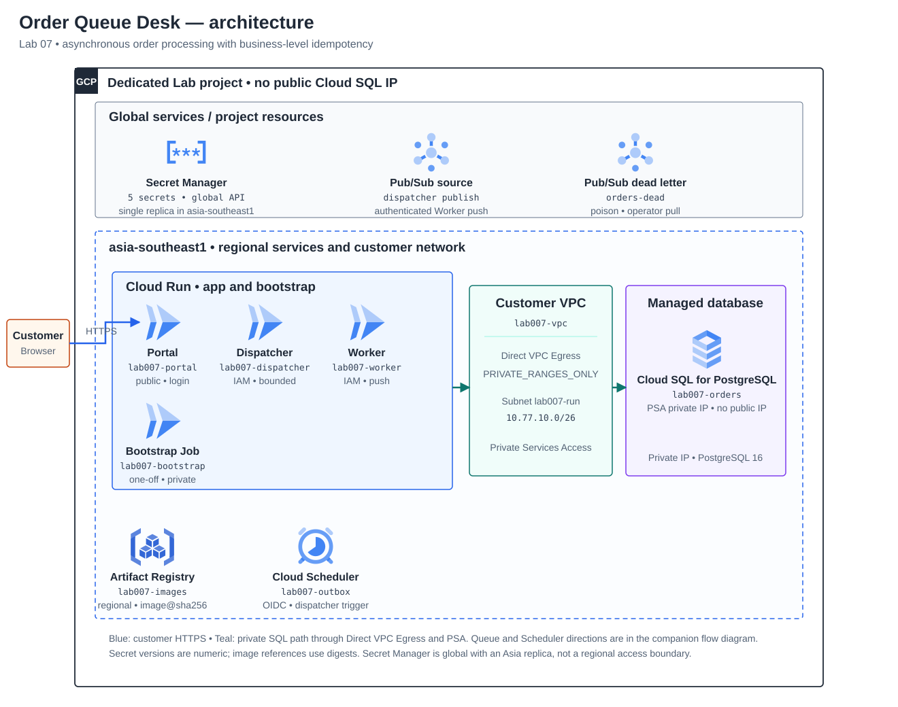
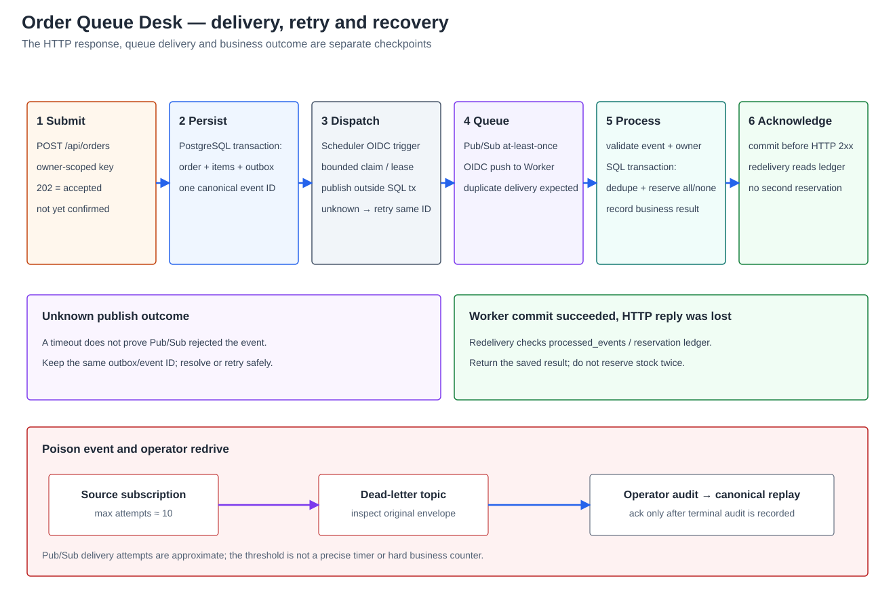
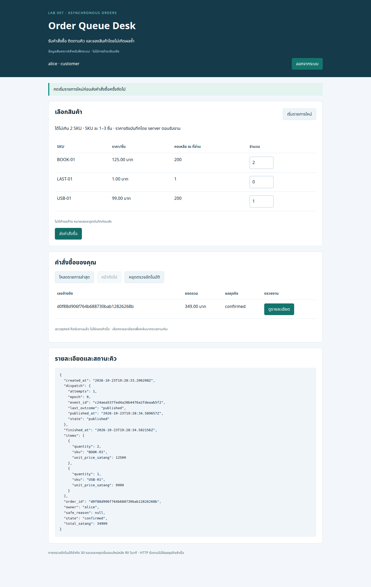
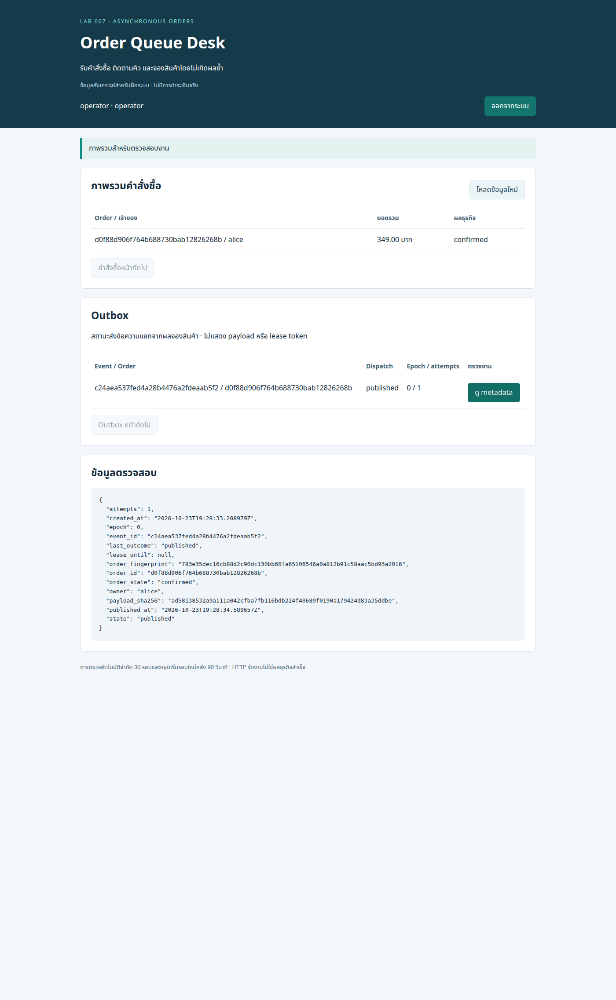

# Lab 07 — รับคำสั่งซื้อผ่าน Queue และจองสต็อกโดยไม่เกิดผลซ้ำ

## สถานการณ์

ทีมขายต้องรับคำสั่งซื้อได้โดยไม่บังคับให้ลูกค้ารอการประมวลผลทั้งหมด เมื่อ worker หยุดชั่วคราว งานต้องไม่หาย และเมื่อ Queue ส่งข้อความซ้ำ ระบบต้องไม่จองสินค้าซ้ำ ลูกค้าต้องกลับมาดูผลของคำสั่งซื้อเดิมได้ ส่วนทีมดูแลต้องรู้ว่างานค้างอยู่ที่การส่งเข้า Queue, การประมวลผล หรือ dead-letter

Solution นี้ชื่อ **Order Queue Desk** ผลสำเร็จทางธุรกิจคือจองสต็อกและเปลี่ยนคำสั่งซื้อเป็น confirmed ไม่ใช่การตัดเงิน ส่งสินค้า หรือรับประกัน exactly-once ของบริการภายนอก

**สถานะ:** Guide-ready หลัง full workflow [CI run 40067214073](https://github.com/somkid-s5/Portfolio-Lab/actions/runs/40067214073) ผ่านทุก job ของ Lab 07 ทั้ง guide checks, PostgreSQL/browser integration, bootstrap, container, Terraform validation และ diagram render. ยังไม่มี GCP deployment/Cloud verification จริง; ทุกช่อง Cloud result ต้องกรอกจากการทดลองใน sandbox ของผู้เรียน

## ผู้ใช้และงานที่ต้องทำได้

- alice / bob: login, เลือกสินค้าจาก catalog, ส่งคำสั่งซื้อ, ตรวจสถานะของตน และกลับมาหาคำขอเดิมเมื่อคำตอบหาย
- operator: ดู outbox/backlog/คำสั่งซื้อที่ติดขัด ตรวจ dead-letter และอนุมัติ replay เฉพาะงานที่ระบุ โดยไม่แก้ owner, ราคา หรือรายการสินค้าเพื่อให้ผ่าน
- dispatcher: ส่ง event ที่บันทึกไว้แล้วเข้า Pub/Sub แบบจำกัดจำนวนต่อรอบ และกู้คำขอ publish ที่ไม่ทราบผลได้
- worker: ตรวจ event และจองสต็อกใน PostgreSQL transaction โดยไม่ใช้ Pub/Sub message ID เป็น business idempotency key เพียงอย่างเดียว

ตัวอย่างข้อมูลสังเคราะห์: BOOK-01 ราคา 12,500 สตางค์, USB-01 ราคา 9,900 สตางค์ และ LAST-01 จำนวนคงเหลือหนึ่งชิ้นสำหรับทดสอบแข่งกันซื้อ ราคาและสต็อกตั้งต้นจะอยู่ใน schema/seed ที่มีเวอร์ชัน ใช้จำนวนเต็ม ไม่รับราคาจาก Browser มาเป็นราคาขายจริง

## Requirements และเกณฑ์รับมอบ

| ID | สิ่งที่ Solution ต้องทำ | หลักฐานที่ต้องเตรียมในคู่มือ |
|---|---|---|
| R1 | รับคำสั่งซื้อและติดตามผลครบวงจร | Browser → accepted/queued → confirmed หรือ rejected; owner, order ID, event ID และรายการสินค้าตรงกัน |
| R2 | ไม่ทำคำสั่งซื้อหายระหว่าง DB กับ Queue | สร้าง order และ outbox ใน transaction เดียว; ฉีด publish failure/คำตอบหาย แล้วส่งงานเดิมได้โดยไม่สร้าง order เพิ่ม |
| R3 | ไม่เกิดผลธุรกิจซ้ำเมื่อส่งหรือรับข้อความซ้ำ | message ID เดิมและใหม่แต่ event/order เดิม; crash หลัง SQL commit ก่อน ack; reservation ledger และยอดสต็อกไม่เปลี่ยนซ้ำ |
| R4 | รักษาสต็อกเมื่อหลายงานแข่งกัน | สอง order ซื้อ LAST-01 ที่เหลือหนึ่งชิ้นพร้อมกัน; confirmed ได้หนึ่งงาน อีกงาน rejected; ไม่มีสต็อกติดลบหรือจองได้เพียงบางรายการ |
| R5 | แยก business rejection ออกจาก transient และ poison event | สินค้าไม่พอเป็น terminal rejection; dependency fault ยังส่งซ้ำได้; schema เสียไป dead-letter โดยไม่แก้ข้อมูลธุรกิจ |
| R6 | ดูแล dead-letter และ replay อย่างตรวจสอบได้ | ตรวจ source/envelope/attempts ตามจริง, เก็บเหตุผล/ผู้อนุมัติ, replay จาก canonical outbox, ตรวจผลก่อน ack รายการ dead-letter |
| R7 | แยก owner, Cloud IAM และ DB roles | bob อ่าน order ของ alice ไม่ได้; anonymous เรียก worker/dispatcher ไม่ได้; runtime ไม่มี DDL/สิทธิ์ admin หรืออ่าน Secret ที่ไม่ต้องใช้ |
| R8 | เปลี่ยน throughput โดยยังรักษาความถูกต้อง | worker capacity 1 → 3 ตาม connection budget; เทียบ backlog/เวลาจบ/error/stock invariants ก่อน–หลัง แล้ว backout ได้ |
| R9 | ส่งมอบและปิดระบบได้ | correlation/logs/runbook, แผนแก้ unknown outcome, evidence/case study, cleanup รวม Queue/DLQ/SQL/Secrets/images/network และ rebuild ที่ไม่สวมรอยเป็น restore |

ผล HTTP 202 ของ Portal หมายถึงบันทึกรับงานแล้ว ไม่ได้หมายถึง publish สำเร็จหรือจองสต็อกแล้ว ผล HTTP ack ของ worker ต้องตามหลัง transaction ที่สรุปผลธุรกิจได้ หรือยืนยันว่าผลเดิมถูกบันทึกแล้วเท่านั้น

## Architecture ที่เลือกใช้

วางระบบใน sandbox project ของ Lab นี้ ไม่ต้องเปิดทรัพยากรจาก Lab ก่อนค้างไว้:

| ส่วน | ตัวเลือกที่ต้องยืนยันใน Design |
|---|---|
| UI / Order API | Cloud Run Portal พร้อม session/CSRF/owner checks และ status page |
| Source of truth | Cloud SQL for PostgreSQL: catalog/stock, orders/items, outbox, processed events และ reservation ledger |
| Outbox publisher | Cloud Run dispatcher แบบ IAM-protected; drain จำนวนจำกัดต่อ request และมีการเรียกซ้ำตามรอบที่กำหนด |
| Queue | Pub/Sub topic และ authenticated push subscription ไป worker |
| Processor | Cloud Run worker; transaction จองสินค้าและบันทึก business deduplication |
| งานที่ส่งไม่สำเร็จ | Dead-letter topic พร้อม pull subscription สำหรับ inspect/replay ที่แยกสิทธิ์ |
| การเรียก dispatcher | Cloud Scheduler เรียก Cloud Run dispatcher ด้วย OIDC ทุกนาที; endpoint drain แบบ bounded ไม่ใช้ background thread ที่หวังว่า Cloud Run จะรันต่อหลังตอบ request |
| Private data path | Cloud Run Direct VPC Egress แบบ PRIVATE_RANGES_ONLY ผ่าน subnet 10.77.10.0/26; Cloud SQL PostgreSQL 16 ใช้ private IP ผ่าน Private Services Access (PSA) ไม่มี public IP |
| Identity / delivery | แยก Portal, dispatcher, worker, bootstrap และ scheduler identities; push ใช้ OIDC; Secret Manager อ้างอิง numeric versions; Artifact Registry ใช้ image digest; foundation/workloads แยก deployment order |

เลือก region เบื้องต้น asia-southeast1 แต่ Pub/Sub topic/subscription ไม่ใช่ VM ใน regional subnet ต้องวาด service scope ตามจริง และกำหนด message storage policy หากโจทย์ต้องควบคุมที่อยู่ข้อมูล Worker ที่ต้องผ่าน IAM ไม่ใช่ private VPC ingress โดยอัตโนมัติ

Private IP เป็นเพียงเส้นทางเครือข่าย การยืนยัน DB identity/TLS และ connection pooling ต้องตัดสินใจให้ครบก่อนเขียน code ไม่ใช้ private IP แทนข้ออ้างว่าการเชื่อมต่อเข้ารหัสแล้ว

## Solution diagram

แผนภาพแยกขอบเขต project, regional services, global endpoints, customer VPC และ managed Cloud SQL ตามตำแหน่งจริง Cloud Run เป็น regional service ที่ใช้ Direct VPC Egress ไม่ได้อยู่ภายใน subnet; Cloud SQL เป็น managed service ที่เชื่อมกับ VPC ด้วย PSA รายละเอียด request/retry/replay แสดงแยกใน event flow เพื่อให้อ่านเส้นทางหลักได้ชัด

[เปิดภาพ topology PNG](assets/diagrams/solution.png) · [ไฟล์ SVG สำหรับแก้ไข](assets/diagrams/solution.svg) · [เปิดภาพ event-flow PNG](assets/diagrams/event-flow.png) · [ไฟล์ SVG สำหรับแก้ไข](assets/diagrams/event-flow.svg)





Secret Manager ในรูปเป็น global API resource ที่กำหนด replica แห่งเดียวใน asia-southeast1 ไม่ใช่ Regional Secret และไม่ได้จำกัดการเข้าถึงไว้เฉพาะ region นั้น; Pub/Sub กำหนด allowed message persistence region แต่ตัว topic/subscription ไม่ใช่ VM ใน subnet

## ข้อตกลงความถูกต้องที่ต้องปิดใน Design

1. **API idempotency:** key มี scope ตาม owner และ fingerprint ของคำสั่งซื้อ คำขอซ้ำคืน order เดิม ส่วน key เดิมเปลี่ยนรายการต้อง conflict ไม่สร้างงานใหม่เมื่อไม่ทราบผล
2. **Transactional outbox:** order กับ canonical event เกิดใน transaction เดียว การ publish อยู่นอก SQL transaction คำตอบ publish หายอาจทำให้ส่งซ้ำได้ จึงต้องคง event ID เดิมและไม่ตีความว่าไม่มีข้อความแน่นอน
3. **Dispatcher claim:** drain มีเพดาน/lease/fencing และไม่ถือ SQL row lock ค้างระหว่าง network call ระบุวิธีกู้หลัง publish แล้วแต่ยัง mark ไม่สำเร็จ
4. **Business transaction:** ตรวจ payload binding, lock order และสินค้าในลำดับคงที่, จองครบทุก item หรือไม่จองเลย, บันทึก ledger/processed event/order result ใน transaction เดียว
5. **Deduplication:** unique business key และ payload fingerprint ต้องป้องกันทั้ง event ซ้ำและ event ID ต่างกันที่พยายามทำ order เดิมซ้ำ ความผิดปกติของ owner/items/ราคาไม่ถูกกลบด้วยการ ack ว่าเคยทำแล้ว
6. **Stock invariant:** available = stock ตั้งต้น − ผลรวม reservation ของ confirmed orders; rejected ไม่เหลือ partial reservation และจำนวนไม่ติดลบ
7. **Ack boundary:** SQL rollback/dependency failure ไม่ ack; commit แล้ว response หายต้องกู้ด้วย ledger ไม่ตัดสต็อกอีกรอบ Business rejection ต่างจากข้อความที่อ่านหรือประมวลผลตาม schema ไม่ได้
8. **Dead-letter:** กำหนดบน source subscription พร้อม service-agent IAM ที่ต้องใช้ จำนวน delivery attempts เป็นค่าประมาณ ไม่ใช้เป็น hard counter หรือรับประกันว่าจะเข้าคิวในวินาทีที่กำหนด
9. **Redrive:** อ่าน envelope ต้นทางแบบ bounded, ตรวจ order/outbox เดิม, บันทึก operator action และใช้ canonical event เดิม ไม่คัดลอกข้อความที่เสียแล้วเปลี่ยน owner/items เอง เมื่อ publish ตอบไม่แน่นอนต้อง resolve ก่อน ack หรือเปิดรอบใหม่
10. **Order state:** accepted/queued, confirmed, rejected และการแสดงสถานะ operational failure ต้องไม่ทำให้คำว่า dead-letter กลายเป็นผลธุรกิจว่าลูกค้าถูกปฏิเสธ ต้องปิด transition และวิธี reconcile ให้ชัด
11. **Observability:** order ID/event ID/outbox ID/message ID/request ID มีหน้าที่ต่างกัน ต้องตามเส้นทางได้โดยไม่มี credentials, session, JWT หรือ raw payload ใน logs
12. **Capacity:** pool size × instance/revision peak รวม Portal/dispatcher/worker/bootstrap ต้องไม่เกิน DB budget หลังหัก headroom ไม่เพิ่ม max instances โดยดูเฉพาะความเร็ว Queue

Pub/Sub push ใช้แบบ at-least-once และไม่รองรับ exactly-once delivery feature ของ pull จึงต้องพิสูจน์ผลธุรกิจไม่ซ้ำด้วย transaction/ledger ของ Solution นี้ ไม่ตั้งชื่อว่าเปิด exactly-once แล้วจบ

## Failure ที่ผู้เรียนต้องได้ฝึก

| สถานการณ์ | วิธีแยกสาเหตุ / ผลที่ต้องพิสูจน์ |
|---|---|
| Order บันทึกแล้ว แต่ publisher ติดต่อ Queue ไม่ได้ | ยังเห็น outbox เดิม; restore แล้วงานเดินต่อ ไม่มี order เพิ่ม |
| Publish สำเร็จ แต่ dispatcher ไม่ทันบันทึกผล | ส่ง event เดิมซ้ำได้; ledger จองสินค้าเพียงครั้งเดียว |
| Worker commit แล้วตอบไม่สำเร็จ | delivery ซ้ำตรวจผลเดิม; สต็อกและยอดสรุปไม่เปลี่ยนเพิ่ม |
| Worker ติดต่อ DB ไม่ได้ชั่วคราว | ไม่มี partial writes; backlog/age และ retry สัมพันธ์กับ fault/recovery |
| Poison schema | ไม่ประเมิน arbitrary payload; เข้า dead-letter ตามการทำงานจริง พร้อมข้อมูลอธิบายที่ปลอดภัย |
| Business stock ไม่พอ | rejected แบบ terminal และ ack ได้ ไม่ปะปนกับ poison/DLQ |
| Operator replay หรือ response หาย | คำขอเดิม resolve ได้; ข้อมูลธุรกิจเดิมไม่เปลี่ยน; ไม่ ack ก่อนทราบว่าจัดการรายการอย่างไร |
| เพิ่ม worker แล้ว DB เริ่มอิ่ม | ตรวจ connection/lock/error ก่อนแก้; backout capacity ไม่ลบ orders/ledger |

Fault controls ต้องเป็น sandbox revision/config ที่ปิดเป็นค่าเริ่มต้น ไม่เปิด endpoint ให้ลูกค้าสร้าง poison หรือสั่งทำ worker ล่ม การทดสอบแต่ละ fault มีจุดเริ่ม/จุดจบ/คืนค่าและช่วงสังเกตจำกัด

## Change Request

ทีมต้องการระบาย backlog ช่วงรับงานมากขึ้น ให้เสนอและทดลอง worker capacity จากหนึ่งเป็นสาม instance โดยคง event/order contract เดิม และกำหนด connection/concurrency budget ก่อน deploy

ใช้ bounded workload ชุดเดิมเปรียบเทียบ baseline/change/backout: จำนวน orders, input schedule, fixture/SHA, stock ก่อน–หลัง, confirmed/rejected, duplicate effects, outbox age, Queue age และเวลาจบตามนิยามเดียวกัน ไม่รับประกันว่าจะเร็วสามเท่าหรือใช้ผลสั้น ๆ อ้าง production capacity

เพดานตั้งต้นสำหรับออกแบบเครื่องมือ: ไม่เกิน 100 orders ต่อรอบ, 2 items ต่อ order, synthetic quantity ไม่เกิน 3 ต่อ item, producer ไม่เกิน 2 requests/วินาที และช่วงส่งไม่เกิน 60 วินาที ต้องเลือก seed/expected results ให้เพียงพอสำหรับรอบเทียบ โดยไม่ reset ฐานข้อมูลเดิมเงียบ ๆ

## Materials ที่ใช้ใน Solution

ชุดแล็บประกอบด้วย Portal/UI, PostgreSQL schema/seed และ least-privilege roles, transactional outbox, dispatcher, authenticated Pub/Sub push worker, operator replay/DLQ tools, private bootstrap/Secret publisher, Terraform foundation/workloads, bounded workload/fault tools, browser/PostgreSQL CI checks และ topology/event-flow diagrams; วิธี deploy, ตรวจผล, เปลี่ยน capacity, เก็บหลักฐาน และ cleanup อยู่ใน Tasks ด้านท้าย README

## สิทธิ์ ต้นทุน และขอบเขตที่ยังไม่รวม

ต้องมี Billing/quotas และสิทธิ์จัดการ Cloud SQL, Cloud Run, Pub/Sub, IAM, VPC/private services access, Secrets, Artifact Registry และเครื่องมือเรียก dispatcher ของ sandbox ระบุ org-policy/public-login constraints ก่อน deploy

Cloud SQL, backups/storage, Queue retention/operations, network, images, logs และบริการตามเวลามีค่าใช้จ่าย Budget alert ไม่ใช่ hard cap ต้องกำหนดอายุการเปิดระบบ, instance/pool limits, retention, dead-letter inventory และลำดับหยุด producer ก่อน cleanup ไม่สร้างระบบจริงในงานจัดทำเอกสารนี้

ไม่รวม payment gateway, physical fulfillment, cross-region DR, service mesh, production SSO หรือการรับประกัน SLA แต่ระบุข้อจำกัดและสิ่งที่ต้องเพิ่มก่อนส่งให้ทีมใช้งานจริงได้

## ลำดับการลงมือ

ทำ Tasks 00–12 ตามลำดับใน Project sandbox ของ Lab 07; ตรวจแผน Terraform และผลจริงก่อนทำขั้นต่อไป หากไม่ได้สร้าง GCP resource ให้บันทึก Not run แทนการตีความ CI ว่าเป็น Cloud result

## แหล่งอ้างอิงที่ตรวจสำหรับ Brief

ตรวจเอกสารวันที่ 24 ตุลาคม 2026; รายละเอียด SDK/provider/location/ราคาและสิทธิ์ต้องตรวจอีกครั้งใน Design

- [Pub/Sub push delivery และ authentication](https://docs.cloud.google.com/pubsub/docs/push)
- [Exactly-once delivery: pull เท่านั้น และ publish-side duplicates](https://docs.cloud.google.com/pubsub/docs/exactly-once-delivery)
- [Dead-letter configuration, service-agent permissions และ approximate attempts](https://docs.cloud.google.com/pubsub/docs/dead-letter-topics)
- [Cloud Run เชื่อม Cloud SQL PostgreSQL ผ่าน private IP](https://docs.cloud.google.com/sql/docs/postgres/connect-run)
- [Cloud Run Direct VPC egress](https://docs.cloud.google.com/run/docs/configuring/vpc-direct-vpc)

## Design — สัญญาที่ใช้สร้างระบบ

### 1. ทรัพยากรและวิธีเชื่อมต่อที่เลือก

| ส่วน | ค่าที่ใช้เป็น baseline |
|---|---|
| Runtime | Python 3.12, Flask/Gunicorn; Cloud Run second generation ใน asia-southeast1; min instances 0 |
| Portal | lab007-portal; max 2 instances/revision, concurrency 4, request timeout 30s, memory 512 MiB |
| Dispatcher | lab007-dispatcher; IAM-required, max 1/revision, concurrency 1, request timeout 60s |
| Worker | lab007-worker; IAM-required, max 1/revision → change 3, concurrency 1, request timeout 60s, memory 512 MiB |
| Dispatcher trigger | Cloud Scheduler HTTP POST ทุกหนึ่งนาทีตาม UTC ใช้ OIDC; audience เป็น dispatcher origin และ target เป็น /internal/outbox/drain |
| Queue | lab007-orders topic; lab007-orders-worker push subscription → worker /events/orders; explicit push identity/audience |
| Dead-letter | lab007-orders-dead topic + lab007-orders-dead-inspect pull subscription (ack deadline600s); max delivery attempts 10 แบบ best-effort ไม่ใช่ hard counter |
| Retry/retention | source retry backoff 10–60s, ack deadline 60s, retention 1 วัน; DLT topic/subscription retention 1 วัน; ไม่เปิด retain acknowledged messages โดยไม่จำเป็น |
| Database | PostgreSQL 16, Enterprise, ZONAL, dedicated db-custom-2-7680; database order_queue; ไม่เปิด public IP |
| Network | lab007-vpc, regional Direct VPC subnet 10.77.10.0/26, PSA range 10.77.240.0/24; ไม่ใช้ subnet CIDR ซ้ำกับระบบอื่น |
| DB transport | Cloud SQL Python Connector + pg8000, private IP ผ่าน Direct VPC egress; connector จัดการ TLS/instance identity; attached SA สำหรับ Google API และ DB password แยก role |
| Delivery assets | Artifact Registry lab007-orders, image@sha256, Secret versions แบบตัวเลข; Terraform 1.9.x/provider Google 6.50.0 เป็นจุดตั้งต้นที่ต้อง validate ใน CI |

ตั้ง Direct VPC egress แบบ private-ranges-only เพื่อส่ง SQL private traffic เข้า VPC โดยไม่บังคับ Pub/Sub/Secret APIs ทั้งหมดผ่าน NAT ไม่สร้าง Cloud NAT เพียงเพื่อให้ Diagram เต็ม Cloud Run ใช้ resource นอก subnet แต่มี Direct VPC network attachment ส่วน Cloud SQL อยู่ managed producer network ที่เชื่อมด้วย PSA ไม่ใช่ VM ใน subnet ของ Portal

Pub/Sub topics เป็นทรัพยากรที่ไม่ผูกกับ regional subnet ตั้ง allowed persistence region เป็น asia-southeast1 ทั้ง source และ dead-letter topic ไม่ตีความว่า resource กลายเป็น regional VM

ขนาด DB ที่เลือกมีต้นทุนสูงกว่า shared-core แต่ให้พื้นที่สำหรับทดลอง connection/lock และ capacity โดยไม่ตั้งต้นด้วย DB เล็กจนแยก bottleneck ไม่ได้ นี่ไม่ใช่ HA Lab หรือ benchmark tier ต้องบันทึกเวลาที่เปิดและ cleanup หลังทดสอบ รุ่น dependencies ของ connector/driver/PubSub จะล็อกพร้อม real-package API checks ใน Materials ไม่ใช้ชื่อ latest ใน image หรือคำสั่งติดตั้งของคู่มือ

### 2. Identity, Secret และ DB role

| Identity | Google Cloud permissions | DB / App permissions |
|---|---|---|
| Portal SA | Cloud SQL Client; อ่าน auth/portal-DB Secrets ของตัวเอง | order_api: อ่าน catalog, สร้าง order/items/outbox ผ่าน transaction interface, อ่านสถานะ/operational view และขอ replay ผ่าน interface ที่จำกัด |
| Dispatcher SA | Cloud SQL Client; อ่าน dispatcher-DB Secret; publisher เฉพาะ source topic | outbox_dispatcher: claim/finish/release outbox; ไม่แก้ stock หรือ order result |
| Worker SA | Cloud SQL Client; อ่าน worker-DB Secret | order_worker: lock/อ่าน order, transaction จองสินค้า/ledger/processed events และ terminal result; ไม่สร้าง/แก้ catalog price หรือ DDL |
| Push SA | run.invoker เฉพาะ worker | ไม่มี DB/Secret/publisher role |
| Scheduler SA | run.invoker เฉพาะ dispatcher | ไม่มี DB/Secret/publisher role |
| Pub/Sub service agent | สร้าง OIDC token สำหรับ Push SA ตาม resource scope; DLT publisher และ source-subscription subscriber ตามเอกสาร | ไม่ใช้เป็น App runtime SA |
| Bootstrap SA / Job | Cloud SQL Client และอ่าน bootstrap/admin+initial-role Secrets เฉพาะช่วงติดตั้ง | admin สำหรับ schema/role/grants/seed ครั้งแรก ไม่ใช้ใน serving services |
| ผู้ดูแล DLQ | subscriber เฉพาะ dead-inspect subscription; login operator ใน Portal | ไม่รับ DB admin หรือสิทธิ์แก้ business payload โดยตรง |

แยก Cloud IAM ออกจาก DB login: role Cloud SQL Client ไม่ได้ให้สิทธิ์อ่านตารางเอง แต่ละ DB role เป็น LOGIN/NOSUPERUSER/NOCREATEDB/NOCREATEROLE ไม่มีสิทธิ์ DDL/delete ledger และไม่เป็นเจ้าของ schema การออกแบบ SQL interface ต้องใช้ explicit schema/search_path และ grants ไม่ให้ PUBLIC เรียก privileged functions

Foundation สร้าง Secret containers เท่านั้น การตั้ง admin password และ initial credentials ต้องใช้ private bundle/API workflow ที่ไม่ใส่ payload ใน Terraform/state/image/arguments ที่พิมพ์ออก log จากนั้น bootstrap Job ใช้ private IP ไม่เปิด public DB หรืออนุญาต laptop IP เพื่อ bootstrap ติดตั้งซ้ำต้องตรวจ schema version/seed identity และไม่ reset รหัสหรือยอดคงเหลือของระบบที่มีข้อมูลอยู่แล้ว

Portal เปิด login ผ่าน App auth แต่ทุก business mutation ต้องตรวจ session/role/CSRF และ owner จาก session ไม่รับ owner จาก request ลูกค้าไม่เข้าถึง DB หรือ Pub/Sub โดยตรง Bootstrap identity/Secret access ไม่คงไว้ใน runtime ของ Portal/worker

### 3. ข้อมูลและ API contract

สินค้าเริ่มต้น: BOOK-01/USB-01 อย่างละ 200 หน่วย และ LAST-01 หนึ่งหน่วย เก็บ seed fingerprint/version ราคาเป็น integer satang snapshot ลง order items ตอนรับงาน 1–2 SKU ที่ไม่ซ้ำต่อ order, quantity 1–3 ต่อ item, ไม่รับ client price, SKU allowlist และ canonical item order ตาม SKU

IDs เป็น UUID hex32 จาก server ส่วน idempotency key ที่ client สร้างต้องมีรูปแบบ/ความยาวจำกัด เก็บ hash(owner+key), request fingerprint และ order reference ไว้ใน transaction เดียว ไม่เอา raw key ไปเป็น log field ไม่ลบ idempotency/ledger ก่อน Queue/DLQ และ replay window สิ้นสุด

| Endpoint | สัญญา |
|---|---|
| GET /api/session; POST /api/login,/api/logout | Secure/HttpOnly/SameSite cookie, hashed demo credentials, CSRF สำหรับ mutations, bounded JSON body |
| GET /api/catalog | login required; คืน SKU/ราคา ไม่ให้ client ตั้ง stock หรือราคาขาย |
| POST /api/orders | owner จาก session, body มี items และ idempotency key เท่านั้น; commit order/items/outbox แล้วตอบ 202 พร้อม order ID |
| GET /api/orders; GET /api/orders/{id} | owner-filtered pagination ≤20; foreign owner 404; คืน business state แยกจาก dispatch state |
| GET /api/operator/orders; GET /api/operator/outbox | operator only; safe operational projection ไม่คืน credentials/raw message |
| POST /api/operator/outbox/{event_id}/replay | operator+CSRF+request key; audit/prepare replay แบบ idempotent และ bounded ไม่รับ replacement payload |
| POST dispatcher /internal/outbox/drain | IAM ก่อน App; bounded empty/configured body ไม่มี arbitrary topic/SQL/URL จาก caller |
| POST worker /events/orders | IAM ก่อน App; wrapped Pub/Sub push JSON ≤64 KiB, strict base64 decoding, decoded data ≤4 KiB, JSON container depth ≤8, exact subscription binding |
| GET /livez; GET /healthz | process readiness แยกจาก bounded DB query; ไม่เขียนข้อมูลหรือไล่อ่าน order ทุกตัว |

Canonical event มีเพียง schema_version=1, event_id, order_id, order_fingerprint โดย UUID/order data มาจาก DB ไม่แนบราคา/owner ที่แก้เองได้จาก message Worker ต้องเทียบ event ID และ fingerprint กับ canonical outbox ก่อนทำงาน ไม่เชื่อ Pub/Sub attributes แทน SQL binding และไม่ติดตาม URL ใน payload

Business state มี accepted → confirmed หรือ rejected และไม่ย้อนกลับ confirmed หมายถึงจองครบทุก item; rejected มี safe reason เช่น insufficient_stock

Dispatch state แยกเป็น pending/publishing/published/exhausted; published หมายถึง Pub/Sub ตอบรับ publish ไม่ใช่ worker สำเร็จ Worker อาจทำงานเสร็จก่อน dispatcher mark published ได้ ต้องไม่เขียน state ของ order ย้อนเป็น queued ภายหลัง ส่วน dead-letter เป็น transport observation ที่ต้อง reconcile ไม่ใช่ business rejection

### 4. Schema และ transaction boundaries

| ตาราง | Invariant สำคัญ |
|---|---|
| products | PK SKU, seed stock/available ≥0, unit price satang ≥0, seed version |
| orders | PK order ID, owner, unique(owner,key_hash), request fingerprint, accepted/confirmed/rejected, safe reason/timestamps |
| order_items | PK(order ID,SKU), quantity/price snapshot/line total; FK ไป order/product |
| outbox | PK event ID, unique order ID, canonical event bytes/hash, dispatch state, lease token/until, attempts/epoch, safe last outcome |
| processed_events | unique event ID และ unique order ID; canonical fingerprint, confirmed/rejected outcome; ไม่มีคำว่าเคยทำแล้วโดยไม่เทียบ binding |
| reservations | unique(order ID,SKU), units/price snapshot; FK; มีเฉพาะ confirmed orders และไม่แก้หรือลบระหว่างทำ Lab |
| operator_actions | unique(operator,request_key_hash), event ID/source digest/epoch, reason/result; ไม่เก็บ JWT/ack token |

**Create:** normalize/fingerprint → lookup idempotency → read catalog/price → insert order/items/canonical outbox ใน SQL transaction เดียว หากคำตอบ commit หายให้ lookup คำขอเดิม ไม่เรียก publish ใน transaction นี้

**Dispatch:** claim ด้วย row lock/SKIP LOCKED และ token/lease120s → commit ก่อน network → publish canonical event → finish เฉพาะ token ปัจจุบัน ถ้าคำตอบหายให้ release หรือรอ lease แล้วส่ง event ID เดิม; stale dispatcher ห้าม mark ตามผล network ของรอบเก่า

หนึ่ง drain รับได้สูงสุด 20 events และมี cooperative budget 40s โดยเริ่ม operation ใหม่เฉพาะเมื่อเหลือเวลาพอสำหรับ bounded call; publish call timeout5s/retryปิด, ไม่ต่อ lease ไม่จำกัด Scheduler overlap/responseหายอาจเรียก drain ซ้ำ จึงไม่ใช้ Scheduler เป็น lock หลัก

Dispatch attempt limit 10 ต่อ epoch เมื่อเกินให้ exhausted พร้อมเหตุผล operational แต่ไม่แก้ order เป็น rejected Operator เปิดเพิ่มได้ไม่เกินสอง epochด้วย request key เดิมที่ resolve ได้ หาก order จบแล้วให้แสดง already-resolved แทน publish เพื่อทำธุรกิจใหม่

**Process:** parse/auth envelope → begin → lock order → verify canonical event/items → ตรวจ processed result เดิม → lock product rows ตาม SKU → ตรวจทุก SKU พอ → จองทั้งหมด+insert reservations+processed result+terminal order state → commit → ack204 หากสินค้าไม่พอ commit rejected/processed outcome โดยไม่แตะ stock

SQL exception/dependency/lock timeout ต้อง rollback และคืน retryable response ส่วน schema/binding ที่ไม่ถูกต้องไม่ ack แบบ success ต้องแยก poison reason เพื่อส่งต่อ DLT ไม่อ่าน arbitrary table/path จาก event การ commitสำเร็จแต่responseหายปลอดภัยเพราะรอบใหม่ตรวจ immutable binding และ terminal ledgerก่อนทำ stock change

ใช้ row constraints/unique keys/transactions เป็นหลัก ไม่ใช้ check-then-act ใน Pythonอย่างเดียว SQL tests ต้องตรวจ race กับ connections จริงและ stock snapshot ไม่ใช่ดูแค่ HTTP status

### 5. Dead-letter inspect/replay

ใช้ Cloud Shell bounded tool กับ operator session และ subscriber permission เฉพาะ dead-inspect ไม่ให้ Portal ดึง DLQ payload สำหรับลูกค้าทั่วไป เครื่องมือ pull ครั้งละไม่เกิน 5 รายการ ไม่ auto-ack และจำกัดขนาด envelope/nesting/base64 decode ต้อง parse รูปแบบ forwarded message จริงจากเอกสาร/fixtureที่ตรวจแล้ว

ลำดับต่อหนึ่งรายการ:

1. ตรวจ source subscription/digest และ lookup canonical outbox ผ่าน operator API ไม่ใช้ raw payload มาเขียนธุรกิจ
2. บันทึก private journal ของ action key/event/source digest และ audit reference ก่อน prepare replay ไม่มี password/JWT/ack ID ในหลักฐานเผยแพร่
3. ถ้า order accepted ให้ operator API prepare pending epoch เดิมแบบ idempotent รอ Scheduler/dispatcher ส่ง canonical event ไม่รับ payload ที่แก้เอง
4. ถ้าคำตอบหาย ให้ resolve action key เดิมและอ่าน order/outbox/ledger ไม่เปิด epoch ใหม่ ถ้า order confirmed/rejectedอยู่แล้วและbindingตรง ให้บันทึก already-resolved
5. Ack เฉพาะ dead-letter รายการที่ตรวจผล terminal/canonical binding แล้ว ห้าม ack batch ทั้ง subscription หรือถือ publish response เป็นผลธุรกิจ หาก ack token หมดอายุให้ pull/ตรวจรายการเดิมใหม่ ไม่สร้างงานธุรกิจเพิ่ม

การ replay ไม่ลบหรือ seek source subscription ทั้งก้อน และไม่รับประกันว่า deliveryAttempt เท่ากับสิบเป๊ะ ต้องแยก application dispatch budget ออกจาก broker best-effort delivery attempts

Poison fault สำหรับฝึกจะเปลี่ยนเฉพาะ schema version ของ event ที่ระบุใน outbound test path โดย canonical outbox/orderไม่เปลี่ยน เมื่อปิด faultให้ replayจากcanonical versionเดิม มี finite target/event markerและคืนbaselineชัดเจน ไม่เปิดfaultให้ลูกค้าเลือกจากAPI

### 6. Connection budget และการเปลี่ยน capacity

ใช้หนึ่ง process ต่อ container, pool overflow=0, pool size Portal2/worker2/dispatcher1, bootstrap1 ตั้ง connect/pool wait/statement/lock timeout แบบจำกัด และใช้ transaction สั้น ไม่มี network I/O ขณะถือ product locks

Change จาก worker1→3 โดยคง concurrency1/pool2 ที่เหลือเดิม สมมติฐาน rollout สอง revision พร้อมกันให้ budget Portal4×2 +worker6×2 +dispatcher2×1 +bootstrap1 =23 connections; เผื่อ inspection/maintenanceอย่างน้อย7และheadroomเพิ่มเติม ไม่อ้างว่า Cloud Run max instances เป็น hard DB connection cap

ตั้ง DB role connection limits ตาม budget: API8/worker12/dispatcher2/bootstrap1 และตรวจ DB actual max_connections/ผู้ใช้ระบบก่อนเริ่ม หาก Cloud Run transient burst/หลายrevisionเกินแผน DBอาจปฏิเสธ connection ต้องเกิด bounded error/backoffไม่สร้างผลซ้ำ ไม่รับประกัน zero errorsระหว่างrollout

ฐาน DBไม่autoscaleตามQueueจึงต้องเทียบ stock correctness/Queue age/DBlocks/connectionsร่วมกัน ไม่เพิ่มpublisherหรือใช้blindloadจนquotaเต็มเพื่อทำให้กราฟสวย

### 7. Test matrix และลำดับ Materials

| ชั้น | สิ่งที่ต้องตรวจจริง |
|---|---|
| Domain/protocol | exact input/schema/fingerprint/integer bounds; duplicate JSON/base64/body limits; owner/binding; safe reasons |
| PostgreSQL16 | create/replay/conflict, concurrent LAST-01 race, all-or-nothing multi-item, duplicate/new message IDs, commit-before-ack recovery, stale publish token, ambiguous publish/reclaim, exhausted/redrive/action idempotency และ DB grants |
| HTTP/browser | real Portal login/catalog/order/status/unknown-create resolution; bob404/operator403/CSRF; queue transport/signing doubles ติดป้ายชัด |
| SDK contracts | real installed Pub/Sub publisher/Cloud SQL connector APIs, timeout/retry/IP/TLS contracts; no paid cloud calls |
| Containers/IaC | explicit roles/Secrets/image digest, non-root/exclusions, Terraform fmt/init-backendfalse/validate, bootstrap no-reset |
| Guide/diagrams | commands parse, links/Taskcoverage, real-width render/visual review, R1–R9evidence, bounded fault/backout/cost/cleanup |

ลำดับทำ: domain/event contractsและfixtures → SQLschema/roles/transactionsกับrealDBtests → outboxclaim/publisher/worker → HTTP/runtime/Secrets/bootstrap → browser+operatorDLQtools → Terraform → diagrams → Tasksพร้อมrecords/runbook/change/cleanup → self-review/Guide-ready แต่ละชั้นต้องแก้ข้อผิดพลาดที่ตรวจได้ก่อนเพิ่มชั้นถัดไป

แผน Tasks จะเริ่มproject/budget/private state → foundation/privateDB → privatecredentials/bootstrap → images/services/queue/schedule → business/owner/stock tests → outbox/push/crash/DLQ faults → throughput change → evidence/cleanup/rebuild ไม่เขียนผล Cloud PASS ล่วงหน้า

### 8. Deployment และ cleanup boundaries

แยก Terraform foundation (APIs/VPC/PSA/SQL/Secretcontainers/SAs/AR), bootstrap (one-off DB installation job) และ workloads (services/topics/subscriptions/identitybindings/Scheduler) เพื่อให้แต่ละเฟสมีค่าที่ต้องใช้และreviewก่อนเปิดtraffic Schema/Secretpayloadอยู่นอกTerraformstate

Bootstrap Jobล้มต้องวินิจฉัย/รันซ้ำแบบไม่reset ไม่แก้roleหรือseedผ่านPortal ส่วน runtime migrationsไม่ทำตอนรับrequesthealth

Cleanupต้องpauseScheduler/หยุดordersและdispatcherก่อน, resolveoutbox/DLQ/unknownoutcomeและเก็บsanitizedsnapshots, ลบworkloads/Queueหลังตัดสินใจเรื่องข้อมูล, ปลดDBprotectionด้วยreviewedplan, ตรวจbackups/retention/images/Secrets/SA/IAM/PSAและnetworkที่เหลือ ไม่ลบproject/sharedAPI/backendหรือdefaultDBของงานอื่น

SQLbackup retentionไม่ใช่การรับประกันrestoreที่ทดลองแล้ว และ rebuild seedไม่ใช่คืนorders/ledgerที่ลบ ต้องระบุสิ่งที่ยังเก็บและค่าใช้จ่ายที่อาจตามหลังinventory

### แหล่งอ้างอิง Design

- [Cloud SQL Python Connector: private IP/TLS/pg8000 และ refresh strategy](https://github.com/GoogleCloudPlatform/cloud-sql-python-connector)
- [Pub/Sub authenticated push และ service agent](https://docs.cloud.google.com/pubsub/docs/authenticate-push-subscriptions)
- [Cloud Scheduler HTTP target authentication](https://docs.cloud.google.com/scheduler/docs/http-target-auth)
- [Cloud Run scheduled invocation](https://docs.cloud.google.com/run/docs/triggering/using-scheduler)

**Design ที่ใช้งาน:** resource, identity, event, schema, transaction, outbox/DLQ, capacity และ cleanup contracts ถูกนำไปใช้ใน app/sql/infra; Tasks ด้านท้ายพา deploy และตรวจส่วนที่ CI จำลองไม่ได้ โดยไม่อ้างว่าได้ทดสอบ Cloud จริง

## ตัวตรวจคำขอและข้อความ

[order_domain.py](app/order_domain.py) ตรวจคำขอไม่รับ owner/ราคาจาก Browser, จำกัด SKU/จำนวนสินค้า, normalize ลำดับรายการ, fingerprint และ key hash ตาม owner ส่วน order binding รวม owner/order ID/ราคาที่อ่านจากฐานข้อมูล เพื่อให้ข้อความแก้ข้อมูลเองไม่กลายเป็นคำสั่งซื้อที่ถูกต้อง

ตัวอ่าน wrapped Pub/Sub รับ messageId/message_id และ publishTime/publish_time ตามตัวอย่างทางการ โดย aliases ที่มีพร้อมกันต้องตรงกัน แยก message ID จาก canonical event ID รองรับ deliveryAttempt แบบ optional แต่ไม่ใช้ตัวเลขนั้นเป็น hard retry budget และ **ไม่ใช้ JSON fields เป็น authentication**

มี [11 tests](tests/test_domain.py) สำหรับ normal/canonical/bounds/duplicates/encoding/schema/alias-conflict และ [คำขอตัวอย่าง](fixtures/order-request.json) / [catalog สังเคราะห์](fixtures/catalog.json) ส่วน domain และ PostgreSQL 12 tests แรกผ่าน [CI 39999204524](https://github.com/somkid-s5/Portfolio-Lab/actions/runs/39999204524) แล้วตามขอบเขตด้านล่าง ไม่ใช่ผล Pub/Sub/GCP จริง

## ฐานข้อมูลและการจองสต็อก

[Schema](sql/schema.sql) แยก order/items/outbox/processed events/reservations และ seed สังเคราะห์ออกชัดเจน [DB roles](sql/roles.sql) เริ่มเป็น NOLOGIN เพื่อให้ขั้น bootstrap ตั้ง credentials ส่วนตัวภายหลัง ไม่มีรหัสผ่านใน SQL หรือ repository และไม่มีสิทธิ์ลบ/แก้ ledger ให้ runtime

[Orders repository](app/orders.py) เป็น transaction interface ใน Python ไม่ใช่ SECURITY DEFINER SQL functions: API ใช้ column/table grants เท่าที่ต้องใช้และตรวจ owner ฝั่ง App; DB role เป็นขอบเขตของ service ไม่ใช่สิทธิ์รายลูกค้า หากเพิ่ม privileged SQL functions สำหรับ operator ภายหลังต้องมี search_path/grants ที่ตรวจแยก ไม่อ้างว่ามีแล้วในชุดนี้

การ create ใช้ transaction advisory lock ตาม owner/key hash ก่อนตรวจ idempotency อ่านราคาจาก catalog และ commit order/items/outbox พร้อมกัน การ process ล็อก order ก่อน แล้วล็อกสินค้าเรียง SKU ตรวจครบทุกชิ้นก่อนเปลี่ยนยอด และ commit stock/reservations/processed result/order state พร้อมกัน ไม่มี publish หรือ network ไปบริการอื่นระหว่างถือ locks

[integration tests](tests/test_sql.py) ใช้ PostgreSQL 16 จริงกับ pg8000 1.31.5 และ SET ROLE เพื่อทดสอบ grants: concurrent create, duplicate processing, LAST-01 race, multi-item rejection, partial-write rollback, commit-before-ack replay, owner/event binding, ledger corruption และ price snapshot คำสั่งทดสอบยอมรับเฉพาะ disposable loopback database ชื่อ lab007_ci ไม่ fallback ไป Cloud SQL

นี่เป็น CI checkpoint ระยะแรกของ domain/PostgreSQL ที่ใช้ SET ROLE ไม่ใช่ผล Cloud SQL/IAM/TLS/Secret login จริง; คู่มือฉบับปัจจุบันและ Tasks สำหรับลงมืออยู่ในส่วน Materials และ Tasks ด้านล่าง

## การ claim และบันทึกผลส่ง outbox

[Outbox repository](app/outbox.py) claim งานด้วย FOR UPDATE/SKIP LOCKED แล้ว commit ก่อนคืน payload ให้ publisher ใช้ lease 120 วินาทีและ token ต่อ attempt หากรอบเก่ากลับมาเมื่อ lease หมดหรือมี token ใหม่จะ finish ไม่ได้ ส่วน publish ที่ไม่ทราบผลคืน pending เพื่อส่ง canonical event ID เดิมในรอบหน้า ไม่สร้าง order ใหม่

เกิน 10 attempts ต่อ epoch ให้ exhausted โดยไม่เปลี่ยน business state เป็น rejected หาก canonical bytes/hash/event/order binding เสียจะ block ด้วย invalid_canonical แทนส่งข้อความที่ผิดออกไป ต้องหาสาเหตุ ไม่แก้ hash หรือเปิด retry เพื่อกลบความเสียหาย

เพิ่ม SQL tests อีก 6 กรณี: concurrent claim, lease reclaim/stale fencing, unconfirmed publish หลัง worker commit, retry budget, canonical corruption และ expired-token completion 18 SQL tests แรกผ่าน [CI 40000048463](https://github.com/somkid-s5/Portfolio-Lab/actions/runs/40000048463) แล้วตาม source ก่อนเพิ่ม publisher การเร่ง expiry ด้วย SQL ทำเฉพาะ disposable CI เพื่อทดสอบ transition ไม่ใช่หลักฐานว่ารอเวลา 120 วินาทีบน Cloud จริง

## Publisher และ dispatcher

[Pub/Sub adapter](app/pubsub_publish.py) ใช้ synchronous GAPIC PublisherClient จาก google-cloud-pubsub 2.33.0 ส่งครั้งละหนึ่งข้อความไป topic ของ Lab นี้โดยเฉพาะ ไม่ใช้ batch/future ตั้ง retry=None และ RPC timeout 5 วินาที ข้อความต้องเป็น canonical event ที่ตรวจแล้ว หาก RPC ล้มเหลวหรือคำตอบไม่ครบจะเป็น publish_unconfirmed ไม่สรุปว่าไม่มีข้อความถูกส่ง

[Dispatcher](app/dispatch.py) เรียก publisher หลัง claim transaction commit แล้ว จำกัด 20 claims ต่อ request และ cooperative budget 40 วินาที โดยไม่เริ่มงานใหม่เมื่อเหลือเวลาไม่พอสำหรับ operation reserve ค่านี้ไม่ใช่ hard wall-clock guarantee ของทุก dependency

แยก publish_acks ออกจาก finished: Pub/Sub รับแล้วแต่ SQL finish ไม่ทราบผลอาจเกิดได้ จึงไม่ release ทับหลัง finish exception ให้ตรวจ state หรือรอ lease recovery ส่วน publish ไม่ทราบผลจะคืน pending และหยุดรอบนั้น ไม่วนยิง event เดิมจนใช้ budget หมดใน request เดียว ผลจาก dispatcher ไม่ใช่ผลธุรกิจว่า order confirmed

เพิ่ม [8 unit tests](tests/test_dispatch.py), [5 real-SDK contract tests](tests/test_pubsub_publish.py) และ PostgreSQL integration อีก 4 กรณี รวม SQL suite เป็น 22 tests ตรวจว่า publish อยู่นอก SQL lock, คำตอบ publish หายหลังจองสำเร็จ, finish commit หาย และ canonical serialization ที่ผิดแม้ hash ตรง ส่วน publisher/dispatcher ผ่าน [CI 40001402332](https://github.com/somkid-s5/Portfolio-Lab/actions/runs/40001402332) แล้ว: domain11 + dispatcher8 + SDK5 + PostgreSQL22 รวม 46 tests การทดสอบ publisher ใช้ mock RPC และการทดสอบ SQL ใช้ publisher double ไม่เรียก Pub/Sub จริง

อ้างอิง [GAPIC PublisherClient รุ่นที่ตรึง](https://github.com/googleapis/python-pubsub/blob/v2.33.0/google/pubsub_v1/services/publisher/client.py) แทนการใช้ timeout ของ future เป็นหลักฐานว่างาน background หยุดแล้ว

## HTTP receiver และขอบเขต ack

[Worker/dispatcher factories](app/queue_http.py) รับ request เฉพาะ route/body ที่กำหนด Worker ตอบ 204 เมื่อ repository คืนผล confirmed/rejected ที่ commit แล้ว หรือผลเดิมแบบ duplicate เท่านั้น ส่วนข้อความ schema/binding เสียเป็น 400 เพื่อให้ Pub/Sub retry/dead-letter และ dependency/integrity/ผลไม่แน่นอนเป็น 503 ไม่ใช้ HTTP success ซ่อนปัญหา

Dispatcher รับเพียง JSON ว่าง ไม่รับ topic/SQL/URL จาก caller คืน counts ที่แยก publish ack กับ SQL finish และ log เฉพาะ IDs/attempt/outcome ที่ whitelist ไม่มี token/payload/JWT/query/exception text ใน log ใช้ request ID ที่ server สร้าง ไม่เชื่อ ID จาก client

/livez ตรวจ process แยกจาก /healthz ที่อ่าน schema version ด้วย runtime DB role ไม่สร้างข้อมูล ทั้งสอง service ยังต้อง Cloud Run IAM ด้านหน้า **Flask factory และ ce/message headers ไม่ได้ทำให้ caller ผ่าน IAM เอง** ต้องให้ push/scheduler identities เท่านั้นในขั้น deploy

เพิ่ม [11 HTTP tests](tests/test_queue_http.py) และ SQL health test ทำให้ SQL suite เป็น 23 tests ณ checkpoint นั้น; CI ใช้ PostgreSQL จริงและ contract tests แต่ Cloud Run runtime identity ต้องยืนยันแยกใน Tasks บน GCP

HTTP 10 tests แรกและชุดรวมของ Lab 007 ผ่าน CI 40002222352 แล้ว (รวม 57 tests ตาม source นั้น) เพิ่ม regression test ให้ framework server error เป็น retryable503 ไม่ตีความเป็น poison400 ทำให้ชุดรวมเป็น 58 tests เมื่อรวม test ใหม่นี้ ซึ่งผ่าน [CI 40003675282](https://github.com/somkid-s5/Portfolio-Lab/actions/runs/40003675282) jobs ของ Lab 007 แล้ว

## Runtime และ private Cloud SQL connection

[Database runtime](app/database.py) ใช้ Cloud SQL Python Connector 1.23.0 กับ private IP, TLS ของ connector และ LAZY refresh ตามสภาพแวดล้อม serverless ไม่ใช้ key file หรือเปลี่ยนไป public IP เมื่อเชื่อมไม่ได้

ผูก SERVICE_ROLE/K_SERVICE กับชื่อ service ของ Lab, instance connection name กับ project:asia-southeast1:lab007-orders และ DB Secret mount /secrets/db/db.json แต่ละ role อ่านได้เฉพาะ user ที่กำหนด (order_api/order_worker/outbox_dispatcher) และ database order_queue ต้องระบุ DB_SECRET_VERSION เป็นตัวเลข ไม่ใช้ latest ทั้งนี้ mount/Secret IAM จริงต้องตรวจตอน deploy

Pool ใช้ SQLAlchemy 2.0.44: Portal2/worker2/dispatcher1, overflow0, wait2s, pre-ping และ rollback เมื่อคืน connection รหัสผ่านส่งให้ connector จาก Secret bundle ในหน่วยความจำ ไม่อยู่ใน URL หรือ engine query logs ช่วงรอ pool เต็มเป็น transient failure ไม่ใช่เหตุให้รับงานแล้วลบทิ้ง

[Cloud Run factories](app/queue_runtime.py) ประกอบ worker/dispatcher กับ repository และ health query จริง พร้อมปิด pool/connector/publisher ตอน process จบ ยังไม่มี bootstrap/admin credential ใน serving role และการทดสอบ runtime นี้ไม่ยืนยัน private routing/TLS/IAM บน GCP

เพิ่ม [8 runtime/SDK tests](tests/test_database.py) และ PostgreSQL pool tests อีก 3 กรณี (SQL suite26): repository ใช้ pool จริง, ไม่สร้าง connection เกินขนาด และ rollback ก่อน reuse runtime และ pool suite ผ่าน [CI 40005157659](https://github.com/somkid-s5/Portfolio-Lab/actions/runs/40005157659) แล้ว รวม Lab 007 เป็น 69 tests ณ source นั้น ไม่ใช่การยืนยัน private routing/TLS/IAM บน GCP

อ้างอิง [Connector 1.23.0](https://github.com/GoogleCloudPlatform/cloud-sql-python-connector/tree/v1.23.0) และ [SQLAlchemy 2.0 pooling](https://docs.sqlalchemy.org/en/20/core/pooling.html)

## ข้อมูลสำหรับ Portal และการแบ่งหน้า

Catalog อ่าน SKU/ราคา/สต็อกด้วยขอบเขตแน่นอน รายละเอียดคำสั่งซื้อคืน items/price snapshot และ dispatch state โดยตรวจ owner ก่อนอ่านข้อมูลประกอบ ไม่คืน payload หรือ lease token ให้ลูกค้า Operator views แยกเป็น interface ของ service ที่ HTTP ต้องตรวจ role ก่อนเรียก ไม่อ้างว่า DB role ของ Portal เป็นสิทธิ์รายบุคคล

[pagination.py](app/pagination.py) ใช้ opaque cursor ของ created_at/ID เรียงใหม่ไปเก่า จำกัดครั้งละ 1–20 รายการและ query เพิ่มหนึ่งแถวเพื่อบอก next cursor ไม่ใช้ cursor เป็น authorization แม้ส่ง cursor ของบัญชีอื่น query ยังต้องกรอง owner จาก session ของผู้เรียก

เพิ่ม [3 cursor tests](tests/test_pagination.py) และ PostgreSQL tests อีก 4 กรณี (SQL suite30): catalog/detail projection, owner pagination/foreign cursor, operator safe views และ invalid limit/cursor ข้อมูลและ pagination ผ่าน CI ของ source ดังกล่าว; Portal/Cloud Run ที่ deploy จริงต้องตรวจแยกใน Tasks

## Portal API, session และข้อมูลส่วนตัว

[Portal API](app/portal_http.py) ใช้ login/session/CSRF, owner จาก session และ role จากบัญชีฝั่ง server ไม่รับ owner หรือราคาขายจาก client การสร้าง order ใหม่ตอบ 202; replay คำขอเดิมตอบ 200 พร้อม order เดิม ไม่ถือว่า order confirmed เพียงเพราะ HTTP รับคำขอแล้ว

Cookie เป็น Secure/HttpOnly/SameSite=Lax มีอายุ 30 นาทีและปิด automatic refresh จากการเปิดดูหน้า ล้าง session/หมุน CSRF เมื่อ login/logout แต่ signed-cookie session ไม่ใช่ระบบ revoke ทุกสำเนาที่ถูกขโมย: logout ล้าง cookie ของ client นี้ สำเนาเก่าอาจใช้ได้จนหมดอายุหรือเปลี่ยน signing key หากนำไปใช้จริงต้องเพิ่ม SSO/central session/revocation/abuse controls ตามโจทย์ทีม

Customer เห็น catalog และ order ของตน Operator ดู order/outbox metadata ที่ whitelist ได้ แต่สร้างคำสั่งซื้อแทน customer ไม่ได้ ส่วน replay mutation เพิ่มแล้วตามหัวข้อ Audited replay ด้านล่าง CSP อนุญาตเฉพาะ same-origin assets/connect และ logs ไม่มี password/hash/cookie/CSRF/query/payload/lease token

[create-secrets.py](scripts/create-secrets.py) สร้างโฟลเดอร์ใหม่ mode700/ไฟล์600: auth.json กับ hash scrypt ที่กำหนด cost ชัดเจน, demo-logins.json สำหรับผู้เรียน และ DB bundles แยก Portal/worker/dispatcher/bootstrap ไม่มี cloud call ไม่พิมพ์รหัสและไม่เขียนทับ หากสร้างไปแล้วต้องเก็บชุดเดิมจน resolve ผลการติดตั้ง ไม่สร้างใหม่เพื่อกลบคำตอบ network ที่หาย

[Portal runtime](app/portal_runtime.py) อ่าน auth mount แบบ bounded/numeric version และใช้ DB role Portal เท่านั้น ไม่โหลด admin bundle [12 API tests](tests/test_portal_http.py) และ [5 auth/runtime tests](tests/test_auth_config.py) CI contracts ไม่ยืนยัน Cloud login/Secret IAM; Browser/Secret IAM ที่ deploy จริงต้องตรวจแยกใน Tasks

## หน้าจอสั่งซื้อและการกลับมาหางานเดิม

[หน้าจอ Order Queue Desk](app/static/index.html) ใช้ [JavaScript แบบ same-origin](app/static/app.js) และ [stylesheet ภายใน image](app/static/style.css) ไม่โหลด script ภายนอก ลูกค้าเลือกได้ 1–2 SKU จำนวน SKU ละ 1–3 ชิ้น ราคาใน Browser มีไว้แสดงเท่านั้น API อ่านราคาและเก็บ snapshot จากฐานข้อมูลเอง

ก่อน POST คำสั่งซื้อ หน้าจอบันทึก idempotency key กับรายการสินค้าใน sessionStorage ที่แยกตามบัญชี เมื่อคำตอบขาดหายให้คงรายการเดิมไว้ รีโหลดแล้วกดส่งซ้ำ หน้าจอจะใช้ key เดิม ไม่สร้าง key ใหม่และไม่ POST อัตโนมัติเมื่อเปิดหน้า หากเปลี่ยนจำนวนสินค้าระหว่างที่คำขอเดิมยังไม่ทราบผล หน้าจอจะหยุดให้กลับมายืนยันงานเดิมก่อน

เมื่อได้ order ID แล้ว ปุ่มส่งจะใช้ GET ตรวจงานเดิม ไม่ส่งซื้ออีกครั้ง หลังงาน terminal ต้องกด **เริ่มรายการใหม่** ก่อนสั่งครั้งต่อไป งานที่ accepted ยังแยกจาก confirmed/rejected; สถานะ published ของ outbox ไม่ใช่ผลจองสินค้า

บันทึกใน Browser ไม่ใช่ฐานข้อมูลหลัก: sessionStorage อยู่เฉพาะ tab/Browser นั้นและหายได้เมื่อปิด tab หรือเคลียร์ข้อมูล หากบันทึกเสียหายหน้าจอจะหยุดส่งงาน ไม่ลบแล้วสร้างคำขอใหม่เงียบ ๆ ให้ตรวจรายการคำสั่งซื้อ/ประสาน operator ก่อนตัดสินใจซื้อใหม่ ไม่เก็บ password, cookie หรือ CSRF ใน storage

การตรวจอัตโนมัติจำกัด 30 รอบและไม่เริ่มรอบใหม่หลัง 90 วินาที แต่ละ request มี abort timeout 10 วินาทีและ response limit 64 KiB การหยุดตรวจไม่ใช่การยกเลิก order บน server เลือกรายละเอียดเพื่อเริ่มตรวจงานเดิมต่อได้ Operator มีหน้าดู order/outbox และ metadata โดยไม่เปิดเผย payload หรือ lease token; replay mutation มีแล้วผ่าน API/CLI ตามหัวข้อ Audited replay DLQ inspect/ack tools อยู่ในส่วน DLQ ด้านล่าง; การ forward/ack บน Pub/Sub จริงต้องตรวจใน Tasks

## Container สำหรับ serving services

[Dockerfile](Dockerfile) ใช้ Python 3.12.15 และ Gunicorn 23.0.0 ที่ตรึงรุ่น รันเป็น UID/GID 10001 ไม่ติดตั้ง bootstrap/admin credentials และ [allowlist build context](.dockerignore) ไม่ส่ง private bundles, SQL หรือ tests เข้า image

[Process entrypoint](scripts/run-container.py) รับ SERVICE_ROLE เพียง portal/worker/dispatcher แล้วเลือก factory ที่กำหนดไว้ ไม่รับ arbitrary import target หรือประกอบ shell command จาก environment ใช้หนึ่ง process ต่อ container, Portal สี่ threads ส่วน worker/dispatcher หนึ่ง thread ตรงกับ concurrency baseline; pool ยังมีขอบเขตแยกต่างหาก การเพิ่ม threads ไม่ได้เพิ่ม DB connection budget ให้เอง

PORT รับเฉพาะเลข ASCII 1–65535; Gunicorn timeout65s/graceful15s ไม่ preload database connections ก่อน fork และไม่เปิด access logs ที่เก็บ query string ทุก request ใช้ application logs ที่ whitelist correlation fields แทน ทั้งนี้ container build/import checks ไม่ใช่หลักฐานว่ารันผ่าน Cloud Run IAM/Secret mounts/private networking จริง

## ตัวอย่างหน้าจอจาก CI

ภาพต่อไปนี้เป็น **Chrome ใน GitHub Actions กับ PostgreSQL 16 จริงบน loopback HTTPS** ใช้ Queue/IAM transport double ไม่ใช่ Console หรือผล Deploy บน GCP





[Browser journey test](tests/test_browser_journey.py) จำลองคำตอบ POST ที่หายหลัง server รับ order แล้ว จากนั้น reload/คืนตะกร้า/ส่งด้วย key เดิม ตรวจว่า order/outbox มีเพียงหนึ่งรายการ เมื่อ dispatcher ส่ง event เข้า worker HTTP สองครั้ง มี processed ledger หนึ่งรายการและ reservations สอง SKU เท่านั้น BOOK-01 เหลือ198/USB-01เหลือ199 ยอดรวม34900สตางค์ ภายในฐานข้อมูล CI สังเคราะห์รอบนี้

ทดสอบสลับบัญชีผ่านหน้าจอจริง: bob ไม่เห็นข้อมูล alice และ GET foreign order เป็น404/operator API เป็น403; operator อ่าน outbox metadata ได้โดยไม่มี payload/lease token ภาพแสดง stock ตอนอ่าน catalog ไม่ใช่ตัวเลขที่ update แบบ real-time หลัง worker จองสินค้า

ผล Lab07 ของ [CI 40011482826](https://github.com/somkid-s5/Portfolio-Lab/actions/runs/40011482826) / source8a2fc21d1ab752f1d56d59fdd0dc24c3486f5a0a: domain/dispatch/pagination/container-entry25 + SDK/HTTP/runtime/auth/SQL/browser72 = **97 tests ผ่าน** พร้อม image build/non-root/import/exclusion checks และตรวจภาพอ่านได้ครบถึง footer [Provenance](assets/ui-provenance.json) ระบุแหล่งภาพและขอบเขตจริง

ผลนี้ไม่ยืนยัน Pub/Sub delivery/dead-letter, Cloud Run IAM, Cloud SQL private routing/TLS/Secrets, production capacity หรือ cleanup จริง; ตรวจข้อจำกัดเหล่านี้แยกใน Tasks บน GCP

## Audited replay — ส่ง event เดิมโดยไม่สร้างคำสั่งซื้อใหม่

[Replay repository](app/replay.py) และ POST /api/operator/outbox/{event_id}/replay รับเฉพาะ idempotency_key/source_digest/reason ผู้เรียกต้องเป็น operator จาก session และผ่าน CSRF ไม่รับ payload, owner, ราคา, รายการสินค้า หรือ topic มาทดแทนข้อมูลเดิม

reason เลือก dependency_restored/poison_removed/dispatch_restored/delivery_restored ตามสิ่งที่แก้จริง ไม่ใช้ free text เพื่อหลีกเลี่ยงข้อมูลส่วนตัวใน audit source_digest เป็น SHA-256 สำหรับอ้างอิงรายการต้นทาง **ไม่ใช่ลายเซ็นหรือหลักฐานว่าข้อความมาจาก Pub/Sub** ผู้ดูแลยังต้องตรวจ subscription/สิทธิ์/ข้อความที่ pull มาจริงในขั้น DLQ

การ prepare ตรวจ canonical bytes/hash, event/order binding, price snapshot/total และ ledger ก่อนเปลี่ยน operational state กรณี pending คง attempts/epoch เดิม ไม่ reset budget ทุกครั้งที่ผู้ใช้กดซ้ำ กรณี publishing ที่ lease ยังไม่หมดตอบ409 dispatch_in_flight; หากหมดอายุแล้วการ prepare รอบใหม่จะ invalidate token เดิม งาน published/exhausted ที่ยัง accepted เปิดเพิ่มได้ epoch1/2 เท่านั้น หลังจากนั้นต้องวินิจฉัย ไม่เปิด retry ไม่จำกัด

ถ้า order confirmed/rejected แล้ว ต้องตรวจ processed event และ reservation ledger ตรงกับผลเดิมจึงบันทึก already_resolved โดยไม่เปลี่ยน stock, order หรือ outbox ส่วน integrity_quarantine/canonical เสีย/ledger ไม่ตรงต้องหยุด ไม่แก้ hash หรือ payload ให้ผ่าน

Audit กับการ prepare commit ใน transaction เดียว ใช้ unique(operator,key_hash) และ advisory lock เมื่อคำตอบหายให้ POST ด้วย key/event/digest/reason เดิม จะได้ผล action เดิมพร้อม replayed=true ไม่เปิด epoch ซ้ำ เปลี่ยนข้อมูลแต่ใช้ key เดิมเป็น409 replay_key_conflict ผล prepared เป็นเพียงอนุมัติให้ dispatcher ส่งงาน ไม่ใช่เหตุผลให้ ack dead-letter; ต้องตรวจผล terminal/canonical binding แยก

สิทธิ์ DB ของ Portal เพิ่มเฉพาะอ่าน ledger/audit, INSERT audit และ UPDATE operational columns ของ outbox ไม่มี UPDATE canonical payload/order result/products หรือ UPDATE/DELETE audit การบังคับ operator เป็นขอบเขต App ไม่ใช่ DB role รายบุคคล ไม่มี privileged SECURITY DEFINER function ในชุดนี้

[Operator replay CLI](scripts/operator-replay.py) สร้าง private journal ก่อน network mutation โดยมี origin/event/digest/reason/key เดิม เก็บ mode600 ใน directory700, fsync ก่อนส่ง, ไม่เขียนทับไฟล์เสียหรือคนละ action ใช้ HTTPS Cloud Run Portal origin และ demo-logins.json ส่วนตัว ไม่รับ password ใน arguments ไม่ตาม redirect และไม่ปิด TLS verification รันคำขอหนึ่งครั้ง ไม่มี automatic retries เมื่อไม่ทราบผลให้ใช้ journal เดิม

เครื่องมือนี้ **ไม่ pull/ack Pub/Sub และไม่ยืนยัน dead-letter ถูกจัดการแล้ว** เป็นส่วน prepare/resolve ที่นำไปประกอบ runbook หลังตรวจ source message จริง ไฟล์ journal ไม่มี password/JWT/CSRF แต่ยังควรเก็บส่วนตัว ไม่อัปโหลด private bundles หรือ ack tokens เป็นหลักฐานสาธารณะ

[CI40012422689](https://github.com/somkid-s5/Portfolio-Lab/actions/runs/40012422689) / source d21d92d1c850354de06e699a2f3863261cbb39d3 ผ่าน 112 tests: 27 domain/entry/replay-request +85 SDK/HTTP/runtime/auth/PG/browser รวม replay concurrency, lost-response, lease fencing, bounded epochs, immutable payload/audit grants และ terminal ledger checks ชุด CLI 7 tests เพิ่มภายหลังผ่าน CI40013039516 และตรวจ real HTTPS client เพิ่มใน CI40013192441 ตามหัวข้อถัดไป ไม่ใช่ผล live Pub/Sub/GCP

### ใช้ replay client โดยรักษาหมายเลขคำขอเดิม

เครื่องมือนี้สำหรับ **Cloud Shell/Linux** หลัง deploy Portal และตรวจ private bundle แล้ว รันจากโฟลเดอร์ Lab นี้ ค่า PORTAL_URL ต้องเป็น origin ของ lab007-portal ที่ได้จาก deployment; EVENT_ID และ SOURCE_DIGEST ต้องมาจากรายการต้นทางที่ตรวจแล้ว ไม่ใส่ค่าทดลองแทนข้อมูลจริงเพื่อให้คำสั่งผ่าน

ตัวอย่างรูปแบบคำขอ Audited replay; การ inspect/ack DLQ มีขั้นแยกด้านล่าง:

```bash
python scripts/operator-replay.py \
  --portal "$PORTAL_URL" \
  --demo-logins secrets/demo-logins.json \
  --event-id "$EVENT_ID" \
  --source-digest "$SOURCE_DIGEST" \
  --reason dependency_restored \
  --journal "secrets/operator-journals/${EVENT_ID}.json"
```

Expected: HTTP สำเร็จคืน outcome=prepared หรือ already_resolved พร้อม epoch/replayed และ event/digest/reason ที่ตรงคำขอ แต่ไม่ได้รับประกันว่างานใน Queue จบแล้ว ถ้า exit2/replay_not_confirmed ให้ตรวจการเชื่อมต่อ/สิทธิ์/ข้อมูลและ **เรียกด้วย arguments และไฟล์ journal เดิม** ห้ามลบไฟล์หรือเปลี่ยน key เพื่อแก้ network timeout

ไฟล์ journal ผูกกับ origin/event/digest/reason หนึ่ง action ถ้าต้องอนุมัติ action ใหม่จริงต้องตรวจผลเดิมก่อนและใช้ชื่อไฟล์ใหม่อย่างตั้งใจ ไฟล์ที่เขียนไม่ครบจะถูกปฏิเสธ ไม่เติม key ใหม่เงียบ ๆ ให้หยุดเพื่อ reconcile กับ operator audit อย่าเปลี่ยนสิทธิ์ private file ให้ world-readable เพื่อแก้ error

[CI40013192441](https://github.com/somkid-s5/Portfolio-Lab/actions/runs/40013192441) / source3da00980842285dbc86576eb386c7b13d8776914 ผ่านทั้ง workflow; Lab07รวม **119 tests** (34pure/entry/request/client +85SDK/HTTP/runtime/auth/PG/browser) พร้อม container checks การทดสอบ [browser journey](tests/test_browser_journey.py) เพิ่ม real operator client → HTTPS Portal → PostgreSQL โดยใช้ CA ของ loopback certificate ที่เชื่อถือเฉพาะ CI ไม่ปิด TLS verification แล้วตัดคำตอบหลัง server commit audit ก่อนส่งซ้ำด้วย journal เดิม ได้ replayed=true, auditหนึ่งแถว และ stock/ledger/orderไม่เพิ่ม

ใน test นี้เปลี่ยน origin allowlist เฉพาะ test ให้เป็น loopback; CLI ที่ส่งมอบยังปฏิเสธ localhost/HTTP และไม่ตาม redirect ข้อมูลอ้างอิงต้นทางเป็น explicit CI transport fixture ไม่ใช่ dead-letter message จริง จึงยังไม่ยืนยัน forwarding format, source IAM หรือ acknowledgment บน Pub/Sub

## ตรวจ DLQ และ ack หลังยืนยันผล

[Dead-letter inspector](scripts/dead-letter.py) ใช้ synchronous Pub/Sub SDK pull ครั้งเดียว ไม่ใช้ streaming callback หรือ auto-ack ดึงได้สูงสุด5ข้อความ ตั้ง retry=None/timeout10s และไม่รับชื่อ subscription จาก caller นอกเหนือ lab007-orders-dead-inspect ของ project ที่ระบุ

**ข้อควรเข้าใจ:** pull ไม่ใช่การ peek ที่ไม่มีผลใด ๆ ข้อความจะอยู่ในช่วง lease ชั่วคราว แม้เครื่องมือไม่ ack ข้อความที่ไม่รู้จักจะถูก hold จน deadline แล้วส่งใหม่ตามบริการ การ pull ว่างครั้งเดียวไม่พิสูจน์ว่า backlog ว่าง อ้างอิง [Pull API](https://docs.cloud.google.com/pubsub/docs/reference/rest/v1/projects.subscriptions/pull)

เครื่องมือตรวจ source subscription/project จาก forwarding attributes, จำกัด data4KiB/JSON depth8 และรับเฉพาะ canonical event version1 หรือ schema-only poison99 ของ Lab ไม่พยายามถอด nested wrapper ที่ไม่รู้จักหรือแก้ arbitrary JSON ให้ผ่าน SDK คืน message.data เป็น bytes แล้ว จึงไม่ base64-decode ซ้ำแบบ REST หากพบรูปแบบอื่นให้หยุดตรวจจาก private diagnostic/Console โดยไม่ ack และบันทึกข้อแตกต่างก่อนปรับ parser

source_delivery_count เป็น observation จาก CloudPubSubDeadLetterSourceDeliveryCount ไม่ใช่ hard retry counter และไม่ใช่ deliveryAttempt ของการส่ง DLQ รอบปัจจุบัน source attributes/digest ไม่ใช่ลายเซ็นหรือ authentication; ต้องมี IAM scope ของ dedicated subscription และเทียบ canonical event กับ DB เสมอ ข้อกำหนด forwarding/approximate attempts อ้างอิง [Dead-letter topics](https://docs.cloud.google.com/pubsub/docs/dead-letter-topics)

### ขั้น Inspect

ก่อนใช้ต้อง deploy source/DLT/push และ Portal ตาม Design แล้ว ระบุ PROJECT_ID/PROJECT_NUMBER จริงของ sandbox, Portal origin และ credentials สังเคราะห์ของ environment เดียวกัน ใช้ Cloud Shell/Linux รันจากโฟลเดอร์ Lab

```bash
python scripts/dead-letter.py \
  --project "$PROJECT_ID" --project-number "$PROJECT_NUMBER" \
  inspect --out secrets/dlq-pull-001
```

Expected: stdout มี inspected/held_unrecognized/acknowledged0 พร้อม event/order/IDs/hashes และชื่อ receipt_file เท่านั้น **ไม่มี ack token หรือ raw payload** ผลทั้งหมดเป็นข้อมูลที่ต้องเทียบกับ Actual ไม่ใช่การยืนยันว่า recovery สำเร็จ

โฟลเดอร์ต้องใหม่ เครื่องมือไม่เขียนทับชุดก่อน receipt mode600/directory700 เก็บ ack token ไว้ส่วนตัว ไม่แนบไฟล์นี้ลง Repo/รูปภาพ/หลักฐานสาธารณะ หาก held_unrecognized>0 ห้ามสร้าง order ใหม่แทนข้อความที่อ่านไม่ได้

เลือก event/digest ของข้อความที่ต้องดูแล อ่าน operator outbox/คำสั่งซื้อและหาสาเหตุ ปิด fault/แก้ dependency ก่อน ใช้ operator-replay.py กับ journal ของ action เดิมเพื่อ prepare canonical event ตามหัวข้อก่อนหน้า **ไม่ publish bytes จาก receipt หรือ raw poison กลับเข้า Queue เอง**

### ขั้น Ack หนึ่งรายการ

[Terminal verification API](app/replay.py) อ่าน canonical outbox/order/items/processed event/reservations ภายใน transaction ก่อนคืน terminal_verified=true ไม่ถือ order.state หรือ published เพียงอย่างเดียวเป็นหลักฐาน เมื่อยัง accepted เครื่องมือจะไม่ ack และจะไม่อนุมัติ terminal audit ให้

```bash
python scripts/dead-letter.py \
  --project "$PROJECT_ID" --project-number "$PROJECT_NUMBER" \
  ack \
  --receipt "$RECEIPT_FILE" \
  --portal "$PORTAL_URL" \
  --demo-logins secrets/demo-logins.json \
  --reason delivery_restored \
  --journal "$TERMINAL_AUDIT_JOURNAL"
```

RECEIPT_FILE คือไฟล์ส่วนตัวที่ inspect สร้าง TERMINAL_AUDIT_JOURNAL เป็น action ใหม่สำหรับอนุมัติ ack ของ source_digest นี้ เช่นใน secrets/operator-journals/ แยกจาก prepare replay ครั้งก่อน และต้องใช้ไฟล์เดิมหากคำตอบหาย

เครื่องมือตรวจ receipt อายุไม่เกิน90s ก่อนและหลัง HTTP checks เทียบ event/order/fingerprint/canonical SHA กับ Portal จากนั้นบันทึก operator action แบบ already_resolved ก่อนส่ง AcknowledgeRequest เฉพาะ ack token เดียว retry=None/timeout5s ไม่ ack ทั้ง batch

ถ้า receipt หมดอายุให้ pull ชุดใหม่หลังข้อความพร้อมส่งอีกครั้งและเลือก message ID/source_digest เดิม ใช้ terminal audit journal เดิม ไม่เปลี่ยน key เพื่อหลบ unknown outcome หากเป็น forwarding คนละข้อความซึ่งมี message ID/digest ใหม่ ต้องพิจารณาเป็นอีก action อย่างชัดเจน ไม่สวม receipt ของคนละรายการ

Expected เมื่อ RPC ตอบรับ: ack_request=accepted และ absence_verified=false นี่ไม่ใช่ PASS ว่าข้อความหายจาก subscription แน่นอน การ ack token ที่ deadline หมดอาจตอบสำเร็จแต่ยังส่งใหม่ได้ตาม [Acknowledge API](https://docs.cloud.google.com/pubsub/docs/reference/rest/v1/projects.subscriptions/acknowledge) ต้องตรวจ message IDs/metrics/การส่งซ้ำตามช่วงสังเกตจริง โดยไม่ใช้ pull ว่างครั้งเดียวเป็นหลักฐานจบ

ตั้ง dead-inspect ack deadline600s ตาม deployment design เพื่อมีเวลาตรวจ แต่เครื่องมือยังใช้หน้าต่าง90s ของตัวเอง ไม่ต่อ lease อัตโนมัติ ไม่ seek/delete/purge subscription หากคำตอบ ack ไม่แน่นอนให้ hold/repull/reconcile กับ terminal proof และ journal เดิม ไม่มีการสร้างผลธุรกิจซ้ำเพื่อแก้สถานะ transport


### ขอบเขตการตรวจเครื่องมือ DLQ

[SDK/protocol tests](tests/test_dead_letter.py) ใช้ PubsubMessage/ReceivedMessage/PullRequest/AcknowledgeRequest และ real installed GAPIC client โดย mock เฉพาะ RPC ตรวจ max5/timeout/retry, source metadata, schema-only poison, data/depth/attribute bounds, stale receipts, terminal proof/audit gates และ unknown ack outcome ไม่ติดต่อ Pub/Sub หรือสร้าง Cloud resources

[CI40014805061](https://github.com/somkid-s5/Portfolio-Lab/actions/runs/40014805061) / source08a64c0153b77b59645fd648f349218e13a760ec: jobs ของ Lab07 ผ่าน **139 tests** (34pure/client +105SDK/HTTP/runtime/auth/PG/browser) รวม SQL43/API17/DLQ15 ภายใน [browser/HTTPS journey](tests/test_browser_journey.py) ตัว operator client อ่าน terminal proof และบันทึก audit ผ่าน Portal/PostgreSQL จริงก่อน ack ไปยัง Pub/Sub double ตรวจ audit เพิ่มเฉพาะ approval ที่ตั้งใจ และ order/stock/processed ledger ไม่เปลี่ยนเพิ่ม

อีก3 CLI tests สำหรับ inspect/private receipts, ack workflow/journal และ lost-audit-response เพิ่มภายหลัง source นี้ ผ่านแล้วใน [CI40015022666](https://github.com/somkid-s5/Portfolio-Lab/actions/runs/40015022666) / source34b0e1b9781ee829560e1b5d8ec67b775a9f69e5 รวม Lab07 เป็น142tests (34pure+108SDK/HTTP/runtime/auth/PG/browser); jobs120626108734/120626108421/120626108328 completed success ตัวอย่าง forwarded metadata/poison ใน CI เป็น fixture ตาม contract ไม่ใช่ broker-forwarded message จริง จึงยังต้องกรอกผล source IAM/forwarding/dead-letter/ack บน GCP ในขั้นลงมือ

## สร้าง private credential bundle และเตรียม Secret versions

ทำขั้นนี้ใน Cloud Shell หลัง Foundation สร้าง Cloud SQL instance กับ Secret Manager secrets แล้ว และก่อน Execute bootstrap Job ครั้งแรก บัญชี Cloud Shell ต้องเข้าถึง project และมีสิทธิ์ตรวจ/อัปเดต Cloud SQL user กับเพิ่มและอ่าน Secret versions: `cloudsql.instances.get`, `cloudsql.users.list`, `cloudsql.users.update`, `cloudsql.operations.get`, `secretmanager.secrets.get`, `secretmanager.versions.access` และ `secretmanager.versions.add` ใช้ role ที่องค์กรอนุมัติซึ่งมี permissions เหล่านี้; ใน sandbox ที่ดูแลเองมักใช้ Cloud SQL Admin ร่วมกับ Secret Accessor และ Secret Version Adder เฉพาะ secrets ของ Lab นี้

รหัสทั้งหมดสร้างในเครื่อง Cloud Shell ของผู้เรียน ไม่ใส่ใน Git, Terraform variables, command arguments หรือ output ของ Cloud Run งานนี้ต้องใช้ **project ใหม่สำหรับแล็บ** ที่ยังไม่มีข้อมูลจริง และ instance `lab007-orders` ต้องเป็น instance ที่เพิ่งสร้างตาม Foundation เท่านั้น

จากโฟลเดอร์ `GCP/LAB-007-queued-order-processing` ติดตั้ง dependencies ที่ pin ในไฟล์ `requirements.txt` และสร้างชุดลับครั้งเดียว:

```bash
python3 -m venv .venv
source .venv/bin/activate
python -m pip install -r requirements.txt

umask 077
python3 scripts/create-secrets.py --out "$HOME/lab007-private"
```

Expected: `private_bundle_created` และโฟลเดอร์ `$HOME/lab007-private` สิทธิ์ 700; ไฟล์เป็น 600 ประกอบด้วย `auth.json`, `demo-logins.json`, `db-portal.json`, `db-worker.json`, `db-dispatcher.json` และ `db-bootstrap.json` ห้ามเปิดไฟล์หรือพิมพ์ค่าเพื่อ “เช็กว่ามีรหัสแล้ว” ให้เก็บโฟลเดอร์นี้ไว้ใน Cloud Shell เดิมตลอด Lab เพราะ state สำหรับป้องกันการตั้งรหัสซ้ำอยู่ในโฟลเดอร์เดียวกัน

ตั้ง project ID แล้วเรียก publisher ในครั้งแรกด้วย flag ที่ยืนยันการตั้งรหัสเริ่มต้นของ PostgreSQL `postgres` บน instance ใหม่:

```bash
export PROJECT_ID="ใส่-project-id-ของ-sandbox"
gcloud config set project "$PROJECT_ID"
python3 scripts/publish_secrets.py \
  --project "$PROJECT_ID" \
  --bundle "$HOME/lab007-private" \
  --initialize-postgres-password
```

Publisher ตรวจชื่อ/region/ชนิด/สถานะของ Cloud SQL instance และตรวจว่า Secret ทั้งห้าเป็น **global Secret Manager resource** ที่กำหนด user-managed replication ไปยัง `asia-southeast1` เพียงแห่งเดียว จากนั้นตรวจรูปแบบและ permission ของไฟล์ แล้วอ่าน latest version โดยไม่พิมพ์ payload ถ้า Cloud SQL operation สำเร็จจึงบันทึกสถานะไว้ใน private directory ก่อนเพิ่ม Secret versions ผ่าน HTTPS โดยส่งข้อมูลจาก memory โดยตรง ไม่ผ่าน shell argument และไม่เก็บ payload ใน Terraform state

ข้อจำกัดสำคัญ: global Secret ที่ replicate ไปภูมิภาคเดียว **ไม่ได้จำกัดการเข้าถึงให้อยู่ในภูมิภาคนั้น**; ใช้ global endpoint/resource name และยังเข้าถึงได้จากภูมิภาคอื่น หากโจทย์ต้องพิสูจน์ strict data residency/access boundary ต้องเลือก Regional Secret Manager service และ regional endpoint เป็นอีกแบบหนึ่ง ไม่เรียกการตั้งค่านี้ว่า Regional Secret ([ความแตกต่างของ global และ regional service](https://docs.cloud.google.com/secret-manager/docs/secret-manager-secrets-comparison)).

Expected: JSON มี `event=secret_publish_complete`, `instance=lab007-orders`, `postgres_password=initialized` และเลข version ใน map `versions` สำหรับ auth, portal, worker, dispatcher และ bootstrap จดเฉพาะเลขเหล่านี้ลง `infra/workloads/terraform.tfvars`; ห้ามคัดลอก payload หรือรหัสผ่านลงไฟล์ Terraform

**การรันซ้ำ/ผลลัพธ์ไม่แน่นอน:** ใช้ private bundle เดิมและคำสั่งเดิมแต่เอา `--initialize-postgres-password` ออก หากมี state ว่า password ตั้งสำเร็จแล้ว script จะไม่เปลี่ยนรหัส postgres; Secret ที่ latest payload ตรงกันจะใช้ version เดิม หาก API ยอมรับการเพิ่ม version แล้วคำตอบหาย การรันซ้ำจะอ่าน latest แล้วรู้ว่า version นั้นถูกเพิ่มไปแล้ว

ถ้าครั้งแรกขาดการเชื่อมต่อระหว่างตั้งรหัส API บันทึกสถานะ `pending` ก่อนส่งคำขอ เมื่อรันซ้ำด้วย private bundle เดิม script จะส่งรหัสค่าเดิมเพื่อ resolve operation แล้วบันทึกว่าเสร็จ ห้ามสร้าง bundle ใหม่เพื่อแก้ unknown outcome ถ้า Secret เดิมมีค่าไม่ตรงกับ bundle script จะหยุดโดยไม่ rotate; ตรวจว่าเป็น project/instance และ bundle ชุดเดิม ก่อนเปลี่ยนอะไร

ข้อผิดพลาดเรื่อง permission, region ของ Cloud SQL/replica, instance หรือ Secret mismatch ให้หยุดแก้ที่สาเหตุ ห้ามเปลี่ยนเป็น `latest`, ห้ามยก public IP หรือใส่รหัสผ่านใน command line เป็นทางลัด API contract อ้างอิง [Cloud SQL users.update](https://docs.cloud.google.com/sql/docs/postgres/admin-api/rest/v1beta4/users/update), [Secret Manager addVersion](https://docs.cloud.google.com/secret-manager/docs/reference/rest/v1/projects.secrets/addVersion) และ [อ่าน Secret version](https://docs.cloud.google.com/secret-manager/docs/reference/rest/v1/projects.secrets.versions/access)

การตรวจใน CI ใช้ Google API mock เท่านั้น ไม่ได้สร้าง Secret, เปลี่ยนรหัสผ่านบน GCP หรือยืนยัน Cloud SQL login จริง ช่อง Cloud verification จึงคงเป็น **Not run** จนกว่าจะมีหลักฐานจาก sandbox จริง


Secret publisher CI tests ใช้ Google API doubles เพื่อตรวจ private bundle, replication, numeric versions, first-run guard และ unknown outcomes; ไม่ได้สร้าง Secret หรือเปลี่ยนรหัสผ่านจริง และไม่ใช่ Cloud verification.

## Bootstrap ฐานข้อมูลใหม่โดยไม่ reset ระบบเดิม

ใช้ [bootstrap image แยก](bootstrap/Dockerfile) รัน [one-off Job](bootstrap/run.py) ก่อนเปิด Portal/dispatcher/worker ไม่ใช้ serving service ทำ DDL หรือโหลด admin Secret ระหว่างรับ request ตัว image รัน non-root และมีเฉพาะ installer/runtime, SQL สองไฟล์ และตัวตรวจ JSON ไม่คัดลอก private bundles หรือโค้ด serving ทั้งชุด

[Installer](bootstrap/installer.py) รองรับ PostgreSQL16 และ database order_queue ของ dedicated instance เท่านั้น เริ่มด้วย transaction/advisory lock เพื่อให้การติดตั้งพร้อมกันมีเพียงรอบเดียวสร้าง schema/seed/roles รอบถัดไปต้องเห็น receipt ของ release และ bundle ชุดเดิม

**ครั้งแรก:** ต้องไม่มี lab007 schema/runtime roles และไม่มีตาราง/view/sequence/foreign table ของแอปเดิมใน public schema ที่ไม่ใช่ของ extension หากพบให้หยุดตรวจ project/instance/database เป้าหมายและเลือก sandbox ใหม่ ไม่ drop ของเดิมเพื่อให้ guard ผ่าน Installer ไม่ adopt role ของระบบอื่น ไม่ใช้ CREATE IF NOT EXISTS ซ่อนการติดตั้งที่ไม่ครบ

การสร้าง schema/seed/grants, เปิด LOGIN ของ runtime roles และ bootstrap receipt อยู่ใน transaction เดียว หากขั้นกลางล้มทั้งหมด rollback ไม่เหลือ role หรือ seed ที่ต้องลบทิ้งด้วยมือก่อนลองใหม่

**รันซ้ำ:** ต้องตรงทั้ง manifest ของ SQL และ fingerprint ของ private runtime bundles ตรวจ schema/seed version, role attributes/connection limits/memberships และ effective table/column grants ไม่เขียน stock, order, ledger หรือรหัสผ่านใหม่ หาก schema ไม่มี receipt, release/bundle เปลี่ยน หรือสิทธิ์ drift ให้หยุด ไม่ซ่อมด้วยการ reset เงียบ ๆ

รหัสผ่าน runtime ใช้ชุดที่สร้างไว้ใน secrets/db-portal.json, db-worker.json และ db-dispatcher.json Installer สร้าง SCRAM-SHA-256 verifier ในหน่วยความจำแล้วส่ง verifier แทน plaintext SQL password literal PostgreSQL รองรับ pre-encrypted SCRAM ตาม [CREATE ROLE](https://www.postgresql.org/docs/16/sql-createrole.html) verifier ยังเป็นข้อมูลอ่อนไหว จึงไม่เปิด debug/statement logging ระหว่าง bootstrap และไม่เผยแพร่ SQL traces/private bundles

บัญชี postgres ของ Cloud SQL ไม่ใช่ PostgreSQL superuser แบบเต็ม ให้ใช้ SQL roles ที่กำหนดสิทธิ์จำกัด ไม่สร้าง runtime users ด้วยเส้นทางที่เพิ่ม cloudsqlsuperuser อัตโนมัติ อ้างอิง [Cloud SQL users and roles](https://docs.cloud.google.com/sql/docs/postgres/users) การทดสอบ CI จึงใช้ installer ที่มี CREATEDB/CREATEROLE แต่ NOSUPERUSER แยกจากบัญชีตั้ง service container

### Job configuration ที่ต้องตรงกับ deployment

| ค่า | สิ่งที่ Job ยอมรับ |
|---|---|
| CLOUD_RUN_JOB / SERVICE_ROLE | lab007-bootstrap / bootstrap; ไม่ยอมรันเป็น serving K_SERVICE |
| GOOGLE_CLOUD_PROJECT | sandbox project ของ Lab |
| SQL_INSTANCE_CONNECTION_NAME | project:asia-southeast1:lab007-orders |
| BOOTSTRAP_SECRET_VERSION | เวอร์ชันตัวเลขของ /secrets/bootstrap/db.json |
| PORTAL_DB_SECRET_VERSION | เวอร์ชันตัวเลขของ /secrets/portal/db.json |
| WORKER_DB_SECRET_VERSION | เวอร์ชันตัวเลขของ /secrets/worker/db.json |
| DISPATCHER_DB_SECRET_VERSION | เวอร์ชันตัวเลขของ /secrets/dispatcher/db.json |

admin bundle ต้องเป็น postgres/order_queue ส่วนสาม runtime bundles ต้องเป็น order_api/order_worker/outbox_dispatcher ตาม role ที่กำหนด ไม่ใช้ latest, GOOGLE_APPLICATION_CREDENTIALS, PGHOST หรือ public-IP fallback เป็นทางแก้เมื่อ bootstrap ไม่เชื่อมต่อ

Connector ใช้ PRIVATE/LAZY/TLS และ attached Job identity พร้อม Direct VPC egress ที่ต้องสร้างใน infrastructure หลัง install/recheck จะ **ปิด admin connection ก่อน** แล้วเชื่อมด้วย credentials ของแต่ละ runtime role ทีละรายการ ตรวจ current_user/current_database/schema version จริง ไม่ใช้ SET ROLE แทนการตรวจ login ในขั้นนี้

Expected เมื่อครบทุกขั้น: disposition=installed หรือ already_installed, schema_version1/seed_version catalog-v1 และ runtime_logins_checked3 ไม่แสดง password, credential fingerprint หรือ SCRAM verifier บน stdout

หากคำตอบ commit หาย หรือ runtime probe ล้มหลัง install อาจมีการ commit สำเร็จแล้ว Job จึงรายงาน bootstrap_not_confirmed/exit2 ให้ตรวจ dependency/Secret/version แล้วรันด้วย **image และ private bundles เดิม** เพื่อ resolve receipt ห้าม generate credentials ใหม่หรือล้าง schema เพื่อแก้ unknown outcome Bootstrap นี้ไม่ใช่ migration, password rotation, backup หรือ restore workflow


รหัส reason ที่อนุญาตแสดงช่วยแยกสาเหตุโดยไม่พิมพ์ exception ตรง ๆ: existing_installation_mismatch_no_changes ให้ตรวจ release และ bundle เดิม; runtime_*_drift ให้ตรวจสิทธิ์เทียบ baseline ไม่ใช่ reset; required_file_unavailable ให้ตรวจ Secret mount/image; dependency_or_installation_unconfirmed ให้ตรวจ IAM/private path/DB connectivity และ resolve ด้วย bundle เดิม

### ขอบเขตหลักฐาน Bootstrap

[CI40062382480](https://github.com/somkid-s5/Portfolio-Lab/actions/runs/40062382480) / source043f8fb381e04433c9191f5b5bcca31a50b38620: jobs ของ Lab07 ผ่านรวม **158 tests** (34pure/client +108SDK/HTTP/runtime/auth/PG/browser +16bootstrap), พร้อม serving/bootstrap image checks

[11 PostgreSQL bootstrap tests](tests/test_bootstrap.py) ใช้ฐาน lab007_bootstrap_ci แยกจาก app integration และใช้ installer NOSUPERUSER ที่มี CREATEROLE/CREATEDB ตรวจ SCRAM authentication ด้วยการ login ของ runtime roles จริง, concurrent install, partial rollback, commit reply lost, same-bundle rerun หลังธุรกรรม, changed credentials/release, preexisting role/schema/application table และ grant drift

[5 bootstrap runtime tests](tests/test_bootstrap_runtime.py) ใช้ Connector mock เฉพาะ Google control-plane contract เพื่อยืนยัน private/LAZY/numeric mounts/job guards, การปิด admin ก่อน probes ทีละ role, failure cleanup และ stdout sanitization ไม่อ้างว่าได้เชื่อม private Cloud SQL ผ่าน Cloud Run จริง

image build/import/exclusion ผ่าน CI ด้วย UID10001; schema/role SQL อยู่เฉพาะ bootstrap image. ขั้นเตรียม Secret/version, infrastructure และรัน Job อยู่ใน Tasks; Cloud verification ยังคง Not run จนกว่าจะมีหลักฐานจาก sandbox จริง


## ลงมือสร้าง Solution — คู่มือ Tasks

Tasks ต่อไปนี้สร้างระบบจริงใน **Project sandbox แยกสำหรับ Lab 07** จึงมีค่าใช้จ่ายตามเวลาที่เปิด Cloud SQL, Cloud Run, Artifact Registry, Cloud Build, Pub/Sub, logs และ backups. ตั้ง Budget alert และตรวจ Pricing Calculator ตาม region/tier ก่อนเริ่ม; Budget alert เป็นการแจ้งเตือน ไม่ใช่ hard cap. งานเอกสาร/CI ใน repository ไม่ได้สร้าง GCP resources

### Task 00 — เตรียม sandbox และ Cloud Shell

1. ใช้ Project ใหม่แยกจาก production/Lab อื่น เปิด Billing และเตรียมสิทธิ์สำหรับ APIs, IAM, VPC/PSA, Cloud SQL, Secret Manager, Artifact Registry, Cloud Build, Cloud Run, Pub/Sub และ Cloud Scheduler
2. ใน Console เปิด **Billing → Budgets & alerts → Create budget**, เลือก Project, กำหนด threshold และผู้รับแจ้งเตือน
3. เปิด Cloud Shell จากปุ่ม terminal ของ Console แล้ว clone branch นี้ (ถ้ามีอยู่แล้วให้เข้า directory เดิม):

~~~bash
git clone --branch docs/gcp-solution-labs --single-branch https://github.com/somkid-s5/Portfolio-Lab.git "$HOME/Portfolio-Lab"
cd "$HOME/Portfolio-Lab/GCP/LAB-007-queued-order-processing"
export PROJECT_ID="ใส่-project-id-ของ-sandbox"
export REGION="asia-southeast1"
export PROJECT_NUMBER="$(gcloud projects describe "$PROJECT_ID" --format='value(projectNumber)')"
export AR="asia-southeast1-docker.pkg.dev/$PROJECT_ID/lab007-images"
gcloud config set project "$PROJECT_ID"
gcloud auth list
git status --short --branch
gcloud version
terraform version
python3 --version
~~~

ใช้ Terraform 1.9.8 ตาม versions.tf; หากไม่ตรงให้หยุดและเตรียมเวอร์ชันที่กำหนด. Cloud SQL ใช้ db-custom-2-7680, zonal SSD 20 GiB พร้อม backup/PITR จึงไม่ใช่ free-tier exercise

**Expected:** sandbox/Cloud Shell พร้อมและยังไม่มี Lab 07 resources ที่สร้างจากขั้นนี้  
**Actual / Evidence:** Project ID, active account, วันเริ่ม, budget alert, CLI versions, branch/commit: __________________

### Task 01 — สร้าง VPC, PSA และ Cloud SQL foundation

~~~bash
export PROJECT_ID="ใส่-project-id-ของ-sandbox"
export REGION="asia-southeast1"
gcloud config set project "$PROJECT_ID"
cd "$HOME/Portfolio-Lab/GCP/LAB-007-queued-order-processing/infra/foundation"
cp terraform.tfvars.example lab007.auto.tfvars
nano lab007.auto.tfvars
chmod 600 lab007.auto.tfvars
terraform init -input=false
terraform fmt -check -recursive
terraform validate -no-color
terraform plan -var-file=lab007.auto.tfvars -out=foundation.tfplan
terraform show foundation.tfplan
~~~

ใส่ Project ID จริงและคง allow_destroy=false. อ่าน plan ให้มีเฉพาะ APIs, lab007-vpc/subnet, PSA range/peering, PostgreSQL16 instance lab007-orders, database order_queue, Secret containers, Artifact Registry lab007-images และ service accounts ของ Lab 07. ตรวจ Project/region ก่อน:

~~~bash
terraform apply foundation.tfplan
terraform output
~~~

ใน Console เปิด **SQL → Instances → lab007-orders → Connections** ยืนยัน Public IP ปิดและมี private address; เปิด VPC network lab007-vpc ตรวจ subnet/PSA. ห้ามเปิด public IP เพื่อแก้ปัญหาเชื่อมต่อ

**Expected:** foundation สำเร็จ, PostgreSQL16 private, allow_destroy=false. ถ้า quota/org policy ปฏิเสธให้บันทึกเหตุผลและหยุดประสานผู้ดูแล; ห้ามลด security หรือย้ายไป production  
**Actual / Evidence:** apply operation, connection name (ปกปิด project numberได้), public-IP state, subnet/PSA, เวลา: __________________

### Task 02 — สร้าง private credentials และ Secret versions

~~~bash
cd "$HOME/Portfolio-Lab/GCP/LAB-007-queued-order-processing"
python3 -m venv .venv
source .venv/bin/activate
python -m pip install -r requirements.txt
umask 077
python3 scripts/create-secrets.py --out "$HOME/lab007-private"
gcloud auth list
python3 scripts/publish_secrets.py \
  --project "$PROJECT_ID" \
  --bundle "$HOME/lab007-private" \
  --initialize-postgres-password
~~~

bundle มี auth.json, demo-logins.json และ DB credentials; เก็บนอก Git/Terraform/screenshots/logs. Flag initialize ใช้ครั้งแรกของ instance ใหม่เท่านั้น. ผลสำเร็จมี event=secret_publish_complete และ numeric versions; จด map: lab007-auth→auth, lab007-db-portal→portal, lab007-db-worker→worker, lab007-db-dispatcher→dispatcher, lab007-db-bootstrap→bootstrap. ถ้าผลไม่แน่นอนคง bundle/state เดิม ห้ามสร้างใหม่หรือ rotate; ทำตามคำแนะนำ Secret publisher ก่อน retry

**Expected:** Secret ทั้งห้ามี numeric versions; ไม่มี password/payload ใน output  
**Actual / Evidence:** เวลา publish, numeric versions ต่อ Secret ID, active account และผล retry (ไม่แนบค่า Secret): __________________

### Task 03 — Build serving และ bootstrap images

ตรวจ Cloud Build identity ก่อน:

~~~bash
gcloud builds get-default-service-account --project="$PROJECT_ID" --region="$REGION"
cd "$HOME/Portfolio-Lab/GCP/LAB-007-queued-order-processing"
export AR="asia-southeast1-docker.pkg.dev/$PROJECT_ID/lab007-images"
export BUILD_TAG="$(date -u +%Y%m%d%H%M%S)"
export SERVING_TAG="$AR/order-queue:lab-$BUILD_TAG"
export BOOTSTRAP_TAG="$AR/bootstrap:lab-$BUILD_TAG"
gcloud builds submit --project="$PROJECT_ID" --region="$REGION" --tag="$SERVING_TAG" .
gcloud builds submit --project="$PROJECT_ID" --region="$REGION" \
  --config=cloudbuild-bootstrap.yaml --substitutions="_IMAGE=$BOOTSTRAP_TAG" .
gcloud artifacts docker images list "$AR/order-queue" --include-tags
gcloud artifacts docker images list "$AR/bootstrap" --include-tags
~~~

ถ้า push denied ให้ตรวจ IAM ของ service account ที่ได้จากคำสั่ง และ grant Artifact Registry Writer เฉพาะ lab007-images เมื่อจำเป็น. Bootstrap build ใช้ cloudbuild-bootstrap.yaml กับ bootstrap/Dockerfile เพื่อแยก admin/DDL code. จด digest sha256 ของ tag รอบนี้และใช้ digest ไม่ใช่ mutable tag. Cloud Build submit ครั้งแรกอาจสร้าง source bucket ชื่อ [PROJECT_NAME]_cloudbuild และไม่ลบ source objects ให้อัตโนมัติ; จดเพื่อ cleanup ([Cloud Build submit](https://docs.cloud.google.com/build/docs/running-builds/submit-build-via-cli-api))

**Expected:** image สองชุดแยกกันพร้อม digest; build ไม่ใช่ Cloud Run verification  
**Actual / Evidence:** build IDs, tags/digests, build identity และ IAM: __________________

### Task 04 — Deploy Cloud Run, Pub/Sub, Scheduler และ Job

~~~bash
cd "$HOME/Portfolio-Lab/GCP/LAB-007-queued-order-processing/infra/workloads"
cp terraform.tfvars.example lab007.auto.tfvars
nano lab007.auto.tfvars
chmod 600 lab007.auto.tfvars
terraform init -input=false
terraform fmt -check -recursive
terraform validate -no-color
terraform plan -var-file=lab007.auto.tfvars -out=workloads.tfplan
terraform show workloads.tfplan
~~~

กรอก Project ID, image references ที่ลงท้าย @sha256 digest และ Secret numeric versions; worker_max_instances=1, worker_fault_mode=off, allow_destroy=false. operator_member ใช้ user:อีเมลบัญชีตรวจ DLQ หรือคงว่างเมื่อตั้งใจ grant subscription scope แยก. ตรวจแผนว่า Portal public invoker แต่แอปบังคับ login/CSRF/owner; worker/dispatcher ไม่มี allUsers. แล้ว Apply:

~~~bash
terraform apply workloads.tfplan
terraform output
export PORTAL_URL="$(terraform output -raw portal_url)"
~~~

**Expected:** Portal, worker, dispatcher, Scheduler, push subscription, DLQ topic/subscription และ bootstrap Job ถูกสร้าง; service อื่น IAM-protected. หาก data source/Secret mount ไม่พบ ให้ตรวจ Project/region/state root/version/IAM ไม่เปลี่ยนเป็น latest หรือเปิด worker public  
**Actual / Evidence:** plan/apply IDs, sandbox Portal URL, IAM, push/DLQ settings: __________________

### Task 05 — ติดตั้ง schema/seed/roles

~~~bash
gcloud run jobs execute lab007-bootstrap \
  --project="$PROJECT_ID" --region="$REGION" --wait
~~~

เปิด **Cloud Run → Jobs → lab007-bootstrap → Executions** ดู execution/logs. Expected disposition=installed หรือ already_installed, schema_version=1, seed_version=catalog-v1, runtime_logins_checked=3. Logs ต้องไม่มี password, Secret payload, credential fingerprint หรือ SCRAM verifier. ถ้า exit 2 อย่าลบ schema/สร้าง bundle ใหม่/use latest; ตรวจ reason, IAM/private path/connection/numeric mounts แล้ว retry image/versions/bundles เดิมเพื่อ resolve unknown

**Expected:** Job สำเร็จด้วย installed/already_installed, schema/seed ตรง release และ runtime logins_checked=3 โดยไม่เผย secret

**Actual / Evidence:** execution name, disposition, schema/seed version, login count, sanitized failure reason: __________________

### Task 06 — Browser journey และ baseline workload

เปิด Portal URL, login เป็น alice จาก private demo-logins.json, ซื้อ BOOK-01 หนึ่งชิ้น, รอ accepted→confirmed/rejected แล้ว refresh งานเดิมโดยไม่สร้างคำสั่งซื้อใหม่. ตรวจ order ID และ stock ก่อน/หลัง. เปิด session แยกเป็น bob; Bob ต้องไม่เห็น order ของ Alice. ถ้า POST response หายให้ตรวจคำสั่งเดิมด้วย idempotency key เดิม

จากนั้นรัน bounded workload 10 รายการ; tool จำกัด 100 orders, 2 requests/sec, send/observe ไม่เกิน 60 วินาที:

~~~bash
cd "$HOME/Portfolio-Lab/GCP/LAB-007-queued-order-processing"
source .venv/bin/activate
python3 scripts/load-orders.py \
  --portal "$PORTAL_URL" \
  --demo-logins "$HOME/lab007-private/demo-logins.json" \
  --journal "$HOME/lab007-private/workload-baseline.json" \
  --customer alice --count 10 --sku BOOK-01 --quantity 1 \
  --rate 1 --observe-seconds 30
~~~

อ่าน run_id, order IDs/states, HTTP 202/200 replay counts, terminal count, stock_before/after/decrease และ observation_error. เก็บ journal private; ห้ามแนบ PR. Exit 2 หากงานยังไม่ terminal หมายถึงต้องตรวจต่อ ไม่ใช่ส่ง journal ใหม่. เมื่อไม่มีงานอื่นรบกวน BOOK-01 เริ่ม stock 200

**Expected:** 10 known orders; states/stock ledger สอดคล้องและ Bob ไม่เห็นงาน Alice  
**Actual / Evidence:** run ID, owner test, count/rate/window, terminal/pending, stock before/after; screenshots ไม่มี password/cookie/CSRF: __________________

### Task 07 — ตรวจ IAM, backlog และ Cloud SQL metrics

~~~bash
gcloud run services get-iam-policy lab007-portal --project="$PROJECT_ID" --region="$REGION"
gcloud run services get-iam-policy lab007-worker --project="$PROJECT_ID" --region="$REGION"
gcloud run services get-iam-policy lab007-dispatcher --project="$PROJECT_ID" --region="$REGION"
gcloud pubsub subscriptions describe lab007-orders-worker --project="$PROJECT_ID"
~~~

ยืนยัน Portal public invoker ไม่เท่ากับ anonymous data; worker จำกัด push identity; dispatcher จำกัด Scheduler identity; subscription มี OIDC/audience และ DLQ policy. ใน **Monitoring → Metrics Explorer** เลือก Pub/Sub Subscription ดู num_unacked_messages_by_region, oldest_unacked_message_age_by_region, push_request_count, dead_letter_message_count. ใน **SQL → lab007-orders → System insights** ดู CPU/connections/activity; ใน **Logging → Logs Explorer** filter resource.type="cloud_run_revision" กับ service name. Metric samples อาจห่างหลายนาที จด time/filter และอย่าตีความไม่มี datapoint เป็น zero/PASS ([Pub/Sub monitoring](https://docs.cloud.google.com/pubsub/docs/monitoring), [Cloud SQL System Insights](https://docs.cloud.google.com/sql/docs/postgres/use-system-insights))

**Expected:** IAM bindings, OIDC/audience/DLQ settings และ telemetry ที่เลือกตรวจอ่านได้; metric ที่ไม่มี sample ถูกบันทึกว่า unavailable ไม่ใช่ zero

**Actual / Evidence:** IAM principal/role, subscription settings, metric names/windows, SQL CPU/connections, sanitized correlation IDs: __________________

### Task 08 — Transient failure: worker 503 ก่อน DB write

เปลี่ยน worker_fault_mode เป็น retryable_503, คง worker=1; plan/show/apply worker revision เท่านั้น. ส่งสามรายการด้วย journal ใหม่; exit 2 คาดไว้เพราะ accepted แต่ NACK ก่อน transaction:

~~~bash
cd "$HOME/Portfolio-Lab/GCP/LAB-007-queued-order-processing"
set +e
python3 scripts/load-orders.py \
  --portal "$PORTAL_URL" --demo-logins "$HOME/lab007-private/demo-logins.json" \
  --journal "$HOME/lab007-private/retryable-503.json" \
  --customer alice --count 3 --sku BOOK-01 --quantity 1 \
  --rate 1 --observe-seconds 30
LAB_RESULT=$?
set -e
test "$LAB_RESULT" -eq 2
~~~

ตรวจ backlog/oldest age, worker logs และ stock; อย่าสร้าง journal ใหม่. ปิด faultเป็น off, plan/apply แล้ว resume งานเดิม:

~~~bash
python3 scripts/load-orders.py \
  --portal "$PORTAL_URL" --demo-logins "$HOME/lab007-private/demo-logins.json" \
  --journal "$HOME/lab007-private/retryable-503.json" --resume
~~~

**Expected:** ช่วง fault ไม่มี reservation เพิ่ม; หลังปิด fault งานเดิม terminal โดยไม่มีผลธุรกิจซ้ำ. หาก exit 2 ให้ตรวจ summary แล้ว resume journal เดิม  
**Actual / Evidence:** revision/fault window, push class, backlog/age ก่อน–ระหว่าง–หลัง, same run ID, stock delta: __________________

### Task 09 — Post-commit NACK และ DLQ audit/ack

หลัง Task 08 ยืนยัน fault=off แล้วเปลี่ยน worker_fault_mode=terminal_nack และ Apply. ส่งหนึ่ง order ด้วย observation 0; mode นี้ตอบ HTTP 400 หลัง DB commit:

~~~bash
python3 scripts/load-orders.py \
  --portal "$PORTAL_URL" --demo-logins "$HOME/lab007-private/demo-logins.json" \
  --journal "$HOME/lab007-private/terminal-nack.json" \
  --customer alice --count 1 --sku BOOK-01 --quantity 1 \
  --rate 1 --observe-seconds 0
~~~

ตรวจ order terminal และ stock ลดหนึ่งครั้ง. เฝ้า dead-letter metric/worker logs จน forwarding ยืนยัน; delivery attempts/backoff best-effort ไม่รับประกันเวลา. อย่าปิด fault ก่อนเห็น DLQ; ถ้าไม่เห็น ให้ปิด fault ตรวจ IAM/metrics และบันทึกว่ายังไม่ยืนยัน ห้ามสร้าง poison จาก public endpoint. เมื่อเห็นรายการให้ปิด faultและ Apply แล้ว inspect ไปยัง directory ใหม่:

~~~bash
python3 scripts/dead-letter.py \
  --project "$PROJECT_ID" --project-number "$PROJECT_NUMBER" \
  inspect --out "$HOME/lab007-private/dlq-pull-001"
~~~

Inspect ≤5 ข้อความและไม่ auto-ack; เทียบ source_digest/event/order กับ Portal/DB. Receipt เป็น private อายุ 90 วินาที. เลือกเฉพาะ receipt ที่ proof ตรง แล้วใช้ชื่อจริง:

~~~bash
export RECEIPT_FILE="$HOME/lab007-private/dlq-pull-001/ชื่อ-receipt-จริง.json"
export TERMINAL_AUDIT_JOURNAL="$HOME/lab007-private/operator-journals/action-จริง.json"
python3 scripts/dead-letter.py \
  --project "$PROJECT_ID" --project-number "$PROJECT_NUMBER" \
  ack --receipt "$RECEIPT_FILE" --portal "$PORTAL_URL" \
  --demo-logins "$HOME/lab007-private/demo-logins.json" \
  --reason delivery_restored --journal "$TERMINAL_AUDIT_JOURNAL"
~~~

ใช้ operator login และ action journal ใหม่; unknown ack ให้ใช้ receipt/journal เดิม ตรวจ proof ก่อน. ห้าม ack batch/สร้าง order ทดแทน

**Expected:** order/stock/ledger ไม่เปลี่ยนซ้ำ, audit ก่อน ack token เดียว; absence_verified=false ไม่ใช่ absence ถาวร  
**Actual / Evidence:** order/event/digest แบบย่อ, response, forwarding metric/time, inspect/held/ack count, proof/audit ID (ไม่แนบ receipt): __________________

### Task 10 — Change Request: Worker 1 → 3 → 1

Pool ceiling จาก config: Portal 2×2=4, dispatcher 1×1=1, worker baseline 1×2=2 รวม 7; worker 3 เป็น 11 ก่อนหัก headroom/operator/bootstrap. Cloud SQL max_connections=64; นี่เป็น config ceiling ไม่ใช่ connection จริง/SLA. เปิด Monitoring/SQL Insights แล้วรัน baseline:

~~~bash
python3 scripts/load-orders.py \
  --portal "$PORTAL_URL" --demo-logins "$HOME/lab007-private/demo-logins.json" \
  --journal "$HOME/lab007-private/capacity-worker-1.json" \
  --customer alice --count 10 --sku BOOK-01 --quantity 1 \
  --rate 2 --observe-seconds 60
~~~

เปลี่ยนเฉพาะ worker_max_instances=3; plan/show/apply แล้วรันค่าเดียวกันด้วย journal capacity-worker-3.json. เทียบ Pub/Sub backlog/oldest age/push status, SQL CPU/connections, terminal states, stock delta, errors ใน time windows เดียวกัน. Backout เป็น Worker 1, plan/show/apply, ตรวจ fault=off. producer duration รวมเวลาส่งและ observe จึงไม่ใช่ worker latency/throughput; ห้ามอ้างเร็วขึ้นกี่เท่าจากค่านี้

**Expected:** invariants เท่าเดิม, connections ตาม budget, backout สำเร็จ  
**Actual / Evidence:** run IDs, instance settings, metric windows, backlog/age, CPU/connections, stock delta, decision: __________________

### Task 11 — Troubleshoot และ Case Study evidence

| อาการ | ตรวจ | หลีกเลี่ยง |
|---|---|---|
| accepted นาน | Portal/outbox state, Scheduler execution, dispatcher logs, Pub/Sub age | สร้าง order ซ้ำ/แก้ DB |
| Worker 503/backlog | revision/fault, worker logs, push response, SQL connectivity | ปิด retry/DLQ หรือเปิด public worker |
| Worker 400/DLQ | parser/binding reason, source metadata, canonical proof | แก้ owner/payload |
| bootstrap_not_confirmed | Job logs, digest, numeric mounts, IAM/private path; ใช้ bundle เดิม | ลบ schema/rotate/use latest |
| SQL connect error | private address, Direct VPC/PSA, Connector TLS/IAM/Secret version | เปิด Public IP/ฝัง password |
| Ack unknown | receipt/action journal เดิม, terminal proof/audit | journal ใหม่/ack subscription ทั้งหมด |

Logs Explorer filter resource.type="cloud_run_revision" และ service name; จำกัดเวลาแล้วจด request ID/order ID ที่ปลอดภัย. หลัง fault ยืนยัน fault=off, worker=1, backlog trend ฟื้น, unknown orders ถูก reconcile. Case study ต้องใช้ผลจริง: problem/invariant, topology/event-flow, Terraform/image digests/numeric secret versions, normal order/stock, retry/DLQ proof/audit, capacity metrics และ limitations. Screenshot ห้ามมี password/cookie/CSRF/ack token/Secret/raw payload. แยก Expected/Actual/Evidence/Interpretation; งานที่ไม่ได้รันให้เขียน Not run; CI screenshot ไม่ใช่ Cloud evidence

**Expected:** troubleshooting result แยก root cause ที่พิสูจน์ได้จากสมมติฐาน และ Case Study ใช้เฉพาะ sanitized evidence/ผลจริง พร้อมระบุ limitations และ Not run ตามจริง

**Actual / Evidence:** root cause/recovery, sanitized evidence links, run IDs, วันที่และค่าที่พิสูจน์ได้: __________________

### Task 12 — Cleanup แบบย้อนกลับไม่ได้

Cleanup ลบ order/ledger/Queue/ฐานข้อมูลสังเคราะห์ ไม่ใช่ restore. Export sanitized evidence และหยุด producer ก่อน
1. ปิด fault, ตั้ง worker=1, ตรวจ/resolve unknown outcomes, outbox และ DLQ; หยุดรับ orders
2. Pause Scheduler และตรวจ Console ว่า paused:

~~~bash
gcloud scheduler jobs pause lab007-outbox-dispatch \
  --project="$PROJECT_ID" --location="$REGION"
~~~

3. ตั้ง allow_destroy=true ใน workloads tfvars; plan/show/apply เพื่อปลด Cloud Run deletion protection แล้วตรวจ destroy plan:

~~~bash
cd "$HOME/Portfolio-Lab/GCP/LAB-007-queued-order-processing/infra/workloads"
terraform plan -destroy -var-file=lab007.auto.tfvars -out=workloads-destroy.tfplan
terraform show workloads-destroy.tfplan
~~~

ตรวจ Project/resource list แล้วจึง terraform apply workloads-destroy.tfplan; ห้ามใช้ -target หรือกวาดทั้ง Project
4. หลัง Cloud Run/PubSub ถูกลบ list images/เก็บ digest แล้วลบเฉพาะ packages ที่ตรวจแล้ว:

~~~bash
gcloud artifacts docker images delete "$AR/order-queue" --delete-tags --project="$PROJECT_ID"
gcloud artifacts docker images delete "$AR/bootstrap" --delete-tags --project="$PROJECT_ID"
~~~

อ่าน confirmation prompt; คำสั่งลบทุก tags/digests ของ package นั้น ([Artifact Registry delete](https://docs.cloud.google.com/sdk/gcloud/reference/artifacts/docker/images/delete))
5. ตั้ง allow_destroy=true ใน foundation tfvars, plan/apply เพื่อปลด SQL protection; ทำ destroy plan แยก ตรวจเฉพาะ lab007 resources แล้วจึง apply
6. ตรวจ SQL backups, Secret retention/soft-delete, Artifact Registry, Cloud Storage, Cloud Build History และ Billing. Cloud Build source bucket [PROJECT_NAME]_cloudbuild อยู่นอก Terraform; ตรวจชื่อ/content/retentionก่อนลบ ([bucket details](https://docs.cloud.google.com/build/docs/running-builds/submit-build-via-cli-api))
7. เก็บ Terraform state จน inventory/cost ตรวจครบ; อย่าปิด APIs ระดับ Project/ลบ Project/backend/resource อื่น. ค่อยลบ private bundle ผ่าน Cloud Shell file manager และปิด budget alert เมื่อ Project ไม่ใช้แล้ว

**Expected:** workloads→images→foundation ถูกลบตามลำดับ, Scheduler หยุดก่อน, protection ปลดผ่าน reviewed plans, ไม่มี Lab resource คิดเงินโดยไม่ตั้งใจ; backup/soft-delete/log retention อาจยังคงตาม policy  
**Actual / Evidence:** destroy IDs, post-delete inventory, backup/bucket decision, billing check, resources ที่ยังอยู่: __________________

## เอกสารอ้างอิงสำหรับ Tasks

- [Cloud Build container builds](https://docs.cloud.google.com/build/docs/building/build-containers) และ [submit ผ่าน CLI/API](https://docs.cloud.google.com/build/docs/running-builds/submit-build-via-cli-api)
- [Cloud Build default service account](https://docs.cloud.google.com/build/docs/cloud-build-service-account-updates) และ [Artifact Registry image management](https://cloud.google.com/artifact-registry/docs/docker/manage-images)
- [Cloud Run Jobs execute](https://docs.cloud.google.com/run/docs/execute/jobs), [Pub/Sub push](https://docs.cloud.google.com/pubsub/docs/push), [Pub/Sub monitoring](https://docs.cloud.google.com/pubsub/docs/monitoring)
- [Push troubleshooting](https://docs.cloud.google.com/pubsub/docs/push-troubleshooting) และ [Cloud SQL System Insights](https://docs.cloud.google.com/sql/docs/postgres/use-system-insights)
