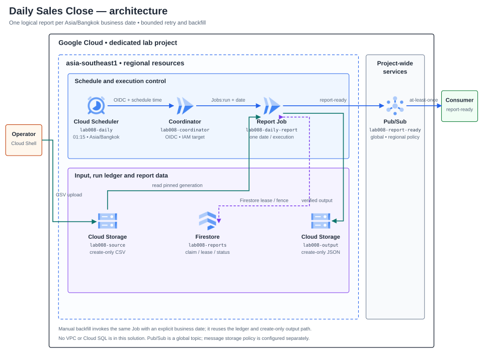
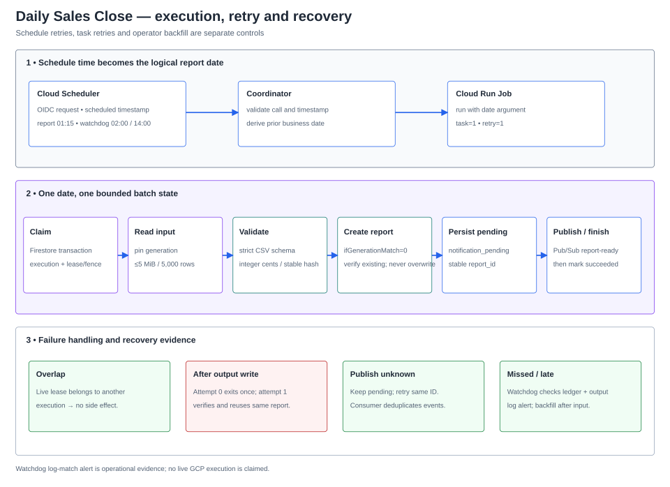

# Lab 08 — รายงานยอดขายรายวันและ Batch ที่รันย้อนหลังได้

## สถานการณ์

ทีมปฏิบัติการและการเงินต้องได้รับรายงานสรุปยอดขายของวันทำการก่อนเริ่มงานเช้า ข้อมูลต้นทางอาจมาช้า, Scheduler อาจเรียกซ้ำ, Job อาจล้มหลังเขียนไฟล์แล้ว หรือมีคนสั่งรันวันเดิมพร้อมกัน ทีมต้องเห็นว่าวันใดสำเร็จ/ขาดหาย แยกความล้มเหลวของรอบงานออกจากข้อมูลธุรกิจ และรันย้อนหลังได้โดยไม่สร้างรายงานหรือแจ้งเตือนซ้ำอย่างเงียบ ๆ

Solution นี้ชื่อ **Daily Sales Close** ใช้ข้อมูลสังเคราะห์ ไม่เชื่อมระบบบัญชีหรือรับชำระเงินจริง เป้าหมายคือรายงานที่ผูกกับ business date และ source version ที่พิสูจน์ย้อนกลับได้ ไม่อ้าง SLA หรือความตรงเวลาที่ไม่ได้วัด

**สถานะ:** Materials/Authoring — domain validation และ schedule-time contract เริ่มสร้างพร้อม fixtures/tests; ยังต้องทำ storage/ledger/notification/coordinator adapters, container, infrastructure และ verification ก่อนเขียน Tasks. ไม่มี GCP resources ถูกสร้าง และ Cloud verification เป็น Not run.

## ผู้ใช้และผลลัพธ์ที่ต้องได้

- ทีม Finance เปิดรายงานตาม business date และตรวจจำนวนรายการ/ยอดรวมกับข้อมูลต้นทางได้
- Operator เห็นสถานะและสาเหตุของรอบที่สำเร็จ, ล้มเหลว, ค้าง หรือยังไม่มีรายงาน และสั่ง backfill วันที่ระบุได้
- Platform team แยกผู้เรียก Scheduler, coordinator, Job และ notification consumer ตามหน้าที่
- ทีม downstream รับสัญญาณ report-ready พร้อม report ID ที่ใช้ deduplicate ได้

## Requirements และเกณฑ์รับมอบ

| ID | Requirement | หลักฐานที่ต้องเก็บ |
|---|---|---|
| R1 | Daily schedule ใช้ timezone และ logical business date ที่กำหนด ไม่คำนวณวันจากเวลาที่ Job เริ่มจริง | scheduled timestamp, timezone, business date; ทดสอบขอบวัน/เดือน/ปีและ invocation ซ้ำ |
| R2 | รับเฉพาะ synthetic CSV ตาม schema และเพดานที่ประกาศ | source object generation/hash, row count, invalid-row result, input size |
| R3 | สรุป count/ยอดเงินแบบจำนวนเต็มและสร้าง output ซ้ำได้จาก source version เดิม | input/output hashes, total rows, amount totals, reconciliation |
| R4 | Overlap, Scheduler retry และ Cloud Run task retry ไม่สร้างผลรายงานซ้ำหรือเขียนทับไฟล์ที่ไม่ตรงกัน | duplicate execution, lease/state history, object generation/precondition และผลก่อน/หลัง retry |
| R5 | ตรวจพบ source ที่มาช้า, scheduled run ที่ไม่มีรายงาน และ job failure; watchdog ส่ง alert เมื่อสถานะยังไม่สำเร็จ และ Operator ทำ backfill วันที่เดิมได้ | watchdog log/alert, ledger/status, execution/log IDs, late-source recovery และการตรวจ output ก่อน/หลัง backfill |
| R6 | ส่ง report-ready event หลัง report ถูกจัดเก็บ; event ที่ตอบรับไม่แน่นอนต้อง recover ได้โดยใช้ event identity เดิม | topic/message attributes, report ID, notification state และ duplicate-consumer scenario |
| R7 | จำกัด IAM ตาม role: Scheduler เรียก coordinator; coordinator สั่งรันเฉพาะ Job; Job อ่าน input/เขียน output/ledger/notification เท่าที่ต้องใช้ | principal/role matrix, unauthorized/authorized calls, bucket/database scope |
| R8 | จำกัด rows, bytes, execution time, retry และ backfill concurrency ก่อนทดสอบ | configured limits, expected upper bounds, billing/cost notes และ backout |
| R9 | ส่งมอบ runbook, case-study evidence และ cleanup/rebuild ที่ไม่อ้างผล Cloud หากไม่ได้รัน | sanitized logs/evidence, known limitations, cleanup inventory และ Not run fields |

## ขอบเขตตั้งต้น

- หนึ่งรายงานต่อ business date ใน timezone Asia/Bangkok; schedule หลัก 01:15 ประมวลผลวันปฏิทินก่อนหน้า และ watchdog ตรวจซ้ำเวลา 02:00 กับ 14:00 เพื่อจับรายงานที่ขาด/มาช้า.
- ข้อมูลสังเคราะห์ CSV เท่านั้น; เพดานตั้งต้น 5 MiB และ 5,000 แถวข้อมูลต่อวัน, ไม่ใส่ PII, ใช้จำนวนเต็มสตางค์และ fail closed เมื่อ schema/ตัวเลขผิด.
- Run หลักเป็น Cloud Run Job งานเดียวต่อ business date; เปลี่ยนเป็น backfill หลายวันแบบ bounded concurrency เป็น Change Request ไม่เริ่มด้วยการประมวลผลขนานไม่จำกัด.
- ไม่มี BigQuery, data warehouse, external email API หรือการเชื่อมระบบ production จริง; มี report-ready event สำหรับ downstream และ Cloud Logging log-based alert โดยผู้เรียนกำหนด notification channel เอง.
- แยก run retry, schedule retry, backfill และ business date ออกจากกัน; ไม่มีข้ออ้างว่าการ retry ของบริการทำให้ exactly-once.

## Architecture ที่เลือกใช้

### Schedule และ logical business date

Cloud Scheduler มี report job เวลา 01:15 และ watchdog job เวลา 02:00 กับ 14:00 ใน timezone `Asia/Bangkok`; ทั้งคู่เรียก coordinator ที่ป้องกันด้วย HTTPS/OIDC แต่ใช้ path และชื่อ Scheduler job คนละค่า. Coordinator ตรวจ identity, ชื่อ job และ `X-CloudScheduler-ScheduleTime` รูป RFC3339; header บอกเวลาที่กำหนดไว้แต่ไม่แทน IAM authentication. แปลง schedule timestamp เป็นวันท้องถิ่นแล้วใช้วันก่อนหน้าเป็น business date ห้ามใช้เวลาที่ service หรือ Job เริ่มจริง. ขาด header, parse ผิด, route กับ job name ไม่ตรง หรือ caller ไม่ได้รับอนุญาต จะถูกปฏิเสธพร้อม reason ปลอดภัย.

Route `/schedule` เรียก Cloud Run Jobs API `jobs:run` ด้วย override เฉพาะ `--business-date=YYYY-MM-DD` แล้วตอบ `202` เมื่อได้ operation name; ไม่รอ batch จบ. ถ้า API ตอบกลับไม่แน่นอน Scheduler อาจ retry และสร้าง execution ซ้ำ; ledger ของ business date เป็นตัวกันผลซ้ำ. Route `/watchdog` อ่าน Firestore ledger และตรวจ output object generation/hash แบบ read-only; ถ้ายังไม่มีรายงานหรือสถานะไม่ใช่ `succeeded` ให้เขียน structured log `event=daily_report_not_ready` พร้อม business date/status/reason เพื่อให้ log-based alert แจ้งผู้ดูแล. Watchdog จะตอบรับ business-missing หลัง log สำเร็จ เพื่อไม่ให้ retry กลายเป็น notification loop; เฉพาะ dependency error จะตอบ 5xx.

### สัญญาไฟล์ต้นทางสำหรับ Materials

รับไฟล์ CSV แบบ UTF-8 (ยอมรับ BOM) ที่มี header ตามลำดับนี้เท่านั้น:

```text
transaction_id,sold_at,sku,quantity,unit_price_minor,currency
```

`transaction_id` ต้องไม่ซ้ำและยาว 1–64 ตัวอักษร ASCII; `sold_at` ต้องเป็น RFC3339 ที่มี timezone และเมื่อนำมาแปลงเป็น `Asia/Bangkok` ต้องตรงกับ business date; `sku` ใช้ตัวพิมพ์ใหญ่ ตัวเลข จุด ขีดล่าง หรือขีดกลาง; `quantity` เป็นจำนวนเต็ม 1–1,000; `unit_price_minor` เป็นจำนวนเต็มหน่วยสตางค์ 0–100,000,000; `currency` รับเฉพาะ `THB`. ปฏิเสธ header/คอลัมน์เกิน schema, transaction ID ซ้ำ, แถวไม่สมบูรณ์, timestamp ไม่มี offset, วันไม่ตรง, ค่าเงิน/จำนวนผิดรูปแบบ, ไฟล์เกิน 5 MiB, มากกว่า 5,000 แถว หรือไม่มีข้อมูล.

Report สรุปจำนวนรายการ, จำนวนสินค้า, `total_amount_minor` และผลรวมต่อ SKU โดย sort SKU และ serialize เป็น canonical JSON (ไม่มี floating-point). `report_id` ผูกกับ `business_date`, source generation และ SHA-256 ของ bytes ต้นทาง; report hash ใช้ตรวจ artifact ที่สร้างซ้ำ. การเรียงแถวใหม่เป็นคนละ source version จึงได้ report ID คนละค่า แม้ยอดรวมเท่ากัน.

### Batch data path และสถานะ

| Component | หน้าที่และขอบเขต |
|---|---|
| Coordinator `lab008-coordinator` | Cloud Run service private; route `/schedule` เริ่ม Job และ `/watchdog` ตรวจ ledger/output. Watchdog อ่าน Firestore กับ report bucket ได้เท่านั้นและ log ผลแบบ structured |
| Source bucket | รับไฟล์ CSV สังเคราะห์ที่ `incoming/business_date=YYYY-MM-DD/transactions.csv`; upload แบบ create-only. เพดาน 5 MiB/5,000 data rows; อ่าน generation ที่ pin ไว้ ไม่ตาม latest หากไฟล์เปลี่ยนระหว่างอ่าน |
| Cloud Run Job `lab008-daily-report` | หนึ่ง task / parallelism 1 ต่อ business date; task timeout 10 นาที, max retries 1. ใช้ execution/task-attempt variables ของ Cloud Run สำหรับ owner และ fault test; ไม่เปิด HTTP endpoint |
| Firestore `lab008-reports` | document ต่อ business date เก็บ status, owner execution, lease/fence, attempts, input generation/hash, output generation/hash และ notification state. Transaction เป็นจุด claim/transition; Project เฉพาะ Lab เป็น IAM boundary |
| Report bucket | สร้าง `reports/business_date=YYYY-MM-DD/summary.json` ด้วย generation precondition `ifGenerationMatch=0`; ถ้ามี object ให้ตรวจ source binding และ hash ก่อน reuse, ถ้าไม่ตรงให้ block ไม่ overwrite |
| Pub/Sub topic `lab008-report-ready` | หลัง output ถูกตรวจแล้ว Job บันทึก `notification_pending` และ publish event ที่มี stable `report_id`, business date, object generation/hash และสรุปสังเคราะห์เท่านั้น; ไม่ส่ง CSV หรือ credentials |
| Downstream consumer | อยู่นอก Solution baseline; รับ report-ready แบบ at-least-once และต้อง deduplicate ด้วย `report_id`. การส่ง event ซ้ำไม่เท่ากับสร้างรายงานซ้ำ |

State path: `not_started → running → report_written → notification_pending → succeeded`; `missing_input`, `blocked` และ `failed` เป็นสถานะที่ต้องแสดงแยกจาก success. Missing input ไม่มี output/event และเปลี่ยนกลับเป็น `running` ได้เมื่อ Operator ส่ง source มาแล้ว. CSV/schema หรือ output conflict เข้า `blocked`; ไม่ล้าง ledger และไม่เขียนทับ object เพื่อบังคับผ่าน. ถ้าแก้ input ให้ upload object ใหม่แบบ immutable ภายใต้ prefix ของ business date แล้วระบุ object/generation ชัดเจนใน operator backfill; ถ้ารายงานเดิมสำเร็จแล้ว ห้าม restate ทับ key เดิม. `succeeded` เป็น no-op สำหรับ invocation ซ้ำ.

Firestore transaction เป็นจุด claim/transition; lease ตั้งต้น 15 นาทีและทุก reclaim เพิ่ม fencing token. Job task retry ใช้ `CLOUD_RUN_EXECUTION` เป็น owner และ `CLOUD_RUN_TASK_ATTEMPT` แยก attempt; attempt ถัดไปใน execution เดิมรับ lease ต่อได้ทันที แต่ execution ใหม่ต้องรอ lease หมด. Task timeout 10 นาทีทำให้ lease ยาวกว่า attempt สูงสุด. Fault test ทำให้ attempt 0 ออกจากงานหลัง create-only report write; attempt 1 ต้องตรวจ object generation/hash เดิมแล้วดำเนิน notification ต่อ. Execution อื่นที่ชนวันที่เดียวกันขณะ lease ยัง valid จะไม่มี side effect; ทุก transition และ publish ตรวจ fence ล่าสุด.

ถ้า Pub/Sub ตอบกลับไม่แน่นอน คงสถานะ `notification_pending` แล้ว retry event ด้วย `report_id` เดิม. Consumer อาจได้รับซ้ำแม้ acknowledgement สำเร็จ จึงต้อง deduplicate; ไม่มี exactly-once claim. ถ้า source มาช้าหรือ schedule ไม่มี report ให้ตรวจ `reportctl status --date` เทียบ expected business date แล้วสั่ง backfill วันเดิมด้วย Job argument เดิมอย่างชัดเจน; ไม่อ้างว่า Scheduler catch-up แทน operator run ได้.

### Identity และ IAM boundary

| Principal | สิทธิ์ที่ออกแบบให้ | สิทธิ์ที่ไม่มี |
|---|---|---|
| Scheduler caller SA | `roles/run.servicesInvoker` เฉพาะ coordinator service; ใช้ OIDC audience ที่ตรงกับ URL | ไม่มี Job override, Storage, Firestore หรือ Pub/Sub |
| Coordinator runtime SA | `roles/run.jobsExecutorWithOverrides` เฉพาะ `lab008-daily-report`; `roles/datastore.viewer` ใน project เฉพาะ Lab และ `roles/storage.objectViewer` เฉพาะ report bucket เพื่อทำ watchdog | ไม่มี source-bucket write/read, Pub/Sub, deploy/update หรือสิทธิ์เปลี่ยน Job; ไม่รับ business date อิสระจาก public caller |
| Job runtime SA | อ่าน source bucket, เขียน/อ่านตรวจ output bucket, Firestore access ใน dedicated project, Pub/Sub Publisher เฉพาะ report-ready topic | ไม่มีสิทธิ์ deploy/update services, run Scheduler, ลบ report หรืออ่าน source นอก bucket ของ Lab |
| Operator | `roles/run.jobsExecutorWithOverrides` เฉพาะ Job สำหรับ backfill, `roles/datastore.viewer`, `roles/run.viewer`, `roles/logging.viewer` และอ่าน output bucket | ไม่ใช้ runtime identity แทนตัวเอง และไม่แก้ ledger/object เพื่อให้ test ผ่าน; ไม่มี source write หรือ deploy role |

Cloud Run Jobs `runWithOverrides` ต้องได้รับ `run.jobs.runWithOverrides`; Cloud Run Invoker อย่างเดียวไม่ให้สิทธิ์ override arguments. ใช้ `roles/run.servicesInvoker` ที่ coordinator service, `roles/run.jobsExecutorWithOverrides` ที่ Job resource และ read-only role แยกตาม data scope. Scheduler service agent/token setup ตรวจตาม Console/diagnostic; ไม่มอบ service-agent role ให้ runtime principal.

### Retry, monitoring และ backfill

| กลไก | ขอบเขตการ retry | วิธีพิสูจน์/แก้ไข |
|---|---|---|
| Cloud Scheduler (report) | `retryCount=2` (retry เพิ่มจากครั้งแรกได้ไม่เกิน 2), `maxRetryDuration=600s`, backoff 10–60s, `maxDoublings=2`; watchdog ใช้ขอบเขตเดียวกัน | Scheduler history/log, coordinator request ID และ duplicate Job execution ที่ ledger deduplicate ได้ |
| Cloud Run Job | 1 task, parallelism 1, timeout 10 นาที, `maxRetries=1`; attempt 0 fault injection หลังเขียน output | Execution/task attempt, output generation/hash เดิมถูกตรวจซ้ำ และ report ID เดิม |
| Watchdog | ตรวจ business date ล่าสุดเวลา 02:00 และ 14:00; รายงาน not-ready ผ่าน structured log + log-based alert | Alert event, `reportctl status --date`, Scheduler/Coordinator logs; `succeeded` ยืนยันด้วย ledger และ output generation/hash |
| Manual backfill | Operator ระบุวันชัดเจน; สูงสุด 7 วันย้อนหลังและ concurrency 2; missing source ไม่สร้าง empty report | `reportctl status`, Job execution override, ledger/output/notification ของ business date |
| Change Request | เพิ่มช่วงย้อนหลังไม่เกิน 7 วันและ concurrency สูงสุด 2; แสดง partial success และ retry เฉพาะวันที่ยังไม่สำเร็จ | per-date run IDs, maximum concurrency, same object/ledger binding และ cost estimate |

Cloud Logging เก็บ structured watchdog event; สร้าง log-based alert ที่ match `jsonPayload.event="daily_report_not_ready"` แล้วกำหนด email/notification channel ใน project. `reportctl status --date` เป็นวิธีวินิจฉัยและยืนยัน recovery; ถ้าไม่พบ ledger ให้เทียบ Cloud Scheduler history กับ Cloud Run Job executions. Baseline ไม่อ้างว่ามี alert เมื่อ Scheduler API/job ถูกปิดหรือไม่ได้ถูกเรียกเลย—กรณีนั้นต้องตรวจ Scheduler job state/audit logs. ไม่มี Cloud SQL, VPC/NAT, BigQuery, external mail API หรือ always-on worker.

เพดานต้นทุนที่คุมได้จาก config: CSV ≤5 MiB/5,000 แถว, Job หนึ่ง task/parallelism 1/10 นาที/หนึ่ง retry, Scheduler report retry เพิ่มไม่เกิน 2, และ backfill ≤7 วัน/concurrency 2. ขอบเขต pessimistic ของ report คือ 3 accepted Job executions × 2 task attempts × 10 นาที = 60 task-minutes/วัน หรือ 30 task-hours/เดือนสำหรับ 30 วัน ที่ 1 vCPU/1 GiB; watchdog, coordinator, Storage, Firestore, Pub/Sub, Logging, artifacts และ operator-run เพิ่มเติมคิดแยก. ใช้ Pricing Calculator กับ region/การใช้จริงก่อน apply; alert-only budget ไม่ได้หยุดค่าใช้จ่าย.

### Diagrams

แผนภาพ topology แยก project, regional resources, Pub/Sub global topic และ Logging/Monitoring สำหรับ watchdog; Cloud Run ไม่ได้ถูกวาดเป็นทรัพยากรใน VPC. ภาพ run/recovery แสดง schedule time, business date, ledger, retry และการ alert เมื่อรายงานยังไม่พร้อม.

[PNG topology](assets/solution.png) · [SVG source](assets/solution.svg) · [PNG run/recovery flow](assets/run-flow.png) · [SVG source](assets/run-flow.svg) · [icon provenance](assets/diagram-provenance.json)





**ข้อจำกัดการยืนยัน:** Diagram เป็น design artifact; CI ต้องตรวจ official icon hashes และ render preview ที่ความกว้างเอกสารก่อนปิด Design.

## Failure และ Change Request

| สถานการณ์ | สิ่งที่ต้องพิสูจน์ |
|---|---|
| Source มาหลังเวลาตัดรอบ | รายงานไม่ปลอมว่าเป็น empty; status แสดง missing input และ backfill หลัง upload สร้างผลที่ผูก generation ได้ |
| Schedule ถูก retry หรือ header/timezone ผิด | logical date มาจาก schedule time ที่ตรวจรูปแบบและ timezone ไม่ใช่ wall clock ตอนประมวลผล |
| Job ตายหลังเขียน report แต่ก่อน notification | retry ตรวจ artifact เดิม, ไม่เขียนทับ และกู้ pending notification ด้วย report ID เดิม |
| Job วันที่เดียวกันทำงานซ้อน | มีผู้ claim ที่ถูกต้องเพียงรายเดียว; contender บันทึก already-running/completed ตาม state ที่พิสูจน์ได้ |
| CSV ผิด schema หรือเกินเพดาน | หยุดแบบ fail-closed, ระบุ reason code ที่ปลอดภัย และไม่ปล่อย report-ready event |
| Change Request: รายงานย้อนหลังหลายวัน | เพิ่ม backfill window ที่จำกัดจำนวนวันและ concurrency, แสดง partial success, หยุด/ต่อได้ และประเมินต้นทุนก่อนเริ่ม |

## จุดบันทึกผลงาน

ผู้เรียนจะบันทึก timezone/cron และเหตุผล, service identity matrix, input fixture/hash, run ID และ business date, output generation/hash และ reconciliation, ledger transitions, retry/overlap/fault/backfill outcomes, notification event identity, metric/log windows, ค่าใช้จ่ายโดยประมาณและข้อจำกัด. ห้ามบันทึก credentials, access tokens หรือข้อมูลผู้ใช้จริง.

## Design decisions — ปิดก่อนเริ่ม Materials

1. เวลา 01:15 `Asia/Bangkok` สร้างรายงานของวันปฏิทินก่อนหน้าโดยใช้ Scheduler schedule-time header; manual backfill เรียก Job ด้วยวันที่ explicit ไม่จำลอง Scheduler header.
2. Coordinator ตอบเมื่อ `jobs:run` คืน operation name; Scheduler retry เพิ่ม 2 ครั้ง/600 วินาที ส่วน Job retry task ได้ 1 ครั้ง/10 นาที. Duplicate execution ถูกกันด้วย Firestore lease/fence, ไม่อ้าง exactly-once.
3. Lease 15 นาที; retry ใน execution เดิมถือ owner เดิมและ attempt ใหม่, execution อื่น reclaim ได้เมื่อ lease หมดเท่านั้น. ทุก transition/side effect ตรวจ fence.
4. Source และ report เป็น object generation ที่ pin ไว้; report ใช้ `ifGenerationMatch=0`, existing object reuse ได้เฉพาะเมื่อ source binding/hash ตรง. Input correction ต้องเป็น object ใหม่ใต้ date prefix; ห้ามทับรายงานที่ succeeded.
5. Pub/Sub notification ใช้ `report_id` คงที่; Firestore `notification_pending` เป็น outbox ที่ retry publish ได้. Consumer อยู่นอก baselineและ deduplicate ตาม `report_id`.
6. Watchdog 02:00/14:00 ตรวจ ledger + output แบบ read-only; structured log ที่ไม่สำเร็จไป Cloud Logging log-based alert. Operator ตรวจ `reportctl status` และ Scheduler/Run logs; การ monitor กรณี Scheduler ถูกปิดทั้งระบบไม่อยู่ใน baseline.
7. ขอบเขตคือ 5 MiB/5,000 rows, 1 task/parallelism 1, 10 นาที/1 task retry, Scheduler retry เพิ่ม 2/600s, backfill 7 วัน/concurrency 2. ค่า compute-bound และรายการต้นทุนแยกอธิบายไว้; งบแจ้งเตือนไม่ใช่ hard cap.
8. Cleanup ปิด Scheduler ก่อน, ตรวจไม่มี execution ค้าง, export evidence ที่ไม่ลับ, ลบ Pub/Sub/log alert, ลบ bucket objects แล้ว bucket, Firestore database, Cloud Run Job/service และ Artifact Registry; ห้ามใส่ retention lock ที่ขวาง cleanup.

Design นี้พร้อมเริ่ม Materials; ยังไม่ใช่ Task guide และไม่มี GCP resources ถูกสร้าง.

## เอกสารอ้างอิงสำหรับ Design

- [Cloud Scheduler cron และ timezone](https://docs.cloud.google.com/scheduler/docs/configuring/cron-job-schedules), [HTTP target headers](https://docs.cloud.google.com/python/docs/reference/cloudscheduler/latest/google.cloud.scheduler_v1.types.HttpTarget), [OIDC authentication](https://docs.cloud.google.com/scheduler/docs/http-target-auth), [retry policy](https://docs.cloud.google.com/scheduler/docs/configuring/retry-jobs)
- [Cloud Run Jobs](https://docs.cloud.google.com/run/docs/create-jobs), [execute/override job arguments](https://docs.cloud.google.com/run/docs/execute/jobs), [Cloud Run IAM permissions](https://docs.cloud.google.com/run/docs/reference/iam/permissions)
- [Cloud Storage request preconditions](https://docs.cloud.google.com/storage/docs/request-preconditions) และ [Storage IAM roles](https://docs.cloud.google.com/storage/docs/access-control/iam-roles), [Firestore transaction contention](https://docs.cloud.google.com/firestore/native/docs/transaction-data-contention) และ [Firestore IAM roles](https://docs.cloud.google.com/iam/docs/roles-permissions/firestore), [Pub/Sub delivery model](https://docs.cloud.google.com/pubsub/docs/subscription-overview)
- [Cloud Logging log-based alert policies](https://docs.cloud.google.com/logging/docs/alerting/log-based-alerts), [Cloud Scheduler logs](https://docs.cloud.google.com/scheduler/docs/viewing-logs), [Cloud Run IAM roles](https://docs.cloud.google.com/iam/docs/roles-permissions/run)
- [Cloud Billing budgets](https://docs.cloud.google.com/billing/docs/how-to/budgets) — alerts-only budgets do not cap spend.

Design decisions are closed. Next phase is Materials (app, fixtures, tests, containers and infrastructure); write the detailed Thai Tasks guide only after those materials and their contracts are verified. No GCP resources have been provisioned.