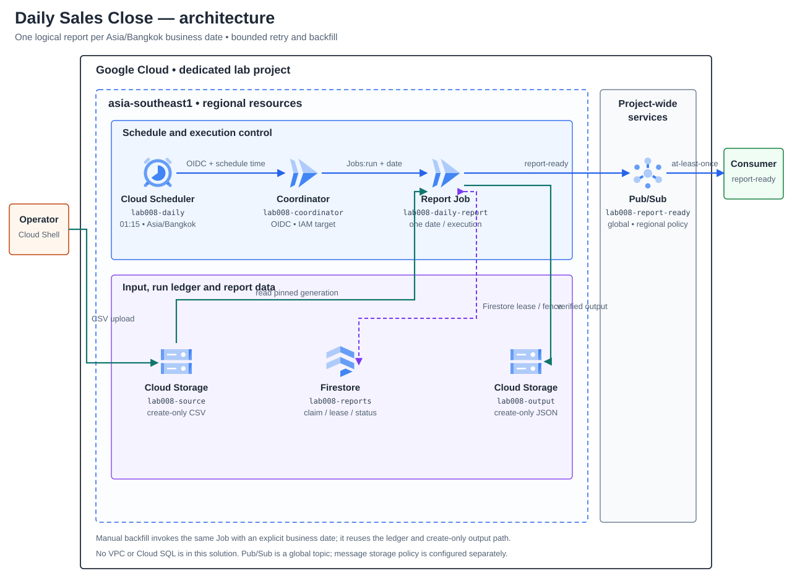
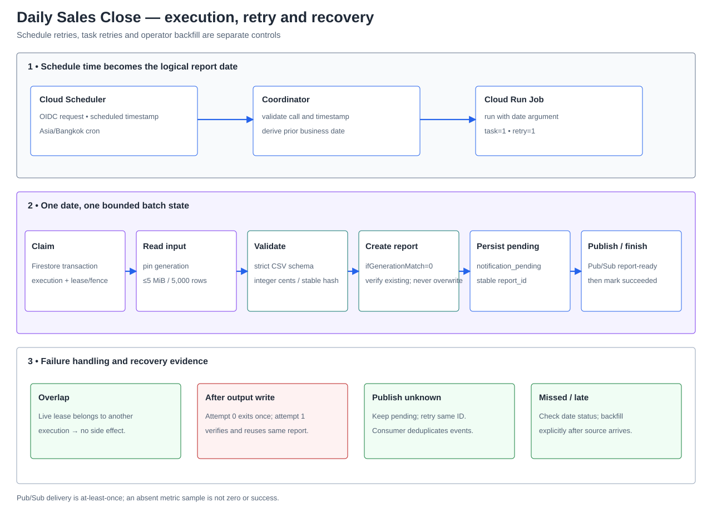

# Lab 08 — รายงานยอดขายรายวันและ Batch ที่รันย้อนหลังได้

## สถานการณ์

ทีมปฏิบัติการและการเงินต้องได้รับรายงานสรุปยอดขายของวันทำการก่อนเริ่มงานเช้า ข้อมูลต้นทางอาจมาช้า, Scheduler อาจเรียกซ้ำ, Job อาจล้มหลังเขียนไฟล์แล้ว หรือมีคนสั่งรันวันเดิมพร้อมกัน ทีมต้องเห็นว่าวันใดสำเร็จ/ขาดหาย แยกความล้มเหลวของรอบงานออกจากข้อมูลธุรกิจ และรันย้อนหลังได้โดยไม่สร้างรายงานหรือแจ้งเตือนซ้ำอย่างเงียบ ๆ

Solution นี้ชื่อ **Daily Sales Close** ใช้ข้อมูลสังเคราะห์ ไม่เชื่อมระบบบัญชีหรือรับชำระเงินจริง เป้าหมายคือรายงานที่ผูกกับ business date และ source version ที่พิสูจน์ย้อนกลับได้ ไม่อ้าง SLA หรือความตรงเวลาที่ไม่ได้วัด

**สถานะ:** Design — ปิด date contract, execution identity, ledger/output/notification boundaries และ failure recovery แล้ว; App, Infrastructure และ Tasks ยังไม่เริ่ม. ไม่มี GCP resources ถูกสร้าง และ Cloud verification เป็น Not run.

## ผู้ใช้และผลลัพธ์ที่ต้องได้

- ทีม Finance เปิดรายงานตาม business date และตรวจจำนวนรายการ/ยอดรวมกับข้อมูลต้นทางได้
- Operator เห็นสถานะและสาเหตุของรอบที่สำเร็จ, ล้มเหลว, ค้าง หรือยังไม่มีรายงาน และสั่ง backfill วันที่ระบุได้
- Platform team แยกผู้เรียก Scheduler, coordinator, Job และ notification consumer ตามหน้าที่
- ทีม downstream รับสัญญาณ report-ready พร้อม report ID ที่ใช้ deduplicate ได้

## Requirements และเกณฑ์รับมอบ

| ID | Requirement | หลักฐานที่ต้องเก็บ |
|---|---|---|
| R1 | Daily schedule ใช้ timezone และ logical business date ที่กำหนด ไม่คำนวณวันจากเวลาที่ Job เริ่มจริง | scheduled timestamp, timezone, business date; ทดสอบขอบวัน/เดือน/ปีและ invocation ซ้ำ |
| R2 | รับเฉพาะ synthetic CSV ตาม schema และเพดานที่ประกาศ | source object generation/hash, row count, invalid-row result, input size |
| R3 | สรุป count/ยอดเงินแบบจำนวนเต็มและสร้าง output ซ้ำได้จาก source version เดิม | input/output hashes, total rows, amount totals, reconciliation |
| R4 | Overlap, Scheduler retry และ Cloud Run task retry ไม่สร้างผลรายงานซ้ำหรือเขียนทับไฟล์ที่ไม่ตรงกัน | duplicate execution, lease/state history, object generation/precondition และผลก่อน/หลัง retry |
| R5 | ตรวจพบ source ที่มาช้า, scheduled run ที่ไม่มีรายงาน และ job failure; Operator ทำ backfill วันที่เดิมได้ | ledger/status, execution/log IDs, late-source recovery และการตรวจ output ก่อน/หลัง backfill |
| R6 | ส่ง report-ready event หลัง report ถูกจัดเก็บ; event ที่ตอบรับไม่แน่นอนต้อง recover ได้โดยใช้ event identity เดิม | topic/message attributes, report ID, notification state และ duplicate-consumer scenario |
| R7 | จำกัด IAM ตาม role: Scheduler เรียก coordinator; coordinator สั่งรันเฉพาะ Job; Job อ่าน input/เขียน output/ledger/notification เท่าที่ต้องใช้ | principal/role matrix, unauthorized/authorized calls, bucket/database scope |
| R8 | จำกัด rows, bytes, execution time, retry และ backfill concurrency ก่อนทดสอบ | configured limits, expected upper bounds, billing/cost notes และ backout |
| R9 | ส่งมอบ runbook, case-study evidence และ cleanup/rebuild ที่ไม่อ้างผล Cloud หากไม่ได้รัน | sanitized logs/evidence, known limitations, cleanup inventory และ Not run fields |

## ขอบเขตตั้งต้น

- หนึ่งรายงานต่อ business date ใน timezone Asia/Bangkok; schedule ตั้งต้น 01:15 และรายงานวันปฏิทินก่อนหน้า เมื่อ source data พร้อมก่อน cutoff ที่ Design กำหนด.
- ข้อมูลสังเคราะห์ CSV เท่านั้น; เพดานตั้งต้น 5 MiB และ 5,000 แถวข้อมูลต่อวัน, ไม่ใส่ PII, ใช้จำนวนเต็มสตางค์และ fail closed เมื่อ schema/ตัวเลขผิด.
- Run หลักเป็น Cloud Run Job งานเดียวต่อ business date; เปลี่ยนเป็น backfill หลายวันแบบ bounded concurrency เป็น Change Request ไม่เริ่มด้วยการประมวลผลขนานไม่จำกัด.
- ไม่มี BigQuery, data warehouse, external email API หรือการเชื่อมระบบ production จริงใน baseline; มี report-ready event สำหรับ downstream และแจ้งเหตุผ่าน monitoring ที่ปิดขอบเขตได้.
- แยก run retry, schedule retry, backfill และ business date ออกจากกัน; ไม่มีข้ออ้างว่าการ retry ของบริการทำให้ exactly-once.

## Architecture ที่เลือกใช้

### Schedule และ logical business date

Cloud Scheduler เรียก IAM-protected coordinator ผ่าน HTTPS/OIDC ทุกวันเวลา 01:15 ตาม timezone `Asia/Bangkok`. Coordinator ยอมรับเฉพาะ identity ที่ได้รับ invoker permission และตรวจ `X-CloudScheduler-ScheduleTime` ในรูป RFC3339; header เป็นข้อมูลกำหนดรอบ ไม่ใช่ตัวแทน IAM identity. แปลง timestamp เป็นวันท้องถิ่นแล้วใช้วันก่อนหน้าเป็น business date ห้ามใช้เวลาที่ Job เริ่มจริง. ถ้าขาด header, parse ไม่ได้ หรือชื่อ Scheduler job ไม่ตรง ให้ปฏิเสธ invocation พร้อม reason ที่ไม่เปิดข้อมูลลับ.

Coordinator เรียก Cloud Run Jobs API `jobs:run` พร้อม override เฉพาะ argument `--business-date=YYYY-MM-DD` แล้วตอบกลับเมื่อ API ยอมรับคำขอ ไม่รอ batch จบ. การ retry ของ Cloud Scheduler อาจสร้าง Job execution ซ้ำได้; ledger ของวันที่เป็นตัวกันผลซ้ำ ไม่พึ่ง HTTP request เดียว.

### Batch data path และสถานะ

| Component | หน้าที่และขอบเขต |
|---|---|
| Source bucket | รับไฟล์ CSV สังเคราะห์ที่ `incoming/business_date=YYYY-MM-DD/transactions.csv`; upload แบบ create-only. เพดาน 5 MiB/5,000 data rows; อ่าน generation ที่ pin ไว้ ไม่ตาม latest หากไฟล์เปลี่ยนระหว่างอ่าน |
| Cloud Run Job `lab008-daily-report` | หนึ่ง task / parallelism 1 ต่อ business date; task timeout 10 นาที, max retries 1. ใช้ execution/task-attempt variables ของ Cloud Run สำหรับ owner และ fault test; ไม่เปิด HTTP endpoint |
| Firestore `lab008-reports` | document ต่อ business date เก็บ status, owner execution, lease/fence, attempts, input generation/hash, output generation/hash และ notification state. Transaction เป็นจุด claim/transition; Project เฉพาะ Lab เป็น IAM boundary |
| Report bucket | สร้าง `reports/business_date=YYYY-MM-DD/summary.json` ด้วย generation precondition `ifGenerationMatch=0`; ถ้ามี object ให้ตรวจ source binding และ hash ก่อน reuse, ถ้าไม่ตรงให้ block ไม่ overwrite |
| Pub/Sub topic `lab008-report-ready` | หลัง output ถูกตรวจแล้ว Job บันทึก `notification_pending` และ publish event ที่มี stable `report_id`, business date, object generation/hash และสรุปสังเคราะห์เท่านั้น; ไม่ส่ง CSV หรือ credentials |
| Downstream consumer | อยู่นอก Solution baseline; รับ report-ready แบบ at-least-once และต้อง deduplicate ด้วย `report_id`. การส่ง event ซ้ำไม่เท่ากับสร้างรายงานซ้ำ |

State path: `missing → running → report_written → notification_pending → succeeded`. Retryable dependency error คงหลักฐาน/lease เพื่อให้ execution เดิม resume หรือ execution ใหม่รับต่อหลัง lease หมดและเพิ่ม fence. Invalid source หรือ output mismatch เป็น blocked state ต้องแก้สาเหตุ ไม่ล้าง ledger เพื่อบังคับผ่าน. `succeeded` คือ no-op สำหรับ invocation ซ้ำ.

Job task retry ใช้ `CLOUD_RUN_EXECUTION` เป็น execution owner และ `CLOUD_RUN_TASK_ATTEMPT` เพื่อแยก attempt. Test fault ทำให้ attempt 0 ออกจากงานหลัง create-only report write; attempt 1 ต้อง verify object generation/hash แล้วดำเนิน notification ต่อ. Execution อื่นที่ชน business date ขณะ lease ยัง valid จะไม่ claim งานและไม่มี side effect. ทุก transition และ publish ตรวจ fence ล่าสุด.

ถ้า Pub/Sub ตอบกลับไม่แน่นอน คงสถานะ `notification_pending` แล้ว retry event ด้วย `report_id` เดิม. Consumer อาจได้รับซ้ำแม้ acknowledgement สำเร็จ จึงต้อง deduplicate; ไม่มี exactly-once claim. ถ้า source มาช้าหรือ schedule ไม่มี report ให้ตรวจ `reportctl status --date` เทียบ expected business date แล้วสั่ง backfill วันเดิมด้วย Job argument เดิมอย่างชัดเจน; ไม่อ้างว่า Scheduler catch-up แทน operator run ได้.

### Identity และ IAM boundary

| Principal | สิทธิ์ที่ออกแบบให้ | สิทธิ์ที่ไม่มี |
|---|---|---|
| Scheduler caller SA | `roles/run.servicesInvoker` เฉพาะ coordinator service; ใช้ OIDC audience ที่ตรงกับ URL | ไม่มี Job override, Storage, Firestore หรือ Pub/Sub |
| Coordinator runtime SA | `roles/run.jobsExecutorWithOverrides` เฉพาะ `lab008-daily-report`; เรียก Cloud Run Jobs API ด้วย attached identity | ไม่มี bucket/database/topic access และไม่รับ business date อิสระจาก public caller |
| Job runtime SA | อ่าน source bucket, เขียน/อ่านตรวจ output bucket, Firestore access ใน dedicated project, Pub/Sub Publisher เฉพาะ report-ready topic | ไม่มีสิทธิ์ deploy/update services, run Scheduler, ลบ report หรืออ่าน source นอก bucket ของ Lab |
| Operator | ตรวจสถานะ/log; สั่ง manual run/backfill ที่ Job พร้อม date override ตาม Task | ไม่ใช้ runtime identity แทนตัวเอง และไม่แก้ ledger/object เพื่อให้ test ผ่าน |

Cloud Run Jobs `runWithOverrides` ต้องได้รับ permission สำหรับ overrides โดยเฉพาะ; `roles/run.invoker` อย่างเดียวไม่พอสำหรับการแทน arguments. ตรวจ IAM grant ที่ resource scope และตรวจ Cloud Scheduler service agent/token setup ใน sandbox ก่อนใช้.

### Retry, monitoring และ backfill

| กลไก | ขอบเขตการ retry | วิธีพิสูจน์/แก้ไข |
|---|---|---|
| Cloud Scheduler | Retry เฉพาะ request ไป coordinator; จำกัดจำนวนและ window เพื่อไม่ให้ชนรอบถัดไปโดยไม่รู้ตัว | Scheduler execution history, coordinator request ID และ duplicate Job execution ที่ ledger deduplicate ได้ |
| Cloud Run Job | Retry task เดิมได้ไม่เกินหนึ่งครั้ง; bounded timeout; attempt 0 fault injection หลังเขียน output | Execution/task attempt, output เดิมถูกตรวจซ้ำ และ report ID เดิม |
| Manual backfill | Operator ระบุวันที่อย่าง explicit; missed run ไม่สร้าง empty report | `reportctl status`, Job execution override, ledger/output/notification ของ business date |
| Change Request | เพิ่มช่วงย้อนหลังไม่เกิน 7 วันและ concurrency สูงสุด 2; แสดง partial success และ retry เฉพาะวันที่ยังไม่สำเร็จ | per-date run IDs, maximum concurrency, same object/ledger binding และ cost estimate |

Cloud Run/Scheduler execution logs และ job metrics ใช้สำหรับตรวจเหตุ; `reportctl status --date` เป็นหลักฐานว่ามี ledger/output ของ business date หรือไม่. ไม่ตีความ metric ที่ไม่มี sample เป็น zero หรือ success. ไม่มี Cloud SQL, VPC/NAT, BigQuery, external mail API หรือ always-on worker ใน baseline. Cloud Run/Firestore/Cloud Storage/Pub/Sub/Cloud Scheduler ยังมีค่าใช้จ่ายตามการใช้; Budget alert ไม่ใช่ hard spending cap.

### Diagrams

แผนภาพ topology แยก project, regional resources และ Pub/Sub global topic; Cloud Run ไม่ได้ถูกวาดเป็นทรัพยากรใน VPC. ภาพ run/recovery แยก schedule time, business date, batch ledger และ notification state.

[SVG topology](assets/solution.svg) · [SVG run/recovery flow](assets/run-flow.svg) · [icon provenance](assets/diagram-provenance.json)

**ข้อจำกัดการยืนยัน:** Diagram เป็น design artifact; CI ต้องตรวจ official icon hashes และ render preview ที่ความกว้างเอกสารก่อนปิด Design.

## Failure และ Change Request

| สถานการณ์ | สิ่งที่ต้องพิสูจน์ |
|---|---|
| Source มาหลังเวลาตัดรอบ | รายงานไม่ปลอมว่าเป็น empty; status แสดง missing input และ backfill หลัง upload สร้างผลที่ผูก generation ได้ |
| Schedule ถูก retry หรือ header/timezone ผิด | logical date มาจาก schedule time ที่ตรวจรูปแบบและ timezone ไม่ใช่ wall clock ตอนประมวลผล |
| Job ตายหลังเขียน report แต่ก่อน notification | retry ตรวจ artifact เดิม, ไม่เขียนทับ และกู้ pending notification ด้วย report ID เดิม |
| Job วันที่เดียวกันทำงานซ้อน | มีผู้ claim ที่ถูกต้องเพียงรายเดียว; contender บันทึก already-running/completed ตาม state ที่พิสูจน์ได้ |
| CSV ผิด schema หรือเกินเพดาน | หยุดแบบ fail-closed, ระบุ reason code ที่ปลอดภัย และไม่ปล่อย report-ready event |
| Change Request: รายงานย้อนหลังหลายวัน | เพิ่ม backfill window ที่จำกัดจำนวนวันและ concurrency, แสดง partial success, หยุด/ต่อได้ และประเมินต้นทุนก่อนเริ่ม |

## จุดบันทึกผลงาน

ผู้เรียนจะบันทึก timezone/cron และเหตุผล, service identity matrix, input fixture/hash, run ID และ business date, output generation/hash และ reconciliation, ledger transitions, retry/overlap/fault/backfill outcomes, notification event identity, metric/log windows, ค่าใช้จ่ายโดยประมาณและข้อจำกัด. ห้ามบันทึก credentials, access tokens หรือข้อมูลผู้ใช้จริง.

## ประเด็นที่ต้องปิดก่อนเริ่ม Materials

1. Schedule timezone/date contract รวมถึง manual Scheduler invocation และวิธีไม่พึ่งเวลาปัจจุบันของ coordinator.
2. Cloud Run Job API call แบบมี overrides, least-privilege `run.jobs.runWithOverrides` และการตอบกลับ/unknown operation ของ coordinator.
3. Firestore ledger state machine, transaction/lease/fence, attempt budget และ recovery เมื่อ lease หมด.
4. Cloud Storage input generation และ output create-only verification, conflict policy และ lifecycle/retention.
5. Notification outbox/event recovery และวิธีทดสอบ duplicate/unknown publish โดยไม่พึ่ง service doubles เป็นหลักฐาน Cloud.
6. Scheduler retry vs Cloud Run Job task retry: ขอบเขต, จำนวน, backoff, duplicate executions และ operator actions.
7. Status/alert path สำหรับ missed run, source missing และ failed execution; กำหนด metric/log/notification ที่ทำได้จริง.
8. Batch/Backfill concurrency, size/time limits, cost ceiling, cleanup ordering และ resource protection.

## เอกสารอ้างอิงสำหรับ Design

- [Cloud Scheduler cron และ timezone](https://docs.cloud.google.com/scheduler/docs/configuring/cron-job-schedules), [HTTP target headers](https://docs.cloud.google.com/python/docs/reference/cloudscheduler/latest/google.cloud.scheduler_v1.types.HttpTarget), [OIDC authentication](https://docs.cloud.google.com/scheduler/docs/http-target-auth), [retry policy](https://docs.cloud.google.com/scheduler/docs/configuring/retry-jobs)
- [Cloud Run Jobs](https://docs.cloud.google.com/run/docs/create-jobs), [execute/override job arguments](https://docs.cloud.google.com/run/docs/execute/jobs), [Cloud Run IAM permissions](https://docs.cloud.google.com/run/docs/reference/iam/permissions)
- [Cloud Storage request preconditions](https://docs.cloud.google.com/storage/docs/request-preconditions), [Firestore transaction contention](https://docs.cloud.google.com/firestore/native/docs/transaction-data-contention), [Pub/Sub delivery model](https://docs.cloud.google.com/pubsub/docs/subscription-overview)

ก่อนเขียน Materials/Tasks ให้ตรวจเอกสาร official ซ้ำกับ API/IAM/region ที่เลือก และจัดทำ Diagram จาก implementation design ที่ปิดแล้ว; Brief นี้ยังไม่ใช่คู่มือให้ deploy.