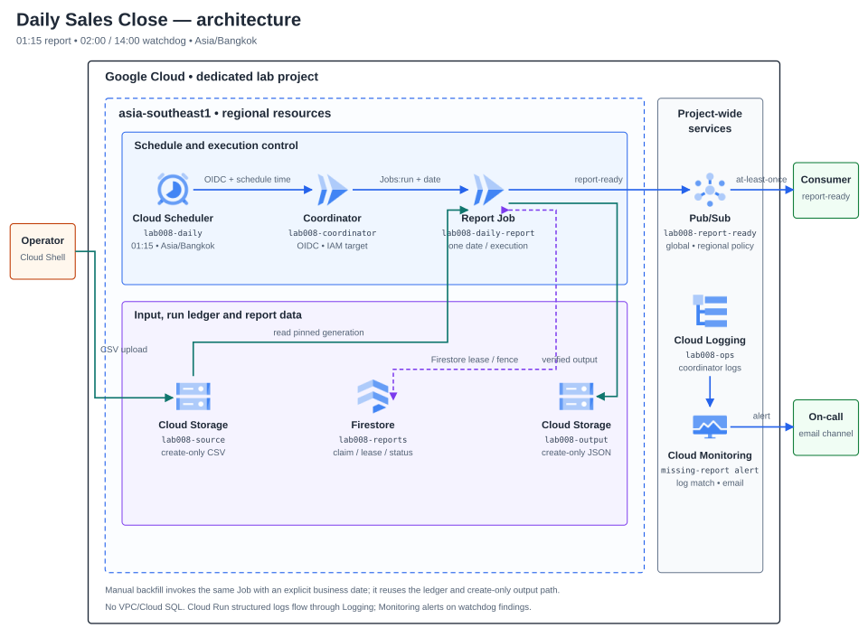

# Lab 08 — รายงานยอดขายรายวันและ Batch ที่รันย้อนหลังได้

## สถานการณ์

ทีมปฏิบัติการและการเงินต้องได้รับรายงานสรุปยอดขายของวันทำการก่อนเริ่มงานเช้า ข้อมูลต้นทางอาจมาช้า, Scheduler อาจเรียกซ้ำ, Job อาจล้มหลังเขียนไฟล์แล้ว หรือมีคนสั่งรันวันเดิมพร้อมกัน ทีมต้องเห็นว่าวันใดสำเร็จ/ขาดหาย แยกความล้มเหลวของรอบงานออกจากข้อมูลธุรกิจ และรันย้อนหลังได้โดยไม่สร้างรายงานหรือแจ้งเตือนซ้ำอย่างเงียบ ๆ

Solution นี้ชื่อ **Daily Sales Close** ใช้ข้อมูลสังเคราะห์ ไม่เชื่อมระบบบัญชีหรือรับชำระเงินจริง เป้าหมายคือรายงานที่ผูกกับ business date และ source version ที่พิสูจน์ย้อนกลับได้ ไม่อ้าง SLA หรือความตรงเวลาที่ไม่ได้วัด

**สถานะ:** Guide-ready — คู่มือ Tasks 00–12, app, fixtures, tests, container, Terraform และ diagrams ผ่าน CI [run 40073869658](https://github.com/somkid-s5/Portfolio-Lab/actions/runs/40073869658). นี่เป็นหลักฐาน CI ของ repository เท่านั้น; ไม่มี GCP resources ถูกสร้างโดยผู้จัดทำ และ Cloud verification ยังคง Not run.

## ผู้ใช้และผลลัพธ์ที่ต้องได้

- ทีม Finance เปิดรายงานตาม business date และตรวจจำนวนรายการ/ยอดรวมกับข้อมูลต้นทางได้
- Operator เห็นสถานะและสาเหตุของรอบที่สำเร็จ, ล้มเหลว, ค้าง หรือยังไม่มีรายงาน และสั่ง backfill วันที่ระบุได้
- Platform team แยกผู้เรียก Scheduler, coordinator, Job และ notification consumer ตามหน้าที่
- ทีม downstream รับสัญญาณ report-ready พร้อม report ID ที่ใช้ deduplicate ได้

## Requirements และเกณฑ์รับมอบ

| ID | Requirement | หลักฐานที่ต้องเก็บ |
|---|---|---|
| R1 | Daily schedule ใช้ timezone และ logical business date ที่กำหนด ไม่คำนวณวันจากเวลาที่ Job เริ่มจริง | scheduled timestamp, timezone, business date; ทดสอบขอบวัน/เดือน/ปีและ invocation ซ้ำ |
| R2 | รับเฉพาะ synthetic CSV ตาม schema และเพดานที่ประกาศ | source object generation/hash, row count, invalid-row result, input size |
| R3 | สรุป count/ยอดเงินแบบจำนวนเต็มและสร้าง output ซ้ำได้จาก source version เดิม | input/output hashes, total rows, amount totals, reconciliation |
| R4 | Overlap, Scheduler retry และ Cloud Run task retry ไม่สร้างผลรายงานซ้ำหรือเขียนทับไฟล์ที่ไม่ตรงกัน | duplicate execution, lease/state history, object generation/precondition และผลก่อน/หลัง retry |
| R5 | ตรวจพบ source ที่มาช้า, scheduled run ที่ไม่มีรายงาน และ job failure; watchdog ส่ง alert เมื่อสถานะยังไม่สำเร็จ และ Operator ทำ backfill วันที่เดิมได้ | watchdog log/alert, ledger/status, execution/log IDs, late-source recovery และการตรวจ output ก่อน/หลัง backfill |
| R6 | ส่ง report-ready event หลัง report ถูกจัดเก็บ; event ที่ตอบรับไม่แน่นอนต้อง recover ได้โดยใช้ event identity เดิม | topic/message attributes, report ID, notification state และ duplicate-consumer scenario |
| R7 | จำกัด IAM ตาม role: Scheduler เรียก coordinator; coordinator สั่งรันเฉพาะ Job; Job อ่าน input/เขียน output/ledger/notification เท่าที่ต้องใช้ | principal/role matrix, unauthorized/authorized calls, bucket/database scope |
| R8 | จำกัด rows, bytes, เวลา/จำนวน retry ต่อ execution และกำหนดวิธีควบคุมการสั่ง backfill ก่อนทดสอบ | configured limits, expected upper bounds, billing/cost notes และ backout |
| R9 | ส่งมอบ runbook, case-study evidence และ cleanup/rebuild ที่ไม่อ้างผล Cloud หากไม่ได้รัน | sanitized logs/evidence, known limitations, cleanup inventory และ Not run fields |

## ขอบเขตตั้งต้น

- หนึ่งรายงานต่อ business date ใน timezone Asia/Bangkok; schedule หลัก 01:15 ประมวลผลวันปฏิทินก่อนหน้า และ watchdog ตรวจซ้ำเวลา 02:00 กับ 14:00 เพื่อจับรายงานที่ขาด/มาช้า.
- ข้อมูลสังเคราะห์ CSV เท่านั้น; เพดานตั้งต้น 5 MiB และ 5,000 แถวข้อมูลต่อวัน, ไม่ใส่ PII, ใช้จำนวนเต็มสตางค์และ fail closed เมื่อ schema/ตัวเลขผิด.
- Run หลักเป็น Cloud Run Job งานเดียวต่อ business date; เปลี่ยนเป็น backfill หลายวันแบบ bounded concurrency เป็น Change Request ไม่เริ่มด้วยการประมวลผลขนานไม่จำกัด.
- ไม่มี BigQuery, data warehouse, external email API หรือการเชื่อมระบบ production จริง; มี report-ready event สำหรับ downstream และ Cloud Logging log-based alert โดยผู้เรียนกำหนด notification channel เอง.
- แยก run retry, schedule retry, backfill และ business date ออกจากกัน; ไม่มีข้ออ้างว่าการ retry ของบริการทำให้ exactly-once.

## Architecture ที่เลือกใช้

### Schedule และ logical business date

Cloud Scheduler มี report job เวลา 01:15 และ watchdog job เวลา 02:00 กับ 14:00 ใน timezone `Asia/Bangkok`; ทั้งคู่เรียก coordinator ที่ป้องกันด้วย HTTPS/OIDC แต่ใช้ path และชื่อ Scheduler job คนละค่า. Coordinator ตรวจ identity, ชื่อ job และ `X-CloudScheduler-ScheduleTime` รูป RFC3339; header บอกเวลาที่กำหนดไว้แต่ไม่แทน IAM authentication. แปลง schedule timestamp เป็นวันท้องถิ่นแล้วใช้วันก่อนหน้าเป็น business date ห้ามใช้เวลาที่ service หรือ Job เริ่มจริง. ขาด header, parse ผิด, route กับ job name ไม่ตรง หรือ caller ไม่ได้รับอนุญาต จะถูกปฏิเสธพร้อม reason ปลอดภัย.

Route `/schedule` เรียก Cloud Run Jobs API `jobs:run` ด้วย override เฉพาะ `--business-date=YYYY-MM-DD` แล้วตอบ `202` เมื่อได้ operation name; ไม่รอ batch จบ. ตัว Job ใช้ mode `scheduled` เป็นค่าเริ่มต้นและอ่าน object หลักของวันนั้น; Operator เรียก Job โดยระบุ `--mode operator-backfill` และกรณีแก้ source ต้องส่ง `--source-object`/`--source-generation` เป็นคู่เพื่อเปลี่ยนไปใช้ immutable object ใต้ `corrections/`. ถ้า API ตอบกลับไม่แน่นอน Scheduler อาจ retry และสร้าง execution ซ้ำ; ledger ของ business date เป็นตัวกันผลซ้ำ. Route `/watchdog` อ่าน Firestore ledger และตรวจ output object generation/hash แบบ read-only; ถ้ายังไม่มีรายงานหรือสถานะไม่ใช่ `succeeded` ให้เขียน structured log `event=daily_report_not_ready` พร้อม business date/status/reason เพื่อให้ log-based alert แจ้งผู้ดูแล. Watchdog จะตอบรับ business-missing หลัง log สำเร็จ เพื่อไม่ให้ retry กลายเป็น notification loop; เฉพาะ dependency error จะตอบ 5xx.

### สัญญาไฟล์ต้นทางสำหรับ Materials

รับไฟล์ CSV แบบ UTF-8 (ยอมรับ BOM) ที่มี header ตามลำดับนี้เท่านั้น:

```text
transaction_id,sold_at,sku,quantity,unit_price_minor,currency
```

`transaction_id` ต้องไม่ซ้ำและยาว 1–64 ตัวอักษร ASCII; `sold_at` ต้องเป็น RFC3339 ที่มี timezone และเมื่อนำมาแปลงเป็น `Asia/Bangkok` ต้องตรงกับ business date; `sku` ใช้ตัวพิมพ์ใหญ่ ตัวเลข จุด ขีดล่าง หรือขีดกลาง; `quantity` เป็นจำนวนเต็ม 1–1,000; `unit_price_minor` เป็นจำนวนเต็มหน่วยสตางค์ 0–100,000,000; `currency` รับเฉพาะ `THB`. ปฏิเสธ header/คอลัมน์เกิน schema, transaction ID ซ้ำ, แถวไม่สมบูรณ์, timestamp ไม่มี offset, วันไม่ตรง, ค่าเงิน/จำนวนผิดรูปแบบ, ไฟล์เกิน 5 MiB, มากกว่า 5,000 แถว หรือไม่มีข้อมูล.

Report สรุปจำนวนรายการ, จำนวนสินค้า, `total_amount_minor` และผลรวมต่อ SKU โดย sort SKU และ serialize เป็น canonical JSON (ไม่มี floating-point). `report_id` ผูกกับ `business_date`, source generation และ SHA-256 ของ bytes ต้นทาง; report hash ใช้ตรวจ artifact ที่สร้างซ้ำ. การเรียงแถวใหม่เป็นคนละ source version จึงได้ report ID คนละค่า แม้ยอดรวมเท่ากัน.

### Batch data path และสถานะ

| Component | หน้าที่และขอบเขต |
|---|---|
| Coordinator `lab008-coordinator` | Cloud Run service ต้องผ่าน IAM authentication; Terraform ใช้ ingress `all` จึงไม่เรียกบริการนี้ว่า network-private. Route `/schedule` เริ่ม Job และ `/watchdog` ตรวจ ledger/output. Watchdog อ่าน Firestore กับ report bucket ได้เท่านั้นและ log ผลแบบ structured |
| Source bucket | รับไฟล์ CSV สังเคราะห์ที่ object หลัก `incoming/business_date=YYYY-MM-DD/transactions.csv` และ input correction แบบใหม่ใต้ `incoming/business_date=YYYY-MM-DD/corrections/<source-id>.csv`; ทุก object upload แบบ create-only. เพดาน 5 MiB/5,000 data rows; อ่าน generation ที่ pin ไว้ ไม่ตาม latest หากไฟล์เปลี่ยนระหว่างอ่าน |
| Cloud Run Job `lab008-daily-report` | หนึ่ง task / parallelism 1 ต่อ business date; task timeout 10 นาที, max retries 1. ใช้ execution/task-attempt variables ของ Cloud Run สำหรับ owner และ attempt identity; fault-after-write recovery ทดสอบใน CI worker tests เท่านั้น และ Job ไม่เปิด HTTP endpoint |
| Firestore `lab008-reports` | document ต่อ business date เก็บ status, owner execution, lease/fence, attempts, input generation/hash, output generation/hash และ notification state. Transaction เป็นจุด claim/transition; Project เฉพาะ Lab เป็น IAM boundary |
| Report bucket | สร้าง `reports/business_date=YYYY-MM-DD/summary.json` ด้วย generation precondition `ifGenerationMatch=0`; ถ้ามี object ให้ตรวจ source binding และ hash ก่อน reuse, ถ้าไม่ตรงให้ block ไม่ overwrite |
| Pub/Sub topic `lab008-report-ready` | หลัง output ถูกตรวจแล้ว Job บันทึก `notification_pending` และ publish event ที่มี stable `report_id`, business date, object generation/hash และสรุปสังเคราะห์เท่านั้น; ไม่ส่ง CSV หรือ credentials |
| Downstream consumer | อยู่นอก Solution baseline; รับ report-ready แบบ at-least-once และต้อง deduplicate ด้วย `report_id`. การส่ง event ซ้ำไม่เท่ากับสร้างรายงานซ้ำ |

State path: `not_started → running → report_written → notification_pending → succeeded`; `missing_input`, `blocked` และ `failed` เป็นสถานะที่ต้องแสดงแยกจาก success. Missing input ไม่มี output/event และเปลี่ยนกลับเป็น `running` ได้เมื่อ Operator ส่ง source มาแล้ว. CSV/schema หรือ output conflict เข้า `blocked`; ไม่ล้าง ledger และไม่เขียนทับ object เพื่อบังคับผ่าน. ถ้าแก้ input ให้ upload object ใหม่แบบ immutable ใต้ `corrections/` ของ business date แล้วระบุ `--source-object` และ `--source-generation` พร้อม `--mode operator-backfill`; ถ้ารายงานเดิมสำเร็จแล้ว ห้าม restate ทับ key เดิม. `succeeded` เป็น no-op สำหรับ invocation ซ้ำ.

Firestore transaction เป็นจุด claim/transition; lease ตั้งต้น 15 นาทีและทุก reclaim เพิ่ม fencing token. Job task retry ใช้ `CLOUD_RUN_EXECUTION` เป็น owner และ `CLOUD_RUN_TASK_ATTEMPT` แยก attempt; attempt ถัดไปใน execution เดิมรับ lease ต่อได้ทันที แต่ execution ใหม่ต้องรอ lease หมด. Task timeout 10 นาทีทำให้ lease ยาวกว่า attempt สูงสุด. CI worker tests จำลองการหยุดหลังเขียน report เพื่อยืนยัน recovery ด้วย generation/hash เดิม; deployment จริงไม่มี fault-injection switch และคู่มือนี้ไม่สั่งฆ่า production execution เพื่อสร้างเหตุการณ์ดังกล่าว. Execution อื่นที่ชนวันที่เดียวกันขณะ lease ยัง valid จะไม่มี side effect; ทุก transition และ publish ตรวจ fence ล่าสุด.

ถ้า Pub/Sub ตอบกลับไม่แน่นอน คงสถานะ `notification_pending` แล้ว retry event ด้วย `report_id` เดิม. Consumer อาจได้รับซ้ำแม้ acknowledgement สำเร็จ จึงต้อง deduplicate; ไม่มี exactly-once claim. ถ้า source มาช้าหรือ schedule ไม่มี report ให้เปิด Firestore Console: database `lab008-reports` → collection `daily_runs` → document ID เป็น business date เทียบ expected business date แล้วสั่ง backfill วันเดิมด้วย Job argument เดิมอย่างชัดเจน; ไม่อ้างว่า Scheduler catch-up แทน operator run ได้.

### Identity และ IAM boundary

| Principal | สิทธิ์ที่ออกแบบให้ | สิทธิ์ที่ไม่มี |
|---|---|---|
| Scheduler caller SA | `roles/run.servicesInvoker` เฉพาะ coordinator service; ใช้ OIDC audience ที่ตรงกับ URL | ไม่มี Job override, Storage, Firestore หรือ Pub/Sub |
| Coordinator runtime SA | `roles/run.jobsExecutorWithOverrides` เฉพาะ `lab008-daily-report`; `roles/datastore.viewer` ใน project เฉพาะ Lab และ `roles/storage.objectViewer` เฉพาะ report bucket เพื่อทำ watchdog | ไม่มี source-bucket write/read, Pub/Sub, deploy/update หรือสิทธิ์เปลี่ยน Job; ไม่รับ business date อิสระจาก public caller |
| Job runtime SA | อ่าน source bucket, เขียน/อ่านตรวจ output bucket, Firestore access ใน dedicated project, Pub/Sub Publisher เฉพาะ report-ready topic | ไม่มีสิทธิ์ deploy/update services, run Scheduler, ลบ report หรืออ่าน source นอก bucket ของ Lab |
| Operator | `roles/run.jobsExecutorWithOverrides` เฉพาะ Job สำหรับ backfill, `roles/datastore.viewer`, `roles/run.viewer`, `roles/logging.viewer` และอ่าน output bucket | ไม่ใช้ runtime identity แทนตัวเอง และไม่แก้ ledger/object เพื่อให้ test ผ่าน; ไม่มี source write หรือ deploy role |

Cloud Run Jobs `runWithOverrides` ต้องได้รับ `run.jobs.runWithOverrides`; Cloud Run Invoker อย่างเดียวไม่ให้สิทธิ์ override arguments. ใช้ `roles/run.servicesInvoker` ที่ coordinator service, `roles/run.jobsExecutorWithOverrides` ที่ Job resource และ read-only role แยกตาม data scope. Scheduler service agent/token setup ตรวจตาม Console/diagnostic; ไม่มอบ service-agent role ให้ runtime principal.

### Retry, monitoring และ backfill

| กลไก | ขอบเขตการ retry | วิธีพิสูจน์/แก้ไข |
|---|---|---|
| Cloud Scheduler (report) | `retryCount=2` (retry เพิ่มจากครั้งแรกได้ไม่เกิน 2), `maxRetryDuration=600s`, backoff 10–60s, `maxDoublings=2`; watchdog ใช้ขอบเขตเดียวกัน | Scheduler history/log, coordinator request ID และ duplicate Job execution ที่ ledger deduplicate ได้ |
| Cloud Run Job | 1 task, parallelism 1, timeout 10 นาที, `maxRetries=1`; attempt 0 fault injection หลังเขียน output | Execution/task attempt, output generation/hash เดิมถูกตรวจซ้ำ และ report ID เดิม |
| Watchdog | ตรวจ business date ล่าสุดเวลา 02:00 และ 14:00; รายงาน not-ready ผ่าน structured log + log-based alert | Alert event, เปิด Firestore Console: database `lab008-reports` → collection `daily_runs` → document ID เป็น business date, Scheduler/Coordinator logs; `succeeded` ยืนยันด้วย ledger และ output generation/hash |
| Manual backfill | Operator เรียก Job ด้วย `--mode operator-backfill` และระบุวัน; ไม่เกิน 7 วันย้อนหลังต่อการเรียกหนึ่ง business date; baseline ไม่มี multi-date dispatcher หรือ global concurrency cap. Cloud Run Job จำกัด task/parallelism เป็น 1 ต่อ execution และ ledger/fence กันผลซ้ำของวันเดียวกัน. เปลี่ยน source ได้เฉพาะ `blocked` จาก invalid input โดยส่งคู่ `--source-object` + `--source-generation` ที่อยู่ใต้ correction prefix เดิม; missing source ไม่สร้าง empty report | Firestore document ราย business date, Job execution override, ledger/output/notification และ source generation ของ business date |
| Change Request | เพิ่ม dispatcher สำหรับหลายวันพร้อมเพดาน concurrency ที่บังคับใช้จริง, per-date partial success/retry, global cost guard และ failure recovery; baseline ยังไม่รองรับ | per-date run IDs, maximum concurrency, same object/ledger binding และ cost estimate |

Cloud Logging เก็บ structured watchdog event; สร้าง log-based alert ที่ match `jsonPayload.event="daily_report_not_ready"` แล้วกำหนด email/notification channel ใน project. เปิด Firestore Console: database `lab008-reports` → collection `daily_runs` → document ID เป็น business date เป็นวิธีวินิจฉัยและยืนยัน recovery; ถ้าไม่พบ ledger ให้เทียบ Cloud Scheduler history กับ Cloud Run Job executions. Baseline ไม่อ้างว่ามี alert เมื่อ Scheduler API/job ถูกปิดหรือไม่ได้ถูกเรียกเลย—กรณีนั้นต้องตรวจ Scheduler job state/audit logs. ไม่มี Cloud SQL, VPC/NAT, BigQuery, external mail API หรือ always-on worker.

เพดานต้นทุนที่คุมได้จาก config: CSV ≤5 MiB/5,000 แถว, Job หนึ่ง task/parallelism 1/10 นาที/หนึ่ง retry, Scheduler report retry เพิ่มไม่เกิน 2, และ backfill หนึ่งวันต่อ invocation ภายใน 7 วัน; ไม่มี global concurrency cap. ขอบเขต pessimistic ของ report คือ 3 accepted Job executions × 2 task attempts × 10 นาที = 60 task-minutes/วัน หรือ 30 task-hours/เดือนสำหรับ 30 วัน ที่ 1 vCPU/1 GiB; watchdog, coordinator, Storage, Firestore, Pub/Sub, Logging, artifacts และ operator-run เพิ่มเติมคิดแยก. ใช้ Pricing Calculator กับ region/การใช้จริงก่อน apply; alert-only budget ไม่ได้หยุดค่าใช้จ่าย.

### Diagrams

แผนภาพ topology แยก project, regional resources, Pub/Sub global topic และ Logging/Monitoring สำหรับ watchdog; Cloud Run ไม่ได้ถูกวาดเป็นทรัพยากรใน VPC. ภาพ run/recovery แสดง schedule time, business date, ledger, retry และการ alert เมื่อรายงานยังไม่พร้อม.

[PNG topology](assets/diagrams/solution.png) · [SVG source](assets/diagrams/solution.svg) · [PNG run/recovery flow](assets/diagrams/run-flow.png) · [SVG source](assets/diagrams/run-flow.svg) · [icon provenance](assets/diagram-provenance.json)




**ข้อจำกัดการยืนยัน:** Diagram เป็น design artifact; CI ต้องตรวจ official icon hashes และ render preview ที่ความกว้างเอกสารก่อนปิด Design.

## Failure และ Change Request

| สถานการณ์ | สิ่งที่ต้องพิสูจน์ |
|---|---|
| Source มาหลังเวลาตัดรอบ | รายงานไม่ปลอมว่าเป็น empty; status แสดง missing input และ backfill หลัง upload สร้างผลที่ผูก generation ได้ |
| Schedule ถูก retry หรือ header/timezone ผิด | logical date มาจาก schedule time ที่ตรวจรูปแบบและ timezone ไม่ใช่ wall clock ตอนประมวลผล |
| Job ตายหลังเขียน report แต่ก่อน notification | retry ตรวจ artifact เดิม, ไม่เขียนทับ และกู้ pending notification ด้วย report ID เดิม |
| Job วันที่เดียวกันทำงานซ้อน | มีผู้ claim ที่ถูกต้องเพียงรายเดียว; contender บันทึก already-running/completed ตาม state ที่พิสูจน์ได้ |
| CSV ผิด schema หรือเกินเพดาน | หยุดแบบ fail-closed, ระบุ reason code ที่ปลอดภัย และไม่ปล่อย report-ready event |
| Change Request: รายงานย้อนหลังหลายวัน | เพิ่ม backfill window ที่จำกัดจำนวนวันและ concurrency, แสดง partial success, หยุด/ต่อได้ และประเมินต้นทุนก่อนเริ่ม |

## จุดบันทึกผลงาน

ผู้เรียนจะบันทึก timezone/cron และเหตุผล, service identity matrix, input fixture/hash, run ID และ business date, output generation/hash และ reconciliation, ledger transitions, retry/overlap/fault/backfill outcomes, notification event identity, metric/log windows, ค่าใช้จ่ายโดยประมาณและข้อจำกัด. ห้ามบันทึก credentials, access tokens หรือข้อมูลผู้ใช้จริง.

## Design decisions ที่ใช้กับระบบ

1. เวลา 01:15 `Asia/Bangkok` สร้างรายงานของวันปฏิทินก่อนหน้าโดยใช้ Scheduler schedule-time header; manual backfill เรียก Job ด้วยวันที่ explicit ไม่จำลอง Scheduler header.
2. Coordinator ตอบเมื่อ `jobs:run` คืน operation name; Scheduler retry เพิ่ม 2 ครั้ง/600 วินาที ส่วน Job retry task ได้ 1 ครั้ง/10 นาที. Duplicate execution ถูกกันด้วย Firestore lease/fence, ไม่อ้าง exactly-once.
3. Lease 15 นาที; retry ใน execution เดิมถือ owner เดิมและ attempt ใหม่, execution อื่น reclaim ได้เมื่อ lease หมดเท่านั้น. ทุก transition/side effect ตรวจ fence.
4. Source และ report เป็น object generation ที่ pin ไว้; report ใช้ `ifGenerationMatch=0`, existing object reuse ได้เฉพาะเมื่อ source binding/hash ตรง. Schedule ใช้ object หลัก; operator เปลี่ยน source ได้เฉพาะด้วย `--mode operator-backfill` และ `--source-object`/`--source-generation` คู่ใหม่ใต้ correction prefix เมื่อ ledger เป็น `blocked/invalid_source` และยังไม่มี output; ห้าม restate รายงานที่ succeeded.
5. Pub/Sub notification ใช้ `report_id` คงที่; Firestore `notification_pending` เป็น outbox ที่ retry publish ได้. Consumer อยู่นอก baselineและ deduplicate ตาม `report_id`.
6. Watchdog 02:00/14:00 ตรวจ ledger + output แบบ read-only; structured log ที่ไม่สำเร็จไป Cloud Logging log-based alert. Operator ตรวจ Firestore document ของวันนั้นและ Scheduler/Run logs; การ monitor กรณี Scheduler ถูกปิดทั้งระบบไม่อยู่ใน baseline.
7. ขอบเขตคือ 5 MiB/5,000 rows, 1 task/parallelism 1, 10 นาที/1 task retry, Scheduler retry เพิ่ม 2/600s, backfill หนึ่งวันต่อ invocation ภายในช่วง 7 วันย้อนหลัง; ไม่มี global concurrency cap. ค่า compute-bound และรายการต้นทุนแยกอธิบายไว้; งบแจ้งเตือนไม่ใช่ hard cap.
8. Cleanup ปิด Scheduler ก่อน, ตรวจไม่มี execution ค้าง, export evidence ที่ไม่ลับ, ลบ Pub/Sub/log alert, ลบ bucket objects แล้ว bucket, Firestore database, Cloud Run Job/service และ Artifact Registry; ห้ามใส่ retention lock ที่ขวาง cleanup.

Materials และ Tasks พร้อม Guide-ready ตาม CI run 40073869658; ไม่มี GCP resources ถูกสร้างโดยผู้จัดทำ.

## เอกสารอ้างอิงสำหรับ Design

- [Cloud Scheduler cron และ timezone](https://docs.cloud.google.com/scheduler/docs/configuring/cron-job-schedules), [HTTP target headers](https://docs.cloud.google.com/python/docs/reference/cloudscheduler/latest/google.cloud.scheduler_v1.types.HttpTarget), [OIDC authentication](https://docs.cloud.google.com/scheduler/docs/http-target-auth), [retry policy](https://docs.cloud.google.com/scheduler/docs/configuring/retry-jobs)
- [Cloud Run Jobs](https://docs.cloud.google.com/run/docs/create-jobs), [execute/override job arguments](https://docs.cloud.google.com/run/docs/execute/jobs), [Cloud Run IAM permissions](https://docs.cloud.google.com/run/docs/reference/iam/permissions)
- [Cloud Storage request preconditions](https://docs.cloud.google.com/storage/docs/request-preconditions) และ [Storage IAM roles](https://docs.cloud.google.com/storage/docs/access-control/iam-roles), [Firestore transaction contention](https://docs.cloud.google.com/firestore/native/docs/transaction-data-contention) และ [Firestore IAM roles](https://docs.cloud.google.com/iam/docs/roles-permissions/firestore), [Pub/Sub delivery model](https://docs.cloud.google.com/pubsub/docs/subscription-overview)
- [Cloud Logging log-based alert policies](https://docs.cloud.google.com/logging/docs/alerting/log-based-alerts), [Cloud Scheduler logs](https://docs.cloud.google.com/scheduler/docs/viewing-logs), [Cloud Run IAM roles](https://docs.cloud.google.com/iam/docs/roles-permissions/run)
- [Cloud Billing budgets](https://docs.cloud.google.com/billing/docs/how-to/budgets) — alerts-only budgets do not cap spend.

Design decisions, app contracts, fixtures, tests, container และ Terraform materials ได้รับการตรวจเทียบก่อนเขียน Tasks. คู่มือนี้อธิบายขั้นตอนที่ผู้เรียนเป็นผู้เลือกดำเนินการใน GCP; CI ไม่ใช่หลักฐาน Cloud verification และไม่มีการ provision GCP โดยผู้จัดทำ.

## Tasks — ทำ Daily Sales Close จากต้นทางถึง runbook

ทำตามลำดับทีละ Task และบันทึกผลในช่อง Actual/Evidence ของ Task นั้น เก็บเฉพาะ project ID, business date, execution ID, generation, hash, สถานะ และ log link ที่ไม่เปิดเผยข้อมูลลับ อย่าใส่ access token, service-account key หรือข้อมูลลูกค้าจริง.

### Task 00 — เตรียม Cloud Shell และตรวจขอบเขตค่าใช้จ่าย

เปิด Cloud Console ของ Dedicated Project สำหรับ Lab นี้เท่านั้น แล้วเปิด Cloud Shell. ห้ามใช้ project production/Personal Knowledge Base. ก่อนเริ่มยืนยัน project ID, สิทธิ์, billing, region และวงเงินที่ยอมรับได้; Terraform จะสร้างทรัพยากรที่อาจคิดค่าบริการ (Cloud Run, Firestore, Cloud Storage, Artifact Registry, Pub/Sub, Scheduler, Logging/Monitoring). Budget เป็นเพียงการแจ้งเตือน ไม่ใช่การหยุดค่าใช้จ่ายอัตโนมัติ. หาก project ยังไม่มี billing หรือผู้อนุมัติงบ ให้หยุดก่อน terraform apply.

~~~bash
gcloud auth list
export PROJECT_ID="ใส่-dedicated-project-id"
export REGION="asia-southeast1"
export BUCKET_SUFFIX="ใส่ตัวพิมพ์เล็กตัวเลขหรือขีดกลางยาว-3-16-ตัว"
gcloud projects describe "$PROJECT_ID" --format="value(projectId,lifecycleState)"
gcloud billing projects describe "$PROJECT_ID" --format="value(billingEnabled,billingAccountName)"
~~~

ผล billing ต้องระบุ True และ project ต้องเป็น project ที่ตั้งใจใช้จริงเท่านั้น. หากคำสั่งถูกปฏิเสธ ให้ขอผู้ดูแลจัดสิทธิ์แทนการเพิ่ม role แบบกว้างด้วยตนเอง. สร้าง budget alert ผ่าน Billing Console ได้ แต่ต้องประเมินราคาตาม region/โควตาใน [Pricing Calculator](https://cloud.google.com/products/calculator) ก่อนลงมือ.

**Expected:** ยืนยัน account, project, billing, asia-southeast1, budget alert และผู้อนุมัติการใช้ทรัพยากรได้ครบ; ไม่มีการสร้าง resource ในขั้นนี้.

**Actual / Evidence:** บันทึก project ID แบบไม่ลับ, account ที่เลือก, ผล billing, budget/ผู้อนุมัติ และเวลาตรวจ: ________________________________.

### Task 01 — รับ source code และตรวจข้อมูลสังเคราะห์

ใน Cloud Shell ใช้ branch ที่แนบกับ PR นี้ แล้วเข้า directory ของ Lab08. ถ้า repo ถูก clone ไว้แล้ว ให้ตรวจ git status ก่อนและเก็บงานเดิมของตนเอง; อย่าทับไฟล์ที่แก้ไว้.

~~~bash
git clone --branch main https://github.com/somkid-s5/Portfolio-Lab.git
cd Portfolio-Lab/GCP/LAB-008-daily-batch-reports
git status --short
python3 -m unittest discover -s tests -p 'test_domain.py' -v
python3 -m unittest discover -s tests -p 'test_generate_input.py' -v
export BUSINESS_DATE="$(TZ=Asia/Bangkok date -d 'yesterday' +%F)"
python3 scripts/generate_input.py --business-date "$BUSINESS_DATE" --output "/tmp/lab008-$BUSINESS_DATE.csv"
sha256sum "/tmp/lab008-$BUSINESS_DATE.csv"
~~~

Generator สร้าง 4 แถว THB แบบ synthetic และไม่เขียนทับไฟล์ที่มีอยู่. หาก object path ของ business date นี้มีอยู่ใน bucket แล้ว อย่า overwrite; เลือกวันอื่นที่ยังอยู่ในกรอบ 7 วันและยังไม่มี ledger/object ของ Lab นี้. unit_price_minor เป็นสตางค์; ยอด 79,000 minor units เท่ากับ 790 บาท ไม่ใช่ 79,000 บาท.

**Expected:** domain และ generator tests ผ่าน; ได้ CSV 4 แถว, SHA-256 และวันธุรกิจเดียวกับ BUSINESS_DATE.

**Actual / Evidence:** บันทึกวันที่, จำนวนแถว, hash และผล test โดยไม่แนบข้อมูลส่วนบุคคล: ________________________________.

### Task 02 — สร้าง Foundation และทบทวน Terraform plan

ใน Cloud Shell Editor เปิด infra/foundation/terraform.tfvars.example แล้ว Save As terraform.tfvars. กำหนด project_id, region = "asia-southeast1", bucket_suffix ที่ยังไม่ซ้ำ และ artifact_publisher_member = "user:อีเมลผู้ปฏิบัติงาน"; อย่า commit tfvars หรือ Terraform state. ต้องใช้สิทธิ์สร้าง API enablement, bucket, Firestore, Pub/Sub, Artifact Registry, service account และ IAM binding. ขอสิทธิ์ผ่านผู้ดูแลตามนโยบาย project; อย่าใช้ Owner เป็น runtime identity.

~~~bash
cd infra/foundation
terraform version
terraform init
terraform fmt -check -diff -recursive
terraform validate
terraform plan -out=foundation.plan
terraform show foundation.plan
~~~

อ่าน plan ทีละ resource และตรวจ project/region/bucket names/IAM ก่อน apply. ถ้า Terraform เสนอให้ลบหรือแทนที่ resource ที่ไม่ใช่ Lab08 ให้หยุดและตรวจ state/workspace. Apply เฉพาะหลังยืนยันค่าใช้จ่ายและขอบเขตแล้ว:

~~~bash
terraform apply foundation.plan
terraform output
~~~

เก็บ local state และ tfvars ใน Cloud Shell จน cleanup จบ; อย่า commit, แชร์ หรือวางไฟล์เหล่านี้ลงใน evidence. Foundation สร้าง source/report bucket คนละใบ, Firestore database lab008-reports, topic lab008-report-ready, repository lab008-images และ runtime service accounts.

**Expected:** terraform validate ผ่าน; terraform output แสดง bucket, database, topic, image repository และสาม service-account identities ใน project ที่ยืนยันไว้.

**Actual / Evidence:** บันทึก Terraform version, plan/apply result และชื่อ resource ที่ไม่ลับ: ________________________________.

### Task 03 — Build และ push image โดย deploy ด้วย digest

กลับไปที่ directory หลักของ Lab08. ใช้ tag ใหม่เพื่อ trace การ build; Terraform workload จะรับ image digest ที่แน่นอน ไม่รับ mutable tag. Artifact Registry Writer ถูกผูกเฉพาะกับ principal ที่ระบุใน Foundation.

~~~bash
cd ../..
export IMAGE_REPO="$(terraform -chdir=infra/foundation output -raw image_repository)"
export IMAGE_TAG="$IMAGE_REPO/daily-sales-close:lab008-$(git rev-parse --short HEAD)"
gcloud auth configure-docker asia-southeast1-docker.pkg.dev --quiet
docker build --tag "$IMAGE_TAG" .
docker image inspect "$IMAGE_TAG" --format '{{.Config.User}}'
docker push "$IMAGE_TAG"
export IMAGE_DIGEST="$(gcloud artifacts docker images describe "$IMAGE_TAG" --project="$PROJECT_ID" --format='value(image_summary.digest)')"
test -n "$IMAGE_DIGEST"
export IMAGE_URI="$IMAGE_REPO/daily-sales-close@$IMAGE_DIGEST"
printf 'IMAGE_URI=%s\n' "$IMAGE_URI"
~~~

docker image inspect ต้องแสดง 10001:10001; image ทำงานเป็น non-root. เก็บ digest แบบ sha256:... และใช้ IMAGE_URI ในขั้น workload. ถ้า push ได้ PERMISSION_DENIED ให้ตรวจ artifact_publisher_member และ IAM ของ repository ก่อน; อย่าเปลี่ยน repository เป็น public.

**Expected:** image อยู่ใน private Artifact Registry, USER=10001:10001 และได้ immutable URI ที่ลงท้ายด้วย digest.

**Actual / Evidence:** บันทึก tag, digest, ผล non-root inspection และเวลา push: ________________________________.

### Task 04 — Deploy workload โดยคง Scheduler ไว้ paused

เปิด infra/workloads/terraform.tfvars.example แล้วคัดลอกเป็น terraform.tfvars. เติม project, region, image_uri = IMAGE_URI, ค่า bucket/database/topic/service-account จาก Foundation outputs และ operator_member = "user:อีเมลผู้ปฏิบัติงาน". คง pause_schedulers = true, allow_destroy = false; notification_channels ปล่อยว่างได้หากยังไม่มี channel.

~~~bash
cd infra/workloads
terraform init
terraform fmt -check -diff -recursive
terraform validate
terraform plan -out=workloads-paused.plan
terraform show workloads-paused.plan
~~~

ตรวจว่า plan จะสร้าง IAM-authenticated Cloud Run coordinator, Job lab008-daily-report, Scheduler jobs ที่ paused, log-based metric/alert และ IAM ตามตารางข้างต้น. Service ใช้ ingress all แต่ยังต้องผ่าน Cloud Run IAM; นี่ไม่ใช่การจำกัดเครือข่ายแบบ internal-only. Apply หลังตรวจ plan:

~~~bash
terraform apply workloads-paused.plan
terraform output
~~~

**Expected:** Outputs แสดง coordinator URI, Job และ Scheduler names; schedulers_paused = true. ยังไม่มี cron trigger ที่เริ่มทำงานอัตโนมัติ.

**Actual / Evidence:** บันทึก plan/apply, coordinator URI แบบไม่ลับ, Job name และ paused state: ________________________________.

### Task 05 — พิสูจน์ missing input และ watchdog alert path

ขั้นนี้ตั้งใจยังไม่ upload source object. เปิด infra/workloads/terraform.tfvars และเปลี่ยน pause_schedulers เป็น false; review plan ต้องแสดงการ unpause เฉพาะ Scheduler สองรายการ แล้ว apply. การทำนี้เริ่มเปิด schedule จริง: report 01:15 และ watchdog 02:00/14:00 เวลาไทย. อย่าปล่อย schedule ทำงานโดยไม่เฝ้าดู.

~~~bash
terraform plan -out=schedulers-active.plan
terraform show schedulers-active.plan
terraform apply schedulers-active.plan
gcloud scheduler jobs run lab008-report-schedule --location="$REGION" --project="$PROJECT_ID"
gcloud run jobs executions list --job=lab008-daily-report --region="$REGION" --project="$PROJECT_ID"
~~~

รอให้ execution ของ report จบก่อน จากนั้นสั่ง watchdog ด้วย Scheduler เพื่อใช้ OIDC identity และ schedule-time contract จริง:

~~~bash
gcloud scheduler jobs run lab008-watchdog --location="$REGION" --project="$PROJECT_ID"
gcloud logging read 'resource.type="cloud_run_revision" AND resource.labels.service_name="lab008-coordinator" AND jsonPayload.event="daily_report_not_ready"' --project="$PROJECT_ID" --freshness=1d --limit=20 --format='table(timestamp,jsonPayload.business_date,jsonPayload.status,jsonPayload.reason)'
~~~

ไม่มี source จึงต้องไม่สร้างรายงานเปล่า; watchdog log ควรแสดงวัน/status/reason ที่ยังไม่พร้อม. Alert policy อาจไม่มี notification channel และ incident/log metric อาจใช้เวลาปรากฏ; หลักฐานขั้นต่ำคือ structured log และ metric/policy ที่ Terraform สร้าง ไม่ใช่อีเมลที่ยังไม่ได้ตั้งค่า.

**Expected:** Scheduler OIDC ผ่าน coordinator, Job บันทึก missing input โดยไม่สร้าง summary และ watchdog เขียน event daily_report_not_ready.

**Actual / Evidence:** บันทึก business date, Scheduler invocation/Job execution ID, log timestamp และ metric/policy ที่พบ: ________________________________.

### Task 06 — รับไฟล์ที่มาช้าแบบ create-only แล้วกู้รายงาน

ก่อน upload ให้กลับไป infra/workloads, ตั้ง pause_schedulers = true, ตรวจ plan และ apply เพื่อหยุด trigger อัตโนมัติระหว่างการแก้เหตุ. ใน Cloud Shell ที่ directory Lab08 ใช้ไฟล์จาก Task01. สร้าง object ตาม canonical path ด้วย generation precondition; ถ้า object มีอยู่แล้วให้หยุดและตรวจ ledger แทนการเขียนทับ.

~~~bash
cd ../..
export SOURCE_BUCKET="$(terraform -chdir=infra/foundation output -raw source_bucket)"
export REPORT_BUCKET="$(terraform -chdir=infra/foundation output -raw report_bucket)"
gcloud storage cp --if-generation-match=0 --content-type=text/csv "/tmp/lab008-$BUSINESS_DATE.csv" "gs://$SOURCE_BUCKET/incoming/business_date=$BUSINESS_DATE/transactions.csv"
gcloud storage objects describe "gs://$SOURCE_BUCKET/incoming/business_date=$BUSINESS_DATE/transactions.csv" --format='yaml(generation,size)'
~~~

เก็บ source generation จากผล describe. จากนั้นกลับไป workload root ตั้ง pause_schedulers = false, review/apply plan แล้วเรียก report Scheduler ซ้ำสำหรับ logical business date เดิม; watchdog ตรวจซ้ำได้หลัง execution เสร็จ:

~~~bash
cd infra/workloads
gcloud scheduler jobs run lab008-report-schedule --location="$REGION" --project="$PROJECT_ID"
gcloud run jobs executions list --job=lab008-daily-report --region="$REGION" --project="$PROJECT_ID"
gcloud scheduler jobs run lab008-watchdog --location="$REGION" --project="$PROJECT_ID"
~~~

เมื่อยืนยันผลแล้วให้หยุด schedule อีกครั้ง โดยตั้ง pause_schedulers = true, review plan และ apply. หากเกิด 412/precondition แปลว่า object path ถูกใช้แล้ว; ห้ามลบ/overwrite เพื่อให้คำสั่งผ่าน ให้เลือกวันที่ใหม่ในกรอบ backfill หรือใช้ correction procedure ตาม Task09.

**Expected:** Job อ่าน generation ที่ upload จริง, ledger เปลี่ยนเป็น succeeded, report มี source generation/hash เดียวกับ input; watchdog ไม่รายงานวันนั้นว่า missing.

**Actual / Evidence:** บันทึก source object path/generation/hash, execution ID และผล pause ก่อน/หลัง: ________________________________.

### Task 07 — ตรวจ report, ledger และขอบเขตของ event

ดึง report object แบบอ่านอย่างเดียวและตรวจค่าที่สร้างจาก generator. ตรวจ generation จาก Firestore หรือ gcloud storage objects describe; อย่าดาวน์โหลด object โดยอ้าง latest หากต้องพิสูจน์ generation เดิม.

~~~bash
export REPORT_OBJECT="reports/business_date=$BUSINESS_DATE/summary.json"
gcloud storage objects describe "gs://$REPORT_BUCKET/$REPORT_OBJECT" --format='yaml(generation,size,metadata)'
gcloud storage cp "gs://$REPORT_BUCKET/$REPORT_OBJECT" "/tmp/lab008-summary-$BUSINESS_DATE.json"
jq '{business_date,row_count,total_quantity,total_amount_minor,report_id,source,by_sku}' "/tmp/lab008-summary-$BUSINESS_DATE.json"
~~~

ผล fixture-generator ที่คาด: row_count=4, total_quantity=4, total_amount_minor=79000 (790 บาท), มี 3 SKU; source มี generation และ SHA-256. เปิด Cloud Console → Firestore → database lab008-reports → collection daily_runs → document ID เป็น BUSINESS_DATE; ตรวจ status, source_generation, source_sha256, report_generation, report_sha256, report_id, notification_state และ lease/fence fields. เปรียบเทียบ report กับ document และ object metadata.

~~~bash
gcloud logging read "jsonPayload.event=\"daily_report_run_finished\" AND jsonPayload.business_date=\"$BUSINESS_DATE\"" --project="$PROJECT_ID" --freshness=1d --limit=20 --format=json
gcloud pubsub topics describe lab008-report-ready --project="$PROJECT_ID"
~~~

Topic ใน baseline ไม่มี subscription/consumer. สถานะสำเร็จยืนยันว่า Publisher API ตอบรับ publish ก่อน Job ปิดสำเร็จ แต่ไม่พิสูจน์การส่งถึง downstream consumer หรือการประมวลผลปลายทาง; อย่าสร้าง consumer แล้วอ้างเป็น baseline.

**Expected:** ledger, object generation/metadata และ JSON report ผูก source เดียวกัน; reconciliation ได้ 4 แถว/79,000 สตางค์.

**Actual / Evidence:** บันทึก status, source/report generations และ hashes, row/amount reconciliation, report ID, Job log link; ปิดบังข้อมูลที่ไม่จำเป็น: ________________________________.

### Task 08 — สั่งวันเดิมซ้ำและตรวจ idempotency

วันธุรกิจต้องอยู่ในช่วงย้อนหลัง 7 วันและห้ามเป็นวันนี้. สั่ง operator backfill วันเดียวกันอีกครั้ง โดยไม่ระบุ source override:

~~~bash
gcloud run jobs execute lab008-daily-report --region="$REGION" --project="$PROJECT_ID" --args="--mode=operator-backfill,--business-date=$BUSINESS_DATE" --wait
gcloud storage objects describe "gs://$REPORT_BUCKET/$REPORT_OBJECT" --format='value(generation,metadata.report_id,metadata.output_sha256)'
~~~

ตรวจ Firestore และ Job logs หลัง execution. ถ้าวันนั้น succeeded แล้ว worker ควรคืน report metadata เดิมโดยไม่สร้าง object generation หรือ notification side effect ใหม่. การรับ publish ซ้ำจากกรณี timeout/unknown outcome ยังคงเป็นไปได้; consumer ในอนาคตต้อง deduplicate ด้วย report_id. CI tests ใช้ failure hook ภายใน test เพื่อทดสอบ crash หลังเขียนไฟล์; Cloud Run deployment ไม่มี fault-injection switch จึงไม่สั่งฆ่า execution จริงเพื่อเลียนแบบ.

**Expected:** report ID, output generation และ hash ไม่เปลี่ยน; duplicate run ไม่มีผลทางธุรกิจซ้ำ.

**Actual / Evidence:** บันทึก execution ID ก่อน/หลัง, report ID, generation/hash ก่อน/หลัง และ ledger status: ________________________________.

### Task 09 — Change Request: แก้ source ที่ไม่ผ่าน validation ด้วย generation ใหม่

สร้างวันที่ทดสอบอีกวันภายในช่วง 7 วันย้อนหลัง (ตัวอย่างใช้สองวันก่อนวันนี้) และยืนยันว่าไม่มี object/ledger ของวันนั้นก่อนเริ่ม. สร้าง input ที่ถูกต้องไว้หนึ่งชุด แล้วสร้าง invalid copy โดยเปลี่ยน currency ของแถวแรกเป็น USD:

~~~bash
cd ../..
export RECOVERY_DATE="$(TZ=Asia/Bangkok date -d '2 days ago' +%F)"
python3 scripts/generate_input.py --business-date "$RECOVERY_DATE" --output "/tmp/lab008-valid-$RECOVERY_DATE.csv"
sed '2s/,THB$/,USD/' "/tmp/lab008-valid-$RECOVERY_DATE.csv" > "/tmp/lab008-invalid-$RECOVERY_DATE.csv"
gcloud storage cp --if-generation-match=0 --content-type=text/csv "/tmp/lab008-invalid-$RECOVERY_DATE.csv" "gs://$SOURCE_BUCKET/incoming/business_date=$RECOVERY_DATE/transactions.csv"
~~~

เรียก Job แบบวันเดียว. สำหรับ invalid CSV คาดว่า ledger จะเป็น blocked ด้วย reason invalid_source; execution อาจจบ non-zero ตาม exit code ของ Job. ตรวจ status/log ก่อนแก้:

~~~bash
if gcloud run jobs execute lab008-daily-report --region="$REGION" --project="$PROJECT_ID" --args="--mode=operator-backfill,--business-date=$RECOVERY_DATE" --wait; then
  echo "ตรวจ Firestore: บันทึกสถานะและ validation result"
else
  echo "คาดหมายได้เมื่อ input ถูกปฏิเสธ; ตรวจ execution และ ledger ก่อนดำเนินต่อ"
fi
~~~

ใช้ไฟล์ valid เดิมเป็น correction object ใหม่; ห้ามแทนที่ main object. อ่าน generation ของ correction แล้วส่ง object/generation เป็นคู่:

~~~bash
export CORRECTION_OBJECT="incoming/business_date=$RECOVERY_DATE/corrections/fix-01.csv"
gcloud storage cp --if-generation-match=0 --content-type=text/csv "/tmp/lab008-valid-$RECOVERY_DATE.csv" "gs://$SOURCE_BUCKET/$CORRECTION_OBJECT"
export CORRECTION_GENERATION="$(gcloud storage objects describe "gs://$SOURCE_BUCKET/$CORRECTION_OBJECT" --format='value(generation)')"
gcloud run jobs execute lab008-daily-report --region="$REGION" --project="$PROJECT_ID" --args="--mode=operator-backfill,--business-date=$RECOVERY_DATE,--source-object=$CORRECTION_OBJECT,--source-generation=$CORRECTION_GENERATION" --wait
~~~

เงื่อนไขสำคัญ: correction path ต้องอยู่ใต้ corrections/ ของ business date เดียวกัน, ระบุ generation ที่อ่านได้จริง, ledger ต้องเป็น blocked/invalid_source และยังไม่มี output; ห้าม restate วันที่ succeeded. หาก generation mismatch หรือ state conflict ให้หยุดและวิเคราะห์ ledger/object ก่อน retry.

**Expected:** invalid run ไม่ปล่อย report/event; correction ที่ pin generation แล้วจึงสร้าง report ใหม่และ ledger succeeded.

**Actual / Evidence:** บันทึกวันที่ทดสอบ, invalid reason, correction object generation/hash, output generation/hash, report ID และผล reconciliation: ________________________________.

### Task 10 — ทบทวน operating limits และข้อเสนอเพิ่ม backfill หลายวัน

ทีม Finance ขอให้รันย้อนหลังหลายวันพร้อมกัน 2 งาน. ตรวจว่าระบบปัจจุบันรับหนึ่ง business date ต่อ Job invocation, จำกัดวันย้อนหลังไม่เกิน 7 วัน, task_count=1 และ parallelism=1 ต่อ execution เท่านั้น; ไม่มี dispatcher และไม่มีเพดาน concurrency รวมข้ามวัน. จึงห้ามเขียน shell loop เพื่อยิงหลาย execution พร้อมกันแล้วเรียกว่า bounded.

ทำ change note สั้น ๆ ก่อนอนุมัติการขยาย: ระบุจำนวนวันที่ต้องการ, global semaphore/queue, per-date partial success, การ retry เฉพาะวันที่ค้าง, ค่าใช้จ่ายสูงสุด, monitoring และ rollback. จนกว่าจะ implement/test control เหล่านั้น ให้ operator เรียกทีละวันและรอ execution จบก่อนวันถัดไป. ค่า task_count=1 ไม่ได้ควบคุมจำนวน Job executions ที่คนสั่งซ้อน.

**Expected:** Change note แยกสิ่งที่ baseline ทำได้จริงออกจาก proposal; ไม่มีการอ้าง global cap ที่ยังไม่ได้ implement.

**Actual / Evidence:** บันทึกคำขอ, การตัดสินใจ (ทำ/เลื่อน/ปฏิเสธ), control ที่ยังขาดและผู้อนุมัติ: ________________________________.

### Task 11 — สรุปหลักฐานเป็น Case Study ที่ตรวจย้อนกลับได้

สรุปโจทย์/ข้อจำกัด, diagram, IAM boundary, failure mode ที่ทดสอบ, ผล reconciliation, idempotency, late-input/correction recovery, alert log, operational limit และ change decision. แนบเฉพาะ sanitized CLI output/log excerpt หรือภาพจาก project ของตนเองที่ไม่มี token, email ที่ไม่จำเป็น, customer data หรือ secrets. ระบุทุกข้อว่าเป็น CI verified, Cloud verified (เฉพาะเมื่อได้รันและเก็บหลักฐานจริง), หรือ Not run.

หากยังไม่ได้สร้าง project ให้คง Cloud verification เป็น Not run; CI success ไม่ใช่ Cloud proof. ห้ามเขียนตัวเลข latency/scale/SLA หรือ downstream delivery ที่ไม่ได้วัด.

**Expected:** Case Study อ่านจบในตัวเองและทุก claim มีหลักฐานหรือระบุเป็นข้อจำกัด; ไม่มี credential/ข้อมูลจริง.

**Actual / Evidence:** บันทึก evidence file names/links, CI run, claim ที่ยัง Not run และวันที่ review: ________________________________.

### Task 12 — หยุด schedule และ Cleanup แบบตรวจ resource ทีละกลุ่ม

ก่อนลบ ให้ตั้ง pause_schedulers = true ใน workload tfvars, terraform plan และ terraform apply; ตรวจ Scheduler jobs paused และไม่มี Cloud Run Job execution ค้าง. Export เฉพาะ evidence ที่ต้องเก็บและตรวจว่าไม่มี secret. จากนั้นใน workload root เปลี่ยน allow_destroy = true, อ่าน plan ว่าปลด deletion protection เฉพาะ coordinator/Job ของ Lab08 แล้ว apply. เมื่อ resources อยู่ใน dedicated project และ plan ถูกต้อง จึง terraform destroy ของ workloads.

ก่อน Foundation destroy ตรวจ bucket names จาก state/output และยืนยันว่าเป็น lab008-s-*/lab008-r-* ของ project นี้เท่านั้น. Bucket เปิด Object Versioning และ force_destroy=false; ลบ object versions ของสอง bucket แบบเจาะจง แล้วลบ image ใน repository ที่กำหนดไว้ก่อน:

~~~bash
gcloud storage rm --recursive "gs://$SOURCE_BUCKET/**"
gcloud storage rm --recursive "gs://$REPORT_BUCKET/**"
gcloud artifacts docker images delete "$IMAGE_REPO/daily-sales-close" --project="$PROJECT_ID" --delete-tags --quiet
~~~

ตรวจชื่อก่อนยืนยันทุกครั้ง; คำสั่งเหล่านี้ลบข้อมูลใน bucket/repository ที่ระบุ. กลับไป infra/foundation, ตรวจ project/state/plan แล้วค่อย terraform destroy เพื่อเอา bucket, Firestore, Pub/Sub, Artifact Registry และ IAM ของ Lab08 ออก. อย่าลบ project ทั้งก้อน. ถ้า destroy แจ้งว่ามี version/object ค้าง ให้ตรวจ bucket ที่แสดงและลบเฉพาะ Lab08; ห้ามเปิด force_destroy ให้ลบ resource ที่ไม่รู้จัก.

**Expected:** Scheduler หยุดก่อน, Workload/Foundation destroy สำเร็จใน dedicated project, ไม่มี resource ที่ Terraform จัดการเหลือ; Google APIs ที่เปิดไว้และ service agents อาจยังคงอยู่; project อื่นไม่ถูกแตะ.

**Actual / Evidence:** บันทึกเวลาหยุด schedule, plan/apply/destroy IDs และ inventory หลัง cleanup; ระบุสิ่งที่ยังเหลือพร้อมเหตุผล: ________________________________.

## References สำหรับการปฏิบัติ

- [Cloud Shell](https://docs.cloud.google.com/shell/docs/launching-cloud-shell) และ [Artifact Registry Docker authentication](https://docs.cloud.google.com/artifact-registry/docs/docker/authentication)
- [gcloud storage cp](https://docs.cloud.google.com/sdk/gcloud/reference/storage/cp), [objects describe](https://docs.cloud.google.com/sdk/gcloud/reference/storage/objects/describe), [ลบ object versions](https://docs.cloud.google.com/sdk/gcloud/reference/storage/rm) และ [Object Versioning](https://docs.cloud.google.com/storage/docs/using-versioned-objects)
- [Cloud Run Jobs execute](https://docs.cloud.google.com/sdk/gcloud/reference/run/jobs/execute), [list executions](https://docs.cloud.google.com/sdk/gcloud/reference/run/jobs/executions/list), [Cloud Scheduler jobs run](https://docs.cloud.google.com/sdk/gcloud/reference/scheduler/jobs/run), [Logging read](https://docs.cloud.google.com/sdk/gcloud/reference/logging/read)
- [Cloud Billing budgets](https://docs.cloud.google.com/billing/docs/how-to/budgets) — alert-only, ไม่ใช่ hard spending cap.
