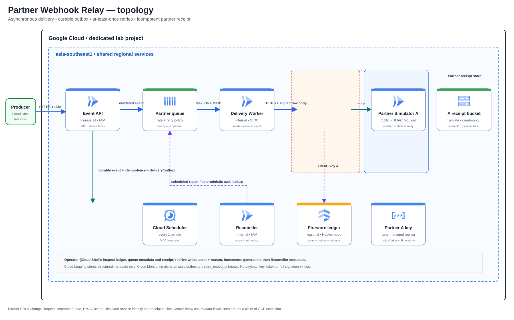
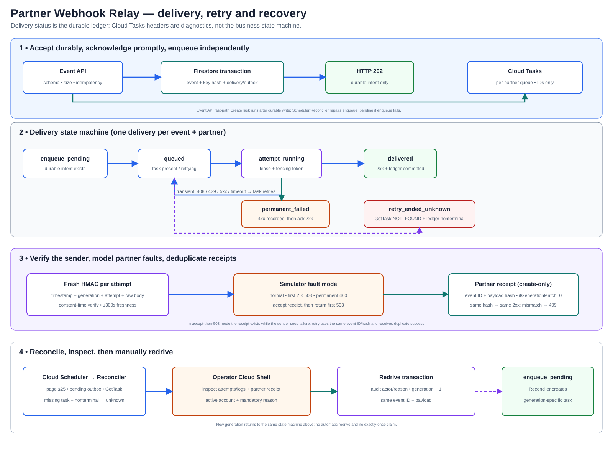

# Lab 09 — ระบบส่ง Webhook ให้ระบบคู่ค้า

**สถานะ:** Build materials in progress — Design ถูกปิดแล้ว. มี pure domain contract, Firestore transaction ledger, Cloud Tasks OIDC adapter, Event API, bounded outbox reconciler และ Scheduler HTTP entrypoint พร้อม unit/emulator tests; ยังขาด Delivery Worker, partner simulator, Terraform และ Guide. ไม่มี GCP provisioning และ Cloud verification ยังคง Not run.

## Build materials checkpoint

- `app/domain.py` กำหนด schema, canonical bytes, idempotency hash, task identity, HMAC และการจำแนกผลตอบกลับโดยไม่พึ่ง Cloud SDK.
- `app/ledger.py` เขียน event, delivery outbox และ idempotency record ใน Firestore transaction เดียว; replay ของ key เดิมคืน event เดิม, body hash ต่างกันเกิด conflict และ state guards กัน stale generation/การถอยสถานะ. Error code กับ `retry_ended_unknown` ถูกบันทึกแบบ bounded เพื่อส่งต่อ human review.
- `app/task_queue.py` สร้าง Cloud Task แบบ deterministic, ส่งเฉพาะ IDs พร้อม OIDC และแยก AlreadyExists→GetTask; unit tests ใช้ client double ไม่มี RPC.
- `app/api.py` รับ event ผ่าน `/v1/events`, ตอบ 202 หลัง Firestore commit และถือ enqueue เป็น best-effort; error ระหว่างส่งไม่ทำให้ producer ส่ง business event ซ้ำโดยไม่จำเป็น. IAM enforcement อยู่ที่ Cloud Run configuration.
- `app/reconciler.py` อ่าน pending/queued อย่างมี page cap รวมไม่เกิน 25 records ต่อรอบ, ซ่อม task ที่ยังสด, และย้าย pending เกิน 15 นาทีหรือ queued ที่หา task ไม่พบไป `retry_ended_unknown` เพื่อให้คนตรวจ. การบันทึก enqueue error ไม่เลื่อน `enqueue_pending_since` จึงไม่รีเซ็ต deadline.
- `app/reconciler_api.py` เปิด `POST /internal/reconcile` สำหรับ Cloud Scheduler, ไม่รับ control fields จาก request, ส่ง HTTP 503 เมื่อมี record error เพื่อให้ Scheduler retry. ใช้ Cloud Run IAM เป็น auth boundary; test นี้ยืนยันเฉพาะ HTTP contract ไม่ได้ทดสอบ IAM จริง.
- Emulator tests ครอบคลุม deadline จริงจากเวลาเริ่ม pending, page bound, queue lookup ที่หาย และไม่เขียนทับ terminal state.
- `tests/test_domain.py` ทดสอบ contract แบบ pure; `tests/test_firestore_ledger.py` ใช้ loopback Firestore Emulator ทดสอบ atomic write, concurrent replay และ state guard. ผลจะถือเป็น CI/emulator evidence เมื่อ workflow ผ่านเท่านั้น.
- ขั้นถัดไปคือ Delivery Worker และ partner simulator; จากนั้นจึงประกอบ runtime entrypoints, Terraform และ Tasks guide. ยังไม่มี Terraform หรือ Cloud SDK call ไปยัง project จริง.

## สถานการณ์

ระบบ Order ภายในต้องแจ้ง event ประเภท order.shipped ไปยัง endpoint ของคู่ค้าหลายราย แต่ปลายทางอาจช้า ตอบ 429/5xx หรือรับ event ไปแล้วแต่คำตอบกลับหาย ทีมต้องตอบผู้เรียกได้เร็ว ติดตามผลส่งย้อนหลังได้ และ redrive ได้โดยไม่ทำให้คู่ค้าเกิดผลทางธุรกิจซ้ำ

ใช้ข้อมูลสังเคราะห์และ partner simulator เท่านั้น ไม่เชื่อมระบบคู่ค้าจริง ไม่ส่ง PII หรือ credential และไม่อ้าง SLA ของ production.

## ผู้ใช้และผลลัพธ์

- **ทีมผู้ส่ง Event:** ส่ง event ที่ผ่าน schema และได้ event ID กลับ แม้คู่ค้ายังไม่พร้อม
- **Operator:** ตรวจสถานะและเหตุผลของ delivery แยกงานที่ retry อยู่จากงานที่ต้องตรวจสอบ และสั่ง redrive พร้อมเหตุผลได้
- **ทีม Platform/Security:** จำกัดผู้เรียกด้วย Cloud Run IAM แยก identity ของ workload และไม่ใส่ secret ใน log
- **Partner simulator:** ตรวจ HMAC จาก raw body และ timestamp ปฏิเสธข้อมูลที่ถูกแก้ไข และบันทึก event ID เพื่อ deduplicate

## Requirements และเกณฑ์รับมอบเบื้องต้น

| ID | Requirement | หลักฐานที่ต้องเก็บใน Guide |
|---|---|---|
| R1 | Event API รับ event สังเคราะห์ตาม schema/เพดานที่กำหนด และตอบรับเมื่อบันทึกเจตนาส่งอย่างถาวรแล้ว | request ID, event ID, response code, Firestore event/outbox record และขนาดข้อมูล |
| R2 | idempotency key เดิมกับ body เดิมคืน event ID/ผลเดิม; key เดิมแต่ body ต่างกันถูกปฏิเสธด้วย 409 | ผลเรียกซ้ำสองกรณี, payload hash และ ledger |
| R3 | การบันทึก event/outbox และการสร้าง task เป็นคนละระบบ; กู้กรณี process หยุดระหว่างสองขั้นได้ | จำลอง enqueue error, outbox ก่อน/หลัง reconcile, task name/generation และผล API |
| R4 | Cloud Tasks เรียก Delivery Worker ด้วย OIDC; Cloud Run IAM/ingress อนุญาตเฉพาะเส้นทางและ identity ที่กำหนด | authorized/unauthorized call, audience, IAM binding และ ingress setting |
| R5 | Worker ลงนามด้วย HMAC-SHA256 จาก timestamp และ raw body; simulator ตรวจลายเซ็น, freshness และ body ที่ถูกแก้ไข | positive/negative cases, event ID และ verdict; ไม่เก็บ secret/signature เต็มใน log |
| R6 | timeout, 408, 429 และ 5xx เป็น transient ตามนโยบาย; permanent 4xx ถูกบันทึกก่อนหยุด retry | attempt log, status classification, retry/backoff และ Firestore transition |
| R7 | กรณี partner รับสำเร็จแต่ response หายและ Cloud Tasks ส่งซ้ำไม่เกิดผลธุรกิจซ้ำ; retry ใช้ event ID/payload เดิม | receiver receipt, payload hash, task metadata และผล dedupe |
| R8 | retry exhaustion หรือ delivery ที่ยืนยันผลไม่ได้ยังตรวจย้อนหลังได้; redrive บันทึก actor, reason และ generation ใหม่ | ledger, queue/log evidence, partner receipt lookup, redrive audit และผลหลัง redrive |
| R9 | Change Request เพิ่ม partner รายที่สองด้วย queue rate limit และ HMAC key แยก; ไม่มี cross-partner leakage | Terraform plan, queue settings สองชุด, IAM/secret binding และ isolation tests |
| R10 | มี runbook สำหรับตรวจ incident, เปลี่ยนค่า, rebuild และ cleanup อย่างปลอดภัย | Expected/Actual/Evidence แยกกัน, resource inventory, cleanup result และ Cloud verification status |

เกณฑ์เหล่านี้เป็นสิ่งที่ผู้เรียนต้องพิสูจน์ใน Lab ไม่ใช่คำอ้างว่าได้รัน Cloud แล้ว. ตัวอย่างผลที่คาดหวังต้องติดป้าย Expected; Actual และหลักฐานให้กรอกหลังรันจริง.

## ขอบเขตตั้งต้น

- Event type เดียว: order.shipped; payload สังเคราะห์มี event ID, partner ID, เวลาเกิดเหตุ, order reference ปลอม และสถานะจัดส่ง ไม่มีชื่อ ที่อยู่ เบอร์โทร หรือข้อมูลชำระเงิน
- จำกัด payload, field count, string length และ event rate สำหรับ Lab; ตัวเลขสุดท้ายยืนยันใน Design พร้อม quota/cost check.
- Baseline มี partner simulator หนึ่งราย; Change Request เพิ่มรายที่สอง พร้อม queue rate และ secret แยก.
- Stack ที่เลือก: Cloud Run แยก Event API, Reconciler, Delivery Worker และ simulator; Operator ใช้ CLI ใน Cloud Shell; Cloud Tasks แยก queue ต่อ partner; Firestore เป็น durable event/outbox/delivery ledger; Cloud Scheduler เรียก Reconciler; Secret Manager เก็บ HMAC keys; Cloud Storage เก็บ durable receipt แบบ create-only.
- Event API และ Reconciler ต้องผ่าน IAM authentication; Worker รับ traffic จาก Cloud Tasks ด้วย OIDC และจำกัด ingress เมื่อยืนยัน topology แล้ว. Partner simulator เป็น HTTPS endpoint สาธารณะเพื่อเลียนแบบ dependency ภายนอก แต่รับเฉพาะข้อมูลสังเคราะห์และตรวจ HMAC.
- ผู้เรียนใช้ gcloud CLI และ Terraform บน project เฉพาะ Lab. เอกสารนี้ไม่สร้าง GCP resources.

## Solution flow

1. Producer ส่ง order.shipped พร้อม idempotency key ไปยัง Event API ที่ผ่าน Google IAM authentication.
2. API ตรวจ schema/ขนาด สร้าง payload hash และเขียน event กับ outbox record ใน Firestore transaction. API ตอบ 202 พร้อม event ID เมื่อบันทึก intent แล้ว; 202 ไม่ได้แปลว่าคู่ค้ารับ event แล้ว.
3. API พยายามสร้าง Cloud Task ใน queue ของ partner. หาก enqueue ไม่สำเร็จ outbox ยังคงอยู่; Reconciler ที่ Scheduler เรียกด้วย OIDC ค้นหา pending item แล้วซ่อมการ enqueue.
4. Cloud Tasks ส่งเฉพาะ event ID, delivery ID, partner ID และ generation ไปยัง Worker ผ่าน OIDC; Worker อ่าน payload canonical จาก ledger ไม่เชื่อ URL/secret ที่ผู้ส่งแนบมา.
5. Worker เลือก endpoint จาก partner allowlist, อ่าน HMAC key จาก Secret Manager, สร้าง timestamp/signature ใหม่ต่อ attempt แล้ว POST ผ่าน HTTPS. Event ID เป็น idempotency key คงที่ตลอด retries.
6. Simulator ตรวจ HMAC แบบ constant-time และ freshness แล้วบันทึก receipt ที่ผูก event ID กับ payload hash. การเขียน receipt ใช้ Cloud Storage generation precondition เพื่อกัน overwrite; ถ้าชน receipt เดิมต้องอ่านและเทียบ hash ก่อนยืนยันว่าเป็น duplicate เดิม.
7. Worker บันทึก attempt/terminal state ก่อนตอบ 2xx ให้ Cloud Tasks. Transient failure ตอบ non-2xx เพื่อให้ retry; permanent rejection ต้องบันทึก terminal state ก่อน acknowledge.
8. Operator ใช้ CLI ใน Cloud Shell ตรวจ ledger, task metadata, logs และ partner receipt ก่อน redrive. Redrive บันทึก actor/reason, เพิ่ม generation และตั้ง delivery กลับเป็น enqueue_pending; event ID/payload เดิมยังคงเดิมเพื่อให้ receiver deduplicate หากผลการส่งก่อนหน้าคลุมเครือ.

## Reliability constraints ที่ต้องคงไว้ใน implementation

- Cloud Tasks มี delivery แบบ at-least-once; Worker และ simulator จึงต้อง idempotent. ชื่อ task ช่วย dedupe ได้สูงสุด 24 ชั่วโมงหลัง task ถูกลบ ไม่ใช่ business idempotency ถาวร. Firestore ledger และ receiver receipt เป็นหลักฐานระยะยาว. [Cloud Tasks overview](https://docs.cloud.google.com/tasks/docs/dual-overview) · [task-name deduplication limit](https://docs.cloud.google.com/tasks/docs/quotas)
- Cloud Tasks ลบ task หลังสำเร็จหรือ retry หมด; task ที่ไม่อยู่ใน queue ไม่ใช่หลักฐานว่าคู่ค้ารับข้อมูล. หาก Worker ไม่เคยได้ attempt สุดท้าย ให้แสดง unknown/needs-review และให้ Operator ตรวจ ledger, queue/log และ partner receipt ก่อน redrive. [Manage queues and tasks](https://docs.cloud.google.com/tasks/docs/manage-queues-and-tasks)
- max attempts นับรวม attempt แรก; retry policy หยุดเมื่อทั้งจำนวน attempt และ retry duration ครบตามเงื่อนไข. Rate limit เป็นค่าต่อ queue และรวม first attempt กับ retry; Cloud Tasks อาจลด dispatch rate เพิ่มเมื่อปลายทางตอบ 429/503/5xx. ห้ามอ้างเวลา/throughput ที่ยังไม่ได้วัด. [queue rate/retry configuration](https://docs.cloud.google.com/tasks/docs/configuring-queues) · [retry behavior](https://docs.cloud.google.com/tasks/docs/common-pitfalls)
- Header X-CloudTasks-TaskRetryCount อาจนับ dispatch ที่ล้มก่อนถึง handler; X-CloudTasks-TaskExecutionCount นับคำตอบจาก handler. ใช้ร่วมกับ delivery attempt ledger ไม่ใช่แทนกัน. [HTTP target headers](https://docs.cloud.google.com/tasks/docs/creating-http-target-tasks)
- Cloud Tasks ใช้ OIDC กับ HTTP targets ได้; service account ที่สร้าง token ต้องอยู่ project เดียวกับ queue. ต้องแยก iam.serviceAccounts.actAs, Cloud Tasks service agent และ Cloud Run Invoker ตาม principal. Cloud Run internal ingress รู้จัก Cloud Tasks เมื่ออยู่ project/perimeter เดียวกันและใช้ default run.app URL; ต้องยืนยันกับ topology จริงก่อนเลือก. [HTTP target authentication](https://docs.cloud.google.com/tasks/docs/creating-http-target-tasks) · [Cloud Run ingress](https://docs.cloud.google.com/run/docs/securing/ingress)
- HMAC-SHA256 ใช้ยืนยันความถูกต้อง/ผู้ถือ shared secret ไม่ได้ปกปิดข้อมูล; HTTPS ยังจำเป็น. [RFC 2104](https://www.rfc-editor.org/rfc/rfc2104/)
- generation-match 0 ทำให้ Cloud Storage สร้าง object ได้เมื่อไม่มี live object ชื่อนั้น. หากชน object เดิม ต้องอ่านและเทียบ hash ไม่ถือว่า payload ซ้ำที่ถูกต้องทันที. [Cloud Storage request preconditions](https://docs.cloud.google.com/storage/docs/request-preconditions)

## Design — architecture และ decisions ที่ปิดแล้ว

### Resource map และตำแหน่ง

ใช้ asia-southeast1 (Singapore) ใน project สำหรับ Cloud Run, Cloud Tasks, Firestore Native, Cloud Scheduler และ Cloud Storage เพื่อให้บริการหลักอยู่ใน region เดียวกัน. Cloud Scheduler มี Bangkok แล้ว แต่ Cloud Tasks ยังไม่แสดง asia-southeast3 ในรายการ region จึงเลือก Singapore เป็น common region สำหรับ solution นี้; Secret Manager ใช้ global API โดยกำหนด user-managed replication ไว้ Singapore. ตรวจ region ซ้ำก่อนเริ่ม เพราะความพร้อมและราคาอาจเปลี่ยนได้.

| Resource | ขอบเขตและหน้าที่ |
|---|---|
| Event API | Cloud Run, ingress all แต่บังคับ Cloud Run IAM; ตรวจ schema, ทำ idempotency และบันทึก event/outbox ก่อนตอบ 202 |
| Operations CLI | รันจาก Cloud Shell ด้วย IAM ของผู้ปฏิบัติการ; อ่านสถานะ/receipt และทำ redrive transaction โดยไม่เปิด admin endpoint สาธารณะเพิ่ม |
| Reconciler | Cloud Run internal + IAM; Cloud Scheduler เรียกทุก 1 นาทีผ่าน default run.app URL; ทำงานสูงสุด 25 records ต่อรอบ |
| Cloud Tasks | HTTP target queue หนึ่งชุดต่อ partner; task มีเฉพาะ IDs/generation และ OIDC identity |
| Delivery Worker | Cloud Run internal + IAM; claim lease, อ่าน payload/secret, ส่ง HTTPS+HMAC และบันทึก attempt/state ก่อน acknowledge |
| Partner Simulator | Cloud Run public test endpoint เพื่อจำลอง partner ภายนอก; รับ synthetic data เท่านั้น, บังคับ HMAC ในแอป |
| Firestore | Regional Native-mode database; เก็บ idempotency, event payload, delivery/outbox state, attempt history และ redrive audit |
| Secret Manager | key แยกราย partner; user-managed replication เฉพาะ asia-southeast1; ห้ามพิมพ์ secret/signature ลง output |
| Cloud Storage | bucket private แยกราย partner; simulator เขียน receipt แบบ create-only และอ่านเพื่อตรวจ duplicate |

Cloud Run สำหรับ Event API และ Cloud Shell client ใช้ ingress all เพราะผู้เรียนเรียกจากภายนอก VPC แต่ยังต้องผ่าน IAM; Reconciler/Worker ใช้ internal ingress และ IAM โดยใช้ default run.app URL. เอกสาร Cloud Run ระบุ Cloud Tasks และ Cloud Scheduler ใน project/perimeter เดียวกันเป็น internal source ได้. Simulator เป็นข้อยกเว้นเดียวที่ public เพราะเลียนแบบปลายทาง partner; ไม่ใช้ข้อมูลจริงและต้องคง HMAC check แม้ Cloud Run IAM จะปิดสำหรับ endpoint นี้.

### Event, idempotency และ durable model

- API รับ event type เดียว order.shipped และ partner_id จาก allowlist เท่านั้น. ผู้เรียกส่ง order_ref สังเคราะห์ตามรูปแบบ ORD- ตามด้วยอักขระ A–Z/0–9 จำนวนคงที่, occurred_at แบบ RFC3339 UTC และ shipping_status ที่ต้องเป็น shipped; server สร้าง event_id และ accepted_at เอง. ห้ามรับ URL, secret name หรือ callback host จาก producer.
- จำกัด request body ไม่เกิน 8 KiB, string/field ตาม schema และไม่เก็บ PII. Canonical body สร้างจาก field allowlist ที่ normalize แล้ว, sort key, compact JSON UTF-8; ไม่มี float. payload_sha256 คำนวณจาก byte sequence นี้ และ Worker ส่ง byte sequence เดิมทุก generation.
- Idempotency-Key เป็น required opaque value ขนาดจำกัด; เก็บเฉพาะ SHA-256 ของ key เป็น document ID. ขอบเขต uniqueness คือ project ของ Lab. key เดิม + payload hash เดิมคืน event_id/delivery เดิม; key เดิม + hash ต่างกันคืน 409. ไม่ใช้ key ดิบเป็น log field.
- Firestore transaction เดียวสร้าง events/{event_id}, idempotency/{key_hash} และ deliveries/{delivery_id} ในสถานะ enqueue_pending. Delivery document เป็น outbox และ state machine เดียวกัน; attempts เป็น immutable subcollection และ redrive audit เก็บเป็น records แยก. Lab เก็บหลักฐานไว้จน cleanup; ไม่ตั้ง TTL ที่อาจลบ record ระหว่าง task/receipt ยังต้องตรวจ.
- Cloud Tasks body มี event_id, delivery_id, partner_id และ generation เท่านั้น. ชื่อ task deterministic จาก delivery_id + generation; endpoint และ Secret ID มาจาก Terraform-controlled partner allowlist. API ตอบ 202 หลัง transaction สำเร็จ ไม่รอ partner; ถ้า Firestore ล้มเหลวตอบ error และไม่สร้าง task.

### State machine และการซ่อม outbox

| สถานะ | ความหมาย / การเปลี่ยน |
|---|---|
| enqueue_pending | มี durable event+delivery แล้ว แต่ยังไม่มี task ที่ยืนยันได้; API ลอง CreateTask ทันทีและ Reconciler ทำซ้ำแบบ deterministic |
| queued | CreateTask สำเร็จหรือ GetTask ยืนยันว่ามี task; ครอบคลุมช่วงรอและ retry |
| attempt_running | Worker claim ด้วย Firestore transaction, บันทึก generation/attempt number และ lease/fencing token ก่อนเรียก partner |
| delivered | simulator ตอบ 2xx และ Worker commit terminal state/attempt สำเร็จแล้ว จึงตอบ 2xx ให้ Cloud Tasks |
| permanent_failed | partner ตอบ 4xx ที่ไม่ใช่ 408/429; บันทึกเหตุผลก่อน Worker ตอบ 2xx เพื่อหยุด poison retry |
| retry_ended_unknown | Reconciler พบ GetTask NOT_FOUND แต่ delivery ยัง nonterminal; อาจเป็น retry exhaustion, การลบ หรือผลสำเร็จที่ ledger commit ไม่ครบ จึงห้ามตีความว่า partner ไม่ได้รับ |
| redrive | Operator ตรวจ logs/task/receipt แล้ว transaction เพิ่ม generation, เขียน actor/reason/evidence reference และตั้ง enqueue_pending; payload/event_id คงเดิม |

API fast path และ Reconciler ห้ามเขียนทับสถานะที่ Worker ทำให้ก้าวหน้าแล้ว: หลัง CreateTask สำเร็จ จะเปลี่ยนเป็น queued ได้เฉพาะเมื่อสถานะยังเป็น enqueue_pending. หาก CreateTask ตอบ AlreadyExists ให้ GetTask ชื่อเดิม; ถ้ามี task ให้คง generation เดิม, ถ้า NOT_FOUND แต่ ledger ยัง nonterminal ให้ตั้ง retry_ended_unknown เพื่อให้คนตรวจ แทนการสร้างชื่อเดิมซ้ำหลังช่วง dedup. enqueue_pending ที่ค้างเกิน 15 นาทีเข้าคิว needs-review และไม่ auto-enqueue ต่อโดยไม่จำกัด.

Reconciler ทำงานทุกนาทีแบบ bounded page ≤25: ซ่อม enqueue_pending ล่าสุด, ตรวจ GetTask ของ queued ที่ยัง nonterminal, และเปลี่ยน task ที่หายเป็น retry_ended_unknown หลัง reread/transaction ตรวจ state อีกครั้ง. งาน terminal จะไม่ถูก redrive อัตโนมัติ. Cloud Tasks ลบ task หลัง successful response หรือ retry exhaustion; task name กันซ้ำได้เพียงช่วงสั้น จึงไม่ใช่ business idempotency.

Worker ใช้ transaction/lease และ fencing ป้องกัน worker เก่าบันทึกทับ generation ใหม่. Duplicate task ที่พบ lease ยัง active ตอบ non-2xx เพื่อให้ Cloud Tasks ลองใหม่ ไม่ตอบ 2xx แล้วทิ้งงาน. Worker commit delivered/permanent_failed ก่อนตอบ 2xx ให้ Cloud Tasks; หากไม่สามารถบันทึก state ให้ตอบ non-2xx. Reconciler และ Operator ตรวจและแก้ ambiguous outcome; ไม่มี exactly-once claim.

### Retry, webhook signing และ fault scenarios

- Baseline queue ตั้ง maxAttempts=5 (นับ attempt แรก), maxRetryDuration=0s (ไม่จำกัดเวลา แต่ maxAttempts ยังมีผล), minBackoff=5s, maxBackoff=20s, maxDoublings=2, maxDispatchesPerSecond=1 และ maxConcurrentDispatches=1 ต่อ partner. ใช้ไม่เกิน 10 synthetic events ในหนึ่ง run. Queue rate limit ใช้กับ first attempt และ retry; timing/throughput จริงไม่รับประกัน.
- Cloud Tasks retry count อาจรวม 5xx ที่ไม่ถึง handler; execution count บอกจำนวน handler responses. Worker บันทึก outbound attempt number ของตนเองใน Firestore ก่อน POST และใช้ค่านั้นกับ simulator scenario; ห้ามอนุมานจำนวน partner calls จาก Cloud Tasks header เพียงอย่างเดียว.
- Worker timeout 20 วินาที, HTTP dispatch deadline 30 วินาที, partner connect/read timeout 5 วินาที. 408/429/5xx/timeout เป็น transient; สำหรับ 429/503 Worker ส่ง Retry-After ที่ parse ได้กลับไปยัง Cloud Tasks โดยจำกัดค่าสูงสุด 60 วินาที. 4xx อื่นเป็น permanent และต้องแก้ config แล้ว Operator จึงค่อย redrive.
- Signature เป็น HMAC-SHA256 บน UTF-8 bytes ของ canonical string: v1, HTTP method/path, Unix timestamp, generation, outbound attempt number และ raw request body ตามลำดับที่กำหนดคงที่; คั่นด้วย newline. ส่ง timestamp/signature เป็น headers. Simulator ยอมรับ timestamp ภายใน ±300 วินาที, เทียบ MAC แบบ constant-time, และใช้ HTTPS. signature เปลี่ยนทุกรอบ แต่ event_id/body คงเดิม.
- Simulator modes เป็น Terraform-controlled enum เท่านั้น ไม่มี public scenario endpoint และ producer เปลี่ยน fault mode ไม่ได้: normal; transient-503-first-two (attempt 1–2 ตอบ 503, attempt 3 บันทึก receipt/ตอบ 200); permanent-400; accept-then-503-on-first (บันทึก receipt ก่อนตอบ 503 เพื่อจำลอง ambiguous acknowledgement; retry เห็น receipt/hash เดิมแล้วตอบ 200). attempt number อยู่ใน HMAC canonical string จึงใช้เป็น test signal ได้เฉพาะเมื่อ request ลงนามถูกต้อง.
- Receipt object key ผูกกับ partner_id/event_id; create ใช้ ifGenerationMatch=0. ถ้าชน object เดิมให้อ่านและเทียบ payload hash: hash เดิมคือ duplicate ที่ตอบ 2xx แบบเดิม, hash ต่างกันคือ 409 และ incident. Simulator A runtime identity อ่าน/เขียนได้เฉพาะ bucket A; Worker เข้าถึงเฉพาะ secret ที่จำเป็น. Change Request เพิ่ม B พร้อม queue, secret, simulator service account/service และ receipt bucket แยก.

### IAM, trust boundary และการทำงานผู้ปฏิบัติการ

| Principal | สิทธิ์ที่จำเป็น |
|---|---|
| Producer | roles/run.invoker บน Event API เท่านั้น |
| Event API runtime SA | Firestore user; Cloud Tasks enqueuer บน queue ที่เกี่ยวข้อง; iam.serviceAccounts.actAs บน task OIDC SA เพื่อแนบ OIDC token |
| Cloud Scheduler caller SA | roles/run.invoker บน Reconciler; Google-managed Scheduler service agent ใช้ตาม service default |
| Reconciler runtime SA | Firestore user; Cloud Tasks viewer + enqueuer บน queue; actAs บน task OIDC SA |
| Cloud Tasks service agent | roles/iam.serviceAccountUser บน target OIDC SA; target SA ต้องอยู่ project เดียวกับ queue |
| Task OIDC SA | roles/run.invoker บน Delivery Worker เท่านั้น |
| Worker runtime SA | Firestore user; secretAccessor เฉพาะ partner secrets ที่ Worker ต้องใช้ |
| Simulator A runtime SA | secretAccessor เฉพาะ key A; storage.objectCreator และ storage.objectViewer เฉพาะ bucket A; ไม่มีสิทธิ์ลบ receipt |
| Operator ใน Cloud Shell | Firestore user สำหรับ inspect/redrive transaction; Cloud Tasks viewer สำหรับ metadata; objectViewer เฉพาะ receipt buckets; ไม่มี enqueuer หรือ secret access |
| Terraform/bootstrap principal | ใช้เฉพาะการสร้าง APIs/resources/IAM ตาม dedicated Lab project; final role list ต้องผูกกับ resource inventory ใน Guide |

IAM ของ Firestore มาตรฐานเป็นระดับ project/database มากกว่าระดับ collection จึงให้แต่ละ Lab ใช้ dedicated project และแยก service accounts/secret/bucket per partner. Operator script บันทึก account จาก gcloud active configuration, reason ที่บังคับกรอก, generation เดิม/ใหม่ และเวลา; Cloud Audit Logs เป็นหลักฐาน authoritative สำหรับ principal ที่เรียก API. Logs ของแอปบันทึก request/correlation ID, event/delivery/partner ID, generation, attempt number, task name, response class, duration และ state transition เท่านั้น; ห้าม log body, key, access token หรือ HMAC เต็ม.

### Test limits, task order และ cost gate

Cloud Run min instances=0; ตั้ง max instances ตาม role ให้ต่ำ (API/worker/reconciler 2, simulator 1), ใช้ CPU เฉพาะ request และไม่สร้าง load test ไม่จำกัด. Guide-run probe จำกัดไม่เกิน 10 events ต่อรอบ, 8 KiB/event, หนึ่ง partner, สูงสุด 5 Cloud Tasks attempts; Change Request ทดสอบ partner B แบบแยก queue. ตัวเลข 10 events เป็นขอบเขตของ guide/probe ไม่ใช่ project-level quota; ตั้ง budget alert แต่จำไว้ว่า alert ไม่ใช่ spending cap; ก่อน apply ผู้เรียนประเมิน Singapore region, Artifact Registry/Cloud Build, Cloud Run, Firestore ops, Tasks, Scheduler, Secret Manager, Storage, egress และ logs ใน Pricing Calculator. ไม่มีการ provision โดยผู้จัดทำ.

Build Materials จะทำตามลำดับนี้ก่อนเขียนคู่มือ Task:
1. ล็อก schema vectors, payload canonicalization, response codes และ idempotency contract.
2. ทำ state/Firestore domain module พร้อม lease, fencing, generation และ attempt ledger.
3. ทำ Event API, Operator CLI และ Reconciler/Cloud Tasks adapters พร้อม unit tests.
4. ทำ HMAC signer/verifier, partner simulator, fault modes และ create-only receipt store.
5. ทำ Docker image/health endpoints/structured logs และ bounded probes.
6. ทำ Terraform foundation/workload switch ใน root เดียว: apply foundation เพื่อ APIs, identities, Firestore, queues, buckets, secrets และ Artifact Registry; build/push image; จากนั้นเปิด workload phase เพื่อสร้าง Cloud Run/Scheduler โดยใช้ digest ไม่ใช้ mutable tag.
7. ทดสอบ service doubles/emulator และ fault matrix โดยไม่มี cloud credentials; ระบุส่วนที่ emulator/double ไม่พิสูจน์.
8. เขียน README Tasks 00–12 พร้อม Expected/Actual/Evidence ใกล้จุดตรวจ, change request partner B, troubleshoot, cleanup และ rebuild.
9. CI/render/review ทั้ง artifacts ก่อนย้าย Lab09 ไป Guide-ready; Cloud status ยังคง Not run จนกว่าจะทดสอบใน project จริง.

## Prerequisites และต้นทุนที่ต้องประเมิน

ผู้เรียนต้องมี project ฝึกที่เปิด billing และสิทธิ์สร้าง APIs, IAM bindings/service accounts, Cloud Run, Cloud Tasks, Firestore Native, Scheduler, Secret Manager, Storage และ Terraform state. Role matrix แบบ least privilege จะทำใน Design/Guide. ต้องตรวจ availability/quota ของ services ใน region ก่อน apply; ยังไม่จำเป็นต้องใช้ VPC connector, Cloud SQL, GKE, public load balancer หรือ partner account จริง.

ต้นทุนที่อาจเกิด: Cloud Run requests/compute, Cloud Tasks, Firestore reads/writes, Scheduler invocations, Secret Manager access, Cloud Storage operations/storage, network egress และ log retention. ตั้ง min instances เป็นศูนย์และจำกัด synthetic events/attempts; ก่อน apply ให้ประเมิน region/ปริมาณ/retention ใน Pricing Calculator และตรวจ budget. Budget alert ไม่ใช่ spending cap. ไม่มีการสร้าง resources หรือ deploy โดยผู้จัดทำ.

## ยังไม่รวม

- partner API จริง, production order data/PII, payment, multi-region DR หรือ SLA claim
- exactly-once delivery หรือใช้ task-name dedupe แทน durable ledger
- automatic payload rewrite/แก้ event เดิมแล้ว redrive ทับข้อมูล; การแก้ payload ต้อง audit และนิยามใน Design
- การอ้าง Cloud verification จาก unit/CI/emulator test หรือการคาดเดาผล Console

## References used for design

- [Lab 09 ใน Roadmap](../ROADMAP.md#lab-09)
- [Cloud Tasks locations](https://docs.cloud.google.com/tasks/docs/locations) · [Cloud Scheduler locations](https://docs.cloud.google.com/scheduler/docs/locations) · [Firestore locations](https://docs.cloud.google.com/firestore/native/docs/locations) · [Cloud Run locations](https://docs.cloud.google.com/run/docs/locations) · [Cloud Storage locations](https://docs.cloud.google.com/storage/docs/locations) · [Secret Manager locations](https://docs.cloud.google.com/secret-manager/docs/locations)
- [Cloud Tasks overview และ at-least-once behavior](https://docs.cloud.google.com/tasks/docs/dual-overview)
- [Cloud Tasks HTTP target headers และ OIDC](https://docs.cloud.google.com/tasks/docs/creating-http-target-tasks)
- [Cloud Tasks queue rate limits และ retry policy](https://docs.cloud.google.com/tasks/docs/configuring-queues)
- [Cloud Tasks queues/tasks operations](https://docs.cloud.google.com/tasks/docs/manage-queues-and-tasks)
- [Cloud Run ingress restrictions](https://docs.cloud.google.com/run/docs/securing/ingress)
- [HMAC RFC 2104](https://www.rfc-editor.org/rfc/rfc2104/)
- [Cloud Storage request preconditions](https://docs.cloud.google.com/storage/docs/request-preconditions)
