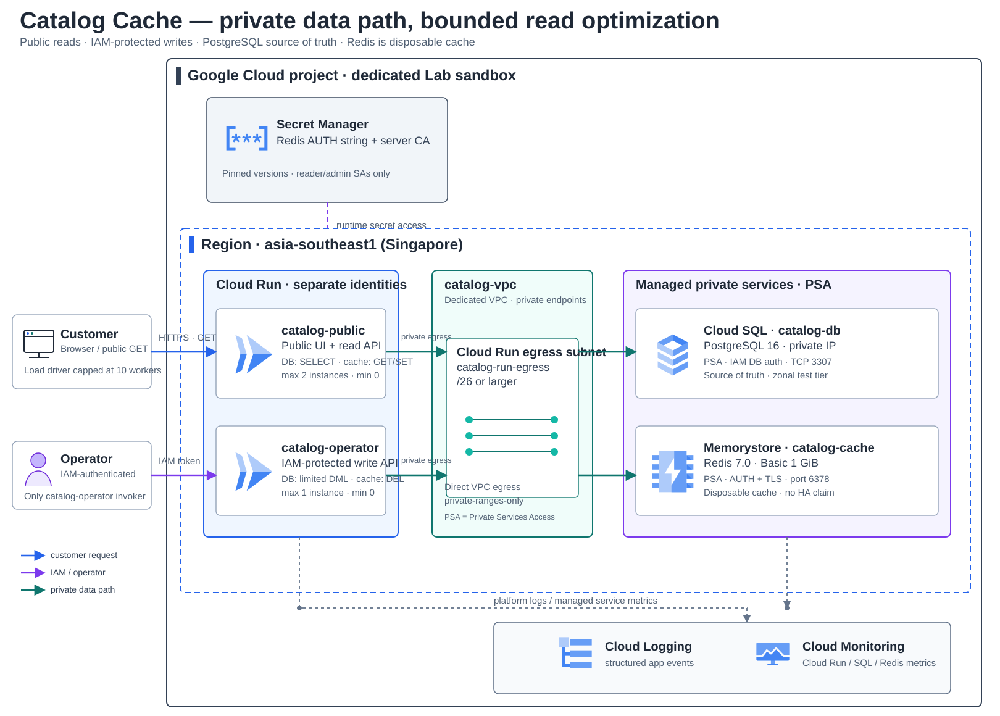
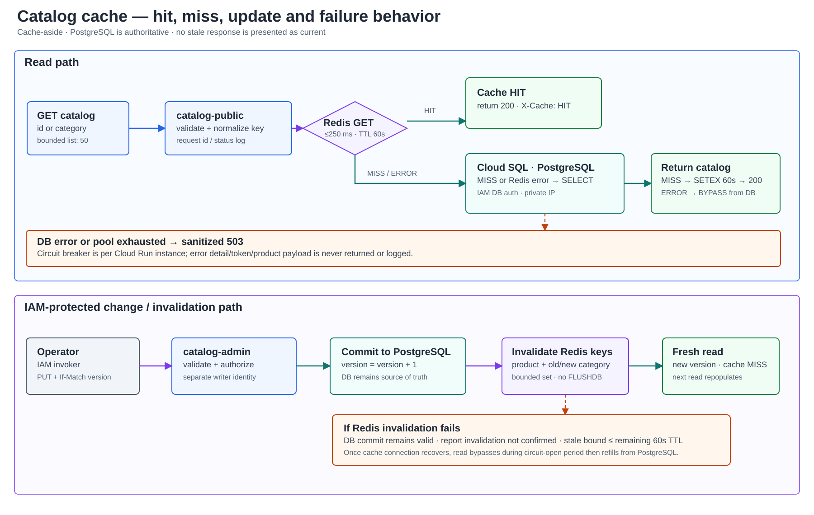

# Lab 10 — ลดภาระอ่าน Catalog ด้วย Cache-aside

**สถานะ:** Guide-ready — คู่มือ Tasks 00–14, App/API, synthetic seed, bounded load tool, Terraform, operator TTL diagnostics, troubleshooting, cleanup และ clean rebuild ผ่าน repository CI #310 ครบ 35/35 jobs โดยไม่มี credentials หรือการ provision. Cloud verification: Not run.

## สถานการณ์

ร้านค้าออนไลน์มีหน้ารายการสินค้าและหน้ารายละเอียดที่ถูกอ่านซ้ำจำนวนมาก ขณะที่การอัปเดตข้อมูลสินค้ามีน้อยกว่า การ query PostgreSQL ซ้ำทุก request เพิ่ม connection และภาระฐานข้อมูล ทีมต้องการลดการอ่านซ้ำ แต่ไม่ต้องการให้ cache กลายเป็นแหล่งข้อมูลจริง หรือทำให้หน้า Catalog แสดงข้อมูลค้างโดยไม่มีขอบเขต

ผู้เรียนจะสร้างระบบ Catalog แบบ synthetic ที่มีฐานข้อมูลเป็น source of truth, API/UI สำหรับอ่าน, เส้นทางแก้ข้อมูลที่ต้องยืนยันตัวตน และ managed Redis cache แบบ cache-aside แล้ววัดผลจาก workload ชุดเดิมก่อนและหลังเปิด cache โดยไม่ตั้งสมมติฐานว่าค่า latency จะดีขึ้นเสมอ

Solution นี้ไม่ใช้ข้อมูลลูกค้า ราคา หรือ stock สำหรับ checkout. ข้อมูลใน cache เป็น metadata ที่ยอมรับ freshness bound ได้ เช่น ชื่อ คำอธิบาย หมวดหมู่ และภาพสินค้า

## ผู้ใช้และผลลัพธ์

- ลูกค้าเปิดหน้า Catalog และอ่านรายการ/รายละเอียดสินค้าได้โดยไม่ต้องล็อกอิน
- Operator ที่ผ่าน Cloud Run IAM authentication แก้ metadata และตรวจผล invalidation ได้
- Platform operator ตรวจ cache hit/miss/error, database query count, request/error/latency และขอบเขต connection ได้
- ผู้เรียนอธิบายได้จากข้อมูลจริงว่า Cache ช่วยลด database reads หรือไม่, trade-off ที่เห็นคืออะไร และระบบตอบสนองอย่างไรเมื่อ Redis ใช้งานไม่ได้

## Requirements

| ID | Requirement | วิธีพิสูจน์ที่จะใส่ใน Guide |
|---|---|---|
| R1 | PostgreSQL เป็นแหล่งข้อมูลจริง; API อ่าน product detail และ category listing ได้ และ UI แสดง synthetic catalog | API/UI happy path, ตรวจ record/version ใน DB |
| R2 | Public service เปิดเฉพาะ read flow; การแก้ metadata ผ่าน Cloud Run service ที่ IAM-protected เท่านั้น | anonymous GET สำเร็จ, anonymous admin request ถูกปฏิเสธ, operator token ผ่าน |
| R3 | Redis ใช้ cache-aside และ key แยกตาม product/query; entry มี TTL ไม่เกิน 60 วินาที | cold request เป็น MISS, request ซ้ำเป็น HIT; Operator ตรวจ TTL ของ category ผ่าน read-only route ที่จำกัด allowlist และไม่คืน cache value |
| R4 | หลัง write ที่ commit สำเร็จให้ invalidate product key และ category keys ที่เกี่ยวข้อง; ถ้า invalidation ล้มเหลวต้องบันทึกผลและไม่อ้างว่า cache สอดคล้องทันที | เปลี่ยน metadata แล้ว GET สะท้อน version ใหม่; ฉีด Redis error และตรวจผล/ขอบเขต freshness |
| R5 | Redis เป็น optional dependency: connection timeout มีขอบเขต; เมื่อใช้ไม่ได้ให้อ่าน DB โดยตรงและส่งสัญญาณ BYPASS/ERROR โดยไม่รั่วข้อมูลภายใน; ถ้า DB ก็ใช้ไม่ได้ให้ตอบ 503 อย่างปลอดภัย | ทดสอบ client error, latency/error, sanitized logs, recovery |
| R6 | Cloud SQL และ Redis ไม่มี public endpoint; Cloud Run ใช้ Direct VPC egress ไปยัง VPC เดียวกัน | ตรวจ Terraform/Console config, private address และ Cloud Run revision networking |
| R7 | Cloud Run scaling และ DB connection pool มีเพดานที่วัดได้; load generator จำกัดจำนวน request และ concurrency | คำนวณ connection ceiling, ทดสอบ workload ที่ประกาศไว้, ตรวจไม่เกิน cap |
| R8 | ทดสอบ baseline แบบ cache-bypass, cold cache และ warm cache ด้วยข้อมูลและ request distribution เดียวกัน | บันทึก request count, errors, p50/p95, hit ratio และจำนวน SQL reads; แยก Expected จาก Actual |
| R9 | Change Request ปรับ policy สำหรับ category ที่เปลี่ยนบ่อย โดยเปลี่ยน TTL/invalidation อย่างมีเหตุผลและวัดผลซ้ำ | ทำ change, ตรวจ plan/revision, freshness และ trade-off เทียบ baseline |
| R10 | มี cleanup ที่ระบุ resource/data ที่ลบได้และสิ่งที่อาจยังคิดเงิน | ตรวจ destroy plan, ลบ Lab resources, บันทึกผลจริง |

## Acceptance criteria

เกณฑ์ต่อไปนี้เป็นสิ่งที่ผู้เรียนต้องพิสูจน์; ไม่มีผลจริงล่วงหน้าและไม่กำหนดว่าค่า latency ต้องดีขึ้น:

1. Seed data สังเคราะห์ได้ซ้ำและมี version; UI, API และ admin update แสดงค่าที่สัมพันธ์กับ DB.
2. Request ชุด baseline และ cache ใช้ seed, dataset, concurrency และจำนวน request เท่ากัน; ไม่มีการสร้าง load ที่ไม่กำหนดขอบเขต.
3. เมื่อ warm cache แล้ว hit ratio และจำนวน SQL reads เปลี่ยนไปตาม request distribution ที่กำหนด; บันทึก p50/p95 และ error rate แม้ latency จะไม่ดีขึ้น.
4. Redis connect/command error ทำให้ request ของ metadata อ่านต่อจาก DB ได้ภายใน timeout budget; ไม่มีการเสิร์ฟ stale cache โดยอ้างว่าเป็นข้อมูลปัจจุบัน.
5. Product update ปกติทำให้รายละเอียดและ category listing เห็น version ใหม่หลัง invalidation; เมื่อ Redis ขัดข้อง ให้แสดง invalidation status และระบุ stale bound ไม่เกิน TTL ที่ยังเหลือของ entry เดิม.
6. การเปลี่ยน cache policy ผ่าน change request มีผลทดสอบก่อน/หลังและอธิบายผลต่อ freshness, hit rate และ database load.

Test profile ที่ล็อก: 2,000 products, hot set 20 รายการรับ 80% ของ read requests, fixed-seed ไม่เกิน 500 requests ต่อ profile, concurrency ไม่เกิน 10, Redis connect/command timeout 250 ms, product/list TTL baseline 60 วินาที. ทำได้สูงสุด 5 profiles ต่อ experiment (bypass baseline, cold, warm, Redis failure, หลัง Change Request) รวมไม่เกิน 2,500 requests; load tool ไม่มี automatic retry. Change Request เปลี่ยน category-list TTL เป็น 15 วินาที. ตัวเลขเป็นเพดาน/ค่าตั้งต้นของ Lab ไม่ใช่ performance claim; ผู้เรียนบันทึก p50/p95 และผลจริงตาม resource ที่เลือก.

## Architecture direction

- **Public Catalog service:** Cloud Run รับ GET/UI, runtime identity อ่าน PostgreSQL และ cache เท่านั้น; ไม่เปิด write endpoint ให้ anonymous callers.
- **Operator service:** Cloud Run แยก service, ต้องมี IAM invoker; runtime identity แยกจาก public serviceและทำ metadata update/invalidation.
- **Data tier:** Cloud SQL for PostgreSQL private IP เป็น source of truth; Memorystore for Redis เป็น cache ที่ทิ้งแล้วสร้างใหม่ได้.
- **Network:** VPC เดียวกับ subnet สำหรับ Direct VPC egress; Cloud Run route เฉพาะ private ranges เข้า VPC. Cloud SQL ใช้ private connectivity; Redis ใช้ authorized VPC/private IP.
- **Observability:** response header บอก HIT/MISS/BYPASS, structured application logs ไม่มี payload/secret, bounded load result และ Cloud Monitoring/Cloud Logging ประกอบการวิเคราะห์.
- **Region/cost starting point:** asia-southeast1 (Singapore), Cloud SQL single-zone และ Memorystore Basic Tier 1 GB เป็น baseline เพื่อศึกษา cache ที่ยอมรับ cold restart/cache flush ได้. ทั้ง SQL และ Redis มีต้นทุนตามเวลา/ขนาดแม้ไม่มี traffic; ต้องทำ Pricing Calculator/cost gate ก่อน Guide จะสั่งสร้าง.
- **HA boundary:** ไม่อ้าง HA, multi-region, durability ของ Redis หรือ production SLA. ถ้า requirement ภายหลังต้องการ Redis failover ให้เปรียบเทียบ Standard Tier และค่าใช้จ่ายเป็น extension.

## Design — Architecture และ decisions ที่ปิดแล้ว

### Topology



เส้นทางสร้างและเผยแพร่ image แยกจาก request path: Cloud Shell ส่ง source ให้ Cloud Build → เก็บ image ใน Artifact Registry ตำแหน่ง asia-southeast1 → resolve SHA-256 digest แล้ว deploy digest เดียวกันให้ `catalog-public` และ `catalog-operator`. ใน Guide จะสร้าง repository ใน foundation ก่อน build; CI ตรวจ build โดยไม่ push/deploy. ค่าบริการ build และ image storage อยู่ใน cost gate.

- **Region:** asia-southeast1 (Singapore). Cloud SQL for PostgreSQL และ Memorystore for Redis มี region นี้ในรายการรองรับ ณ วันที่จัดทำ Design; ตรวจ availability/quota/ราคาอีกครั้งก่อนเริ่ม Guide.
- **VPC:** สร้าง catalog-vpc เฉพาะ Lab; ใช้ subnet catalog-run-egress ขนาด /26 สำหรับ Cloud Run Direct VPC egress. จอง IP ranges ที่ไม่ทับกันสำหรับ Private Services Access และสร้าง service networking connection ก่อนสร้าง managed private endpoints.
- **Cloud Run:** ใช้ image digest เดียวกัน แต่ deploy สอง service: catalog-public เปิด public GET/UI เท่านั้น และ catalog-operator บังคับ Cloud Run IAM invoker. ทั้งคู่ใช้ Direct VPC egress เฉพาะ private ranges, minimum instances 0; public service max 2 instances, admin max 1.
- **Cloud SQL:** PostgreSQL 16, Enterprise, single-zone, db-custom-1-3840 (1 vCPU/3.75 GiB), 10 GiB SSD, private IP ผ่าน PSA, ไม่มี public IP. เลือกขนาดเพื่อทดสอบได้ใน sandbox ไม่อ้าง SLA/HA. Database เป็น source of truth.
- **Database authentication:** ใช้ Cloud SQL Python Connector กับ private IP และ automatic IAM database authentication; allow connector egress TCP 3307 ไปยัง instance และ TCP 443 ไปยัง Cloud SQL Admin API; ไม่ใส่ database password ใน Terraform, image หรือ environment. แยก reader, operator และ migrator IAM database users กับ PostgreSQL grants; app DB grants ทดสอบกับ PostgreSQL จริงใน CI รวมถึง UPDATE แบบรายคอลัมน์. Runtime service accounts ได้เฉพาะ Cloud SQL Client + Cloud SQL Instance User ที่ต้องใช้ใน dedicated Lab project.
- **Memorystore:** Memorystore for Redis 7.0 Basic Tier, 1 GiB, private connection ผ่าน PSA, AUTH เปิดและ TLS server authentication เปิด. Cache ยอมรับ cold restart/cache flush ได้; ถ้า cache หายให้เติมจาก PostgreSQL. ไม่มี Redis failover/HA ใน baseline.
- **Redis AUTH และ Terraform state:** `google_redis_instance.auth_string` เป็น computed attribute และมีค่าเมื่อเปิด AUTH; provider ทำเครื่องหมายค่าเป็น sensitive แต่ Terraform ยังบันทึกค่าที่ sensitive ลง state/plan ได้. Secret Manager จึงเป็นสำเนาสำหรับ runtime ไม่ใช่ที่เดียวที่มี AUTH. เก็บ state ในพื้นที่ผู้ใช้ Cloud Shell ที่จำกัดสิทธิ์ไฟล์, ห้าม commit/อัปโหลด/แสดง state หรือ plan JSON และลบ state/backup หลังยืนยัน destroy สำเร็จ. สร้าง Secret Manager version นอก Terraform โดย pipe ผล `gcloud redis instances get-auth-string` เข้า `gcloud secrets versions add --data-file=-` โดยไม่พิมพ์ AUTH ลง terminal; Terraform จัดการเฉพาะ secret container ไม่จัดการ payload/version. server CA เป็น trust material สำหรับตรวจ certificate chain ไม่ใช่ credential; จัดให้ runtime อ่าน CA ที่ pin ไว้แยกจาก AUTH. Cloud Run revision อ้างเลข secret version แบบ pin และเฉพาะ reader/admin identities อ่าน AUTH/CA ได้. AUTH ต้องใช้พร้อม TLS.
- **Run identities:** public service ใช้ reader DB user (SELECT only); admin ใช้ operator DB user ที่ได้ SELECT และ UPDATE เฉพาะคอลัมน์ category/name/description/image_url/active/version/updated_at (แก้ id ไม่ได้; ไม่มี INSERT/DELETE); migrator ใช้ Cloud SQL `cloudsqlsuperuser` เฉพาะ one-shot Job เพื่อสร้าง schema/seed/grant ซึ่งเป็นสิทธิ์สูงและไม่ใช้รับ traffic; provider 6.50 ไม่รองรับ `database_roles` ใน `google_sql_user` จึง assign role หลัง foundation ด้วย `gcloud sql users assign-roles` ก่อนเรียก Job. Public service ไม่มี write grant; admin service ไม่ให้ allUsers. Build identity แยก มีเพียง log writer กับ Artifact Registry writer; Terraform ให้ผู้รัน ActAs กับ build SA แบบ scoped.
- **Catalog API/UI:** GET / และ GET /api/catalog?category=... สำหรับหน้า/รายการ, GET /api/products/{id} สำหรับรายละเอียด; listing จำกัดผล 50 records. Operator ใช้ PUT /admin/products/{id} พร้อม expected version/If-Match, GET /admin/cache/ttl/{category} แบบ read-only ที่รับเฉพาะ category allowlist, และ POST /admin/cache/clear ที่ล้างได้เฉพาะ namespace catalog:v1 ไม่ใช้ FLUSHDB.
- **Schema/data:** ตาราง products เก็บ synthetic id, category, name, description, image URL, active flag, version และ updated_at; ไม่มี price, inventory, customer data หรือ PII. Indexes รองรับ active/category/id. Seed 2,000 rows deterministically ในหนึ่ง transaction และเรียกซ้ำได้โดยไม่ duplicate.
- **Cache-aside:** product key = catalog:v1:product:{id}; category key = catalog:v1:list:{category}. Baseline TTL 60 วินาที. จำกัด category เป็น 4 ค่าที่อนุญาต จึง invalidate product key และ category list เก่ากับใหม่ได้แบบ bounded หลัง DB commit. Cache ไม่ถือข้อมูล durable และไม่ใช้ KEYS/FLUSHDB.
- **Write/cache consistency:** PostgreSQL commit มาก่อน Redis invalidation. หาก Redis ล้มเหลว write ยังคงเป็นจริงใน DB; Admin API ตอบว่าการ invalidate ยังไม่ยืนยันและบันทึก structured event, ห้ามแสดงว่า cache สด. Entry เดิมมีอายุเหลือไม่เกิน TTL 60 วินาที; product metadata เท่านั้นที่รับ stale bound นี้ได้.
- **Cache failure:** Redis timeout 250 ms; เมื่อเกิด Redis error 3 ครั้งติดกัน service instance เปิด local circuit breaker 15 วินาทีและอ่าน DB โดยตรง พร้อม X-Cache: BYPASS. Circuit breaker เป็น per-instance ไม่อ้างว่า global. เมื่อ Redis กลับมาให้ MISS/เติม cache ใหม่. ถ้า DB ใช้ไม่ได้ตอบ sanitized 503; ไม่ยอมคืนข้อมูล stale เพื่อซ่อน source-of-truth failure.
- **Connection budget:** SQLAlchemy pool size 3, max overflow 0; catalog-public ≤2 instances, catalog-operator ≤1, migration Job task ≤1. Maximum app connections ระหว่างงานปกติ = 9, migration Job เพิ่มได้ไม่เกิน 3 ระหว่างรัน; Guide ต้องตรวจค่า Cloud SQL limit/actual active sessions ก่อน load test. Cloud Run concurrency จำกัด 20 requests/instance, load driver ≤10 workers.
- **Measurement:** app ส่ง structured log ต่อ request ด้วย validated lab_run_id, cache_status, db_read flag, db_ms, total_ms, HTTP status และ error class; ห้าม log payload, auth token, AUTH string หรือ product text. Load tool ใช้ seed เดิมและ request distribution เดิม, สรุป status/cache headers/p50/p95/error rate. เปรียบเทียบ baseline cache bypass, cold, warm และ failure; ไม่มี latency target เพราะ cache overhead อาจทำให้ผลไม่ดีขึ้นใน workload เล็ก.
- **Network fault exercise:** สร้าง Cloud Run revision ชั่วคราวที่ชี้ Redis ไปยัง port 6380 ของ private endpoint (ไม่ใช่ secure port 6378), ยิง bounded requests แล้วคืน port 6378. นี่พิสูจน์ client unreachable/fallback path ไม่ใช่การทำให้ Memorystore service ล่มจริงหรือพิสูจน์ failover.
- **Change Request:** category listing ที่ถูกแก้บ่อยลด TTL จาก 60 → 15 วินาที โดยยังคง invalidate หลัง commit; ทดสอบ freshness, cache hit ratio และ DB reads ซ้ำ พร้อมอธิบายผลต่อ cache churn/DB load.
- **Cost boundary:** Cloud SQL และ Redis คิดค่าบริการตาม configuration/time แม้ไม่มี request. ไม่มี HA, public IP, NAT, load balancer, GKE หรือ cross-region replication. ก่อน provision ผู้เรียนต้องใช้ Pricing Calculator, ตั้ง budget alert และตกลงว่าจะคง project ไว้แค่ช่วงทำ Lab.

### Cache request / failure flow



Service glyphs are embedded from the pinned Google Cloud icon collection; source commit, per-file hashes and the diagram-style attribution are recorded in `assets/diagram-provenance.json`.

### Design decision record

ล็อกการตัดสินใจต่อไปนี้สำหรับ Lab baseline แล้ว; หากข้อกำหนดเปลี่ยน ให้เปิดเป็น change request ใหม่แทนการแก้ค่ากลางทางโดยไม่บันทึกเหตุผล

1. **Private connectivity — PSA.** ใช้ VPC เฉพาะ Lab, non-overlapping PSA ranges และ Cloud Run Direct VPC egress subnet /26.
2. **Cloud SQL — private IP + Python Connector + automatic IAM DB authentication.** ใช้ roles แยก reader/operator/migrator; pool size 3, max overflow 0; public/admin สูงสุดรวม 3 instances จึงมี runtime pool ceiling 9 connections และ one-shot migration job เพิ่มได้สูงสุดอีก 3 connections ระหว่าง execute. Migrator แยกจาก request path.
3. **Redis — Memorystore Basic 1 GiB, Redis 7.0, PSA, AUTH และ TLS.** ใช้ TLS endpoint port 6378, Secret Manager pinned secret versions และ connect/command timeout 250 ms. ค่า AUTH ที่ provider เปิดเผยเป็น sensitive computed attribute ยังอยู่ใน Terraform state; runtime secret version สร้างแยกนอก Terraform. จำกัดสิทธิ์ state และ Secret Manager ตามบทบาท.
4. **Data/API/cache contract — bounded metadata only.** ตารางมี version; categories allowlist 4 ค่า; listing limit 50; 2,000 deterministic synthetic products. Product/category keys มี namespace `catalog:v1`; baseline TTL 60 s; invalidate product และ category เก่า/ใหม่หลัง commit.
5. **Measurement — same workload, explicit counters.** fixed seed ≤500 requests ต่อ profile (≤2,500 ต่อ experiment), hot set 20 รับ 80%, concurrency ≤10; มี Terraform toggles แบบจำกัดค่าเพื่อปิด cache (matched DB-only baseline) และชี้ Redis ไปพอร์ต private 6380 (client-path fault); วัด SQL reads, cache status, p50/p95 และ errors. ไม่บังคับ latency threshold และไม่ log payload/secret.
6. **Failure exercise — reversible client-path fault.** Revision ชั่วคราวชี้ Redis ไป private port 6380, พิสูจน์ fallback/bounded wait แล้วคืน 6378. Hard database outage ทดสอบด้วย CI test double; Cloud exercise ใช้เพียง bounded probe ไม่ทำให้ connection pool เต็ม.
7. **Infrastructure and cleanup — staged, reviewable.** Terraform ใช้ root เดียวพร้อม `enable_workloads=false` สำหรับ foundation; หลัง build image แบบ digest และเพิ่ม secret versions จาก stdin แล้วจึงเปิด workloads. AUTH อยู่ใน provider-managed Terraform state จึงต้องป้องกัน state/plan จากการอ่านหรือ commit; Cloud SQL/Cloud Run ใช้ deletion-protection fields, ส่วน Redis ใช้ Terraform `prevent_destroy` (ต้องถอด guard อย่างชัดเจนใน cleanup); runtime Secret Manager version สร้างนอก Terraform โดยไม่แสดงค่า. ทำ destroy เฉพาะ Lab resources และลบ state/backup เมื่อยืนยันการลบสำเร็จ. คู่มือมี stop/go cost gate ก่อน apply; เอกสารนี้ไม่ได้ provision ให้.
8. **Region/cost — asia-southeast1, no numeric cost claim.** Region และ service fit อ้าง official documentation; ผู้เรียนต้องคำนวณจากค่าที่เลือกใน Pricing Calculator และตัดสินใจว่าจะคง resources ไว้ช่วงใดก่อน provision. Baseline ไม่ใช้ HA, NAT, public IP, LB หรือ cross-region.

### Design trade-offs

- แยก public read จาก IAM-protected operator เพื่อให้ Cloud Run IAM บังคับสิทธิ์ระดับ service ได้จริง; แลกกับการ deploy สอง service และต้องดูแล service accounts/DB roles สองชุด.
- ใช้ Cloud SQL IAM database authentication และ Python Connector เพื่อตัด static DB password; เพิ่ม API/Cloud SQL IAM prerequisites และ connector/connection-pool behavior ที่ต้องตรวจ.
- ใช้ Memorystore Basic เพราะ cache สร้างใหม่ได้และอยากพิสูจน์ว่า source of truth ไม่พึ่ง Redis; ไม่มี replication/failover จึงไม่เหมาะกับ requirement availability สูง.
- ใช้ PSA เพราะ Lab มี VPC เดียวและต้องการเส้นทาง private ที่ทำซ้ำได้; ยอมรับข้อจำกัดของ VPC peering/one-network design. หากต้องเชื่อมหลาย VPC ในอนาคต ให้ประเมิน Cloud SQL PSC/แนวทางที่บริการรองรับใหม่.
- Cache สะสมเพียง product metadata และจำกัด query shapes/categories เพื่อให้ TTL/invalidation ทดสอบและ cleanup ได้; ไม่ใช้กับราคา/stock ที่มีผลต่อ transaction.
- Baseline จะรายงานทั้ง request-level cache, SQL reads, p50/p95 และ errors. จะไม่สรุปว่า cache คุ้มจาก hit ratio อย่างเดียว; ต้องชั่ง latency/complexity/always-on Redis cost กับการลด DB reads ที่วัดได้.

## สถานการณ์ทดสอบที่ต้องอยู่ใน Lab

- **Normal:** seed, public browse, hot-key reads, inspect hit/miss, compare DB reads/latency.
- **Cache cold/expired:** clear namespace แบบจำกัดขอบเขตหรือรอ TTL, ตรวจ MISS แล้วเติม cache.
- **Invalidation:** operator update product/category, ตรวจ affected keys และ version ใหม่.
- **Redis connection failure:** ใช้ failure injection ที่ระบุชัดและคืน config เดิม; verify DB fallback, timeout, logs และ recovery. ห้ามลบ/stop resource เพื่อสร้าง outage โดยไม่มีแผนย้อนกลับ.
- **Database failure/connection pressure:** ใช้ test double/CI สำหรับ hard outage; ใน Cloud ใช้ safe bounded connection/availability probe โดยไม่ทำให้ instance หมด connection จริง.
- **Change Request:** category ที่อัปเดตบ่อยลด TTL จาก baseline; ทดสอบ freshness, hit ratio และ SQL reads ซ้ำ.
- **Cleanup/rebuild:** destroy เฉพาะ Lab project resources, สร้างจาก clean state ได้ และไม่ลบ resources นอก Lab.

## หลักฐานที่ผู้เรียนจะบันทึกใน README

- Architecture/region/resource versions และค่าใช้จ่ายที่คาดก่อนเริ่ม
- Terraform plan/apply summary ที่ไม่แสดง secret, Cloud Run revision และ private endpoint inventory
- seed version, request count, seed/concurrency, cache policy และ test timestamps
- baseline/cold/warm/load outputs: hit/miss/bypass, SQL reads, p50/p95, errors และ Cloud Monitoring time range
- admin IAM deny/allow, product version ก่อน/หลัง update และ invalidation result
- cache-failure fallback/recovery, sanitized logs และผล connection cap
- Change Request decision, trade-offs, cleanup verification และ case-study summary

## ขอบเขตที่ไม่รวม

- ราคาสินค้า/ยอดคงเหลือที่ใช้ยืนยันการซื้อ; checkout/order/payment
- PII, customer account, recommendation engine, CDN, global load balancing
- Redis เป็นระบบ durable หรือ source of truth; exactly-once invalidation ข้าม database/cache
- การกล่าวว่า cache ลด latency/ค่าใช้จ่ายได้เท่าใดก่อนมีผลวัดจริง
- การทดสอบ Redis service-level outage/failover จริงในชุด CI; Cloud failure exercise เป็น client-path fault ที่ย้อนกลับได้

## วิธีทำ — Tasks 00–14

ทำตามลำดับในโปรเจกต์ GCP เฉพาะสำหรับ Lab นี้เท่านั้น ใช้ Google Cloud Shell เพื่อให้ Terraform state และไฟล์ผลทดสอบอยู่ในสภาพแวดล้อมเดียวกันตลอด Lab; อย่าเอา `terraform.tfstate`, state backup, plan, token, Redis AUTH หรือ private key เข้า GitHub. ตัวอย่าง command เป็นคำสั่งสำหรับผู้เรียนรันเอง ไม่ใช่ผลที่รันแล้วใน Cloud ของผู้เขียนคู่มือ

ค่า **Expected** เป็นสัญญาของการทดสอบ ไม่ใช่ผลจริง. หลังทำแต่ละ Task ให้กรอก **Actual / Status / UTC** และ **Evidence** จากสิ่งที่คุณเห็นจริง; ถ้าไม่ได้รัน ให้คง `Not run`. อย่ากรอก PASS จากตัวอย่างที่คาดหวัง.

### Task 00 — Cost gate และขอบเขตโปรเจกต์

1. เลือก Google Cloud project ที่สร้างไว้สำหรับ Lab นี้โดยเฉพาะและผูก billing แล้ว ห้ามใช้ production/shared project.
2. เปิด [Google Cloud Pricing Calculator](https://cloud.google.com/products/calculator) แล้วเพิ่ม Cloud SQL PostgreSQL `db-custom-1-3840`, 10 GiB SSD, zonal; Memorystore for Redis Basic 1 GiB; Secret Manager; Artifact Registry; Cloud Build และค่า network ที่เกี่ยวข้อง โดยเลือก `asia-southeast1`. SQL/Redis มีค่าใช้จ่ายต่อเนื่องแม้ไม่มี request; Cloud Run ตั้ง min instances 0 แต่การใช้จริงยังมีค่าใช้จ่ายตาม request/CPU/memory. Budget alert เป็นการแจ้งเตือน ไม่ใช่ hard spending cap.
3. ตกลงช่วงเวลาเปิดระบบและผู้รับผิดชอบ cleanup. ถ้าไม่มี billing, ไม่มีงบ/เวลา cleanup, project มี policy ที่ห้ามทรัพยากรเหล่านี้ หรือไม่มั่นใจว่าจะทำลายได้ ให้หยุดก่อน Task 02.
4. ให้ project administrator ตรวจว่า account สำหรับ Terraform/Cloud Shell สามารถเปิด APIs และสร้าง/จัดการเฉพาะเครือข่าย, Cloud SQL, Memorystore, IAM/service accounts, Secret Manager, Artifact Registry, Cloud Build และ Cloud Run ใน project นี้ได้; Task 04 ต้องอ่าน Redis AUTH/CA, เพิ่ม Secret versions และ assign database role. ใช้ role ที่จำเป็นใน project เฉพาะ Lab ไม่ใช้ `roles/owner`; ถ้านโยบายองค์กรไม่อนุญาต public Cloud Run หรือ custom IAM ให้หยุด ไม่หาทางเลี่ยง policy.

**Expected:** มี project ID เฉพาะ, billing ที่ใช้ได้, ประมาณการจาก calculator ที่คุณทำเอง และช่วงเวลาสำหรับ cleanup; ยังไม่มี Lab resource ถูกสร้างจาก Terraform.

**Actual / Status / UTC:** _Not run — กรอกหลังตรวจจริง_

**Evidence:** `project ID` (ปกปิดใน portfolio ได้), วันที่/ช่วงเวลาที่อนุมัติค่าใช้จ่าย, รายการ calculator ที่ใช้ และคำตัดสิน Go / Stop; ไม่แนบข้อมูล billing account.

### Task 01 — เปิด Cloud Shell และเตรียม working copy

เปิด Google Cloud Console → Activate Cloud Shell. ในตัวอย่างให้แทน `REPLACE_WITH_DEDICATED_PROJECT_ID` ด้วย project ID จริงก่อนรัน. ใช้ terminal tab เดิมตลอด Lab; หาก Cloud Shell session ใหม่ ให้ตั้งค่าตัวแปรอีกครั้ง. บัญชีที่ใช้ Terraform/Cloud Build/Cloud SQL role ต้องตรงกับ `operator_member` ที่กำหนดใน tfvars.

```bash
export PROJECT_ID="REPLACE_WITH_DEDICATED_PROJECT_ID"
export REGION="asia-southeast1"
gcloud auth list
gcloud config set project "$PROJECT_ID"
gcloud config set run/region "$REGION"
gcloud auth application-default print-access-token >/dev/null

git clone --single-branch --branch main \
  https://github.com/somkid-s5/Portfolio-Lab.git
cd Portfolio-Lab/GCP/LAB-010-catalog-cache
cp infra/terraform.tfvars.example infra/terraform.tfvars
chmod 600 infra/terraform.tfvars
nano infra/terraform.tfvars
```

ใน `nano` แก้ `project_id` และ `operator_member` ให้ตรงกับ project และบัญชีที่แสดงจาก `gcloud auth list` (รูปแบบ `user:you@example.com`); คง `region = "asia-southeast1"`, `enable_workloads = false`, `cache_enabled = true`, `simulate_redis_failure = false` และ `allow_destroy = false`. บันทึกไฟล์. ห้ามใส่ค่า secret ลง tfvars.

**Expected:** `gcloud config get-value project` ตรงกับ dedicated project; `infra/terraform.tfvars` มีค่า project/member จริงและ permission `600`; ค่า secret version กับ image ยังว่างใน phase แรก.

**Actual / Status / UTC:** _Not run — กรอกหลังตรวจจริง_

**Evidence:** account type (ไม่ต้องเปิดเผยอีเมลเต็ม), project ID ที่ปกปิดแล้ว, region, ผลตรวจ permission ของไฟล์; ห้ามแนบ tfvars.

### Task 02 — ตรวจ Terraform และทบทวน Foundation plan

จากโฟลเดอร์ `GCP/LAB-010-catalog-cache` ตรวจ provider/config และ plan เท่านั้น. คำสั่งนี้ยังไม่สร้าง Cloud resource.

```bash
terraform -chdir=infra version
terraform -chdir=infra fmt -check -diff -recursive
terraform -chdir=infra init
terraform -chdir=infra validate
terraform -chdir=infra plan -out=lab010-foundation.tfplan
terraform -chdir=infra show -no-color lab010-foundation.tfplan
```

ตรวจ project ID ก่อนดู plan. Foundation ควรมี VPC/subnet/Private Services Access, Cloud SQL, Memorystore, Artifact Registry, Secret Manager containers, APIs และ service accounts/IAM; ต้องยังไม่มี Cloud Run services/job เพราะ `enable_workloads=false`. ตรวจว่าจะไม่ลบหรือแก้ resource ที่อยู่นอกชื่อ Lab. Cloud SQL และ Redis เริ่มคิดค่าใช้จ่ายหลังสร้าง. ถ้า plan มี resource replacement, target project ผิด, หรือมีการลบนอก Lab ให้หยุดและหาสาเหตุก่อน apply.

**Expected:** `fmt`, `validate` และ plan ผ่าน; plan ชี้เฉพาะ foundation ใน project/region ที่ตั้งใจ; ไม่มี workload service/job และไม่มี action ลบ resource ที่ไม่เกี่ยวข้อง.

**Actual / Status / UTC:** _Not run — กรอกหลังตรวจจริง_

**Evidence:** Terraform version, จำนวน resource ตาม plan, ชื่อ Cloud SQL/Redis/VPC, การยืนยัน target project; เก็บ plan ไว้เฉพาะ Cloud Shell และห้าม commit/upload.

### Task 03 — สร้างและตรวจ Foundation

ก่อน apply อ่าน plan อีกครั้งและยืนยันว่า project เป็น sandbox. จากนั้น apply plan file ที่เพิ่งตรวจแล้ว.

```bash
terraform -chdir=infra apply lab010-foundation.tfplan
terraform -chdir=infra output artifact_registry_repository
terraform -chdir=infra output cloud_sql_private_ip
terraform -chdir=infra output redis_private_host
terraform -chdir=infra output database_service_accounts
```

ใน Console ตรวจที่ **VPC network → VPC networks / Private Service Access**, **Cloud SQL → Instances → `lab010-catalog-db` → Connections**, **Memorystore for Redis → `lab010-catalog-cache`**, **Artifact Registry → Repositories**, และ **Secret Manager**. ยืนยัน Cloud SQL เปิด private IP เท่านั้น/ปิด public IPv4, Redis เป็น Basic 1 GiB และเปิด AUTH + server-authenticated TLS, และ Cloud Run subnet/PSA ไม่ทับกัน. ค่า `redis_private_host` เป็น private IP; ห้ามเปิด AUTH string ใน terminal, screenshot หรือ log.

ถ้า Cloud SQL ยังสถานะ `PENDING`/`CREATING` ให้รอจนเป็น `RUNNABLE`; รอ Memorystore จนแสดงว่า `READY`/พร้อมใช้งานก่อนทำ Task ต่อ. ห้ามสร้าง workaround เป็น public IP, authorized network, VM หรือ NAT.

**Expected:** Cloud SQL และ Redis private-only ใน region ที่กำหนด; Artifact Registry และ secret containers มีชื่อ `lab010-*`; output ไม่มี AUTH; Terraform state อยู่ใน `infra/` บน Cloud Shell เท่านั้น.

**Actual / Status / UTC:** _Not run — กรอกหลังตรวจจริง_

**Evidence:** ผล Terraform apply summary แบบไม่แสดงค่า sensitive, ภาพ config ที่ปกปิด project ID/IP ได้ และ resource inventory; ห้ามแนบ state/plan.

### Task 04 — ส่ง Redis AUTH/CA เข้า Secret Manager และกำหนดสิทธิ์ Migrator

Secret payload ต้องไหลผ่าน stdin จาก gcloud ไป Secret Manager โดยไม่พิมพ์ลงจอ. อย่าเปิด `set -x`, อย่าใช้ `echo`, shell variable หรือไฟล์ชั่วคราวเก็บ payload. ถ้า pipeline ล้มเหลว ให้ดูเฉพาะ error message ที่ไม่มีค่า secret แล้วแก้ permission/instance state.

```bash
set -o pipefail
if ! gcloud redis instances get-auth-string lab010-catalog-cache \
  --region="$REGION" --project="$PROJECT_ID" --format='value(authString)' |
  awk 'NF { found=1 } END { exit !found }'; then
  printf 'AUTH value is unavailable; stop before creating a Secret version.\n' >&2
  exit 1
fi
gcloud redis instances get-auth-string lab010-catalog-cache \
  --region="$REGION" --project="$PROJECT_ID" --format='value(authString)' |
  gcloud secrets versions add lab010-redis-auth \
    --project="$PROJECT_ID" --data-file=-

if ! gcloud redis instances describe lab010-catalog-cache \
  --region="$REGION" --project="$PROJECT_ID" \
  --format='value(serverCaCerts[0].cert)' |
  awk 'NF { found=1 } END { exit !found }'; then
  printf 'Server CA is unavailable; stop before creating a Secret version.\n' >&2
  exit 1
fi
gcloud redis instances describe lab010-catalog-cache \
  --region="$REGION" --project="$PROJECT_ID" \
  --format='value(serverCaCerts[0].cert)' |
  gcloud secrets versions add lab010-redis-ca \
    --project="$PROJECT_ID" --data-file=-
```

สองคำสั่งควรคืนเพียง metadata เช่นเลข secret version ไม่ใช่ payload. ตรวจ Secret Manager → `lab010-redis-auth` และ `lab010-redis-ca` → Versions ให้เห็น version ที่เป็น `Enabled`; อย่ากดดู secret value. จดเฉพาะเลข version แล้วใส่ใน tfvars เป็น string เช่น `redis_auth_version = "1"` และ `redis_ca_version = "1"` (ใช้เลขที่ปรากฏจริง).

Terraform provider สร้าง IAM DB users แล้ว. ให้ role ที่จำเป็นกับ migrator identity ซึ่งใช้เฉพาะ one-shot migration Job; คำสั่งนี้เป็น database role ที่มีสิทธิ์สูงเพื่อสร้าง schema/role/grant และจะคงอยู่จนกว่าจะ destroy instance เว้นแต่ผู้ดูแลจัดการเปลี่ยนสิทธิ์ด้วยขั้นตอนที่ตรวจสอบแล้ว.

```bash
export MIGRATOR_DB_USER="lab010-catalog-migrator@${PROJECT_ID}.iam"
gcloud sql users assign-roles "$MIGRATOR_DB_USER" \
  --instance=lab010-catalog-db \
  --type=CLOUD_IAM_SERVICE_ACCOUNT \
  --database-roles=cloudsqlsuperuser \
  --project="$PROJECT_ID"
gcloud sql users list --instance=lab010-catalog-db --project="$PROJECT_ID"
gcloud secrets versions list lab010-redis-auth --project="$PROJECT_ID" \
  --format='table(name,state,createTime)'
gcloud secrets versions list lab010-redis-ca --project="$PROJECT_ID" \
  --format='table(name,state,createTime)'
```

ถ้า instance ไม่พร้อม, secret payload ว่าง, หรือ role update ถูกปฏิเสธ ให้หยุด. อย่าแก้ด้วยการให้ `roles/owner`; ตรวจ Cloud SQL Admin/API/permission ที่ขาด แล้วขอสิทธิ์เฉพาะจาก project administrator.

**Expected:** secret versions มีสถานะ Enabled โดยค่า payload ไม่ถูกแสดง; migrator IAM DB user ได้ `cloudsqlsuperuser`; reader/operator ยังคงใช้สิทธิ์ PostgreSQL ที่ migration grant ให้แยกกัน.

**Actual / Status / UTC:** _Not run — กรอกหลังรันจริง_

**Evidence:** version number/state (ไม่ใช่ value), command result ที่ไม่มี payload และ database user/type/role; ห้ามบันทึก AUTH, access token หรือ secret output.

### Task 05 — Build image และ pin digest

ให้ยืนอยู่ที่ `GCP/LAB-010-catalog-cache` ซึ่งมี `Dockerfile`, `.dockerignore` และ `cloudbuild.yaml`. `.dockerignore` ตัด `infra/`, tests และ Terraform state/plan ออกจาก upload context. Cloud Build ใช้ `lab010-catalog-builder` ที่แยกจาก runtime identities.

```bash
IMAGE_TAG="${REGION}-docker.pkg.dev/${PROJECT_ID}/lab010-images/catalog:lab10-$(git rev-parse --short HEAD)"
gcloud builds submit . \
  --config=cloudbuild.yaml \
  --region="$REGION" \
  --substitutions="_IMAGE_URI=${IMAGE_TAG}"
```

เปิด Console → **Cloud Build → History** เลือก build ล่าสุดจากเวลาที่สั่ง แล้วตรวจสถานะ `SUCCESS`, service account และ image target. จด Build ID; ใช้ `gcloud builds describe` แสดง metadata/digest เท่านั้น.

```bash
export BUILD_ID="REPLACE_WITH_BUILD_ID_FROM_CLOUD_BUILD_HISTORY"
gcloud builds describe "$BUILD_ID" --region="$REGION" --project="$PROJECT_ID" \
  --format='yaml(id,status,results.images)'
```

คัดลอก `sha256:...` ของ image ที่ตรงกับ `lab010-images/catalog` แล้วตั้ง `IMAGE_URI` เป็น `asia-southeast1-docker.pkg.dev/PROJECT_ID/lab010-images/catalog@sha256:...` (แทน `PROJECT_ID` ด้วย project จริง). ห้าม deploy ด้วย tag ที่เคลื่อนย้ายได้.

**Expected:** Build สำเร็จและ Artifact Registry มี image digest; image build เป็น non-root ตาม CI contract; ยังไม่มี Cloud Run workload จนกว่าจะเปิด gate ใน Task 06.

**Actual / Status / UTC:** _Not run — กรอกหลังตรวจจริง_

**Evidence:** Build ID/status, repository path และ digest; ห้ามแนบ build log ที่มีข้อมูลภายในโดยไม่ตรวจ/ปกปิดก่อน.

### Task 06 — เปิด Workloads โดยเริ่มจาก cache-bypass baseline

แก้ `infra/terraform.tfvars` ให้เป็นค่าจริงของ environment. เปิด workload หลังมี image digest และ secret versions แล้ว. ตั้ง `cache_enabled = false` เพื่อเก็บ database-only baseline ก่อน; คง fault=false และ baseline category TTL=60.

```bash
nano infra/terraform.tfvars
terraform -chdir=infra plan -out=lab010-workloads.tfplan
terraform -chdir=infra show -no-color lab010-workloads.tfplan
```

ในไฟล์กำหนด `enable_workloads = true`, `image_uri` เป็นค่า `@sha256`, `redis_auth_version` และ `redis_ca_version` เป็นเลข version จริง, `cache_enabled = false`, `simulate_redis_failure = false`, `category_list_ttl_seconds = 60`, `allow_destroy = false`. ก่อน apply ให้ตรวจว่า plan สร้างเพียง public/operator Cloud Run services กับ migration Job และ IAM binding ที่เกี่ยวข้อง ไม่ replace Cloud SQL/Redis หรือแก้ project/region.

```bash
terraform -chdir=infra apply lab010-workloads.tfplan
terraform -chdir=infra output -json service_urls
```

**Expected:** มี `lab010-catalog-public`, `lab010-catalog-operator` และ `lab010-catalog-migrate`; public/operator ใช้ image digest เดียวกัน, Direct VPC egress ไป subnet Lab, min instances 0; env ของ public/operator ตั้ง cache disabled สำหรับ baseline.

**Actual / Status / UTC:** _Not run — กรอกหลังตรวจจริง_

**Evidence:** Plan summary/revision name/image digest/network settings; ห้ามแนบ tfvars หรือ plan file.

### Task 07 — สร้าง schema/seed ด้วย migration Job

สั่ง migration Job หนึ่งครั้ง แล้วรอผลจบ. Job มีหนึ่ง task, parallelism หนึ่ง, retry ศูนย์ และใช้ migrator identity. การ seed เป็น deterministic/idempotent; หากรันซ้ำ `inserted` อาจเป็น 0 เพราะมีข้อมูลอยู่แล้ว.

```bash
gcloud run jobs execute lab010-catalog-migrate \
  --region="$REGION" --project="$PROJECT_ID" --wait
```

Console → **Cloud Run → Jobs → `lab010-catalog-migrate` → Executions** เปิด execution ล่าสุดแล้วดู task state/log. คาด log event `catalog_seeded_and_granted`, `seed_version=catalog-v1`, `expected=2000`; `inserted=2000` เมื่อเป็น database ใหม่ หรือเป็น 0 เมื่อ seed ไปแล้ว. ตรวจ Cloud SQL **Databases** ว่ามี database `catalog`; อย่ารัน SQL ด้วย root/admin user จากเครื่องส่วนตัว.

**Expected:** Job จบ `Succeeded`; schema มีตาราง `products`, seed ทำซ้ำได้, และ runtime grants ถูกสร้าง; หากไม่สำเร็จให้หยุดก่อนยิง workload และแก้ IAM DB login / grants / private path.

**Actual / Status / UTC:** _Not run — กรอกหลังรันจริง_

**Evidence:** Execution name, state, event/version/count และ log timestamp; ปกปิด project details ที่ไม่ต้องการเผยแพร่.

### Task 08 — ตรวจ Public read และ IAM boundary

อ่าน URL จาก output ของ Terraform แล้วเก็บใน shell variables; token เก็บเฉพาะในตัวแปรชั่วคราวและห้ามพิมพ์ค่า.

```bash
SERVICE_URLS="$(terraform -chdir=infra output -json service_urls)"
export PUBLIC_URL="$(python3 -c 'import json,sys; print(json.load(sys.stdin)["public"])' <<<"$SERVICE_URLS")"
export OPERATOR_URL="$(python3 -c 'import json,sys; print(json.load(sys.stdin)["operator"])' <<<"$SERVICE_URLS")"

curl -i "$PUBLIC_URL/healthz"
curl -i "$PUBLIC_URL/readyz"
curl -i "$PUBLIC_URL/api/products/1"
curl -sS -o /dev/null -w 'anonymous operator HTTP %{http_code}\n' \
  -X POST "$OPERATOR_URL/admin/cache/clear"

ID_TOKEN="$(gcloud auth print-identity-token --audiences="$OPERATOR_URL")"
curl -i -X POST "$OPERATOR_URL/admin/cache/clear" \
  -H "Authorization: Bearer $ID_TOKEN"
unset ID_TOKEN
```

public `/healthz`, `/readyz`, product API ควรตอบ 200; database ยังไม่พร้อมจะทำให้ readiness เป็น 503. anonymous operator request ต้องถูก Cloud Run ปฏิเสธ (ไม่ใช่ 2xx); token ของ `operator_member` ที่ได้รับ `roles/run.invoker` จึงเรียก operator ได้. เมื่อ cache ปิด การเรียก clear ที่ผ่าน IAM อาจตอบ HTTP 200 แต่ body ระบุ `status=not_confirmed` เพราะไม่มี Redis operation; ใช้ยืนยันเฉพาะ IAM/DB path ไม่ใช่การ clear cache. หน้า `/` เปิด UI Catalog และดึงข้อมูลสังเคราะห์; ไม่มี public write API. `cache_enabled=false` ทำให้ read response มี `X-Cache: BYPASS`.

ถ้า anonymous เข้าถึง operator ได้ ให้หยุดและตรวจ IAM binding; ห้ามแก้โดยเปลี่ยน admin เป็น public. ถ้าผู้เรียกได้ 403 ให้ตรวจ active account, `operator_member`, audience ที่ตรงกับ URL และ invoker binding.

**Expected:** public read ใช้ได้โดยไม่ล็อกอิน; operator route ปฏิเสธ anonymous และผ่านเมื่อ identity ถูกต้อง; response มี `X-Request-ID`, `X-Cache` และ `Cache-Control: no-store`; secret ไม่ปรากฏใน response/log.

**Actual / Status / UTC:** _Not run — กรอกหลังทดสอบจริง_

**Evidence:** HTTP status/headers ที่ตัด token ออก, response request ID, IAM binding และภาพหน้า UI ที่ใช้ข้อมูล synthetic.

### Task 09 — วัด Database-only baseline แบบจำกัด

ตั้ง cache ยังปิดอยู่ตาม Task 06. รัน workload profile ด้วยจำนวน/seed/worker เดิมสำหรับทุก profile; ค่าเริ่มต้นนี้ใช้ 200 requests, 5 workers, fixed seed `20261024`. `run_load.py` จำกัดสูงสุด 500 ต่อ profile, 2,500 ต่อ experiment และ 10 workers; ไม่มี retry อัตโนมัติ. ผล JSON อยู่ใน path ที่ `.gitignore` ป้องกัน.

```bash
python3 scripts/run_load.py \
  --base-url "$PUBLIC_URL" --profile bypass \
  --requests 200 --workers 5 --seed 20261024 \
  --out-dir lab10-results/experiment-01
python3 -c 'import json; print(json.load(open("lab10-results/experiment-01/bypass.json"))["run_id"])'
```

เก็บ `run_id` จากไฟล์ JSON แล้วเปิด Console → **Logging → Logs Explorer**. ใช้ filter:

```text
resource.type="cloud_run_revision"
resource.labels.service_name="lab010-catalog-public"
jsonPayload.event="catalog_request"
jsonPayload.lab_run_id="REPLACE_WITH_RUN_ID"
```

รวม `db_reads`, `cache_status`, `total_ms`, `status_code` ตามผลจริง. baseline ที่ cache ปิดควรเป็น `BYPASS` และ request ที่อ่าน product/list สำเร็จจะอ่านจาก DB; ไม่ตั้งเป้าว่าต้องได้ latency เท่าใด. ใน Cloud SQL → **Instance → System insights/Monitoring** ดู metric `postgresql/num_backends` เทียบ pool ceiling ใน Design โดยไม่สร้าง load เพิ่มเอง. Metric นี้เก็บตัวอย่างเป็นช่วง จึงอาจแสดงข้อมูลช้ากว่าการทดสอบ; ใช้ app logs สำหรับ request-level SQL read counts.

**Expected:** JSON แสดง request ที่พยายาม 200, workers 5, seed 20261024, status/errors/cache counts และ p50/p95; logs หาได้จาก `run_id`; ไม่เกินขอบเขต connection/request.

**Actual / Status / UTC:** _Not run — กรอกค่าจริง รวม status/error counts, SQL reads, p50/p95 และเวลา_

**Evidence:** `bypass.json` เก็บไว้ใน Cloud Shell (ignored), experiment manifest และ Logs Explorer filter/time range; ใน portfolio ให้คัดเฉพาะ summary ที่ตรวจแล้ว ห้ามอ้างค่า Expected เป็นผลจริง.

### Task 10 — เปิด Cache, ทดสอบ Cold/Warm และตรวจ TTL จริง

แก้ tfvars เป็น `cache_enabled = true`; ค่าอื่นคงเดิม. Plan ต้องอัปเดต revision ของ Cloud Run เท่านั้น ไม่ replace Cloud SQL/Redis. Apply plan ที่ตรวจแล้ว และรอทั้งสอง service พร้อม.

```bash
nano infra/terraform.tfvars
terraform -chdir=infra plan -out=lab010-cache-on.tfplan
terraform -chdir=infra show -no-color lab010-cache-on.tfplan
terraform -chdir=infra apply lab010-cache-on.tfplan

ID_TOKEN="$(gcloud auth print-identity-token --audiences="$OPERATOR_URL")"
curl -fsS -X POST "$OPERATOR_URL/admin/cache/clear" \
  -H "Authorization: Bearer $ID_TOKEN"
curl -i "$PUBLIC_URL/api/products/1"
curl -i "$PUBLIC_URL/api/products/1"
curl -i "$PUBLIC_URL/api/catalog?category=books"
curl -i "$PUBLIC_URL/api/catalog?category=books"
curl -i "$OPERATOR_URL/admin/cache/ttl/books" \
  -H "Authorization: Bearer $ID_TOKEN"
unset ID_TOKEN

python3 scripts/run_load.py \
  --base-url "$PUBLIC_URL" --profile cold \
  --requests 200 --workers 5 --seed 20261024 \
  --out-dir lab10-results/experiment-01
python3 scripts/run_load.py \
  --base-url "$PUBLIC_URL" --profile warm \
  --requests 200 --workers 5 --seed 20261024 \
  --out-dir lab10-results/experiment-01
```

หลัง clear, request แรกของ key ที่ยังไม่มีควร `MISS`, request ซ้ำควร `HIT`; category TTL endpoint คืน key ที่ allowlist ไว้และ `ttl_seconds` จริงระหว่าง 1–60. เปรียบเทียบ `bypass.json`, `cold.json`, `warm.json` โดยใช้ count/worker/seed เดิม: HTTP errors, `X-Cache` distribution, SQL `db_reads`, p50/p95. Cache อาจเพิ่ม latency ใน workload เล็ก; รายงานทั้งผลดีและไม่ดีโดยไม่เลือกเฉพาะตัวเลขที่ชอบ. ถ้า `run_load.py` ล้มเหลวและ profile ถูก reserve ไปแล้ว ให้เริ่ม `experiment-02` ใหม่ ไม่แก้ manifest เก่า.

**Expected:** cache cold/warm เปลี่ยนจาก MISS ไป HIT ได้, diagnostic ตรวจ TTL ที่ Redis เก็บจริง, และ logs ยืนยัน SQL read count; ยังไม่มี performance target ที่รับประกัน.

**Actual / Status / UTC:** _Not run — กรอกผลแต่ละ profile แยกกัน_

**Evidence:** สาม JSON summaries, TTL diagnostic response, run IDs/Logs Explorer และ Cloud SQL connection chart; raw files อยู่ใน ignored directory จนกว่าจะคัด summary ไป README.

### Task 11 — Operator write, cache invalidation และ optimistic concurrency

ใช้ product `500` ในฐานข้อมูล synthetic ใหม่; หากทำ Lab ต่อจากรอบก่อน ให้ใช้ version ที่ได้จาก GET ไม่ hardcode `1`. การเปลี่ยน category นี้ควรทำให้ key ของ category เดิมและใหม่ invalidate หลัง commit.

```bash
CURRENT_VERSION="$(curl -fsS "$PUBLIC_URL/api/products/500" | \
  python3 -c 'import json,sys; print(json.load(sys.stdin)["version"])')"
printf 'Current version: %s\n' "$CURRENT_VERSION"
ID_TOKEN="$(gcloud auth print-identity-token --audiences="$OPERATOR_URL")"

curl -i -X PUT "$OPERATOR_URL/admin/products/500" \
  -H "Authorization: Bearer $ID_TOKEN" \
  -H "Content-Type: application/json" \
  -H "If-Match: \"$CURRENT_VERSION\"" \
  --data '{"category":"electronics","name":"Lab 10 Demo Product 0500"}'

curl -i "$PUBLIC_URL/api/products/500"
curl -i "$PUBLIC_URL/api/catalog?category=books"
curl -i "$PUBLIC_URL/api/catalog?category=electronics"

curl -sS -o /dev/null -w 'stale-version HTTP %{http_code}\n' \
  -X PUT "$OPERATOR_URL/admin/products/500" \
  -H "Authorization: Bearer $ID_TOKEN" \
  -H "Content-Type: application/json" \
  -H "If-Match: \"$CURRENT_VERSION\"" \
  --data '{"name":"This stale write must not apply"}'
unset ID_TOKEN
```

write แรกควรตอบ 200, version เพิ่ม 1, `cache_invalidation=confirmed`; รายการ electronics ใน 50 แถวแรกมี product 500 (เรียงตาม ID) และ books ไม่มี product 500. write ซ้ำด้วย version เก่าควรตอบ 412 และไม่เปลี่ยนชื่อ. ถ้า header version หาย API ตอบ 428; field ที่ไม่อนุญาต/invalid category ตอบ 400. ตรวจค่า actual ใน GET ก่อน/หลังและ log เท่านั้น. ถ้า Redis invalidation ไม่ยืนยัน ให้เก็บ response/status/stale bound ตามจริง; ห้ามสรุปว่า cache สด.

**Expected:** เฉพาะ IAM-authorized operator เปลี่ยน metadata ได้, version guard ปฏิเสธ stale write, read หลัง commit เห็น version/category ใหม่และ invalidation ที่ยืนยันได้.

**Actual / Status / UTC:** _Not run — กรอก status code, version เดิม/ใหม่ และผล invalidation_

**Evidence:** HTTP request/response ที่ลบ Authorization header ออก, product 500 ก่อน/หลัง, old/new category query และ log run/request IDs.

### Task 12 — Fault injection ที่ Redis client path และ recovery

เปลี่ยนเฉพาะ `simulate_redis_failure = true` ใน tfvars; ต้องคง cache enabled และอย่าแก้ Redis instance/network. Terraform จะสร้าง Cloud Run revision ใหม่ที่ชี้ client ไป private TCP port `6380` แทน TLS port `6378`; เป็นการจำลอง client connection failure แบบย้อนกลับได้ ไม่ใช่การทำให้ Memorystore ล่มจริง.

```bash
nano infra/terraform.tfvars
terraform -chdir=infra plan -out=lab010-redis-fault.tfplan
terraform -chdir=infra show -no-color lab010-redis-fault.tfplan
terraform -chdir=infra apply lab010-redis-fault.tfplan

python3 scripts/run_load.py \
  --base-url "$PUBLIC_URL" --profile redis-failure \
  --requests 100 --workers 5 --seed 20261024 \
  --out-dir lab10-results/experiment-01
```

Fault plan ต้องเปลี่ยน Cloud Run revision env เท่านั้น, ไม่มี SQL/Redis replacement. ตรวจว่า `redis-failure.json` ไม่มี HTTP/service error (หากมีให้วิเคราะห์ ไม่ซ่อน), `X-Cache` เป็น `BYPASS`, `db_reads` เพิ่ม และเวลา fallback ตามที่วัดจริง. Redis client timeout ตั้งไว้ 250 ms และ breaker เป็น per-instance 15 วินาที; ไม่รับรอง p95 ของทั้ง HTTP request. อย่ารันซ้ำเกิน profile/request budget.

จากนั้นคืนค่าทันทีและตรวจ recovery ด้วย request สองครั้ง.

```bash
nano infra/terraform.tfvars
terraform -chdir=infra plan -out=lab010-redis-restore.tfplan
terraform -chdir=infra show -no-color lab010-redis-restore.tfplan
terraform -chdir=infra apply lab010-redis-restore.tfplan

curl -i "$PUBLIC_URL/api/products/1"
curl -i "$PUBLIC_URL/api/products/1"
```

ใน tfvars คืน `simulate_redis_failure = false` (port 6378), คง `cache_enabled = true`. รอ revision ใหม่ Ready; คาด request แรก MISS แล้วครั้งต่อไป HIT เมื่อ Redis path กลับมา. ตรวจ Logs Explorer ด้วย run ID ของ `redis-failure` และ request ID recovery. ถ้า restore apply ไม่สำเร็จ ให้หยุด load ทันทีและแก้กลับ port 6378; อย่าปล่อย fault revision ค้าง.

**Expected:** ระหว่าง fault API ยังอ่านจาก PostgreSQL ได้และส่ง `BYPASS`; หลัง restore cache กลับมา MISS/HIT ได้; หลักฐานไม่อ้างว่า Redis service-level failover ถูกทดสอบ.

**Actual / Status / UTC:** _Not run — กรอกผล fault และ recovery แยกกัน_

**Evidence:** fault/restore plan summary, `redis-failure.json`, sanitized logs, revision env port ก่อน/หลัง และผล request recovery.

### Task 13 — Change Request: category-list TTL 60 → 15 วินาที

ทีม Catalog แจ้งว่ารายการ category เปลี่ยนถี่ขึ้น จึงขอลด stale window ของรายการจาก 60 เป็น 15 วินาที. เปลี่ยนเฉพาะ `category_list_ttl_seconds = 15`; คง cache enabled, Redis restored, image digest และ request profile เดิม. อ่าน plan ให้แน่ใจว่าเป็น Cloud Run revision config change เท่านั้น.

```bash
nano infra/terraform.tfvars
terraform -chdir=infra plan -out=lab010-ttl-change.tfplan
terraform -chdir=infra show -no-color lab010-ttl-change.tfplan
terraform -chdir=infra apply lab010-ttl-change.tfplan

ID_TOKEN="$(gcloud auth print-identity-token --audiences="$OPERATOR_URL")"
curl -fsS -X POST "$OPERATOR_URL/admin/cache/clear" \
  -H "Authorization: Bearer $ID_TOKEN"
unset ID_TOKEN

curl -i "$PUBLIC_URL/api/catalog?category=books"
ID_TOKEN="$(gcloud auth print-identity-token --audiences="$OPERATOR_URL")"
curl -i "$OPERATOR_URL/admin/cache/ttl/books" \
  -H "Authorization: Bearer $ID_TOKEN"
unset ID_TOKEN
sleep 16
curl -i "$PUBLIC_URL/api/catalog?category=books"
ID_TOKEN="$(gcloud auth print-identity-token --audiences="$OPERATOR_URL")"
curl -i "$OPERATOR_URL/admin/cache/ttl/books" \
  -H "Authorization: Bearer $ID_TOKEN"
unset ID_TOKEN

python3 scripts/run_load.py \
  --base-url "$PUBLIC_URL" --profile change-request \
  --requests 200 --workers 5 --seed 20261024 \
  --out-dir lab10-results/experiment-01

for profile in bypass cold warm redis-failure change-request; do
  python3 -c 'import json,sys; name=sys.argv[1]; path=f"lab10-results/experiment-01/{name}.json"; print(name, json.load(open(path))["run_id"])' "$profile"
done
```

หลัง clear แล้ว category request ควร MISS; `/admin/cache/ttl/books` ควรอ่าน TTL จริง 1–15. รอ 16 วินาทีให้ entry เดิมหมดอายุ แล้ว request ใหม่ควร MISS และเติม entry ใหม่; diagnostic ยืนยัน TTL รอบใหม่อยู่ในช่วง 1–15. ใน `change-request.json` เปรียบเทียบกับ warm profile และอธิบาย cache hit/read trade-off จากค่า actual — การทดสอบเพียง 200 requests ไม่ได้พิสูจน์ production freshness/SLA. หาก TTL ยังเป็น 60 ให้ตรวจ revision ว่า `CATEGORY_LIST_TTL_SECONDS=15`, key ที่ตรวจเป็น list key และได้ clear หลัง deploy แล้ว.

**Expected:** change ถูกจำกัดอยู่ที่ category-list TTL; Redis TTL ที่อ่านจริงไม่เกิน 15 วินาทีและหมดอายุ/เติมใหม่; product TTL ยังคง 60 วินาที; มีผล workload หลัง change พร้อม trade-off ที่ระบุชัด.

**Actual / Status / UTC:** _Not run — กรอก TTL ก่อน/หลัง, MISS/HIT, run counts, SQL reads, p50/p95 และ error counts_

**Evidence:** plan/revision env, TTL endpoint ก่อน-หมดอายุ-หลังเติม, `change-request.json`, log filter/time window และสรุป trade-off.

### Task 14 — Cleanup และ handoff หลักฐาน Portfolio

ห้ามปิด Cloud Shell หรือทิ้ง Terraform state ก่อน cleanup. ทำตามลำดับนี้ เพราะ Cloud SQL/Cloud Run มี deletion protection และ Redis มี `lifecycle.prevent_destroy` แบบ static.

1. แก้ tfvars เป็น `allow_destroy = true` และ `enable_workloads = false`; คง project/region เดิม. ตรวจ state inventory ด้วย `terraform -chdir=infra state list` และยืนยันทุก resource เป็น `lab010-*` หรือ resource dependency ที่ Task นี้สร้าง.
2. สร้างและ review `lab010-cleanup-workloads.tfplan`; ต้องเห็น Cloud Run service/job ถูกลบ และ Cloud SQL/Run deletion protection ถูกปิด แต่ยังไม่ลบ SQL/Redis. Apply plan นี้.
3. เปิด `infra/main.tf` ใน Cloud Shell editor แล้วเอาเฉพาะ block `lifecycle { prevent_destroy = true }` ของ `google_redis_instance.catalog` ออกใน working copy; ห้าม commit การถอด guard นี้. ตรวจ diff ให้แน่ใจว่าไม่มีไฟล์อื่นเปลี่ยน.
4. สร้าง `terraform -chdir=infra plan -destroy -out=lab010-destroy.tfplan`; อ่าน plan และตรวจ project/resource list ทีละรายการ. ถ้ามี resource นอก Lab หรือไม่แน่ใจ ให้ยกเลิกและขอความช่วยเหลือ.
5. เมื่อยืนยัน target และ resource list ด้วยตนเองแล้ว apply แผนที่ตรวจแล้ว. ไม่ใช้ `-auto-approve`.
6. หลัง destroy สำเร็จ ให้ใส่ Redis `lifecycle { prevent_destroy = true }` block กลับใน working copy ตามไฟล์ tracked เดิม แล้วตรวจ `git diff -- infra/main.tf` ว่าง; การถอด guard ใช้เฉพาะ cleanup ครั้งนี้.

```bash
terraform -chdir=infra state list
terraform -chdir=infra plan -out=lab010-cleanup-workloads.tfplan
terraform -chdir=infra show -no-color lab010-cleanup-workloads.tfplan
terraform -chdir=infra apply lab010-cleanup-workloads.tfplan

# หลังแก้เฉพาะ Redis prevent_destroy ใน infra/main.tf working copy:
terraform -chdir=infra plan -destroy -out=lab010-destroy.tfplan
terraform -chdir=infra show -no-color lab010-destroy.tfplan
terraform -chdir=infra apply lab010-destroy.tfplan
terraform -chdir=infra state list
```

ตรวจ Console ว่า SQL instance, Redis instance, Cloud Run services/job, secret containers และ Lab VPC ถูกลบแล้ว; API ที่เปิดโดย Terraform อาจยัง enabled ตาม `disable_on_destroy=false` แต่ไม่ใช่ compute/database instance. หลังยืนยัน destroy สำเร็จแล้วเท่านั้น ลบไฟล์ state/backup/plan/tfvars ที่ระบุแน่ชัดจาก `infra/`; ห้ามใช้ wildcard หรือ recursive delete:

```bash
cd infra
rm -f terraform.tfstate terraform.tfstate.backup \
  lab010-foundation.tfplan lab010-workloads.tfplan lab010-cache-on.tfplan \
  lab010-redis-fault.tfplan lab010-redis-restore.tfplan lab010-ttl-change.tfplan \
  lab010-cleanup-workloads.tfplan lab010-destroy.tfplan terraform.tfvars
```

ตรวจ Secret Manager ว่าไม่มี secret version คงค้าง; ถ้ายังมี ให้ระบุ exact secret/version และตรวจผลกระทบก่อนลบตามนโยบายของ project. อย่าลบ billing project, user account, resources นอก Lab หรือสิ่งที่ไม่ได้อยู่ใน Terraform state นี้.

**Expected:** workload/data/cache/network/secret containers ของ Lab ถูกลบ; `terraform state list` ว่าง; local state/plan ที่มี sensitive provider value ถูกลบหลังยืนยันแล้ว; ไม่มีการลบ resource นอก Lab.

**Actual / Status / UTC:** _Not run — กรอก resource count ที่ลบ, verification time และไฟล์ที่ลบ_

**Evidence:** state list ก่อน/หลัง (resource names only), destroy summary, Console inventory หลัง cleanup และ sanitized screenshots; ไม่มี state/plan payload.

## Portfolio case study — กรอกหลัง Cloud run จริง

เขียนสรุปนี้จากข้อมูลที่เก็บใน Tasks เท่านั้น; ถ้ายังไม่ได้รัน GCP ให้คงช่อง Actual ว่าง/Not run. ไม่ใส่ benchmark ที่ไม่มี run ID และไม่เปลี่ยน CI test result ให้กลายเป็น Cloud result.

| หัวข้อ | บันทึกจริง |
|---|---|
| Business problem / ผู้ใช้ | _ใครอ่าน Catalog ซ้ำ และปัญหา DB read ที่ต้องการตรวจ_ |
| Constraints | _region, budget window, private-only, synthetic data, instance/pool caps_ |
| Architecture decision | _cache-aside, source of truth, identity split, network path และเหตุผล_ |
| Evidence of implementation | _Terraform revision, image digest, migration execution, sanitized resource inventory_ |
| Measurement | _bypass/cold/warm/failure/change-request: requests, workers, HTTP errors, SQL reads, cache status, p50/p95 และ run IDs_ |
| Failure & recovery | _ผล Redis client-path fault, fallback, restore และสิ่งที่ไม่ได้ทดสอบ_ |
| Change request | _เหตุผล TTL 60→15, TTL ที่อ่านจริง, freshness/hit-rate/DB-load trade-off_ |
| Security / operations | _anonymous vs operator boundary, IAM DB roles, connection ceiling, logging/secret handling_ |
| Cost / cleanup | _calculator estimate ของคุณ, actual duration, resource teardown evidence_ |
| What I would change for production | _HA/monitoring/alerting/security/traffic assumptions ที่ยังนอก Lab_ |

**Case-study claim status:** `Not run` จนกว่าจะมี Cloud run ID และหลักฐานจริง. Lab นี้ไม่มีการรับรอง production SLA หรือค่า latency ที่คาดหวัง.


## Troubleshooting และ Clean rebuild

ใช้ลำดับ **ดู symptom → ตรวจ revision/IAM/log → เปลี่ยนเฉพาะสาเหตุที่ยืนยันได้ → ทดสอบซ้ำด้วยขอบเขตเดิม**. อย่าแก้ปัญหาด้วยการเปิด public IP, ปิด TLS/IAM, ให้ Owner หรือเพิ่ม load โดยไม่จำกัด.

| อาการ | จุดตรวจ | วิธีแก้/เกณฑ์หยุด |
|---|---|---|
| Terraform API/permission denied | project ID/ billing, API enable permission, resource/IAM permission ที่ขาด | ขอ role เฉพาะใน dedicated project; ไม่ให้ `roles/owner`. ถ้า org policy ห้าม ให้หยุดและรายงานข้อจำกัด |
| PSA, Cloud SQL หรือ Redis สร้างไม่สำเร็จ | VPC/subnet, ช่วง PSA /16 ที่ไม่ทับ, operation state, region/quota | รอ managed service พร้อมหรือแก้ range/quota ตาม plan; ห้ามใช้ public IP/authorized network แทน |
| Migration Job login denied | Job service account, Cloud SQL IAM user type/username, `roles/cloudsql.client`, `roles/cloudsql.instanceUser`, database role ของ migrator | ตรวจ IAM propagation และ `cloudsqlsuperuser` ที่ assign ให้ migrator ก่อน rerun; ไม่ใส่ static DB password |
| Operator ตอบ 401/403 | active principal เทียบ `operator_member`, token audience ต้องตรง `OPERATOR_URL`, `roles/run.invoker` binding | สร้าง identity token ใหม่ด้วย audience URL ปัจจุบัน; ถ้า anonymous ได้ 2xx ให้หยุดและแก้ IAM ก่อนทำต่อ |
| Public readiness 503 / API 503 | Cloud Run revision logs, `error_class`, Cloud SQL RUNNABLE/private route, IAM DB login/grants, migration execution | แก้ source-of-truth path ก่อน; Redis เป็น optional และไม่ควรทำให้ DB 503 เมื่อ DB ปกติ |
| Cache แสดง BYPASS ทุกครั้ง | revision env `CACHE_ENABLED`, Redis host/port 6378, secret version state/reader access, TLS CA/AUTH | แยก disabled, circuit-open, connection/TLS/AUTH error จาก logs; ห้ามแก้ด้วยการปิด TLS หรือพิมพ์ secret |
| TTL diagnostic เป็น missing/unavailable | เรียก GET category ก่อนเพื่อสร้าง key; ตรวจว่า category อยู่ใน allowlist; ดู `ttl_state` และ `reason` | `missing` หมายถึง key ยังไม่มี/หมดอายุ; `unavailable` ให้ตรวจ cache flag/revision/Redis path โดยไม่ลอง arbitrary key |
| Change Request ยังเห็น TTL 60 | revision มี `CATEGORY_LIST_TTL_SECONDS=15`, plan/apply ใช้ไฟล์ tfvars ที่ถูกต้อง, category cache ถูก clear หลัง rollout | ใช้ operator clear, GET รายการเพื่อเติม key ใหม่ แล้วตรวจ TTL endpoint; product key คง TTL 60 |
| Update ได้ 412 | version ล่าสุดของ product เปลี่ยนแล้ว | GET product ใหม่และส่ง `If-Match` ตาม version ล่าสุด; อย่าลองส่ง stale version ซ้ำ |
| Load tool แจ้ง profile ซ้ำ/เกิน budget | `experiment.json` จอง profile/request ไว้ก่อนยิงจริง | อย่าแก้ manifest ย้อนหลัง; เริ่ม `experiment-02` ใหม่และคงขอบเขต 500/profile, 2,500/experiment, 10 workers |
| Cleanup ติด `prevent_destroy` | Cloud Run workload ถูกลบ/ protection ปิดแล้วหรือไม่, Redis guard ถูกถอดจาก working copy เฉพาะ cleanup หรือยัง | ย้อนดู Task 14; ตรวจ destroy plan ก่อน apply. ห้ามถอด guard ใน commit หรือใช้ auto-approve |

### เริ่มใหม่จาก clean state

หลัง Task 14 ต้องยืนยันว่า GCP resources หาย, Redis guard ถูกใส่กลับใน source, และ Terraform state/plan ถูกลบแล้ว. ถ้าต้องการทำซ้ำ ให้ใช้ Cloud Shell working copy เดิมใน branch เดิม; สร้าง tfvars ใหม่และทำ cost/permission gate ใหม่. Redis AUTH และ CA เป็นค่าของ instance เดิมที่ถูกลบ จึงต้องเพิ่ม version ใหม่หลัง foundation รอบใหม่. ใช้ result directory ใหม่เพื่อเก็บ run แยกจากหลักฐานเดิม:

```bash
REPO_ROOT="$(git rev-parse --show-toplevel)"
cd "$REPO_ROOT/GCP/LAB-010-catalog-cache"
if [[ -e infra/terraform.tfvars ]]; then
  echo "พบ terraform.tfvars เดิม: ตรวจสอบและเก็บค่าที่จำเป็นก่อนสร้างไฟล์ใหม่"
  exit 1
fi
cp infra/terraform.tfvars.example infra/terraform.tfvars
chmod 600 infra/terraform.tfvars
git diff -- infra/main.tf
```

เมื่อ source diff ว่างและ project/billing ยืนยันแล้ว ให้กลับไป Task 00 และทำตาม Tasks ตั้งแต่ต้น. หากใช้ project เดิม ให้ตรวจว่าไม่มีทรัพยากร/secret ของรอบก่อนตกค้าง; API services ที่ถูกเปิดไว้อาจยัง enabled ได้. สำหรับ measurement รอบใหม่ใช้ `--out-dir lab10-results/experiment-02`; เก็บ raw JSON แยกรอบและคัดเฉพาะ summary ที่ตรวจแล้วเข้าส่วน case study.

## References used for Design and future Guide

- [Connect to a Redis instance from Cloud Run using Direct VPC egress](https://docs.cloud.google.com/memorystore/docs/redis/connect-redis-instance-cloud-run)
- [Cloud Run Direct VPC egress](https://docs.cloud.google.com/run/docs/configuring/vpc-direct-vpc)
- [Cloud SQL private connection from Cloud Run and connection limits](https://docs.cloud.google.com/sql/docs/postgres/connect-run)
- [Cloud SQL IAM database authentication](https://docs.cloud.google.com/sql/docs/postgres/iam-authentication)
- [Automatic IAM database authentication with Cloud SQL Python Connector](https://docs.cloud.google.com/sql/docs/postgres/iam-logins)
- [Cloud SQL connector network egress requirements](https://docs.cloud.google.com/sql/docs/postgres/sql-proxy)
- [Cloud SQL private IP options](https://docs.cloud.google.com/sql/docs/postgres/private-ip)
- [Memorystore for Redis networking and Private Service Access](https://docs.cloud.google.com/memorystore/docs/redis/networking)
- [Memorystore Redis AUTH and TLS](https://docs.cloud.google.com/memorystore/docs/redis/manage-redis-auth)
- [Cloud Run service secrets](https://docs.cloud.google.com/run/docs/configuring/services/secrets)
- [Build container images with Cloud Build](https://docs.cloud.google.com/build/docs/building/build-containers)
- [Deploy container images to Cloud Run](https://docs.cloud.google.com/run/docs/deploying)
- [Artifact Registry repository locations](https://docs.cloud.google.com/artifact-registry/docs/repositories/repo-locations)
- [Private services access overview for Cloud SQL](https://docs.cloud.google.com/sql/docs/postgres/about-private-services-access)
- [Memorystore for Redis Basic and Standard tiers](https://docs.cloud.google.com/memorystore/docs/redis/redis-tiers)
- [Memorystore for Redis regions](https://docs.cloud.google.com/memorystore/docs/redis/regions)
- [Memorystore for Redis instances and capacity](https://docs.cloud.google.com/memorystore/docs/redis/instances)
- [Memorystore Redis AUTH](https://docs.cloud.google.com/memorystore/docs/redis/about-redis-auth)
- [Memorystore Redis in-transit encryption](https://docs.cloud.google.com/memorystore/docs/redis/about-in-transit-encryption)
- [Memorystore pricing](https://cloud.google.com/memorystore/docs/redis/pricing)
- [Cloud SQL pricing](https://cloud.google.com/sql/pricing)
- [Terraform google_redis_instance resource](https://registry.terraform.io/providers/hashicorp/google/latest/docs/resources/redis_instance.html)
- [Terraform: manage sensitive data and protect state](https://developer.hashicorp.com/terraform/language/manage-sensitive-data)
- [Terraform: state and sensitive provider values](https://developer.hashicorp.com/terraform/language/expressions/references)
- [Get Memorystore Redis AUTH string](https://docs.cloud.google.com/memorystore/docs/redis/manage-redis-auth)
- [Add a Secret Manager version from standard input](https://docs.cloud.google.com/sdk/gcloud/reference/secrets/versions/add)
- [redis-py 7.4.1 package and release information](https://pypi.org/project/redis/7.4.1/)
- [Cloud SQL Python Connector](https://github.com/GoogleCloudPlatform/cloud-sql-python-connector)

- [Cloud SQL IAM database authentication และ GRANT](https://docs.cloud.google.com/sql/docs/postgres/iam-authentication)
- [สร้าง/จัดการ IAM database users และ PostgreSQL grants](https://docs.cloud.google.com/sql/docs/postgres/add-manage-iam-users)
- [Cloud Build user-managed service account](https://docs.cloud.google.com/build/docs/securing-builds/configure-user-specified-service-accounts)
- [Memorystore supported Redis versions](https://docs.cloud.google.com/memorystore/docs/redis/supported-versions)
- [Terraform Google provider 6.50.0 — Cloud SQL user resource](https://github.com/hashicorp/terraform-provider-google/blob/v6.50.0/website/docs/r/sql_user.html.markdown)
- [Terraform Google provider 6.50.0 — Memorystore Redis instance resource](https://github.com/hashicorp/terraform-provider-google/blob/v6.50.0/website/docs/r/redis_instance.html.markdown)
- [Assign Cloud SQL database roles with gcloud](https://docs.cloud.google.com/sdk/gcloud/reference/sql/users/assign-roles)

- [gcloud auth print-identity-token และ audience ของ Cloud Run](https://docs.cloud.google.com/sdk/gcloud/reference/auth/print-identity-token)
- [gcloud run jobs execute](https://docs.cloud.google.com/sdk/gcloud/reference/run/jobs/execute)
- [gcloud builds submit และ custom build service account](https://docs.cloud.google.com/sdk/gcloud/reference/builds/submit)
- [Assign Cloud SQL database roles with gcloud](https://docs.cloud.google.com/sdk/gcloud/reference/sql/users/assign-roles)
- [Memorystore AUTH string command](https://docs.cloud.google.com/sdk/gcloud/reference/redis/instances/get-auth-string)
- [Memorystore Redis instance REST resource and server CA field](https://docs.cloud.google.com/memorystore/docs/redis/reference/rest/v1/projects.locations.instances)
- [Pricing Calculator](https://cloud.google.com/products/calculator)
- [Cloud SQL PostgreSQL connection metric and monitoring delay](https://docs.cloud.google.com/sql/docs/postgres/use-system-insights)
