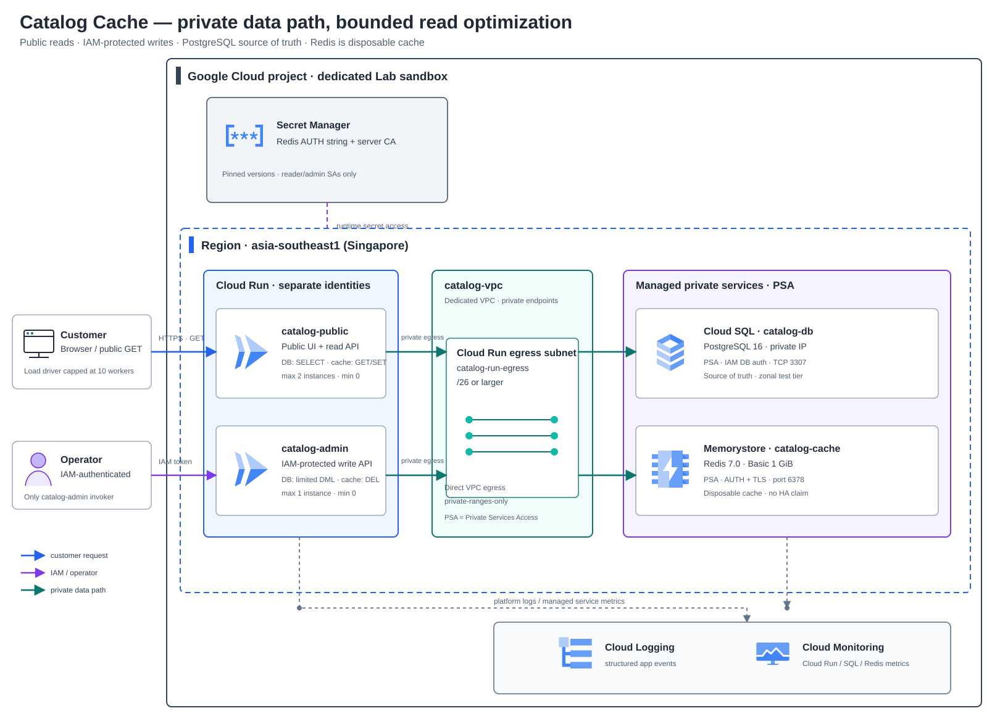
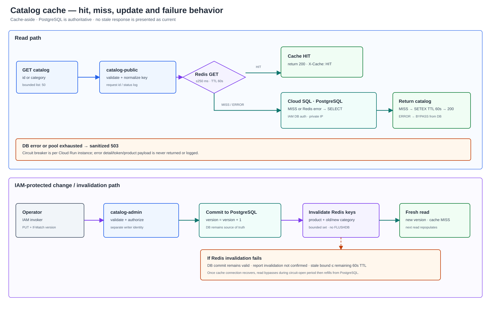

# Lab 10 — ลดภาระอ่าน Catalog ด้วย Cache-aside

**สถานะ:** Design — ปิด business requirements, access boundary, database/cache topology, consistency/failure model, bounded measurement profile และ Change Request แล้ว. ยังไม่มี Task คู่มือ, App, Terraform หรือผลการรัน Cloud.

## สถานการณ์

ร้านค้าออนไลน์มีหน้ารายการสินค้าและหน้ารายละเอียดที่ถูกอ่านซ้ำจำนวนมาก ขณะที่การอัปเดตข้อมูลสินค้ามีน้อยกว่า การ query PostgreSQL ซ้ำทุก request เพิ่ม connection และภาระฐานข้อมูล ทีมต้องการลดการอ่านซ้ำ แต่ไม่ต้องการให้ cache กลายเป็นแหล่งข้อมูลจริง หรือทำให้หน้า Catalog แสดงข้อมูลค้างโดยไม่มีขอบเขต

ผู้เรียนจะสร้างระบบ Catalog แบบ synthetic ที่มีฐานข้อมูลเป็น source of truth, API/UI สำหรับอ่าน, เส้นทางแก้ข้อมูลที่ต้องยืนยันตัวตน และ managed Redis cache แบบ cache-aside แล้ววัดผลจาก workload ชุดเดิมก่อนและหลังเปิด cache โดยไม่ตั้งสมมติฐานว่าค่า latency จะดีขึ้นเสมอ

Solution นี้ไม่ใช้ข้อมูลลูกค้า ราคา หรือ stock สำหรับ checkout. ข้อมูลใน cache เป็น metadata ที่ยอมรับ freshness bound ได้ เช่น ชื่อ คำอธิบาย หมวดหมู่ และภาพสินค้า

## ผู้ใช้และผลลัพธ์

- ลูกค้าเปิดหน้า Catalog และอ่านรายการ/รายละเอียดสินค้าได้โดยไม่ต้องล็อกอิน
- Operator ที่ผ่าน Cloud Run IAM authentication แก้ metadata และตรวจผล invalidation ได้
- Platform operator ตรวจ cache hit/miss/error, database query count, request/error/latency และขอบเขต connection ได้
- ผู้เรียนอธิบายได้จากข้อมูลจริงว่า Cache ช่วยลด database reads หรือไม่, trade-off ที่เห็นคืออะไร และระบบตอบสนองอย่างไรเมื่อ Redis ใช้งานไม่ได้

## Requirements

| ID | Requirement | วิธีพิสูจน์ที่จะใส่ใน Guide |
|---|---|---|
| R1 | PostgreSQL เป็นแหล่งข้อมูลจริง; API อ่าน product detail และ category listing ได้ และ UI แสดง synthetic catalog | API/UI happy path, ตรวจ record/version ใน DB |
| R2 | Public service เปิดเฉพาะ read flow; การแก้ metadata ผ่าน Cloud Run service ที่ IAM-protected เท่านั้น | anonymous GET สำเร็จ, anonymous admin request ถูกปฏิเสธ, operator token ผ่าน |
| R3 | Redis ใช้ cache-aside และ key แยกตาม product/query; entry มี TTL ไม่เกิน 60 วินาที | cold request เป็น MISS, request ซ้ำเป็น HIT, ตรวจ TTL และ cache key |
| R4 | หลัง write ที่ commit สำเร็จให้ invalidate product key และ category keys ที่เกี่ยวข้อง; ถ้า invalidation ล้มเหลวต้องบันทึกผลและไม่อ้างว่า cache สอดคล้องทันที | เปลี่ยน metadata แล้ว GET สะท้อน version ใหม่; ฉีด Redis error และตรวจผล/ขอบเขต freshness |
| R5 | Redis เป็น optional dependency: connection timeout มีขอบเขต; เมื่อใช้ไม่ได้ให้อ่าน DB โดยตรงและส่งสัญญาณ BYPASS/ERROR โดยไม่รั่วข้อมูลภายใน; ถ้า DB ก็ใช้ไม่ได้ให้ตอบ 503 อย่างปลอดภัย | ทดสอบ client error, latency/error, sanitized logs, recovery |
| R6 | Cloud SQL และ Redis ไม่มี public endpoint; Cloud Run ใช้ Direct VPC egress ไปยัง VPC เดียวกัน | ตรวจ Terraform/Console config, private address และ Cloud Run revision networking |
| R7 | Cloud Run scaling และ DB connection pool มีเพดานที่วัดได้; load generator จำกัดจำนวน request และ concurrency | คำนวณ connection ceiling, ทดสอบ workload ที่ประกาศไว้, ตรวจไม่เกิน cap |
| R8 | ทดสอบ baseline แบบ cache-bypass, cold cache และ warm cache ด้วยข้อมูลและ request distribution เดียวกัน | บันทึก request count, errors, p50/p95, hit ratio และจำนวน SQL reads; แยก Expected จาก Actual |
| R9 | Change Request ปรับ policy สำหรับ category ที่เปลี่ยนบ่อย โดยเปลี่ยน TTL/invalidation อย่างมีเหตุผลและวัดผลซ้ำ | ทำ change, ตรวจ plan/revision, freshness และ trade-off เทียบ baseline |
| R10 | มี cleanup ที่ระบุ resource/data ที่ลบได้และสิ่งที่อาจยังคิดเงิน | ตรวจ destroy plan, ลบ Lab resources, บันทึกผลจริง |

## Acceptance criteria

เกณฑ์ต่อไปนี้เป็นสิ่งที่ผู้เรียนต้องพิสูจน์; ไม่มีผลจริงล่วงหน้าและไม่กำหนดว่าค่า latency ต้องดีขึ้น:

1. Seed data สังเคราะห์ได้ซ้ำและมี version; UI, API และ admin update แสดงค่าที่สัมพันธ์กับ DB.
2. Request ชุด baseline และ cache ใช้ seed, dataset, concurrency และจำนวน request เท่ากัน; ไม่มีการสร้าง load ที่ไม่กำหนดขอบเขต.
3. เมื่อ warm cache แล้ว hit ratio และจำนวน SQL reads เปลี่ยนไปตาม request distribution ที่กำหนด; บันทึก p50/p95 และ error rate แม้ latency จะไม่ดีขึ้น.
4. Redis connect/command error ทำให้ request ของ metadata อ่านต่อจาก DB ได้ภายใน timeout budget; ไม่มีการเสิร์ฟ stale cache โดยอ้างว่าเป็นข้อมูลปัจจุบัน.
5. Product update ปกติทำให้รายละเอียดและ category listing เห็น version ใหม่หลัง invalidation; เมื่อ Redis ขัดข้อง ให้แสดง invalidation status และระบุ stale bound ไม่เกิน TTL ที่ยังเหลือของ entry เดิม.
6. การเปลี่ยน cache policy ผ่าน change request มีผลทดสอบก่อน/หลังและอธิบายผลต่อ freshness, hit rate และ database load.

Test profile ที่ล็อก: 2,000 products, hot set 20 รายการรับ 80% ของ read requests, fixed-seed 500 requests, concurrency ไม่เกิน 10, Redis connect/command timeout 250 ms, product/list TTL baseline 60 วินาที. Change Request เปลี่ยน category-list TTL เป็น 15 วินาที. ตัวเลขเป็นเพดาน/ค่าตั้งต้นของ Lab ไม่ใช่ performance claim; ผู้เรียนบันทึก p50/p95 และผลจริงตาม resource ที่เลือก.

## Architecture direction

- **Public Catalog service:** Cloud Run รับ GET/UI, runtime identity อ่าน PostgreSQL และ cache เท่านั้น; ไม่เปิด write endpoint ให้ anonymous callers.
- **Operator service:** Cloud Run แยก service, ต้องมี IAM invoker; runtime identity แยกจาก public serviceและทำ metadata update/invalidation.
- **Data tier:** Cloud SQL for PostgreSQL private IP เป็น source of truth; Memorystore for Redis เป็น cache ที่ทิ้งแล้วสร้างใหม่ได้.
- **Network:** VPC เดียวกับ subnet สำหรับ Direct VPC egress; Cloud Run route เฉพาะ private ranges เข้า VPC. Cloud SQL ใช้ private connectivity; Redis ใช้ authorized VPC/private IP.
- **Observability:** response header บอก HIT/MISS/BYPASS, structured application logs ไม่มี payload/secret, bounded load result และ Cloud Monitoring/Cloud Logging ประกอบการวิเคราะห์.
- **Region/cost starting point:** asia-southeast1 (Singapore), Cloud SQL single-zone และ Memorystore Basic Tier 1 GB เป็น baseline เพื่อศึกษา cache ที่ยอมรับ cold restart/cache flush ได้. ทั้ง SQL และ Redis มีต้นทุนตามเวลา/ขนาดแม้ไม่มี traffic; ต้องทำ Pricing Calculator/cost gate ก่อน Guide จะสั่งสร้าง.
- **HA boundary:** ไม่อ้าง HA, multi-region, durability ของ Redis หรือ production SLA. ถ้า requirement ภายหลังต้องการ Redis failover ให้เปรียบเทียบ Standard Tier และค่าใช้จ่ายเป็น extension.

## Design — Architecture และ decisions ที่ปิดแล้ว

### Topology

- **Region:** asia-southeast1 (Singapore). Cloud SQL for PostgreSQL และ Memorystore for Redis มี region นี้ในรายการรองรับ ณ วันที่จัดทำ Design; ตรวจ availability/quota/ราคาอีกครั้งก่อนเริ่ม Guide.
- **VPC:** สร้าง catalog-vpc เฉพาะ Lab; ใช้ subnet catalog-run-egress ขนาด /26 สำหรับ Cloud Run Direct VPC egress. จอง IP ranges ที่ไม่ทับกันสำหรับ Private Services Access และสร้าง service networking connection ก่อนสร้าง managed private endpoints.
- **Cloud Run:** ใช้ image digest เดียวกัน แต่ deploy สอง service: catalog-public เปิด public GET/UI เท่านั้น และ catalog-admin บังคับ Cloud Run IAM invoker. ทั้งคู่ใช้ Direct VPC egress เฉพาะ private ranges, minimum instances 0; public service max 2 instances, admin max 1.
- **Cloud SQL:** PostgreSQL 16, Enterprise, single-zone, db-custom-1-3840 (1 vCPU/3.75 GiB), 10 GiB SSD, private IP ผ่าน PSA, ไม่มี public IP. เลือกขนาดเพื่อทดสอบได้ใน sandbox ไม่อ้าง SLA/HA. Database เป็น source of truth.
- **Database authentication:** ใช้ Cloud SQL Python Connector กับ private IP และ automatic IAM database authentication; ไม่ใส่ database password ใน Terraform, image หรือ environment. แยก reader, operator และ migrator IAM database users กับ PostgreSQL grants. Runtime service accounts ได้เฉพาะ Cloud SQL Client + Cloud SQL Instance User ที่ต้องใช้ใน dedicated Lab project.
- **Memorystore:** Memorystore for Redis 7.0 Basic Tier, 1 GiB, private connection ผ่าน PSA, AUTH เปิดและ TLS server authentication เปิด. Cache ยอมรับ cold restart/cache flush ได้; ถ้า cache หายให้เติมจาก PostgreSQL. ไม่มี Redis failover/HA ใน baseline.
- **Redis secret handling:** เก็บ AUTH string และ server CA ใน Secret Manager แยกจาก Terraform state/image; Cloud Run revision อ้าง secret version แบบ pin. เฉพาะ reader/admin service accounts อ่านค่าได้. AUTH ต้องใช้พร้อม TLS ไม่ส่ง token ผ่าน plaintext.
- **Run identities:** public service ใช้ reader DB user (SELECT only), admin service ใช้ operator DB user (เฉพาะ SELECT/INSERT/UPDATE บน product table) และ migrator ใช้ schema-owner privileges เฉพาะตอนรัน one-shot Cloud Run Job. Public service ไม่มี write grant; admin service ไม่ให้ allUsers.
- **Catalog API/UI:** GET / และ GET /api/catalog?category=... สำหรับหน้า/รายการ, GET /api/products/{id} สำหรับรายละเอียด; listing จำกัดผล 50 records. Operator ใช้ PUT /admin/products/{id} พร้อม expected version/If-Match และ POST /admin/cache/clear ที่ล้างได้เฉพาะ namespace catalog:v1 ไม่ใช้ FLUSHDB.
- **Schema/data:** ตาราง products เก็บ synthetic id, category, name, description, image URL, active flag, version และ updated_at; ไม่มี price, inventory, customer data หรือ PII. Indexes รองรับ active/category/id. Seed 2,000 rows deterministically ในหนึ่ง transaction และเรียกซ้ำได้โดยไม่ duplicate.
- **Cache-aside:** product key = catalog:v1:product:{id}; category key = catalog:v1:list:{category}. Baseline TTL 60 วินาที. จำกัด category เป็น 4 ค่าที่อนุญาต จึง invalidate product key และ category list เก่ากับใหม่ได้แบบ bounded หลัง DB commit. Cache ไม่ถือข้อมูล durable และไม่ใช้ KEYS/FLUSHDB.
- **Write/cache consistency:** PostgreSQL commit มาก่อน Redis invalidation. หาก Redis ล้มเหลว write ยังคงเป็นจริงใน DB; Admin API ตอบว่าการ invalidate ยังไม่ยืนยันและบันทึก structured event, ห้ามแสดงว่า cache สด. Entry เดิมมีอายุเหลือไม่เกิน TTL 60 วินาที; product metadata เท่านั้นที่รับ stale bound นี้ได้.
- **Cache failure:** Redis timeout 250 ms; เมื่อเกิด Redis error 3 ครั้งติดกัน service instance เปิด local circuit breaker 15 วินาทีและอ่าน DB โดยตรง พร้อม X-Cache: BYPASS. Circuit breaker เป็น per-instance ไม่อ้างว่า global. เมื่อ Redis กลับมาให้ MISS/เติม cache ใหม่. ถ้า DB ใช้ไม่ได้ตอบ sanitized 503; ไม่ยอมคืนข้อมูล stale เพื่อซ่อน source-of-truth failure.
- **Connection budget:** SQLAlchemy pool size 3, max overflow 0; catalog-public ≤2 instances, catalog-admin ≤1, migration Job task ≤1. Maximum app connections ระหว่างงานปกติ = 9, migration Job เพิ่มได้ไม่เกิน 3 ระหว่างรัน; Guide ต้องตรวจค่า Cloud SQL limit/actual active sessions ก่อน load test. Cloud Run concurrency จำกัด 20 requests/instance, load driver ≤10 workers.
- **Measurement:** app ส่ง structured log ต่อ request ด้วย validated lab_run_id, cache_status, db_read flag, db_ms, total_ms, HTTP status และ error class; ห้าม log payload, auth token, AUTH string หรือ product text. Load tool ใช้ seed เดิมและ request distribution เดิม, สรุป status/cache headers/p50/p95/error rate. เปรียบเทียบ baseline cache bypass, cold, warm และ failure; ไม่มี latency target เพราะ cache overhead อาจทำให้ผลไม่ดีขึ้นใน workload เล็ก.
- **Network fault exercise:** สร้าง Cloud Run revision ชั่วคราวที่ชี้ Redis ไปยัง port 6380 ของ private endpoint (ไม่ใช่ secure port 6378), ยิง bounded requests แล้วคืน port 6378. นี่พิสูจน์ client unreachable/fallback path ไม่ใช่การทำให้ Memorystore service ล่มจริงหรือพิสูจน์ failover.
- **Change Request:** category listing ที่ถูกแก้บ่อยลด TTL จาก 60 → 15 วินาที โดยยังคง invalidate หลัง commit; ทดสอบ freshness, cache hit ratio และ DB reads ซ้ำ พร้อมอธิบายผลต่อ cache churn/DB load.
- **Cost boundary:** Cloud SQL และ Redis คิดค่าบริการตาม configuration/time แม้ไม่มี request. ไม่มี HA, public IP, NAT, load balancer, GKE หรือ cross-region replication. ก่อน provision ผู้เรียนต้องใช้ Pricing Calculator, ตั้ง budget alert และตกลงว่าจะคง project ไว้แค่ช่วงทำ Lab.

### Cache request / failure flow

Service glyphs are embedded from the pinned Google Cloud icon collection; source commit, per-file hashes and the diagram-style attribution are recorded in `assets/diagram-provenance.json`.

### Design decision record

ล็อกการตัดสินใจต่อไปนี้สำหรับ Lab baseline แล้ว; หากข้อกำหนดเปลี่ยน ให้เปิดเป็น change request ใหม่แทนการแก้ค่ากลางทางโดยไม่บันทึกเหตุผล

1. **Private connectivity — PSA.** ใช้ VPC เฉพาะ Lab, non-overlapping PSA ranges และ Cloud Run Direct VPC egress subnet /26.
2. **Cloud SQL — private IP + Python Connector + automatic IAM DB authentication.** ใช้ roles แยก reader/operator/migrator; pool size 3, max overflow 0; runtime max instances รวมกันไม่เกิน 3. Migrator เป็น one-shot Job แยกจาก request path.
3. **Redis — Memorystore Basic 1 GiB, Redis 7.0, PSA, AUTH และ TLS.** ใช้ TLS endpoint port 6378, Secret Manager pinned secret versions และ connect/command timeout 250 ms. Secret grants จำกัดเฉพาะ runtime identities.
4. **Data/API/cache contract — bounded metadata only.** ตารางมี version; categories allowlist 4 ค่า; listing limit 50; 2,000 deterministic synthetic products. Product/category keys มี namespace `catalog:v1`; baseline TTL 60 s; invalidate product และ category เก่า/ใหม่หลัง commit.
5. **Measurement — same workload, explicit counters.** fixed seed 500 requests, hot set 20 รับ 80%, concurrency ≤10; วัด SQL reads, cache status, p50/p95 และ errors จาก app/test outputs. ไม่บังคับ latency threshold และไม่ log payload/secret.
6. **Failure exercise — reversible client-path fault.** Revision ชั่วคราวชี้ Redis ไป private port 6380, พิสูจน์ fallback/bounded wait แล้วคืน 6378. Hard database outage ทดสอบด้วย CI test double; Cloud exercise ใช้เพียง bounded probe ไม่ทำให้ connection pool เต็ม.
7. **Infrastructure and cleanup — staged, reviewable.** Terraform แยก foundation/workload gates, image อ้าง digest, secret ไม่อยู่ใน state/config output และมี destroy plan ตรวจเฉพาะ Lab resources. คู่มือมี stop/go cost gate ก่อน apply; เอกสารนี้ไม่ได้ provision ให้.
8. **Region/cost — asia-southeast1, no numeric cost claim.** Region และ service fit อ้าง official documentation; ผู้เรียนต้องคำนวณจากค่าที่เลือกใน Pricing Calculator และตัดสินใจว่าจะคง resources ไว้ช่วงใดก่อน provision. Baseline ไม่ใช้ HA, NAT, public IP, LB หรือ cross-region.

### Design trade-offs

- แยก public read จาก IAM-protected operator เพื่อให้ Cloud Run IAM บังคับสิทธิ์ระดับ service ได้จริง; แลกกับการ deploy สอง service และต้องดูแล service accounts/DB roles สองชุด.
- ใช้ Cloud SQL IAM database authentication และ Python Connector เพื่อตัด static DB password; เพิ่ม API/Cloud SQL IAM prerequisites และ connector/connection-pool behavior ที่ต้องตรวจ.
- ใช้ Memorystore Basic เพราะ cache สร้างใหม่ได้และอยากพิสูจน์ว่า source of truth ไม่พึ่ง Redis; ไม่มี replication/failover จึงไม่เหมาะกับ requirement availability สูง.
- ใช้ PSA เพราะ Lab มี VPC เดียวและต้องการเส้นทาง private ที่ทำซ้ำได้; ยอมรับข้อจำกัดของ VPC peering/one-network design. หากต้องเชื่อมหลาย VPC ในอนาคต ให้ประเมิน Cloud SQL PSC/แนวทางที่บริการรองรับใหม่.
- Cache สะสมเพียง product metadata และจำกัด query shapes/categories เพื่อให้ TTL/invalidation ทดสอบและ cleanup ได้; ไม่ใช้กับราคา/stock ที่มีผลต่อ transaction.
- Baseline จะรายงานทั้ง request-level cache, SQL reads, p50/p95 และ errors. จะไม่สรุปว่า cache คุ้มจาก hit ratio อย่างเดียว; ต้องชั่ง latency/complexity/always-on Redis cost กับการลด DB reads ที่วัดได้.

## สถานการณ์ทดสอบที่ต้องอยู่ใน Lab

- **Normal:** seed, public browse, hot-key reads, inspect hit/miss, compare DB reads/latency.
- **Cache cold/expired:** clear namespace แบบจำกัดขอบเขตหรือรอ TTL, ตรวจ MISS แล้วเติม cache.
- **Invalidation:** operator update product/category, ตรวจ affected keys และ version ใหม่.
- **Redis connection failure:** ใช้ failure injection ที่ระบุชัดและคืน config เดิม; verify DB fallback, timeout, logs และ recovery. ห้ามลบ/stop resource เพื่อสร้าง outage โดยไม่มีแผนย้อนกลับ.
- **Database failure/connection pressure:** ใช้ test double/CI สำหรับ hard outage; ใน Cloud ใช้ safe bounded connection/availability probe โดยไม่ทำให้ instance หมด connection จริง.
- **Change Request:** category ที่อัปเดตบ่อยลด TTL จาก baseline; ทดสอบ freshness, hit ratio และ SQL reads ซ้ำ.
- **Cleanup/rebuild:** destroy เฉพาะ Lab project resources, สร้างจาก clean state ได้ และไม่ลบ resources นอก Lab.

## หลักฐานที่ผู้เรียนจะบันทึกใน README

- Architecture/region/resource versions และค่าใช้จ่ายที่คาดก่อนเริ่ม
- Terraform plan/apply summary ที่ไม่แสดง secret, Cloud Run revision และ private endpoint inventory
- seed version, request count, seed/concurrency, cache policy และ test timestamps
- baseline/cold/warm/load outputs: hit/miss/bypass, SQL reads, p50/p95, errors และ Cloud Monitoring time range
- admin IAM deny/allow, product version ก่อน/หลัง update และ invalidation result
- cache-failure fallback/recovery, sanitized logs และผล connection cap
- Change Request decision, trade-offs, cleanup verification และ case-study summary

## ขอบเขตที่ไม่รวม

- ราคาสินค้า/ยอดคงเหลือที่ใช้ยืนยันการซื้อ; checkout/order/payment
- PII, customer account, recommendation engine, CDN, global load balancing
- Redis เป็นระบบ durable หรือ source of truth; exactly-once invalidation ข้าม database/cache
- การกล่าวว่า cache ลด latency/ค่าใช้จ่ายได้เท่าใดก่อนมีผลวัดจริง
- การทดสอบ Redis service-level outage/failover จริงในงานเอกสารที่ยังไม่มี Cloud provisioning

## References used for Design and future Guide

- [Connect to a Redis instance from Cloud Run using Direct VPC egress](https://docs.cloud.google.com/memorystore/docs/redis/connect-redis-instance-cloud-run)
- [Cloud Run Direct VPC egress](https://docs.cloud.google.com/run/docs/configuring/vpc-direct-vpc)
- [Cloud SQL private connection from Cloud Run and connection limits](https://docs.cloud.google.com/sql/docs/postgres/connect-run)
- [Cloud SQL IAM database authentication](https://docs.cloud.google.com/sql/docs/postgres/iam-authentication)
- [Automatic IAM database authentication with Cloud SQL Python Connector](https://docs.cloud.google.com/sql/docs/postgres/iam-logins)
- [Cloud SQL private IP options](https://docs.cloud.google.com/sql/docs/postgres/private-ip)
- [Memorystore for Redis networking and Private Service Access](https://docs.cloud.google.com/memorystore/docs/redis/networking)
- [Memorystore Redis AUTH and TLS](https://docs.cloud.google.com/memorystore/docs/redis/manage-redis-auth)
- [Cloud Run service secrets](https://docs.cloud.google.com/run/docs/configuring/services/secrets)
- [Private services access overview for Cloud SQL](https://docs.cloud.google.com/sql/docs/postgres/about-private-services-access)
- [Memorystore for Redis Basic and Standard tiers](https://docs.cloud.google.com/memorystore/docs/redis/redis-tiers)
- [Memorystore for Redis regions](https://docs.cloud.google.com/memorystore/docs/redis/regions)
- [Memorystore for Redis instances and capacity](https://docs.cloud.google.com/memorystore/docs/redis/instances)
- [Memorystore Redis AUTH](https://docs.cloud.google.com/memorystore/docs/redis/about-redis-auth)
- [Memorystore Redis in-transit encryption](https://docs.cloud.google.com/memorystore/docs/redis/about-in-transit-encryption)
- [Memorystore pricing](https://cloud.google.com/memorystore/docs/redis/pricing)
- [Cloud SQL pricing](https://cloud.google.com/sql/pricing)
- [Terraform google_redis_instance resource](https://registry.terraform.io/providers/hashicorp/google/latest/docs/resources/redis_instance.html)
