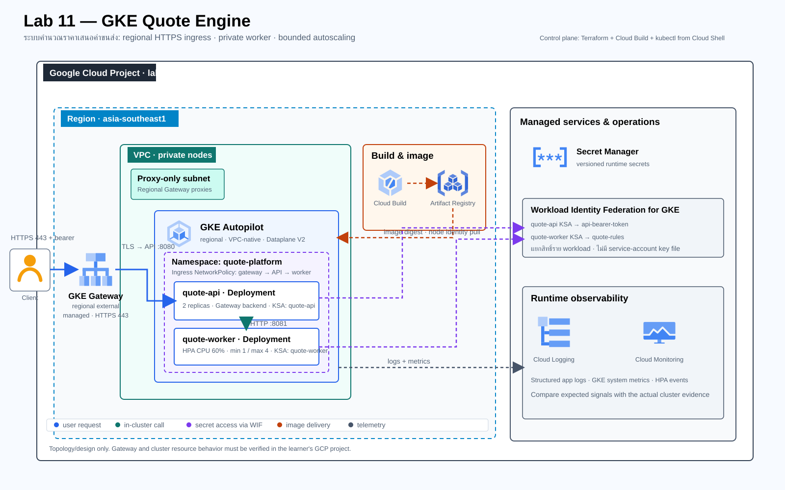

# Lab 11 — ระบบคำนวณราคาเสนอค่าขนส่งบน GKE

**สถานะ:** Brief และ Design — ยังไม่ใช่คู่มือทำ Lab และยังไม่มีผลรันบน GCP. ขอบเขตนี้วางไว้ก่อนออกแบบ Tasks และเริ่มสร้าง App/infra.

## สถานการณ์

ทีม Logistics มี API สำหรับคำนวณราคาเสนอค่าขนส่ง คำขอที่มีจำนวนน้อยทำงานได้ แต่ช่วงแคมเปญมี traffic เพิ่ม ระบบต้องคงความพร้อมให้บริการ ขยายเฉพาะ worker ได้ และไม่เปิด worker หรือกติกาการคิดราคาออกสู่อินเทอร์เน็ต ทีมยังต้อง deploy รุ่นใหม่โดยพิสูจน์ readiness, rollback และการฟื้นตัวเมื่อ Pod หายไป

ผู้เรียนจะสร้าง Quote Engine แบบ stateless ด้วย GKE Autopilot: regional HTTPS Gateway รับคำขอที่ยืนยันตัวตน, API ตรวจ input และเรียก worker ภายใน ClusterIP, worker คำนวณราคาจากกติกา versioned ใน Secret Manager, และ HPA ปรับจำนวน worker ตาม CPU. ข้อมูลทั้งหมดเป็น synthetic; ไม่มี database, customer PII หรือข้อมูลธุรกรรมจริง

## ผู้ใช้และผลลัพธ์

- Client ส่ง quote request ที่มี `weight_kg`, `distance_km` และ `service_level` ผ่าน HTTPS พร้อม bearer token
- `quote-api` ตรวจ authentication/validation และส่งต่อไปยัง `quote-worker` ภายใน cluster
- `quote-worker` โหลด pricing rules จาก Secret Manager ผ่าน Workload Identity Federation for GKE และคืนผลพร้อม `rules_version`
- Operator deploy image ด้วย digest, ตรวจ rollout/HPA/logs, ทดสอบ network boundaries, เปลี่ยน pricing secret และ cleanup ได้

## Requirements และเกณฑ์ยอมรับ

| ID | Requirement | หลักฐานที่ต้องพิสูจน์ |
|---|---|---|
| R1 | HTTPS regional GKE Gateway เปิดเฉพาะ API ที่ต้องใช้ พร้อม bearer-token validation | `Gateway`/`HTTPRoute` พร้อม `curl` success; no/invalid token ถูกปฏิเสธ; worker ไม่มี public route |
| R2 | API แยกจาก worker; worker ใช้ ClusterIP และรับ ingress จาก API เท่านั้น | `Service`/`NetworkPolicy`, `kubectl describe`, และ positive API→worker กับ negative probe→worker |
| R3 | Cluster ใช้ GKE Autopilot regional, VPC-native private nodes, DNS-based control-plane endpoint และ Workload Identity Federation | Terraform plan/config, endpoint config, cluster details และ KSA principal bindings |
| R4 | API กับ worker ใช้ KSA และสิทธิ์ Secret Manager คนละชุด; ไม่มี service-account key file | API อ่านได้เฉพาะ `api-bearer-token`; worker อ่านได้เฉพาะ `quote-rules`; negative IAM probes ถูกปฏิเสธ |
| R5 | Readiness/liveness, startup, resource requests/limits และ rolling-update policy มีค่าชัดเจน | Pod conditions/probes, Deployment rollout และ app health endpoints |
| R6 | Worker มี CPU HPA แบบมีขอบเขตและ CPU requests ที่ใช้คำนวณ utilization ได้ | `kubectl get hpa` แสดง current/desired replicas และเหตุผลจาก `describe`; บันทึกจริง ไม่กำหนดผล scale ไว้ล่วงหน้า |
| R7 | ทดสอบ broken readiness rollout และ Pod failure แล้ว rollback/recover ด้วย runbook | revision/events ก่อน-หลัง, สัดส่วน request ที่สำเร็จ/ผิดพลาด และ recovery evidence |
| R8 | Logs/metrics ใช้ตรวจ error, readiness, CPU และ HPA behavior | Cloud Logging query และ Cloud Monitoring/GKE metrics ที่บันทึกเวลาและช่วงทดสอบ |
| R9 | Change Request ปรับ pricing-rule version และ worker resource profile โดยไม่เสีย readiness | ก่อน/หลัง rule version, rollout/HPA, HTTP errors และค่าใช้จ่ายที่ประมาณใหม่ |
| R10 | Workload/test/cleanup มีเพดานและเริ่มใหม่ได้โดยไม่ลบ resource นอก Lab | task records, state inventory, clean rebuild และ evidence handoff ที่ sanitized |

**Expected เป็นเกณฑ์ตรวจ ไม่ใช่ผล Cloud จริง.** ค่า replica, latency, error rate, scale-up time และค่าใช้จ่ายจริงต้องบันทึกจากการรันของผู้เรียน; ไม่มีตัวเลข performance ที่รับรองล่วงหน้า

## Solution design

[เปิด diagram แบบ standalone HTML](assets/solution.html) · [ดู SVG source](assets/solution.svg)

### Decisions

- **GKE Autopilot regional:** เน้น lifecycle ของ workload, probes, HPA และ rollout โดยไม่เพิ่ม node-pool management เป็นโจทย์หลัก; การปรับ/ดูแล node OS และ Standard node pools อยู่นอก Lab นี้. ใช้ DNS-based control-plane endpoint และปิด IP-based endpoints; ใน Cloud Shell ใช้ `gcloud container clusters get-credentials --dns-endpoint` แล้วให้ IAM เป็นตัวควบคุมผู้เข้าถึง ไม่ผูกกับ egress IP ที่เปลี่ยนได้. คู่มือจะทดสอบ `kubectl` access ก่อน deploy; หาก endpoint/สิทธิ์องค์กรไม่รองรับ ให้หยุดก่อน apply แทนการเปิด public endpoint หรือ allowlist `0.0.0.0/0`.
- **External regional Gateway:** ใช้ `gke-l7-regional-external-managed`, HTTPRoute และ regional proxy-only subnet; TLS ใน Lab ใช้ self-signed cert อายุสั้นกับ test hostname ผ่าน `curl --resolve --cacert` เพราะไม่มี DNS domain ของผู้เรียน. Production ต้องแทนด้วย certificate ที่เชื่อถือได้และ domain/TLS lifecycle จริง
- **Private worker:** Gateway route ชี้เฉพาะ API; worker รับเฉพาะ API service ผ่าน NetworkPolicy. Ingress policy ต้องอนุญาต health-check/proxy source ranges ที่ Gateway ใช้จริงและ KSA/pod selector ของ API; ให้พิสูจน์ด้วย positive/negative probes
- **Per-workload identity:** ใช้ Workload Identity Federation for GKE และ IAM principal ของแต่ละ KSA โดยตรง ไม่มี key file. API/worker อ่านคนละ Secret Manager secret และโหลดค่าตอนเริ่ม process; การเพิ่ม secret version ต้องมี rollout เพื่อใช้ version ใหม่
- **Bounded horizontal scaling:** worker ใช้ HPA CPU target 60%, min 1/max 4; API เริ่ม 2 replicas เพื่อให้ rollout มี backend พร้อม. ทุก container ระบุ CPU/memory requests และ limits; load tool จะจำกัดจำนวน/concurrency/เวลาตาม design ก่อนเขียน Task
- **Image promotion:** Cloud Build สร้าง image ใน region, push ไป Artifact Registry และคู่มือ deploy ด้วย image digest ไม่พึ่ง mutable `latest`
- **Observability:** ใช้ structured logs จาก app และ GKE system metrics/Events ใน Cloud Logging/Monitoring; ไม่สร้าง dashboard หรือ alert ที่มีค่าใช้จ่ายเพิ่ม เว้นแต่จะจำเป็นต่อหลักฐาน

### Component และ identity inventory

| Component | หน้าที่ | Identity / trust boundary |
|---|---|---|
| Regional external GKE Gateway + HTTPRoute | TLS termination และ route ไป API เท่านั้น | Public edge; ephemeral lab cert; test ด้วย HTTPS |
| `quote-api` Deployment + Service | bearer auth, validation, quote request handoff | KSA `quote-api`; อ่าน `api-bearer-token`; ไม่มี worker pricing secret |
| `quote-worker` Deployment + ClusterIP | คำนวณราคาและคืน `rules_version` | KSA `quote-worker`; อ่าน `quote-rules`; ไม่มี public Gateway route |
| GKE Autopilot cluster | รัน workload, probes, rollout และ HPA | Private nodes, VPC-native subnet, Dataplane V2 |
| Secret Manager | เก็บ token และ pricing rules แยก secret/version | IAM binding ราย KSA; secret values ไม่อยู่ใน Terraform state |
| Cloud Build + Artifact Registry | build และเก็บ image | Dedicated build identity; deploy ใช้ immutable digest |
| Cloud Logging + Cloud Monitoring | app/system telemetry | ใช้ managed GKE collection; query ด้วยช่วงเวลาทดลอง |

### Request และ control flow

1. Client ส่ง HTTPS bearer-authenticated request ไป Gateway; Gateway terminate TLS และส่ง HTTP ภายในไป API port 8080.
2. API ตรวจ token/input แล้วเรียก `quote-worker` ผ่าน ClusterIP port 8081; NetworkPolicy ปฏิเสธ ingress จาก Pod อื่นที่ไม่ใช่ API.
3. Worker โหลด pricing rules ผ่าน WIF, คำนวณ quote แบบ bounded และส่งผลพร้อม rules version กลับ API.
4. API ส่งผล quote กลับ Client; structured logs ติด `request_id`, `rules_version`, outcome และ duration แต่ไม่บันทึก token หรือ secret.
5. Cloud Build push image digest ไป Artifact Registry; GKE node identity pull image. Workload identity ของ app ใช้เฉพาะเรียก Secret Manager.
6. GKE ส่ง logs/metrics/events ไป Cloud Operations สำหรับตรวจ rollout, probe, CPU, HPA และ errors.

## Operations scenarios ที่จะลงใน Guide

- Baseline quote success, invalid input, invalid token และการทดสอบ worker route ว่าเข้าได้เฉพาะ API
- Sustained bounded load เพื่อสังเกต worker HPA scale-up/down โดยไม่รับประกันว่าทุก run ต้องถึง max replicas
- Broken-readiness rollout: ให้ revision ใหม่ไม่ผ่าน readiness, ยืนยัน ready revision เดิมยังรับ traffic ตาม maxUnavailable policy แล้ว rollback
- ลบ worker Pod ระหว่างโหลดแบบจำกัด: ดู Deployment replacement, request failures/recovery และเหตุการณ์จริง; ไม่อ้าง zero downtime หากไม่ได้วัด
- Secret Manager negative probes ด้วย KSA ที่ไม่มี binding และ positive runtime read ผ่าน worker
- Change Request: publish rules version ใหม่, rollout worker, เปรียบเทียบ `rules_version`, quote output, HPA, resource requests/limits และ readiness
- Cleanup ทุก GCP/Kubernetes resource ที่สร้าง รวม Gateway/IP/proxy subnet/cluster/repository/secrets/temporary certificate และผล load test

## Cost, access และข้อจำกัด

GKE Autopilot regional cluster, regional external Application Load Balancer/Gateway, proxy-only subnet, Cloud Build, Artifact Registry และ secret/API usage มีค่าใช้จ่าย. ก่อน Task ที่สร้าง cluster ต้องใช้ Pricing Calculator กับ region/เวลาที่จะเปิดจริง, ใช้ dedicated project ที่มี billing, ยืนยันสิทธิ์และเวลา cleanup, ตั้ง budget alert (ไม่ใช่ hard spending cap), กำหนด HPA max 4 และจำกัด load tool. ถ้าไม่มี budget หรือสิทธิ์ ให้หยุดก่อน provision; ไม่มีการสร้าง Cloud resources ในขั้น authoring นี้.

Control plane ใช้ DNS-based endpoint และ IAM-authenticated access จาก Cloud Shell; ปิด IP-based endpoint เพื่อลดการพึ่งพา source IP. ผู้เรียนต้องตรวจว่า `container.clusters.get`/`get-credentials` และ Kubernetes RBAC ตรงกับบัญชีที่ใช้ก่อน deploy. Nodes เป็น private; ใช้ Private Google Access สำหรับ Google APIs และไม่เปิด Cloud NAT หาก service dependency ยืนยันว่าไม่ต้องออก public internet. หากตรวจพบ dependency ที่ต้องใช้อินเทอร์เน็ต ให้หยุดและปรับ design/cost review ก่อน.

TLS certificate ที่ self-signed ใช้เฉพาะ lab endpoint และไม่เป็นหลักฐาน production certificate management. bearer token เป็น credential สำหรับ demo ใน dedicated project ไม่ใช่ระบบ customer identity จริง. ระบบไม่มี database, PII, persistent customer state, Cloud Armor, multi-region DR หรือ SLA.

## Evidence handoff ที่จะบันทึกใน Tasks

| หลักฐาน | สิ่งที่ต้องเก็บ |
|---|---|
| Deployment | commit, build ID, image digest, cluster/region (ปกปิด project number ได้) |
| Functional/security | success/invalid-input/invalid-token, worker path denial, secret allow/deny |
| Operations | rollout revisions, pod failure/replacement, logs/events และเวลาที่วัด |
| Scaling/change | HPA current/desired, CPU request/limit, rules version ก่อน/หลัง, errors และ p50/p95 ถ้าวัด |
| Cleanup | Terraform state inventory ก่อน/หลัง, GCP resource inventory, certificate/secret version dispositions |

Actual/status/UTC/Evidence จะวางติดกับแต่ละ Task ใน README หลัง design review แล้ว; ตอนนี้ไม่มีผลที่ถูกบันทึกว่า PASS.

## References checked for this design

- [GKE Autopilot overview](https://docs.cloud.google.com/kubernetes-engine/docs/concepts/autopilot-overview)
- [Workload Identity Federation for GKE](https://docs.cloud.google.com/kubernetes-engine/docs/concepts/workload-identity)
- [Deploying Gateways in GKE](https://docs.cloud.google.com/kubernetes-engine/docs/how-to/deploying-gateways)
- [GKE Gateway security and TLS support](https://docs.cloud.google.com/kubernetes-engine/docs/concepts/gateway-security)
- [GKE NetworkPolicy behavior and Dataplane V2](https://docs.cloud.google.com/kubernetes-engine/docs/how-to/network-policy)
- [Configure horizontal Pod autoscaling](https://docs.cloud.google.com/kubernetes-engine/docs/how-to/horizontal-pod-autoscaling)
- [GKE network isolation and DNS-based control-plane endpoint](https://docs.cloud.google.com/kubernetes-engine/docs/how-to/latest/network-isolation)
- [GKE networking best practices](https://docs.cloud.google.com/kubernetes-engine/docs/best-practices/networking)
- [kubectl access and `get-credentials --dns-endpoint`](https://docs.cloud.google.com/kubernetes-engine/docs/how-to/cluster-access-for-kubectl)
- [Pricing Calculator](https://cloud.google.com/products/calculator)

Design checked against official docs on 2026-10-24. Verify release channel, quotas, supported GatewayClass, pricing, IAM and organization policy again when writing executable Tasks. GKE DNS endpoint and Cloud Shell credential path are now explicit; no reliance on Cloud Shell's dynamic egress IP.