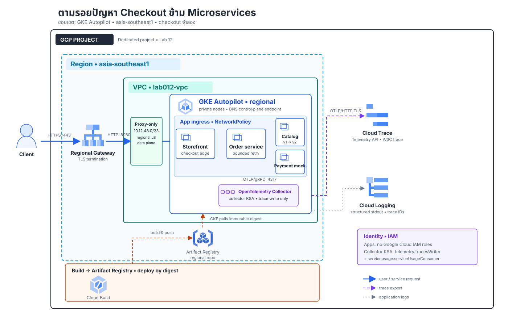

# Lab 12 — ระบบ Microservices ที่ติดตามปัญหาข้ามบริการได้

**สถานะ:** Guide review — มีคู่มือและไฟล์ประกอบครบฉบับร่าง กำลังตรวจโค้ด/ลิงก์/คำสั่งใน CI. ยังไม่มีการสร้าง Cloud resources หรือผล Cloud run จริง.

## สถานการณ์

ทีม Commerce พบว่า checkout บางช่วงช้าและตอบ error แต่ log ของ Storefront, Order, Catalog และ Payment mock แยกจากกัน ทีมต้องระบุให้ได้ว่า request หนึ่งวิ่งผ่านบริการใด ใช้เวลาที่ไหน และ failure เริ่มจาก dependency ตัวไหน โดยไม่เปิดสิทธิ์ Cloud ให้ทุก service และไม่ retry แบบไม่จำกัด

Lab นี้สร้าง checkout แบบ synthetic บน GKE. ผู้เรียนจะ deploy services, instrument HTTP boundaries ด้วย OpenTelemetry, ส่ง W3C trace context ผ่านทุก hop, ดู trace ใน Cloud Trace และเชื่อม structured log ใน Cloud Logging ด้วย trace ID. จากนั้นจำลอง dependency timeout/503, วัดผลการ retry ที่มีเพดาน, กู้ service และเปลี่ยน contract แบบ backward-compatible ทีละชั้น.

## ผู้ใช้และผลลัพธ์ที่ต้องพิสูจน์

Client เรียก POST /v1/checkout ผ่าน HTTPS พร้อม demo bearer token ด้วย SKU และจำนวนชิ้น. Storefront เรียก Order service; Order อ่าน Catalog และขออนุมัติจาก Payment mock. เมื่อสำเร็จ API ตอบ checkout_id, total_thb และ trace_id. Payment mock ไม่เชื่อม payment provider, ไม่มีการตัดเงินจริง และไม่มี customer PII.

**เกณฑ์ยอมรับ**

| ID | Requirement | หลักฐาน |
|---|---|---|
| R1 | HTTPS entry point พร้อม demo bearer-token check ไปยัง Storefront; backend services ไม่ถูกเปิด public | Gateway/HTTPRoute, service inventory, token allow/deny และ request success |
| R2 | หนึ่ง checkout มี distributed trace ที่เชื่อม Storefront → Order → Catalog และ Payment mock ด้วย traceparent | trace ID/parent-child spans ใน Cloud Trace |
| R3 | ทุก service ระบุ service.name, operation, status และ duration; failure span แยกจาก successful span | trace details และ span attributes ที่ผู้เรียนบันทึก |
| R4 | Payment fault ถูกควบคุมจาก deployment config และ Order retry ได้สูงสุด 2 attempts | fault config, trace attempts และ HTTP result |
| R5 | เมื่อเอา fault ออก ระบบกลับ success โดยไม่ต้องเปลี่ยน client contract | config diff, rollout และ retest |
| R6 | Structured application logs เชื่อมกับ trace/span ID; logs ไม่ใส่ token, PII หรือ payload เกินจำเป็น | Cloud Logging query และ trace correlation |
| R7 | Workload identity แยก Collector จาก App; เฉพาะ collector identity มี trace-write permission | KSA/IAM binding, app identity ไม่มีสิทธิ์ trace-write และมี trace ที่ export สำเร็จ |
| R8 | Service ingress มีขอบเขตและ resource/probe values ชัดเจน; bounded traffic/fault test มีเพดาน | manifests, policy inspection, load/test summary |
| R9 | เพิ่ม field ใน Catalog response โดยไม่ลบ field เดิม แล้ว rollout provider ก่อน consumer พร้อม rollback path | v1/v2 contract diff, rollout order และ compatibility retest |

Expected เป็นเกณฑ์ตรวจ ไม่ใช่ผลจริง. ห้ามสร้าง trace screenshot, PASS, latency หรือ Cloud result ไว้ล่วงหน้า.

## Solution design

[เปิด Diagram แบบ standalone HTML](assets/solution.html) · [ดู SVG source](assets/solution.svg) · [ดู icon provenance](assets/diagram-provenance.json)

### Request path

Client → regional external GKE Gateway → Storefront → Order service → Catalog + Payment mock. Gateway ใช้ HTTPS termination; backend เป็น ClusterIP ภายใน private regional GKE Autopilot. Gateway data plane ใช้ regional proxy-only subnet และ route ชี้เฉพาะ Storefront. NetworkPolicy จำกัด app ingress ตาม upstream relationship; egress ใช้ GKE/VPC routes ไปยัง service/Collector และ Google APIs. คู่มือจะไม่อ้างว่า Kubernetes NetworkPolicy จำกัด FQDN egress.

### Trace และ log path

แต่ละ service สร้าง server/client spans ด้วย OpenTelemetry Python SDK และ HTTP instrumentation. W3C traceparent ต้องถูก inject/extract โดยอัตโนมัติ; business spans ใส่ operation, dependency, attempt และ error type โดยไม่ใส่ข้อมูลส่วนบุคคล. Services ส่ง OTLP/gRPC ไปยัง Collector ภายใน cluster; Collector ใช้ KSA + Workload Identity Federation for GKE ส่ง traces ผ่าน Telemetry (OTLP) API ไป Cloud Trace. Cloud Telemetry ต้องใช้ quota project และสิทธิ์ serviceusage.services.use; จึงให้ collector เท่านั้นรับ roles/telemetry.tracesWriter และ roles/serviceusage.serviceUsageConsumer. App KSAs ไม่มี Google Cloud IAM roles.

App logs เป็น JSON ไป stdout/stderr; GKE ส่งไป Cloud Logging. ใส่ logging.googleapis.com/trace และ logging.googleapis.com/spanId ที่สัมพันธ์กับ active span เพื่อค้น log จาก trace โดยไม่ duplicate payload. Pipeline trace และ log แยกกัน; app ไม่ส่ง log ผ่าน Collector ใน design นี้.

### Components และ boundary

| Component | Role | Boundary |
|---|---|---|
| Regional external Gateway | รับ TLS/route ไป Storefront เท่านั้น | Public edge; proxy-only subnet อยู่ใน VPC |
| Storefront | client-facing checkout endpoint; ตรวจ demo bearer token จาก Kubernetes Secret | KSA เฉพาะ; ไม่มี Google Cloud IAM role |
| Order service | orchestration และ retry cap | เรียก Catalog/Payment mock ผ่าน ClusterIP |
| Catalog | synthetic SKU/price contract v1/v2 | ไม่มี database หรือข้อมูลจริง |
| Payment mock | synthetic approval; controlled 503/latency | ไม่เชื่อม provider/เงินจริง |
| OpenTelemetry Collector | รับ OTLP แล้ว export traces | KSA เฉพาะมี IAM trace-write/quota |
| Cloud Trace / Cloud Logging | trace analysis และ log correlation | project-level observability |
| Cloud Build / Artifact Registry | build และเก็บ image; deploy by digest | dedicated lab repository |

### Change request ที่ออกแบบไว้

Catalog v1 ตอบ sku, unit_price_thb และ available. Change request เพิ่ม currency และ catalog_revision แต่คง field เดิมและ semantics ไว้. Stage 1 ปล่อย Catalog v2 ก่อน แล้ว retest กับ Order consumer รุ่นเดิม. Stage 2 ปล่อย Order รุ่นที่อ่าน currency แบบ optional พร้อม fallback THB; ตรวจ rollout และ rollback ก่อนปิด change. ไม่มีการเปลี่ยน public checkout request/response ที่จำเป็นต่อ client.

### Cost, security และข้อจำกัด

ใช้ dedicated project, budget alert และการประเมินราคาก่อน apply. Regional Autopilot, external regional Gateway, Cloud Build/Artifact Registry, Cloud Trace และ Cloud Logging อาจมีค่าใช้จ่าย; จำกัด duration/requests ของ load/fault tests และ cleanup หลังจบ. ไม่ถือว่า budget alert เป็น spending cap. รายละเอียดราคาให้คำนวณใหม่ใน Google Cloud Pricing Calculator วันที่จะรัน.

GKE nodes เป็น private; control-plane access ใช้ DNS endpoint และ IAM-authenticated Cloud Shell. Storefront ตรวจ token สำหรับ lab ที่เก็บเป็น Kubernetes Secret; token ไม่ใช่ customer identity และไม่แทน production authentication. ไม่เปิด 0.0.0.0/0 เพื่อแก้ปัญหา access. TLS test cert เป็น self-signed สำหรับ lab hostname. ไม่มี database, durable order state, real payment gateway, customer identity, multi-region DR หรือ production SLO; ผล latency เป็น observation ของ run เดียว ไม่ใช่ SLA.

### ขอบเขต Task Guide ที่จะลงมือเขียน

Tasks 00–19 ด้านล่างพาผู้เรียนตั้ง cost/access boundary → สร้าง foundation → build/deploy image → สร้าง TLS/demo secret → ตรวจ request/trace/log → inject fault และกู้คืน → ทำ bounded traffic → rollout Catalog v2 แบบ backward-compatible → rollback → เก็บหลักฐานและ cleanup. แต่ละ Task มี Expected, Actual และ Evidence fields. CI ตรวจเอกสาร/โค้ด/manifest/Terraform syntax เท่านั้น ไม่แทน Cloud verification.

## References for this design

- [Cloud Trace: instrument for Cloud Trace](https://cloud.google.com/trace/docs/setup)
- [Python OpenTelemetry instrumentation sample](https://cloud.google.com/trace/docs/setup/python-ot)
- [Google Cloud Observability: OTLP support](https://cloud.google.com/stackdriver/docs/otlp/overview)
- [Migrate Collector exports to the Telemetry API](https://cloud.google.com/stackdriver/docs/otlp/migrate-collector-to-otlp-exporters)
- [GKE: deploy Google-Built OpenTelemetry Collector](https://cloud.google.com/stackdriver/docs/instrumentation/opentelemetry-collector-gke)
- [GKE: Workload Identity Federation](https://cloud.google.com/kubernetes-engine/docs/concepts/workload-identity)
- [Deploying regional Gateways on GKE](https://cloud.google.com/kubernetes-engine/docs/how-to/deploying-gateways)

## วิธีใช้ Lab นี้

อ่าน Expected เป็นเกณฑ์ตรวจ ไม่ใช่ผลที่เกิดขึ้นแล้ว. ทำทีละ Task และบันทึก Actual หลังรันจริงในช่องของ Task เดียวกัน. ใช้ Cloud Shell ที่มี repository branch docs/gcp-solution-labs; ไม่ต้องพึ่งเครื่องผู้เรียนที่เปิดทิ้งไว้.

สภาพแวดล้อมใช้ข้อมูลสังเคราะห์เท่านั้น: SKU-001/SKU-002, checkout ID สุ่ม และ Payment mock ที่ไม่ติดต่อผู้ให้บริการเงินจริง. ไม่ใช้ customer PII, บัตรชำระเงินจริง หรือข้อมูล production.

### Scope และขอบเขตการพิสูจน์

| พิสูจน์ | วิธีตรวจใน Lab |
|---|---|
| HTTPS public edge แต่ backend เป็น internal | Gateway/HTTPRoute, TLS, ClusterIP inventory, token allow/deny |
| หนึ่ง request ต่อเนื่อง Storefront → Order → Catalog + Payment | Trace Explorer: parent/child spans, service.name, status, duration |
| Logs เชื่อมกับ trace | Logs Explorer trace field และ JSON event fields |
| Fault/retry จำกัด | PAYMENT_MODE เป็น unavailable/slow; Order มีเพดาน 2 attempts |
| กู้คืนและ contract change | กลับ normal, Catalog v2 เปิดก่อน, consumer switch/rollback |
| Workload identity | Terraform binding เฉพาะ Collector KSA; app KSAs ไม่มี GCP role |
| Service ingress | NetworkPolicy: Gateway → Storefront, Storefront → Order, Order → Catalog/Payment, app → Collector |
| ขอบเขต traffic | Probe จำกัด 1–60 requests, 1–4 workers, timeout 1–10 วินาที |

Kubernetes NetworkPolicy ใน Lab นี้กำหนดเฉพาะ ingress. ไม่อ้างว่า egress จำกัดตาม FQDN. Probe เป็น request ปริมาณน้อยเพื่อพิสูจน์ journey และเก็บตัวอย่าง ไม่ใช่ load/performance benchmark หรือหลักฐาน SLO/capacity.

### ตัวแปรและข้อมูลที่ใช้

| ชื่อ | ค่าเริ่มต้น/ที่มา | หมายเหตุ |
|---|---|---|
| PROJECT_ID | disposable project ที่ผู้เรียนเลือก | ต้อง linked billing และมีสิทธิ์จัดการ project |
| REGION | asia-southeast1 | GKE, proxy-only subnet, Gateway address และ Artifact Registry |
| HOST | checkout.lab.local | ใช้ curl --resolve; ไม่ต้องสร้าง public DNS |
| GATEWAY_IP | Terraform output gateway_ip | public IPv4 ของ regional Gateway |
| GATEWAY_IP_NAME | lab012-gateway-ip | Terraform reserved regional address |
| IMAGE_URI | Artifact Registry URI ลงท้ายด้วย digest | deploy ด้วย digest ไม่ใช้ latest |
| LAB012_WORKDIR | $HOME/lab012-private ใน Cloud Shell | เก็บ demo token/certificate key; อย่าใส่ใน git |
| Demo bearer token | สุ่มใน Task 05 | ใช้เฉพาะ Lab นี้; ไม่ใช่ credential จริง |

### Task 00 — ตรวจค่าใช้จ่าย สิทธิ์ และความพร้อมก่อนเริ่ม

1. เปิด Google Cloud Console แล้วเลือก disposable project ที่ไม่มี workload อื่น. ห้ามใช้ project production หรือ project ที่ Terraform ไม่ได้ดูแล.
2. ไปที่ Billing → My projects ตรวจว่า project linked กับ billing account ที่อนุมัติแล้ว.
3. ไปที่ Billing → Budgets & alerts → Create budget ตั้ง budget และ email alert. Budget alert ไม่ได้หยุดการใช้เงิน.
4. ประเมิน GKE Autopilot ระดับ Regional, regional external Gateway/load balancer, Cloud Build, Artifact Registry, Cloud Logging และ Cloud Trace ใน Pricing Calculator ตามเวลาที่จะเปิดจริง.
5. ตรวจ quota/organization policy และทำ cleanup ใน session เดียวกัน. ถ้าค่าใช้จ่ายหรือสิทธิ์ยังไม่ชัด ให้หยุดก่อน Apply.

**สิ่งที่คาดว่าจะเห็น (Expected):** project เฉพาะ, billing link, budget alert และ estimate ปัจจุบันครอบคลุมทรัพยากรหลัก.

**ผลจริงที่ฉันบันทึก:** project alias / วันที่ estimate / alert / quota หรือ policy / go-no-go: [กรอกหลังตรวจ]

**หลักฐานที่เก็บ:** วันที่และรายการ estimate, ภาพ/ลิงก์ budget ที่ปกปิดเลขบัญชี และบันทึกอนุมัติ. ห้ามเก็บ credential หรือข้อมูล billing ที่ไม่ต้องการเผยแพร่.

### Task 01 — เปิด Cloud Shell และยืนยันตัวตน

ใน Console คลิก Activate Cloud Shell ที่แถบด้านบน. ตรวจ account/project ก่อนใช้คำสั่งสร้าง resource.

**คำสั่ง Bash:**

    gcloud auth list --filter=status:ACTIVE --format='table(account,status)'
    PROJECT_ID="ใส่-project-id-เฉพาะของ-lab"
    REGION="asia-southeast1"
    gcloud config set project "$PROJECT_ID"
    gcloud projects describe "$PROJECT_ID" --format='value(projectId,projectNumber)'
    gcloud version
    terraform version
    kubectl version --client
    openssl version

บัญชีผู้รัน Terraform ต้องจัดการ VPC/subnet, GKE Autopilot, service account/IAM, Artifact Registry, Cloud Build และเปิด API ใน disposable project. ระหว่าง bootstrap ใช้ project admin ที่ได้รับอนุมัติ; workload identities ในระบบยังแยกสิทธิ์ตามหน้าที่.

**สิ่งที่คาดว่าจะเห็น (Expected):** active account และ project ID ตรง Task 00; client tools แสดง version โดยยังไม่สร้าง resource.

**ผลจริงที่ฉันบันทึก:** account type / project ID ที่ปกปิดได้ / region / tool versions: [กรอกหลังตรวจ]

**หลักฐานที่เก็บ:** output ที่ redact account email และ project number ได้. ห้ามเก็บ access token.

### Task 02 — ดึง Lab จาก GitHub และเตรียม working directory

ดึงไฟล์จาก branch ที่มี Lab นี้. ถ้า clone ไว้แล้วให้ตรวจ working tree และอย่า overwrite งานที่ยังไม่บันทึก.

**คำสั่ง Bash:**

    git clone --branch docs/gcp-solution-labs https://github.com/somkid-s5/Portfolio-Lab.git
    cd Portfolio-Lab/GCP/LAB-012-cross-service-tracing
    git status --short
    export PROJECT_ID="ใส่-project-id-เฉพาะของ-lab"
    export REGION="asia-southeast1"
    export HOST="checkout.lab.local"
    export LAB012_WORKDIR="$HOME/lab012-private"
    mkdir -p "$LAB012_WORKDIR"
    chmod 700 "$LAB012_WORKDIR"

ถ้ามี clone เดิม ให้เข้า directory นั้นและใช้ git pull --ff-only origin docs/gcp-solution-labs หลังตรวจงานก่อน. ตั้ง PROJECT_ID ให้ตรง Task 01.

**สิ่งที่คาดว่าจะเห็น (Expected):** branch/commit ถูกต้อง, working tree สะอาดก่อนเริ่ม และ private directory อยู่นอก repository.

**ผลจริงที่ฉันบันทึก:** branch/commit / working directory / ไฟล์เดิมที่ต้องเก็บ: [กรอกหลังตรวจ]

**หลักฐานที่เก็บ:** commit SHA และ git status ที่ไม่มี path ส่วนบุคคล.

### Task 03 — ตรวจและวางแผน Infrastructure โดยยังไม่ Apply

เปิด infra/terraform.tfvars.example ใน Cloud Shell Editor แล้วคัดลอกเป็น infra/terraform.tfvars. แก้ project ID และ operator_member เป็น IAM member จริง เช่น user:email@example.com. ห้ามใส่ token/password ใน tfvars.

**คำสั่ง Bash:**

    cp infra/terraform.tfvars.example infra/terraform.tfvars
    terraform -chdir=infra fmt -check -recursive
    terraform -chdir=infra init -backend=false -input=false
    terraform -chdir=infra validate -no-color
    mkdir -p infra/build
    terraform -chdir=infra plan -input=false -out=build/lab012.tfplan
    terraform -chdir=infra show -no-color build/lab012.tfplan

Review VPC/subnets, custom node/build service accounts, Artifact Registry, regional reserved IP, GKE Autopilot และ IAM binding ของ Collector. ตรวจไม่มี public node IP, service-account key, Owner role สำหรับ workload หรือ resource จาก project อื่น. Plan ไม่ได้สร้าง resource.

**สิ่งที่คาดว่าจะเห็น (Expected):** validate ผ่านและ plan มีเฉพาะ Lab 12 ใน project/region ที่เลือก.

**ผลจริงที่ฉันบันทึก:** resource count / region / project alias / unexpected diff / decision: [กรอกหลังตรวจ]

**หลักฐานที่เก็บ:** plan แบบ redact และ timestamp. ห้าม commit tfvars, state หรือ plan.

### Task 04 — Apply Foundation และตรวจ Cluster

ทำเมื่อ Task 03 ผ่าน review และยอมรับ estimate แล้วเท่านั้น. ใช้แผนเดียวกับที่ตรวจ.

**คำสั่ง Bash:**

    terraform -chdir=infra apply -input=false build/lab012.tfplan
    terraform -chdir=infra output
    gcloud container clusters get-credentials lab012-checkout --region="$REGION" --project="$PROJECT_ID"
    kubectl config current-context
    kubectl get nodes -o wide

Terraform เปิด API ที่ต้องใช้, สร้าง VPC/subnets, regional proxy-only subnet, service identities, Artifact Registry, regional IP และ private-node GKE Autopilot. Cluster คิดค่าใช้จ่ายระหว่างเปิดอยู่แม้ไม่มี traffic.

**สิ่งที่คาดว่าจะเห็น (Expected):** apply จบและ outputs มี cluster_name, gateway_ip, gateway_ip_name; kubectl เห็น GKE nodes.

**ผลจริงที่ฉันบันทึก:** start time / cluster / IP ที่ปกปิดได้ / error: [กรอกหลังตรวจ]

**หลักฐานที่เก็บ:** outputs ที่ redact project number ได้, node inventory และเวลาเริ่ม resource.

### Task 05 — สร้าง Secret และ TLS สำหรับ Hostname ของ Lab

สร้าง namespace และเก็บค่า private ใน Cloud Shell/Kubernetes Secret. Self-signed cert ใช้ทดสอบเท่านั้น ไม่ใช่ production PKI.

**คำสั่ง Bash:**

    kubectl create namespace checkout --dry-run=client -o yaml | kubectl apply -f -
    mkdir -p "$LAB012_WORKDIR/tls"
    if [[ ! -f "$LAB012_WORKDIR/tls/tls.key" ]]; then openssl req -x509 -nodes -days 2 -newkey rsa:2048 -keyout "$LAB012_WORKDIR/tls/tls.key" -out "$LAB012_WORKDIR/tls/tls.crt" -subj "/CN=checkout.lab.local" -addext "subjectAltName=DNS:checkout.lab.local"; fi
    chmod 600 "$LAB012_WORKDIR/tls/tls.key"
    kubectl create secret tls checkout-tls --namespace checkout --cert="$LAB012_WORKDIR/tls/tls.crt" --key="$LAB012_WORKDIR/tls/tls.key" --dry-run=client -o yaml | kubectl apply -f -
    if [[ ! -s "$LAB012_WORKDIR/demo-token" ]]; then openssl rand -hex 24 > "$LAB012_WORKDIR/demo-token"; fi
    chmod 600 "$LAB012_WORKDIR/demo-token"
    kubectl create secret generic checkout-demo --namespace checkout --from-file=token="$LAB012_WORKDIR/demo-token" --dry-run=client -o yaml | kubectl apply -f -

ไฟล์ key/token อยู่นอก repository. ห้ามอ่าน Secret YAML หรือใส่ค่าจริงในหลักฐาน. Token สุ่มนี้ไม่ใช่ account credential.

**สิ่งที่คาดว่าจะเห็น (Expected):** namespace และ Secret สองรายการ; cert SAN เป็น checkout.lab.local; file permissions 600.

**ผลจริงที่ฉันบันทึก:** namespace / cert expiry / creation time / error: [กรอกหลังตรวจ]

**หลักฐานที่เก็บ:** Secret names/type/age, SAN และ permission. ห้ามแนบ key/token/base64.

### Task 06 — Build และ Publish Image ด้วย Cloud Build

ส่ง build context เฉพาะ app/ เพื่อไม่ส่ง tfstate, plan หรือ evidence. Tag ใช้ commit SHA แล้ว resolve เป็น immutable digest ก่อน deploy.

**คำสั่ง Bash:**

    BUILD_TAG="$(git rev-parse HEAD)"
    gcloud builds submit app --project="$PROJECT_ID" --region="$REGION" --config=cloudbuild.yaml --service-account="projects/$PROJECT_ID/serviceAccounts/lab012-build@$PROJECT_ID.iam.gserviceaccount.com" --substitutions="_REGION=$REGION,_IMAGE_TAG=$BUILD_TAG" --timeout=1200s
    IMAGE_DIGEST="$(gcloud artifacts docker images describe "$REGION-docker.pkg.dev/$PROJECT_ID/lab012-images/checkout:$BUILD_TAG" --project="$PROJECT_ID" --format='value(image_summary.digest)')"
    printf '%s\n' "$IMAGE_DIGEST"
    [[ "$IMAGE_DIGEST" =~ ^sha256:[0-9a-f]{64}$ ]]
    export IMAGE_URI="$REGION-docker.pkg.dev/$PROJECT_ID/lab012-images/checkout@$IMAGE_DIGEST"
    printf '%s\n' "$IMAGE_URI"

Image ใช้ Gunicorn WSGI server, non-root user และ digest pinning. Build identity เขียนได้เฉพาะ image repository และ Cloud Build logs. GKE node identity pull image; app KSA ไม่มีสิทธิ์ GCP นี้. Build/Registry มีค่าใช้จ่ายตามการใช้งาน.

**สิ่งที่คาดว่าจะเห็น (Expected):** build สำเร็จ, Artifact Registry มี tag จาก commit และ IMAGE_URI ลงท้ายด้วย SHA-256 digest.

**ผลจริงที่ฉันบันทึก:** Build ID / source commit / digest: [กรอกหลังตรวจ]

**หลักฐานที่เก็บ:** Build ID, commit และ digest. ห้ามเก็บ token หรือ secret ใน build log.

### Task 07 — Render Manifest และ Deploy

เชื่อม kubectl กับ cluster. Renderer ตรวจ project, image digest และ named regional IP ก่อนสร้าง YAML ที่เติมค่าแล้ว.

**คำสั่ง Bash:**

    gcloud container clusters get-credentials lab012-checkout --region="$REGION" --project="$PROJECT_ID"
    GATEWAY_IP_NAME="$(terraform -chdir=infra output -raw gateway_ip_name)"
    python3 scripts/render_manifests.py --project "$PROJECT_ID" --image-uri "$IMAGE_URI" --gateway-ip-name "$GATEWAY_IP_NAME"
    if grep -nE '__[A-Z0-9_]+__|:latest' manifests/build/platform.yaml; then printf '%s\n' 'Unrendered placeholder found'; exit 1; fi
    kubectl apply -f manifests/build/platform.yaml
    kubectl rollout status deployment/otel-collector --namespace checkout --timeout=300s
    kubectl rollout status deployment/storefront --namespace checkout --timeout=300s
    kubectl rollout status deployment/order --namespace checkout --timeout=300s
    kubectl rollout status deployment/catalog --namespace checkout --timeout=300s
    kubectl rollout status deployment/payment --namespace checkout --timeout=300s

Rendered YAML ถูก ignore ใน Git. NetworkPolicy จำกัด ingress ตาม diagram; egress ยัง default และไม่ใช่ FQDN allowlist.

**สิ่งที่คาดว่าจะเห็น (Expected):** ไม่มี placeholder ค้าง, rollout ครบ และ app Services เป็น ClusterIP.

**ผลจริงที่ฉันบันทึก:** digest / rollout times / restart หรือ warning: [กรอกหลังตรวจ]

**หลักฐานที่เก็บ:** rollout และ kubectl get deploy,svc,networkpolicy -n checkout. ห้ามเก็บ Secret values.

### Task 08 — รอ Gateway และตรวจ Route

Gateway controller provision load-balancing resources หลังสร้าง Gateway/HTTPRoute; อาจใช้เวลาหลายนาที.

**คำสั่ง Bash:**

    kubectl wait --for=condition=Programmed gateway/checkout-gateway --namespace checkout --timeout=15m
    kubectl get gateway checkout-gateway --namespace checkout -o yaml
    kubectl get httproute checkout-route --namespace checkout -o yaml
    gcloud compute addresses describe lab012-gateway-ip --region="$REGION" --project="$PROJECT_ID" --format='value(address,status)'
    kubectl describe gateway checkout-gateway --namespace checkout

คาดว่า class เป็น gke-l7-regional-external-managed, HTTPS listener ได้ Programmed=True และ HTTPRoute ได้ Accepted=True/ResolvedRefs=True. ถ้าไม่ Ready ให้ดู Conditions/events, proxy-only subnet และ controller messages; อย่าเปิด backend เป็น public.

**สิ่งที่คาดว่าจะเห็น (Expected):** Gateway ผูก reserved regional IP และ route ชี้ Storefront เท่านั้น.

**ผลจริงที่ฉันบันทึก:** Gateway/route conditions / elapsed provisioning / IP ที่ปกปิดได้: [กรอกหลังตรวจ]

**หลักฐานที่เก็บ:** describe Gateway/HTTPRoute, events และเวลา.

### Task 09 — พิสูจน์ HTTPS, Auth และ Checkout

ใช้ cert self-signed จาก Task 05 และ --resolve; อย่าปิด TLS verification. ทดสอบ deny ก่อน allow.

**คำสั่ง Bash:**

    GATEWAY_IP="$(terraform -chdir=infra output -raw gateway_ip)"
    HOST="checkout.lab.local"
    HTTP_DENIED="$(curl --silent --show-error --output /dev/null --write-out '%{http_code}' --cacert "$LAB012_WORKDIR/tls/tls.crt" --resolve "$HOST:443:$GATEWAY_IP" "https://$HOST/v1/checkout" --header 'Content-Type: application/json' --data '{"sku":"SKU-001","quantity":1}')"
    printf 'request without token: HTTP %s\n' "$HTTP_DENIED"
    LAB012_DEMO_TOKEN="$(<"$LAB012_WORKDIR/demo-token")"
    CHECKOUT_RESPONSE="$(curl --silent --show-error --cacert "$LAB012_WORKDIR/tls/tls.crt" --resolve "$HOST:443:$GATEWAY_IP" "https://$HOST/v1/checkout" --header "Authorization: Bearer $LAB012_DEMO_TOKEN" --header 'Content-Type: application/json' --data '{"sku":"SKU-001","quantity":2}')"
    unset LAB012_DEMO_TOKEN
    printf '%s\n' "$CHECKOUT_RESPONSE"
    TRACE_ID="$(printf '%s' "$CHECKOUT_RESPONSE" | python3 -c 'import json,sys; print(json.load(sys.stdin)["trace_id"])')"
    printf 'TRACE_ID=%s\n' "$TRACE_ID"

คาดว่า request แรก HTTP 401; request ที่สอง HTTP 200 พร้อม checkout_id, total_thb=2500, currency=THB, catalog_revision=legacy-v1 และ trace ID 32 ตัวอักษร.

**สิ่งที่คาดว่าจะเห็น (Expected):** TLS hostname ตรวจผ่าน, unauthenticated ถูกปฏิเสธ, authenticated checkout ใช้ข้อมูลสังเคราะห์.

**ผลจริงที่ฉันบันทึก:** deny/allow status / checkout ID ที่ redact ได้ / trace ID: [กรอกหลังตรวจ]

**หลักฐานที่เก็บ:** curl status/response ที่ redact แล้ว และ trace ID. ห้ามแนบ token.

### Task 10 — ดู Trace และ Correlate Logs

รอ telemetry flush/ingestion สักครู่. เลือก project นี้ใน Console แล้วเปิด Observability → Trace → Trace Explorer. ใส่ TRACE_ID จาก Task 09 แล้วเปิด trace details.

ตรวจ Storefront → Order → Catalog และ Payment spans, parent-child, service.name, operation, status/duration. Python HTTP instrumentation ส่ง W3C traceparent; app ไม่บันทึก token หรือ payload.

เปิด Logging → Logs Explorer และใส่ filter ต่อไปนี้ โดยแทน project/trace ด้วย run จริง:

    resource.type="k8s_container"
    resource.labels.namespace_name="checkout"
    trace="projects/PROJECT_ID/traces/TRACE_ID"

หรือใช้ gcloud:

**คำสั่ง Bash:**

    LOG_FILTER="resource.type=\"k8s_container\" AND resource.labels.namespace_name=\"checkout\" AND trace=\"projects/$PROJECT_ID/traces/$TRACE_ID\""
    gcloud logging read "$LOG_FILTER" --project="$PROJECT_ID" --limit=20 --format='table(timestamp,jsonPayload.event,jsonPayload.service,trace)'

คาดว่าเห็น checkout_completed, catalog_read และ payment_mock_approved ที่ trace เดียวกัน. เปิด log entry และเลือก trace icon/View in Trace. ถ้าไม่พบ ให้ตรวจ Collector logs, GOOGLE_CLOUD_PROJECT, googleclientauth, Collector KSA IAM และ quota project.

**สิ่งที่คาดว่าจะเห็น (Expected):** trace เดียวเชื่อมบริการครบและ log มี trace correlation; Collector identity เป็นผู้ส่ง trace.

**ผลจริงที่ฉันบันทึก:** trace ID / service spans / logs / ingestion wait / IAM ที่ตรวจ: [กรอกหลังตรวจ]

**หลักฐานที่เก็บ:** ภาพ Trace Explorer และ Logs Explorer จาก run จริงที่ redact account/project. ห้ามใช้ภาพตัวอย่างแทน.

### Task 11 — Incident Drill: Payment ตอบ 503 และ Retry Cap

แจ้งผู้ร่วมทดลองก่อน. เปลี่ยน PAYMENT_MODE ของ mock เท่านั้น; ไม่หยุด cluster และไม่ยิง load.

**คำสั่ง Bash:**

    kubectl set env deployment/payment --namespace checkout PAYMENT_MODE=unavailable
    kubectl rollout status deployment/payment --namespace checkout --timeout=180s
    LAB012_DEMO_TOKEN="$(<"$LAB012_WORKDIR/demo-token")"
    FAULT_RESPONSE="$(curl --max-time 8 --silent --show-error --cacert "$LAB012_WORKDIR/tls/tls.crt" --resolve "$HOST:443:$GATEWAY_IP" "https://$HOST/v1/checkout" --header "Authorization: Bearer $LAB012_DEMO_TOKEN" --header 'Content-Type: application/json' --data '{"sku":"SKU-001","quantity":1}')"
    unset LAB012_DEMO_TOKEN
    printf '%s\n' "$FAULT_RESPONSE"
    FAULT_TRACE_ID="$(printf '%s' "$FAULT_RESPONSE" | python3 -c 'import json,sys; print(json.load(sys.stdin)["trace_id"])')"
    printf 'FAULT_TRACE_ID=%s\n' "$FAULT_TRACE_ID"
    kubectl logs deployment/order --namespace checkout --since=5m --all-pods=true --prefix=true

คาดว่า Storefront คืน sanitized 502 พร้อม trace ID; Order trace มี payment.authorize attempts ไม่เกิน 2 แล้วจบ 503. ถ้าเกิน 2 ให้หยุดและบันทึก defect.

**สิ่งที่คาดว่าจะเห็น (Expected):** fault จำกัดที่ Payment mock, client ได้ 502 และเห็น failure spans ไม่เกิน 2 attempts.

**ผลจริงที่ฉันบันทึก:** fault start/end / HTTP / observed attempts / trace / dependency ที่เริ่ม error: [กรอกหลังตรวจ]

**หลักฐานที่เก็บ:** trace details และ order logs ที่ไม่มี token.

### Task 12 — แยก Timeout จาก HTTP 503 ด้วย Slow Dependency

เปลี่ยน mock เป็น slow. Payment รอ 1.7 วินาที; Order timeout 1 วินาทีต่อ attempt และมี 2 attempts. curl max-time 8 เป็น guard ภายนอก.

**คำสั่ง Bash:**

    kubectl set env deployment/payment --namespace checkout PAYMENT_MODE=slow
    kubectl rollout status deployment/payment --namespace checkout --timeout=180s
    LAB012_DEMO_TOKEN="$(<"$LAB012_WORKDIR/demo-token")"
    SLOW_RESPONSE="$(curl --max-time 8 --silent --show-error --cacert "$LAB012_WORKDIR/tls/tls.crt" --resolve "$HOST:443:$GATEWAY_IP" "https://$HOST/v1/checkout" --header "Authorization: Bearer $LAB012_DEMO_TOKEN" --header 'Content-Type: application/json' --data '{"sku":"SKU-002","quantity":1}')"
    unset LAB012_DEMO_TOKEN
    printf '%s\n' "$SLOW_RESPONSE"
    SLOW_TRACE_ID="$(printf '%s' "$SLOW_RESPONSE" | python3 -c 'import json,sys; print(json.load(sys.stdin)["trace_id"])')"
    printf 'SLOW_TRACE_ID=%s\n' "$SLOW_TRACE_ID"
    kubectl logs deployment/order --namespace checkout --since=5m --all-pods=true --prefix=true

Trace ควรแยก timeout spans ออกจาก HTTP status. Mock server อาจทำงานต่อหลัง client ยกเลิก; ห้ามอ้าง elapsed เป็น performance result.

**สิ่งที่คาดว่าจะเห็น (Expected):** Order มี attempts สูงสุด 2 และ checkout ไม่รอ dependency แบบไม่มีกำหนด.

**ผลจริงที่ฉันบันทึก:** HTTP / attempts / span error / elapsed observation / curl timeout หรือไม่: [กรอกหลังตรวจ]

**หลักฐานที่เก็บ:** trace timeline และ sanitized log excerpt. เขียนว่าเป็น observation หนึ่ง run.

### Task 13 — กู้ระบบและยืนยัน Normal Flow

คืน mock เป็น normal และทดสอบ request ใหม่ด้วย checkout ID ใหม่.

**คำสั่ง Bash:**

    kubectl set env deployment/payment --namespace checkout PAYMENT_MODE=normal
    kubectl rollout status deployment/payment --namespace checkout --timeout=180s
    LAB012_DEMO_TOKEN="$(<"$LAB012_WORKDIR/demo-token")"
    RECOVERY_RESPONSE="$(curl --max-time 8 --silent --show-error --cacert "$LAB012_WORKDIR/tls/tls.crt" --resolve "$HOST:443:$GATEWAY_IP" "https://$HOST/v1/checkout" --header "Authorization: Bearer $LAB012_DEMO_TOKEN" --header 'Content-Type: application/json' --data '{"sku":"SKU-001","quantity":1}')"
    unset LAB012_DEMO_TOKEN
    printf '%s\n' "$RECOVERY_RESPONSE"
    kubectl get pods --namespace checkout

**สิ่งที่คาดว่าจะเห็น (Expected):** request ใหม่ HTTP 200, total_thb=1250 และ Pods Ready หลัง rollout.

**ผลจริงที่ฉันบันทึก:** recovery interval / HTTP / trace ID: [กรอกหลังตรวจ]

**หลักฐานที่เก็บ:** before/after mode, rollout และ successful response ที่ redact checkout ID.

### Task 14 — ส่ง Bounded HTTPS Probe

ค่า default 12 requests/2 workers; สูงสุด 60 requests/4 workers และ timeout 10 วินาที. ใช้เพื่อ proof journey เท่านั้น ไม่ใช่ benchmark/capacity/SLO.

**คำสั่ง Bash:**

    LAB012_DEMO_TOKEN="$(<"$LAB012_WORKDIR/demo-token")" python3 scripts/checkout_probe.py --host "$HOST" --ip "$GATEWAY_IP" --ca "$LAB012_WORKDIR/tls/tls.crt" --requests 12 --workers 2 --timeout 4
    kubectl get hpa --namespace checkout

Probe พิมพ์ status count, transport failure และ latency summary จาก request จริง. ไม่มี latency target ที่ต้องผ่าน; solution ไม่ได้ติด HPA จึงอาจไม่มี HPA resource.

**สิ่งที่คาดว่าจะเห็น (Expected):** จำนวน request ถูกจำกัดและ report ระบุชัดว่าไม่ใช่ benchmark.

**ผลจริงที่ฉันบันทึก:** requests/workers / status / latency observations / errors / เวลา: [กรอกหลังตรวจ]

**หลักฐานที่เก็บ:** JSON summary และสภาพ cluster/เวลา. ห้ามเรียกค่าที่ได้ว่า capacity.

### Task 15 — Change Request Stage 1: เปิด Catalog v2 โดยคง v1

Requirement ใหม่เพิ่ม currency และ catalog_revision โดยไม่ลบ sku/unit_price_thb/available. เปิด provider v2 ก่อน; consumer ยังอ่าน v1.

**คำสั่ง Bash:**

    kubectl set env deployment/catalog --namespace checkout CATALOG_V2_ENABLED=true
    kubectl rollout status deployment/catalog --namespace checkout --timeout=180s
    kubectl exec --namespace checkout deployment/order -- python -c 'import requests; base="http://catalog.checkout.svc.cluster.local"; paths=("/v1/items/SKU-001","/v2/items/SKU-001"); [print(path, (r:=requests.get(base+path,timeout=3)).status_code, r.json()) for path in paths]'
    kubectl get deployment/order deployment/catalog --namespace checkout -o wide

ตรวจ v1 field/semantics เดิมและ v2 additive fields. ถ้า v2 เปิดแล้ว response v1 เปลี่ยนโดยไม่ตั้งใจ ให้ rollback provider ก่อนเปลี่ยน consumer.

**สิ่งที่คาดว่าจะเห็น (Expected):** v1/v2 ตอบพร้อมกัน, Order ยังตั้ง CATALOG_API_VERSION=v1 และ baseline checkout ทำงาน.

**ผลจริงที่ฉันบันทึก:** v1 field set / v2 additions / provider rollout / baseline: [กรอกหลังตรวจ]

**หลักฐานที่เก็บ:** redacted JSON v1/v2, Deployment env และ rollout time.

### Task 16 — Change Request Stage 2: เปลี่ยน Consumer และฝึก Rollback

เปลี่ยน Order ไปอ่าน v2 หลัง provider พร้อม. จากนั้น rollback consumer กลับ v1 ก่อนปิด v2.

**คำสั่ง Bash:**

    kubectl set env deployment/order --namespace checkout CATALOG_API_VERSION=v2
    kubectl rollout status deployment/order --namespace checkout --timeout=180s
    LAB012_DEMO_TOKEN="$(<"$LAB012_WORKDIR/demo-token")"
    V2_RESPONSE="$(curl --max-time 8 --silent --show-error --cacert "$LAB012_WORKDIR/tls/tls.crt" --resolve "$HOST:443:$GATEWAY_IP" "https://$HOST/v1/checkout" --header "Authorization: Bearer $LAB012_DEMO_TOKEN" --header 'Content-Type: application/json' --data '{"sku":"SKU-001","quantity":1}')"
    unset LAB012_DEMO_TOKEN
    printf '%s\n' "$V2_RESPONSE"
    kubectl set env deployment/order --namespace checkout CATALOG_API_VERSION=v1
    kubectl rollout status deployment/order --namespace checkout --timeout=180s
    LAB012_DEMO_TOKEN="$(<"$LAB012_WORKDIR/demo-token")"
    ROLLBACK_RESPONSE="$(curl --max-time 8 --silent --show-error --cacert "$LAB012_WORKDIR/tls/tls.crt" --resolve "$HOST:443:$GATEWAY_IP" "https://$HOST/v1/checkout" --header "Authorization: Bearer $LAB012_DEMO_TOKEN" --header 'Content-Type: application/json' --data '{"sku":"SKU-001","quantity":1}')"
    unset LAB012_DEMO_TOKEN
    printf '%s\n' "$ROLLBACK_RESPONSE"

v2 response ควรมี currency=THB/catalog_revision=2026-10-v2 และยังมี total_thb. rollback ต้องยัง HTTP 200 และ total เดิม. Catalog v2 สามารถปิดเสริมหลังยืนยัน consumer กลับ v1 แล้ว.

**สิ่งที่คาดว่าจะเห็น (Expected):** provider-first rollout ผ่าน, contract ใหม่ additive, rollback consumer กลับ v1 โดย client contract ใช้งานต่อได้.

**ผลจริงที่ฉันบันทึก:** v2 rollout / compatibility / rollback / สิ่งที่ต้องแก้: [กรอกหลังตรวจ]

**หลักฐานที่เก็บ:** v2/rollback JSON, deployment env และ trace IDs; ระบุลำดับ provider-before-consumer.

### Task 17 — ตรวจ Network Boundary และทำ Incident Review

ตรวจ backend ไม่เป็น public Service และ Storefront ข้าม Order ไปหา Payment โดยตรงไม่ได้. ถ้า probe สำเร็จให้ถือเป็น security defect.

**คำสั่ง Bash:**

    kubectl get service --namespace checkout -o custom-columns=NAME:.metadata.name,TYPE:.spec.type,CLUSTER-IP:.spec.clusterIP
    kubectl get networkpolicy --namespace checkout
    kubectl get serviceaccount --namespace checkout -o custom-columns=NAME:.metadata.name,AUTOMOUNT:.automountServiceAccountToken
    if kubectl exec --namespace checkout deployment/storefront -- python -c 'import requests; requests.get("http://payment.checkout.svc.cluster.local/healthz",timeout=2)' > "$LAB012_WORKDIR/direct-access.log" 2>&1; then printf '%s\n' 'Unexpected: Storefront reached Payment directly; review NetworkPolicy.'; exit 1; else if grep -Eiq 'timed out|timeout' "$LAB012_WORKDIR/direct-access.log"; then printf '%s\n' 'Expected: direct request timed out at the ingress boundary.'; else cat "$LAB012_WORKDIR/direct-access.log"; exit 1; fi; fi
    gcloud projects get-iam-policy "$PROJECT_ID" --flatten='bindings[].members' --filter='bindings.role=roles/telemetry.tracesWriter' --format='table(bindings.members,bindings.role)'
    kubectl logs deployment/otel-collector --namespace checkout --since=10m --tail=80

Inventory ควรแสดงทุก Service เป็น ClusterIP; app KSAs ไม่ mount Kubernetes API token; trace-write binding มีเฉพาะ Collector principal. ใช้ trace ของ fault ระบุ symptom → dependency → evidence → recovery → retest. Egress ไม่มี allowlist ใน Lab นี้.

**สิ่งที่คาดว่าจะเห็น (Expected):** direct Storefront→Payment probe ถูก ingress policy block, ไม่มี public app service และ Collector เป็น workload identity เดียวที่เขียน trace ได้.

**ผลจริงที่ฉันบันทึก:** direct access outcome / IAM principal / root cause / evidence: [กรอกหลังตรวจ]

**หลักฐานที่เก็บ:** Service types, NetworkPolicy, KSA flags, filtered IAM และ incident timeline. redact project/account.

### Task 18 — สรุปผลเป็น Case Study จากหลักฐานจริง

เติมส่วนนี้หลัง Tasks 00–17. Expected ไม่ใช่ Actual; แยกสิ่งที่ผ่านจากสิ่งที่ยังไม่ทดสอบ.

- **ปัญหาและผู้ใช้:** checkout ช้า/error และ log แยกตามบริการ.
- **Constraints:** disposable regional lab, mock payment, no customer data, bounded test.
- **Architecture decision:** HTTPS Gateway → Storefront; internal ClusterIP chain; workload-specific KSA; Collector trace writer; JSON logs to Cloud Logging.
- **Trade-offs:** Autopilot ลด node operations แต่ยังมี cluster/Gateway cost; self-signed cert ไม่แทน public PKI; no DB จึงไม่มี durable order state.
- **ผลทดสอบจริง:** baseline/fault/recovery statuses, traces/log correlation, retry count, bounded probe observation และ rollout/rollback.
- **Incident narrative:** symptom → trace/log evidence → cause → action → retest → remaining risk.
- **Evidence index:** Cloud Build ID, source commit, image digest, sanitized curl/probe output, trace/log screenshots ที่ผู้เรียน capture เอง.
- **สถานะ:** Guide-ready กับ Cloud-verified แยกกัน; ถ้ายังไม่ Apply ให้เขียน Cloud verification: Not run.

**สิ่งที่คาดว่าจะเห็น (Expected):** case study อธิบายเหตุผล/หลักฐาน/ข้อจำกัดโดยไม่กล่าวอ้างเกินผล run.

**ผลจริงที่ฉันบันทึก:** [สรุปจาก Evidence index ด้วยภาษาของฉัน]

**หลักฐานที่เก็บ:** README fields และไฟล์ที่ redact token, key, account email และข้อมูลส่วนบุคคลแล้ว. Repository เป็น public; ตรวจ redaction ก่อน push.

### Task 19 — Cleanup, ตรวจ Inventory และเก็บ Rebuild Entry Point

ลบ public entry แล้วรอ controller ลบ load-balancing resources. ตรวจว่า forwarding rules/backend ที่ GKE Gateway สร้างถูกลบก่อน Terraform destroy; ใช้ dedicated project เพื่อไม่ลบ resource อื่น.

**คำสั่ง Bash:**

    kubectl delete namespace checkout --wait=true
    gcloud compute forwarding-rules list --regions="$REGION" --project="$PROJECT_ID"
    gcloud compute backend-services list --global --project="$PROJECT_ID"
    gcloud compute backend-services list --regions="$REGION" --project="$PROJECT_ID"
    gcloud compute addresses describe lab012-gateway-ip --region="$REGION" --project="$PROJECT_ID" --format='value(name,address,status)'
    terraform -chdir=infra apply -var=allow_destroy=true
    terraform -chdir=infra destroy -var=allow_destroy=true
    terraform -chdir=infra state list
    gcloud container clusters list --region="$REGION" --project="$PROJECT_ID"
    gcloud compute addresses list --regions="$REGION" --project="$PROJECT_ID" --filter='name=lab012-gateway-ip'
    git status --short

ถ้า load-balancer resources ยังอยู่ ให้รอและตรวจ Gateway events ก่อน destroy; อย่าฝืนลบ VPC ที่ยังถูกใช้. deletion protection ต้องปิดด้วย apply แยก. Terraform ตั้ง disable_on_destroy=false จึงปล่อย APIs ที่เปิดไว้ให้คง enabled; APIs ไม่ใช่ workload. อย่าลบ project/billing account. อย่าลบ state จนยืนยัน inventory ว่าง.

สำหรับ rebuild ให้ตรวจ Gateway resources ว่าถูกเก็บหมด, terraform plan ไม่มี unexplained drift, แล้วรัน Tasks 04–18 ใหม่; build digest ใหม่เมื่อ source เปลี่ยน. อย่า deploy manifest ที่ render จาก digest เก่าโดยไม่ตรวจ.

**สิ่งที่คาดว่าจะเห็น (Expected):** namespace/Pods/Gateway ถูกลบ; cluster, address, Artifact Registry, VPC/subnets และ lab service accounts หาย; state ไม่มี managed resource เหลือ. Billing reports อาจอัปเดตช้า.

**ผลจริงที่ฉันบันทึก:** cleanup start/end / resource ที่รอ / inventory / APIs ที่คง enabled / rebuild SHA: [กรอกหลังตรวจ]

**หลักฐานที่เก็บ:** final terraform state list, cluster/address inventory, deletion timestamps และ cleanup issue. ห้ามแนบ tfstate.

## สรุป Case Study สำหรับ Portfolio

กรอกจาก Actual/Evidence ของ Tasks เท่านั้น; ไม่ต้องส่งผลให้ผู้เขียนคู่มือ.

| หัวข้อ | บันทึกจาก run |
|---|---|
| สถานการณ์และผลกระทบต่อทีม | [กรอก] |
| Requirements และ acceptance ที่พิสูจน์แล้ว | [กรอก R1–R9 พร้อม evidence] |
| Architecture และ trade-off | [กรอกเหตุผลเลือกทางนี้] |
| Build/deploy และ identity/network boundary | [กรอก commit, digest, cluster/IAM evidence] |
| Fault, root cause และ recovery | [กรอก incident narrative พร้อม trace/log IDs] |
| Change/rollback และ compatibility | [กรอกลำดับ provider/consumer] |
| Observed result และขอบเขต | [ค่าจริง พร้อมย้ำว่าไม่ใช่ SLO] |
| Cleanup / สิ่งที่ยังไม่พิสูจน์ | [กรอก] |
| Cloud verification | Not run จนกว่าจะมีหลักฐาน run จริง; CI ไม่ใช่ Cloud run |

## Troubleshooting

| อาการ | จุดตรวจแรก | วิธีแยกสาเหตุ |
|---|---|---|
| Terraform API/IAM error | active project/account, billing, Service Usage/IAM permission | อ่าน API error; อย่าเพิ่ม Owner ให้ workload |
| Cluster create failed | quota, GKE API, regional policy, proxy-only subnet | gcloud container operations list --region=REGION และ GKE notifications |
| Pod ImagePullBackOff | digest URI, node SA Artifact Registry Reader, repository region | kubectl describe pod; ตรวจ digest ใน Artifact Registry |
| CreateContainerConfigError | checkout-demo Secret key token และ namespace | kubectl describe pod; ห้ามพิมพ์ Secret data |
| CrashLoopBackOff | app logs, SERVICE_ROLE, port 8080, readiness | kubectl logs deployment/NAME --previous -n checkout |
| Gateway ไม่ Programmed | proxy-only subnet, GatewayClass, TLS Secret, named IP | describe Gateway; อ่าน Conditions/Events |
| HTTPRoute not Accepted | parentRefs, host, backend Service/port | describe HTTPRoute และ route conditions |
| HTTPS cert/hostname error | host/SAN/cacert/resolve | ใช้ hostname checkout.lab.local กับ cert เดียวกัน; อย่าใช้ -k |
| 401 ตลอด | Secret name/key, env ref, token file, rollout | apply Secret จากไฟล์ mode 600 โดยไม่แสดงค่า |
| Checkout 502 | Storefront→Order หรือ Order→Catalog DNS/NetworkPolicy | ตรวจ Service endpoints, traces และ events |
| Payment timeout | ingress policy, pod readiness, ClusterIP DNS | compare request spans; อย่าเปิด Service เป็น LoadBalancer |
| ไม่มี trace | SDK exporter/collector endpoint/config | collector logs; ตรวจ OTLP receiver 4317 และ IAM |
| Collector 403 | Collector KSA principal, telemetry.tracesWriter, Service Usage Consumer | ตรวจ project number/WIF principal, API/quota project |
| Trace ยังไม่แสดง | ingestion, trace ID, project scope | รอสักครู่และตรวจ project; ดู [Cloud Trace troubleshooting](https://cloud.google.com/trace/docs/troubleshooting) |
| Logs ไม่ correlate | logging.googleapis.com/trace และ Logs Explorer trace filter | ตรวจ JSON fields กับ GKE Cloud Logging |
| direct app probe ไม่ timeout | source/destination selector/port ใน NetworkPolicy | ถ้า Storefront แตะ Payment สำเร็จ ให้บันทึกเป็น defect |

## References

- [GKE: Deploying Gateways](https://cloud.google.com/kubernetes-engine/docs/how-to/deploying-gateways)
- [GKE: Secure a Gateway with TLS](https://cloud.google.com/kubernetes-engine/docs/how-to/secure-gateway)
- [GKE: Workload Identity Federation for GKE](https://cloud.google.com/kubernetes-engine/docs/concepts/workload-identity)
- [GKE: Autopilot cluster with a custom service account](https://cloud.google.com/kubernetes-engine/docs/how-to/creating-an-autopilot-cluster)
- [Google Cloud: Migrate Collector exports to OTLP](https://docs.cloud.google.com/stackdriver/docs/otlp/migrate-collector-to-otlp-exporters)
- [Google Cloud IAM: Telemetry roles and permissions](https://docs.cloud.google.com/iam/docs/roles-permissions/telemetry)
- [Google-Built OpenTelemetry Collector image/version](https://docs.cloud.google.com/stackdriver/docs/instrumentation/google-built-otel)
- [OpenTelemetry Python: instrument for Cloud Trace](https://cloud.google.com/trace/docs/setup/python-ot)
- [Cloud Trace: Find and explore traces](https://docs.cloud.google.com/trace/docs/finding-traces)
- [Cloud Logging: Correlate log entries](https://docs.cloud.google.com/logging/docs/view/correlate-logs)
- [Terraform Google provider 7.29.0: google_container_cluster](https://registry.terraform.io/providers/hashicorp/google/7.29.0/docs/resources/container_cluster)
- [PyPI Flask 3.1.3](https://pypi.org/project/Flask/3.1.3/)
- [PyPI Requests 2.34.2](https://pypi.org/project/requests/2.34.2/)
- [PyPI urllib3 2.8.0](https://pypi.org/project/urllib3/2.8.0/)
- [PyPI OpenTelemetry SDK 1.45.1](https://pypi.org/project/opentelemetry-sdk/1.45.1/)
- [PyPI OpenTelemetry Flask instrumentation 0.66b1](https://pypi.org/project/opentelemetry-instrumentation-flask/0.66b1/)
- [PyPI OpenTelemetry Requests instrumentation 0.66b1](https://pypi.org/project/opentelemetry-instrumentation-requests/0.66b1/)
- [PyPI Gunicorn 26.2.0](https://pypi.org/project/gunicorn/26.2.0/)
