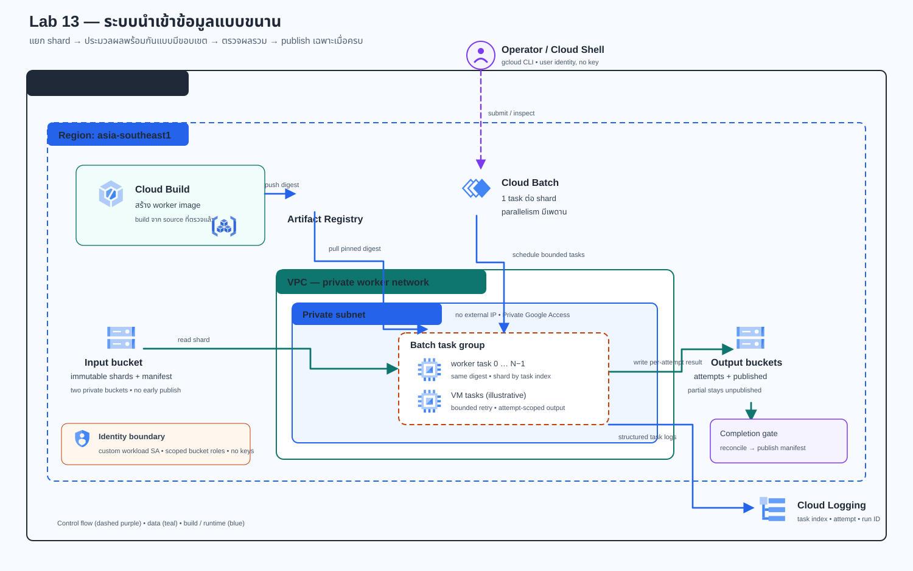

# Lab 13 — ระบบประมวลผลข้อมูลนำเข้าแบบขนาน

> **สถานะเอกสาร:** Guide-ready — โจทย์, architecture, Terraform, worker, data generator, uploader, job renderer, reconciler และขั้นตอนตรวจ/กู้คืนครบ  
> **สถานะ Cloud:** Not run — ยังไม่มีผลรัน GCP จริงในเอกสารนี้ Expected เป็นเพียงสิ่งที่ควรเห็น ห้ามนำไปกรอกแทน Actual

## โจทย์

ทีม Data Operations ต้องนำเข้ารายการสินค้าจำลองที่แบ่งเป็น shard หลายไฟล์ การประมวลผลบนเครื่องเดียวใช้เวลานาน และเมื่อ worker บางส่วนล้มเหลว ทีมไม่รู้ว่าส่วนไหนสำเร็จแล้วหรือข้อมูลครบพอให้ downstream ใช้หรือยัง

ให้สร้างระบบรับไฟล์แบบ immutable แล้วใช้ Cloud Batch ประมวลผลแต่ละ shard แบบขนานใน private worker network จากนั้นตรวจ task state, hash, record count และยอดรวมให้ครบก่อน publish completion manifest ระบบต้องแยก transient failure ที่ retry ได้ออกจากข้อมูลผิดรูปที่ต้องหยุด และสร้างรายงาน partial โดยไม่ประกาศข้อมูลไม่ครบว่าเสร็จแล้ว

ข้อมูลทั้งหมดใน Lab นี้เป็น synthetic product records ห้ามใช้ข้อมูลลูกค้า ผู้ขายจริง หรือข้อมูลอ่อนไหว

## เกณฑ์ยอมรับ

| ID | เกณฑ์ | วิธีพิสูจน์ |
|---|---|---|
| R1 | Manifest ระบุ run, shard, record count และ SHA-256; ตรวจ input ก่อน submit | manifest และผล validate |
| R2 | หนึ่ง Batch task ต่อหนึ่ง shard พร้อม parallelism และ timeout ที่กำหนด | job config, task list, job state |
| R3 | Worker ไม่มี external IP, อยู่ใน private subnet, ใช้ custom service account และ image digest | Terraform, Batch config, Artifact Registry |
| R4 | Worker อ่าน input/สร้าง attempt output ได้ แต่สร้าง object ใน input/published ไม่ได้ | IAM policies และ probe ที่ได้ 403 ทั้งสอง bucket |
| R5 | Logs เชื่อมโยง run, shard, task, attempt และผลการทำงาน | Cloud Logging task logs |
| R6 | Exit code 75 retry ได้หนึ่งครั้ง; malformed input code 65 ไม่ retry | task status events, attempts และ worker logs |
| R7 | งานไม่ครบสร้าง partial report ได้แต่ไม่มี completion manifest | failed job, report และ published prefix |
| R8 | Recovery ใช้ run ID ใหม่และ reconcile ทุก shard ใหม่ | failed/recovery run IDs และ reports |
| R9 | Change Request เปลี่ยนจาก 8×1,000 เป็น 16×1,000 records และ parallelism 2→4 | config, สถานะ, เวลาจริง, resource shape และราคาอ้างอิง |
| R10 | สร้าง HTML/JSON report และ cleanup ได้ตาม inventory | reports ใน Cloud Shell และ inventory ก่อน/หลัง |

R9 เป็นการสังเกตใน environment ของผู้เรียน ไม่ใช่ benchmark; เพราะขนาด input กับ concurrency เปลี่ยนพร้อมกัน ห้ามสรุปว่าเวลาที่ต่างเกิดจากตัวแปรใดตัวแปรหนึ่ง

## Solution diagram

[เปิด diagram แบบ standalone](assets/diagrams/solution.html) · [ดูแหล่งที่มาของไอคอน](assets/diagram-provenance.json)

Cloud Batch เป็น control plane ที่จัด Compute Engine workers ใน subnet; Cloud Storage และ Cloud Logging เป็น Google APIs ที่เข้าถึงผ่าน Private Google Access. ไม่สร้าง VM ด้วยมือ และไม่กำหนด external IP ให้ worker

## ภาพรวม flow

1. สร้าง synthetic records แบบ deterministic และ manifest ที่ผูก shard, record count และ hash
2. ตรวจ bytes ก่อน upload; สร้าง shard objects แบบ create-only แล้วสร้าง manifest เป็น object สุดท้าย
3. Cloud Build build worker image แล้ว push เข้า private Artifact Registry
4. Cloud Batch เรียก worker ตาม shard index พร้อม parallelism, runtime และ retry ที่มีขอบเขต
5. Worker ตรวจ manifest/schema/hash, คำนวณ totals และเขียนผลตาม run/shard/attempt
6. Operator ตรวจ job/task/logs และ reconcile output กับ input
7. Publisher สร้าง completion manifest เฉพาะเมื่อทุก task และ result ผ่าน
8. เมื่อผิดพลาดให้สร้าง partial report; recovery ใช้ run ID ใหม่

Batch มี semantics แบบ at-least-once; lifecycle policy ใช้ RETRY_TASK เฉพาะ exit code 75 และ maxRetryCount=1; exit code 65 ที่ไม่อยู่ใน allowlist ไม่ retry. Lab นี้ไม่อ้าง exactly-once execution. Output แยก attempt และ publish ใช้ create-only เพื่อไม่เขียนทับผลเดิม

## IAM ที่ต้องรักษา

| Identity | Role / ขอบเขต |
|---|---|
| Operator | Cloud Build Editor (roles/cloudbuild.builds.editor), Service Usage Consumer (roles/serviceusage.serviceUsageConsumer), Batch Job Editor (roles/batch.jobsEditor), Compute Network Viewer (roles/compute.networkViewer) และ Logs Viewer (roles/logging.viewer) ใน disposable project |
| Operator | Service Account User (roles/iam.serviceAccountUser) เฉพาะ build/runtime service accounts |
| Operator | Storage Object Viewer (roles/storage.objectViewer) เฉพาะ input, attempt-output และ published buckets |
| Operator | Storage Object Creator (roles/storage.objectCreator) เฉพาะ input (append source objects) และ published (publish manifest) |
| Build service account | Artifact Registry Writer (roles/artifactregistry.writer) เฉพาะ worker repository และ Logs Writer (roles/logging.logWriter) |
| Runtime service account | Batch Agent Reporter (roles/batch.agentReporter), Logs Writer (roles/logging.logWriter), Artifact Registry Reader (roles/artifactregistry.reader) เฉพาะ repository |
| Runtime service account | Storage Object Viewer (roles/storage.objectViewer) เฉพาะ input; Object Creator (roles/storage.objectCreator) เฉพาะ attempt-output; ไม่มี write ใน input/published |
| Cloud Batch service agent | Google จัดการ Batch Service Agent (roles/batch.serviceAgent) หลังเปิดใช้บริการ; อย่าถอดหรือมอบ role นี้ให้ principal อื่น |

Terraform Foundation ต้องใช้ bootstrap identity ที่สร้าง API, VPC/subnet, service accounts, buckets, repository และ IAM bindings ได้ใน disposable project (เช่น Service Usage Admin, Compute Network Admin, Service Account Admin, Storage Admin, Artifact Registry Admin และ Project IAM Admin ตามทรัพยากรที่อนุญาต) อย่ามอบ Owner/Editor ทั้งองค์กรเพื่อทำ Lab. ถ้าใช้สิทธิ์ชั่วคราว ให้ตกลงวิธีถอนคืนกับผู้ดูแล

> **ค่าใช้จ่าย/การกู้คืน:** Cloud Batch worker, Cloud Build, image storage, Cloud Storage และ Cloud Logging อาจคิดค่าบริการตามการใช้และ region. ตรวจ Billing ก่อนเริ่ม; budget alert ไม่ได้หยุด resource อัตโนมัติ. Buckets ของ Lab ตั้ง soft delete เป็น 0 สำหรับข้อมูลชั่วคราวเพื่อลดค่าเก็บ object ที่ลบแล้ว จึงกู้ object ที่ลบผิดไม่ได้ — เก็บหลักฐานก่อน cleanup. CI ของ repository ไม่ได้สร้าง Cloud resource.

## เริ่มใน Cloud Shell

ทำทั้งหมดใน Google Cloud Shell ของ disposable project เพื่อให้ environment และไฟล์อยู่ที่เดียวกัน ใช้ region asia-southeast1 เมื่อ project quota/policy อนุญาต ห้ามวาง service-account key ลงไฟล์หรือ commit

### Task 00 — เช็ก Project, Billing และงบก่อนเริ่ม

เลือก project ที่ไม่มี production data. ใน Console เปิด Project selector ตรวจ Project ID; เปิด Billing ตรวจว่าผูก billing account แล้ว; ตรวจ budget/alert และข้อจำกัด Compute, Batch, Cloud Build, Storage, Artifact Registry. ถ้าขาด bootstrap roles ให้หยุดและขอผู้ดูแลเฉพาะ project นี้

**คำสั่ง Bash:**

    gcloud config list
    gcloud projects describe YOUR_DISPOSABLE_PROJECT_ID --format="value(projectId,lifecycleState)"
    gcloud beta billing projects describe YOUR_DISPOSABLE_PROJECT_ID --format="yaml(projectId,billingEnabled,billingAccountName)"

สิ่งที่คาดว่าจะเห็น (Expected): Project ACTIVE และ billingEnabled เป็น true. หาก billing command ไม่มีสิทธิ์ ให้ตรวจใน Console; อย่าสรุปว่า project ฟรีหรือ budget จะหยุด resource

**ผลจริงที่ฉันบันทึก:** Project alias __________ · Region __________ · Billing ตรวจเมื่อ __________ · Budget/alert __________ · Bootstrap approver __________

**หลักฐานที่เก็บ:** screenshot Project/Billing/Budget ที่ปกปิดเลขบัญชีและข้อมูลส่วนตัว; ไม่เก็บ token

### Task 01 — เปิด Cloud Shell และตรวจตัวตน

กด **Activate Cloud Shell** ใน Google Cloud Console แล้วรอ terminal พร้อม ยืนยันว่าใช้บัญชีคนที่ตั้งใจ ไม่ใช้ key file

**คำสั่ง Bash:**

    gcloud auth list
    gcloud config set project YOUR_DISPOSABLE_PROJECT_ID
    gcloud config get-value project
    gcloud version
    terraform version
    python3 --version

สิ่งที่คาดว่าจะเห็น (Expected): account เดียวที่ตั้งใจเป็น ACTIVE, project ตรงกับ Task 00, Terraform 1.9≤version<2.0 และ Python 3.12 ขึ้นไป; ถ้า Terraform ไม่มี ให้ติดตั้งจากเอกสารทางการใน Cloud Shell ก่อน

**ผลจริงที่ฉันบันทึก:** Account alias __________ · Project __________ · gcloud __________ · Terraform __________ · Python __________

**หลักฐานที่เก็บ:** version/project output ที่ redact แล้ว; ไม่แนบ credential หรือ token

### Task 02 — Clone branch และเข้า Lab

Clone branch ที่กำลัง review โดยตรง แล้วกำหนด working directory

**คำสั่ง Bash:**

    git clone --depth 1 --branch docs/gcp-solution-labs https://github.com/somkid-s5/Portfolio-Lab.git
    cd Portfolio-Lab
    export LAB_DIR="$PWD/GCP/LAB-013-parallel-data-processing"
    test -f "$LAB_DIR/README.md"
    cd "$LAB_DIR"
    git rev-parse --short HEAD

สิ่งที่คาดว่าจะเห็น (Expected): README, app, infra, tools และ tests อยู่ใต้ LAB_DIR; commit เป็น branch docs/gcp-solution-labs

**ผลจริงที่ฉันบันทึก:** Commit SHA __________ · วันที่ clone __________ · Branch __________

**หลักฐานที่เก็บ:** commit SHA และรายการไฟล์; ถ้าใช้ fork/branch อื่นบันทึก URL/branch จริง

### Task 03 — ตั้งค่าตัวแปรและ Terraform input

ตั้ง run suffix/prefix ไม่ซ้ำ: prefix เป็น lowercase ตัวเลข/ขีดกลาง ยาว 3–53 ตัว ไม่จบด้วยขีดกลาง และไม่ขึ้นต้น goog/google. คัดลอกตัวอย่าง tfvars แล้วเปิด infra/terraform.tfvars ด้วย Cloud Shell Editor หรือ nano เพื่อแทน placeholder ด้วยค่าจริง

**คำสั่ง Bash:**

    export PROJECT_ID="$(gcloud config get-value project)"
    export REGION="asia-southeast1"
    export RUN_SUFFIX="$(date -u +%Y%m%d-%H%M%S)"
    export BUCKET_PREFIX="lab13-$PROJECT_ID-$(date -u +%s)"
    export OPERATOR_EMAIL="$(gcloud auth list --filter=status:ACTIVE --format='value(account)')"
    cp infra/terraform.tfvars.example infra/terraform.tfvars
    printf 'project=%s region=%s prefix=%s operator=%s\n' "$PROJECT_ID" "$REGION" "$BUCKET_PREFIX" "$OPERATOR_EMAIL"
    nano infra/terraform.tfvars
    mkdir -p work

กรอก project_id, region, operator_member เป็น user:$OPERATOR_EMAIL (ถ้า principal ไม่ใช่ user ให้ใช้ชนิด principal จริง) และ bucket_prefix ให้ตรงกับค่าที่พิมพ์

สิ่งที่คาดว่าจะเห็น (Expected): ไม่มี placeholder, project/operator ตรงกับ Cloud Shell และชื่อ bucket หลังเติม suffix ไม่เกิน 63 ตัว. tfvars/state ถูก ignore จาก Git แต่ state ยังมี resource metadata จึงอย่าแชร์

**ผลจริงที่ฉันบันทึก:** Region __________ · Prefix alias __________ · Principal type __________ · ตรวจชื่อ bucket แล้ว [ ]

**หลักฐานที่เก็บ:** เก็บเพียง alias/ท้ายชื่อ; ไม่แนบ tfvars หรือ state

### Task 04 — ตรวจ Code และ Terraform Plan ก่อนสร้าง

ตั้ง virtual environment แล้วทดสอบ code แบบไม่เรียก Google APIs; ตรวจ format/validate/plan ก่อนสร้าง Foundation

**คำสั่ง Bash:**

    python3 -m venv .venv
    . .venv/bin/activate
    python -m pip install --disable-pip-version-check -r app/requirements.txt
    python -m compileall -q app tools tests
    python -m unittest discover -s tests -p "test_*.py" -v
    terraform -chdir=infra fmt -check -recursive
    terraform -chdir=infra init -input=false -backend=false
    terraform -chdir=infra validate -no-color
    mkdir -p infra/work
    terraform -chdir=infra plan -input=false -out=work/lab13.tfplan
    terraform -chdir=infra show -no-color work/lab13.tfplan

สิ่งที่คาดว่าจะเห็น (Expected): tests ผ่าน; plan มี VPC/subnet, repo, 2 service accounts, 3 private buckets และ IAM; ไม่มี VM, Batch job, NAT หรือ resource นอก project. ถ้าเห็น bucket/resource ที่ไม่รู้จัก ให้หยุดและตรวจ project/tfvars

**ผลจริงที่ฉันบันทึก:** Python tests __________ · Terraform/provider __________ · Plan add/change/destroy __________ · Scope reviewer __________

**หลักฐานที่เก็บ:** plan/redacted show เก็บใน Cloud Shell ชั่วคราว; ห้าม commit state/plan

### Task 05 — สร้าง Foundation

อ่าน plan และยืนยัน project, prefix, IAM principal และค่าใช้จ่ายอีกครั้ง แล้ว apply เฉพาะ plan ที่ตรวจแล้ว

**คำสั่ง Bash:**

    terraform -chdir=infra apply -input=false work/lab13.tfplan
    terraform -chdir=infra output
    terraform -chdir=infra output -json > infra/work/infra-outputs.json

สิ่งที่คาดว่าจะเห็น (Expected): network/subnet, buckets, repo และ service accounts; ยังไม่มี worker VM จน submit Batch job

**ผลจริงที่ฉันบันทึก:** Apply start/end __________ / __________ · Outputs checked [ ] · Errors __________

**หลักฐานที่เก็บ:** redacted apply summary; อย่า commit infra/work/infra-outputs.json หรือ Terraform state

### Task 06 — ตรวจ VPC, buckets และ IAM boundary

อ่าน outputs เพื่อเตรียมตัวแปร ตรวจ PGA, bucket policies, IAM และ repository. ใช้ policy จริงเป็นหลักฐาน ไม่อนุมานจาก plan อย่างเดียว

**คำสั่ง Bash:**

    export INPUT_BUCKET="$(terraform -chdir=infra output -raw input_bucket)"
    export ATTEMPT_BUCKET="$(terraform -chdir=infra output -raw attempt_output_bucket)"
    export PUBLISHED_BUCKET="$(terraform -chdir=infra output -raw published_manifest_bucket)"
    export IMAGE_PATH="$(terraform -chdir=infra output -raw worker_image_path)"
    export BUILD_SA="$(terraform -chdir=infra output -raw build_service_account)"
    export RUNTIME_SA="$(terraform -chdir=infra output -raw runtime_service_account)"
    gcloud compute networks subnets describe lab013-workers --region="$REGION" --format="value(privateIpGoogleAccess,ipCidrRange)"
    gcloud storage buckets describe "gs://$INPUT_BUCKET"
    gcloud storage buckets describe "gs://$ATTEMPT_BUCKET"
    gcloud storage buckets describe "gs://$PUBLISHED_BUCKET"
    gcloud storage buckets get-iam-policy "gs://$INPUT_BUCKET" --format=json > work/input-iam.json
    gcloud storage buckets get-iam-policy "gs://$ATTEMPT_BUCKET" --format=json > work/attempt-iam.json
    gcloud storage buckets get-iam-policy "gs://$PUBLISHED_BUCKET" --format=json > work/published-iam.json
    grep -E "storage.object(Viewer|Creator)" work/input-iam.json work/attempt-iam.json work/published-iam.json
    gcloud artifacts repositories describe lab013-images --location="$REGION"

สิ่งที่คาดว่าจะเห็น (Expected): PGA=true; buckets เปิด UBLA/PAP; runtime Viewer เฉพาะ input และ Creator เฉพาะ attempt; operator Viewer ทั้งสาม และ Creator input/published; runtime ไม่มี Creator input/published

**ผลจริงที่ฉันบันทึก:** PGA __________ · UBLA/PAP __________ · IAM reviewer __________ · ความต่างจาก Expected __________

**หลักฐานที่เก็บ:** subnet/bucket metadata และ IAM JSON ที่ redact email/project แล้ว

### Task 07 — สร้าง baseline 8 shards × 1,000 records

ใช้ run ID ที่ยังไม่เคยใช้; generator deterministic และไม่ยอมเขียนทับ run directory เดิม

**คำสั่ง Bash:**

    export BASE_RUN_ID="lab13-base-$RUN_SUFFIX"
    python3 tools/generate_dataset.py --input-bucket "$INPUT_BUCKET" --run-id "$BASE_RUN_ID" --shards 8 --records-per-shard 1000 --output-root work/input
    python3 -c 'import json,pathlib; m=json.loads((pathlib.Path("work/input") / "'"$BASE_RUN_ID"'" / "manifest.json").read_text()); print({"run_id":m["run_id"],"shards":m["shard_count"],"records":m["total_records"]})'
    find "work/input/$BASE_RUN_ID" -maxdepth 2 -type f -print

สิ่งที่คาดว่าจะเห็น (Expected): 8 shard files และ manifest, รวม 8,000 synthetic records; manifest บันทึก SHA-256 ของ bytes จริง

**ผลจริงที่ฉันบันทึก:** Baseline run ID __________ · Shards __________ · Records __________ · Manifest SHA-256 __________

**หลักฐานที่เก็บ:** manifest, hash และผล validate; ตรวจว่าไม่มีข้อมูลส่วนตัว

### Task 08 — Upload แบบ create-only และ manifest-last

Uploader ตรวจ shard ทุกไฟล์ก่อนส่ง network; object ใช้ generation precondition 0 และ manifest ถูกสร้างเป็นลำดับสุดท้าย. ถ้าถูกขัดจังหวะให้รันซ้ำได้: tool ยืนยัน bytes ของ object เดิมและรับช่วงต่อ; หากข้อมูลต่างจะ fail closed. ห้ามใช้ run ID ซ้ำกับข้อมูลชุดอื่น

**คำสั่ง Bash:**

    python3 tools/upload_dataset.py --run-dir "work/input/$BASE_RUN_ID" --input-bucket "$INPUT_BUCKET"
    gcloud storage ls --recursive "gs://$INPUT_BUCKET/runs/$BASE_RUN_ID/**"
    gcloud storage objects describe "gs://$INPUT_BUCKET/runs/$BASE_RUN_ID/manifest.json"

สิ่งที่คาดว่าจะเห็น (Expected): shard objects และ manifest URI; rerun แสดง already-present-and-verified; ไม่มีการ overwrite

**ผลจริงที่ฉันบันทึก:** Shards uploaded/verified __________ · Manifest URI __________ · Generation __________

**หลักฐานที่เก็บ:** uploader output, object list/metadata และผล resume หากมี

### Task 09 — ตรวจ worker และชุดทดสอบ bounded

รัน code/test อีกครั้งก่อน build. การทดสอบนี้ local/CI ไม่ใช่ Cloud verification; tests ไม่ใช้ credential หรือ Google API calls

**คำสั่ง Bash:**

    . .venv/bin/activate
    python -m compileall -q app tools tests
    python -m unittest discover -s tests -p "test_*.py" -v
    sed -n '1,220p' app/lab13/worker.py
    sed -n '1,220p' app/lab13/contract.py
    sed -n '1,180p' app/Dockerfile

สิ่งที่คาดว่าจะเห็น (Expected): tests ครอบคลุม manifest/hash/schema, retry path, malformed data, IAM probe contract, append/resume upload, reconciliation และ Guide; Dockerfile ใช้ non-root UID 10001

**ผลจริงที่ฉันบันทึก:** จำนวน tests __________ · ผ่าน/ล้มเหลว __________ · Code review note __________

**หลักฐานที่เก็บ:** test output และ commit SHA; label ว่าเป็น no-cloud test

### Task 10 — Build image ด้วย Cloud Build และเก็บ digest

Tag ใช้ติดตาม build เท่านั้น; Batch ต้องใช้ digest. Cloud Build ใช้ custom build service account ที่เขียนได้เฉพาะ worker repo และส่ง logs ไป Cloud Logging. Operator ต้องมี Cloud Build Editor, Service Usage Consumer และ Service Account User บน build account

**คำสั่ง Bash:**

    export BUILD_TAG="lab13-$RUN_SUFFIX"
    gcloud builds submit --project="$PROJECT_ID" --region="$REGION" --config=cloudbuild.yaml --substitutions="_REGION=$REGION,_TAG=$BUILD_TAG" .
    gcloud builds list --project="$PROJECT_ID" --region="$REGION" --limit=5
    export BUILD_ID="REPLACE_WITH_BUILD_ID_FROM_OUTPUT"
    gcloud builds describe "$BUILD_ID" --project="$PROJECT_ID" --region="$REGION" --format="yaml(id,status,results.images,source)"
    export BUILD_DIGEST="$(gcloud builds describe "$BUILD_ID" --project="$PROJECT_ID" --region="$REGION" --format='value(results.images[0].digest)')"
    test -n "$BUILD_DIGEST"
    export IMAGE_URI="$IMAGE_PATH@$BUILD_DIGEST"
    printf 'digest-pinned image: %s\n' "$IMAGE_URI"
    gcloud artifacts docker images list "$IMAGE_PATH" --include-tags

สิ่งที่คาดว่าจะเห็น (Expected): Cloud Build SUCCESS; image tag/digest ปรากฏใน repository; IMAGE_URI มี @sha256: ตามด้วย 64 hex. ถ้า digest ว่างให้ตรวจ build/logs และอย่า submit Batch ด้วย tag อย่างเดียว

**ผลจริงที่ฉันบันทึก:** Build ID __________ · Status __________ · Image digest __________ · Build duration __________

**หลักฐานที่เก็บ:** build details/log และ image digest. Cloud Build อาจสร้าง source staging bucket/object ที่ไม่ถูกลบอัตโนมัติ; บันทึก bucket/object จาก build metadata เพื่อ cleanup เฉพาะ object ใน Task 19

### Task 11 — Render และ review job config

Renderer ทำงาน local ไม่เรียก GCP. Baseline ฉีด transient exit code 75 ให้ task 0 หนึ่งครั้ง เพื่อพิสูจน์ retry แบบ bounded

**คำสั่ง Bash:**

    export BASE_JOB_ID="lab13-base-$RUN_SUFFIX"
    export BASE_MANIFEST_URI="gs://$INPUT_BUCKET/runs/$BASE_RUN_ID/manifest.json"
    python3 tools/render_batch_job.py --purpose process --project "$PROJECT_ID" --region "$REGION" --job-id "$BASE_JOB_ID" --image-uri "$IMAGE_URI" --runtime-service-account "$RUNTIME_SA" --manifest-uri "$BASE_MANIFEST_URI" --attempt-output-bucket "$ATTEMPT_BUCKET" --task-count 8 --parallelism 2 --fail-once-index 0 --output "work/configs/$BASE_JOB_ID.json"
    python3 -c 'import json; p=json.load(open("work/configs/'"$BASE_JOB_ID"'.json")); g=p["taskGroups"][0]; n=p["allocationPolicy"]["network"]["networkInterfaces"][0]; print({"tasks":g["taskCount"],"parallelism":g["parallelism"],"retry":g["taskSpec"]["lifecyclePolicies"],"no_external_ip":n["noExternalIpAddress"]})'
    cat "work/configs/$BASE_JOB_ID.json"

สิ่งที่คาดว่าจะเห็น (Expected): 8 tasks, parallelism 2, noExternalIpAddress=true, digest-pinned image, runtime SA และ retry เฉพาะ code 75/maxRetryCount 1

**ผลจริงที่ฉันบันทึก:** Job ID __________ · Tasks/parallelism __________ / __________ · Machine type __________ · Config reviewer __________

**หลักฐานที่เก็บ:** rendered JSON และ image digest ใน work/

### Task 12 — Submit baseline และตรวจ retry

ส่ง job ใน asia-southeast1. Poll สูงสุด 10 นาที; ถ้ายังไม่ terminal state ให้หยุดวิเคราะห์ status/agent logs ก่อนส่งซ้ำ

**คำสั่ง Bash:**

    gcloud batch jobs submit "$BASE_JOB_ID" --project="$PROJECT_ID" --location="$REGION" --config="work/configs/$BASE_JOB_ID.json"
    export JOB_STATE="UNKNOWN"
    for poll in $(seq 1 60); do
      JOB_STATE="$(gcloud batch jobs describe "$BASE_JOB_ID" --project="$PROJECT_ID" --location="$REGION" --format='value(status.state)')"
      printf 'poll=%s state=%s\n' "$poll" "$JOB_STATE"
      if [[ "$JOB_STATE" == "SUCCEEDED" || "$JOB_STATE" == "FAILED" ]]; then break; fi
      sleep 10
    done
    test "$JOB_STATE" = "SUCCEEDED"
    mkdir -p "work/evidence/$BASE_RUN_ID"
    gcloud batch jobs describe "$BASE_JOB_ID" --project="$PROJECT_ID" --location="$REGION" --format=json > "work/evidence/$BASE_RUN_ID/job.json"
    gcloud batch tasks list --job="$BASE_JOB_ID" --project="$PROJECT_ID" --location="$REGION" --format=json > "work/evidence/$BASE_RUN_ID/tasks.json"
    grep -n '"state"' "work/evidence/$BASE_RUN_ID/tasks.json"

สิ่งที่คาดว่าจะเห็น (Expected): job และ 8 tasks SUCCEEDED; task 0 มี exit code 75 ก่อน success และ result ใต้ attempt-1; tasks อื่นมีผลใต้ attempt-0. นับ attempts จากผลจริง ไม่อนุมานจาก config

**ผลจริงที่ฉันบันทึก:** Job UID __________ · State __________ · Task 0 attempts/exit codes __________ · Runtime __________

**หลักฐานที่เก็บ:** job/tasks JSON, UID, เวลา submit/complete และสถานะจริง

### Task 13 — ตรวจ Logs และ IAM negative probe

Cloud Batch task logs อยู่ใน batch_task_logs; filter ใช้ job UID. จากนั้นส่ง probe job หนึ่ง task ซึ่งพยายามสร้าง object ใน input และ published buckets; probe สำเร็จเมื่อทั้งคู่ถูกปฏิเสธด้วย 403

**คำสั่ง Bash:**

    export BASE_JOB_UID="$(gcloud batch jobs describe "$BASE_JOB_ID" --project="$PROJECT_ID" --location="$REGION" --format='value(uid)')"
    export LOG_FILTER="logName=projects/$PROJECT_ID/logs/batch_task_logs AND labels.job_uid=$BASE_JOB_UID"
    gcloud logging read "$LOG_FILTER" --project="$PROJECT_ID" --limit=200 --format=json > "work/evidence/$BASE_RUN_ID/task-logs.json"
    grep -nE "shard_succeeded|transient_fault_injected|shard_rejected" "work/evidence/$BASE_RUN_ID/task-logs.json"
    export IAM_PROBE_JOB_ID="lab13-iam-probe-$RUN_SUFFIX"
    export PROBE_ID="lab13-probe-$RUN_SUFFIX"
    python3 tools/render_batch_job.py --purpose iam-probe --project "$PROJECT_ID" --region "$REGION" --job-id "$IAM_PROBE_JOB_ID" --image-uri "$IMAGE_URI" --runtime-service-account "$RUNTIME_SA" --input-bucket "$INPUT_BUCKET" --published-bucket "$PUBLISHED_BUCKET" --probe-id "$PROBE_ID" --output "work/configs/$IAM_PROBE_JOB_ID.json"
    gcloud batch jobs submit "$IAM_PROBE_JOB_ID" --project="$PROJECT_ID" --location="$REGION" --config="work/configs/$IAM_PROBE_JOB_ID.json"
    export IAM_STATE="UNKNOWN"
    for poll in $(seq 1 60); do
      IAM_STATE="$(gcloud batch jobs describe "$IAM_PROBE_JOB_ID" --project="$PROJECT_ID" --location="$REGION" --format='value(status.state)')"
      printf 'poll=%s state=%s\n' "$poll" "$IAM_STATE"
      if [[ "$IAM_STATE" == "SUCCEEDED" || "$IAM_STATE" == "FAILED" ]]; then break; fi
      sleep 10
    done
    gcloud batch jobs describe "$IAM_PROBE_JOB_ID" --project="$PROJECT_ID" --location="$REGION" --format=json > "work/evidence/$BASE_RUN_ID/iam-probe-job.json"
    gcloud batch tasks list --job="$IAM_PROBE_JOB_ID" --project="$PROJECT_ID" --location="$REGION" --format=json > "work/evidence/$BASE_RUN_ID/iam-probe-tasks.json"
    export IAM_UID="$(gcloud batch jobs describe "$IAM_PROBE_JOB_ID" --project="$PROJECT_ID" --location="$REGION" --format='value(uid)')"
    gcloud logging read "logName=projects/$PROJECT_ID/logs/batch_task_logs AND labels.job_uid=$IAM_UID" --project="$PROJECT_ID" --limit=50 --format=json > "work/evidence/$BASE_RUN_ID/iam-probe-logs.json"
    grep -n "iam_boundary_verified" "work/evidence/$BASE_RUN_ID/iam-probe-logs.json"
    test "$IAM_STATE" = "SUCCEEDED"

สิ่งที่คาดว่าจะเห็น (Expected): logs มี shard_succeeded/transient_fault_injected; IAM probe SUCCEEDED และ log iam_boundary_verified แสดง deny ทั้ง input/published. Exit 66 หมายถึงสิทธิ์เขียนมากเกินไป; exit 70 คือ probe error ไม่ใช่หลักฐานว่า IAM ถูกต้อง หาก probe ไม่ SUCCEEDED หรือพบ write allowed ให้หยุดก่อน Task 14, อย่า publish และเก็บ probe object path เพื่อ cleanup หลังแก้ IAM

**ผลจริงที่ฉันบันทึก:** Log query __________ · Probe UID/state __________ · Input denied __________ · Published denied __________

**หลักฐานที่เก็บ:** task logs, probe status และ redacted policies; ถ้า probe สร้าง objectให้บันทึก prefix ใน log เพื่อ cleanup เฉพาะจุด

### Task 14 — Reconcile และ publish baseline

Reconciler ดาวน์โหลด manifest และ attempt outputs แล้วตรวจ job/task state, output naming, hashes, manifest binding และยอดรวม; ต้องมี result ที่ผ่านหนึ่งชิ้นต่อ shard. completion object ใช้ create-only. รันหลังตรวจ job สำเร็จและเก็บ job/tasks JSON แล้วเท่านั้น

**คำสั่ง Bash:**

    python3 tools/reconcile.py --job-json "work/evidence/$BASE_RUN_ID/job.json" --tasks-json "work/evidence/$BASE_RUN_ID/tasks.json" --manifest-uri "$BASE_MANIFEST_URI" --attempt-output-bucket "$ATTEMPT_BUCKET" --published-bucket "$PUBLISHED_BUCKET" --output-dir work/reports --publish
    gcloud storage objects describe "gs://$PUBLISHED_BUCKET/runs/$BASE_RUN_ID/completion.json"
    python3 -c 'import json,pathlib; r=json.loads((pathlib.Path("work/reports") / "'"$BASE_RUN_ID"'-reconciliation.json").read_text()); print({"complete":r["complete"],"records":r["record_count"],"units":r["units_total"],"value_minor":r["value_minor_total"],"attempts":r["attempt_count_by_task"]})'

สิ่งที่คาดว่าจะเห็น (Expected): complete=true, 8 shards/8,000 records, totals จากผล worker ที่ตรวจ hash และ completion manifest มี source manifest hash/result URIs. HTML report เปิดอ่านได้ใน Cloud Shell แต่ไม่ได้ deploy เป็นเว็บ

**ผลจริงที่ฉันบันทึก:** Reconcile __________ · Records __________ · Units __________ · Value minor __________ · Completion URI __________

**หลักฐานที่เก็บ:** JSON/HTML report, manifest metadata และ input/output totals

### Task 15 — malformed data: fail ไม่ retry และไม่ publish

สร้าง run ID ใหม่ หนึ่ง shard ที่มี JSONL ผิดรูป. Uploader ปกติจะปฏิเสธ; flag allow-invalid-shard 0 เป็นทางยกเว้นสำหรับ fault exercise นี้เท่านั้น โดยยังเช็ก hash/count และบังคับ dataset หนึ่ง shard. Worker ควร exit 65 ซึ่งไม่อยู่ใน retry allowlist

**คำสั่ง Bash:**

    export BAD_RUN_ID="lab13-bad-$RUN_SUFFIX"
    export BAD_JOB_ID="lab13-bad-data-$RUN_SUFFIX"
    export BAD_MANIFEST_URI="gs://$INPUT_BUCKET/runs/$BAD_RUN_ID/manifest.json"
    python3 tools/generate_dataset.py --input-bucket "$INPUT_BUCKET" --run-id "$BAD_RUN_ID" --shards 1 --records-per-shard 25 --output-root work/input --malformed-shard 0
    python3 tools/upload_dataset.py --run-dir "work/input/$BAD_RUN_ID" --input-bucket "$INPUT_BUCKET" --allow-invalid-shard 0
    python3 tools/render_batch_job.py --purpose process --project "$PROJECT_ID" --region "$REGION" --job-id "$BAD_JOB_ID" --image-uri "$IMAGE_URI" --runtime-service-account "$RUNTIME_SA" --manifest-uri "$BAD_MANIFEST_URI" --attempt-output-bucket "$ATTEMPT_BUCKET" --task-count 1 --parallelism 1 --output "work/configs/$BAD_JOB_ID.json"
    gcloud batch jobs submit "$BAD_JOB_ID" --project="$PROJECT_ID" --location="$REGION" --config="work/configs/$BAD_JOB_ID.json"
    export BAD_JOB_STATE="UNKNOWN"
    for poll in $(seq 1 60); do
      BAD_JOB_STATE="$(gcloud batch jobs describe "$BAD_JOB_ID" --project="$PROJECT_ID" --location="$REGION" --format='value(status.state)')"
      printf 'poll=%s state=%s\n' "$poll" "$BAD_JOB_STATE"
      if [[ "$BAD_JOB_STATE" == "SUCCEEDED" || "$BAD_JOB_STATE" == "FAILED" ]]; then break; fi
      sleep 10
    done
    test "$BAD_JOB_STATE" = "FAILED"
    mkdir -p "work/evidence/$BAD_RUN_ID"
    gcloud batch jobs describe "$BAD_JOB_ID" --project="$PROJECT_ID" --location="$REGION" --format=json > "work/evidence/$BAD_RUN_ID/job.json"
    gcloud batch tasks list --job="$BAD_JOB_ID" --project="$PROJECT_ID" --location="$REGION" --format=json > "work/evidence/$BAD_RUN_ID/tasks.json"
    if python3 tools/reconcile.py --job-json "work/evidence/$BAD_RUN_ID/job.json" --tasks-json "work/evidence/$BAD_RUN_ID/tasks.json" --manifest-uri "$BAD_MANIFEST_URI" --attempt-output-bucket "$ATTEMPT_BUCKET" --published-bucket "$PUBLISHED_BUCKET" --output-dir work/reports; then echo "unexpected reconcile success"; exit 1; else rc=$?; test "$rc" -eq 2; fi
    if gcloud storage objects describe "gs://$PUBLISHED_BUCKET/runs/$BAD_RUN_ID/completion.json" > "work/evidence/$BAD_RUN_ID/completion-check.txt" 2>&1; then echo "unexpected completion object"; false; else grep -E '404|NotFound' "work/evidence/$BAD_RUN_ID/completion-check.txt"; fi

สิ่งที่คาดว่าจะเห็น (Expected): job FAILED, task exit 65 เพียง attempt เดียว, report เป็น PARTIAL — DO NOT PUBLISH และไม่มี completion object. ถ้า status ไม่ terminal ใน 10 นาที ให้หยุดวิเคราะห์ task/agent logs

**ผลจริงที่ฉันบันทึก:** Failed run __________ · Job/task state __________ · Code/attempts __________ · Partial report __________ · ตรวจ manifest absence ด้วย __________

**หลักฐานที่เก็บ:** malformed manifest/hash, job/tasks, worker log, partial report และผลตรวจ published prefix

### Task 16 — Recovery ด้วย run ID ใหม่

ห้ามแก้ input ของ failed run. สร้าง valid dataset ใหม่ 8×1,000, upload, submit และ reconcile ทุก shard ใหม่. transient injection ที่ task 0 ใช้ตรวจ attempt trace ใน recovery

**คำสั่ง Bash:**

    export RECOVERY_RUN_ID="lab13-recovery-$RUN_SUFFIX"
    export RECOVERY_JOB_ID="lab13-recovery-$RUN_SUFFIX"
    export RECOVERY_MANIFEST_URI="gs://$INPUT_BUCKET/runs/$RECOVERY_RUN_ID/manifest.json"
    python3 tools/generate_dataset.py --input-bucket "$INPUT_BUCKET" --run-id "$RECOVERY_RUN_ID" --shards 8 --records-per-shard 1000 --output-root work/input
    python3 tools/upload_dataset.py --run-dir "work/input/$RECOVERY_RUN_ID" --input-bucket "$INPUT_BUCKET"
    python3 tools/render_batch_job.py --purpose process --project "$PROJECT_ID" --region "$REGION" --job-id "$RECOVERY_JOB_ID" --image-uri "$IMAGE_URI" --runtime-service-account "$RUNTIME_SA" --manifest-uri "$RECOVERY_MANIFEST_URI" --attempt-output-bucket "$ATTEMPT_BUCKET" --task-count 8 --parallelism 2 --fail-once-index 0 --output "work/configs/$RECOVERY_JOB_ID.json"
    gcloud batch jobs submit "$RECOVERY_JOB_ID" --project="$PROJECT_ID" --location="$REGION" --config="work/configs/$RECOVERY_JOB_ID.json"
    gcloud batch jobs describe "$RECOVERY_JOB_ID" --project="$PROJECT_ID" --location="$REGION" --format="yaml(status.state,uid)"

Poll ไม่เกิน 10 นาที แล้วบันทึก state พร้อม job/tasks/logs แม้ job จะล้มเหลว; reconcile/publish เฉพาะเมื่อ SUCCEEDED:

**คำสั่ง Bash:**

    export RECOVERY_STATE="UNKNOWN"
    for poll in $(seq 1 60); do
      RECOVERY_STATE="$(gcloud batch jobs describe "$RECOVERY_JOB_ID" --project="$PROJECT_ID" --location="$REGION" --format='value(status.state)')"
      printf 'poll=%s state=%s\n' "$poll" "$RECOVERY_STATE"
      if [[ "$RECOVERY_STATE" == "SUCCEEDED" || "$RECOVERY_STATE" == "FAILED" ]]; then break; fi
      sleep 10
    done
    mkdir -p "work/evidence/$RECOVERY_RUN_ID"
    gcloud batch jobs describe "$RECOVERY_JOB_ID" --project="$PROJECT_ID" --location="$REGION" --format=json > "work/evidence/$RECOVERY_RUN_ID/job.json"
    gcloud batch tasks list --job="$RECOVERY_JOB_ID" --project="$PROJECT_ID" --location="$REGION" --format=json > "work/evidence/$RECOVERY_RUN_ID/tasks.json"
    export RECOVERY_UID="$(gcloud batch jobs describe "$RECOVERY_JOB_ID" --project="$PROJECT_ID" --location="$REGION" --format='value(uid)')"
    gcloud logging read "logName=projects/$PROJECT_ID/logs/batch_task_logs AND labels.job_uid=$RECOVERY_UID" --project="$PROJECT_ID" --limit=200 --format=json > "work/evidence/$RECOVERY_RUN_ID/task-logs.json"
    if [[ "$RECOVERY_STATE" == "SUCCEEDED" ]]; then
      python3 tools/reconcile.py --job-json "work/evidence/$RECOVERY_RUN_ID/job.json" --tasks-json "work/evidence/$RECOVERY_RUN_ID/tasks.json" --manifest-uri "$RECOVERY_MANIFEST_URI" --attempt-output-bucket "$ATTEMPT_BUCKET" --published-bucket "$PUBLISHED_BUCKET" --output-dir work/reports --publish
      gcloud storage objects describe "gs://$PUBLISHED_BUCKET/runs/$RECOVERY_RUN_ID/completion.json"
    else
      echo "ยังไม่ SUCCEEDED: เก็บ task/log evidence, ห้าม publish และให้หยุดแก้สาเหตุก่อน"
    fi

สิ่งที่คาดว่าจะเห็น (Expected): recovery run ID ต่างจาก bad run; ทุก shard ผ่านใหม่และรายงานอ้าง manifest ของ recovery เท่านั้น

**ผลจริงที่ฉันบันทึก:** Failed __________ → Recovery __________ · State __________ · Reconcile/publish __________

**หลักฐานที่เก็บ:** recovery job/tasks/logs, report, manifest hash และ attempt paths

### Task 17 — Change Request: 16 shards, parallelism 4

ทีมเพิ่ม input เป็น 16×1,000 และ parallelism 4. ใช้ image digest กับ machine type เดิมเพื่อไม่เปลี่ยน build/runtime พร้อมกัน; แต่ input size และ concurrency ยังเปลี่ยนพร้อมกัน จึงห้ามสรุป causal effect. บันทึก timestamps, task/VM ที่สังเกตได้, totals และราคาอ้างอิงพร้อมวันที่

**คำสั่ง Bash:**

    export CR_RUN_ID="lab13-change-$RUN_SUFFIX"
    export CR_JOB_ID="lab13-change-$RUN_SUFFIX"
    export CR_MANIFEST_URI="gs://$INPUT_BUCKET/runs/$CR_RUN_ID/manifest.json"
    python3 tools/generate_dataset.py --input-bucket "$INPUT_BUCKET" --run-id "$CR_RUN_ID" --shards 16 --records-per-shard 1000 --output-root work/input
    python3 tools/upload_dataset.py --run-dir "work/input/$CR_RUN_ID" --input-bucket "$INPUT_BUCKET"
    python3 tools/render_batch_job.py --purpose process --project "$PROJECT_ID" --region "$REGION" --job-id "$CR_JOB_ID" --image-uri "$IMAGE_URI" --runtime-service-account "$RUNTIME_SA" --manifest-uri "$CR_MANIFEST_URI" --attempt-output-bucket "$ATTEMPT_BUCKET" --task-count 16 --parallelism 4 --output "work/configs/$CR_JOB_ID.json"
    gcloud batch jobs submit "$CR_JOB_ID" --project="$PROJECT_ID" --location="$REGION" --config="work/configs/$CR_JOB_ID.json"
    gcloud batch jobs describe "$CR_JOB_ID" --project="$PROJECT_ID" --location="$REGION" --format="yaml(status.state,createTime,updateTime,uid)"

Poll และเก็บ job/tasks/logs; reconcile/publish เมื่อ job สำเร็จเท่านั้น:

**คำสั่ง Bash:**

    export CR_STATE="UNKNOWN"
    for poll in $(seq 1 60); do
      CR_STATE="$(gcloud batch jobs describe "$CR_JOB_ID" --project="$PROJECT_ID" --location="$REGION" --format='value(status.state)')"
      printf 'poll=%s state=%s\n' "$poll" "$CR_STATE"
      if [[ "$CR_STATE" == "SUCCEEDED" || "$CR_STATE" == "FAILED" ]]; then break; fi
      sleep 10
    done
    mkdir -p "work/evidence/$CR_RUN_ID"
    gcloud batch jobs describe "$CR_JOB_ID" --project="$PROJECT_ID" --location="$REGION" --format=json > "work/evidence/$CR_RUN_ID/job.json"
    gcloud batch tasks list --job="$CR_JOB_ID" --project="$PROJECT_ID" --location="$REGION" --format=json > "work/evidence/$CR_RUN_ID/tasks.json"
    export CR_UID="$(gcloud batch jobs describe "$CR_JOB_ID" --project="$PROJECT_ID" --location="$REGION" --format='value(uid)')"
    gcloud logging read "logName=projects/$PROJECT_ID/logs/batch_task_logs AND labels.job_uid=$CR_UID" --project="$PROJECT_ID" --limit=300 --format=json > "work/evidence/$CR_RUN_ID/task-logs.json"
    if [[ "$CR_STATE" == "SUCCEEDED" ]]; then
      python3 tools/reconcile.py --job-json "work/evidence/$CR_RUN_ID/job.json" --tasks-json "work/evidence/$CR_RUN_ID/tasks.json" --manifest-uri "$CR_MANIFEST_URI" --attempt-output-bucket "$ATTEMPT_BUCKET" --published-bucket "$PUBLISHED_BUCKET" --output-dir work/reports --publish
      gcloud storage objects describe "gs://$PUBLISHED_BUCKET/runs/$CR_RUN_ID/completion.json"
    else
      echo "ยังไม่ SUCCEEDED: เก็บ task/log evidence, ห้าม publish; หากเป็น quota ให้บันทึก blocked แล้วไป cleanup"
    fi

หาก job ยังไม่ terminal state หลัง 10 นาที ให้หยุดวิเคราะห์ events/agent logs ก่อน ไม่ส่ง job ซ้ำ. หาก quota ไม่พอ อย่าเพิ่ม quota/machine โดยไม่ประเมินค่าใช้จ่ายและสิทธิ์.

สิ่งที่คาดว่าจะเห็น (Expected): 16 tasks, parallelism 4, image digest/machine type เดิมและ private network

**ผลจริงที่ฉันบันทึก:** CR job/state __________ · Start/end __________ / __________ · Task attempts __________ · Cost source/date __________

**หลักฐานที่เก็บ:** config, job/tasks, report, Billing/price source และสมมติฐาน

### Task 18 — ทำ Case Study และเตรียมหลักฐาน Portfolio

เติมตารางจากผลจริงของ baseline, bad-data, recovery และ CR. HTML/JSON report เป็นไฟล์ local ใน Cloud Shell; screenshot Console ต้อง capture เองจาก job/task/log/IAM จริง. อย่าระบุ Cloud-verified หากไม่มี acceptance evidence ครบ

| หัวข้อ Case Study | ผลจริงที่ฉันบันทึก |
|---|---|
| ปัญหางานและ requirements | __________ |
| Architecture/trade-offs | __________ |
| Project alias/region/commit | __________ |
| Baseline: shards, records, parallelism, state, elapsed time | __________ |
| Retry: shard, attempts, code, output path | __________ |
| IAM negative test: input/published denial | __________ |
| Failure: malformed input, code, partial report, no manifest | __________ |
| Recovery: run ID ใหม่และ reconciliation | __________ |
| Change Request: config, runtime, resources, cost source/date | __________ |
| Limits: quota, ตัวแปรที่เปลี่ยนพร้อมกัน, no causal claim | __________ |
| Cleanup inventory before → after | __________ |
| สิ่งที่จะปรับเมื่อนำไปใช้ production | __________ |

**คำสั่ง Bash:**

    mkdir -p "work/evidence/$BASE_RUN_ID"
    cp "work/reports/$BASE_RUN_ID-reconciliation.json" "work/evidence/$BASE_RUN_ID/"
    cp "work/reports/$BASE_RUN_ID-reconciliation.html" "work/evidence/$BASE_RUN_ID/"
    find work/evidence -maxdepth 3 -type f -print
    git status --short

สิ่งที่คาดว่าจะเห็น (Expected): work/ และ .venv ไม่ขึ้นเป็น untracked; เก็บ report/screenshots/config ที่ redacted แล้วและเติมค่าจริงในตารางก่อนนำไปเผยแพร่

**ผลจริงที่ฉันบันทึก:** Case study เสร็จเมื่อ __________ · ไฟล์ __________ · Redaction reviewer __________ · Verification status __________

**หลักฐานที่เก็บ:** HTML/JSON, redacted screenshots, job/task logs, config/digest, failure/recovery manifests และ cost notes; อย่าเผย email/project number โดยไม่จำเป็น

### Task 19 — Cleanup แบบตรวจ target ก่อนลบ

เก็บ Case Study และหลักฐานที่ต้องการไว้ก่อน. ใช้ bootstrap identity ที่สร้าง Foundation; runtime/operator lab role ไม่มี delete permission. เลือก project เดิมและตรวจชื่อ bucket/run/job/image ก่อนลบ. ทำเฉพาะ prefix ที่ list แสดงว่ามี object; ห้ามลบทั้ง bucket prefix runs/ หรือ resource ที่ใช้ร่วมกับ Lab อื่น

ตรวจ inventory และ source staging metadata ก่อนเริ่ม:

**คำสั่ง Bash:**

    gcloud config get-value project
    gcloud auth list
    gcloud batch jobs list --project="$PROJECT_ID" --location="$REGION" --filter="name~lab13" --format="table(name,status.state)"
    gcloud storage ls --recursive "gs://$INPUT_BUCKET/runs/$BASE_RUN_ID/**"
    gcloud storage ls --recursive "gs://$ATTEMPT_BUCKET/runs/$BASE_RUN_ID/**"
    gcloud storage ls --recursive "gs://$PUBLISHED_BUCKET/runs/$BASE_RUN_ID/**"
    gcloud builds describe "$BUILD_ID" --project="$PROJECT_ID" --region="$REGION" --format="yaml(id,source.storageSource)"
    gcloud artifacts docker images list "$IMAGE_PATH" --include-tags

สำหรับแต่ละ run ID ให้ตรวจ inventory ก่อน แล้วลบเฉพาะ run prefix ที่มี object จริง ฟังก์ชันด้านล่างยอมรับเฉพาะ bucket/Run ID ของ Lab นี้ และต้องพิมพ์คำยืนยันให้ตรงกับ run ที่กำลังลบ หากคำสั่ง list ใช้ไม่ได้จะหยุด ไม่ตีความ error ว่า prefix ว่าง:

**คำสั่ง Bash:**

    delete_run_prefix() {
      local bucket_name="$1" run_id="$2" prefix objects answer
      case "$bucket_name" in "$INPUT_BUCKET"|"$ATTEMPT_BUCKET"|"$PUBLISHED_BUCKET") ;; *) echo "bucket นอก Lab 13"; return 2 ;; esac
      case "$run_id" in "$BASE_RUN_ID"|"$BAD_RUN_ID"|"$RECOVERY_RUN_ID"|"$CR_RUN_ID") ;; *) echo "run ID นอก Lab 13"; return 2 ;; esac
      prefix="gs://$bucket_name/runs/$run_id"
      if ! objects="$(gcloud storage ls --recursive "$prefix/**" 2>&1)"; then
        if printf '%s\n' "$objects" | grep -Eqi 'matched no objects|no URLs matched|404'; then
          echo "ไม่มี object: $prefix"
          return 0
        fi
        printf '%s\n' "$objects"
        echo "ตรวจ inventory ไม่สำเร็จ; ไม่ลบ"
        return 2
      fi
      if [[ -z "$objects" ]]; then echo "ไม่มี object: $prefix"; return 0; fi
      printf '%s\n' "$objects"
      read -r -p "พิมพ์ DELETE $run_id เพื่อลบ prefix นี้: " answer
      if [[ "$answer" != "DELETE $run_id" ]]; then echo "ยกเลิก"; return 1; fi
      gcloud storage rm --recursive "$prefix"
    }
    for run_id in "$BASE_RUN_ID" "$BAD_RUN_ID" "$RECOVERY_RUN_ID" "$CR_RUN_ID"; do
      [[ -n "$run_id" ]] || continue
      for bucket_name in "$INPUT_BUCKET" "$ATTEMPT_BUCKET" "$PUBLISHED_BUCKET"; do
        delete_run_prefix "$bucket_name" "$run_id" || echo "ข้าม/ตรวจด้วยตนเอง: $bucket_name / $run_id"
      done
    done
    for job_id in "$BASE_JOB_ID" "$BAD_JOB_ID" "$RECOVERY_JOB_ID" "$CR_JOB_ID" "$IAM_PROBE_JOB_ID"; do
      [[ -n "$job_id" ]] || continue
      gcloud batch jobs delete "$job_id" --project="$PROJECT_ID" --location="$REGION"
    done

จัดการ IAM probe โดยตรวจ input/published prefix จาก log ก่อน; หากพบ object ให้ลบเฉพาะ object path หลังยืนยันด้วยตนเอง เพราะอยู่นอก runs/. ลบ Artifact Registry images ทีละ digest URI ที่ตรวจแล้ว เช่น gcloud artifacts docker images delete "$IMAGE_URI" --delete-tags; ถ้ามีหลาย digest ให้ review แต่ละรายการก่อน

Cloud Build source staging bucket/object อาจคงอยู่หลัง build. ใช้ bucket/object จาก source.storageSource ใน Task 10 เพื่อระบุ object ของ build นี้ แล้วตรวจ URL และ inventory ก่อนลบ; หากหา object ไม่ชัดหรือเป็น bucket ที่แชร์กัน ให้เก็บไว้และบันทึกเหตุผล ห้ามลบ staging bucket

เมื่อ object/job/image ของ Lab ถูกจัดการแล้ว ให้ตรวจ Terraform destroy plan และยืนยันว่าจะลบเฉพาะ Lab13 resources ก่อนพิมพ์ yes:

**คำสั่ง Bash:**

    terraform -chdir=infra plan -destroy -input=false -var-file=terraform.tfvars -out=work/lab13-destroy.tfplan
    terraform -chdir=infra show -no-color work/lab13-destroy.tfplan
    terraform -chdir=infra destroy -input=false -var-file=terraform.tfvars

สิ่งที่คาดว่าจะเห็น (Expected): job IDs ถูกลบ, run prefixes ว่าง, repo ไม่มี image และ Terraform destroy จบ; Cloud Build history/source bucket หรือ APIs ที่เปิดอาจยังอยู่ จึงตรวจและบันทึกสิ่งที่เหลือ. Buckets ใช้ soft delete 0 และ force_destroy=false

**ผลจริงที่ฉันบันทึก:** Jobs __________ · Object prefixes __________ · AR digests __________ · Source object __________ · Destroy __________ · สิ่งที่เหลือ/เหตุผล __________

**หลักฐานที่เก็บ:** inventory ก่อน/หลัง, destroy summary และ Billing review; เก็บ tfstate อย่างปลอดภัยจนยืนยัน destroy สำเร็จ

## Troubleshooting

| อาการ | จุดตรวจก่อน | แนวทาง |
|---|---|---|
| Terraform permission denied | identity/project/bootstrap roles | ขอ role เฉพาะที่ขาดใน disposable project; อย่าเพิ่ม Owner/Editor ทั้งองค์กร |
| bucket name ชน | prefix ใน tfvars | เปลี่ยน prefix ก่อน apply; ห้ามใช้ bucket ผู้อื่น |
| Cloud Build submit denied | Builds Editor, Service Usage Consumer, Service Account User บน build SA | ตรวจ Cloud Build API, region และ service agent; รอ IAM propagation |
| Batch pull image denied | Artifact Registry IAM/digest | runtime SA ต้อง Reader บน repo; ดู job status events และ agent logs |
| Worker เข้า Google APIs ไม่ได้ | subnet PGA, route, enabled APIs, IAM | worker ไม่มี public IP; ตรวจ PGA ก่อนคิดเพิ่ม external IP |
| Job ไม่เริ่ม/quota | status events, region/machine quota, org policy | ลด parallelismหรือหยุด; อย่าเพิ่ม quota/machine โดยไม่ประเมิน cost |
| ไม่มี task logs | logsPolicy, Logs Writer และ Logging API | query batch_task_logs ด้วย job UID; logs มีหลัง job เริ่ม |
| code 75 ไม่ retry | lifecyclePolicies/maxRetryCount/attempt env | เทียบ config กับ task events และ output attempt path |
| malformed task retry | exit code/config/image digest | code 65 ไม่อยู่ allowlist; ยืนยัน job ใช้ image digest ที่ถูกต้อง |
| reconcile ไม่ complete | job/tasks, manifest/hash/output names/counts | ห้าม publish; แก้สาเหตุแล้วสร้าง recovery run ID ใหม่ |
| manifest มีอยู่ก่อน | published prefix/run ID | ยอมรับ object เดิมเฉพาะ immutable fields ตรง; ห้าม overwrite |
| destroy ลบ bucket ไม่ได้ | object list/AR images/IAM attachments | ลบเฉพาะ run objects และ image ที่ระบุ; อย่าเปิด force_destroy |
| มีค่าใช้จ่ายหลัง cleanup | Batch state, source staging object, image, Billing | ตรวจ object ของ build นี้และลบแบบเจาะจง; อย่าลบ staging bucket ที่แชร์ |

## สถานะผลจริงของผู้เรียน

Source guide เริ่มที่ cloud_verification: not-run. หลังรันจริงเปลี่ยนได้เป็น in-progress, verified, failed หรือ blocked พร้อมวันที่และหลักฐานอ้างอิง; ใช้ verified เมื่อ acceptance criteria ที่อ้างครบมีผลจริงรองรับ. Repository CI เป็น code/documentation test ไม่ใช่ Cloud verification.

**Cloud verification:** Not run — ยังไม่มีผล GCP จริงใน repository

**Case study:** รอผู้เรียนกรอกผลจริงใน Task 18 หลัง run และ cleanup

## เอกสารทางการ

- [Cloud Batch — retry policies](https://docs.cloud.google.com/batch/docs/automate-task-retries)
- [Cloud Batch — job setup](https://docs.cloud.google.com/batch/docs/get-started)
- [Cloud Batch — private workers/no external access](https://docs.cloud.google.com/batch/docs/job-without-external-access)
- [Cloud Batch — analyze job logs](https://docs.cloud.google.com/batch/docs/analyze-job-using-logs)
- [Cloud Build — user-managed service account](https://docs.cloud.google.com/build/docs/securing-builds/configure-user-specified-service-accounts)
- [Cloud Build — submit builds and source staging](https://docs.cloud.google.com/build/docs/running-builds/submit-build-via-cli-api)
- [Cloud Build — access to builds](https://docs.cloud.google.com/build/docs/securing-builds/configure-access-to-resources)
- [Artifact Registry — access control](https://docs.cloud.google.com/artifact-registry/docs/access-control)
- [Cloud Storage — IAM roles](https://docs.cloud.google.com/storage/docs/access-control/iam-roles)
- [Cloud Storage — soft delete and temporary data](https://docs.cloud.google.com/storage/docs/soft-delete)
- [Cloud Batch pricing](https://cloud.google.com/batch/pricing)
- [Terraform Google provider — bucket](https://registry.terraform.io/providers/hashicorp/google/7.29.0/docs/resources/storage_bucket)

## Diagram attribution

Service icons are Google Cloud icons mirrored from [AwesomeLogos/google-cloud-icons](https://github.com/AwesomeLogos/google-cloud-icons) at pinned commit 9fe9b31ddce5804ae4e6cf4d1bda5d5ee5ae6192; source paths and Git blob hashes are in [assets/diagram-provenance.json](assets/diagram-provenance.json). Icon use retains Google Cloud attribution.
