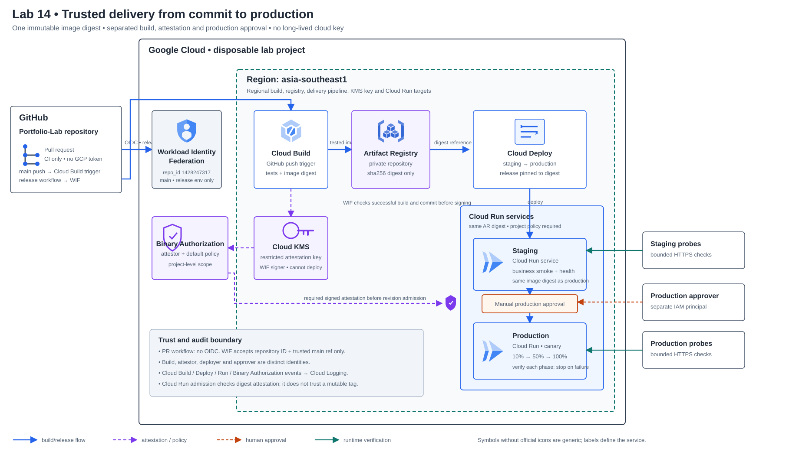

# Lab 14 — แพลตฟอร์มส่งมอบ App สำหรับทีมพัฒนา

> **สถานะเอกสาร:** Design — สถาปัตยกรรมและแผนภาพ Solution ร่างเสร็จ; ยังไม่ได้เขียน Task Guide หรือ deploy files
> **สถานะ Cloud:** Not run — เป็นแผนและแบบฝึกหัด ยังไม่มีการสร้างทรัพยากรหรือผลทดสอบ GCP จริง

## สถานการณ์

ทีมพัฒนามีบริการคำนวณค่าจัดส่ง และต้องการปล่อยการเปลี่ยนแปลงจาก GitHub ไปยัง staging และ production อย่างมีหลักฐาน ตรวจสอบย้อนหลังได้ และกู้กลับได้ ทีมไม่ต้องการเก็บ Service Account key ใน GitHub และไม่ต้องการให้ทุก workflow deploy เข้า production ได้โดยตรง

ให้วาง delivery path ที่แยกหน้าที่ระหว่างการทดสอบ การสร้าง artifact การรับรอง artifact และการ deploy ใช้ image แบบ immutable digest, ป้องกัน Cloud Run รับ image ที่ไม่มี attestation, ตรวจ staging ก่อน production, กำหนดผู้อนุมัติ production และใช้ canary พร้อม verification ก่อนเลื่อน traffic เต็มระบบ

## ขอบเขตบริการตัวอย่าง

App เป็น Shipping Quote API แบบ stateless ใช้ข้อมูลจำลองและไม่เก็บข้อมูลลูกค้าจริง มี endpoint สำหรับ health, version และคำนวณ quote พร้อม structured logs ที่เชื่อม request กับ image digest/commit ได้ เนื้อหา App ทำหน้าที่ให้ทีมมี business path ที่ทดสอบจาก CI, staging และ production ไม่ใช่หัวข้อหลักที่ต้องใช้เวลาเขียน App ใหม่

## Solution diagram



[เปิดแผนภาพ HTML แบบ standalone](assets/solution.html) · [ดูที่มาของไอคอนและ layout](assets/diagram-provenance.json)

แผนภาพแยก GitHub ออกจากขอบเขต Google Cloud, แสดง WIF และ Binary Authorization เป็น project-level controls และวาง Cloud Run staging/production ซ้อนแนวตั้งใต้ Cloud Deploy เพื่อให้เส้น promotion/approval สั้นและไม่ตัดผ่าน service labels. สัญลักษณ์ของ Cloud Deploy, Binary Authorization และ Cloud KMS เป็น generic symbols พร้อมป้ายชื่อ ไม่ใช่ไอคอนผู้ให้บริการ

## Requirements และเกณฑ์ยอมรับ

| ID | Requirement | หลักฐานที่ต้องบันทึก |
|---|---|---|
| R1 | Pull request รัน unit/contract tests โดยไม่ออก GCP credential; workflow ที่ publish ได้จำกัดเฉพาะ repository และ branch ที่เชื่อถือผ่าน GitHub OIDC + Workload Identity Federation | run URL, branch/ref, test summary และผลทดลอง workflow จาก branch ที่ไม่อยู่ใน trust condition |
| R2 | ไม่มี long-lived service-account key ใน GitHub Secrets; token เป็น short-lived และ IAM ให้สิทธิ์ตามหน้าที่ | GitHub workflow permissions, WIF provider condition, IAM matrix และ secret scan |
| R3 | สร้าง container image หนึ่งครั้ง, push ไป Artifact Registry และ deploy ด้วย digest เดียวกันทุก environment; ไม่ใช้ mutable tag เป็นตัวตัดสินปล่อย | build ID, repository path, image digest และ digest ใน Cloud Deploy release |
| R4 | Build ทำ tests ที่กำหนดและสร้างหลักฐาน provenance; image ที่ไม่มี attestation จาก attestor ที่เชื่อถือถูก Binary Authorization ปฏิเสธก่อนสร้าง Cloud Run revision | build result/provenance, attestation ของ digest ที่อนุมัติ และ error/audit event จากการ deploy digest ที่ไม่มี attestation |
| R5 | Staging deploy และ verification ผ่านก่อนจึงขอเลื่อน release; verifier ตรวจทั้ง health และ business quote path | rollout state, verification result, HTTP status และ response ที่ sanitize แล้ว |
| R6 | Production rollout ต้องมี approval จาก identity ที่แยกจาก release caller; GitHub publisher ไม่มีสิทธิ์ approve หรือ deploy Cloud Run โดยตรง | principal ผู้สร้าง release, principal ผู้อนุมัติ และ IAM deny/permission checks |
| R7 | Production ใช้ Cloud Deploy canary ตามลำดับ 10% → 50% → 100%; แต่ละ canary phase รัน verification และหยุดเมื่อผลไม่ผ่าน | rollout phases, traffic split, verify job logs และ revision/traffic ก่อน–หลัง |
| R8 | จำลอง application regression ที่ health ยังตอบได้แต่ business path ผิด; canary verification ต้อง fail และ traffic ต้องไม่เลื่อนไป 100% | release/rollout ที่ fail, business probe output และ traffic split ที่คงเหลือ |
| R9 | Recovery ทำได้ด้วย Cloud Deploy rollback ไป revision/release ที่รู้ว่าดี แล้วพิสูจน์ health, business path และ traffic กลับสภาพปกติ | rollback rollout, stable revision, traffic state, probe output และ audit logs |
| R10 | Change Request เพิ่ม approval/exception record ที่ระบุ owner, เหตุผล, ขอบเขต และวันหมดอายุ; งานตรวจต้องปฏิเสธ exception ที่หมดอายุหรือไม่มี owner | record ก่อน–หลัง, CI/policy result และการอนุมัติ/หมดอายุ |
| R11 | Cleanup inventory ระบุ Cloud Run revisions/services, Cloud Deploy resources, Artifact Registry images, KMS key/attestor, IAM bindings และ build artifacts; ลบเฉพาะ resource ของ Lab | inventory ก่อนลบ, command/result และตรวจซ้ำหลัง cleanup |

ตัวเลข canary เป็น progression ของแบบฝึกหัด ไม่ใช่คำแนะนำสัดส่วนที่เหมาะกับ production ทุกระบบ; จะบันทึกเหตุผลและผลจริงใน environment ของผู้เรียน

## สถาปัตยกรรมตั้งต้น

เส้นทางที่ต้องพิสูจน์เรียงตามเหตุการณ์จริง:

1. **Pull request:** GitHub Actions รัน unit/contract tests, lint และ manifest checks โดยมี permission เท่าที่จำเป็น และไม่มี `id-token: write` จึงขอ Google Cloud credential ไม่ได้
2. **Merge เข้า main:** GitHub App ที่เชื่อมกับ Cloud Build ส่ง commit event ให้ repository trigger ซึ่งจำกัด branch เป็น `main` และใช้ build config กับ builder service account ที่กำหนดไว้ล่วงหน้า
3. **Build:** Cloud Build รัน tests, สร้าง container และ push ไป Artifact Registry ใน project/region นี้; ผลต้องมี build ID, commit SHA และ image digest ที่ไม่ใช่ tag แบบ mutable
4. **Release workflow:** GitHub Actions บน commit เดียวกันเริ่มพร้อม Cloud Build; ใช้ WIF แบบ short-lived credentials เพื่อรอผล build แบบมี timeout และจับคู่ trigger ID, commit SHA, builder identity, สถานะ SUCCESS และ digest ให้ครบ หากหาไม่พบ/ไม่ตรง/หมดเวลา ให้หยุดโดยไม่ sign และไม่ deploy
5. **Attestation:** job แยกใน GitHub Environment `gcp-attest` ใช้ attestor service account ตรวจ metadata ของ build ที่สำเร็จ แล้วใช้ Cloud KMS key ลงนาม attestation ให้ digest นั้น; signer ไม่มีสิทธิ์สร้าง build หรือปล่อย Cloud Deploy
6. **Release:** job ใน Environment `gcp-release` ใช้ releaser service account สร้าง Cloud Deploy release จาก digest ที่ตรวจและ attest แล้วเท่านั้น; ไม่มีสิทธิ์ sign, deploy ด้วยตนเอง หรือ approve production
7. **Staging:** Cloud Deploy สร้าง release และ deploy ไป Cloud Run staging; verification ตรวจ health และ quote contract ผ่าน HTTPS แบบ bounded
8. **Production gate:** หลัง staging ผ่าน Cloud Deploy สร้าง production rollout ที่ต้อง manual approval; approver ตรวจ digest, commit, staging evidence และ change record ก่อน approve/reject
9. **Canary/recovery:** Cloud Deploy ค่อยเพิ่ม traffic 10% → 50% → 100% พร้อม verification ทุก phase; หาก business check ล้มเหลว rollout ต้องไม่เป็น stable 100% และผู้เรียน rollback ไป release ที่รู้ว่าดี แล้วตรวจ traffic/revision/quote response ซ้ำ
10. **Audit:** เชื่อม GitHub commit, Cloud Build ID, digest, attestation, Cloud Deploy release/rollout, approval principal และ Cloud Run revision จาก logs/evidence โดยไม่บันทึก credential หรือข้อมูลส่วนบุคคล

Release workflow และ Cloud Build trigger เริ่มจาก push เดียวกัน จึงมี race ได้โดยธรรมชาติ: polling ต้องผูกกับ commit SHA และ trigger ID ที่แน่นอน มี timeout/retry สูงสุด และห้ามเลือก “build ล่าสุด” โดยไม่เทียบ SHA. การ fail closed เมื่อไม่พบ build คือ acceptance criterion ไม่ใช่สัญญาณให้ใช้ digest เก่าแทน.

## Identity boundary ที่ต้องรักษา

### GitHub OIDC trust

GitHub Environment ของ release workflow จำกัดให้ deploy จาก branch `main`; WIF provider ตรวจ immutable repository ID `1428247317`, ref `refs/heads/main` และ workflow ref `somkid-s5/Portfolio-Lab/.github/workflows/release.yml@refs/heads/main`. Map claim `environment` เพิ่มด้วย แล้ว bind principal ของแต่ละ Environment ให้ service account แยกกัน:

- `gcp-attest` → `lab014-attestor`
- `gcp-release` → `lab014-releaser`

GitHub PR workflow ไม่มี OIDC permission. ห้ามใช้ service-account JSON key, broad repository-wide cloud credential หรือ environment ที่เปิดให้ branch อื่น deploy ได้. ในคู่มือจะมี negative test ที่ลอง ref/environment ผิดและต้องได้ credential exchange denied.

ตัวอย่าง claim contract ที่ต้องแสดงและทดสอบในคู่มือ (เปลี่ยน project/pool/provider เป็นค่าที่ผู้เรียนสร้าง):

```text
google.subject=assertion.sub
attribute.repository_id=assertion.repository_id
attribute.ref=assertion.ref
attribute.workflow_ref=assertion.workflow_ref
attribute.environment=assertion.environment

attribute.repository_id == "1428247317" &&
attribute.ref == "refs/heads/main" &&
attribute.workflow_ref == "somkid-s5/Portfolio-Lab/.github/workflows/release.yml@refs/heads/main"
```

สิทธิ์ WIF `roles/iam.workloadIdentityUser` bind กับ principalSet ของ environment ที่ตรงกันบน service account แต่ละตัว; condition ตรวจ repository/ref/workflow และ workflow job ต้องระบุ GitHub Environment ก่อนขอ token.

### IAM role และขอบเขต

| Principal | Role / scope ใน baseline | ห้ามมี |
|---|---|---|
| GitHub PR workflow | ไม่มี GCP role และไม่มี OIDC token permission | service-account key หรือ cloud token |
| Cloud Build builder SA | `roles/artifactregistry.writer` เฉพาะ Artifact Registry repo; `roles/logging.logWriter` ใน disposable project | KMS signing, Binary Authorization policy edit, Cloud Deploy หรือ IAM admin |
| `lab014-attestor` (WIF: `gcp-attest`) | `roles/cloudbuild.builds.viewer` ใน project; `roles/cloudkms.signerVerifier` บน attestation key เดียว; `roles/containeranalysis.notes.attacher` บน attestor note; `roles/containeranalysis.occurrences.editor` ใน project | สร้าง/แก้ build, deploy/approve Cloud Deploy, แก้ IAM |
| `lab014-releaser` (WIF: `gcp-release`) | `roles/clouddeploy.releaser` ใน project; `roles/iam.serviceAccountUser` เฉพาะ Cloud Deploy execution SA ที่ใช้ render | KMS signing/attestation, Cloud Run deploy โดยตรง, production approval |
| Cloud Deploy execution SA | `roles/clouddeploy.jobRunner` และ `roles/run.developer` ใน disposable project; `roles/iam.serviceAccountUser` เฉพาะ runtime SA | sign image, เปลี่ยน Binary Authorization policy, IAM admin |
| Production approver (คน/กลุ่ม) | `roles/clouddeploy.approver` ใน disposable project | build, sign, deploy หรือแก้ policy |
| Cloud Run runtime SA | ไม่มี role เพิ่ม เพราะ Quote API ไม่เรียก Google APIs | build, registry write, sign, deploy |

Cloud Build GitHub trigger ผูก builder SA ไว้ใน trigger config; GitHub WIF ไม่มีสิทธิ์ `cloudbuild.builds.create`. Cloud Build-managed service agent คง role ที่ Google จัดการให้ ไม่ย้าย role นี้ไป builder SA. Role ที่ต้อง project-level อยู่ใน disposable project เดียว เพราะ Cloud Build metadata, attestation occurrences และ Cloud Deploy predefined roles มีขอบเขตดังกล่าว; repo/key/note/runtime-SA binding แคบลงถึง resource เมื่อ API รองรับ. ก่อนเขียน commands จะยืนยัน role ID, permission และ Terraform schema กับเอกสารปัจจุบันอีกครั้ง.

## Fault และ Change Request

- **Untrusted identity:** รัน release workflow จาก branch ที่ไม่ใช่ `main`, repository อื่น หรือ workflow path อื่น; WIF exchange ต้องถูกปฏิเสธก่อนเรียก GCP API
- **Build failure/race:** ทำให้ test/build ล้มเหลว หรือให้ release poll ก่อน build จบ; release ต้องรอเฉพาะ build ของ commit SHA เดียวกันภายใน timeout แล้วหยุดโดยไม่สร้าง attestation/release ถ้า build ไม่สำเร็จหรือข้อมูลไม่ตรง
- **Unapproved image:** สร้าง Cloud Deploy release ไปยัง digest ที่ไม่มี attestation; Binary Authorization ต้องปฏิเสธ revision admission และ revision เดิมยังคงรับ traffic
- **Canary regression:** สร้าง image ที่ health endpoint ยังผ่านแต่ quote contract ผิด; verification ของ canary phase ต้อง fail และ rollout ต้องไม่เลื่อนเป็น stable 100%
- **Rollback:** deploy release ล่าสุดที่รู้ว่าดีด้วย Cloud Deploy แล้วตรวจ traffic, revision, health และ quote response; ห้ามถือว่าการกด rollback อย่างเดียวเป็นหลักฐาน recovery
- **Change Request:** เพิ่ม exception-request record ที่มี owner, reason, digest/scope, approver และ expires_at; CI ปฏิเสธข้อมูลขาด/หมดอายุ และ record นี้ไม่ bypass Binary Authorization. Break-glass deployment อยู่นอก baseline ต้องมีการอนุมัติ/บันทึกเฉพาะและไม่ใช้เป็นทางลัดใน Lab
- **First release caveat:** Cloud Deploy canary ไม่มี revision เดิมให้แบ่ง traffic ในการ deploy ครั้งแรก จึงอาจข้าม canary phases; ต้องสร้าง baseline revision ให้สำเร็จก่อน แล้วจึงทดสอบ canary ใน release ถัดไป.

## สมมติฐาน ค่าใช้จ่าย และความเสี่ยง

- ใช้ **disposable Google Cloud project ที่ไม่มี Cloud Run workload อื่น** เท่านั้น: Binary Authorization default policy เป็นระดับ project และมีผลกับ Cloud Run services/jobs ใน project ไม่ใช่เฉพาะ Lab. ก่อน apply ต้อง export/ตรวจ policy เดิมและหยุดหากมี rule/custom policy ที่ต้องเก็บ; ห้ามใช้ project ที่มี workload สำคัญ
- ผู้เรียนมี Billing project และสิทธิ์เชื่อม GitHub App, เปิด APIs, จัดการ IAM/WIF/KMS/Binary Authorization/Cloud Build/Artifact Registry/Cloud Deploy/Cloud Run ได้; การสร้าง GitHub App connection ครั้งแรกทำผ่าน Cloud Build Repositories UI และติดตั้งเฉพาะ repository นี้
- Cloud Build trigger จำกัด main และใช้ user-managed builder service account; ก่อนให้สิทธิ์ `cloudbuild.builds.create` กับ trigger/operator ตรวจ default/legacy Cloud Build service account ว่าไม่มีสิทธิ์เกินจำเป็น เพราะ permission นี้อาจอนุญาตให้เริ่ม build ด้วย identity เริ่มต้นได้. Lab ไม่มอบสิทธิ์สร้าง build ให้ GitHub WIF
- Cloud Build, Cloud Run, Artifact Registry storage, Cloud Logging, Cloud KMS key และ Cloud Deploy อาจคิดค่าใช้จ่าย; ก่อน run จริงต้องตรวจราคา/quota/region ปัจจุบัน, จำกัด build concurrency/timeout, Cloud Run min instances เป็นศูนย์และ max instances ต่ำ, และมี cleanup checklist
- ไม่ใช้ production traffic, customer data หรือ load test ที่ยิงไม่จำกัด; probes มีจำนวน/timeout ตายตัวและ app ใช้ข้อมูลสังเคราะห์
- WIF trusts protected main workflow; ผู้ที่แก้/merge release workflow บน main อยู่ใน trust boundary. Stronger organization-level separation (reviewer-protected environments, separate projects/attestor owners) เป็น extension และต้องระบุว่าไม่ได้ตั้งค่าใน baseline หากผู้เรียนไม่ทำ
- Cloud Run Binary Authorization ใช้ default policy; Cloud Run service-specific rules แบบ GKE ใช้ไม่ได้ใน baseline. Policy changes ไม่ retroactively apply ต่อ revision เดิม; ต้องพิสูจน์ reject ด้วย revision ใหม่ที่ไม่มี attestation
- เอกสาร Cloud Run ระบุ built-by-cloud-build attestor เป็น Preview จึง baseline ใช้ custom attestor + Cloud KMS; ตรวจสถานะบริการและ CLI/API ก่อนทำจริง.

## หลักฐานสำหรับ Case Study

เมื่อทำ Guide เสร็จ แต่ละ Task จะมีช่อง Actual/Evidence ติดกับจุดตรวจ ให้บันทึกอย่างน้อย:

- release ID, commit SHA, image digest, build ID และ attestation/attestor
- WIF subject/claims ที่ sanitize แล้ว, identity ที่ใช้งาน, และผล negative authorization
- staging/production rollout IDs, approval principal, canary percentages และ verification output
- regression ที่ใช้, จุดที่ rollout หยุด, rollback ID และ traffic/revision หลัง recovery
- exception owner/reason/scope/expiry พร้อม policy-test result
- เวลาเริ่ม–จบเฉพาะที่วัดจริง, ค่าใช้จ่ายจาก Billing ที่มีช่วงเวลา/ขอบเขตชัด และ cleanup inventory
- สิ่งที่ไม่สำเร็จ, สิ่งที่ยังไม่ได้ตรวจ และสิ่งที่ต้องปรับก่อนใช้กับ production จริง

ไม่กรอก Expected ลงช่อง Actual และไม่ใช้ผล CI แทนผล Cloud

## แหล่งอ้างอิงทางการสำหรับช่วง Design

- [Workload Identity Federation สำหรับ deployment pipelines](https://docs.cloud.google.com/iam/docs/workload-identity-federation-with-deployment-pipelines) — GitHub OIDC claims, immutable repository ID, attribute mapping/condition และ short-lived credentials
- [Cloud Build repositories](https://docs.cloud.google.com/build/docs/repositories) — GitHub App connection และ repository integration
- [Cloud Build triggers](https://docs.cloud.google.com/build/docs/triggers) — trigger ตาม branch/commit และ build configuration
- [Cloud Build IAM roles and permissions](https://docs.cloud.google.com/build/docs/iam-roles-permissions) — `builds.create`, trigger permissions และข้อควรระวังของ Cloud Build Editor
- [Cloud Build user-managed service accounts](https://docs.cloud.google.com/build/docs/securing-builds/configure-user-specified-service-accounts) — กำหนด SA ประจำ trigger และ log writer
- [Cloud Deploy targets สำหรับ Cloud Run](https://docs.cloud.google.com/deploy/docs/run-targets) — target, Skaffold, Cloud Run service และข้อจำกัด canary สำหรับ jobs
- [Cloud Deploy pipeline และ targets](https://docs.cloud.google.com/deploy/docs/create-pipeline-targets) — requireApproval และการจัด target
- [Cloud Deploy canary สำหรับ Cloud Run](https://docs.cloud.google.com/deploy/docs/deployment-strategies/canary/cloud-run) — traffic progression และ verify ต่อ phase
- [Cloud Deploy deployment verification](https://docs.cloud.google.com/deploy/docs/verify-deployment) — verification task result และ rollout failure
- [Cloud Deploy service accounts](https://docs.cloud.google.com/deploy/docs/cloud-deploy-service-account) — execution SA, jobRunner, runtime roles และ caller `actAs`
- [Cloud Deploy IAM roles and permissions](https://docs.cloud.google.com/deploy/docs/iam-roles-permissions) — Releaser/Approver/Runner roles
- [Binary Authorization สำหรับ Cloud Run](https://docs.cloud.google.com/binary-authorization/docs/run/overview) — policy scope, enforcement และข้อจำกัด Cloud Run
- [สร้าง Binary Authorization attestation ด้วย Cloud KMS](https://docs.cloud.google.com/binary-authorization/docs/making-attestations) — payload, signing key และ roles สำหรับ attestation
- [Artifact Registry IAM](https://docs.cloud.google.com/artifact-registry/docs/access-control) — scope ของ writer/reader บน repository

## Design decisions

- **Build event:** Cloud Build GitHub App repository trigger รับเฉพาะ push ที่ `main`, ใช้ config/trigger ที่ล็อกไว้ และ builder service account แยก. PR checks ไม่ได้รับ cloud identity และ GitHub WIF ไม่มี `cloudbuild.builds.create`.
- **Release race:** push เดียวกันเริ่ม build trigger และ release workflow พร้อมกัน; workflow poll แบบ bounded และยืนยัน build ID/trigger ID/commit SHA/status/builder identity/image digest ก่อนส่งต่อ. ไม่มี fallback ไป build ล่าสุดหรือ tag mutable
- **Workload Identity Federation:** provider ใช้ immutable `repository_id` ร่วมกับ `ref`, `workflow_ref` และ GitHub Environment claims; map environment เพื่อ bind `gcp-attest` และ `gcp-release` ไปคนละ service account. ไม่มี long-lived key
- **IAM:** builder เขียนได้เฉพาะ Artifact Registry repository และเขียน build logs; attestor อ่าน build results + sign/attach attestation; releaser สร้าง release เท่านั้น; Cloud Deploy execution service account deploys/verifies และ runtime service account ไม่มี permission เพิ่ม; production approver เป็น human identity แยก
- **Image admission:** ใช้ custom Binary Authorization attestor ที่รับ KMS-signed attestation; default project policy ครอบคลุม Cloud Run ทั้ง project จึงบังคับใช้กับ disposable project ที่ว่างเท่านั้น
- **Deployment:** Cloud Deploy targets เป็น Cloud Run services; production target บังคับ approval และ canary verification. Deploy baseline ก่อนเพื่อให้มี revision เดิมที่จะแบ่ง traffic
- **App/verification:** Quote API deterministic, no database/external dependency; `/healthz` แยกจาก business quote route. Canary verifier ตรวจ expected quote response จึงจับ regression ที่ health check ตรวจไม่พบ; ทุก probe มี timeout/count limit
- **Evidence:** ทุก Task มีช่อง Expected/Actual/Evidence อยู่ติด checkpoint; CI ตรวจไฟล์และ render ได้แต่ไม่แทนผล Cloud. บันทึก build/deploy IDs, commit/digest, sanitized identity/approval, canary outcome, rollback และ cleanup inventory โดยไม่แนบ secrets.

## ขั้นถัดไป

ปิด Design checkpoint ด้วยการทดสอบ architecture contract และทบทวน role/scope กับ Terraform/API schema จากนั้นเริ่ม Materials: Quote API ที่รันทดสอบได้, Cloud Build config, WIF release workflow, Cloud Deploy/Skaffold manifests, Terraform และ offline integration tests. เมื่อ materials ผ่าน CI แล้วจึงเขียน Task Guide แบบคลิก/คำสั่ง/ผลคาดหวัง/วิธีแก้ failure และช่อง Actual/Evidence ให้ครบ; ไม่มีการสร้าง GCP resources ระหว่างจัดทำเอกสาร.
