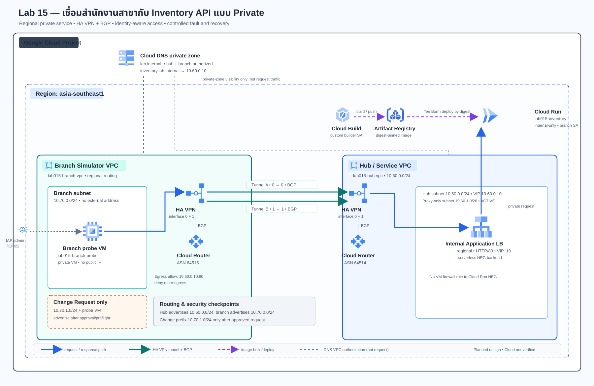

# Lab 15 — เชื่อมสำนักงานสาขากับ Inventory API แบบ Private

**สถานะคู่มือ:** Guide-ready — [Repository CI #40116050598 ผ่านครบ 54/54 jobs และ Lab 15 ผ่าน 4/4 jobs](https://github.com/somkid-s5/Portfolio-Lab/actions/runs/40116050598)  
**สถานะ Cloud:** Not run — ยังไม่มีการสร้างทรัพยากร GCP จากงานจัดทำเอกสารนี้  
**Region หลัก:** asia-southeast1  
**รูปแบบ:** Branch Simulator VPC ↔ HA VPN/BGP ↔ Hub VPC ↔ Internal Application Load Balancer ↔ Cloud Run

## โจทย์

สำนักงานสาขาต้องค้นหาสินค้าคงคลังจากบริการบน Cloud โดยไม่เปิด VM หรือ API ให้เข้าถึงจากอินเทอร์เน็ตโดยตรง ทีม Cloud ต้องพิสูจน์ private path, DNS, IAM และ firewall พร้อมสังเกตอาการเมื่อ tunnel หรือ DNS ใช้งานไม่ได้ และเพิ่ม subnet สาขาตาม change request

VPC สาขาใน Lab นี้เป็น **เครือข่ายจำลองใน GCP** ไม่ใช่อุปกรณ์ on-premises จริง การทดสอบ tunnel เป็นการถอด/ใส่ tunnel ด้วย Terraform ไม่ใช่การจำลองสายอินเทอร์เน็ตหรืออุปกรณ์จริง

## ผลลัพธ์ที่ต้องพิสูจน์

| ID | ข้อกำหนด | วิธีพิสูจน์ |
|---|---|---|
| R1 | VM สาขาไม่มี External IP และผู้ดูแลเข้าได้ผ่าน IAP | ตรวจ interface และ SSH ผ่าน IAP |
| R2 | VM สาขาเรียก Inventory API ผ่าน private DNS/VIP | ตรวจ DNS, route, HTTP 200 และรายการตัวอย่าง |
| R3 | Cloud Run ไม่เปิด anonymous และ invoker จำกัดเฉพาะ probe service account | ไม่มี token ได้ 401/403; ID token ของ VM ได้ 200 |
| R4 | HA VPN มี BGP สอง session และประกาศเฉพาะ prefix ที่อนุมัติ | ตรวจ Cloud Router status/routes ทั้งสองฝั่ง |
| R5 | ถอน tunnel A แล้วยังกลับมารับ request ผ่าน B ได้ | เก็บ continuous-probe log ก่อน/ระหว่าง/หลัง apply และบันทึก interruption จริง |
| R6 | ปิด branch DNS authorization แล้ว lookup ล้มเหลว แต่ BGP route ยังอยู่ | ตรวจ DNS และ BGP แยกกัน แล้วคืนค่า |
| R7 | CIDR ที่ซ้อนทับถูกปฏิเสธก่อน apply | ใช้ preflight และบันทึกผลปฏิเสธ |
| R8 | เพิ่ม subnet branch ที่อนุมัติ โดยไม่เปิดสิทธิ์กว้างขึ้น | เพิ่ม 10.70.1.0/24, ตรวจ route, IAP และ API |
| R9 | Cleanup ลบ Lab resources แต่ไม่ลบ Project | ทำ Terraform destroy และตรวจ inventory |

## Solution diagram

เปิด [Standalone Diagram HTML](assets/solution.html) ได้โดยไม่ต้องพึ่งเว็บภายนอก

## องค์ประกอบและเหตุผลที่เลือก

- **Branch VPC:** 10.70.0.0/24; มี probe VM ไม่มี External IP และเข้าเครื่องผ่าน IAP TCP forwarding
- **Hub VPC:** 10.60.0.0/24 สำหรับ internal load balancer; proxy-only subnet 10.60.1.0/26 ประเภท REGIONAL_MANAGED_PROXY
- **HA VPN:** gateway สองฝั่ง, tunnel คู่ interface 0↔0 และ 1↔1; Cloud Router ASN 64514/64515 ใช้ BGP และประกาศเฉพาะ prefix ที่กำหนด
- **Private DNS:** zone lab.internal. อนุญาตเฉพาะ hub/branch; inventory.lab.internal ชี้ VIP 10.60.0.10
- **Internal Application Load Balancer:** regional HTTP ภายใน; serverless NEG ส่งต่อไป Cloud Run
- **Cloud Run:** ingress internal-only; ไม่มี allUsers; invoker ให้เฉพาะ branch-probe service account
- **Firewall:** ingress ไป VM อนุญาต TCP/22 จาก IAP range 35.235.240.0/20; egress อนุญาต TCP/80 ไป VIP และ deny egress อื่น
- **Inventory API:** ข้อมูลสินค้าสังเคราะห์ใน memory; มี /healthz และ /v1/items เพื่อทดสอบ path/identity ไม่ใช่ฐานข้อมูลหรือระบบธุรกรรม
- **Cloud Build + Artifact Registry:** build จาก source ใน Repo ด้วย builder SA เฉพาะงาน และ deploy image แบบ digest pin ผ่าน Terraform

Cloud Run ที่ใช้ serverless NEG ไม่ต้องเพิ่ม VPC firewall rule เพื่อเปิด proxy-only subnet เข้า backend แบบ VM; proxy-only subnet เป็นส่วนของ regional internal Application Load Balancer โดยตรง

### Firewall matrix

| ทิศทาง | ต้นทาง/ปลายทาง | Protocol | ผล |
|---|---|---|---|
| Ingress ไป branch probe | 35.235.240.0/20 → VM tag lab015-iap-probe | TCP/22 | Allow สำหรับ IAP |
| Ingress อื่นไป VM | Any → VM | Any | Deny ตาม implied ingress deny ของ custom VPC |
| Egress จาก probe | VM → 10.60.0.10/32 | TCP/80 | Allow เพื่อเรียก internal LB |
| Egress จาก probe | VM → destination อื่น | Any | Deny ด้วย explicit egress rule |
| Internal LB → Cloud Run NEG | Google-managed proxy path | HTTP backend | ควบคุมด้วย LB + Cloud Run ingress/IAM ไม่ใช่ VM firewall rule |

Connection ที่ probe เริ่มเป็น stateful return traffic; metadata server และ DNS resolver ของ VM ใช้เส้นทาง platform ที่สงวนไว้ การ deny egress นี้ไม่ได้เปิด Internet/NAT ให้ VM

## เตรียมก่อนเริ่ม

### ค่าใช้จ่ายและความปลอดภัย

Lab สร้าง HA VPN gateways/tunnels, regional internal Application Load Balancer, proxy-only subnet, Cloud Run, Artifact Registry, Cloud Build และ VM หนึ่งเครื่อง (สองเครื่องช่วง Change Request) บางรายการคิดเงินขณะ resource ค้างอยู่แม้ไม่มี request ตรวจราคา/region ปัจจุบันใน Google Cloud Pricing Calculator และกำหนดเวลาทำ Lab/cleanup ก่อนเริ่ม เอกสารนี้ไม่ได้สร้าง resource หรือกำหนดยอดค่าใช้จ่ายแทนผู้ทำ

ใช้ **Project สำหรับ Lab โดยเฉพาะ** อย่าใช้ production project หรือข้อมูลจริง Cloud VPN ใช้ shared secret สองค่า แยก tunnel A/B; คู่เดียวกันทั้งสองฝั่งต้องใช้ค่าเดียวกัน Terraform ใช้ write-only field ของ provider จึงไม่บันทึก plaintext ใน state แต่ผู้ทำต้องส่ง secret ให้ Terraform ทุกครั้งที่เริ่ม shell ใหม่ เก็บใน password manager ส่วนตัว ห้ามใส่ใน Repo, screenshot, command output หรือหลักฐาน Portfolio หาก secret สูญหายให้หมุน secret พร้อมเพิ่ม vpn_secret_version ตาม Troubleshooting

### สิทธิ์และข้อกำหนด

เตรียม Project ที่เปิด Billing แล้ว, Cloud Shell/gcloud และสิทธิ์ตามนโยบายองค์กรสำหรับเปิด APIs, จัดการ VPC/subnet/Cloud Router/HA VPN/firewall/VM, Cloud Run, Cloud DNS, Artifact Registry/Cloud Build, service accounts และ IAM bindings

Terraform ผูก Compute Viewer, OS Login และ IAP Tunnel Access ให้ operator_email ใน Project Lab นี้ และให้ roles/iam.serviceAccountUser แก่ผู้ทำเฉพาะ service account runtime, builder และ branch-probe ไม่ได้ให้สิทธิ์ actAs แบบ project-wide; Cloud Build service agent ได้ actAs เฉพาะ builder ส่วน builder ได้ Artifact Registry Writer เฉพาะ repo ของ Lab และ Log Writer สำหรับ build ผู้ทำต้องมีสิทธิ์สร้าง IAM binding และส่ง Cloud Build ด้วย custom service account ตามนโยบายองค์กร หากองค์กรปิด service identity, OS Login, IAP หรือ HA VPN ให้ขอสิทธิ์ก่อน ห้ามใช้ service account key file แทน

### Resource inventory

| กลุ่ม | Resource หลัก |
|---|---|
| Network | lab015-hub-vpc, lab015-branch-vpc, hub/branch subnet, proxy-only subnet, firewall rules |
| Connectivity | HA VPN gateways 2 ตัว, tunnels สูงสุด 4 ตัว, Cloud Router 2 ตัว, BGP peer สูงสุด 4 ตัว |
| Workload | Cloud Run lab015-inventory, serverless NEG, regional backend service, URL map, target proxy, forwarding rule, probe VM |
| Identity/Build | service account runtime/builder/branch-probe, Artifact Registry repo, Cloud Build service identity |
| DNS | private zone lab.internal. และ inventory.lab.internal. |

## ทำ Lab

คำสั่งรันใน Cloud Shell ภายใต้ project เดียวกัน เว้นแต่ระบุให้ SSH ไปยัง probe VM อย่าแก้ resource ผ่าน Console ขณะ Terraform จัดการอยู่ เพราะ state จะไม่ตรงกัน

### Task 00 — ตรวจโจทย์และกำหนดค่าที่คาดหวัง

อ่าน Requirements, diagram และ firewall matrix ก่อนเริ่ม เลือก Project แยกจากงานจริง ผู้รับผิดชอบ cleanup และเวลาที่พร้อมทดสอบ interruption

**Expected:** เข้าใจว่า branch เป็น VPC จำลอง, API ใช้ข้อมูลสังเคราะห์ และ failover test อาจสะดุดชั่วคราว

**Actual:** [เติมสิ่งที่เกิดขึ้นจริง]

**Evidence:** บันทึก project ID ที่จะใช้, เวลาทดสอบ และข้อจำกัดองค์กร ห้ามบันทึก secret

### Task 01 — ตรวจ Project และเปิด Cloud Shell

เลือก Project Lab ใน Console → เปิด Cloud Shell → ตรวจ account/project:

~~~bash
gcloud auth list
gcloud config get-value project
gcloud projects describe "$(gcloud config get-value project)" --format='value(projectId,projectNumber)'
export PROJECT_ID="$(gcloud config get-value project)"
export REGION="asia-southeast1"
export ZONE="asia-southeast1-a"
gcloud config set project "$PROJECT_ID"
~~~

ดึง Repo branch ที่มี Lab นี้ หากยังไม่มี checkout:

~~~bash
git clone --branch docs/gcp-solution-labs https://github.com/somkid-s5/Portfolio-Lab.git
cd Portfolio-Lab/GCP/LAB-015-branch-private-connectivity
~~~

ถ้ามี checkout อยู่แล้ว ให้เข้า path ของ Lab และตรวจ branch/ไฟล์ก่อน ห้ามใช้ project default โดยไม่ตรวจ

**Expected:** account, project, region และ zone ตรงกับที่ตั้งใจ; zone อยู่ใน region; มี README.md, app/, infra/ และ scripts/

**Actual:** [เติมค่าที่เห็นจริง โดยปกปิดอีเมลได้]

**Evidence:** บันทึก project ID แบบไม่ลับ, region, zone และ source commit; ไม่เก็บ token

### Task 02 — ตั้ง Terraform และ shared secret

จากโฟลเดอร์ Lab:

~~~bash
cp infra/terraform.tfvars.example infra/terraform.tfvars
~~~

แก้ไฟล์ infra/terraform.tfvars ด้วย editor ให้ project_id, region, zone และ operator_email ตรงจริง อย่าเพิ่ม secret ลงไฟล์นี้ จากนั้นสร้าง secret สองค่าใน shell ปัจจุบันและเก็บไว้ใน password manager โดยไม่ echo ค่า:

~~~bash
export TF_VAR_vpn_shared_secret_a="$(openssl rand -hex 24)"
export TF_VAR_vpn_shared_secret_b="$(openssl rand -hex 24)"
~~~

อย่าปิด shell นี้ก่อน cleanup เว้นแต่เตรียมเรียก secret เดิมจาก password manager ได้

**Expected:** tfvars มีเฉพาะค่าที่ไม่ลับ; shell มี secret สองค่าแต่ไม่มี output แสดง secret

**Actual:** [ระบุการเตรียม secret/config โดยไม่ใส่ secret]

**Evidence:** ตรวจ git status --short ว่าไม่มี tfvars; บันทึกแค่ชื่อ secret entry ใน password manager

### Task 03 — ตรวจ CIDR ก่อนเริ่ม

ตรวจ prefix เริ่มต้นและ Change Request ที่อนุมัติ:

~~~bash
python3 scripts/cidr_check.py
python3 scripts/cidr_check.py --additional 10.70.1.0/24
~~~

ซ้อม negative case โดยใช้ prefix ที่ชนกับ hub:

~~~bash
python3 scripts/cidr_check.py --additional 10.60.0.128/25
~~~

คำสั่งสุดท้ายควร exit code 2 และระบุว่า overlap กับ hub; ห้ามเอา range นี้ไป apply

**Expected:** prefix จริงผ่าน; prefix ชนถูกปฏิเสธก่อนสร้าง/แก้ resource

**Actual:** [บันทึกผลจริงและ error]

**Evidence:** เก็บ output ทั้งกรณีผ่าน/ปฏิเสธ โดยไม่มี secret หรือ account token

### Task 04 — Initialize Terraform และอ่าน Plan

~~~bash
terraform version
terraform -chdir=infra fmt -check -recursive
terraform -chdir=infra init -backend=false -input=false
terraform -chdir=infra validate -no-color
terraform -chdir=infra plan -out=baseline.tfplan
terraform -chdir=infra show baseline.tfplan
~~~

อ่าน plan ก่อน apply ต้องมีเฉพาะ lab015 resources ไม่มี VM external IP, NAT, public Cloud Run invoker, BGP default route หรือการลบ resource ที่ไม่รู้จัก

**Expected:** Terraform 1.11 ขึ้นไป (CI pin 1.17.0); validate ผ่าน; Plan มี resource ที่ระบุ; Cloud Run ใช้ public hello image เป็น bootstrap ชั่วคราว; shared secrets ใช้ write-only field ที่ไม่บันทึกลง plan/state

**Actual:** [บันทึก Terraform/provider version และจำนวน add/change/destroy จริง]

**Evidence:** เก็บ Plan summary ที่ปกปิดข้อมูลลับ; ห้ามอัปโหลด state หรือ plan file

### Task 05 — สร้าง Foundation และตรวจ network boundary

หลังอ่าน Plan แล้ว apply ไฟล์เดิม:

~~~bash
terraform -chdir=infra apply baseline.tfplan
gcloud compute networks describe lab015-hub-vpc --project="$PROJECT_ID"
gcloud compute networks describe lab015-branch-vpc --project="$PROJECT_ID"
gcloud compute instances describe lab015-branch-probe --zone="$ZONE" --project="$PROJECT_ID" --format='yaml(name,networkInterfaces,serviceAccounts,tags)'
gcloud run services describe lab015-inventory --region="$REGION" --project="$PROJECT_ID" --format='yaml(metadata.name,status.url,spec.template.spec.containers[0].image)'
gcloud dns record-sets list --zone=lab015-private --project="$PROJECT_ID"
~~~

รอจน API, VPC, VPN, Cloud Router, private DNS, bootstrap Cloud Run, LB และ VM สร้างครบ

**Expected:** VM ไม่มี accessConfigs/External IP; VPC เป็น custom mode; Cloud Run ingress internal; DNS ชี้ VIP; ไม่มี allUsers invoker

**Actual:** [บันทึก resource ที่สร้างสำเร็จ/ไม่สำเร็จ]

**Evidence:** เก็บ output ที่ปกปิด project number/account; ห้ามแนบ Terraform state, secret, token หรือ billing data

### Task 06 — Build image และ deploy API แบบ digest

ผูก image tag กับ source commit แล้วให้ Cloud Build ใช้ builder SA จาก cloudbuild.yaml:

~~~bash
export IMAGE_TAG="$(git rev-parse --short=12 HEAD)"
gcloud builds submit . --project="$PROJECT_ID" --region="$REGION" --config=cloudbuild.yaml --substitutions="_REGION=$REGION,_TAG=$IMAGE_TAG"
~~~

ตรวจ .gcloudignore ว่าตัด .git, tfstate, plan, terraform.tfvars และ environment files ออกจาก source upload; ห้ามลบ ignore rules เพื่อแก้ build ชั่วคราว

ดึง digest จาก Artifact Registry, ตั้ง Terraform image variable และ review Plan:

~~~bash
DIGEST="$(gcloud artifacts docker images describe "$REGION-docker.pkg.dev/$PROJECT_ID/lab015-images/inventory-api:$IMAGE_TAG" --project="$PROJECT_ID" --format='value(image_summary.digest)')"
test -n "$DIGEST"
export TF_VAR_container_image="$REGION-docker.pkg.dev/$PROJECT_ID/lab015-images/inventory-api@$DIGEST"
terraform -chdir=infra plan -out=app-image.tfplan
terraform -chdir=infra show app-image.tfplan
~~~

ยืนยันว่าเปลี่ยนเฉพาะ Cloud Run image แล้ว apply:

~~~bash
terraform -chdir=infra apply app-image.tfplan
gcloud run services describe lab015-inventory --region="$REGION" --project="$PROJECT_ID" --format='value(status.url,status.latestReadyRevisionName)'
~~~

**Expected:** Cloud Build ใช้ custom builder SA; revision อ้าง image ด้วย @sha256 digest; ingress/IAM/network ไม่เปลี่ยน

**Actual:** [เติม build ID, digest, revision และผลจริง]

**Evidence:** เก็บ build URL/ID, source commit, image digest, revision และ Plan summary; ห้ามแนบ token/secret

### Task 07 — ตรวจ BGP routes และ firewall matrix

~~~bash
gcloud compute routers get-status lab015-hub-router --region="$REGION" --project="$PROJECT_ID" --format='yaml(result.bgpPeerStatus,result.bestRoutes)'
gcloud compute routers get-status lab015-branch-router --region="$REGION" --project="$PROJECT_ID" --format='yaml(result.bgpPeerStatus,result.bestRoutes)'
gcloud compute routes list --project="$PROJECT_ID" --filter='network:lab015-hub-vpc' --format='table(name,destRange,priority,routeType,nextHopVpnTunnel)'
gcloud compute routes list --project="$PROJECT_ID" --filter='network:lab015-branch-vpc' --format='table(name,destRange,priority,routeType,nextHopVpnTunnel)'
~~~

ตรวจ peer ทั้งสองฝั่งว่า UP, hub เรียนรู้ 10.70.0.0/24 และ branch เรียนรู้ 10.60.0.0/24; ยังไม่มี additional prefix จนกว่าจะทำ Change Request ตรวจ Firewall ว่ามี IAP TCP/22, egress VIP TCP/80 และ deny egress rule

**Expected:** มี BGP สอง sessions ต่อฝั่งและเฉพาะ approved routes; ไม่มี default route จาก BGP

**Actual:** [เติม peer status, learned prefix, priority และ firewall rule ที่เห็นจริง]

**Evidence:** เก็บ router/route/firewall output โดยปกปิดข้อมูลบัญชี; ไม่แก้ route ผ่าน Console

### Task 08 — เข้า Probe VM ผ่าน IAP และตรวจ IAM/API

คัดลอก helper ไป VM ผ่าน IAP โดยไม่เปิด External IP:

~~~bash
gcloud compute scp scripts/probe.py lab015-branch-probe:~/probe.py --project="$PROJECT_ID" --zone="$ZONE" --tunnel-through-iap
export SERVICE_URI="$(gcloud run services describe lab015-inventory --region="$REGION" --project="$PROJECT_ID" --format='value(status.url)')"
gcloud compute ssh lab015-branch-probe --project="$PROJECT_ID" --zone="$ZONE" --tunnel-through-iap --command="python3 ~/probe.py --url http://inventory.lab.internal/v1/items --audience '$SERVICE_URI' --expect-deny"
gcloud compute ssh lab015-branch-probe --project="$PROJECT_ID" --zone="$ZONE" --tunnel-through-iap --command="python3 ~/probe.py --url http://inventory.lab.internal/v1/items --audience '$SERVICE_URI'"
~~~

ครั้งแรกไม่มี token ต้องถูกปฏิเสธ 401/403; ครั้งที่สองดึง ID token จาก VM metadata ด้วย audience เป็น Cloud Run service URI และส่ง header X-Serverless-Authorization โดยไม่พิมพ์ token

**Expected:** DNS resolve เป็น 10.60.0.10; request ไม่มี token ถูกปฏิเสธ; request มี ID token ได้ 200 และรายการตัวอย่าง

**Actual:** [เติม DNS, HTTP status, item count และเวลาที่วัดจริง]

**Evidence:** เก็บ probe output ที่ไม่มี token, IAP session ที่ไม่มีข้อมูลส่วนตัว และ request ID ถ้ามี

### Task 09 — พิสูจน์ business path และบันทึก Baseline

~~~bash
gcloud compute ssh lab015-branch-probe --project="$PROJECT_ID" --zone="$ZONE" --tunnel-through-iap --command="python3 ~/probe.py --url http://inventory.lab.internal/healthz --audience '$SERVICE_URI'"
gcloud compute ssh lab015-branch-probe --project="$PROJECT_ID" --zone="$ZONE" --tunnel-through-iap --command="python3 ~/probe.py --url 'http://inventory.lab.internal/v1/items?sku=SKU-100' --audience '$SERVICE_URI'"
gcloud logging read 'resource.type="cloud_run_revision" AND resource.labels.service_name="lab015-inventory"' --project="$PROJECT_ID" --limit=20 --format='table(timestamp,severity,jsonPayload.request_id,jsonPayload.path,jsonPayload.status)'
~~~

จดผลจาก VM, Cloud Router, DNS และ Cloud Run logs แยกกัน เพื่อไม่สรุปว่า API ล่มเมื่อสาเหตุจริงคือ DNS, route หรือ IAM

**Expected:** /healthz ได้ status ok; SKU-100 คืนหนึ่งรายการ; logs มี path/status/request ID โดยไม่มี auth header

**Actual:** [เติมผลจริงและความต่างจาก baseline]

**Evidence:** เก็บ probe output และ query log ที่ปกปิด project/account; ห้ามสร้างภาพ Console จำลอง

### Task 10 — ถอน Tunnel A และพิสูจน์ Recovery

เปิด Cloud Shell tab ที่สอง รัน probe ต่อเนื่องห้านาที:

~~~bash
gcloud compute ssh lab015-branch-probe --project="$PROJECT_ID" --zone="$ZONE" --tunnel-through-iap --command="python3 ~/probe.py --url http://inventory.lab.internal/v1/items --audience '$SERVICE_URI' --duration 300 --interval 2"
~~~

ระหว่าง probe ทำงาน กลับ tab แรก สร้าง Plan เพื่อถอน tunnel A:

~~~bash
terraform -chdir=infra plan -out=tunnel-a-down.tfplan -var='simulate_tunnel_a_failure=true'
terraform -chdir=infra show tunnel-a-down.tfplan
~~~

ยืนยันว่าลบเฉพาะ tunnel/interface/peer pair A และ pair B ยังคงอยู่ แล้ว apply:

~~~bash
terraform -chdir=infra apply tunnel-a-down.tfplan
gcloud compute routers get-status lab015-hub-router --region="$REGION" --project="$PROJECT_ID" --format='yaml(result.bgpPeerStatus,result.bestRoutes)'
~~~

หลัง probe จบ จดจำนวน success/failure และ interruption ที่เกิดจริง ห้ามคาดว่า zero loss หรือรับรองเวลาคงที่; route withdrawal อาจสะดุดช่วง convergence จากนั้นคืน Tunnel A:

~~~bash
terraform -chdir=infra plan -out=tunnel-a-restored.tfplan -var='simulate_tunnel_a_failure=false'
terraform -chdir=infra show tunnel-a-restored.tfplan
terraform -chdir=infra apply tunnel-a-restored.tfplan
~~~

รอ BGP สอง peer กลับมา UP แล้ว probe แบบครั้งเดียวซ้ำ

**Expected:** ระหว่างเหลือ B มี peer UP อย่างน้อยหนึ่งและ service กลับมาผ่าน route ที่เหลือ; หลัง restore มีสอง sessions

**Actual:** [บันทึกเวลา, success/failure, interruption และผล restore จริง ห้ามใส่ตัวเลขคาดเดา]

**Evidence:** เก็บ probe log, Plan ที่ยืนยันลบเฉพาะ pair A และ router status ก่อน/ระหว่าง/หลัง โดยปกปิด secret

### Task 11 — แยก DNS Failure จาก VPN Failure

ปิด zone authorization เฉพาะ branch ด้วย Terraform:

~~~bash
terraform -chdir=infra plan -out=branch-dns-off.tfplan -var='authorize_branch_dns=false'
terraform -chdir=infra show branch-dns-off.tfplan
terraform -chdir=infra apply branch-dns-off.tfplan
~~~

จาก VM ลอง resolve hostname; failure เป็นผลที่คาดในช่วงนี้:

~~~bash
gcloud compute ssh lab015-branch-probe --project="$PROJECT_ID" --zone="$ZONE" --tunnel-through-iap --command="python3 -c 'import socket; print(socket.gethostbyname(\"inventory.lab.internal\"))'"
~~~

ตรวจ Router status ว่า BGP ยัง UP แล้วคืน DNS authorization:

~~~bash
terraform -chdir=infra plan -out=branch-dns-restored.tfplan -var='authorize_branch_dns=true'
terraform -chdir=infra show branch-dns-restored.tfplan
terraform -chdir=infra apply branch-dns-restored.tfplan
~~~

รอ DNS propagation แล้ว probe hostname ซ้ำ

**Expected:** lookup ล้มเหลวขณะที่ branch ไม่ได้รับ authorization แต่ BGP route ยังอยู่; หลังคืนค่า hostname กลับเป็น VIP เดิม

**Actual:** [เติม DNS error, peer status, เวลารอ และผล restore จริง]

**Evidence:** เก็บ DNS error + router status ในช่วงเดียวกันและผลหลังคืนค่า แสดงว่าตรวจสองชั้นแยกกัน

### Task 12 — ซ้อม CIDR conflict โดยไม่ Apply

~~~bash
python3 scripts/cidr_check.py --hub 10.60.0.0/24 --proxy 10.60.1.0/26 --branch 10.70.0.0/24 --additional 10.70.1.0/24
python3 scripts/cidr_check.py --hub 10.60.0.0/24 --proxy 10.60.1.0/26 --branch 10.70.0.0/24 --additional 10.60.0.128/25
~~~

กรณีแรกควรผ่าน กรณีสองควร exit 2 ก่อนมี Terraform apply ห้ามสร้าง network ที่ชนจริง เพราะเสี่ยงทำให้ route ambiguity และ VPN ใช้งานไม่ได้

**Expected:** preflight รับ 10.70.1.0/24 และปฏิเสธ 10.60.0.128/25 ว่าซ้อนกับ hub

**Actual:** [บันทึก output และ exit code จริง]

**Evidence:** เก็บ output สองกรณีและเหตุผลตัดสินใจ ไม่ต้องสร้าง GCP resource เพื่อพิสูจน์ negative case

### Task 13 — Change Request: เพิ่ม Subnet Branch

**คำขอ:** เพิ่ม branch range 10.70.1.0/24 ให้เรียก Inventory API ได้ โดยไม่เพิ่ม public IP/ingress และประกาศเฉพาะ prefix ที่อนุมัติ

ตรวจ preflight แล้วสร้าง plan:

~~~bash
python3 scripts/cidr_check.py --additional 10.70.1.0/24
terraform -chdir=infra plan -out=branch-expansion.tfplan -var='branch_additional_cidr=10.70.1.0/24'
terraform -chdir=infra show branch-expansion.tfplan
~~~

ตรวจว่าเพิ่มเฉพาะ subnet, probe VM และ branch route advertisement; ไม่มีการขยาย IAM/firewall/hub prefix โดยไม่ตั้งใจ แล้ว apply:

~~~bash
terraform -chdir=infra apply branch-expansion.tfplan
gcloud compute routers get-status lab015-hub-router --region="$REGION" --project="$PROJECT_ID" --format='yaml(result.bgpPeerStatus,result.bestRoutes)'
~~~

ส่ง helper ไป VM ใหม่ผ่าน IAP แล้วทดสอบ:

~~~bash
gcloud compute scp scripts/probe.py lab015-branch-probe-change:~/probe.py --project="$PROJECT_ID" --zone="$ZONE" --tunnel-through-iap
gcloud compute ssh lab015-branch-probe-change --project="$PROJECT_ID" --zone="$ZONE" --tunnel-through-iap --command="python3 ~/probe.py --url http://inventory.lab.internal/v1/items --audience '$SERVICE_URI'"
~~~

**Expected:** hub เรียนรู้ 10.70.1.0/24; VM ไม่มี External IP; ใช้ DNS/IAM boundary เดิมและ API ตอบ 200

**Actual:** [บันทึก Plan, route, VM interface, DNS/API และการรับ/ปฏิเสธ change จริง]

**Evidence:** เก็บ change request, before/after route output, Plan summary และ probe จาก VM ใหม่

### Task 14 — บันทึก Operations และ Case Study

ตรวจ inventory, Cloud Run logs และ Router status รอบสุดท้าย จดสิ่งที่พบโดยแยกผลจริงจากเกณฑ์ที่คาด สรุป incident จาก tunnel/DNS/CIDR และหลักฐานที่ใช้แยกสาเหตุ

เติม **ผลการทำจริง** ด้านล่างด้วยข้อมูลจริง ระบุ App commit, image digest, Terraform plan, failover, ข้อจำกัด และสิ่งที่จะเปลี่ยนเมื่อใช้กับ on-prem จริง

**Expected:** หลักฐาน R1–R9 เชื่อมกับผลตรวจย้อนกลับได้; ไม่มี secret หรือ claim ที่ไม่ได้พิสูจน์

**Actual:** [สรุปผลจริง/ข้อจำกัด]

**Evidence:** กรอก Case Study Record ด้านล่างจากผลจริง แล้วตรวจ git status ว่าไม่มี tfstate/tfvars/secret หรือภาพที่มีข้อมูลส่วนตัว

## Portfolio Case Study Record

กรอกหลังตรวจระบบครบ ใช้เฉพาะผลที่รันและหลักฐานที่เก็บจริง; ถ้ายังไม่ได้ทดสอบให้คง Not run ไว้ ห้ามเปลี่ยน Expected ให้กลายเป็น Actual โดยไม่มีหลักฐาน

### สรุปสำหรับ Portfolio

- **ปัญหาและข้อกำหนด:** [โจทย์สำนักงานสาขา, private access, identity, availability]
- **แนวทางที่สร้าง:** [Branch Simulator VPC, HA VPN/BGP, private DNS, Internal LB, Cloud Run]
- **ขอบเขตการทดลอง:** [Project/Region/วันที่ โดยไม่เปิดเผย account หรือข้อมูลส่วนบุคคล]
- **ผลลัพธ์จริง:** [อ้าง R1–R9 และหลักฐานที่ตรวจย้อนกลับได้]

### การตัดสินใจด้านสถาปัตยกรรม

| การตัดสินใจ | เหตุผล/ข้อแลกเปลี่ยนที่พบจริง |
|---|---|
| จำลอง Branch ด้วย VPC ใน GCP | [เหตุผล และข้อจำกัดเมื่อเทียบกับ on-prem จริง] |
| HA VPN สอง tunnel pair + BGP | [เส้นทางที่เรียนรู้และ interruption ที่สังเกต ไม่อ้าง zero loss] |
| Private DNS + internal Application LB | [หลักฐานการ resolve และ private request path] |
| Cloud Run internal-only + service-level invoker | [ผล unauthenticated/authenticated] |
| Change Request เพิ่ม 10.70.1.0/24 | [ผล preflight, route, access และขอบเขตที่ไม่เปลี่ยน] |

### ผลตรวจและหลักฐาน

| Result | สถานะจริง (Pass/Fail/Not run) | Evidence path/link | หมายเหตุ/ข้อจำกัด |
|---|---|---|---|
| R1 — private path + IAP | [ ] | [ ] | [ ] |
| R2 — DNS/VIP/API | [ ] | [ ] | [ ] |
| R3 — IAM allow/deny | [ ] | [ ] | [ ] |
| R4 — BGP/two tunnels | [ ] | [ ] | [ ] |
| R5 — tunnel A withdrawal/recovery | [ ] | [ ] | [ ] |
| R6 — DNS failure while BGP stays up | [ ] | [ ] | [ ] |
| R7 — overlapping CIDR rejected | [ ] | [ ] | [ ] |
| R8 — approved subnet Change Request | [ ] | [ ] | [ ] |
| R9 — cleanup/inventory | [ ] | [ ] | [ ] |

### Operational timeline

| เวลา/เหตุการณ์ | สิ่งที่สังเกต | การตัดสินใจ/การกู้คืน | Evidence |
|---|---|---|---|
| Baseline | [ ] | [ ] | [ ] |
| ถอน/คืน Tunnel A | [ ] | [ ] | [ ] |
| ปิด/คืน DNS authorization | [ ] | [ ] | [ ] |
| CIDR conflict / Change Request | [ ] | [ ] | [ ] |
| Cleanup | [ ] | [ ] | [ ] |

### ข้อจำกัดและสิ่งที่จะเปลี่ยนก่อนใช้จริง

- Branch ใน Lab เป็น VPC จำลอง ไม่ได้พิสูจน์เส้นทาง ISP, CPE, on-prem routing, SLA หรือความพร้อมใช้งานจริง
- API เป็นข้อมูลสังเคราะห์แบบ read-only; ไม่ใช่ฐานข้อมูล, load test, production workload หรือผล capacity test
- **สิ่งที่จะเพิ่ม/เปลี่ยนในระบบจริง:** [เช่น CPE/peer จริง, IP plan ขององค์กร, HA/DR, monitoring/SLO, change control, cost controls]
- **Source commit / App image digest / Terraform version:** [บันทึกค่าจริง]
- **วัน cleanup และ resource ที่ยังคงอยู่:** [บันทึกผล inventory/log retention จริง]

### Task 15 — Cleanup และตรวจ Resource

ก่อนลบให้บันทึก evidence, ปิด probe และตรวจ Project/Plan ทำลาย:

~~~bash
terraform -chdir=infra plan -destroy -out=cleanup.tfplan
terraform -chdir=infra show cleanup.tfplan
~~~

ยืนยันว่ามีเฉพาะ lab015 resources; หากเจอ resource ที่ไม่รู้จักให้หยุดตรวจ state ก่อน แล้ว apply:

~~~bash
terraform -chdir=infra apply cleanup.tfplan
gcloud compute instances list --project="$PROJECT_ID" --filter='name~lab015'
gcloud compute vpn-tunnels list --project="$PROJECT_ID" --filter='name~lab015'
gcloud compute forwarding-rules list --project="$PROJECT_ID" --regions="$REGION" --filter='name~lab015'
gcloud run services list --project="$PROJECT_ID" --region="$REGION" --filter='metadata.name=lab015-inventory'
gcloud artifacts repositories list --project="$PROJECT_ID" --location="$REGION" --filter='name~lab015'
~~~

Destroy ลบ Lab resources รวม Artifact Registry repository และทุก image/version ภายใน repo นี้ กับ Cloud Run revisions แต่ไม่ลบ Project หรือ log records ที่ Cloud Build/Run เขียนไว้ ตรวจ inventory และ Billing หลัง cleanup ก่อนเก็บหลักฐาน cleanup จากนั้นลบไฟล์เฉพาะของ Lab ใน Cloud Shell:

~~~bash
unset TF_VAR_vpn_shared_secret_a TF_VAR_vpn_shared_secret_b TF_VAR_container_image
rm -f infra/terraform.tfstate infra/terraform.tfstate.backup infra/terraform.tfvars infra/*.tfplan
git status --short
~~~

ถ้าใช้ Terraform workspace หรือเก็บ state/plan ที่ path อื่น ให้ตรวจ path และลบเฉพาะไฟล์ Lab ที่ยืนยันแล้ว อย่าลบ Project หรือ repository ที่ใช้ร่วมกับงานอื่น

**Expected:** ไม่มี VM, VPN tunnel, forwarding rule, Cloud Run service หรือ Artifact Registry repository ของ Lab; Project ยังอยู่; state, tfvars และ plan ของ Lab ไม่เหลือใน working directory

**Actual:** [บันทึกสิ่งที่ลบและสิ่งที่ยังคงอยู่ เช่น log retention]

**Evidence:** เก็บ output หลัง cleanup และ billing status ที่ตรวจจริง; อย่าอ้างว่าค่าใช้จ่ายหยุดทันทีถ้ายังมี log/artifact อื่น

## Troubleshooting

| อาการ | จุดตรวจ | วิธีแก้ที่ปลอดภัย |
|---|---|---|
| Enable API ไม่ได้ | Project/Billing, serviceusage.services.enable, org policy | ใช้ Lab project ที่อนุมัติและขอ role; ไม่เปิด IAM กว้าง |
| CIDR preflight fail | ชื่อ prefix ใน output | เลือก range ไม่ทับกันและรัน preflight ใหม่ |
| VPN tunnel ไม่ ESTABLISHED | peer gateway, shared secret คู่เดียวกัน, interface 0↔0/1↔1, IKEv2, region | ตรวจ env โดยไม่ echo secret; เทียบ A เฉพาะคู่ A, B เฉพาะคู่ B |
| BGP DOWN แต่ tunnel ESTABLISHED | Router interface /30, peer IP/ASN, Router status | แก้ Terraform; ห้ามเพิ่ม static route กลบปัญหา |
| BGP route มีแต่เรียก API ไม่ได้ | egress firewall, VIP/port, LB, Cloud Run ingress/IAM | แยก DNS, route, firewall, IAM ทีละชั้น |
| DNS NXDOMAIN | private zone authorization, record, propagation | ตรวจ branch authorization/record; อย่าเปลี่ยนเป็น public DNS |
| API 401/403 | audience เป็น Cloud Run URI, VM SA, service-level run.invoker | ตรวจ URI/role binding; อย่าเพิ่ม allUsers |
| API timeout หลัง DNS resolve | BGP, tunnel, forwarding rule, branch egress allow | เทียบ router/route กับ request log และ restore last-good Terraform var |
| Build push ไม่ได้ | Cloud Build service agent actAs, builder AR Writer/Logging Writer, API/region | อ่าน build log; ปรับเฉพาะ SA/repository ที่จำเป็น |
| Secret หายหลัง Cloud Shell ปิด | Terraform ต้องรับ write-only variable อีกครั้ง | ดึง secret เดิมจาก password manager; ถ้ากู้ไม่ได้สร้าง secret ใหม่ทั้งคู่, เพิ่ม vpn_secret_version และหมุนอย่างควบคุม |
| Tunnel restored แต่ BGP ยัง DOWN | secret version, tunnel API state, Router peer | ตรวจทั้งสองด้าน/รอ convergence; ยังไม่ claim recovery จน peer UP และ probe ผ่าน |

## ผลการทำจริง

กรอกหลังลงมือจริงเท่านั้น Expected เป็นเกณฑ์ ไม่ใช่ผลที่เกิดแล้ว

- ผู้ทำ/วันที่/Project alias:
- Source commit / Terraform provider:
- Build ID / image digest / Cloud Run revision:
- BGP peers และ prefix ที่เรียนรู้จริง:
- Tunnel A start/end, probe success/failure, interruption ที่เห็น:
- DNS disable/restore และเวลาที่ใช้:
- CIDR conflict preflight:
- Change Request decision และ before/after:
- Cleanup inventory / log ที่ยังคงอยู่:
- สิ่งที่ทำได้ดี, วิธีแก้ปัญหา, trade-off:
- ข้อจำกัดก่อนนำแนวคิดไปใช้กับ on-prem/production:

### สรุป Case Study สำหรับ Portfolio

**ปัญหาและผู้ใช้:** [เขียนจากโจทย์และผลจริง]  
**ข้อกำหนดสำคัญ:** [อ้าง R1–R9 และสถานะผ่าน/ไม่ผ่าน]  
**แนวทางออกแบบ:** [topology, IAM/firewall boundary และเหตุผล]  
**ผลที่พิสูจน์ได้:** [เฉพาะผลจริง พร้อม evidence]  
**เหตุการณ์และการแก้:** [อิง probe/router/DNS/log]  
**Change Request:** [ทางเลือก ผลกระทบ ผล retest]  
**ข้อจำกัด/สิ่งที่ยังไม่พิสูจน์:** [เช่น peer VPC ไม่ใช่ on-prem, ไม่มี SLA/load test]  
**วิธี Cleanup:** [วันและ resource inventory หลังลบ]

## แหล่งอ้างอิงทางการ

ตรวจซ้ำก่อนลงมือ เพราะ Console, ราคา, quota, limits และ provider schema เปลี่ยนได้:

- [สร้าง HA VPN ระหว่าง VPC](https://docs.cloud.google.com/network-connectivity/docs/vpn/how-to/creating-ha-vpn2)
- [HA VPN topologies และ failover](https://docs.cloud.google.com/network-connectivity/docs/vpn/concepts/topologies)
- [Cloud Router learned routes](https://docs.cloud.google.com/network-connectivity/docs/router/concepts/learned-routes)
- [VPC subnets และ CIDR](https://docs.cloud.google.com/vpc/docs/subnets)
- [Cloud DNS private zones](https://docs.cloud.google.com/dns/docs/key-terms)
- [Internal Application Load Balancer + Cloud Run serverless NEG](https://docs.cloud.google.com/load-balancing/docs/l7-internal/setting-up-l7-internal-serverless)
- [Cloud Run service authentication/metadata ID token](https://docs.cloud.google.com/run/docs/authenticating/service-to-service)
- [IAP TCP forwarding](https://docs.cloud.google.com/iap/docs/using-tcp-forwarding)
- [Cloud Build custom service account](https://docs.cloud.google.com/build/docs/securing-builds/configure-user-specified-service-accounts)
- [Artifact Registry image digest](https://docs.cloud.google.com/sdk/gcloud/reference/artifacts/docker/images/describe)
- [ลบ Artifact Registry repository](https://docs.cloud.google.com/artifact-registry/docs/repositories/delete-repos) — การลบ repository ลบ contents ภายในด้วย
- [Google Cloud icons](https://cloud.google.com/icons)
- [Terraform write-only arguments](https://developer.hashicorp.com/terraform/language/manage-sensitive-data/ephemeral) — ต้องใช้ Terraform 1.11 ขึ้นไป
- [Terraform Google provider 7.29.0: VPN tunnel](https://registry.terraform.io/providers/hashicorp/google/7.29.0/docs/resources/compute_vpn_tunnel)

## Diagram attribution

Icons ใน assets/icons เป็น original Google Cloud product icons จาก official icon catalog และ community mirror ที่ระบุ source commit/blob SHA ใน [diagram-provenance.json](assets/diagram-provenance.json); glyph คงสีและรูปทรงเดิม
