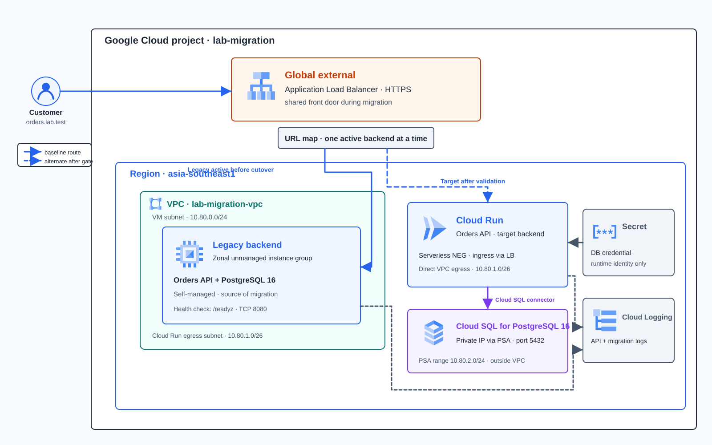
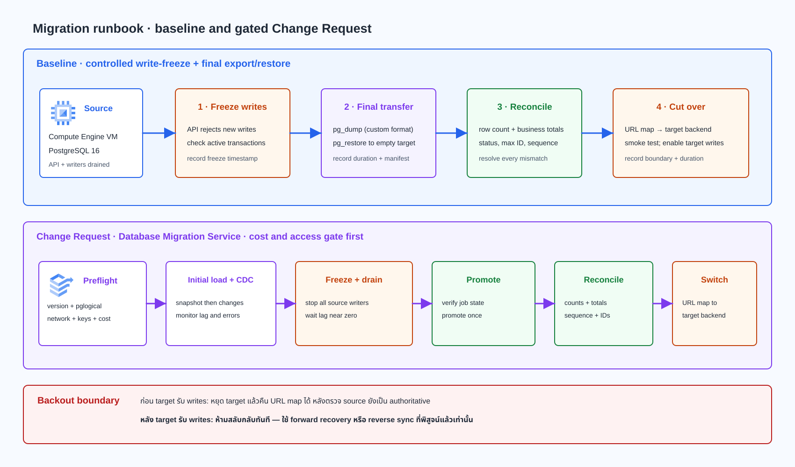

# Lab 16 — ย้ายระบบ Orders จาก VM ไป Cloud Run และ Cloud SQL

> **สถานะคู่มือ:** Guide-ready — [CI #385](https://github.com/somkid-s5/Portfolio-Lab/actions/runs/40156391005) ผ่าน 59/59 repository jobs  
> **Cloud verification:** Not run — ยังไม่มีผลจากการสร้างหรือทดสอบทรัพยากรจริง  
> **ข้อมูล:** ใช้ข้อมูลจำลองเท่านั้น ห้ามใช้ข้อมูลลูกค้า รหัสผ่านจริง หรือ private key จริง

## เป้าหมาย

ทีมมี Orders API และ PostgreSQL ที่ดูแลเองบน VM ต้องย้าย API ไป Cloud Run และข้อมูลไป Cloud SQL โดยคุมช่วงหยุดเขียน ตรวจข้อมูลก่อนสลับระบบ และกำหนดจุดที่ยังย้อนกลับได้

Lab นี้ทำเป็น solution เดียวตั้งแต่สำรวจ source, เตรียม target, deploy, ทดสอบ, freeze, export/restore, reconcile, cutover, fault recovery, Change Request และ cleanup ใช้ข้อมูลจำลองขนาดเล็ก ไม่มีการอ้างว่า zero downtime หรือ production performance

## Solution

Client ใช้ HTTPS front door เดิมตลอด Lab: global external Application Load Balancer → URL map → backend service ของ VM หรือ Cloud Run serverless NEG อย่างใดอย่างหนึ่ง ข้อมูล Cloud Run อยู่ใน Cloud SQL private IP ผ่าน Direct VPC egress และ Private Services Access; VM ไม่มี external IP

Diagram เป็นแบบออกแบบ ไม่ใช่ผล Cloud execution. ใช้สี ไอคอน การจัดกลุ่ม และแนวทางเดินเส้นตาม Diagram Design Personal Custom จาก ZIP ที่บันทึกเป็นมาตรฐานเดียวใน [docs/diagram-style.md](../../docs/diagram-style.md).

## Requirements และเกณฑ์รับงาน

| ID | เกณฑ์ | หลักฐาน |
|---|---|---|
| R01 | Source/target ทำ health, readiness, list และ create order ได้ พร้อม backend marker | HTTP status/body และเวลา |
| R02 | บันทึก PostgreSQL version, schema, extensions, keys, size และ App roles | Source inventory |
| R03 | Freeze ก่อน final export; มี run ID และ checksum | เวลา freeze, manifest, SHA256 |
| R04 | ระหว่าง freeze POST ถูกปฏิเสธและไม่มี transaction เขียนค้าง | 503 writes_frozen และ transaction check |
| R05 | Count, total, status, max ID และ sequence ตรงกัน | reconciliation.json ทุก check true |
| R06 | Cloud Run เข้าถึงเฉพาะ SQL/secret ที่จำเป็น; direct URL ไม่เป็นทางเข้า | IAM/config และ positive/negative tests |
| R07 | เปลี่ยน backend ผ่าน URL map โดยคง front door เดิม | URL map และ backend marker |
| R08 | ทดลอง route back ก่อน target write; หลัง target write ห้ามย้อน source | rollback boundary และเหตุผล |
| R09 | จำแนกและกู้ App/database readiness fault แล้วทดสอบซ้ำ | timeline, logs, retest |
| R10 | ประเมิน DMS continuous migration เป็น Change Request; ถ้า gate ไม่ผ่านให้บันทึก No-go | compatibility/cost/access record |

## ขอบเขตและข้อจำกัด

- Source เป็น VM สำหรับ Lab ไม่ใช่ on-premises จริง
- PostgreSQL 16 และ Cloud SQL แบบ zonal ใช้กับชุดข้อมูลสังเคราะห์ขนาดเล็ก ไม่ใช่ HA production design
- Cloud SQL, VM/disk, NAT, Cloud Build, Artifact Registry, Load Balancer/IP, Secret Manager และ Logging อาจคิดค่าใช้จ่าย ตรวจราคา/region/quota ก่อน Apply
- DMS เป็น Change Request มี prerequisites และค่าใช้จ่ายเพิ่ม; baseline source ไม่ได้เปิด logical replication
- ผู้เรียนเป็นผู้รัน Cloud Lab; คู่มือนี้ไม่สร้าง resource และไม่ deploy website

## ก่อนเริ่ม

เปิด Google Cloud Console แล้วกด **Activate Cloud Shell** เพื่อใช้ gcloud, Terraform, Git และ OpenSSL จาก Cloud-hosted environment

ต้องมี project ที่เปิด Billing และสิทธิ์เปิด API, สร้าง VPC/VM/Cloud SQL/Cloud Run/Artifact Registry/Load Balancer/service accounts/IAM ตามที่ใช้ใน Lab. การเข้า VM ต้องมี IAP TCP forwarding, OS Login และสิทธิ์ใช้ service account ของ VM. ถ้าองค์กรจำกัดสิทธิ์ ให้หยุดที่ access gate และขอผู้ดูแลกำหนดสิทธิ์ ไม่เปิด SSH จาก internet

ตรวจว่า CIDR 10.80.0.0/24, 10.80.1.0/26, 10.80.2.0/24 ไม่ทับ subnet หรือ peering route ใน VPC ที่เชื่อมอยู่ ดูราคาผ่าน [Google Cloud Pricing Calculator](https://cloud.google.com/products/calculator) และยืนยัน budget ก่อนสร้างของ

**จุดหยุด:** ห้าม Apply หาก project/Billing/IAM/CIDR/quota/budget ยังไม่ชัด

| Resource | ชื่อ |
|---|---|
| Region / Zone | asia-southeast1 / asia-southeast1-a |
| VPC / source VM | lab016-vpc / lab016-source |
| Cloud SQL / database | lab016-target-pg / orders |
| Cloud Run / Artifact Registry | lab016-orders |
| Host สำหรับ curl | orders.lab.test |

## Task 00 — ตั้งค่าพื้นที่ทำงาน

ทำใน Cloud Shell. แทน project ID แล้วตรวจ account/project ให้ถูกต้องก่อนเริ่ม

~~~bash
PROJECT_ID="replace-with-your-project-id"
REGION="asia-southeast1"
ZONE="asia-southeast1-a"
RUN_ID="$(date -u +%Y%m%d-%H%M%S)"
LAB_WORK="$HOME/lab016-$RUN_ID"
mkdir -p "$LAB_WORK/evidence"
gcloud config set project "$PROJECT_ID"
gcloud auth list --filter=status:ACTIVE --format='table(account,status)'
gcloud projects describe "$PROJECT_ID" --format='value(projectId,projectNumber)'
printf 'RUN_ID=%s\nREGION=%s\nZONE=%s\n' "$RUN_ID" "$REGION" "$ZONE"
~~~

ตรวจ IAM > **IAM & Admin > IAM**, Billing, quota, VPC ranges และนโยบายองค์กร ถ้าใช้ OS Login ให้ผู้ใช้มี roles/compute.osLogin; สำหรับ tunnel ใช้ roles/iap.tunnelResourceAccessor. สิทธิ์ actAs ต่อ VM service account อาจต้องให้ตามนโยบาย project.

**Expected:** account active และ project ตรงกับที่ตั้งใจ; ยังไม่มี Lab resource.

| บันทึก | Actual / Evidence |
|---|---|
| Project/account/region/run ID | เติมค่าจริง: |
| Billing/IAM/CIDR/quota/budget gate | ผ่าน/ไม่ผ่าน พร้อมหลักฐาน: |

## Task 01 — ตรวจ Terraform plan และสร้าง foundation

Clone branch นี้จาก Cloud Shell, ตรวจ plan ว่ามีเฉพาะ Lab resources และ Apply หลัง budget gate ผ่านเท่านั้น

~~~bash
git clone --depth 1 --branch docs/gcp-solution-labs --single-branch https://github.com/somkid-s5/Portfolio-Lab.git "$LAB_WORK/Portfolio-Lab"
LAB_ROOT="$LAB_WORK/Portfolio-Lab/GCP/LAB-016-legacy-migration"
cd "$LAB_ROOT/infra"
export TF_VAR_project_id="$PROJECT_ID"
export TF_VAR_region="$REGION"
export TF_VAR_zone="$ZONE"
export TF_VAR_sql_tier="db-custom-1-3840"
export TF_VAR_source_machine_type="e2-small"
terraform init
terraform validate
terraform plan -out="$LAB_WORK/lab016.tfplan"
terraform show "$LAB_WORK/lab016.tfplan"
~~~

Plan ควรมี API, custom VPC/subnets/PSA, NAT เฉพาะ source subnet, private VM, Cloud SQL PostgreSQL 16 แบบไม่มี public IP, Secret containers, Artifact Registry และ service identities. ถ้าพบการเปลี่ยน resource อื่น, CIDR overlap, region/tier/quota issue ให้หยุดก่อน Apply.

~~~bash
terraform apply "$LAB_WORK/lab016.tfplan"
terraform output
~~~

ห้าม commit terraform.tfstate, plan, tfvars หรือ credentials. เก็บผล Apply และ private IP ใน evidence.

| บันทึก | Actual / Evidence |
|---|---|
| Plan summary / Apply time | เติมผลจริง: |
| SQL status, VM status, private IP | เติมค่าจาก Console/API: |
| ราคาประมาณก่อน Apply | เติมตัวเลข/เงื่อนไขจาก calculator: |

## Task 02 — Bootstrap Source VM และ Orders API

รอ startup script ติดตั้ง Docker, Python, gcloud, Ops Agent และ Cloud SQL Auth Proxy. ตรวจ Console ที่ **Compute Engine > VM instances > lab016-source > Logs**. ส่ง bundle จาก Cloud Shell ผ่าน IAP:

~~~bash
tar -czf "$LAB_WORK/lab016-bundle.tgz" -C "$LAB_ROOT" app scripts
gcloud compute scp --project="$PROJECT_ID" --zone="$ZONE" --tunnel-through-iap \
  "$LAB_WORK/lab016-bundle.tgz" lab016-source:/tmp/lab016-bundle.tgz
gcloud compute ssh lab016-source --project="$PROJECT_ID" --zone="$ZONE" --tunnel-through-iap \
  --command='sudo install -d -o root -g root -m 0755 /opt/lab016/lab-bundle && sudo tar -xzf /tmp/lab016-bundle.tgz -C /opt/lab016/lab-bundle && sudo bash /opt/lab016/lab-bundle/scripts/start-source-db.sh && sudo bash /opt/lab016/lab-bundle/scripts/install-source-app.sh /opt/lab016/lab-bundle && sudo rm -f /tmp/lab016-bundle.tgz'
~~~

ตรวจ systemd, health และ readiness:

~~~bash
gcloud compute ssh lab016-source --project="$PROJECT_ID" --zone="$ZONE" --tunnel-through-iap \
  --command='sudo systemctl --no-pager --full status lab016-orders && curl --fail --silent http://127.0.0.1:8080/healthz && curl --fail --silent http://127.0.0.1:8080/readyz'
~~~

**Expected:** HTTP 200, backend legacy-source, PostgreSQL container healthy, port 5432 bind เฉพาะ 127.0.0.1. หาก SSH ไม่ได้ให้ตรวจ OS Login/IAP role, firewall TCP/22 จาก 35.235.240.0/20 และ VM RUNNING. หาก App ไม่ ready ให้ดู systemd journal, Docker health และ startup log; อย่าลบ database directory เพื่อแก้ปัญหา

| บันทึก | Actual / Evidence |
|---|---|
| Startup/health/readiness เวลาและผล | เติมผลจริง: |
| Bootstrap issue และวิธีแก้ | เติม timeline/log ที่ไม่มี secret: |

## Task 03 — สำรวจ PostgreSQL และบันทึก baseline

ตรวจ source version, size, extensions, keys และข้อมูลจำลองก่อนสร้าง test order:

~~~bash
gcloud compute ssh lab016-source --project="$PROJECT_ID" --zone="$ZONE" --tunnel-through-iap \
  --command="sudo docker exec lab016-postgres psql --no-psqlrc --username lab016_admin --dbname orders --command \"SELECT current_setting('server_version') AS version, current_database() AS database, pg_size_pretty(pg_database_size(current_database())) AS database_size; SELECT extname, extversion FROM pg_extension ORDER BY extname; SELECT count(*) AS rows, COALESCE(sum(amount_cents),0) AS total_amount_cents, max(id) AS max_id FROM public.orders; SELECT status,count(*) FROM public.orders GROUP BY status ORDER BY status; SELECT indexname,indexdef FROM pg_indexes WHERE schemaname='public' ORDER BY indexname;\""
~~~

ตรวจด้วยว่ามี table, primary/unique key, identity sequence, trigger, function หรือ role เพิ่มเติมหรือไม่ แล้วเทียบ extension/edition/region กับ Cloud SQL compatibility ก่อนย้าย

**Expected:** seed เริ่มต้น 5 rows, 97,400 cents, max ID 1005. หลังสร้าง order ใน Task 07 ค่าจะเปลี่ยน ให้ถือค่าที่บันทึกจริงเป็น baseline.

| บันทึก | Actual / Evidence |
|---|---|
| PostgreSQL version/extensions/size | เติมผลจริง: |
| Tables/keys/sequence/roles | เติมผลจริง: |
| Count/total/status/max ID ก่อน test order | เติมผลจริง: |
| Compatibility issues/decision | เติมรายการหรือระบุว่าไม่พบ: |

## Task 04 — เก็บ target credentials ใน Secret Manager

Terraform สร้าง Secret containers ไว้แต่ไม่มี secret version หรือรหัสผ่านใน state. ใช้ password manager ทำ admin password 64 ตัวอักษร hex; app password สร้างใหม่ใน Cloud Shell. ไม่ใช้ shell tracing และไม่ echo secret.

~~~bash
SQL_INSTANCE="lab016-target-pg"
APP_DB_PASS="$(openssl rand -hex 32)"
read -rsp "วาง admin password 64-char lowercase hex จาก password manager: " ADMIN_DB_PASS
printf '\n'
[[ "$ADMIN_DB_PASS" =~ ^[a-f0-9]{64}$ ]]
APP_SECRET_VERSION="$(printf '%s' "$APP_DB_PASS" | gcloud secrets versions add lab016-target-db-password --project="$PROJECT_ID" --data-file=- --format='value(name)' | awk -F/ '{print $NF}')"
printf '%s' "$ADMIN_DB_PASS" | gcloud secrets versions add lab016-target-admin-password --project="$PROJECT_ID" --data-file=- >/dev/null
unset ADMIN_DB_PASS
gcloud sql users set-password postgres --project="$PROJECT_ID" --instance="$SQL_INSTANCE" --prompt-for-password
unset APP_DB_PASS
printf 'APP_SECRET_VERSION=%s\n' "$APP_SECRET_VERSION"
~~~

ที่ hidden prompt ของ gcloud ให้พิมพ์ admin password ค่าเดิมจาก password manager. ตรวจ Secret Manager > **Secrets** ว่ามี enabled version โดยไม่เปิดค่า.

| บันทึก | Actual / Evidence |
|---|---|
| Secret version IDs | เติมเฉพาะเลข version: |
| SQL password operation | เติม status/time: |
| ตรวจว่าไม่มี secret ใน history/log/repo | ยืนยันผล: |

## Task 05 — Build image และ deploy Cloud Run แบบ read-only

ตรวจ Cloud Build > **Settings** ว่า build service account เขียน Artifact Registry ได้ หาก permission denied ให้ใช้ email ที่แสดงใน Settings เพื่อเพิ่มสิทธิ์เฉพาะ repository

~~~bash
IMAGE_URI="$REGION-docker.pkg.dev/$PROJECT_ID/lab016-orders/orders-api:$RUN_ID"
gcloud builds submit --project="$PROJECT_ID" --tag="$IMAGE_URI" "$LAB_ROOT/app"
~~~

~~~bash
BUILD_SA="replace-with-service-account-email-from-cloud-build-settings"
gcloud artifacts repositories add-iam-policy-binding lab016-orders \
  --project="$PROJECT_ID" --location="$REGION" \
  --member="serviceAccount:$BUILD_SA" --role="roles/artifactregistry.writer"
~~~

ดึงค่าจาก Terraform output แล้ว deploy ให้ Cloud Run ใช้ private-range Direct VPC egress, Cloud SQL connection และเลข secret version:

~~~bash
VPC_NAME="lab016-vpc"
RUN_SUBNET="lab016-run-egress"
CONNECTION_NAME="$(terraform -chdir="$LAB_ROOT/infra" output -raw cloud_sql_connection_name)"
RUN_SA="$(terraform -chdir="$LAB_ROOT/infra" output -raw run_runtime_service_account)"
gcloud run deploy lab016-orders \
  --project="$PROJECT_ID" --region="$REGION" \
  --image="$IMAGE_URI" --service-account="$RUN_SA" \
  --port=8080 --cpu=1 --memory=512Mi --timeout=15 \
  --concurrency=8 --max=2 \
  --network="$VPC_NAME" --subnet="$RUN_SUBNET" --vpc-egress=private-ranges-only \
  --add-cloudsql-instances="$CONNECTION_NAME" \
  --ingress=internal-and-cloud-load-balancing --allow-unauthenticated \
  --set-env-vars="DB_HOST=/cloudsql/$CONNECTION_NAME,DB_PORT=5432,DB_NAME=orders,DB_USER=orders_app,BACKEND_NAME=cloud-run-target,ALLOW_WRITES=false,PORT=8080,LOG_LEVEL=INFO" \
  --set-secrets="DB_PASSWORD=lab016-target-db-password:$APP_SECRET_VERSION"
~~~

ตรวจ Cloud Run > **Services > lab016-orders > Revisions / Networking / Security**. Direct Run URL จาก public internet ไม่ใช่ทางเข้า; ทดสอบผ่าน front door หลัง Task 06.

**Expected:** revision Ready และ write gate ปิด. ถ้าไม่ Ready ตรวจ revision logs, Secret Accessor, Cloud SQL Client, connection name, PSA และ VPC subnet; อย่าเปิด ingress เป็น all.

| บันทึก | Actual / Evidence |
|---|---|
| Build ID/image URI/digest | เติมผลจริง: |
| Run revision/runtime identity/network/ingress | เติมค่าจริง โดยไม่ใส่ secret: |

## Task 06 — สร้าง HTTPS Load Balancer และ backend ทั้งสองแบบ

Source เป็น unmanaged instance-group backend; Cloud Run เป็น serverless NEG และ backend service แยกกัน เริ่ม URL map ที่ legacy backend.

~~~bash
gcloud compute instance-groups unmanaged create lab016-source-ig --project="$PROJECT_ID" --zone="$ZONE"
gcloud compute instance-groups unmanaged add-instances lab016-source-ig \
  --project="$PROJECT_ID" --zone="$ZONE" --instances=lab016-source
gcloud compute instance-groups set-named-ports lab016-source-ig \
  --project="$PROJECT_ID" --zone="$ZONE" --named-ports=http:8080
gcloud compute health-checks create http lab016-source-hc \
  --project="$PROJECT_ID" --port=8080 --request-path=/readyz \
  --check-interval=5 --timeout=5 --healthy-threshold=2 --unhealthy-threshold=3
gcloud compute backend-services create lab016-legacy-backend \
  --project="$PROJECT_ID" --global --load-balancing-scheme=EXTERNAL_MANAGED \
  --protocol=HTTP --port-name=http --health-checks=lab016-source-hc
gcloud compute backend-services add-backend lab016-legacy-backend \
  --project="$PROJECT_ID" --global \
  --instance-group=lab016-source-ig --instance-group-zone="$ZONE"
gcloud compute network-endpoint-groups create lab016-run-neg \
  --project="$PROJECT_ID" --region="$REGION" \
  --network-endpoint-type=serverless --cloud-run-service=lab016-orders
gcloud compute backend-services create lab016-run-backend \
  --project="$PROJECT_ID" --global --load-balancing-scheme=EXTERNAL_MANAGED
gcloud compute backend-services add-backend lab016-run-backend \
  --project="$PROJECT_ID" --global \
  --network-endpoint-group=lab016-run-neg --network-endpoint-group-region="$REGION"
gcloud compute url-maps create lab016-orders-map \
  --project="$PROJECT_ID" --default-service=lab016-legacy-backend
gcloud compute addresses create lab016-orders-ip \
  --project="$PROJECT_ID" --ip-version=IPV4 --network-tier=PREMIUM --global
LB_IP="$(gcloud compute addresses describe lab016-orders-ip --project="$PROJECT_ID" --global --format='value(address)')"
printf 'LB_IP=%s\n' "$LB_IP"
~~~

สร้าง self-signed TLS certificate สำหรับ Lab เท่านั้น. Private key อยู่ใน Cloud Shell work dir ไม่อยู่ใน Git.

~~~bash
openssl req -x509 -newkey rsa:2048 -nodes \
  -keyout "$LAB_WORK/orders.lab.test.key" -out "$LAB_WORK/orders.lab.test.crt" \
  -days 7 -subj "/CN=orders.lab.test" \
  -addext "subjectAltName=DNS:orders.lab.test"
chmod 600 "$LAB_WORK/orders.lab.test.key"
gcloud compute ssl-certificates create lab016-orders-test-cert \
  --project="$PROJECT_ID" --global \
  --certificate="$LAB_WORK/orders.lab.test.crt" \
  --private-key="$LAB_WORK/orders.lab.test.key"
gcloud compute target-https-proxies create lab016-orders-https-proxy \
  --project="$PROJECT_ID" --url-map=lab016-orders-map \
  --ssl-certificates=lab016-orders-test-cert
gcloud compute forwarding-rules create lab016-orders-https \
  --project="$PROJECT_ID" --global --load-balancing-scheme=EXTERNAL_MANAGED \
  --network-tier=PREMIUM --address=lab016-orders-ip \
  --target-https-proxy=lab016-orders-https-proxy --ports=443
gcloud compute backend-services get-health lab016-legacy-backend --project="$PROJECT_ID" --global
~~~

รอ source backend เป็น HEALTHY. ตรวจ **Network services > Load balancing > Backend services**. Serverless NEG ไม่มี health-check state แบบ VM; ใช้ readiness request ผ่าน Load Balancer แทน

**Troubleshooting:** ถ้า source unhealthy ตรวจ VM, systemd, /readyz, port 8080, named port, firewall source ranges และ target tag; ห้ามเปิด 0.0.0.0/0.

| บันทึก | Actual / Evidence |
|---|---|
| Health/backend/url map default | เติมผลจริง: |
| LB IP/certificate status/time | เติมผลจริง: |

## Task 07 — ทดสอบ business flow ฝั่งเดิม

ใช้ IP ที่จองไว้พร้อม host/SNI orders.lab.test. curl ตรวจ TLS ด้วย CA ที่สร้างไว้.

~~~bash
curl --silent --show-error --cacert "$LAB_WORK/orders.lab.test.crt" --resolve "orders.lab.test:443:$LB_IP" https://orders.lab.test/healthz
curl --silent --show-error --cacert "$LAB_WORK/orders.lab.test.crt" --resolve "orders.lab.test:443:$LB_IP" https://orders.lab.test/readyz
curl --silent --show-error --cacert "$LAB_WORK/orders.lab.test.crt" --resolve "orders.lab.test:443:$LB_IP" https://orders.lab.test/ops/backend
curl --silent --show-error --cacert "$LAB_WORK/orders.lab.test.crt" --resolve "orders.lab.test:443:$LB_IP" https://orders.lab.test/ops/summary
~~~

สร้าง order เดียวด้วย unique ref จาก RUN_ID. ถ้า request timeout ให้ตรวจรายการก่อน retry.

~~~bash
curl --silent --show-error --include --cacert "$LAB_WORK/orders.lab.test.crt" \
  --resolve "orders.lab.test:443:$LB_IP" --header 'Content-Type: application/json' \
  --data "{\"order_ref\":\"LAB16-SRC-$RUN_ID\",\"customer_name\":\"Lab User\",\"amount_cents\":1000}" \
  https://orders.lab.test/v1/orders
curl --silent --show-error --cacert "$LAB_WORK/orders.lab.test.crt" --resolve "orders.lab.test:443:$LB_IP" \
  https://orders.lab.test/ops/summary
~~~

ทำ bounded read 20 requests; นี่ไม่ใช่ performance benchmark.

~~~bash
for i in $(seq 1 20); do
  curl --silent --show-error --output /dev/null --write-out '%{http_code}\n' \
    --cacert "$LAB_WORK/orders.lab.test.crt" --resolve "orders.lab.test:443:$LB_IP" \
    "https://orders.lab.test/v1/orders?limit=5"
done
~~~

**Expected:** health/readiness 200, backend legacy-source, POST 201 หนึ่งครั้ง, read probes 20 ค่าเป็น 200. คาด seed ก่อน POST คือ 5 rows, 97,400 cents; หลัง POST ควรเห็น 6 rows, 98,400 cents หากสร้างรายการสำเร็จเพียงครั้งเดียว

| บันทึก | Actual / Evidence |
|---|---|
| Health/readiness/backend | เติม response/time: |
| Source order ref/ID/status | เติม response จริง: |
| Summary/count/total/status/max ID/sequence | เติมค่าจริง: |
| Probe count/status/latency ที่สังเกต | เติม actual; ห้ามอ้าง production throughput: |

## Task 08 — Freeze writes และตรวจ source ก่อน export

ปิด writes ที่ source, ลอง POST ใหม่ซึ่งต้องถูกปฏิเสธ แล้วตรวจไม่มี active transaction/idle-in-transaction ก่อน dump

~~~bash
gcloud compute ssh lab016-source --project="$PROJECT_ID" --zone="$ZONE" --tunnel-through-iap \
  --command='sudo bash /opt/lab016/lab-bundle/scripts/source-write-gate.sh freeze'
curl --silent --show-error --include --cacert "$LAB_WORK/orders.lab.test.crt" \
  --resolve "orders.lab.test:443:$LB_IP" --header 'Content-Type: application/json' \
  --data "{\"order_ref\":\"LAB16-FROZEN-$RUN_ID\",\"customer_name\":\"Lab User\",\"amount_cents\":1000}" \
  https://orders.lab.test/v1/orders
gcloud compute ssh lab016-source --project="$PROJECT_ID" --zone="$ZONE" --tunnel-through-iap \
  --command="sudo docker exec lab016-postgres psql --no-psqlrc --username lab016_admin --dbname orders --tuples-only --no-align --command \"SELECT count(*) FROM pg_stat_activity WHERE datname='orders' AND pid <> pg_backend_pid() AND (xact_start IS NOT NULL OR state='idle in transaction'); SELECT count(*),COALESCE(sum(amount_cents),0),max(id) FROM public.orders;\""
~~~

**Expected:** POST เป็น 503 writes_frozen, write gate false, active transaction = 0, summary ไม่เปลี่ยนหลัง freeze. ถ้าไม่ตรงให้หยุด; ห้าม export/cutover.

| บันทึก | Actual / Evidence |
|---|---|
| Freeze start/confirmed UTC | เติมเวลา: |
| Negative POST status/body | เติมผลจริง: |
| Active transaction count / final source summary | เติมผลจริง: |

## Task 09 — Export, restore และ reconcile

Script ตรวจ write freeze, source health, active transactions, target table ว่าง, ทำ custom-format dump, restore, สร้าง least-privilege app role, reconcile invariants และเขียน manifest/checksum. ใช้ RUN_ID เดิมและห้ามใช้ซ้ำ.

~~~bash
gcloud compute ssh lab016-source --project="$PROJECT_ID" --zone="$ZONE" --tunnel-through-iap \
  --command="sudo bash /opt/lab016/lab-bundle/scripts/final-migrate.sh $PROJECT_ID $CONNECTION_NAME $RUN_ID"
~~~

หลักฐานที่ VM สร้างอยู่ใต้ /var/lib/lab016-migration/RUN_ID: source.dump, SHA256SUMS, reconciliation.json, manifest.json. directory เป็น root 0700 และ dump 0600; ห้ามเอา dump เข้า Git. คัดลอกเฉพาะ checksum, manifest และ reconciliation ไป Cloud Shell:

~~~bash
mkdir -p "$LAB_WORK/evidence/migration-$RUN_ID"
gcloud compute scp --project="$PROJECT_ID" --zone="$ZONE" --tunnel-through-iap lab016-source:/var/lib/lab016-migration/"$RUN_ID"/SHA256SUMS "$LAB_WORK/evidence/migration-$RUN_ID/"
gcloud compute scp --project="$PROJECT_ID" --zone="$ZONE" --tunnel-through-iap lab016-source:/var/lib/lab016-migration/"$RUN_ID"/manifest.json "$LAB_WORK/evidence/migration-$RUN_ID/"
gcloud compute scp --project="$PROJECT_ID" --zone="$ZONE" --tunnel-through-iap lab016-source:/var/lib/lab016-migration/"$RUN_ID"/reconciliation.json "$LAB_WORK/evidence/migration-$RUN_ID/"
cat "$LAB_WORK/evidence/migration-$RUN_ID/reconciliation.json"
~~~

**Expected:** manifest reconciliation matched; checks count, total, max ID, distinct order refs, by status และ sequence เป็น true. ถ้ามี mismatch ให้คงทั้งสองระบบ read-only, ห้ามเปลี่ยน URL map, แล้วตรวจ writers/schema/sequence/dump/restore.

| บันทึก | Actual / Evidence |
|---|---|
| Export/restore/reconcile start/end UTC, freeze duration | เติมเวลาจริง: |
| Run ID / dump SHA256 | เติมค่าจาก manifest: |
| ทุก check และ mismatch | เติมผลจริง/ไฟล์: |

## Task 10 — ทดลองเปลี่ยน route และ route back ก่อน target write

1. เปลี่ยน URL map ไป Cloud Run ขณะที่ target ยังปิด writes
2. ตรวจ backend marker, readiness และ summary ผ่าน hostname เดิม
3. POST ต้องเป็น 503 writes_frozen
4. ทดลอง route กลับ source แล้วตรวจ GET/backend; source ต้องยัง frozen
5. ตั้ง URL map กลับ target และตรวจซ้ำ
6. ระหว่าง rehearsal ห้ามเปิด source writes หรือ POST order สำเร็จบน source เพราะจะทำให้ข้อมูลไม่ตรงกับ final export

~~~bash
gcloud compute url-maps set-default-service lab016-orders-map \
  --project="$PROJECT_ID" --global --default-service=lab016-run-backend
~~~

รอ global propagation แล้วตรวจ /ops/backend, /readyz, /ops/summary และ POST negative test. route back ไป source ด้วยคำสั่งนี้ แล้วตรวจ marker เป็น legacy-source และ POST ยังถูกปฏิเสธ:

~~~bash
gcloud compute url-maps set-default-service lab016-orders-map \
  --project="$PROJECT_ID" --global --default-service=lab016-legacy-backend
~~~

ตั้ง URL map กลับ target ก่อนจบ rehearsal:

~~~bash
gcloud compute url-maps set-default-service lab016-orders-map \
  --project="$PROJECT_ID" --global --default-service=lab016-run-backend
~~~

| บันทึก | Actual / Evidence |
|---|---|
| URL map target/source/target timestamps | เติมเวลาและผล: |
| Backend markers/readiness | เติม actual response: |
| POST negative test | เติมผล target/source: |
| Rollback boundary | ยังไม่ข้าม; ระบุเงื่อนไขที่จะข้าม: |

## Task 11 — Final cutover และ rollback boundary

ยืนยัน URL map ชี้ Run, source ยัง frozen, target readiness/summary ตรง reconciliation แล้วเปิด target writes:

~~~bash
gcloud run services update lab016-orders --project="$PROJECT_ID" --region="$REGION" \
  --update-env-vars=ALLOW_WRITES=true
gcloud run services update-traffic lab016-orders --project="$PROJECT_ID" --region="$REGION" --to-latest
~~~

ส่ง order หนึ่งรายการด้วย ref เฉพาะ target แล้วตรวจ summary:

~~~bash
curl --silent --show-error --include --cacert "$LAB_WORK/orders.lab.test.crt" \
  --resolve "orders.lab.test:443:$LB_IP" --header 'Content-Type: application/json' \
  --data "{\"order_ref\":\"LAB16-TGT-$RUN_ID\",\"customer_name\":\"Lab User\",\"amount_cents\":2500}" \
  https://orders.lab.test/v1/orders
curl --silent --show-error --cacert "$LAB_WORK/orders.lab.test.crt" \
  --resolve "orders.lab.test:443:$LB_IP" https://orders.lab.test/ops/summary
~~~

เมื่อ target ตอบ HTTP 201 และบันทึกสำเร็จ ให้บันทึกเวลาเป็น rollback boundary. ตั้งแต่นั้นห้ามสลับ URL map กลับ source เพราะ order ใหม่ยังไม่มีที่ source; ให้ forward-recover หรือทำ reverse sync ที่ออกแบบ/พิสูจน์แล้วเท่านั้น

| บันทึก | Actual / Evidence |
|---|---|
| Final URL map/Run revision/timestamp | เติมผลจริง: |
| Pre-write summary เทียบ manifest | เติมผลจริง: |
| Target POST status/order ID/backend | เติม response จริง: |
| Rollback boundary UTC | เติมเวลา/เหตุการณ์: |
| Target summary หลัง write | เติม count/total/status/max ID/sequence: |

## Task 12 — Fault injection, recovery และ Change Request

### Fault test

ทดสอบ bad DB host ใน revision ใหม่; ไม่เปลี่ยน SQL data และไม่ route กลับ source.

~~~bash
GOOD_REVISION="$(gcloud run services describe lab016-orders --project="$PROJECT_ID" --region="$REGION" --format='value(status.latestReadyRevisionName)')"
gcloud run deploy lab016-orders --project="$PROJECT_ID" --region="$REGION" \
  --image="$IMAGE_URI" --update-env-vars=DB_HOST=127.0.0.1 --no-traffic
BAD_REVISION="$(gcloud run services describe lab016-orders --project="$PROJECT_ID" --region="$REGION" --format='value(status.latestCreatedRevisionName)')"
printf 'GOOD_REVISION=%s\nBAD_REVISION=%s\n' "$GOOD_REVISION" "$BAD_REVISION"
gcloud run services update-traffic lab016-orders --project="$PROJECT_ID" --region="$REGION" --to-revisions="$BAD_REVISION=100"
~~~

ผ่าน front door: /healthz ควรเป็น 200 เพราะ process ทำงาน; /readyz ควรเป็น 503 database_unavailable. ดู Cloud Run > service > Logs แล้วค้นหา database_request_failed. คืน traffic ไป revision ดี จากนั้นแก้ service template ให้กลับไปใช้ Cloud SQL socket ที่ถูกต้อง สร้าง revision ที่แก้แล้ว และให้ revision นั้นรับ traffic เพื่อไม่ทิ้ง bad config ไว้เป็น latest:

~~~bash
gcloud logging read 'resource.type="cloud_run_revision" AND resource.labels.service_name="lab016-orders" AND jsonPayload.event="database_request_failed"' \
  --project="$PROJECT_ID" --limit=10 --freshness=1h \
  --format='table(timestamp,jsonPayload.error_type,resource.labels.revision_name)'
gcloud run services update-traffic lab016-orders --project="$PROJECT_ID" --region="$REGION" \
  --to-revisions="$GOOD_REVISION=100"
gcloud run deploy lab016-orders --project="$PROJECT_ID" --region="$REGION" \
  --image="$IMAGE_URI" --update-env-vars="DB_HOST=/cloudsql/$CONNECTION_NAME" --no-traffic
FIXED_REVISION="$(gcloud run services describe lab016-orders --project="$PROJECT_ID" --region="$REGION" --format='value(status.latestCreatedRevisionName)')"
gcloud run services update-traffic lab016-orders --project="$PROJECT_ID" --region="$REGION" \
  --to-revisions="$FIXED_REVISION=100"
~~~

ตรวจ /readyz ได้ 200, marker เป็น cloud-run-target และ target order ยังอยู่. บันทึก fault/recovery timeline. bad revision ควรไม่มี traffic หลังจบการทดสอบ.

### Bounded read probe

หลัง recovery อ่าน 20 ครั้งพร้อมกันไม่เกิน 4 requests. ผลเป็นข้อมูลสังเกตของ Lab ไม่ใช่ benchmark/SLA.

~~~bash
seq 1 20 | xargs -P4 -I{} curl --silent --show-error --output /dev/null \
  --write-out '%{http_code} %{time_total}\n' \
  --cacert "$LAB_WORK/orders.lab.test.crt" --resolve "orders.lab.test:443:$LB_IP" \
  'https://orders.lab.test/v1/orders?limit=5&probe={}'
~~~

### Change Request — DMS continuous migration

CR นี้ตรวจว่าลด write-freeze ได้หรือไม่. Baseline source ใช้ PostgreSQL container โดยไม่ได้ตั้ง logical replication parameters หรือ replication account จึงอย่าสร้าง DMS job ก่อนเตรียม source ใหม่ให้ผ่าน compatibility/network/identity/cost gate

ใน Cloud Console ไป **Database Migration Service > Migration jobs > Create migration job** เพื่อทบทวน source/destination profile, private connectivity, database version, extensions, primary keys, DDL, replication slots, WAL sender/slot limits, IAM, quota และราคา. ถ้า gate ใดไม่ผ่าน ให้บันทึก No-go และคง pg_dump/restore เป็นเส้นทางหลัก. ถ้าผ่านทุก gateและได้รับงบ ให้ทำ DMS ในรอบทดลองแยก: configure source, create connection profiles/job, start initial load/CDC, monitor lag, freeze source, รอ lag ใกล้ศูนย์, promote, reconcile counts/business totals/sequences แล้วเปลี่ยน URL map. ห้าม promote ขณะที่ lag ยังมีค่า

| บันทึก | Actual / Evidence |
|---|---|
| Fault symptom/diagnosis/log/revision/recovery | เติม timeline และ link: |
| Bounded probes: count/concurrency/status/latency | เติม actual; ไม่อ้าง performance: |
| DMS gate Go/No-go/Not run และเหตุผล | เติม compatibility/cost/access evidence: |

## Task 13 — Cleanup และบันทึกผล

คัดลอกเฉพาะหลักฐานที่ไม่มี secret ออกจาก Cloud Shell work dirก่อนลบ. ห้ามเก็บ private key, passwords, terraform state/plan, raw dump หรือ token ใน Git

ลบ front door และ backend ตาม dependency จากนั้นลบ Cloud Run และ image tag:

~~~bash
gcloud compute forwarding-rules delete lab016-orders-https --project="$PROJECT_ID" --global --quiet
gcloud compute target-https-proxies delete lab016-orders-https-proxy --project="$PROJECT_ID" --global --quiet
gcloud compute url-maps delete lab016-orders-map --project="$PROJECT_ID" --global --quiet
gcloud compute backend-services delete lab016-legacy-backend --project="$PROJECT_ID" --global --quiet
gcloud compute backend-services delete lab016-run-backend --project="$PROJECT_ID" --global --quiet
gcloud compute network-endpoint-groups delete lab016-run-neg --project="$PROJECT_ID" --region="$REGION" --quiet
gcloud compute health-checks delete lab016-source-hc --project="$PROJECT_ID" --quiet
gcloud compute instance-groups unmanaged delete lab016-source-ig --project="$PROJECT_ID" --zone="$ZONE" --quiet
gcloud compute ssl-certificates delete lab016-orders-test-cert --project="$PROJECT_ID" --global --quiet
gcloud compute addresses delete lab016-orders-ip --project="$PROJECT_ID" --global --quiet
gcloud run services delete lab016-orders --project="$PROJECT_ID" --region="$REGION" --quiet
gcloud artifacts docker images delete "$IMAGE_URI" --project="$PROJECT_ID" --delete-tags --quiet
~~~

ตรวจ backups แล้วทำ destroy plan; อ่านว่ามีแต่ Lab resources ก่อน apply:

~~~bash
gcloud sql backups list --project="$PROJECT_ID" --instance=lab016-target-pg
cd "$LAB_ROOT/infra"
terraform plan -destroy -out="$LAB_WORK/lab016-destroy.tfplan"
terraform show "$LAB_WORK/lab016-destroy.tfplan"
terraform apply "$LAB_WORK/lab016-destroy.tfplan"
gcloud compute instances list --project="$PROJECT_ID" --filter='name=lab016-source'
gcloud compute addresses list --project="$PROJECT_ID" --global --filter='name=lab016-orders-ip'
~~~

ตรวจ Console ว่า VM/disk, SQL, NAT, IP, LB, Run, secrets และ Artifact Registry ถูกลบ. Cloud Build staging bucket และ logs อาจอยู่นอก Terraform; ตรวจ ownership ก่อนลบ อย่าลบ bucket/shared logs ของ Lab อื่น. Project APIs ยังคง Enabled ตาม Terraform. ลบไฟล์ cert/key, state/plan และ dump จากพื้นที่ทำงานหลังเก็บ evidence ที่ต้องการแล้ว

| บันทึก | Actual / Evidence |
|---|---|
| Cleanup start/end UTC | เติมเวลา/resource ที่ลบ: |
| Inventory หลัง cleanup | เติมผลจริง: |
| Buckets/backups/logs ที่ยังอยู่และเหตุผล | เติม ownership/retention: |
| ค่าใช้จ่ายที่ Billing แสดง | เติมช่วงวันที่และข้อจำกัด: |

## Case-study summary สำหรับบันทึกผลจริง

- **Problem:** ระบบเดิม, data risk และ downtime constraint: เติมหลัง Lab
- **Design decision:** เหตุผลเลือก dump/restore และเงื่อนไขที่ DMS จะเหมาะกว่า:
- **Implementation:** resources/scripts/Console steps ที่ใช้จริง:
- **Verification:** freeze duration, reconciliation, route propagation และ recovery: เติม actual เท่านั้น
- **Operations:** readiness/logs/revision และวิธีกู้:
- **Rollback boundary:** เวลาและเหตุการณ์ที่ source rollback ไม่ปลอดภัย:
- **Limitations:** dataset เล็ก, Cloud SQL zonal, ไม่มี production load test และข้อจำกัดที่พบ:
- **Cleanup/cost:** ทรัพยากรคงเหลือและค่าใช้จ่ายจริง:
- **Next improvement:** อ้างอิงจากผลจริง:

## Troubleshooting

| อาการ | ตรวจตรงไหน |
|---|---|
| Terraform API/IAM error | project, Service Usage permission, policy constraint |
| IAP/SSH ไม่เข้า | OS Login role, IAP tunnel role, firewall 35.235.240.0/20, VM state |
| Startup ไม่จบ | startup log/serial output, Cloud NAT และ source subnet |
| Source API unhealthy | systemd journal, Docker health, local /readyz |
| VM backend unhealthy | named port, health check path/port, firewall, instance group zone |
| Cloud Run 503 | revision logs, service account, pinned secret, Cloud SQL Client/connection name |
| Target readiness fail | Direct VPC subnet, PSA/private IP, Cloud SQL connection |
| Migration refuses | write gate, active transaction, target already contains orders, reused run ID |
| Reconciliation mismatch | keep writes frozen; compare source/target snapshot, keys, sequence, schema, dump |
| URL map reports old backend | wait for global propagation, inspect URL map and test one request at a time |
| DMS gate fails | record No-go; do not expose PostgreSQL publicly or weaken WAL/security settings |

## Rebuild

Cleanup ให้เสร็จและตรวจ inventory ว่างก่อนใช้ชื่อเดิม. เริ่ม Task 00 ด้วย RUN_ID และ Cloud Shell work directory ใหม่. Final migration script ปฏิเสธ target ที่มีตาราง orders อยู่แล้ว; ห้ามใช้ซ้ำเพื่อ overwrite data.

## References

ตรวจเอกสาร Google Cloud ณ 25 ตุลาคม 2026; ตรวจซ้ำก่อนลงมือเพราะ CLI/IAM/region/quota/ราคาเปลี่ยนได้

- [Direct VPC egress for Cloud Run](https://docs.cloud.google.com/run/docs/configuring/vpc-direct-vpc)
- [Cloud Run to Cloud SQL for PostgreSQL](https://docs.cloud.google.com/sql/docs/postgres/connect-run)
- [Cloud SQL Auth Proxy](https://docs.cloud.google.com/sql/docs/postgres/sql-proxy)
- [Cloud SQL private IP and PSA](https://docs.cloud.google.com/sql/docs/postgres/configure-private-ip)
- [Global external Load Balancer with VM backends](https://docs.cloud.google.com/load-balancing/docs/https/setup-global-ext-https-compute)
- [Global external Load Balancer with serverless backends](https://docs.cloud.google.com/load-balancing/docs/https/setup-global-ext-https-serverless)
- [Serverless NEG concepts and limits](https://docs.cloud.google.com/load-balancing/docs/negs/serverless-neg-concepts)
- [SSH through IAP](https://docs.cloud.google.com/compute/docs/connect/ssh-using-iap)
- [OS Login](https://docs.cloud.google.com/compute/docs/oslogin)
- [Cloud Build service account access](https://docs.cloud.google.com/build/docs/securing-builds/configure-access-for-cloud-build-service-account)
- [Set Cloud SQL PostgreSQL user password](https://docs.cloud.google.com/sql/docs/postgres/create-manage-users)
- [DMS PostgreSQL scenarios](https://docs.cloud.google.com/database-migration/docs/postgres/scenario-overview)
- [Configure self-managed PostgreSQL source for DMS](https://docs.cloud.google.com/database-migration/docs/postgres/configure-source-database)
- [DMS network methods](https://docs.cloud.google.com/database-migration/docs/postgres/networking-methods)
- [DMS PostgreSQL limitations](https://docs.cloud.google.com/database-migration/docs/postgres/known-limitations)
- [Cloud Pricing Calculator](https://cloud.google.com/products/calculator)
