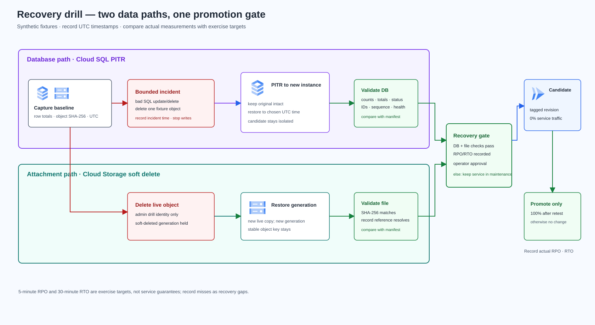

# Lab 17 — กู้คืน Records และไฟล์แนบหลังข้อมูลเสียหาย

> **สถานะคู่มือ:** Design — Brief และ architecture พร้อมตรวจ; Task Guide ยังไม่เริ่ม  
> **Cloud verification:** Not run — ยังไม่มีการสร้างหรือทดสอบทรัพยากรจริง  
> **ข้อมูล:** ใช้ synthetic records และไฟล์จำลองเท่านั้น

## สถานการณ์

ทีม Records เก็บข้อมูลรายการงานและไฟล์แนบไว้ใน Cloud SQL กับ Cloud Storage. วันหนึ่งมี batch ที่ตั้งค่า filter ผิด ทำให้แถวในฐานข้อมูลถูกแก้/ลบ และมีไฟล์แนบถูกลบ ทีมต้องกู้ทั้งสองส่วนให้สัมพันธ์กัน แล้วพิสูจน์ว่าบริการกลับมาอ่านและเขียนได้ก่อนเปิด traffic กลับ

โจทย์นี้จบเป็น solution เดียว ตั้งแต่ตั้ง protection, deploy app, เก็บ baseline, จำลอง incident, restore, ตรวจ integrity, สลับ revision, วัด RPO/RTO และ cleanup. ใช้ข้อมูลสังเคราะห์; ไม่มีการอ้างว่า cross-region DR, zero data loss หรือค่า performance ผ่านแล้ว

## Solution

ใช้ Diagram Design Personal Custom จาก ZIP เป็นมาตรฐานเดียวของ Repo ทั้งสี ไอคอน การจัดกลุ่ม scope และแนวคิดการจัดเส้นตามความสัมพันธ์ ตาม [diagram-style.md](../../docs/diagram-style.md). ไอคอน GCP เป็นไฟล์ official ที่ pin source และเก็บ attribution ไว้ใน assets

## Requirements และเกณฑ์รับงาน

| ID | เกณฑ์ | หลักฐานที่ต้องบันทึก |
|---|---|---|
| R01 | Records API มี health/readiness, สร้าง/ค้น record และรับ/อ่านไฟล์แนบได้ | HTTP status/body, record ID, object key |
| R02 | Cloud SQL PostgreSQL 16 ใช้ private IP พร้อม automated backup และ PITR ที่ตั้งค่า/ตรวจได้ | Terraform plan/config, backup/PITR settings, recoverable time |
| R03 | Bucket เป็น regional, uniform access, public access prevention และ soft delete 7 วัน | bucket configuration, retention window, cost note |
| R04 | Runtime identity อ่าน/สร้าง object ได้แต่ลบไม่ได้; operator แยกจาก runtime | IAM policy และ positive/negative access result |
| R05 | ก่อน incident สร้าง manifest ของ row count, totals, status, IDs และ attachment SHA-256 | manifest, เวลา UTC, checksum |
| R06 | จำลอง SQL corruption กับการลบ object บน fixture ที่ระบุเท่านั้น | fault command, incident time, audit/evidence |
| R07 | PITR กู้ไป Cloud SQL instance ใหม่; primary เดิมยังอยู่จนกว่าจะผ่าน validation | source/target instance IDs, UTC restore time, instance status |
| R08 | กู้ soft-deleted object generation แล้วตรวจ checksum และ record reference | deleted generation, restored generation, SHA-256 |
| R09 | ทดสอบ Cloud Run recovery revision แบบ 0% traffic; promote ได้เมื่อ database และไฟล์ผ่าน gate เท่านั้น | revision/tag, readiness, integrity result, traffic split |
| R10 | วัด RPO/RTO จริงและบันทึก cleanup; ประเมิน cross-region recovery เป็น Change Request | incident timeline, actual vs target, cost/decision, cleanup record |

**เป้าหมายการฝึก:** RPO ≤ 5 นาที และ RTO ≤ 30 นาที. ค่านี้เป็นเกณฑ์ที่โจทย์ใช้เปรียบเทียบกับผลของผู้เรียน ไม่ใช่คำรับรองของ Google Cloud. หากเวลาจริงเกินเป้า ให้บันทึกผลเป็น gap พร้อมเหตุและแผนปรับปรุง

## Architecture decisions

- **Database:** Cloud SQL for PostgreSQL 16, private IP, scheduled backups, PITR transaction logs 1 วัน และเก็บ automated backups มากกว่าจำนวนวันของ transaction logs. PITR สร้าง instance ใหม่ จึงตรวจ candidate ได้ก่อนเปลี่ยน app.
- **Attachments:** Cloud Storage regional bucket ใช้ soft delete 7 วัน. Baseline ไม่เปิด Object Versioning เพื่อให้ drill เน้นการกู้ soft-deleted generation. Restore สร้าง live copy ใหม่และ generation ใหม่; app อ้าง stable object key และตรวจ SHA-256 ไม่ผูกการอ่านกับ generation เก่า.
- **Runtime permissions:** Cloud Run service account ได้สิทธิ์สร้างและอ่าน object แยก role; ไม่มีสิทธิ์ลบ. ใช้ operator identity แยกสำหรับ fault injection และ restore.
- **Promotion:** Deploy recovery revision แบบ no-traffic โดยชี้ไป private IP ของ PITR instance. ทดสอบ readiness, record invariants และ attachment SHA ก่อนเปลี่ยน traffic. ห้าม dual-writer และอย่าให้ candidate รับ write ก่อน gate.
- **Scope:** Lab baseline เป็น region เดียว. ไม่ทดสอบ zone/region disaster recovery; cross-region replication, failover และ failback อยู่ใน Change Request.

## ขอบเขตและค่าใช้จ่าย

Cloud SQL instance/backup/PITR logs, Cloud Run, VPC, Private Services Access, bucket storage/soft-deleted objects, Artifact Registry และ logging อาจมีค่าใช้จ่าย. PITR candidate จะทำให้มี instance เพิ่มระหว่าง drill. ก่อน Apply ให้ตรวจ project, Billing, IAM, quota, region, estimate, retention และ budget. หยุดหากยังไม่มีงบหรือสิทธิ์ชัดเจน

ไม่ใช้ข้อมูลจริงหรือ credentials จริง. ห้าม commit terraform state/plan, secret, export หรือไฟล์ที่มีข้อมูลส่วนตัว. Cleanup ต้องตรวจและลบ PITR candidate ที่สร้างนอก Terraform ด้วย; soft-deleted object และ bucket อาจยังถูกเก็บจนหมด retention ตามนโยบาย

## Change Request — Cross-region recovery

ประเมิน Cloud SQL cross-region replica/restore strategy, bucket location/replication, failover/failback, identity, data consistency, RPO/RTO target, DNS/traffic switch, test cadence และค่าใช้จ่าย. ยังไม่สร้าง replication หรือประกาศ multi-region resilience ใน baseline

## References

- [Configure PITR for Cloud SQL for PostgreSQL](https://docs.cloud.google.com/sql/docs/postgres/backup-recovery/configure-pitr)
- [Perform PITR; restore creates a new instance](https://docs.cloud.google.com/sql/docs/postgres/backup-recovery/pitr)
- [Cloud SQL backup and retention options](https://docs.cloud.google.com/sql/docs/postgres/backup-recovery/backup-options)
- [Connect Cloud Run to Cloud SQL](https://docs.cloud.google.com/sql/docs/postgres/connect-run)
- [Direct VPC egress for Cloud Run](https://docs.cloud.google.com/run/docs/configuring/vpc-direct-vpc)
- [Cloud Storage soft delete](https://docs.cloud.google.com/storage/docs/soft-delete)
- [Restore soft-deleted objects](https://docs.cloud.google.com/storage/docs/use-soft-deleted-objects)
- [Cloud SQL Terraform resource](https://registry.terraform.io/providers/hashicorp/google/7.29.0/docs/resources/sql_database_instance)
- [Cloud Storage bucket Terraform resource](https://registry.terraform.io/providers/hashicorp/google/7.29.0/docs/resources/storage_bucket)
