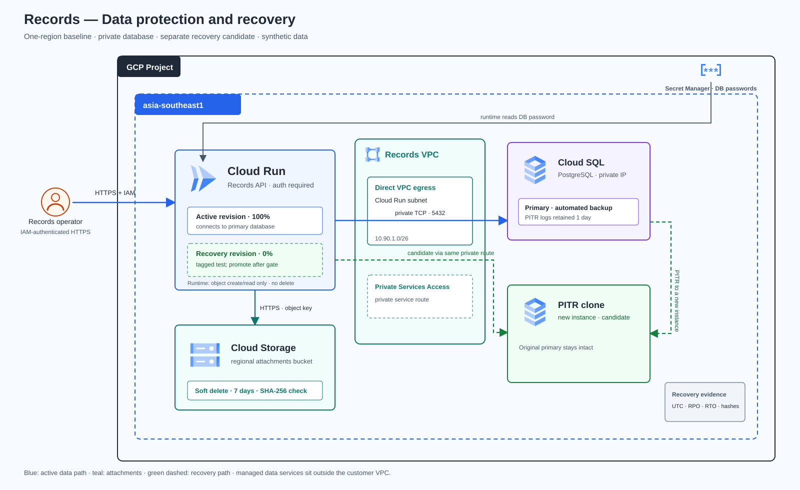

# Lab 17 — กู้คืน Records และไฟล์แนบหลังข้อมูลเสียหาย

> **สถานะคู่มือ:** Guide-ready — repository CI #394 ผ่าน 65/65 jobs; Lab 17 ผ่าน 6/6 jobs  
> **Cloud verification:** Not run — ยังไม่มีการสร้างหรือทดสอบทรัพยากรจริง  
> **ข้อมูล:** ใช้ synthetic records และไฟล์จำลองเท่านั้น

## สถานการณ์

ทีม Records เก็บข้อมูลรายการงานและไฟล์แนบไว้ใน Cloud SQL กับ Cloud Storage. วันหนึ่งมี batch ที่ตั้งค่า filter ผิด ทำให้แถวในฐานข้อมูลถูกแก้/ลบ และมีไฟล์แนบถูกลบ ทีมต้องกู้ทั้งสองส่วนให้สัมพันธ์กัน แล้วพิสูจน์ว่าบริการกลับมาอ่านและเขียนได้ก่อนเปิด traffic กลับ

โจทย์นี้จบเป็น solution เดียว ตั้งแต่ตั้ง protection, deploy app, เก็บ baseline, จำลอง incident, restore, ตรวจ integrity, สลับ revision, วัด RPO/RTO และ cleanup. ใช้ข้อมูลสังเคราะห์; ไม่มีการอ้างว่า cross-region DR, zero data loss หรือค่า performance ผ่านแล้ว

## Solution




ไดอะแกรมอ้างอิงมาตรฐานสี ไอคอน การจัดกลุ่ม scope และแนวเส้นจาก ZIP ตาม [diagram-style.md](../../docs/diagram-style.md) (ยังไม่มีหลักฐานว่าได้เรียกใช้ Personal Custom Skill); ไอคอนบริการ GCP อ้างอิง source และ attribution ที่บันทึกไว้ใน assets

## Requirements และเกณฑ์รับงาน

| ID | เกณฑ์ | หลักฐานที่ต้องบันทึก |
|---|---|---|
| R01 | Records API มี health/readiness, สร้าง/ค้น record และรับ/อ่านไฟล์แนบได้ | HTTP status/body, record ID, object key |
| R02 | Cloud SQL PostgreSQL 16 ใช้ private IP พร้อม automated backup และ PITR ที่ตั้งค่า/ตรวจได้ | Terraform plan/config, backup/PITR settings, recoverable time |
| R03 | Bucket เป็น regional, uniform access, public access prevention และ soft delete 7 วัน | bucket configuration, retention window, cost note |
| R04 | Runtime identity สร้าง/อ่าน object ได้แต่ลบไม่ได้; DB role อ่าน/เพิ่ม/แก้ record ได้แต่ไม่มี DELETE; operator แยกจาก runtime | IAM policy และ positive/negative access result |
| R05 | ก่อน incident สร้าง manifest ของ row count, totals, status, IDs และ attachment SHA-256 | manifest, เวลา UTC, checksum |
| R06 | จำลอง SQL corruption กับการลบ object บน fixture ที่ระบุเท่านั้น | fault command, incident time, audit/evidence |
| R07 | PITR กู้ไป Cloud SQL instance ใหม่; primary เดิมยังอยู่จนกว่าจะผ่าน validation | source/target instance IDs, UTC restore time, instance status |
| R08 | กู้ soft-deleted object generation แล้วตรวจ checksum และ record reference | deleted generation, restored generation, SHA-256 |
| R09 | ทดสอบ Cloud Run recovery revision แบบ 0% traffic; promote ได้เมื่อ database และไฟล์ผ่าน gate เท่านั้น | revision/tag, readiness, integrity result, traffic split |
| R10 | วัด RPO/RTO จริงและบันทึก cleanup; ประเมิน cross-region recovery เป็น Change Request | incident timeline, actual vs target, cost/decision, cleanup record |

**เป้าหมายการฝึก:** RPO ≤ 5 นาที และ RTO ≤ 30 นาที. ค่านี้เป็นเกณฑ์ที่โจทย์ใช้เปรียบเทียบกับผลของผู้เรียน ไม่ใช่คำรับรองของ Google Cloud. หากเวลาจริงเกินเป้า ให้บันทึกผลเป็น gap พร้อมเหตุและแผนปรับปรุง

## Architecture decisions

- **Database:** Cloud SQL for PostgreSQL 16, private IP, scheduled backups, PITR transaction logs 1 วัน และเก็บ automated backups มากกว่าจำนวนวันของ transaction logs. PITR สร้าง instance ใหม่ จึงตรวจ candidate ได้ก่อนเปลี่ยน app.
- **Attachments:** Cloud Storage regional bucket ใช้ soft delete 7 วัน. Baseline ไม่เปิด Object Versioning เพื่อให้ drill เน้นการกู้ soft-deleted generation. Restore สร้าง live copy ใหม่และ generation ใหม่; app อ้าง stable object key และตรวจ SHA-256 ไม่ผูกการอ่านกับ generation เก่า.
- **Runtime permissions:** Cloud Run service account ได้สิทธิ์สร้างและอ่าน object แยก role; ไม่มีสิทธิ์ลบ. PostgreSQL app role ได้ SELECT/INSERT/UPDATE และ sequence access เท่าที่ API ใช้; ไม่มี DELETE. Operator identity แยกสำหรับ fault injection, schema changes และ restore.
- **Secrets:** Terraform สร้าง Secret Manager secret containers แต่ไม่บันทึก secret versions/passwords ใน state. App runtime อ่านเฉพาะ app DB password; admin password ใช้โดย operator เท่านั้น.
- **Promotion:** Deploy recovery revision แบบ no-traffic โดยชี้ไป private IP ของ PITR instance. ทดสอบ readiness, record invariants และ attachment SHA ก่อนเปลี่ยน traffic. ห้าม dual-writer และอย่าให้ candidate รับ write ก่อน gate.
- **Scope:** Lab baseline เป็น region เดียว. ไม่ทดสอบ zone/region disaster recovery; cross-region replication, failover และ failback อยู่ใน Change Request.

## ขอบเขตและค่าใช้จ่าย

Cloud SQL instance/backup/PITR logs, Cloud Run, VPC, Private Services Access, bucket storage/soft-deleted objects, Artifact Registry, Secret Manager versions และ logging อาจมีค่าใช้จ่าย. PITR candidate จะทำให้มี instance เพิ่มระหว่าง drill. ก่อน Apply ให้ตรวจ project, Billing, IAM, quota, region, estimate, retention และ budget. หยุดหากยังไม่มีงบหรือสิทธิ์ชัดเจน

ไม่ใช้ข้อมูลจริงหรือ credentials จริง. ห้าม commit terraform state/plan, secret, export หรือไฟล์ที่มีข้อมูลส่วนตัว. Cleanup ต้องตรวจและลบ PITR candidate ที่สร้างนอก Terraform ด้วย; soft-deleted object และ bucket อาจยังถูกเก็บจนหมด retention ตามนโยบาย

## Change Request — Cross-region recovery

ประเมิน Cloud SQL cross-region replica/restore strategy, bucket location/replication, failover/failback, identity, data consistency, RPO/RTO target, DNS/traffic switch, test cadence และค่าใช้จ่าย. ยังไม่สร้าง replication หรือประกาศ multi-region resilience ใน baseline

## ก่อนเริ่มทำจริง

**การทดลองนี้สร้างทรัพยากรที่มีค่าใช้จ่าย** รวม Cloud SQL, PITR clone, Cloud Run, Cloud Build, Cloud Storage, Private Services Access และ logging. ทำเฉพาะ project ที่ได้รับอนุญาตและมีงบชัดเจน. ใช้ Google Cloud Shell (Bash) เพื่อให้คำสั่งตัวอย่างตรงกัน. อย่านำ credentials, manifest จริง, Terraform state/plan หรือภาพหน้าจอที่มี secret ไป commit.

ใช้ค่าต่อไปนี้ตลอด Lab; bucket ต้องเป็นชื่อใหม่ไม่ซ้ำทั่วโลก:

```bash
export PROJECT_ID="ใส่-project-id-ที่มี-billing-และสิทธิ์"
export REGION="asia-southeast1"
export BUCKET="${PROJECT_ID}-lab017-$(date -u +%s)"
export INSTANCE="lab017-primary"
export SERVICE="lab017-records-api"
export REPO="lab017"
export IMAGE="${REGION}-docker.pkg.dev/${PROJECT_ID}/${REPO}/records-api:lab017-v1"
export DRILL_ID="LAB017-DRILL-01"
```

เปิด Google Cloud Console ด้วย account เดียวกับ Cloud Shell. เลือก project เดียวกันที่แถบ project selector. เตรียม Terraform CLI 1.7 ขึ้นไปและ gcloud CLI; provider Google ถูก pin ไว้ที่ 7.29.0. ชื่อไฟล์หลักที่ใช้บันทึกผลใน Cloud Shell คือ `lab017-baseline.json`, `lab017-recovered.json`, `lab017-recovery-measurement.json`; เก็บสำเนาไว้ในที่ส่วนตัวและคัดเฉพาะข้อมูลที่ลบค่าเฉพาะ project/account แล้วลง Portfolio.

### Task 00 — อ่านโจทย์และกำหนดขอบเขตการกู้คืน

1. อ่านสถานการณ์, requirements R01–R10, Architecture decisions และ Change Request ด้านบน.
2. กำหนดว่า incident นี้ครอบคลุมเฉพาะ fixture `LAB017-DRILL-01`; ห้ามเลือกข้อมูลอื่น.
3. ตั้งเป้าฝึก RPO 300 วินาทีและ RTO 1,800 วินาทีเป็นเกณฑ์วัดของ drill เท่านั้น.
4. ก่อนสร้างอะไร ให้เขียน project, region, bucket name และชื่อผู้อนุมัติงบไว้ในบันทึก.

**ผลที่คาดหวัง:** เข้าใจว่า PITR สร้าง instance ใหม่, object restore เลือก generation, traffic ยังคงอยู่ใน maintenance จน integrity gate ผ่าน.

**บันทึกจริง / หลักฐาน:** project ID ที่ปกปิดได้, region, bucket ที่เลือก, ผู้อนุมัติงบ, เวลาเริ่ม.

### Task 01 — ตรวจ project, billing, account และเครื่องมือ

1. ใน Console ตรวจ project ID และ Billing account ที่ผูกกับ project. อย่าทำต่อถ้า billing, quota หรือ permission ยังไม่ชัด.
2. ขอผู้ดูแล project ตรวจสิทธิ์ที่จำเป็นสำหรับเปิด APIs, สร้าง network/PSA, Cloud SQL, bucket, Artifact Registry, service account และ Secret Manager, deploy Cloud Run/build image, เพิ่ม IAM bindings และ restore object; Cloud SQL Studio ต้องมีสิทธิ์ Studio User. ใช้ role ตามขอบเขตงานขององค์กร ไม่ขอ Owner แบบกว้าง.
3. ใน Cloud Shell รัน:
   ```bash
   gcloud config set project "$PROJECT_ID"
   gcloud config get-value project
   gcloud auth list --filter=status:ACTIVE --format='value(account)'
   gcloud version
   terraform version
   ```
4. ยืนยันว่า active project ตรงกับ `PROJECT_ID`, account เป็น account ที่มีสิทธิ์ และ Terraform เป็น 1.7 ขึ้นไป.
5. ตรวจ budget/estimate สำหรับ Cloud SQL primary และ clone สอง instance ชั่วคราว, Cloud Storage soft delete, Cloud Run และ build/logs.

**ผลที่คาดหวัง:** ใช้ project/account ที่ได้รับอนุมัติ และรู้ว่าจะเกิดค่าใช้จ่ายจาก resource ใด.

**บันทึกจริง / หลักฐาน:** project, account แบบปกปิดข้อมูล, Terraform/gcloud version, งบที่อนุมัติ, cost estimate และเวลาที่ตรวจ.

### Task 02 — เปิด source และเตรียมตัวแปร

1. ใน Cloud Shell clone branch ที่มี Lab 17:
   ```bash
   git clone --branch docs/gcp-solution-labs https://github.com/somkid-s5/Portfolio-Lab.git
   cd Portfolio-Lab/GCP/LAB-017-data-recovery
   ```
2. ตรวจไฟล์คู่มือ, `app/schema.sql`, `infra/` และ `scripts/`. อ่าน `infra/terraform.tfvars.example`; อย่าใส่ secret ลงไฟล์นี้.
3. ตรวจตัวแปร:
   ```bash
   printf 'project=%s region=%s bucket=%s image=%s\n' "$PROJECT_ID" "$REGION" "$BUCKET" "$IMAGE"
   ```
4. หากเปิด Cloud Shell session ใหม่ ให้กำหนดตัวแปรชุดเดิมอีกครั้ง. อย่าใช้ bucket ที่มีข้อมูลของระบบอื่น.

**ผลที่คาดหวัง:** อยู่ในโฟลเดอร์ Lab 17 และค่าที่พิมพ์ออกมาตรง project/region/bucket ที่ได้รับอนุมัติ.

**บันทึกจริง / หลักฐาน:** branch/commit ที่ใช้, เวลา, ชื่อ bucket และ image tag.

### Task 03 — ตรวจ Terraform plan ก่อนสร้าง resource

1. เข้าโฟลเดอร์ infra และสร้างไฟล์ตัวแปรจากตัวอย่าง:
   ```bash
   cd infra
   cp terraform.tfvars.example terraform.tfvars
   nano terraform.tfvars
   ```
2. ใส่เฉพาะ `project_id`, `region`, `bucket_name`; บันทึกและปิด editor.
3. ตรวจค่าแล้ว initialize provider:
   ```bash
   terraform fmt -check -recursive
   terraform init
   terraform validate
   terraform plan -out=lab017.tfplan
   terraform show lab017.tfplan
   ```
4. ตรวจว่า plan สร้าง VPC/subnet, Private Services Access, Cloud SQL PostgreSQL 16 แบบ private, bucket regional soft-delete 7 วัน, Artifact Registry, service account, IAM และ secret containers ตามที่ออกแบบ. ยืนยันว่าไม่มี public IP หรือ role ที่ให้ runtime ลบ object ได้.
5. อ่านผล plan และ cost estimate. ถ้ามี resource/สิทธิ์ที่ไม่เข้าใจ ให้หยุดก่อน Apply.

**ผลที่คาดหวัง:** Plan แสดง resource ตาม architecture โดยไม่ใส่ password หรือ secret ลง Terraform.

**บันทึกจริง / หลักฐาน:** Terraform version, plan summary, จำนวน resource ที่จะเพิ่ม/เปลี่ยน/ลบ, สิ่งที่ตรวจพบ, เวลาและผู้ทบทวน. เก็บ `lab017.tfplan` เป็นไฟล์ส่วนตัว ห้าม commit.

### Task 04 — สร้าง foundation และตรวจค่าที่ได้

1. ยืนยัน project และ bucket จาก plan อีกครั้ง แล้วจึงสร้าง:
   ```bash
   terraform apply lab017.tfplan
   ```
2. อ่าน outputs:
   ```bash
   terraform output
   export DB_HOST="$(terraform output -raw primary_private_ip)"
   export RUNTIME_SA="$(terraform output -raw runtime_service_account)"
   export BUCKET="$(terraform output -raw bucket_name)"
   ```
3. ตรวจ Cloud SQL instance ใน Console: Cloud SQL → Instances → `lab017-primary` → Overview; ต้องแสดง PostgreSQL 16 และ private IP เท่านั้น.
4. ตรวจ bucket: Cloud Storage → Buckets → bucket ของ Lab → Protection; ยืนยัน uniform access, public access prevention และ soft-delete 7 วัน.
5. ตรวจว่า instance/bucket อยู่ใน region ที่เลือก. อย่าบันทึก IP หรือ project identifier ลงภาพที่จะเผยแพร่โดยไม่ปกปิด.

**ผลที่คาดหวัง:** foundation อยู่ในสถานะพร้อมใช้งาน; Cloud SQL ยังไม่เปิด public IP.

**บันทึกจริง / หลักฐาน:** Terraform outputs ที่ลบ project-specific values แล้ว, instance state, private IP แบบปกปิดได้, bucket protection และเวลา. Cloud readiness นี้ยังไม่ใช่ผล Cloud verification ที่ผู้จัดทำคู่มือรับรอง.

### Task 05 — สร้าง DB users และเก็บรหัสผ่านใน Secret Manager

1. กลับไปโฟลเดอร์ Lab:
   ```bash
   cd ..
   bash scripts/prepare_db_users.sh "$PROJECT_ID" "$INSTANCE"
   ```
2. สคริปต์ตรวจ active project, สร้างรหัสผ่านสุ่มแยก admin/app, ตั้ง built-in user `postgres`, สร้างหรือเปลี่ยนรหัส `records_app`, เพิ่ม Secret versions และลบไฟล์ชั่วคราวเมื่อจบ. ผลสำเร็จควรขึ้น `db_users_ready=true`; ไม่มีรหัสผ่านพิมพ์ออกมา.
3. ใน Console เปิด Security → Secret Manager. ยืนยันว่า `lab017-db-password` และ `lab017-db-admin-password` มี version ที่เปิดใช้งาน.
4. ห้ามใช้คำสั่ง `echo`, shell trace (`set -x`) หรือ screenshot ที่เผยค่ารหัสผ่าน. รหัส admin ใช้เฉพาะงาน schema/restore; Cloud Run ได้สิทธิ์อ่านเฉพาะรหัส app.

**ผลที่คาดหวัง:** ผู้ใช้ฐานข้อมูลแยกกันและ secret versions ถูกสร้างโดยไม่มีการแสดงค่า secret ใน output.

**บันทึกจริง / หลักฐาน:** ชื่อ secret, version number, เวลา, ผล script และ identity ที่ใช้; ห้ามบันทึก password.

### Task 06 — สร้าง schema และพิสูจน์ least privilege

1. ใน Console ไป Cloud SQL → Instances → `lab017-primary` → Cloud SQL Studio.
2. เลือก database `records`, database user `postgres`, และ built-in authentication. ดึงค่า admin password จาก Secret Manager โดยไม่ใส่ลงบันทึกหรือภาพหน้าจอ.
3. เปิด `app/schema.sql` จาก repo, คัดลอก SQL ทั้งไฟล์ลง Cloud SQL Studio แล้วกด Run. หากรันหลาย statement พร้อมกันแล้ว UI ไม่แสดงผล query ให้รันแต่ละ statement ซ้ำแยกตามข้อความที่ Studio แสดง.
4. ตรวจว่า table และ index ถูกสร้าง:
   ```sql
   SELECT count(*) FROM information_schema.tables
   WHERE table_schema = 'public' AND table_name = 'records';
   ```
5. ตรวจสิทธิ์ของ `records_app`:
   ```sql
   SELECT has_table_privilege('records_app', 'public.records', 'SELECT') AS can_select,
          has_table_privilege('records_app', 'public.records', 'INSERT') AS can_insert,
          has_table_privilege('records_app', 'public.records', 'UPDATE') AS can_update,
          has_table_privilege('records_app', 'public.records', 'DELETE') AS can_delete;
   ```
6. คาดหวัง `true, true, true, false`. ห้ามใช้ app role ทำ fault injection.

**ผลที่คาดหวัง:** table `records` มีอยู่และ runtime role ไม่มีสิทธิ์ DELETE.

**บันทึกจริง / หลักฐาน:** SQL ที่รัน, table/index, privilege query result และ account ที่ใช้ใน Studio โดยปกปิดข้อมูลระบุตัวบุคคล.

### Task 07 — Build image และตรวจ Artifact Registry

1. กลับไปโฟลเดอร์ Lab 17:
   ```bash
   cd ~/Portfolio-Lab/GCP/LAB-017-data-recovery
   gcloud builds submit app --project="$PROJECT_ID" --tag="$IMAGE"
   ```
2. รอ Cloud Build จบ แล้วเปิด Cloud Build → History; ตรวจ build log และ commit/tag ที่สร้าง.
3. เปิด Artifact Registry → Repositories → `lab017` → Images; ยืนยัน image tag `lab017-v1` พร้อม digest.
4. หาก push ไม่ผ่าน ให้ตรวจว่า Cloud Build service identity ได้สิทธิ์เขียน Artifact Registry ใน project นี้ตามนโยบายขององค์กร. อย่าแก้โดยให้สิทธิ์ owner แบบกว้าง.

**ผลที่คาดหวัง:** image ถูกสร้างจากโฟลเดอร์ `app/` และมี digest ใน Artifact Registry.

**บันทึกจริง / หลักฐาน:** build ID, commit, image digest, ผล build และเวลาที่เสร็จ.

### Task 08 — Deploy API แบบ IAM-only และเชื่อม private dependencies

1. ใช้ private IP จาก Task 04 และ deploy baseline:
   ```bash
   gcloud run deploy "$SERVICE" \
     --project="$PROJECT_ID" --region="$REGION" \
     --image="$IMAGE" --no-allow-unauthenticated \
     --service-account="$RUNTIME_SA" \
     --network=lab017-vpc --subnet=lab017-run-egress \
     --vpc-egress=private-ranges-only \
     --set-env-vars="DB_HOST=$DB_HOST,DB_NAME=records,DB_USER=records_app,STORAGE_BUCKET=$BUCKET,MAINTENANCE_MODE=false" \
     --set-secrets="DB_PASSWORD=lab017-db-password:latest" \
     --min=0 --max=3 --memory=512Mi --cpu=1
   ```
2. รอ Cloud Run revision เป็น Ready. เก็บ service URL และ base URL:
   ```bash
   export SERVICE_URL="$(gcloud run services describe "$SERVICE" --region="$REGION" --format='value(status.url)')"
   export OPERATOR_EMAIL="$(gcloud auth list --filter=status:ACTIVE --format='value(account)')"
   gcloud run services add-iam-policy-binding "$SERVICE" \
     --project="$PROJECT_ID" --region="$REGION" \
     --member="user:$OPERATOR_EMAIL" --role="roles/run.invoker"
   ```
3. ตรวจ Cloud Run → service → Revisions/Networking: service ใช้ runtime service account, VPC `lab017-vpc`, subnet `lab017-run-egress`, egress private ranges only, ไม่อนุญาต unauthenticated.
4. หาก deploy แจ้งว่า subnet ยังไม่พร้อม ให้ตรวจ Direct VPC egress prerequisites และ API status; อย่าเปลี่ยนเป็น public database เพื่อแก้ชั่วคราว.

**ผลที่คาดหวัง:** Cloud Run revision Ready, ได้ URL, ใช้ Direct VPC egress และกำหนด IAM invoker ให้ operator.

**บันทึกจริง / หลักฐาน:** service/revision, image digest, runtime SA, network/subnet, IAM binding และ URL ที่ปกปิดได้.

### Task 09 — ทดสอบ health, IAM และ API

1. ทดสอบโดยไม่มี token. คาดหวัง HTTP 401 หรือ 403 จาก Cloud Run IAM:
   ```bash
   curl -sS -o /tmp/lab017-noauth.txt -w 'HTTP %{http_code}\n' "$SERVICE_URL/readyz"
   ```
2. ขอ ID token โดยใช้ base service URL เป็น audience:
   ```bash
   export TOKEN="$(gcloud auth print-identity-token --audiences="$SERVICE_URL")"
   curl -sS -i -H "Authorization: Bearer $TOKEN" "$SERVICE_URL/healthz"
   curl -sS -i -H "Authorization: Bearer $TOKEN" "$SERVICE_URL/readyz"
   ```
3. `/healthz` ต้องคืน 200 และ `{"status":"ok"}`; `/readyz` ต้องคืน 200 และ `{"status":"ready"}`.
4. ตรวจ log ที่ Cloud Run → service → Logs ว่าไม่มี DB, Secret Manager หรือ Storage connection errors. ห้ามคัด token ลงบันทึก.

**ผลที่คาดหวัง:** request ที่ไม่มี identity ถูกปฏิเสธ; request จาก operator ที่มี invoker ผ่าน; readiness ผ่านทั้ง database และ storage configuration.

**บันทึกจริง / หลักฐาน:** HTTP status/body ที่ไม่เปิดเผย token, revision, เวลา, log event ที่เกี่ยวข้อง.

### Task 10 — เติม fixture และจับ baseline

1. ใช้ fixture สังเคราะห์ 5 รายการตามสคริปต์:
   ```bash
   python3 scripts/seed_fixtures.py --service-url "$SERVICE_URL"
   ```
   ใช้เฉพาะเมื่อมี output จาก Task 09 ที่ผ่าน; script ใช้ ID คงที่ `LAB017-DRILL-01`.
2. จับ baseline พร้อมชื่อ bucket:
   ```bash
   python3 scripts/capture_manifest.py \
     --service-url "$SERVICE_URL" --bucket "$BUCKET" \
     --drill-id "$DRILL_ID" --output lab017-baseline.json
   ```
3. เปิด manifest แบบ local และตรวจ count=5, status distribution, total amount, record refs, attachment keys/hash/bytes และ `integrity_pass=true`.
4. เก็บ baseline ไว้นอก Git. ใช้สำเนาที่ปกปิดข้อมูลเมื่อแนบ Portfolio. ถ้า baseline ไม่ผ่าน อย่าเริ่ม fault drill.

**ผลที่คาดหวัง:** baseline ยืนยัน record ทั้ง 5 รายการและไฟล์แนบครบ hash ตรงกัน.

**บันทึกจริง / หลักฐาน:** เวลา UTC, count, total, sequence, status summary, manifest path/checksum และภาพที่ไม่มี token/secret.

### Task 11 — ยืนยัน backup/PITR และ soft-delete ก่อน incident

1. ตรวจ Cloud SQL settings จาก CLI:
   ```bash
   gcloud sql instances describe "$INSTANCE" --project="$PROJECT_ID" \
     --format='yaml(state,databaseVersion,settings.backupConfiguration,ipAddresses)'
   ```
   ยืนยัน backup enabled, PITR enabled, transaction log retention 1 วัน และไม่มี public IP.
2. สร้าง on-demand backup ก่อน fault:
   ```bash
   gcloud sql backups create --instance="$INSTANCE" \
     --project="$PROJECT_ID" --description="lab017 pre-incident checkpoint"
   gcloud sql backups list --instance="$INSTANCE" --project="$PROJECT_ID"
   ```
3. เปิด Storage → bucket → Protection; ยืนยัน soft-delete 7 วัน. ตรวจ object prefix ของ fixture และบันทึก generation ของ `LAB017-REC-003` จาก baseline. อย่าเริ่ม fault หาก baseline ไม่ครบ.

**ผลที่คาดหวัง:** configuration และ on-demand backup ตรวจได้; ทราบ object generation เดิมก่อน incident.

**บันทึกจริง / หลักฐาน:** backup ID/status, PITR settings, soft-delete retention และ object generation.

### Task 12 — เปิด maintenance mode ก่อนทำ fault

1. Deploy maintenance revision โดยคง image, identity, network, DB และ bucket เดิม; ตั้ง `MAINTENANCE_MODE=true`, เพิ่ม tag และไม่ให้รับ traffic ตอน deploy:
   ```bash
   gcloud run deploy "$SERVICE" \
     --project="$PROJECT_ID" --region="$REGION" \
     --image="$IMAGE" --no-allow-unauthenticated \
     --service-account="$RUNTIME_SA" \
     --network=lab017-vpc --subnet=lab017-run-egress \
     --vpc-egress=private-ranges-only \
     --set-env-vars="DB_HOST=$DB_HOST,DB_NAME=records,DB_USER=records_app,STORAGE_BUCKET=$BUCKET,MAINTENANCE_MODE=true" \
     --set-secrets="DB_PASSWORD=lab017-db-password:latest" \
     --tag=maintenance --no-traffic --min=0 --max=3
   ```
2. เปิด tag URL จาก Cloud Run → service → Revisions → tag `maintenance`; ใช้ base service URL ใน token audience.
3. ทดสอบ `/healthz`, `/readyz` และ `/v1/records?drill_id=$DRILL_ID` ผ่าน maintenance tag. กำหนด traffic ให้ tag นี้ 100%:
   ```bash
   gcloud run services update-traffic "$SERVICE" \
     --project="$PROJECT_ID" --region="$REGION" --to-tags=maintenance=100
   ```
4. ตรวจคำขอ business endpoint คืน HTTP 503 `maintenance_mode`; health/readiness/manifest ยังทำงาน. หากยังมี user traffic จริง ให้หยุดและแจ้งผู้ดูแลก่อนเปลี่ยน.

**ผลที่คาดหวัง:** service ที่รับ traffic อยู่ใน maintenance; ไม่มีการเขียนใหม่ในช่วง recovery.

**บันทึกจริง / หลักฐาน:** revision/tag, traffic split, HTTP 503, health/readiness status และผู้อนุมัติ fault.

### Task 13 — จำลอง SQL corruption เฉพาะ fixture

1. ใน Cloud SQL Studio เลือก instance `lab017-primary`, database `records`, login `postgres`.
2. ตรวจแถวก่อนแก้:
   ```sql
   SELECT record_ref, drill_id, status, amount_cents
   FROM public.records WHERE drill_id = 'LAB017-DRILL-01' ORDER BY record_ref;
   ```
3. ทันทีหลัง maintenance และก่อนคำสั่งแก้ข้อมูล ให้บันทึก restore point:
   ```bash
   export RESTORE_POINT="$(date -u +%Y-%m-%dT%H:%M:%SZ)"
   printf 'restore_point_utc=%s\\n' "$RESTORE_POINT"
   ```
   ใช้เวลานี้เป็นจุดก่อน fault; ห้ามกำหนดเป็นเวลาในอนาคต.
4. รัน block นี้ครั้งเดียว. มันเปลี่ยนแถวและลบแถวได้ก็ต่อเมื่อทั้งสองเงื่อนไขตรงคนละหนึ่ง row; ถ้าไม่ตรงจะ raise exception และ statement rollback:
   ```sql
   DO $lab017$
   DECLARE
     updated_rows integer;
     deleted_rows integer;
   BEGIN
     UPDATE public.records
        SET amount_cents = amount_cents + 700000
      WHERE drill_id = 'LAB017-DRILL-01' AND record_ref = 'LAB017-REC-001';
     GET DIAGNOSTICS updated_rows = ROW_COUNT;

     DELETE FROM public.records
      WHERE drill_id = 'LAB017-DRILL-01' AND record_ref = 'LAB017-REC-002';
     GET DIAGNOSTICS deleted_rows = ROW_COUNT;

     IF updated_rows <> 1 OR deleted_rows <> 1 THEN
       RAISE EXCEPTION 'Fixture scope mismatch: update=%, delete=%', updated_rows, deleted_rows;
     END IF;
   END
   $lab017$;
   ```
5. ตรวจผลด้วย SELECT เดิม. ต้องเห็นค่า REC-001 เพิ่ม 700000 cents และไม่มี REC-002; record อื่นต้องไม่เปลี่ยน. หาก exception ให้หยุด ตรวจ fixture และห้ามทำ fault ซ้ำโดยไม่ตรวจ primary.
6. ทันทีหลังการเปลี่ยนสำเร็จ ให้จดเวลา incident:
   ```bash
   export INCIDENT_AT="$(date -u +%Y-%m-%dT%H:%M:%SZ)"
   printf 'incident_at_utc=%s\\n' "$INCIDENT_AT"
   ```

**ผลที่คาดหวัง:** primary ผิดจาก baseline เฉพาะสองแถว; app runtime role ยังไม่มีสิทธิ์ DELETE.

**บันทึกจริง / หลักฐาน:** SQL ที่ใช้, row counts จาก DO block, `RESTORE_POINT`, `INCIDENT_AT`, เวลา commit, Cloud SQL operation/audit evidence. อย่าถ่าย secret หรือข้อมูลนอก fixture.

### Task 14 — ลบไฟล์ fixture แบบมี generation guard

1. กลับโฟลเดอร์ Lab 17 แล้วตรวจ target จาก baseline ก่อน:
   ```bash
   python3 scripts/delete_fixture_object.py \
     --baseline lab017-baseline.json --bucket "$BUCKET" \
     --record-ref LAB017-REC-003
   ```
2. ตรวจ output `target=gs://...` และ generation ว่าตรง object ของ `LAB017-REC-003`. จากนั้นให้สคริปต์ยืนยันลบ object เดียวด้วย generation match:
   ```bash
   python3 scripts/delete_fixture_object.py \
     --baseline lab017-baseline.json --bucket "$BUCKET" \
     --record-ref LAB017-REC-003 --execute
   ```
3. ยืนยันว่า object live หายและปรากฏใน soft-deleted listing:
   ```bash
   gcloud storage ls "gs://$BUCKET/records/$DRILL_ID/LAB017-REC-003/quote-003.txt" --soft-deleted
   ```
4. ถ้า target, bucket หรือ generation ไม่ตรง baseline ให้หยุด; ห้ามใช้ wildcard ลบไฟล์.

**ผลที่คาดหวัง:** fixture object เดียวถูก soft-delete และ generation เดิมยังมองเห็นใน soft-deleted listing.

**บันทึกจริง / หลักฐาน:** target URI ที่ปกปิด bucket ได้, deleted generation, command result และเวลา.

### Task 15 — PITR ไปยัง Cloud SQL instance ใหม่

1. ตรวจ source ยังอยู่และ `RESTORE_POINT` อยู่ก่อน incident. ตั้งชื่อ clone เฉพาะรอบนี้:
   ```bash
   export RECOVERY_INSTANCE="lab017-restore-$(date -u +%Y%m%d%H%M)"
   gcloud sql instances clone "$INSTANCE" "$RECOVERY_INSTANCE" \
     --project="$PROJECT_ID" --point-in-time="$RESTORE_POINT"
   ```
2. รอ operation จบ; PITR ใช้เวลาหลายนาทีและสร้าง paid instance เพิ่ม. ตรวจ state, engine, private IP และ network:
   ```bash
   gcloud sql instances describe "$RECOVERY_INSTANCE" --project="$PROJECT_ID" \
     --format='yaml(state,databaseVersion,ipAddresses,settings.ipConfiguration)'
   export RECOVERY_DB_HOST="$(gcloud sql instances describe "$RECOVERY_INSTANCE" \
     --project="$PROJECT_ID" --format='value(ipAddresses[0].ipAddress)')"
   ```
3. ตรวจ Cloud SQL Studio ของ clone แล้ว query fixture. ต้องเห็นค่า `REC-001` ก่อน UPDATE, `REC-002` ก่อน DELETE และ record ทั้งห้าก่อน incident.
4. ถ้า clone ใช้ private IP คนละค่า ให้ใช้ค่าของ clone ใน recovery revision; ห้ามเปลี่ยน DNS หรือย้าย primary ด้วยมือในขั้นนี้.

**ผลที่คาดหวัง:** clone ใหม่เป็น RUNNABLE, ใช้ private IP และข้อมูลกลับไปตรง baseline โดย primary ที่เสียหายยังอยู่.

**บันทึกจริง / หลักฐาน:** source/clone names แบบปกปิดได้, PITR timestamp, operation duration, state, private connectivity และผล query.

### Task 16 — Restore object generation ที่ถูก soft-delete

1. จาก Task 14 ใช้ deleted generation เดิม:
   ```bash
   export OBJECT_GENERATION="ใส่-generation-จากผล Task 14"
   gcloud storage restore \
     "gs://$BUCKET/records/$DRILL_ID/LAB017-REC-003/quote-003.txt#$OBJECT_GENERATION"
   ```
2. ตรวจว่า object กลับมาเป็น live object:
   ```bash
   gcloud storage ls --stat \
     "gs://$BUCKET/records/$DRILL_ID/LAB017-REC-003/quote-003.txt"
   ```
3. บันทึก generation ใหม่; มันอาจต่างจาก generation ที่ถูกลบ. แอปอ้าง object key คงที่และตรวจ byte count/SHA-256 ไม่ได้ผูกกับ generation เดิม.
4. ถ้า object เดิมชื่อเดียวกันถูกสร้างใหม่แล้ว restore ไม่ผ่าน ห้าม overwrite โดยเดา; ตรวจ live และ soft-deleted generation ก่อนแก้.

**ผลที่คาดหวัง:** object key เดิมอ่านได้อีกครั้งและเนื้อหาตรง checksum ใน baseline.

**บันทึกจริง / หลักฐาน:** deleted generation, generation หลัง restore, object size, เวลา และ hash จาก manifest ขั้นต่อไป.

### Task 17 — Deploy candidate แบบ 0% และผ่าน integrity gate

1. Deploy revision ใหม่ให้ชี้ Cloud SQL clone, เปิด maintenance, ตั้ง tag `recovery` และไม่รับ service traffic:
   ```bash
   gcloud run deploy "$SERVICE" \
     --project="$PROJECT_ID" --region="$REGION" \
     --image="$IMAGE" --no-allow-unauthenticated \
     --service-account="$RUNTIME_SA" \
     --network=lab017-vpc --subnet=lab017-run-egress \
     --vpc-egress=private-ranges-only \
     --set-env-vars="DB_HOST=$RECOVERY_DB_HOST,DB_NAME=records,DB_USER=records_app,STORAGE_BUCKET=$BUCKET,MAINTENANCE_MODE=true" \
     --set-secrets="DB_PASSWORD=lab017-db-password:latest" \
     --tag=recovery --no-traffic --min=0 --max=3
   ```
2. อ่าน recovery tag URL จาก Console → Cloud Run → service → Revisions. เก็บ base service URL ไว้เป็น token audience; tagged URL ใช้เป็นปลายทาง request.
3. ทดสอบ `/healthz` และ `/readyz` ที่ recovery tag. ดึง manifest:
   ```bash
   python3 scripts/capture_manifest.py \
     --service-url "$RECOVERY_URL" --audience "$SERVICE_URL" \
     --bucket "$BUCKET" --drill-id "$DRILL_ID" \
     --output lab017-recovered.json
   python3 scripts/compare_manifest.py \
     --baseline lab017-baseline.json --current lab017-recovered.json
   ```
4. gate ต้องแสดง `recovery_gate=PASS`. ตรวจ record set, sequence, totals, statuses, `created_at`, object references และ checksum. ถ้า FAIL ให้คง maintenance/0% traffic แล้วแก้ความต่าง; ห้าม promote.
5. ตรวจ Cloud Run traffic ว่า recovery candidate ยัง 0% และ maintenance revision ยังรับ traffic.

**ผลที่คาดหวัง:** PITR database และ restored attachment ผ่าน manifest gate; candidate ยังไม่รับ user traffic.

**บันทึกจริง / หลักฐาน:** recovery revision/tag URL แบบปกปิด, readiness, manifest comparison, error list ถ้ามี และ traffic split.

### Task 18 — ทดสอบ write บน candidate แล้วค่อย promote

1. หลัง gate PASS ให้ deploy candidate revision เดิมอีกครั้งโดยใช้ `MAINTENANCE_MODE=false`, `DB_HOST=$RECOVERY_DB_HOST`, tag `recovery` และ `--no-traffic`. ใช้ image, IAM, VPC, bucket และ secret เดิม. ยืนยัน tag ชี้ revision ล่าสุด.
2. ขอ token โดยใช้ `SERVICE_URL` เป็น audience แม้ request ส่งไป tagged recovery URL. ทดสอบ record ใหม่ที่ไม่อยู่ใน baseline drill:
   ```bash
   curl -sS -i -X POST "$RECOVERY_URL/v1/records" \
     -H "Authorization: Bearer $TOKEN" -H 'Content-Type: application/json' \
     -d '{"record_ref":"LAB017-POSTREC-001","drill_id":"LAB017-POSTRECOVERY-01","title":"Post-recovery write check","status":"NEW","amount_cents":1,"attachment_name":"post-recovery.txt","attachment_text":"synthetic post recovery write"}'
   curl -sS -i -H "Authorization: Bearer $TOKEN" \
     "$RECOVERY_URL/v1/records/LAB017-POSTREC-001"
   ```
3. คาดหวัง POST 201 และ GET 200; ห้ามเขียนเพิ่มใน `LAB017-DRILL-01` เพราะต้องรักษา manifest baseline ให้เทียบได้.
4. ทดสอบ IAM denial โดยไม่มี token และตรวจ tag URL ยังมี 0% service traffic. เมื่อทุก gate ผ่านและผู้เรียนอนุมัติ cutover จึงสลับ:
   ```bash
   gcloud run services update-traffic "$SERVICE" \
     --project="$PROJECT_ID" --region="$REGION" --to-tags=recovery=100
   ```
5. จาก base service URL ทดสอบ `/readyz`, อ่าน attachment `/v1/records/LAB017-REC-003/attachment`, และทำ GET ของ record ใหม่. ตรวจ traffic 100% ไป revision ที่ชี้ recovery clone.

**ผลที่คาดหวัง:** candidate ผ่าน read/write checks ก่อน traffic change; traffic ถูกสลับด้วยคำสั่งชัดเจนหลัง gate เท่านั้น.

**บันทึกจริง / หลักฐาน:** gate result, POST/GET status, IAM negative test, approval/time, traffic ก่อน/หลัง, revision ที่รับ traffic และ validation timestamp.

### Task 19 — วัด RPO/RTO, เก็บบทเรียน และ cleanup

1. กำหนด `VALIDATED_AT` หลัง traffic cutover และการทดสอบ base service ผ่าน:
   ```bash
   export VALIDATED_AT="$(date -u +%Y-%m-%dT%H:%M:%SZ)"
   python3 scripts/measure_recovery.py \
     --incident-at "$INCIDENT_AT" --restore-point "$RESTORE_POINT" \
     --validated-at "$VALIDATED_AT" --output lab017-recovery-measurement.json
   ```
2. อ่าน `observed_rpo_seconds`, `observed_rto_seconds`, `rpo_target_met`, `rto_target_met`. บันทึกค่าจริงตาม output; ห้ามแทนค่าที่เกินเป้าด้วยค่าคาดหวัง.
3. ทำ **Change Request — Cross-region recovery**: ระบุว่าจะเพิ่ม replica/region สำรองอย่างไร, bucket replication/location, traffic failover/failback, identity, consistency, test cadence, RPO/RTO และ cost delta. อย่า provision ส่วนนี้ใน Lab baseline.
4. ก่อน cleanup ให้บันทึกหลักฐานทั้งหมดและทบทวน resource ที่จะลบ. ตรวจ project ID และชื่อ bucket ซ้ำ:
   ```bash
   printf 'project=%s bucket=%s recovery_instance=%s\n' "$PROJECT_ID" "$BUCKET" "$RECOVERY_INSTANCE"
   gcloud storage ls "gs://$BUCKET/**"
   ```
5. ลบ Cloud Run service ก่อน เพื่อปล่อย VPC subnet; ลบ PITR clone ที่อยู่นอก Terraform state:
   ```bash
   gcloud run services delete "$SERVICE" --project="$PROJECT_ID" --region="$REGION" --quiet
   gcloud sql instances delete "$RECOVERY_INSTANCE" --project="$PROJECT_ID" --quiet
   ```
6. ยืนยัน bucket เป็น bucket เฉพาะของ Lab แล้วจึงลบ live objects:
   ```bash
   gcloud storage rm --recursive "gs://$BUCKET/**"
   ```
   คำสั่งนี้ลบ object ทั้งหมดใน bucket ที่ระบุ; ตรวจค่า `BUCKET` และรายการก่อนกดตอบยืนยัน. Soft-deleted copies อาจยังมีค่าใช้จ่ายจนหมด retention.
7. ลบ image ของ Lab จาก Artifact Registry ก่อนลบ repository:
   ```bash
   gcloud artifacts docker images list "$REGION-docker.pkg.dev/$PROJECT_ID/$REPO" --include-tags
   gcloud artifacts docker images delete "$REGION-docker.pkg.dev/$PROJECT_ID/$REPO/records-api" \
     --delete-tags --project="$PROJECT_ID" --quiet
   ```
   ตรวจรายการก่อนให้แน่ใจว่ามีเฉพาะ image ของ Lab 17.
8. จาก `infra/` ตรวจ workspace/project อีกครั้งและทำลาย resource ที่ Terraform สร้าง:
   ```bash
   cd infra
   terraform workspace show
   terraform plan -destroy
   terraform destroy
   ```
9. ตรวจ Cloud Console ว่าไม่มี Cloud Run service, PITR clone, Cloud SQL primary, bucket, Artifact Registry และ network ที่ Lab สร้าง. Cloud Run Direct VPC อาจยังอ้าง subnet ชั่วระยะหนึ่งหลังลบ service; หาก destroy แจ้ง resource in use ให้รอให้การอ้างอิงหมดและลองใหม่ ห้ามลบ VPC ด้วยมือเพื่อข้าม dependency.
10. ทำตามส่วน **บันทึกผลเป็น Case Study** ด้านล่าง. เก็บไฟล์ดิบส่วนตัว; commit เฉพาะหลักฐานที่ลบ project/user identifiers และผ่านการตรวจแล้ว.

**ผลที่คาดหวัง:** มีค่า RPO/RTO ที่วัดจาก timestamps จริง, มีบันทึก cleanup และ resource ทั้งหมดถูกตรวจหลังทำลาย.

**บันทึกจริง / หลักฐาน:** measurement JSON ที่ผ่านการ sanitize, cleanup checklist, resource ที่ลบ/รอ retention, ค่าใช้จ่ายที่เห็นจริง, Change Request และข้อปรับปรุงรอบหน้า.

## Troubleshooting

| อาการ | ตรวจตรงไหน | วิธีแยกสาเหตุ / ขั้นถัดไป |
|---|---|---|
| `terraform apply` ติดสิทธิ์หรือ API | project, active account, API enablement, IAM | ตรวจ error permission/API ทีละรายการ; อย่าให้ Owner กว้างเพื่อให้ผ่าน |
| Cloud SQL ไม่มี private IP หรือ Cloud Run ต่อ DB ไม่ได้ | Cloud SQL IP configuration, PSA connection, subnet/region, Direct VPC egress | ยืนยัน Cloud Run ใช้ network/subnet ใน region เดียวกัน; ตรวจ readiness และ Cloud Run logs |
| `/readyz` เป็น 503 | revision log, Secret Manager access, DB host/user, schema, bucket | ตรวจ app secret accessor, secret version, private IP ของ instance ที่ revision ชี้, role/table grant |
| API คืน 401/403 | Cloud Run IAM invoker, active identity, token audience | เพิ่ม invoker ให้ principal ที่ถูกต้อง; ใช้ base service URL เป็น `aud` แม้ยิง tagged URL |
| baseline มี `integrity_pass=false` | manifest records และ GCS live objects | หยุดก่อน incident; ตรวจ role storage viewer, DB row state, key/hash/bytes และ fixture seeding |
| object restore แจ้ง generation ไม่พบ | soft-deleted listing, object key, bucket name, retention | ใช้ generation จาก baseline/tool output; ยืนยัน object อยู่ในช่วง soft-delete; อย่า restore ด้วย wildcard |
| PITR clone ไม่มีแถวที่คาด | restore point, UTC timezone, backup/PITR status, SQL mutation time | ยืนยัน timestamp ก่อน fault และหลัง baseline; clone ใหม่จากเวลาที่ถูกต้อง |
| recovered manifest ต่างจาก baseline | `compare_manifest.py` รายการ field ที่ต่าง | คง maintenance/0% traffic; แก้ DB restore point หรือ object restoration ให้ผ่านทุก field ก่อนเปิด |
| Terraform destroy บอกว่า bucket ยังไม่ว่าง | รายการ live objects และ bucket ชื่อเฉพาะ Lab | ตรวจ bucket เฉพาะของ Lab แล้วลบ live objects; soft-deleted items ยังอยู่ตาม retention |
| subnet ยังถูกใช้งานหลังลบ Cloud Run | Cloud Run service revisions / VPC attachment | ตรวจว่าลบ service แล้วและไม่มี revision ใช้งาน subnet; รอ resource detach แล้วลอง destroy ใหม่ |

## บันทึกผลเป็น Case Study

เขียนจาก **ผลที่เกิดจริง** หลังทำ Lab. แทน placeholder ด้วยค่าที่บันทึกไว้; ถ้าไม่ได้ทำขั้น Cloud ให้ระบุ “ยังไม่ได้ทดสอบบน GCP”.

- **โจทย์/ผลกระทบ:** ข้อมูล Records และไฟล์แนบใดเสียหาย; scope ที่ได้รับอนุมัติ.
- **ข้อจำกัด:** region, private access, runtime/operator separation, downtime/maintenance, budget.
- **แนวทาง:** PITR ไป instance ใหม่ + restore soft-deleted generation + checksum/manifest gate + tagged Cloud Run revision.
- **หลักฐาน:** diagram, Terraform plan ที่ sanitize แล้ว, IAM/DB privilege results, before/after manifests, restore times, traffic split, logs และ cleanup.
- **ผลที่วัด:** observed RPO ___ วินาที; observed RTO ___ วินาที; target met? ___; record/object integrity ___; Cloud verification status ___.
- **สิ่งที่ไม่ผ่าน/ช่องว่าง:** error, timeouts, cost ที่เกิด, สาเหตุ, งานแก้ไขที่วางแผน.
- **Trade-off/Change Request:** region เดียว, clone มีต้นทุนระหว่าง drill, soft-deleted data retention; งาน cross-region ที่ต้องออกแบบต่อ.
- **ข้อสรุป:** สิ่งที่พิสูจน์ได้จากหลักฐานและสิ่งที่ยังพิสูจน์ไม่ได้.

## References

- [Configure PITR for Cloud SQL for PostgreSQL](https://docs.cloud.google.com/sql/docs/postgres/backup-recovery/configure-pitr)
- [Perform PITR; restore creates a new instance](https://docs.cloud.google.com/sql/docs/postgres/backup-recovery/pitr)
- [Cloud SQL backup and retention options](https://docs.cloud.google.com/sql/docs/postgres/backup-recovery/backup-options)
- [Connect Cloud Run to Cloud SQL](https://docs.cloud.google.com/sql/docs/postgres/connect-run)
- [Secret Manager overview](https://cloud.google.com/secret-manager/docs)
- [Cloud Storage soft delete](https://docs.cloud.google.com/storage/docs/soft-delete)
- [Restore soft-deleted objects](https://docs.cloud.google.com/storage/docs/use-soft-deleted-objects)
- [Cloud SQL Terraform resource](https://registry.terraform.io/providers/hashicorp/google/7.29.0/docs/resources/sql_database_instance)
- [Cloud Storage bucket Terraform resource](https://registry.terraform.io/providers/hashicorp/google/7.29.0/docs/resources/storage_bucket)
- [Cloud SQL Studio for PostgreSQL](https://docs.cloud.google.com/sql/docs/postgres/manage-data-using-studio)
- [Cloud Run tagged revisions and traffic migration](https://docs.cloud.google.com/run/docs/rollouts-rollbacks-traffic-migration)
- [Cloud Run developer authentication and ID-token audience](https://docs.cloud.google.com/run/docs/authenticating/developers)
- [Configure Secret Manager secrets for Cloud Run](https://docs.cloud.google.com/run/docs/configuring/services/secrets)
- [List and restore soft-deleted object generations](https://docs.cloud.google.com/storage/docs/use-soft-deleted-objects)
- [Delete Artifact Registry container images](https://docs.cloud.google.com/sdk/gcloud/reference/artifacts/docker/images/delete)
