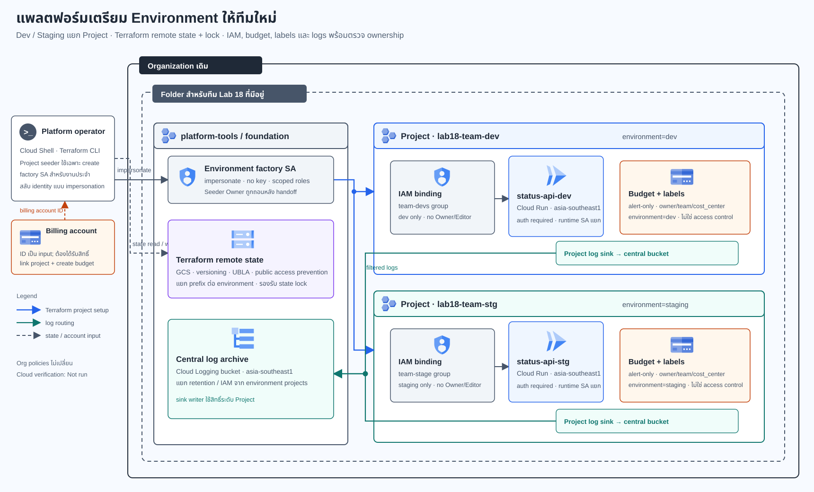

# Lab 18 — แพลตฟอร์มสร้าง Environment ให้ทีมใหม่

> **สถานะ:** Brief + Design checkpoint; กำลังตรวจแบบและข้อกำหนดก่อนลงรายละเอียดคู่มือ  
> **Cloud verification:** Not run — ไม่มีการสร้าง GCP resources ในงานจัดทำเอกสารนี้  
> **มาตรฐาน Diagram:** Diagram Design Personal Custom จาก ZIP ตาม `docs/diagram-style.md`

## ภาพรวม Solution

ทีม Platform ต้องเปิด Dev และ Staging ให้ทีมใหม่โดยเร็ว แต่ยังแยกสิทธิ์กับค่าใช้จ่ายต่อ Environment ได้ และต้องรู้ว่า Project หรือ resource ใดมีเจ้าของ Solution นี้ใช้ Terraform สร้าง Project สำหรับแต่ละ Environment ใต้ Folder ที่องค์กรจัดเตรียมไว้ แล้วใช้ Template เดียวกันตั้งค่า IAM, API, labels, budgets, sample workload และ log routing

มี Foundation Project แยกสำหรับ Terraform state และศูนย์รวม log ที่ต้องเก็บตาม region ที่อนุมัติ งานนี้ไม่สร้าง Organization, Folder หรือ Billing Account และไม่แก้ Organization Policy

## สถานการณ์และปัญหา

ทีม `commerce` ขอ Dev และ Staging เพื่อทดสอบ Status API ก่อนเริ่มงาน ทีมเดิมเคยใช้ Project ร่วมกัน ให้สิทธิ์ Editor กว้าง ๆ และตั้งชื่อ resource ไม่สม่ำเสมอ ทำให้ยากต่อการแยกการเข้าถึง ค่าใช้จ่าย drift และการลบ resource ที่ไม่มีเจ้าของ

ทีม Platform ต้องส่งมอบ Environment ที่เปิดซ้ำได้ มี owner/team/environment/cost labels, มีงบเตือน, เก็บ log ไปยังพื้นที่ส่วนกลาง และถอนสิทธิ์ชั่วคราวหลังสร้าง Project โดยไม่ปล่อย Owner ค้างไว้

## Requirements

| ID | Requirement | เกณฑ์พิสูจน์ |
|---|---|---|
| R01 | Dev และ Staging ต้องเป็นคนละ Google Cloud Project ใต้ Folder ที่กำหนด | ผล Terraform และ Resource Manager แสดง Project ID คนละค่าและ parent ตรงตาม profile |
| R02 | Environment factory ใช้ profile และ module เดียวกัน โดยรับ team, project ID, region, group และ budget เป็น input พร้อมเปิดเฉพาะ API ที่ Solution ต้องใช้ | profile ที่ขาดค่า/ชื่อผิด/region ไม่อยู่ใน allowlist ต้องไม่ผ่าน policy test |
| R03 | Project seeder ใช้เฉพาะช่วงสร้างและ handoff; ถอน Owner หลัง factory identity ได้ role ที่จำเป็น | IAM policy หลัง handoff ไม่มี roles/owner หรือ roles/editor; มีบันทึกผลก่อนและหลัง |
| R04 | Dev และ Staging ใช้ runtime identity และ team group แยกกัน ไม่มี service-account key | IAM inventory แสดง group ที่ตรง Environment; ตรวจไม่พบ key หรือ binding ข้าม Project |
| R05 | Terraform state เก็บใน GCS ที่เปิด Object Versioning, Uniform bucket-level access และ public access prevention พร้อมแยก prefix ต่อ Environment | ตรวจ bucket config, state object versions และการลอง state-lock contention โดยไม่มี force-unlock |
| R06 | มี budget แยก Project พร้อม threshold notification | Terraform plan และการตั้งค่า budget แสดง project filter/thresholds; บันทึกผู้รับแจ้งเตือน |
| R07 | Project labels มี owner, team, environment, cost_center และ managed_by | profile/policy test ปฏิเสธ label ที่ขาด; inventory แสดงค่าหลัง apply |
| R08 | มี authenticated Cloud Run Status API ที่รายงาน Environment และ health โดยไม่บันทึก secret หรือข้อมูลส่วนบุคคล | health probe, authenticated request, unauthenticated/unauthorized negative test และ structured logs |
| R09 | Logs ของ sample workload ถูกส่งไป central regional Log bucket ด้วย sink writer identity ที่มีสิทธิ์เฉพาะปลายทาง | ค้น log ทดสอบจาก dev/stg ที่ปลายทาง และทดสอบวินิจฉัยเมื่อ writer permission ขาด |
| R10 | การเปลี่ยน label นอก Terraform ต้องเห็น drift และ plan ต้องเสนอการคืนค่าตาม profile | เก็บ plan ก่อนและหลังแก้ drift; ไม่ใช้การเปลี่ยน IAM จริงเป็น fault injection |
| R11 | Change Request สำหรับทีมใหม่ต้องผ่าน region/access policy ก่อนเพิ่ม Environment | region ที่ยังไม่อนุมัติถูกปฏิเสธ; หลังอนุมัติ profile, log location และ group binding ต้องผ่าน checks |
| R12 | Cleanup ต้องตรวจ inventory ก่อนลบ Project และคง Foundation state/log ตาม retention | บันทึก resources/Project ก่อนและหลัง cleanup; ไม่มีการลบ Foundation Project หรือ state โดยไม่ตั้งใจ |

## Acceptance Criteria

1. สร้าง dev/staging Projects ด้วย profile ที่กำหนด และใช้ shared module เดียวกันได้ โดย ID, labels และ service configuration ไม่ทับกัน
2. ผู้ใช้ใน dev group เรียก service ใน dev ได้ตามที่อนุญาต แต่เรียก staging ไม่ได้; ทำ negative test กลับทิศด้วย
3. หลัง handoff ไม่มี Owner/Editor เหลือใน environment projects; seeder ใช้ไม่ได้ในงานประจำ และ factory ใช้ impersonation โดยไม่มี key
4. Terraform state มี version และการทำ operation พร้อมกันบน state เดียวถูก lock หรือรอ; คู่มือห้ามใช้ force-unlock เว้นแต่ตรวจยืนยัน lock owner และ process แล้ว
5. Budget เป็น alert-only; เมื่อถึง threshold จะส่งการแจ้งเตือน แต่ไม่ถือว่าเป็น spending cap
6. Log ที่สร้างจาก Status API ปรากฏใน regional central log bucket; เมื่อ sink writer ไม่มีสิทธิ์ ให้แสดง error ที่ระบุได้และวิธีแก้แบบ scope แคบ
7. เปลี่ยน project label ด้วยมือแล้ว Terraform ตรวจพบ drift; apply คืนค่าให้ตรงกับ approved profile
8. Change Request ทีม dataops ที่ขอ region `asia-east1` และกลุ่ม contractor แบบดูข้อมูลอย่างเดียว ต้องถูกปฏิเสธจนกว่า region จะถูกอนุมัติ; เมื่ออนุมัติแล้ว contractor ยังไม่มีสิทธิ์ invoke service หรือ deploy
9. Cleanup ลบเฉพาะ environment Projects ตาม confirmation ที่กำหนด พร้อมเก็บ state, log archive และหลักฐาน cleanup ไว้ตามอายุที่ระบุ
10. Repository CI ตรวจ Brief, Diagram, application, Terraform, scripts และคู่มือโดยไม่เรียก GCP API และไม่สร้าง resources

## ข้อกำหนดก่อนเริ่ม Cloud execution

| สิ่งที่ต้องมี | เหตุผล / ขอบเขต |
|---|---|
| Organization และ team Folder ที่มีอยู่แล้ว | Solution สร้าง Projects ใต้ parent ที่มีอยู่ ไม่สร้างหรือแก้ hierarchy |
| สิทธิ์ Project Creator บน Folder ที่กำหนด | ใช้สร้าง environment projects ได้เฉพาะตำแหน่งนี้ |
| Billing Account ที่เชื่อมได้ พร้อม Billing Account User และ Billing Account Costs Manager ตามงานที่ทำ | ใช้ผูก billing และจัดการ project-scoped budgets |
| Foundation Project ที่อนุมัติแล้ว | เก็บ remote state และ central log buckets |
| Google Groups สำหรับ dev/stage และ platform operators | factory ผูกสิทธิ์ให้กลุ่มที่มีอยู่ ไม่สร้าง/แก้สมาชิกกลุ่ม |
| region, project ID, cost center และ budget ที่เจ้าของระบบอนุมัติ | ป้องกันการสร้าง environment จากค่าที่ไม่ได้ตรวจ |

Google Cloud ให้ Project Creator เป็น Owner ของ Project ที่เพิ่งสร้างโดยอัตโนมัติ จึงแยกขั้น seed/create กับงานประจำ: seeder สร้าง Project และส่งสิทธิ์เฉพาะที่ factory ต้องใช้ จากนั้นถอน Owner ของ seeder แล้วตรวจ IAM ก่อน deploy workload. [Project IAM access control](https://docs.cloud.google.com/resource-manager/docs/access-control-proj)

หากไม่มีสิทธิ์ Organization/Folder หรือ Billing Account ให้ทำ repository checks และ Terraform plan ที่ไม่ใช้ credential ต่อไปได้ แต่ให้บันทึก cloud execution เป็น Not run ห้ามใช้ project ส่วนตัวแทนแล้วอ้างว่า project isolation ผ่าน

## Architecture decisions

| หัวข้อ | การตัดสินใจ |
|---|---|
| Environment boundary | หนึ่ง Project ต่อหนึ่ง Environment: commerce-dev และ commerce-stg |
| Resource hierarchy | ใช้ Organization/Folder เดิมเป็น parent; ไม่สร้าง Folder, ไม่แก้ Organization Policy และไม่อ้างว่ามี org controls เพิ่ม |
| Identity handoff | ใช้ project seeder เฉพาะ create/handoff; factory identity เป็น keyless และ impersonated สำหรับงานประจำ; ถอน default Owner หลังตรวจสิทธิ์ที่จำเป็น |
| Terraform state | สร้าง GCS backend ใน Foundation Project ก่อน แล้ว migrate bootstrap state; เปิด Object Versioning, Uniform bucket-level access (UBLA) และ public access prevention; prefix แยก Environment และใช้ GCS lock |
| IAM | กลุ่ม dev/stage แยก Project; developer ได้เฉพาะสิทธิ์ deploy/invoke ที่จำเป็นและ serviceAccountUser บน runtime SA ที่ระบุ; ไม่มี Owner/Editor |
| Workload | Status API บน Cloud Run ต้อง authenticate; dev/stage ใช้ service/runtime identity คนละชุด |
| Logs | Project-level sinks ส่งเฉพาะ log ที่กำหนดไป regional Cloud Logging bucket; ให้ sink writer เขียนปลายทางได้เท่านั้น |
| Cost / ownership | งบแยก Projectแบบ alert-only; labels ใช้ inventory/cost attribution ไม่ใช่ access boundary |
| Change Request | dataops ขอ asia-east1 และ read-only contractor access; ต้องเพิ่ม region หลังอนุมัติข้อมูล และผูก read-only role โดยไม่ให้ invoker |
| Cleanup | ลบเฉพาะ environment projects หลังยืนยัน inventory; คง Foundation state/log resources ตาม retention |

GCS backend ต้องมี bucket ก่อนเริ่มใช้ remote backend; backend รองรับ state lock และเอกสาร Terraform แนะนำเปิด Object Versioning เพื่อกู้ state จากการลบ/แก้ผิดพลาด. [Terraform GCS backend](https://developer.hashicorp.com/terraform/language/backend/gcs)

Cloud Logging sink ไปยัง log bucket ต่าง Project ต้องกำหนดสิทธิ์ให้ writer identity ที่ได้จาก sink; ปลายทางใช้ `roles/logging.bucketWriter` ตาม scope ที่ต้องเขียน. [Route logs to supported destinations](https://docs.cloud.google.com/logging/docs/export/configure_export_v2)

Budget alerts ไม่ได้จำกัดค่าใช้จ่ายโดยอัตโนมัติ จึงใช้แสดงสัญญาณเตือนและผู้รับผิดชอบเท่านั้น. [Cloud Billing budgets](https://docs.cloud.google.com/billing/docs/how-to/budgets) การสร้าง project ต้องมี `resourcemanager.projects.create`; การผูก billing ใช้ Billing Account User ร่วมกับ Project Creator ตามสิทธิ์ที่องค์กรอนุมัติ. [Create projects](https://docs.cloud.google.com/resource-manager/docs/creating-managing-projects)

## Solution diagram

ตัวอย่างในภาพเป็น architecture ที่ออกแบบไว้ ไม่ใช่ผลจากการสร้าง GCP จริง. Arrows แสดง Terraform setup, state read/write และ log routing. Dev และ Staging แยก Project; log sink ทั้งสองส่ง log ไป bucket ส่วนกลางผ่าน junction ที่เป็นปลายทางร่วมจริง.

## Change Request — ทีม dataops

ทีม dataops ต้องการ Environment ที่ region `asia-east1` และให้ contractor group ตรวจ metadata ของ Cloud Run ได้ โดยไม่มีสิทธิ์ deploy, invoke หรือดู secret

- ให้ policy test ปฏิเสธ region ก่อนผู้ดูแลข้อมูลอนุมัติ
- เมื่ออนุมัติ ให้เพิ่ม region ใน allowlist และสร้าง central log bucket ใน location ที่สอดคล้องกับข้อกำหนดข้อมูล
- ผูก `roles/run.viewer` ให้ contractor บน service ที่อนุมัติเท่านั้น; ห้าม `roles/run.invoker`, deploy roles, secret access หรือ membership ใน dev/stage group
- แสดง plan diff, IAM diff, sample request ที่ถูกปฏิเสธ และหลักฐานการยืนยัน log location ก่อน apply

## หลักฐานที่จะบันทึกเมื่อทำ Lab

บันทึก actual values จากการรันจริงเท่านั้น: project IDs/parent, label inventory, plan/apply summary, Terraform state lock result, IAM ก่อน–หลัง handoff, budget thresholds/ผู้รับแจ้งเตือน, sink writer identity และ log query, authenticated/denied HTTP checks, drift plan, cleanup inventory และ Change Request approval. ห้ามบันทึก token, secret value, state file หรือ personal data ลง evidence.

## References

- [Create and manage projects](https://docs.cloud.google.com/resource-manager/docs/creating-managing-projects)
- [Access control for projects with IAM](https://docs.cloud.google.com/resource-manager/docs/access-control-proj)
- [Terraform GCS backend](https://developer.hashicorp.com/terraform/language/backend/gcs)
- [Create, edit, or delete budgets and budget alerts](https://docs.cloud.google.com/billing/docs/how-to/budgets)
- [Access control for the Cloud Billing Budget API](https://docs.cloud.google.com/billing/docs/how-to/budget-api-access-control)
- [Route logs to supported destinations](https://docs.cloud.google.com/logging/docs/export/configure_export_v2)
