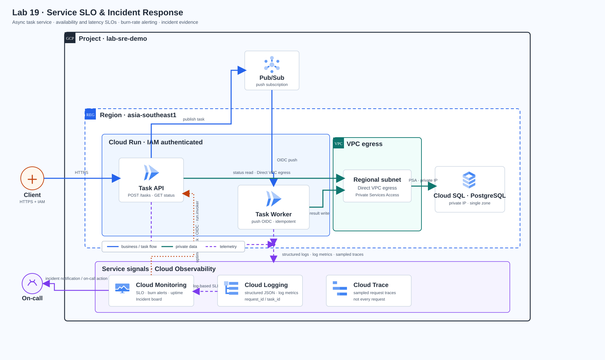

# Lab 19 — ระบบเฝ้าระวังและรับ Incident สำหรับทีมบริการ

> **สถานะ:** Brief + Design ready — [CI #403](https://github.com/somkid-s5/Portfolio-Lab/actions/runs/40163824288) ผ่านครบ 73/73 repository jobs และ Lab 19 ผ่าน 2/2 checks (brief, design/render); ยังไม่มี Task Guide  
> **Cloud verification:** Not run — ไม่มีการสร้าง GCP resources หรือผลทดสอบจริง  
> **Diagram:** ใช้แนวทาง Diagram Design Personal Custom จาก ZIP ตาม [docs/diagram-style.md](../../docs/diagram-style.md)

## ภาพรวม Solution

ทีม Commerce รับคำสั่งงานผ่าน API แล้วให้ Worker ประมวลผลแบบ asynchronous ทีม On-call ต้องแยกให้ออกว่าคำขอล้มเหลวที่ขอบ API, งานค้างใน Queue, Worker ช้า หรือฐานข้อมูลเริ่มอิ่มตัว ต้องเห็นสัญญาณที่สัมพันธ์กับผลกระทบผู้ใช้ รับ Incident ที่มีเงื่อนไขชัด และบันทึกการตรวจพบ การบรรเทา และการกู้คืนได้

Solution ใช้ Cloud Run Task API, Pub/Sub push subscription, Cloud Run Worker และ Cloud SQL for PostgreSQL ใน `asia-southeast1`; Cloud Logging เก็บ structured logs, Cloud Monitoring คำนวณ SLO และส่ง burn-rate alerts, Cloud Trace ใช้ดู sampled request traces. API และ Worker ต้องยืนยันตัวตนด้วย IAM; Worker push ใช้ OIDC; Cloud SQL รับ private IP ผ่าน Direct VPC egress และ Private Services Access (PSA).

[เปิด HTML preview](assets/solution.html) · [ดู provenance และที่มาของ icons](assets/diagram-provenance.json)

## ขอบเขตของโจทย์

- **ผู้ใช้ระบบ:** Client ที่สร้าง/ตรวจ task และทีม SRE/On-call ที่รับผิดชอบ API, Queue, Worker และฐานข้อมูล
- **ข้อมูลตัวอย่าง:** Task ID, idempotency key, สถานะงาน, เวลาที่รับ/เริ่ม/จบ, attempt และผลสำเร็จ/ล้มเหลว ใช้ข้อมูลสังเคราะห์เท่านั้น
- **จุดเริ่มของ flow:** Client ส่ง `POST /tasks`; API ตรวจ input และ idempotency key แล้วตอบรับหลัง Pub/Sub รับ message จากนั้น Client ใช้ `GET /tasks/{task_id}` ตรวจสถานะ
- **การทำงานเบื้องหลัง:** Pub/Sub ส่ง message ไป Worker ด้วย push + OIDC; Worker เขียนผลลง Cloud SQL และต้องทำซ้ำได้อย่างปลอดภัยเมื่อได้รับ message ซ้ำ
- **ขอบเขตข้อมูล:** API และ Worker เป็น Cloud Run services แบบ IAM-authenticated; Cloud SQL ไม่มี public IP; VPC scope แสดงเฉพาะ subnet/egress path ส่วน Cloud SQL เป็น managed service ที่เข้าผ่าน PSA
- **ขอบเขตความพร้อมใช้งาน:** Cloud SQL แบบ single-zone สำหรับ Lab นี้; ไม่อ้าง HA, cross-region DR หรือ production readiness
- **ขอบเขต tracing:** Cloud Run สร้าง request traces แบบ sampled; ผู้เรียนใช้ task ID/request ID เชื่อม log เพื่อหาข้ามช่วง API/Workerได้ แต่ห้ามสรุปว่าเป็น distributed trace ครบทุก message
- **ขอบเขต Cloud:** คู่มือในขั้นถัดไปจะมี Terraform, app, seed/test data, bounded test tool, fault controls และ cleanup; ยังไม่สร้างหรือทดสอบ Cloud resources ใน checkpoint นี้

## Requirements

| ID | Requirement | วิธีพิสูจน์ที่ต้องมีใน Guide |
|---|---|---|
| R01 | API รับ task ที่ถูกต้องและปฏิเสธ input ผิดรูปแบบ พร้อม idempotency key | ส่ง input ปกติ, ซ้ำ key เดิม และ input ไม่ถูกต้อง; บันทึก HTTP status และ task ID |
| R02 | API แสดงสถานะ task ที่ยังรอ กำลังทำ เสร็จ และล้มเหลว | เรียก `GET /tasks/{task_id}` ตามแต่ละสถานะและยืนยันข้อมูลที่อ่านได้ |
| R03 | Pub/Sub push เรียก Worker ที่ไม่เปิด anonymous access และตรวจ OIDC token | ตรวจ IAM binding, service account, audience และการปฏิเสธ request ที่ไม่มี token |
| R04 | API/Worker เข้าถึง Cloud SQL ผ่าน private IP และ PSA | ตรวจ IP/connection path จาก Cloud Run และยืนยันว่า instance ไม่มี public IP |
| R05 | API, Worker และ push identity แยกกันและใช้สิทธิ์เท่าที่ต้องใช้ | บันทึก service account ต่อ service และ role/resource scope ที่ให้จริง |
| R06 | ทุก business request log มี request/task identifier, route, status/outcome และ duration | ตรวจ JSON log ของ API/Worker และบันทึก Logs Explorer filter ที่ใช้ |
| R07 | Availability SLI นับเฉพาะ business request ที่เข้าเกณฑ์; `/healthz` และ expected 4xx ไม่กิน error budget | ยิง health check, valid request, invalid 4xx และ injected 5xx; เปรียบเทียบ counter |
| R08 | Availability SLO เป้าหมาย 99.5% บน rolling 7 วัน | ตรวจ SLO service, SLI filter, goal และ compliance window ใน Monitoring |
| R09 | Latency SLO เป้าหมายอย่างน้อย 95% ของ request ต่ำกว่า 1,000 ms บน rolling 7 วัน | ตรวจ distribution metric, threshold, goal และผลใน SLO view |
| R10 | Fast burn alert ตั้งที่ 10× ใน 1 ชั่วโมง และ slow burn ตั้งที่ 2× ใน 24 ชั่วโมง | ทำ fault scenario ตามปริมาณจำกัดและเก็บ condition, incident และเวลาที่เกิด |
| R11 | Dashboard แสดง API traffic/error/latency, Pub/Sub backlog/อายุ message, Worker failure/DLQ และ Cloud SQL CPU/connection | บันทึก dashboard panels, time range และค่าที่เห็นระหว่าง baseline กับ fault |
| R12 | Uptime check เรียก API ด้วย OIDC จาก Monitoring service agent; API ไม่เปิด `allUsers` | ตรวจ check configuration, service-agent binding, successful authenticated check และ IAM policy |
| R13 | Runbook เริ่มจากผลกระทบผู้ใช้และแยก API, Queue, Worker, Database ก่อน mitigation | ทำ incident drill และกรอกเวลา/หลักฐานของแต่ละ checkpoint |
| R14 | Change Request ลด noise จาก expected 4xx/เหตุการณ์โดดเดี่ยว โดยยังตรวจพบ sustained 5xx, SLO burn และ Queue ค้าง | เปรียบเทียบ baseline/candidate alerts ด้วย test scenarios; แสดง alert ที่ต้องเงียบและที่ต้องเกิด |

**Acceptance criteria**

1. Request ที่ API ตอบรับแล้วมี task ID ตรวจสถานะต่อได้; duplicate delivery ไม่ทำให้เกิด side effect ซ้ำ
2. API และ Worker ติดต่อ Cloud SQL ผ่าน private path; Pub/Sub ส่งถึง Worker ด้วย OIDC; request anonymous ถูกปฏิเสธ
3. SLI filters ตัด `/healthz` และ expected 4xx ออกอย่างชัดเจน; 5xx และ latency ที่เกินเกณฑ์นับเป็น bad service
4. เห็นทั้ง API-level user SLO และ queue/worker/database health; ไม่ใช้ backlog metric แทน SLO ของผู้ใช้
5. fault drill สร้าง incident ตามเงื่อนไขที่กำหนดและบันทึกหลักฐาน; recovery ปิด/resolve incident ได้พร้อมเหตุผล
6. Change Request ผ่านทั้ง “สิ่งที่ควรเงียบ” และ “failure ที่ยังต้อง alert”; ไม่มี alert ที่อ้างจาก test ไม่ได้
7. Cleanup ระบุ resource inventory และตรวจรายการคงเหลือหลังลบ; มีวิธีป้องกันการลบ project ผิด

## Architecture decisions

| การตัดสินใจ | เหตุผลและผลที่ต้องยอมรับ |
|---|---|
| แยก API และ Worker เป็น Cloud Run คนละ service | ปรับ IAM, concurrency, scaling และ fault injection แยกกัน; เพิ่มจำนวน revision ได้จำกัดตาม budget |
| ใช้ Pub/Sub push + OIDC ไป Worker | แสดง identity ระหว่าง service และ retry; handler ต้อง idempotent เพราะ delivery ซ้ำได้ |
| ใช้ Cloud SQL PostgreSQL private IP ผ่าน Direct VPC egress + PSA | พิสูจน์ private connectivity; เพิ่ม VPC, subnet และ allocated PSA range ที่จำเป็น |
| ใช้ log-based counter/distribution metrics สร้าง SLI แบบมี business exclusions | native request metrics ยังใช้ดู platform; structured business event ทำให้ expected 4xx และ health check ไม่ปะปนกับ eligible requests; log-based metric มี processing delay ที่ต้องระบุใน troubleshooting |
| ใช้ SLO targets 99.5% availability และ 95% latency < 1,000 ms บน 7 วัน | เป็น training objectives สำหรับฝึก error budget; ไม่ใช่ผลวัดจริงหรือคำรับรอง production |
| ใช้ burn rates 10×/1h และ 2×/24h | เรียนรู้ fast/slow response; ผู้เรียนต้องตรวจหน้าต่างและ notification delay ก่อนสรุปผล |
| ใช้ Cloud Run sampled traces และ structured log correlation | Trace sampling ไม่รับประกันทุก request; task ID ใช้ตาม flow ข้าม Pub/Sub ได้ |
| ใช้ Cloud SQL single-zone, Cloud Run min instances = 0 และ bounded load | คุมค่าใช้จ่ายของ Lab; ไม่ได้แสดง high availability หรือ capacity ของ production |

### SLI และ Error Budget ที่จะใช้

- `eligible_request_total`: business request ที่ผ่าน validation และเข้าสู่การทำงานจริง; ไม่รวม `/healthz`, expected 4xx และเส้นทางที่ไม่ใช่ user request
- `eligible_request_bad`: eligible request ที่ตอบ 5xx หรือไม่ทำตาม latency/behavior contract
- **Availability:** `good / total` โดย good = total − bad; SLO 99.5% ใน rolling 7 วัน
- **Latency:** distribution ของ `request_duration_ms` สำหรับ eligible requests; good เมื่อใช้เวลาไม่เกิน 1,000 ms; SLO 95% ใน rolling 7 วัน
- **Error budget:** งบเริ่มต้นตาม SLO คือ 0.5% ของ eligible requests; การอ่านต้องดูปริมาณตัวอย่างและช่วง metric ยังไม่พร้อม
- **Metric delay:** logs-based metrics ปรากฏช้ากว่า log entry; Guide ต้องให้ผู้เรียนรอ/refresh ตาม latency ที่หน้า metric ระบุ และเทียบกับ Cloud Run native metrics ห้ามตีความกราฟว่างทันทีว่าไม่มี traffic
- ตัวเลขและ filters นี้เป็น design target สำหรับคู่มือ; ไม่มีการคำนวณหรือผล Cloud ใน checkpoint นี้

### การตอบสนองต่อ Incident

ใช้ Cloud Monitoring Incidents เป็น incident board ของ Lab และกำหนด notification channel ของผู้เรียนเองเมื่อทำ Guide ในอนาคต ลำดับตรวจ: user impact/SLO → API 5xx/latency → Pub/Sub backlog และ oldest unacked age → Worker errors/retry/DLQ → Cloud SQL CPU/connection → mitigation → verify recovery → resolve incident.

การทดสอบสร้าง fault ด้วย revision environment variables สำหรับ API delay/5xx และ Worker processing delay เฉพาะใน Lab project เท่านั้น ไม่มี public chaos endpoint และต้องคืนค่า revision/config หลังตรวจ Fault load จำกัดจำนวน request และช่วงเวลา; ห้ามใช้ load test ต่อเนื่อง

### ขอบเขตค่าใช้จ่ายและความปลอดภัย

Cloud SQL, serverless egress, log ingestion/retention, uptime checks และ notification channels อาจมีค่าใช้จ่ายหรือข้อจำกัดตาม account/region/quota ต้องตรวจราคาและ billing account ก่อนเริ่ม Guide. กำหนด max instances/concurrency, queue test volume, log retention และ cleanup ไว้ในคู่มือ. **Budget เป็น alert-only และไม่ได้จำกัดค่าใช้จ่ายโดยอัตโนมัติ.** ไม่มีการ provision ในงานเขียน Lab นี้.

ไม่มี `allUsers` บน API/Worker; ใช้ distinct service accounts, OIDC push, Monitoring service agent invoker เฉพาะ API และ least privilege. ห้ามใส่ credentials, email ส่วนตัว, task payload จริง หรือข้อมูล billing ลงหลักฐาน.

## Change Request

**CR-19-01 — ลด alert noise โดยคงการตรวจพบเหตุที่กระทบผู้ใช้**

ทีมพบ Incident มากเกินไปจาก input error และ error ชั่วคราวหนึ่งครั้ง จึงต้องปรับ alert ให้ expected 4xx และ isolated failure ไม่ page On-call แต่ sustained 5xx, burn-rate breach, queue backlog/oldest message age ที่เกินเกณฑ์ และ Worker/DB saturation ยังสร้าง Incident ตามลำดับความรุนแรง ผู้เรียนต้องแสดง filter/threshold ก่อนและหลัง พร้อม test cases ที่ยืนยันทั้ง alert suppression และ alert ที่ยังต้องทำงาน ห้ามปิด alert policy ทั้งหมดเพื่อให้เงียบ

## Task Sequence Design

ลำดับนี้เป็น **แผนเรียงงาน** เพื่อทบทวน dependency ก่อนเขียนขั้นตอน Console/Cloud Shell แบบละเอียด; ยังไม่ใช่ Task Guide. ทุก Task จะมี Checkpoint, Expected, ช่อง Actual/Evidence, จุดวิเคราะห์เมื่อไม่ตรง และ cleanup handoff.

| Task | ขอบเขตและผลที่ต้องได้ก่อนเดินต่อ |
|---|---|
| T00 — ตรวจสิทธิ์ งบ และข้อจำกัด | เลือก Lab project ที่อนุญาต, ตรวจ billing/quotas/APIs/region/role และบันทึกขอบเขตค่าใช้จ่ายก่อนสร้าง resource |
| T01 — เตรียม Cloud Shell และค่า Lab | checkout branch/commit ที่กำหนด, ตั้งตัวแปรโดยไม่ใส่ secret ใน history, ตรวจ gcloud/Terraform version และเปิดเฉพาะ APIs ที่ต้องใช้ |
| T02 — สร้าง Foundation แบบ private | Terraform สร้าง VPC/subnet, PSA range, Cloud SQL private IP, Pub/Sub topic/subscription/DLQ, Artifact Registry และ IAM identities; ตรวจ plan/outputs ก่อน apply |
| T03 — Build และ Publish application images | รัน app/unit checks, build API/Worker/migrator จาก source ที่ pin, push ไป Artifact Registry และบันทึก image digest |
| T04 — สร้าง schema ด้วย migrator identity | รัน Cloud Run Job แบบ one-off ผ่าน private egress, สร้าง PostgreSQL schema/roles/seed data และตรวจ migration result; API runtime ไม่มีสิทธิ์ DDL |
| T05 — Deploy Worker และ authenticated push | Deploy Worker แบบ IAM-authenticated; ตั้ง Pub/Sub push OIDC service account, audience, invoker binding และ retry/DLQ behavior |
| T06 — Deploy Task API และ private DB access | Deploy API แบบ IAM-authenticated, จำกัด max instances/concurrency, ตั้ง Direct VPC egress และสิทธิ์ publish/read เท่าที่ต้องใช้ |
| T07 — พิสูจน์ transaction และ security boundaries | POST/GET task, duplicate key/delivery, worker status, anonymous denial, push token denial/acceptance และ Cloud SQL no-public-IP |
| T08 — สร้าง structured logs และ SLI metrics | ตรวจ JSON events; สร้าง total/bad counters และ latency distribution จาก eligible business requests; ตรวจ exclusions สำหรับ health/expected 4xx |
| T09 — สร้าง custom service, SLO และ dashboard | สร้าง availability/latency SLO กับ rolling 7 วันและ dashboard; เทียบ Logs Explorer/Metrics Explorer/Cloud Run native metrics โดยรอ metric ingestion |
| T10 — ตั้ง burn-rate และ resource alerts | ตั้ง SLO-based policy ผ่าน `select_slo_burn_rate` (fast 10×/60m, slow 2×/24h) พร้อม Queue/DLQ/Worker/DB conditions และ notification channel |
| T11 — ตั้ง OIDC uptime check และตรวจ agent | สร้าง authenticated HTTPS check ด้วย Monitoring service agent, ให้ invoker เฉพาะ API และยืนยัน API ไม่มี `allUsers` |
| T12 — วัด Baseline และ Error Budget | สร้าง bounded traffic, ตรวจ event count/latency/backlog/DB metrics, บันทึก metric delay และค่า baseline จริง |
| T13 — Fault drill: API error/latency | เปิด fault ผ่าน revision config, สร้างช่วง 5xx/slow ตามจำนวนจำกัด, ตรวจ SLO burn/Incident/runbook และบันทึก timeline |
| T14 — Fault drill: Worker/Queue และ recovery | เพิ่ม worker delay ให้ backlog/oldest age สูง, ตรวจ retry/DLQ, คืน revision/config, รอ queue drain และพิสูจน์ task completion |
| T15 — Change Request: ลด alert noise | ทดสอบ expected 4xx และ isolated error บน baseline traffic ที่เพียงพอ; candidate ต้องไม่ page เหตุที่อยู่ใน budget แต่ยัง alert sustained 5xx/SLO burn/queue stuck |
| T16 — สรุป Incident และ Case Study | กรอก user impact, detection/mitigation/recovery times, SLO/budget, dashboard/log evidence, CR before/after, limitations และข้อสรุปที่อ้างจาก Actual เท่านั้น |
| T17 — Cleanup และตรวจทรัพยากรคงเหลือ | ปิด test traffic, ลบ resources ตาม dependency, ตรวจ project inventory/billing หลัง Terraform destroy และเก็บเฉพาะหลักฐานที่ไม่เป็นความลับ |

### กติกาออกแบบการทดสอบ

- Fault switch เป็น revision configuration เฉพาะ Lab; ไม่มี public chaos route และทุก Task มีคำสั่งคืนค่า/rollback ทันที
- Alert ที่ใช้ SLO burn rate ต้องใช้ `select_slo_burn_rate` filter; Google Cloud ระบุ fast-burn 10× กับ lookback สั้น 1–2 ชั่วโมง และ slow-burn 2× กับ lookback 24 ชั่วโมงเป็นจุดเริ่มต้น. Task Guide จะใช้ threshold ที่ brief ระบุและย้ำว่าเป็น training values.
- Task ที่ตรวจ “isolated error ไม่ page” ต้องสร้าง baseline eligible requests มากพอให้คำนวณ budget ได้; ห้ามใช้ error 1 ครั้งจาก sample เล็กแล้วสรุปว่า alert noise ผ่าน
- Cloud SQL, log metric และ Monitoring SLO อาจมีเวลาสร้าง/ingest; Expected จะบอกช่วงรอและจุดตรวจ metric descriptor/data ก่อนทดสอบ alert
- Terraform provider ใช้รุ่นเดียวกับ Repo Lab 18 คือ 7.29.0 เป็น candidate; ก่อน authoring ต้องยืนยัน schema ของ logging metrics, SLO, burn alerts และ uptime-check OIDC ด้วย CI validate
- ลำดับนี้ยังไม่มีคำสั่ง Deploy, ผล performance, alert delivery หรือ Cloud PASS; จะเพิ่ม Tasks เมื่อ app/infra contract และ cost boundary ผ่านการทบทวน

## ไฟล์ใน Lab

- `assets/solution.svg` — source Diagram แบบแก้ไขได้ ใช้แนวทางและ icon set เดียวกับ Lab 18
- `assets/solution.html` — preview ที่ฝัง SVG ไว้ในไฟล์เดียว
- `assets/diagram-provenance.json` — source commit และ attribution ของ style/icons
- `assets/icons/` — official Google Cloud service icons ที่ pin ไว้
- `tests/test_brief.py`, `tests/test_design.py` — ตรวจ brief และ accessibility/provenance/layout; ไม่ได้ทดสอบ Cloud

## References

ตรวจเอกสารทางการก่อนเขียน Guide/Task อีกครั้ง โดยเฉพาะ IAM, metric names, permissions, region, quotas, pricing และ Console UI.

- [Cloud Run request tracing](https://docs.cloud.google.com/run/docs/trace) — trace เป็น sampled
- [Cloud Run logging](https://docs.cloud.google.com/run/docs/logging) — structured logs และ trace field
- [Cloud Monitoring metric catalog](https://docs.cloud.google.com/monitoring/api/metrics) — metric type/labels
- [Cloud Monitoring SLO concepts](https://docs.cloud.google.com/stackdriver/docs/solutions/slo-monitoring)
- [SLOs using logs-based metrics](https://docs.cloud.google.com/stackdriver/docs/solutions/slo-monitoring/sli-metrics/logs-based-metrics)
- [Burn-rate alerting](https://docs.cloud.google.com/stackdriver/docs/solutions/slo-monitoring/alerting-on-budget-burn-rate)
- [Uptime checks](https://docs.cloud.google.com/monitoring/uptime-checks) — Monitoring service agent และ OIDC
- [Authenticated Pub/Sub push](https://docs.cloud.google.com/pubsub/docs/authenticate-push-subscriptions)
- [Pub/Sub delivery failures and DLQ](https://docs.cloud.google.com/pubsub/docs/handling-failures)
- [Cloud Run to Cloud SQL for PostgreSQL](https://docs.cloud.google.com/sql/docs/postgres/connect-run)
- [Cloud Run Direct VPC egress](https://docs.cloud.google.com/run/docs/configuring/vpc-direct-vpc)
- [Official Google Cloud icons](https://cloud.google.com/icons)
- [Terraform Google provider — Monitoring SLO](https://registry.terraform.io/providers/hashicorp/google/latest/docs/resources/monitoring_slo)

## สรุป Case Study

**สถานการณ์:** ทีมให้บริการ asynchronous task API และต้องเห็น user-facing reliability กับสัญญาณภายในก่อนลูกค้าแจ้ง  
**ออกแบบ:** Cloud Run API/Worker, Pub/Sub OIDC push, Cloud SQL private IP, business SLI/SLO, burn alerts, dashboard และ incident runbook.  
**ผลที่ต้องบันทึกหลังทำจริง:** architecture/configuration ที่สร้าง, actual SLO/burn/baseline/fault/recovery, หลักฐาน incidents, cost ที่เห็นจริง, สิ่งที่เปลี่ยนตาม CR-19-01 และข้อจำกัด.  
**ผล Cloud:** Not run. ช่องผลจริงและ evidence จะเติมเมื่อผู้เรียนทำ Guide หลังผ่าน design review.

