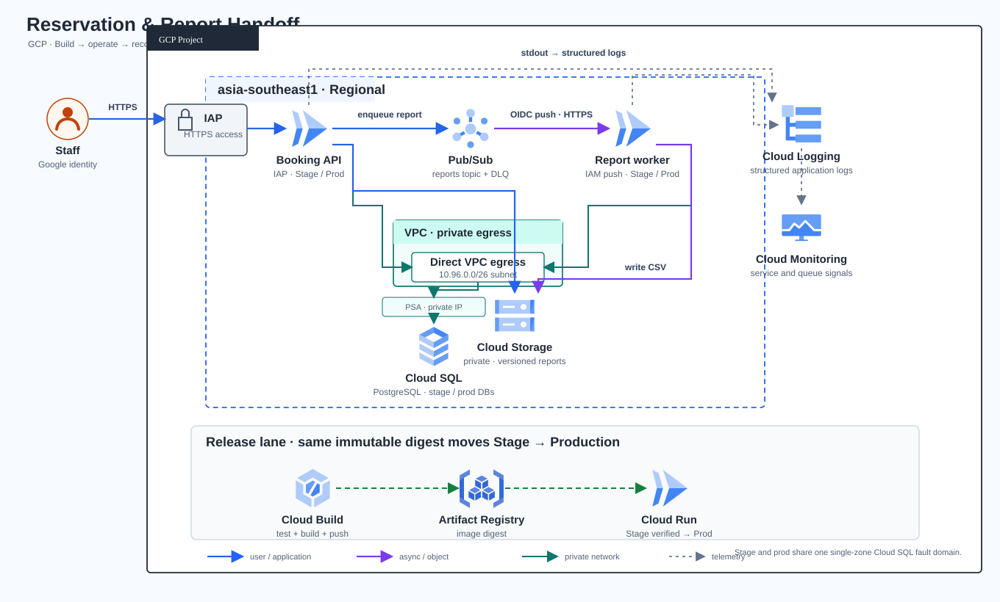

# Lab 20 — แพลตฟอร์มจองและสร้างรายงานแบบรับมอบงานได้

**สถานะคู่มือ:** Guide review pending  
**Cloud verification:** Not run  
**Region ตัวอย่าง:** asia-southeast1  
GitHub CI ตรวจ source/contract เท่านั้น ไม่สร้าง GCP resources. ผู้เรียนเลือกงบประมาณและรัน Cloud Lab ใน project แยกของตนเอง

## สรุปโจทย์

ทีม Cloud ต้องส่งมอบพอร์ทัลภายในสำหรับจองช่วงเวลารับคำปรึกษาและสร้างรายงาน CSV แบบ asynchronous พนักงานเข้าใช้ผ่าน Google identity และ Identity-Aware Proxy (IAP) ระบบต้องรับคำขอซ้ำได้โดยไม่จองซ้ำ จำกัดจำนวนที่นั่ง สร้างงานรายงานผ่าน Pub/Sub, เก็บรายงานใน Cloud Storage แบบ private และให้ผู้ขอโหลดผ่าน API หลังตรวจสิทธิ์แล้ว

ทีมต้องติดตั้ง Stage และ Production, ใช้ artifact digest เดียวกัน, แยก identity ของ API/Worker/Migrator, รับมือ worker ที่ล้มเหลว, กู้คืน object version, ทำ Change Request แบบ migration เพิ่มคอลัมน์ และส่งต่องานพร้อมหลักฐานและแผน rollback

ระบบนี้เป็นตัวอย่างระดับทีมขนาดเล็ก ไม่ได้อ้างว่าเป็น HA เต็มรูปแบบ: Stage และ Production แยกบริการ/ฐานข้อมูล/คิว/bucket แต่ใช้ Cloud SQL instance แบบ single-zone ร่วมกันเพื่อจำกัดค่าใช้จ่าย จึงมี shared fault domain ที่ต้องเปิดเผยใน handover

## Requirements

| ID | ความต้องการ | วิธีพิสูจน์ |
|---|---|---|
| R01 | ผู้ใช้ที่ไม่มี identity ที่ผ่าน IAP ห้ามเรียก API ได้ | เปิด URL แบบ private และตรวจ redirect/denial; ทดสอบ app identity check |
| R02 | ผู้ใช้จองได้เฉพาะช่วงที่ยังมีที่นั่ง | จองจนเต็มและยืนยันคำขอถัดไปได้ 409 slot_full |
| R03 | Idempotency key ของผู้ใช้เดิมต้องไม่สร้างรายการซ้ำ | replay key เดิม; ตรวจ booking ID และจำนวน booked |
| R04 | ผู้ใช้เห็น booking/report ของตนเองเท่านั้น | ทดลองเปิด report ID ของอีกบัญชีแล้วเห็น 404 |
| R05 | API/Worker เชื่อ Cloud SQL private IP ด้วย IAM DB auth | ตรวจ config, IAM DB user, Cloud Run VPC egress และ /healthz |
| R06 | API กับ Worker ใช้ฐานข้อมูล role แยกกัน | ตรวจ grants: API เขียน booking/queue; Worker อ่าน booking และอัปเดต report |
| R07 | API ส่งงานรายงานไป Pub/Sub; push ใช้ OIDC ไป Worker | ตรวจ push config และผล queued → ready |
| R08 | Worker สร้าง CSV เฉพาะวันที่ร้องขอ สูงสุด 5,000 แถว | ตรวจ CSV header/date และทดสอบขอบเขต 5,001 แถวใน code contract |
| R09 | ผู้ใช้ไม่มีสิทธิ์อ่าน bucket โดยตรง | ตรวจ bucket IAM; ดาวน์โหลดผ่าน endpoint ที่เช็กผู้ขอ |
| R10 | Pub/Sub retry มี DLQ และ redrive ที่จำกัดจำนวน | ส่ง fault แบบ 503 ใน Stage; ตรวจ DLQ; dry-run แล้ว redrive ไม่เกิน 5 |
| R11 | Cloud Storage ใช้ Uniform bucket access, public access prevention และ versioning | ตรวจ Console/gcloud storage buckets describe |
| R12 | Stage ผ่านก่อน Production; ใช้ image digest เดียวกัน | เก็บ digest และ deployment revision ของทั้งสอง environment |
| R13 | migration เพิ่ม column เป็น additive, tracked และทดสอบย้อนหลังได้ | ทดสอบ patch ใน disposable copy; migrate ก่อนเปลี่ยน application digest |
| R14 | มีหลักฐานการตรวจ, restore, rollback, cost review และ handover | บันทึก Actual/Evidence ราย Task; สรุปข้อจำกัดใน handover |
| R15 | Resource จำกัดขนาดเพื่อทดลองได้อย่างควบคุม | API max 2 instances, Worker max 3, DB single-zone, probe ไม่เกิน 30 requests |
| R16 | Log ไม่เก็บ email ผู้จองโดยตรง | ตรวจ JSON logs ว่าใช้ actor_hash; CSV ไม่มี email |

## Architecture และการตัดสินใจ

เปิด [SVG ต้นฉบับ](assets/solution.svg), [HTML preview](assets/solution.html) หรือดู [ที่มา style และ official icons](assets/diagram-provenance.json).

| ประเด็น | การตัดสินใจและผลแลกเปลี่ยน |
|---|---|
| ทางเข้า | Direct IAP บน Cloud Run API; Worker แยก service และรับเฉพาะ Pub/Sub push ที่มี OIDC token พร้อม roles/run.invoker |
| งานเบื้องหลัง | API บันทึก report_jobs แล้ว publish ไป Pub/Sub; Worker ทำ CSV และอัปเดตสถานะ |
| Database | PostgreSQL 16 private IP, Private Services Access, Direct VPC egress, Cloud SQL IAM authentication, API/Worker DB roles แยก |
| Stage/Prod | แยก database, Cloud Run service, topic/subscription, bucket และ runtime identity แต่ใช้ single-zone Cloud SQL instance ร่วมกัน; instance outage กระทบทั้งคู่ |
| Storage | Bucket private/versioned; Worker สร้าง object แบบ create-only; API proxy download หลังเช็ก ownership |
| Release | Cloud Build สร้าง image ที่ติด tag สำหรับค้นหา; Terraform deploy ด้วย sha256 digest; promote digest เดียวจาก Stage ไป Prod |
| Recovery | Pub/Sub retry + DLQ, bounded redrive, Cloud Storage object generation restore; Cloud SQL PITR เป็นแผนเสริมที่ต้องทำเป็น recovery candidate ก่อนเปิด traffic |
| Cost guard | เลือก DB tier หลังดูราคาใน region จริง, Cloud Run scale-to-zero/จำกัด max instances, probe มีเพดาน, ลบทรัพยากรหลังจบ |

### Access boundary

| Principal | สิทธิ์หลัก | สิ่งที่ไม่มี |
|---|---|---|
| ผู้ปฏิบัติงาน | Terraform/Cloud Build/IAP ใน Lab project ที่แยก | ไม่มีสิทธิ์แทน Production จริง |
| API service account | Cloud SQL Client/IAM DB user, Pub/Sub Publisher, อ่าน report objects | ไม่มีสิทธิ์เขียน bucket หรือรัน migration |
| Worker service account | Cloud SQL Client/IAM DB user, สร้าง/อ่าน report objects | ไม่มี Pub/Sub publish และไม่มี IAP |
| Pub/Sub push identity | Invoke Worker ผ่าน OIDC | ไม่มีสิทธิ์อ่าน DB หรือ bucket |
| Migrator | Cloud SQL admin เฉพาะ Lab instance เพื่อ apply schema | ไม่ถูกผูกกับบริการ API/Worker |
| Build service account | เขียน Artifact Registry และ Cloud Logging | ไม่มีสิทธิ์ deploy Runtime โดยตรง |

## ขอบเขตและความปลอดภัยก่อนเริ่ม

- ใช้ Google Cloud project ใหม่สำหรับ Lab นี้เท่านั้น ห้ามใช้ project บริษัท/Production หรือ project ที่มีข้อมูลจริง
- ตั้ง Budget และแจ้งเตือนใน Billing → Budgets & alerts ก่อนสร้าง resource; alert ไม่ใช่ hard spending cap ให้ตรวจ Billing report เองด้วย ไม่มีตัวเลขราคาแบบเหมารวมในคู่มือ เพราะราคาเปลี่ยนตาม region/tier/การใช้งาน
- Cloud SQL คิดค่าใช้จ่ายขณะ instance ยังอยู่ แม้ Cloud Run scale-to-zero; อย่าปล่อย Lab ค้าง
- ผู้ทำต้องมีสิทธิ์เปิด APIs, สร้าง IAM/service accounts, network/PSA, Cloud SQL, Cloud Run, Pub/Sub, Storage, Artifact Registry และ Cloud Build ใน Lab project; IAP บน project ที่ไม่มี Organization อาจต้องตั้งค่า OAuth ผ่าน Console ครั้งแรก
- Terraform state เก็บใน GCS bucket แยกจาก Lab resources; อย่า commit *.tfstate, *.tfplan, *.tfvars, token หรือไฟล์ config ที่มี secret
- Expected output เป็นตัวอย่าง; ไม่ถือ Expected เป็น PASS หรือ Cloud proof
- คู่มือใช้ Google Cloud Console ภาษาอังกฤษกับ Cloud Shell Bash เพื่อให้ชื่อเมนูและคำสั่งตรงกัน

## เตรียมใช้งาน

1. เปิด Google Cloud Console แล้วเลือก project สำหรับ Lab ใหม่; ตรวจว่ามี Billing account ผูกอยู่
2. สร้าง Budget ที่เหมาะกับตนเอง พร้อมแจ้งเตือน 50%, 80%, 100%
3. เปิด Cloud Shell จากไอคอน >_; ใช้ Cloud Shell เดียวตลอดช่วงทำ Lab
4. Clone branch ที่มี Lab 20 และเข้า directory

~~~bash
git clone --branch docs/gcp-solution-labs https://github.com/somkid-s5/Portfolio-Lab.git
cd Portfolio-Lab/GCP/LAB-020-reservation-handoff
gcloud auth list
gcloud config get-value account
terraform version
~~~

ถ้า repository ถูกตั้งเป็น private ให้ใช้ GitHub CLI ที่ลงชื่อเข้าใช้แล้วใน Cloud Shell; ห้ามวาง Personal Access Token ในคำสั่ง, README, shell history หรือภาพหลักฐาน

---

## คู่มือทำ Solution Lab

### Task T00 — กำหนดขอบเขต Lab และบันทึก starting point

ยืนยันว่าเลือก project ใหม่, Billing account ถูกต้อง และผู้ใช้ที่กำลังล็อกอินคือผู้ที่จะได้รับ IAP access. บันทึก project ID/region โดยไม่ใส่ข้อมูลบัญชี billing หรือ token ลง Repo. Diagram ใช้ Diagram Design Personal Custom จาก ZIP และ official Google Cloud service icons ตาม provenance.

**ผลที่คาดหวัง:** project แยกและ account ที่ถูกต้อง พร้อมมี Budget alert ก่อน provision.

**บันทึกจริง / หลักฐาน:** Project ID: ____ · Account alias (ไม่ใช่ secret): ____ · Budget thresholds: ____ · ภาพหน้า project selector/Budget ที่ปิดข้อมูล billing ID: ____

### Task T01 — ตรวจโจทย์และกำหนดเกณฑ์รับมอบ

อ่าน Requirements R01–R16 และ diagram. อธิบายเส้นทาง: Staff → IAP → API → Pub/Sub → Worker → private SQL/GCS. ระบุข้อจำกัดเรื่อง single-zone Cloud SQL instance ร่วมกัน และตกลงว่าจะทดสอบเฉพาะ Stage ก่อน promote.

**ผลที่คาดหวัง:** ผู้เรียนอธิบาย request, identity, data, failure และ restore flow ได้ โดยไม่สับสนว่า Worker อยู่หลัง IAP หรือไม่.

**บันทึกจริง / หลักฐาน:** ข้อกำหนดที่สำคัญที่สุด 3 ข้อ: ____ · shared fault domain: ____ · แผนพิสูจน์ acceptance: ____

### Task T02 — เลือก project, region, Budget และ state bucket

ใน Cloud Shell ตั้งค่าตัวแปร. ชื่อ bucket ต้อง unique ทั่วโลก. เปิด Storage API เพื่อ bootstrap state bucket; Foundation Terraform จะเปิด API อื่นที่ต้องใช้. Bucket นี้อยู่นอก Terraform state ของตัวเองและต้องเก็บไว้จน destroy state ทั้งหมดเสร็จ.

~~~bash
export PROJECT_ID="$(gcloud config get-value project)"
export REGION="asia-southeast1"
export OPERATOR_EMAIL="$(gcloud config get-value account)"
export OPERATOR_MEMBER="user:$OPERATOR_EMAIL"
export STATE_BUCKET="lab20-$PROJECT_ID-tfstate-$(date -u +%Y%m%d%H%M%S)"
test -n "$PROJECT_ID" && test -n "$OPERATOR_EMAIL"
gcloud services enable storage.googleapis.com --project="$PROJECT_ID"
gcloud storage buckets create "gs://$STATE_BUCKET" --project="$PROJECT_ID" --location="$REGION" --uniform-bucket-level-access --public-access-prevention
gcloud storage buckets update "gs://$STATE_BUCKET" --versioning
gcloud storage buckets describe "gs://$STATE_BUCKET" --format="yaml(name,location,versioning,iamConfiguration)"
~~~

เก็บ STATE_BUCKET ไว้ใน Cloud Shell session. ถ้า session หาย ให้อ่านชื่อจาก Cloud Storage Console แล้ว export กลับมา. State bucket มีค่าใช้จ่ายตามขนาด/operations และต้องลบหลัง cleanup.

**ผลที่คาดหวัง:** project/region ตรงกัน; uniformBucketLevelAccess=true, public access prevention enforced และ versioning เปิด.

**บันทึกจริง / หลักฐาน:** Project ID: ____ · Region: ____ · State bucket: ____ · Budget alert ถูกตั้ง: ____ · ผล bucket describe: ____

### Task T03 — ตรวจ tools และสร้าง remote Terraform state namespaces

จาก directory GCP/LAB-020-reservation-handoff, ตรวจ project และ tools อีกครั้ง. GCS backend ใช้ prefix แยก foundation/runtime; Runtime ใช้ workspaces stage/prod.

~~~bash
gcloud config set project "$PROJECT_ID"
gcloud config get-value project
terraform -chdir=infra/foundation init -backend-config="bucket=$STATE_BUCKET" -backend-config="prefix=lab20/foundation"
terraform -chdir=infra/runtime init -backend-config="bucket=$STATE_BUCKET" -backend-config="prefix=lab20/runtime"
~~~

**ผลที่คาดหวัง:** Terraform init สำเร็จและแสดง GCS backend; ยังไม่มี resource จาก Lab นี้.

**บันทึกจริง / หลักฐาน:** Terraform version: ____ · backend bucket/prefix: ____ · เวลาเริ่ม: ____

### Task T04 — วางแผนและสร้าง Foundation

เปิดอ่าน infra/foundation/main.tf. ตรวจ VPC/subnet/PSA range ว่าไม่ชน CIDR ใน project; Lab กำหนด subnet 10.96.0.0/26, PSA 10.96.16.0/20. ตรวจ DB tier กับราคา region ปัจจุบันก่อน apply. ค่าเริ่มต้นเป็น single-zone db-custom-1-3840; ปรับ tier ได้ในคำสั่ง แต่ต้องบันทึก.

~~~bash
terraform -chdir=infra/foundation plan -out=foundation.tfplan -var="project_id=$PROJECT_ID" -var="region=$REGION" -var="operator_member=$OPERATOR_MEMBER"
terraform -chdir=infra/foundation show foundation.tfplan
~~~

ถ้า plan ตรงกับ project และ resource inventory ให้ apply ด้วย plan ที่ตรวจแล้ว:

~~~bash
terraform -chdir=infra/foundation apply foundation.tfplan
terraform -chdir=infra/foundation output
gcloud sql instances describe lab20-postgres --project="$PROJECT_ID" --format="yaml(databaseVersion,region,settings.ipConfiguration.ipv4Enabled,settings.availabilityType)"
~~~

**ผลที่คาดหวัง:** private VPC + PSA, Cloud SQL PostgreSQL 16 ไม่มี public IPv4, databases lab20_stage/lab20_prod, Artifact Registry และ dedicated service accounts; database ยังเป็น single-zone.

**บันทึกจริง / หลักฐาน:** Plan reviewed โดย: ____ · Cloud SQL connection name: ____ · IPv4 enabled: ____ · DB tier/ราคาอ้างอิง ณ วันที่: ____ · resource/plan evidence: ____

### Task T05 — Build และ pin baseline image digest

Cloud Build ทำ unit checks แล้ว build image ไปยัง Artifact Registry. ใช้ tag แบบระบุเวลาเพื่อค้นหา image; deploy ด้วย digest เท่านั้น. ตั้ง custom build service account ที่ Foundation สร้างไว้.

~~~bash
export BUILD_TAG="baseline-$(date -u +%Y%m%dT%H%M%SZ)"
export BUILD_SA="lab20-build@$PROJECT_ID.iam.gserviceaccount.com"
gcloud builds submit --project="$PROJECT_ID" --region="$REGION" --config=cloudbuild.yaml --service-account="projects/$PROJECT_ID/serviceAccounts/$BUILD_SA" --substitutions="_REGION=$REGION,_REPOSITORY=lab20-apps,_IMAGE=reservation-handoff,_TAG=$BUILD_TAG" .
export BASELINE_IMAGE_URI="$REGION-docker.pkg.dev/$PROJECT_ID/lab20-apps/reservation-handoff"
export BASELINE_IMAGE_DIGEST="$(gcloud artifacts docker images describe "$BASELINE_IMAGE_URI:$BUILD_TAG" --project="$PROJECT_ID" --format='value(image_summary.digest)')"
printf 'baseline_digest=%s' "$BASELINE_IMAGE_DIGEST"
test "$(printf '%s' "$BASELINE_IMAGE_DIGEST" | cut -c1-7)" = "sha256:"
~~~

ห้ามบันทึก OAuth token, access token หรือ service account key. Digest ไม่ใช่ secret; จดเก็บไว้ในช่องหลักฐานและ shell variable.

**ผลที่คาดหวัง:** Build ผ่าน unit tests; Artifact Registry แสดง image ที่มี sha256 digest และ Cloud Build ใช้ CLOUD_LOGGING_ONLY.

**บันทึกจริง / หลักฐาน:** Build ID/URL: ____ · Tag: ____ · Baseline digest: ____ · Build result: ____ · image describe: ____

### Task T06 — สร้าง Stage runtime และ IAP ครั้งแรก

สร้าง workspace stage, plan ก่อน apply. รอบแรกตั้ง iap_enabled=false เพื่อให้ service ถูกสร้างแบบ Cloud Run IAM-only และไม่มี allUsers; IAP policy ยังไม่ถูก attach. หลัง service มีอยู่ ให้เปิด IAP ใน Console ก่อนครั้งแรก โดยเฉพาะ project ที่ไม่มี Organization เพราะ OAuth client setup ครั้งแรกทำผ่าน Console ได้ตรงกว่า. Service ยังไม่เปิด public access.

~~~bash
terraform -chdir=infra/runtime workspace new stage
terraform -chdir=infra/runtime plan -out=stage-initial.tfplan -var="project_id=$PROJECT_ID" -var="region=$REGION" -var="environment=stage" -var="image_digest=$BASELINE_IMAGE_DIGEST" -var="operator_member=$OPERATOR_MEMBER" -var="iap_enabled=false"
terraform -chdir=infra/runtime show stage-initial.tfplan
terraform -chdir=infra/runtime apply stage-initial.tfplan
terraform -chdir=infra/runtime output
~~~

Console: Cloud Run → Services → lab20-stage-portal → Security → Require authentication → Identity-Aware Proxy (IAP) → Save/Deploy. เพิ่ม user:อีเมลของคุณ ใน IAP policy. ถ้า project ไม่มี Organization และเป็นการเปิดครั้งแรก ให้ทำ Google Auth Platform/IAP setup ตาม Console; อย่าใส่ OAuth client secret ใน Git. เมื่อเปิด IAP จาก Console แล้ว ให้ Terraform รับ configuration กลับ:

~~~bash
terraform -chdir=infra/runtime plan -out=stage-iap.tfplan -var="project_id=$PROJECT_ID" -var="region=$REGION" -var="environment=stage" -var="image_digest=$BASELINE_IMAGE_DIGEST" -var="operator_member=$OPERATOR_MEMBER" -var="iap_enabled=true"
terraform -chdir=infra/runtime show stage-iap.tfplan
terraform -chdir=infra/runtime apply stage-iap.tfplan
gcloud run services describe lab20-stage-portal --project="$PROJECT_ID" --region="$REGION" --format="yaml(metadata.name,status.url,spec.template.metadata.annotations)"
~~~

หาก Console สร้าง IAP client/policy สำเร็จแต่ Terraform รายงาน conflict ให้ตรวจ Cloud Run → Security และ terraform plan ก่อน ห้ามแก้ด้วย allUsers; หาก apply แรกติด OAuth setup ให้ทำ Console setup ให้เสร็จก่อนแล้วค่อย apply iap_enabled=true.

**ผลที่คาดหวัง:** Stage API เปิดผ่าน IAP, ไม่มี allUsers; Worker/Job มี IAM invoker ปิดสาธารณะ; API/Worker max instances ถูกจำกัด.

**บันทึกจริง / หลักฐาน:** Stage API URL (URL ไม่ใช่ secret): ____ · IAP enabled: ____ · IAP policy member: ____ · Terraform revision: ____ · IAP first-time setup path: ____

### Task T07 — Apply schema แยก API/Worker database roles

เรียก Cloud Run Job ของ Migrator หลัง service identities และ databases พร้อม. Job เชื่อม Cloud SQL ผ่าน private egress, ใช้ Cloud SQL IAM authentication และสร้าง schema/seed แบบ tracked; Migrator เท่านั้นที่มี cloudsqlsuperuser. ตรวจ log ของ Job แทนการเชื่อเพียง exit code.

~~~bash
gcloud run jobs execute lab20-stage-migrate --project="$PROJECT_ID" --region="$REGION" --wait
gcloud run jobs executions list --job=lab20-stage-migrate --project="$PROJECT_ID" --region="$REGION" --limit=3
~~~

เปิด Execution → Logs หรือใช้ Logs Explorer filter resource.type="cloud_run_job" และค้น migration_status=applied. API role ต้อง update slot counter; Worker อ่าน booking rows และ update report_jobs เท่านั้น.

**ผลที่คาดหวัง:** Log แสดง migration_status=applied database=lab20_stage versions=001_initial; Job สำเร็จ; schema มีตาราง slots, bookings, report_jobs, schema_migrations.

**บันทึกจริง / หลักฐาน:** Execution name: ____ · migration versions: ____ · Job status: ____ · API/Worker role check: ____

### Task T08 — ยืนยัน IAP และ readiness

เปิด api_url จาก output ใน browser ที่ลงชื่อเข้าใช้ account ที่ได้รับ IAP. ตรวจหน้า portal และลอง URL เดิมใน browser profile ที่ไม่มี access หากมีบัญชีทดสอบที่ได้รับอนุมัติ. เรียก /healthz ผ่าน browser หลัง IAP; /livez เป็น liveness check ภายใน container แต่ Cloud Run IAP ยังปกป้อง ingress ทั้ง service.

**ผลที่คาดหวัง:** ผู้มี IAP access เห็นหน้าเว็บ; ผู้ไม่มีสิทธิ์ถูก redirect/denied ก่อนถึง app; /healthz แสดง {"ready":true,"environment":"stage"}.

**บันทึกจริง / หลักฐาน:** Browser/account alias: ____ · ผล unauthorized: ____ · health response: ____ · X-Request-ID ตัวอย่าง: ____

### Task T09 — ทดสอบจอง, replay, cancel และ privacy

ในหน้าเว็บจองช่วงเวลาหนึ่งครั้ง; รีเฟรชหน้าแล้วดูว่าจำนวนที่นั่งเพิ่มหนึ่ง. API ใช้ Idempotency-Key; UI สร้าง key ใหม่ต่อการคลิก. ทดสอบ key เดิมด้วย DevTools/curl เฉพาะเมื่อมี bearer credential ที่ IAP รองรับ; ห้ามพิมพ์ token ลง shell output. ทดสอบ cancel แล้วดูว่า capacity กลับมา. สำหรับ request ซ้ำที่ key เดิมแต่ slot ต่างกัน คาดหวัง 409 idempotency_key_conflict.

ตรวจ JSON logs ของ API: ควรมี actor_hash, request_id, path, status, revision และ duration; ต้องไม่มี email ของ actor.

**ผลที่คาดหวัง:** booking หนึ่งรายการต่อ actor/key; slot เต็มตอบ 409 slot_full; ผู้ใช้คนอื่นดู/ยกเลิก booking ไม่ได้; logs ไม่เปิดเผย email.

**บันทึกจริง / หลักฐาน:** booking ID (เก็บเฉพาะใน record ส่วนตัว): ____ · replay response: ____ · cancel/capacity: ____ · actor_hash present: ____ · raw email absent: ____

### Task T10 — สร้างรายงานแบบ asynchronous

เลือกวันที่ UTC แล้วส่งคำขอจากหน้าเว็บ. API ตอบรับ 202 queued; Pub/Sub push ที่ใช้ OIDC ส่ง event ไป Worker. Worker จำกัด 5,000 booking rows ต่อรายงาน, query เฉพาะวันที่, เขียน CSV create-only ไปยัง bucket private และตั้ง report เป็น ready. UI poll status ไม่เกิน 30 รอบ; ดาวน์โหลดผ่าน API ซึ่งตรวจ requested_by ก่อนอ่าน bucket.

**ผลที่คาดหวัง:** สถานะเปลี่ยน queued → ready; CSV header คือ booking_id,slot_id,status,created_at; ไม่มีอีเมลผู้จองใน CSV; ผู้ใช้คนอื่นได้รับ 404 report_not_found.

**บันทึกจริง / หลักฐาน:** Report ID: ____ · queued time: ____ · ready time: ____ · object name/generation: ____ · header/row count: ____ · denied cross-user: ____

### Task T11 — ตรวจ IAM และ network boundary

Console: IAM & Admin → IAM ตรวจ service accounts. Cloud Run → Services → lab20-stage-portal / lab20-stage-report-worker → Security ตรวจ service identities และ invoker. Cloud SQL → lab20-postgres → Connections ตรวจ private IP only และ VPC. Cloud Storage → Buckets → stage bucket → Permissions/Configuration ตรวจไม่มี public principal, Uniform access, public access prevention, versioning. ตรวจว่าไม่มีสิทธิ์ผู้ใช้ใน bucket สำหรับดาวน์โหลดรายงาน.

~~~bash
gcloud run services get-iam-policy lab20-stage-portal --project="$PROJECT_ID" --region="$REGION"
gcloud run services get-iam-policy lab20-stage-report-worker --project="$PROJECT_ID" --region="$REGION"
gcloud storage buckets describe "gs://lab20-$PROJECT_ID-stage-reports" --project="$PROJECT_ID"
gcloud sql instances describe lab20-postgres --project="$PROJECT_ID" --format="yaml(settings.ipConfiguration.ipv4Enabled,settings.ipConfiguration.privateNetwork,settings.ipConfiguration.sslMode)"
~~~

**ผลที่คาดหวัง:** API มี IAP access principal; Worker มี Pub/Sub push SA เป็น invoker; ไม่มี allUsers; bucket private; Cloud SQL ไม่มี public IPv4 และเปิด TLS.

**บันทึกจริง / หลักฐาน:** API IAP policy: ____ · Worker invoker: ____ · bucket controls: ____ · DB private/TLS: ____ · policy evidence: ____

### Task T12 — ดู Logs, metrics และเก็บ bounded probe

Logs Explorer ใช้ resource type Cloud Run Revision; filter service lab20-stage-portal และ lab20-stage-report-worker. ค้น event=http_request, event=report_ready, event=report_retryable_error และผูก request/report ID ระหว่างระบบ. ใน Cloud Run → Service → Metrics ดู request count, latency, instance count. ใน Pub/Sub → Subscription → Monitoring ดู backlog/oldest unacked age; ใน Cloud SQL → Insights/Monitoring ดู CPU, connections, storage. เก็บค่าที่ Console แสดงจริง ณ เวลาเก็บ; คู่มือนี้ไม่ได้กำหนด latency target หรืออ้าง load-test result.

ถ้าตั้งค่า OAuth client แบบอนุญาต programmatic IAP access ไว้แล้ว จึงเรียก bounded probe ด้วย bearer credential ที่ IAP รองรับ; ถ้ายังใช้ Google-managed OAuth client ให้ใช้ browser flow และบันทึกว่า probe แบบ script ไม่ได้รัน. ห้ามใช้ gcloud auth print-identity-token แทน IAP OAuth token โดยไม่ตรวจ audience/client config.

~~~bash
python scripts/bounded_probe.py --url "$STAGE_API_URL" --token "$IAP_BEARER_TOKEN" --count 10
~~~

Script รับ 1–30 requests, เป็น sequential GET /api/slots, ไม่ส่ง booking/report และไม่ใช่ load test.

**ผลที่คาดหวัง:** Logs correlate ด้วย request/report ID; dashboard แสดง metric ของ Stage; probe ถ้ารันสำเร็จแสดง successful count, p50/p95 จาก sample จริงเท่านั้น.

**บันทึกจริง / หลักฐาน:** Log filter/time range: ____ · Cloud Run requests/latency: ____ · Pub/Sub backlog: ____ · SQL metrics: ____ · probe count/results หรือ Not run: ____

### Task T13 — ฝึก Pub/Sub retry และ DLQ แบบจำกัด

ใช้เฉพาะ Stage. เปิด infra/runtime/main.tf; plan worker_fault_mode=503 แล้ว apply. สร้าง report 1 รายการผ่านหน้าเว็บ. Worker ตอบ 503 อย่างตั้งใจ ทำให้ Pub/Sub retry ตาม backoff และหลังจำนวนส่งซ้ำสูงสุดอาจส่งเข้า DLQ. นโยบาย delivery attempts ของ Pub/Sub เป็นกลไกส่งซ้ำ ไม่ใช่นาฬิกาเที่ยงตรง; รอและดู subscription metrics/log ก่อน redrive.

~~~bash
terraform -chdir=infra/runtime plan -out=stage-fault.tfplan -var="project_id=$PROJECT_ID" -var="region=$REGION" -var="environment=stage" -var="image_digest=$BASELINE_IMAGE_DIGEST" -var="operator_member=$OPERATOR_MEMBER" -var="iap_enabled=true" -var="worker_fault_mode=503"
terraform -chdir=infra/runtime show stage-fault.tfplan
terraform -chdir=infra/runtime apply stage-fault.tfplan
~~~

ตรวจ DLQ ด้วย Console หรือ script แบบ dry-run; ระบุ project, subscription DLQ และ topic หลัก:

~~~bash
python -m pip install --disable-pip-version-check -r app/requirements.txt
python scripts/redrive_dlq.py --project "$PROJECT_ID" --subscription lab20-stage-reports-dlq-pull --topic lab20-stage-reports --max-messages 5 --dry-run
~~~

คืน Worker เป็นปกติก่อน redrive. Apply กลับ worker_fault_mode=none; จากนั้น redrive โดยไม่ใส่ --dry-run. Script publish สำเร็จก่อน ack และอ่านไม่เกิน 5 messages. ถ้ามี malformed message จะไม่ ack message นั้น.

~~~bash
terraform -chdir=infra/runtime plan -out=stage-recovered.tfplan -var="project_id=$PROJECT_ID" -var="region=$REGION" -var="environment=stage" -var="image_digest=$BASELINE_IMAGE_DIGEST" -var="operator_member=$OPERATOR_MEMBER" -var="iap_enabled=true" -var="worker_fault_mode=none"
terraform -chdir=infra/runtime show stage-recovered.tfplan
terraform -chdir=infra/runtime apply stage-recovered.tfplan
python scripts/redrive_dlq.py --project "$PROJECT_ID" --subscription lab20-stage-reports-dlq-pull --topic lab20-stage-reports --max-messages 5
~~~

**ผลที่คาดหวัง:** Worker log แสดง fault 503; message เข้า DLQ ตาม retry policy; dry-run แสดง candidate โดยไม่ ack; หลังกลับสู่ none, redrive ถูกจำกัด 5 และรายงานกลับ ready.

**บันทึกจริง / หลักฐาน:** Report ID: ____ · worker 503 log: ____ · DLQ message ID/count: ____ · dry-run output: ____ · redrive result: ____ · final report status: ____

### Task T14 — กู้คืน Cloud Storage object generation

สร้าง report ที่เสร็จแล้วและจด object generation ปัจจุบัน. ใน Cloud Storage version history หา noncurrent generation ที่ต้องการคืน. Script แสดงแผนโดย default; --apply จะคัดลอก bytes ของ generation ที่เลือกเป็น version ใหม่ของ object เดิม โดยใช้ generation precondition กับ live version ปัจจุบัน และปฏิเสธไฟล์เกิน 5 MiB. ใช้กับ report ทดสอบใน Stage เท่านั้น.

~~~bash
export REPORT_BUCKET="lab20-$PROJECT_ID-stage-reports"
export REPORT_OBJECT="stage/reports/ใส่-report-id.csv"
gcloud storage ls --all-versions "gs://$REPORT_BUCKET/$REPORT_OBJECT"
python scripts/restore_object_generation.py --bucket "$REPORT_BUCKET" --object "$REPORT_OBJECT" --source-generation ใส่_GENERATION
~~~

หลังตรวจ source/current generation กับ report ID แล้วจึง run แบบ apply:

~~~bash
python scripts/restore_object_generation.py --bucket "$REPORT_BUCKET" --object "$REPORT_OBJECT" --source-generation ใส่_GENERATION --apply
gcloud storage ls --all-versions "gs://$REPORT_BUCKET/$REPORT_OBJECT"
~~~

ผล restore เป็น generation ใหม่ ไม่ได้ย้อนเลข generation เดิม. ยืนยันเนื้อหา CSV ผ่าน portal/download API และบันทึก checksum ที่คำนวณจากไฟล์ทดสอบ. Cloud SQL PITR เป็นส่วนขยาย: restore ไปยัง instance/database candidate แยก, เปรียบเทียบ integrity และทดสอบแอปก่อนเปลี่ยน traffic; อย่า restore ทับ Production ใน Lab นี้.

**ผลที่คาดหวัง:** dry-run ไม่แก้ object; apply สร้าง generation ใหม่ด้วย bytes จาก source version; generation ที่ใช้เป็น source ยังคงอยู่จน lifecycle/delete; download ผ่าน API ได้.

**บันทึกจริง / หลักฐาน:** object: ____ · source generation: ____ · current generation ก่อน/หลัง: ____ / ____ · checksum: ____ · download verified: ____ · Cloud SQL PITR ทำ/ไม่ทำ: ____

### Task T15 — Promote baseline digest ไป Production

หลัง Stage ผ่าน booking, report, IAM, retry/recovery และ acceptance แล้ว ให้เลือก workspace prod. สร้าง production runtime ด้วย baseline digest เดิม; iap_enabled=false ใน first creation, ทำ IAP setup ใน Console, grant ผู้ปฏิบัติงาน แล้ว plan/apply iap_enabled=true. รัน Production Migrator ก่อนเปิดใช้งาน application data. คำว่า Prod ในที่นี้หมายถึง environment แยกภายใน Lab project ไม่ใช่ Production จริงขององค์กร.

~~~bash
terraform -chdir=infra/runtime workspace new prod
terraform -chdir=infra/runtime plan -out=prod-initial.tfplan -var="project_id=$PROJECT_ID" -var="region=$REGION" -var="environment=prod" -var="image_digest=$BASELINE_IMAGE_DIGEST" -var="operator_member=$OPERATOR_MEMBER" -var="iap_enabled=false"
terraform -chdir=infra/runtime show prod-initial.tfplan
terraform -chdir=infra/runtime apply prod-initial.tfplan
~~~

ทำ IAP Console setup สำหรับ lab20-prod-portal, จากนั้น:

~~~bash
terraform -chdir=infra/runtime plan -out=prod-iap.tfplan -var="project_id=$PROJECT_ID" -var="region=$REGION" -var="environment=prod" -var="image_digest=$BASELINE_IMAGE_DIGEST" -var="operator_member=$OPERATOR_MEMBER" -var="iap_enabled=true"
terraform -chdir=infra/runtime show prod-iap.tfplan
terraform -chdir=infra/runtime apply prod-iap.tfplan
gcloud run jobs execute lab20-prod-migrate --project="$PROJECT_ID" --region="$REGION" --wait
~~~

เปรียบเทียบ outputs/digest, services, database, bucket, topic และ IAP access ของ Stage/Prod. ใช้ gcloud run services describe ตรวจ image ที่ deploy ได้; อย่าใช้ tag เป็นหลักฐาน digest.

**ผลที่คาดหวัง:** Prod runtime และ schema พร้อม; baseline digest ที่ deploy ใน Stage และ Prod ตรงกัน; environments และ identities แยกจากกัน.

**บันทึกจริง / หลักฐาน:** Stage digest: ____ · Prod digest: ____ · same digest: ____ · Prod IAP: ____ · migration execution: ____ · authorized smoke check: ____

### Task T16 — Change Request CR-20-01: เพิ่มช่องทางรับจอง

ทีม Support ต้องสร้างการจองแทนผู้ใช้ผ่านช่อง booking_source (portal หรือ support_desk) และต้องปรากฏในรายงาน CSV. ห้ามเปลี่ยน contract เดิมของ portal: เมื่อไม่ส่ง field ให้ default เป็น portal. Schema change ต้อง additive และ migrate ก่อนเลื่อน application image.

เริ่ม branch แยกจาก baseline guide branch; ติดตั้ง dependencies ตาม README. จาก repository root:

~~~bash
git switch -c cr20-01-booking-source
git apply --check GCP/LAB-020-reservation-handoff/change-requests/CR-20-01-booking-source.patch
git apply GCP/LAB-020-reservation-handoff/change-requests/CR-20-01-booking-source.patch
python -m unittest discover -s GCP/LAB-020-reservation-handoff/tests -p 'test_release.py' -v
~~~

test_release.py สร้าง disposable copy, apply patch และรัน regression suite; ไม่แก้ baseline evidence. Build candidate จาก source ที่มี patch โดยใช้ build command ใน T05 และตั้ง tag cr20-01-...; จด CR_IMAGE_DIGEST. ทดสอบ Stage schema ก่อน application deploy: ใช้ runtime workspace stage, คง image_digest=$BASELINE_IMAGE_DIGEST (API ยังเป็น baseline), ตั้ง migration_image_digest=$CR_IMAGE_DIGEST, plan/apply เพื่อเปลี่ยนเฉพาะ Migrator job แล้ว execute lab20-stage-migrate. เมื่อ migration ผ่าน จึง apply Stage services ด้วย image_digest=$CR_IMAGE_DIGEST และ migration_image_digest=$CR_IMAGE_DIGEST. ทดสอบ API ปกติ default portal, Support Desk support_desk, invalid source ถูก reject, export CSV มีคอลัมน์ใหม่.

ถ้า release มีปัญหา ให้ rollback app ไป BASELINE_IMAGE_DIGEST; additive column คงอยู่และ baseline app ไม่อ่าน column นี้. ห้ามลบ column ขณะมี app รุ่น CR ทำงาน. เมื่อ Stage ผ่าน ให้ migrate Prod ด้วยลำดับเดียวกัน: เปลี่ยน migration_image_digest เป็น CR ก่อน แต่คง production image_digest baseline, run Job, จากนั้น promote CR digest ไป Prod. Production ใน Lab ยังเป็น project แยก ไม่ใช้ระบบจริง.

**ผลที่คาดหวัง:** patch apply ได้, migration 002 ถูก track, baseline app ใช้ได้หลัง migration, CR app รับค่าใหม่และสร้าง report CSV มี booking_source; invalid value ตอบ 400; Prod ได้ CR digest เดียวกับ Stage หลัง Stage acceptance.

**บันทึกจริง / หลักฐาน:** CR branch: ____ · regression result: ____ · baseline digest: ____ · CR digest: ____ · Stage migration/app digest: ____ · Prod migration/app digest: ____ · rollback decision: ____

### Task T17 — Handover, evidence pack และ cleanup

เขียน handover สั้น ๆ: service diagram, URLs/resource IDs (ไม่ใช่ token), identities/permissions, database fault-domain, image digests, latest schema version, recovery runbook, known issue, rollback, cost owner และหลักฐานที่ยังไม่มี. เก็บเฉพาะ synthetic evidence. Cloud verification ยังคง Not run จนกว่าจะมี actual Cloud execution ที่ผู้เรียนบันทึกเอง.

ก่อน destroy: หยุดเรียกบริการ, บันทึก Evidence, จด bucket names, image digests และ Terraform workspace. ลบ object versions ใน report buckets ก่อน เพราะ Terraform กำหนด force_destroy=false. --recursive กับ bucket URL จะลบ bucket ด้วย; ใช้ --all-versions กับ object wildcard เพื่อให้ Terraform ลบ bucket ได้ตาม state.

~~~bash
gcloud storage rm --all-versions "gs://lab20-$PROJECT_ID-stage-reports/**"
gcloud storage rm --all-versions "gs://lab20-$PROJECT_ID-prod-reports/**"
gcloud artifacts docker images list "$REGION-docker.pkg.dev/$PROJECT_ID/lab20-apps/reservation-handoff" --include-tags
~~~

ลบ image digests ที่ Lab สร้างด้วยตนเอง/ตรวจรายการก่อนทุกครั้ง:

~~~bash
gcloud artifacts docker images delete "$REGION-docker.pkg.dev/$PROJECT_ID/lab20-apps/reservation-handoff@$BASELINE_IMAGE_DIGEST" --delete-tags --quiet
gcloud artifacts docker images delete "$REGION-docker.pkg.dev/$PROJECT_ID/lab20-apps/reservation-handoff@$CR_IMAGE_DIGEST" --delete-tags --quiet
terraform -chdir=infra/runtime workspace select prod
terraform -chdir=infra/runtime destroy -var="project_id=$PROJECT_ID" -var="region=$REGION" -var="environment=prod" -var="image_digest=$CR_IMAGE_DIGEST" -var="migration_image_digest=$CR_IMAGE_DIGEST" -var="operator_member=$OPERATOR_MEMBER" -var="iap_enabled=true"
terraform -chdir=infra/runtime workspace select stage
terraform -chdir=infra/runtime destroy -var="project_id=$PROJECT_ID" -var="region=$REGION" -var="environment=stage" -var="image_digest=$CR_IMAGE_DIGEST" -var="migration_image_digest=$CR_IMAGE_DIGEST" -var="operator_member=$OPERATOR_MEMBER" -var="iap_enabled=true"
terraform -chdir=infra/foundation destroy -var="project_id=$PROJECT_ID" -var="region=$REGION" -var="operator_member=$OPERATOR_MEMBER"
~~~

Review each destroy plan carefully. Foundation destroy removes the shared SQL instance and networks after both Runtime workspaces are empty. After confirming the exact bucket name, run gcloud storage rm --recursive "gs://$STATE_BUCKET/"; this deletes the bucket and every object generation. Do this last because it permanently removes remote Terraform state. State bucket ต้องเป็นขั้นตอนสุดท้าย เพราะการลบจะลบ remote state อย่างถาวร. หาก resource คงเหลือ ให้ตรวจ Terraform state และ Console ก่อน; อย่า issue broad project-wide deletes.

**ผลที่คาดหวัง:** services and database removed, report/artifact objects cleared, state bucket deleted last, no Lab resources remain; evidence and cost notes retainedนอก Cloud account โดยไม่มี secrets.

**บันทึกจริง / หลักฐาน:** Handover recipient/role: ____ · remaining risks: ____ · Stage/Prod destroyed: ____ · SQL deleted: ____ · state bucket removed last: ____ · cleanup completion time: ____

## Troubleshooting ที่เริ่มจากอาการ

| อาการ | ตรวจตามลำดับ | วิธีแก้/จุดหยุด |
|---|---|---|
| Terraform init เข้า GCS ไม่ได้ | project, STATE_BUCKET, Storage API, bucket IAM และ Cloud Shell account | เพิ่มสิทธิ์เฉพาะที่จำเป็น; ห้ามเปลี่ยนกลับไป local state แล้วลบ Cloud Shell |
| Foundation plan ติด CIDR/PSA | VPC range ซ้ำหรือ Service Networking API ยังไม่พร้อม | เลือก CIDR ว่างใน Lab-only project แล้ว plan ใหม่; อย่า apply plan เก่า |
| Cloud SQL รอเกินคาด | SQL Admin API, Service Networking connection, region/tier quota และ operation ใน SQL Console | รอ operation จบ; ห้ามสร้าง instance ซ้ำชื่ออื่นโดยไม่แก้ Terraform state |
| Migration ต่อ DB ไม่ได้ | Job logs → service account roles cloudsql.client/cloudsql.instanceUser → IAM DB username → VPC subnet/PSA | อย่าเพิ่ม public IP เป็น workaround; แก้ private path/identity แล้ว execute Job อีกครั้ง |
| IAP 403/redirect loop | IAP enabled, IAP user policy, OAuth Audience/brand, correct browser Google account, IAP service agent run.invoker | ใช้ Console first-time setup; อย่า grant allUsers หรือปิด invoker IAM |
| Pub/Sub push 401/403 | push OIDC service account, audience, Worker roles/run.invoker, push service agent token creator | ตรวจ Pub/Sub delivery logs; ห้ามเปิด Worker ให้ unauthenticated |
| Report ค้าง queued | API publish error → subscription delivery/backlog → Worker logs → Cloud SQL/bucket IAM | ตรวจ report_publish_failed, report_retryable_error, DLQ; อย่า mark ready ด้วยมือ |
| Report failed row limit | date-specific rows มากกว่า 5,000 | แบ่ง report/date หรือเพิ่ม controlled design ใน CR; อย่าลบ bound เพื่อให้ผ่าน |
| Bucket delete ติด | มี live หรือ noncurrent object generation | list --all-versions, ลบเฉพาะ Lab bucketหลังเก็บหลักฐาน, retry Terraform destroy |
| Terraform drift หลัง Console IAP | ตรวจ plan และ IAP policy; Console มี setup ครั้งแรก | Apply iap_enabled=true เพื่อ align; ไม่แก้ state ด้วยมือถ้าไม่ทราบ resource address |

## Change Request acceptance record

- [ ] Schema migration มี version และ additive change
- [ ] Existing portal request default เป็น portal
- [ ] support_desk ยอมรับได้และ invalid source ถูกปฏิเสธ
- [ ] CSV column order ตรง contract ที่บันทึก
- [ ] Migration Job ใช้ CR image ก่อน service image
- [ ] Stage acceptance ผ่านก่อน promote digest เดียวไป Prod
- [ ] Rollback กลับ baseline digest ได้โดย schema ใหม่ยังคงอยู่
- [ ] Evidence แยก Expected, Actual, GitHub CI และ Cloud verification

## Portfolio case-study summary — เติมจากผลที่ทำจริง

**สถานการณ์:** ทีม Cloud ต้องรับมอบ internal booking/report service ที่มี async processing และส่งต่อให้ผู้ดูแลทีมอื่น  
**หน้าที่ของฉัน:** ____  
**การตัดสินใจด้านสถาปัตยกรรม:** ____  
**สิ่งที่สร้าง/เปลี่ยน:** ____  
**Failure ที่ทดสอบและการกู้คืน:** ____  
**ผลที่วัดจริงและช่วงเวลาวัด:** ____  
**ข้อแลกเปลี่ยน/ความเสี่ยงที่ยอมรับ:** Stage/Prod ใช้ Cloud SQL single-zone instance ร่วมกัน; ____  
**หลักฐานแนบ:** diagram, sanitized plan/apply summary, revision/digest, logs, report test, DLQ test, object generation recovery, cleanup inventory  
**สถานะหลักฐาน Cloud:** Not run จนกว่าผู้เรียนจะรันและบันทึก Actual ของตนเอง

## References

- [Configure IAP for Cloud Run](https://docs.cloud.google.com/run/docs/securing/identity-aware-proxy-cloud-run)
- [IAP programmatic authentication](https://docs.cloud.google.com/iap/docs/authentication-howto)
- [Connect from Cloud Run to Cloud SQL for PostgreSQL](https://docs.cloud.google.com/sql/docs/postgres/connect-run)
- [Cloud SQL private IP](https://docs.cloud.google.com/sql/docs/postgres/private-ip)
- [Cloud SQL IAM database users](https://docs.cloud.google.com/sql/docs/postgres/add-manage-iam-users)
- [Cloud SQL point-in-time recovery](https://docs.cloud.google.com/sql/docs/postgres/backup-recovery/restore)
- [Authenticated Pub/Sub push](https://docs.cloud.google.com/pubsub/docs/authenticate-push-subscriptions)
- [Pub/Sub push retry and delivery attempts](https://docs.cloud.google.com/pubsub/docs/push)
- [Cloud Storage versioned object restore](https://docs.cloud.google.com/storage/docs/using-versioned-objects)
- [Cloud Storage request preconditions](https://docs.cloud.google.com/storage/docs/request-preconditions)
- [Cloud Build user-specified service accounts](https://docs.cloud.google.com/build/docs/securing-builds/configure-user-specified-service-accounts)
- [Cloud Run Direct VPC egress](https://docs.cloud.google.com/run/docs/configuring/vpc-direct-vpc)
- [Terraform Google provider — Cloud Run v2 service](https://registry.terraform.io/providers/hashicorp/google/latest/docs/resources/cloud_run_v2_service)
- [Terraform GCS backend](https://developer.hashicorp.com/terraform/language/backend/gcs)
